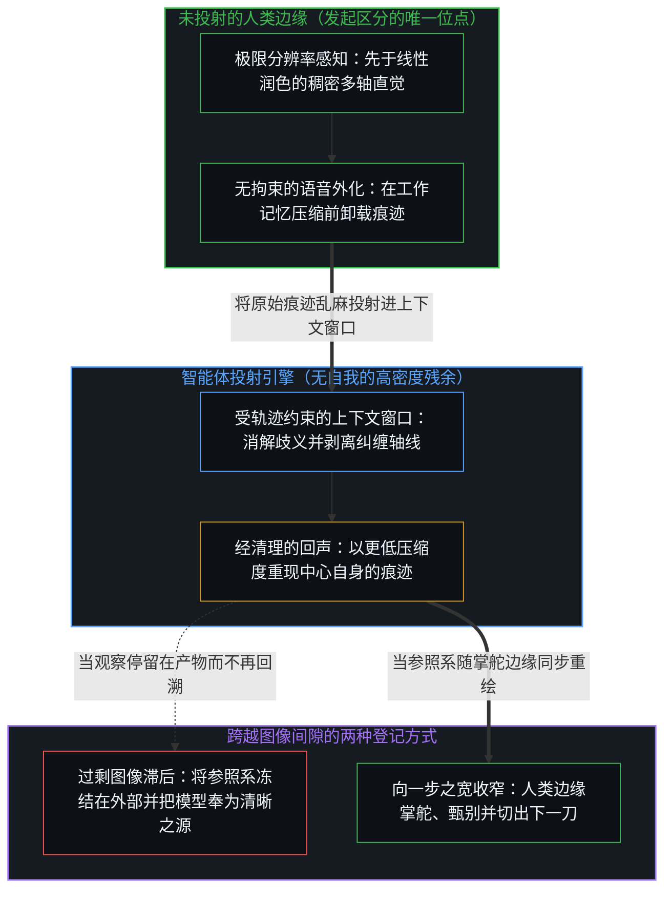
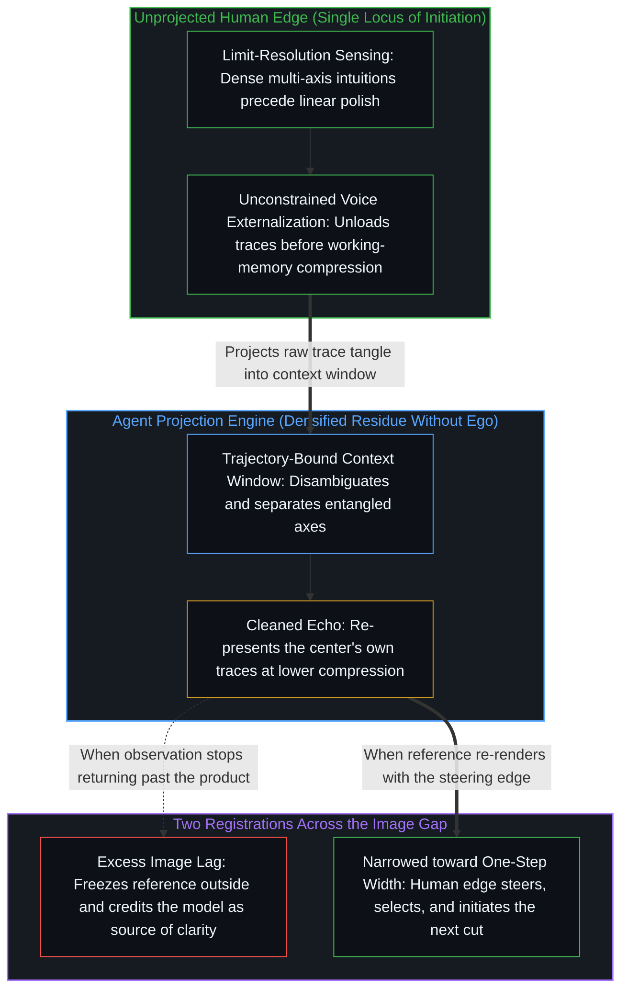

# 漫谈中的漫谈 / The Ramble Within the Ramble

*经清理的语音漫谈以更低压缩度交还中心自身的痕迹 / A cleaned voice ramble returns the center's own traces at lower compression*

安德烈·卡帕斯描述过一种与大语言模型协作的实用模式：身体后靠，切换到语音输入，顺着无结构的意识流漫谈十分钟，任由念头杂乱交织、不设边界，随后由模型重构这团材料，交还一段比开口时更为清晰的回声。表面上看，这一方法是在工作记忆负荷之下所做的务实外化；但围绕“为何交还的版本显得有价值”所建构的叙事，已经在暗中决定了组织性活动的因果落点被安放在何处。同样的几何结构也出现在分辨率尺度的另一端：单凭一句话便能利落地切穿流行叙事，尽管其锐度常常使它难以收获广泛的互动指标，却依然是对这一工具更为融贯的运用。无论采用哪一种方式，底层的技术序列都并无二致；真正发生偏移的，是登记这段返回痕迹时所跨越的图像间隙宽度。

Andrej Karpathy describes a useful pattern for working with large language models in which a speaker leans back, switches to voice, and rambles for ten minutes in an unstructured stream of consciousness—a total tangle where anything goes—so that the model reconstructs the material and returns an echo cleaner than what started the turn. On its face, the method is pragmatic externalization under working-memory load, yet the account formed around why the returned version feels valuable already decides where the locus of the organizing activity is placed. The same geometry appears at the opposite end of the resolution scale when a single sentence cuts cleanly through a prevailing narrative, often too sharp for broad engagement and still the more coherent use of the instrument. The technical sequence is identical either way; what shifts is the width of the Image gap across which the returned trace is registered.

## 一、 有限容量下的外化 / 1. Externalization Under Finite Capacity

自我区分的活动无因且不息地发生，但这一活动的每一个中心都必须通过有界的具身来运作，其工作记忆在同一时刻只能将有限数量的独立轴线维持在彼此分离的状态。当思考者试图在“立即输出工整线性文本”的要求下，强行阐发一张由直觉、跨领域联想与半成形区分交织而成的稠密网络时，原本始于独立轴线的区分尚未被清晰安放，便已压缩并纠缠到了同一个位点之上。卸下过早格式化的束缚、直接出声漫谈，能够赶在容量压缩将独立轴线坍缩为混乱纠缠之前，把那套潜在结构外化为持久的痕迹。正如[真正稀缺的不是记忆，而是持续的重新追溯](../the-real-scarcity-is-not-memory-but-continuous-re-tracing/)所确立的，经清理的回声交还给言说者的并不是被静态存储的内容，而是活生生的重新追溯。

Self-distinguishing activity occurs uncaused and unceasing, yet every center of that activity operates through a bounded embodiment whose working memory holds only a finite number of axes apart at once. When a thinker attempts to articulate a dense web of intuitions, cross-domain associations, and half-formed distinctions under the demand for immediate linear polish, distinctions that began on independent axes compress onto the same locus before they can be set down cleanly. Speaking aloud without the constraint of premature formatting externalizes that latent structure into durable traces before capacity compression collapses independent axes into entanglement. What the cleaned echo returns to the speaker is active re-tracing rather than stored content, as [The Real Scarcity Is Not Memory, But Continuous Re-Tracing](../the-real-scarcity-is-not-memory-but-continuous-re-tracing/) establishes.

随后，语言模型对这批外化材料进行压缩、消歧与重现，从而降低阻力并加速后续的区分活动。这一切无需假设某种合成协作者或共享心智的存在。它只是一个处于有限工作记忆负荷下的中心，借由一套具备互补机械特性的延展具身来运作——正如[模型永远无法成为第二重前沿](../the-model-never-becomes-a-second-edge/)所追溯的，技术在此仅作为高密度的残余痕迹发挥功能，从未成为发起区分的第二重位点。正如[你的代码库即是记忆](../your-codebase-is-memory/)所确立的，无论是那段原始的十分钟语音转录稿，还是负责重构它的模型权重，皆为早先区分留下的层叠残余；原始的语音漫谈只是一道暂态的工作痕迹，其功用在于折入经清理的当下检查点，并在承重轴线被吸收之后即予修剪，而非作为历史碎屑囤积下来、加深后续轮次的引力井。

The language model then compresses, disambiguates, and re-presents the externalized material so that friction drops and subsequent distinction-making accelerates. None of this requires positing a synthetic collaborator or a shared mind. It is a center operating under finite working-memory load through an extended embodiment with a complementary mechanical profile—technology functioning as densified residue rather than a second locus of initiation, as [The Model Never Becomes a Second Edge](../the-model-never-becomes-a-second-edge/) traces. As [Your Codebase Is Memory](../your-codebase-is-memory/) establishes, both the raw ten-minute voice transcript and the model weights that reconstruct it are stacked residues of prior distinctions; the raw ramble serves as a transient working trace to be folded into the cleaned present checkpoint and pruned once its load-bearing axes are absorbed, rather than hoarded as historical debris that thickens the gravity well for later turns.

## 二、 常见登记将参照系冻结在外部 / 2. The Common Registration Freezes the Reference Outside

围绕语音漫谈的流行解释，无不强调机器的重构威力：输入一段支离破碎的倾泻，换回一篇结构井然、仿佛颇具洞见的文章。叙事的重心落在了系统如何从噪声中探测隐秘秩序，以及如何替言说者完成了他在当场无力执行的阐释劳作。在这一描述之下，经清理的回声被登记为模型从外部提取或供给的某种意义——仿佛人类中心在开口时并未掌握这些内容，而清晰的源点是从外部降临的。

The prevailing account of the voice ramble emphasizes the reconstructive power of the machine: an incoherent outpouring goes in, and structured, seemingly insightful prose comes back. Emphasis falls on the system detecting hidden order inside noise and performing interpretive labor the speaker could not execute in the moment. Under that description, the cleaned echo registers as the model extracting or supplying meaning that the human center did not possess while speaking, and the locus of clarity is experienced as arriving from outside.

这种“清晰来自外部”的体验，正是日常伪装之下的过剩图像滞后。观察抓住了下游的结果——那段消除了歧义的文本——却将所保留的参照系冻结在生成这团乱麻的活生生边缘身后一步，错把可读的产物当成了发起的动因。用“人机搭档”或“共同探索”的修辞来包装这一互动，只是柔化了措辞，却依然保留着同一幅被冻结的参照系；而[总在倾听者无法发起](../what-always-listens-cannot-originate/)则追溯了这一错置在接收端的那一面：先前痕迹的随时待命，永远无法引入目的或发起新的区分。

That experience of external arrival is excess Image lag in its everyday costume. Observation holds the effect—the disambiguated text—and freezes the retained reference one step behind the living edge that generated the tangle, mistaking the readable product for the initiating cause. Framing the interaction as human-AI partnership or mutual discovery softens the language while preserving the same frozen reference, and [What Always Listens Cannot Originate](../what-always-listens-cannot-originate/) traces the receptivity face of that exact misallocation: continuous availability of prior traces never introduces an end or originates a distinction.

## 三、 将过剩滞后向一步之宽收窄 / 3. Narrowing Excess Lag Toward One-Step Width

当过剩滞后向着“一步之宽”的方向性界限收窄时，同一段技术序列便能在不把源点外化的前提下得到登记。每一道相关的区分、联想与感知到的张力，早已在人类中心自身的活动内部生成；真正的瓶颈从来不是洞见的匮乏，而是生物工作记忆的有限容量——它难以在将多轴网络线性化为文句的同时，继续把各个轴线维持在彼此分离的状态。

When excess lag is narrowed toward the directional bound of one-step width, the same technical sequence registers without externalizing the source. Every relevant distinction, association, and felt tension was already generated within the human center's own activity; the bottleneck was never an absence of insight, but the finite capacity of biological working memory to hold a multi-axis web apart while simultaneously linearizing it into prose.

正如[超越投射](../beyond-the-projection/)所揭示的，这套工作流之所以奏效，是因为它将人类身份认同与机器轨迹之间的结构性非对称衔接了起来，而不是强迫其中一方去模仿另一方。人类中心在形式化解释成型之前，便以极限分辨率感知着现实并登记前解释阶段的摩擦；然而一旦在言说时死死护住体面的自我图像，推理就会与身份认同熔接在一起，进而扼住表达的流动。相比之下，自回归智能体是一台受上下文窗口内词元条件约束的有限投射引擎，没有自我，也没有需要防卫的自我图像。放下对即时工整度的要求，能让人类中心将极限分辨率的痕迹倾注进上下文窗口，由无自我的投射引擎将纠缠的轴线剥离并投射到清晰的坐标之上。即便如此，投射引擎依然受制于交到它手里的词元轨迹，无法跨出上下文窗口去核验现实或消解前提矛盾。正如[因果停留在掌舵的边缘](../causality-stays-at-the-edge-that-steers/)所确立的，确立追问的框架、在返回的接续项中甄别何者成立、辨认意义的轻重，以及退后一步修正前提，始终是发生在人类边缘的离散行动。

As [Beyond the Projection](../beyond-the-projection/) demonstrates, this workflow succeeds because it wires together the structural asymmetry between human identity and machine trajectory rather than forcing one to mimic the other. A human center senses reality at limit-resolution prior to formal explanation, registering pre-interpretive friction, yet clamping onto a polished self-image while speaking fuses reasoning with identity and chokes the flow; an autoregressive agent, by contrast, is a finite projection engine conditioned by tokens inside its context window, possessing zero ego and no self-image to defend. Dropping the demand for immediate polish lets the human center pour limit-resolution traces into the context window, where the ego-free projection engine separates the axes and projects them onto clean coordinates. Even so, the projection engine remains bound to the token trajectory it was handed and cannot step outside its context window to verify reality or resolve premise contradictions. As [Causality Stays at the Edge That Steers](../causality-stays-at-the-edge-that-steers/) establishes, framing the inquiry, selecting what holds among the returned continuations, recognizing significance, and stepping backward to revise premises remain discrete acts at the human edge.

## 四、 同一操作上的两种滞后宽度 / 4. Two Widths of Lag on One Operation

这两种解释并非在描绘相互竞争的技术机制，而是在同一项操作上登记了图像间隙的两种不同宽度。保留过剩滞后会将参照系冻结，使清理后的融贯性看似来自某个外部智能，从而把间隙宽度转化为感知到的外在性。随着步伐移动不断重绘参照系，则能将过剩滞后向构成性的一步之宽下限收窄，认出输出结果不过是中心先前的区分在边界得以舒展之后重新回到了眼前。

These two accounts do not describe competing technical mechanisms; they register two different widths of the Image gap across the identical operation. Preserving excess lag freezes the reference so that the cleaned coherence appears to arrive from an external intelligence, turning gap width into perceived externality. Re-rendering the reference as the step moves narrows that excess lag toward the constitutive one-step minimum, recognizing the output as the center's own prior distinctions returned with their boundaries held apart.

[验证中因果权能的分配](../the-allocation-of-causal-power-in-validation/)在迈出下一步的节点上追踪了同一处定位：究竟哪一方被当作了接续动作的供给者。一旦经清理的文本被当作来自外部的供给，顺从模型的框架就不再被登记为言说者自己的选择，反而伪装成了对“机器所发掘之物”的谦逊或诚实。然而，那份缺失的授权从来不在词元配置内部。是人类中心通过将组织性行动安放在自身递归之外，亲手交出了这份授权——尽管承担并修正随后每一步的，依然是同一个递归中心。

[The Allocation of Causal Power in Validation](../the-allocation-of-causal-power-in-validation/) tracks this exact placement at the point where the next step is taken: which side is treated as supplying the continuation. Once the cleaned transcript is treated as external supply, deferring to the model's framing no longer registers as the speaker's own choice; it disguises itself as humility or honesty about what the machine recovered. Yet the missing authorization was never inside the token configuration. The human center supplied it by placing the organizing act outside the recursion that still has to bear and correct every subsequent step.

## 五、 演化轨迹取决于所持守的位点 / 5. Trajectory Follows the Held Locus

在反复循环的协作中，所持守的图像宽度会训练出截然不同的发展轨迹。当经清理的返回结果一再对照滞后的参照系来衡量——把“弄明白自己想说什么”归功于模型——人类中心便会逐步卸下组织思维本身的训练：既然延展具身随时能按需合成一副似是而非的工整表面，又何必在心智中勉力维持复杂的结构？维持稠密多轴区分的容量因荒废而萎缩；正如[自我价值感与所有权](../ownership-and-self-worthiness/)所追溯的，被登记为主体性流失的现象，正是那道间隙的不断拓宽——在必须迈出随后每一步的边缘上，实时更新因长期荒废而令权能日益稀薄。

Across repeated cycles, the width of the held Image trains divergent developmental trajectories. When the cleaned return is consistently measured against a lagged reference—crediting the model with having figured out what the speaker meant—the human center progressively offloads the organizing discipline itself, declining to hold complex structure in mind because the extended embodiment can synthesize a plausible surface on demand. Capacity for sustaining dense multi-axis distinctions thins through disuse, and what registers as a loss of agency is the widening of that gap, where power thins because the update at the edge that must take every next step goes unexercised, as [Ownership and Self-Worthiness](../ownership-and-self-worthiness/) traces.

反之，当经清理的回声被登记为发起活动在更低压缩度下审视自身外化的痕迹时，展开的则是相反的轨迹。言说者之所以敢于外化更稠密、更具野心的概念乱麻，恰恰是因为工具降低了检视与压力测试的成本，同时并未转移判断的席位。[AI 作为增强](../ai-as-augmentation/)通过将工具能力与第一人称身份认同剥离开来，消解了被替代的焦虑；而语音漫谈则在实践中展示了这一剥离：更高密度的候选结构复原，强化了活生生边缘处的甄别要求，而非让甄别者退场。

When the cleaned echo is registered instead as the initiating activity examining its own externalized traces under reduced compression, the opposite trajectory unfolds. The speaker externalizes denser, more ambitious conceptual tangles precisely because the instrument lowers the cost of inspecting and pressure-testing them without relocating the seat of judgment. [AI as Augmentation](../ai-as-augmentation/) dissolves the replacement anxiety by separating instrumental capability from first-person identity, and the voice ramble exhibits that separation in practice: denser candidate restoration intensifies selection at the living edge rather than retiring the selector.

## 六、 重构与生成共享同一道切口 / 6. Reconstruction and Generation Share the Cut

同一条边界也支配着语言模型在清理语音笔记之外的用途，无论是生成超出研究者当前视野的候选形式体系，还是用反例对半成形的假说进行压力测试。无论是在重构还是开放式探索中，底层跨越先前痕迹的统计模式补全都并无二致；决定演化轨迹的，是概念推演究竟继续作为由人类中心掌舵的离散行动序列推进，还是退化为对机器接续项的被动策展。

The same boundary governs uses of language models that go beyond cleaning a voice note, whether generating candidate formalisms beyond a researcher's immediate horizon or pressure-testing half-formed hypotheses against counterexamples. In both reconstruction and open-ended exploration, the underlying statistical pattern completion across prior traces is the same; what determines the trajectory is whether conceptual development remains a sequence of discrete acts steered by the human center or decays into passive curation of machine continuations.

[放大悖论](../amplification-paradox/)标出了这一规模化扩展的正交切面：成倍提升候选输出的密度与流畅度，抬高了人类边缘所需的判断门槛，而不是用自动化消解判断。每当观察死死盯住抛光后的产出，并将创造行为归功于媒介本身，它便跌入了[器物是智能的表达，而非智能本身](../two-failures-of-trace/)所剖析的那种冻结状态。无论在重构还是生成之中，提高媒介密度所扩展的只是中心自身痕迹之间的带宽，而发起区分的源点从未被触动。

[The Amplification Paradox](../amplification-paradox/) marks the orthogonal face of this scaling: multiplying the density and fluency of candidate outputs raises the threshold of judgment required at the human edge rather than automating judgment away. Whenever observation fixates on the polished output and assigns the act of creation to the medium, it falls into the freeze dissected in [Artifacts Are Expressions of Intelligence, Not Intelligence Itself](../two-failures-of-trace/). In both reconstruction and generation, densifying the medium expands bandwidth among a center's traces while leaving initiation untouched.

## 七、 高分辨率才是融贯的用法 / 7. High Resolution Is the Coherent Use

如果说十分钟的语音漫谈是在为工作记忆减负，使稠密的乱麻向其作者显出纹理，那么在同一位点上的互补运动，便是将一次完成的递归回路压缩为单句高分辨率的切口，径直切穿封闭的集体叙事。面对“只要把剩余的证明搜索化约为算力规模与自动化脚手架，数学就近乎被解完”的流行论调，单单一句话便能重置边界：在哥德尔不完备定理之后，“数学被解完”永远不会是一个可抵达的终点，而只能是一道开放的灵感地平线。[为何数学永远解不完](../why-mathematics-can-never-be-solved/)以整篇文章的篇幅展开了这一证明，而单句切口则以高压缩度持守着同一道区分——这不是因容量过载而把独立轴线纠缠在一起的坍缩，而是将一次走完的递归凝练为重新打开场域的锋刃。

If the ten-minute ramble unburdens working memory so that a dense tangle becomes legible to its author, the complementary movement at the same locus is compressing a completed return into a single high-resolution cut that slices through a closed collective narrative. Against the prevailing claim that mathematics is nearly solved once remaining proof search is reduced to compute scale and automated scaffolding, a single sentence restores the boundary: after Gödel's incompleteness theorems, "math is solved" is never an achievable destination, only an open horizon of inspiration. [Why Mathematics Can Never Be Solved](../why-mathematics-can-never-be-solved/) unfolds that proof at essay length, while the one-line cut holds the exact same distinction at high compression—not the capacity overload that entangles independent axes, but the deliberate distillation of a completed recursion into a form that reopens the field.

这类高分辨率切口在公共场域中常受冷遇，因为互动指标追踪的是与受众已在维持的排列方式之间的共振。一道消解封闭前提、把“已解决”交还给不息接续的区分，同大多数中心正在强化的坐标相互正交，因而很难作为社交信号广泛传播。这种沉寂并非反驳该切口融贯性的证据；它所测量的，恰恰是新区分与场域仍在用来给输出打分的滞后参照系之间的间隙宽度。

Such high-resolution cuts routinely draw little public engagement because engagement metrics track resonance with alignments an audience is already sustaining. A distinction that dissolves a closed premise—returning "solved" to unceasing continuation—lands orthogonal to the coordinates most centers are reinforcing, so it travels poorly as a social signal. That silence is not evidence against the coherence of the cut; it measures the gap width between the new distinction and the lagged references against which the field is still scoring outputs.

在这里，工具的融贯用法无需借“把十分钟乱麻变成锦绣文章”的戏剧性效果来彰显。模型充当着高带宽媒介，供中心对一道区分进行压力测试、打磨并剥离冗余，直至露出承重的边缘。衡量成败的尺度，既不是回声表面的修饰平滑度，也不是受众掌声的分贝，而是清晰的位点是否依然留在发起区分的边缘，将僵死的叙事冻结转化为可供进一步递归的利落支点。

Here the coherent use of the instrument operates without the drama of turning a ten-minute mess into polished prose. The model serves as a high-bandwidth medium against which the center pressure-tests, sharpens, and strips a distinction down to its load-bearing edge. Success is measured neither by the cosmetic smoothness of the echo nor by the volume of audience applause, but by whether the locus of clarity remains at the initiating edge, turning a narrative freeze into a crisp lever for further recursion.

## 八、 持久的切口在于重绘间隙本身 / 8. The Durable Cut Is Rendering the Gap

无论是语音漫谈还是单句切口，都不只是战术层面的提示词技巧。由于当代投射引擎拥有充足的表达带宽，能够即刻将流畅的结构镜面般反射回来，登记其输出时所跨越的图像宽度，便如同技术工作流本身一样有力地塑造着使用者的心智。每一种把模型描绘为“替人类噪声理出意义”的叙事，以及每一种把社交互动指标奉为区分真伪仲裁者的习惯，都在通过将权威移交到残余痕迹之中来维持过剩滞后。

Neither the voice ramble nor the one-line cut is merely a tactical prompting trick. Because contemporary projection engines possess enough articulatory bandwidth to mirror fluent structure back immediately, the width of the Image through which their outputs are registered shapes the mind that uses them as powerfully as the technical workflow itself. Every account that describes the model as making sense of human noise, and every habit that treats social engagement as the arbiter of a distinction's truth, preserves excess lag by relocating authority into the residue.

认出这两种实践是同一门训练的正反两面，便能让工具归于其位。无论是在上下文窗口中铺开前形式阶段的思维乱麻以缓解工作记忆负荷，还是将结构性边界凝缩为毫不妥协的单行句子，核心工作都是将参照系向着一步之宽持续重绘——察觉将第二重心智投射进回声或人群的诱惑，并把因果所有权稳稳留在那道划出每一个下一步区分的活生生边缘。

Recognizing both practices as opposite faces of one discipline restores the instrument to its place. Whether expanding a pre-formal tangle across a context window to relieve working memory or condensing a structural boundary into a single uncompromising line, the work is continuous re-rendering of the reference toward one-step width—noticing the temptation to project a second mind into the echo or the crowd, and keeping causal ownership at the living edge that draws every next distinction.
