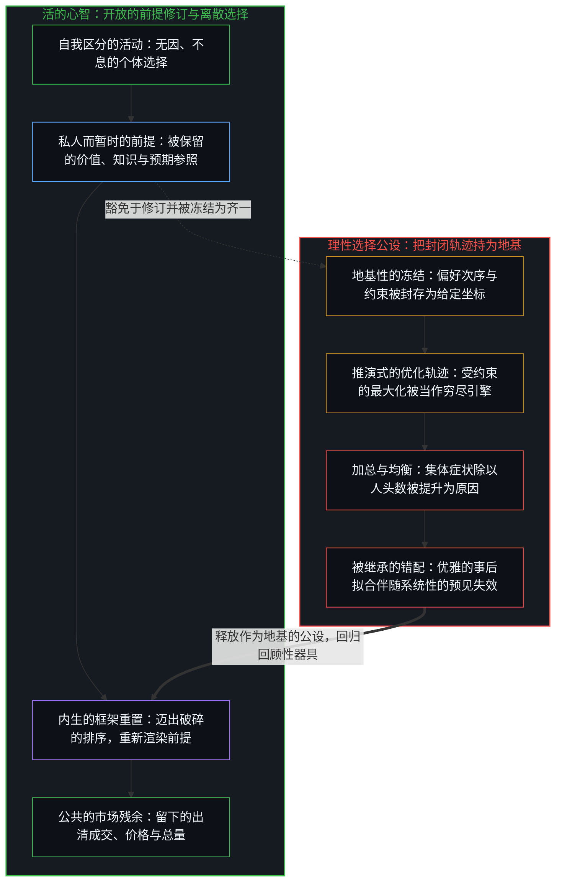
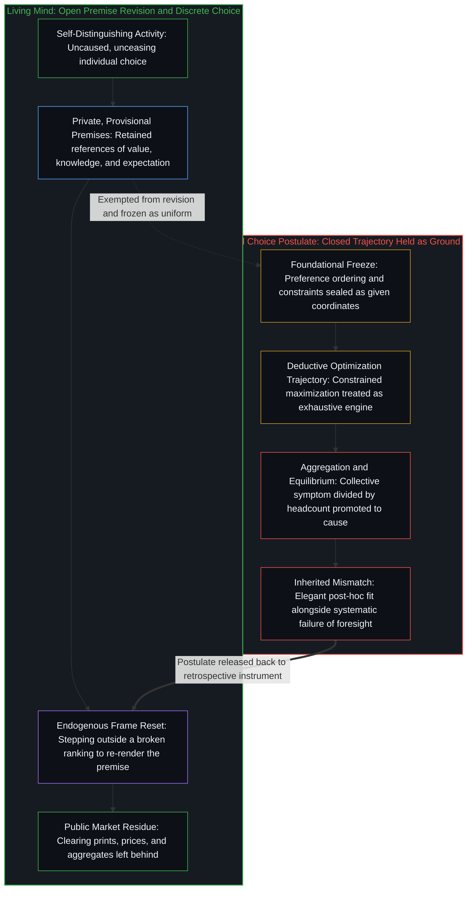

# 理性选择公设是原罪 / The Rational Choice Postulate Is the Original Sin

*齐一的一致被持为地基，而选择在私人前提的变动之下继续 / Uniform consistency held as ground while choice shifts under private premises*

经济现象只发端于个体选择。每一次选择都是一次离散的行动，发生在那个心智那一刻可得的前提之下；这些前提是私人的、暂时的，在不同心智之间、在同一心智相继的时刻之间，从不全然相同。把理性选择公设持为地基，就把一个一致最大化的形式结构冻结为足够坚实、足以为加总、均衡定理与政策处方奠基的东西；生成选择的前提满足不了这一冻结，于是这套装置之内此后的每一个理论动作，都继承同一个错配：事后拟合优雅，预见力薄弱，在结果之间搜寻原因，而唯一的自变量被当作已经定下。把这个被继承的结构称为原罪：它不是对个人或学派的判决，而是一个单一的生成性错误的名字；装置里此后的每一个动作，都携带这个错误的逻辑后果。

Economic phenomena originate solely in individual choices, each a discrete act under the premises available to that mind at that moment, premises private, provisional and never wholly identical across minds or across successive moments of one mind. Holding the rational choice postulate as foundation freezes a formal structure of consistent maximization as solid enough to ground aggregation, equilibrium theorems and policy prescription; the premises that generate choice cannot meet that freeze, so every later theoretical move within this apparatus inherits the same mismatch: elegant post-hoc fit, weak foresight, and causal search among effects while the only independent variable is treated as already settled. Call that inherited structure original sin: not a verdict on persons or schools, but the name of a single generative error whose logical consequence every later move in the apparatus carries.

## 一、 私人前提下的选择是唯一的自变量 / 1. Choice Under Private Premises Is the Sole Independent Variable

自我区分的活动发生着，无因，不息。称之为心智：已在进行中的观察者，它的每一个行动都是一次区分。经济学称为选择的，是个体心智中的这一行动：这一个行动，然后下一个，处在一个已被先前行动定型的场中。前提是这一行动所保留的参照：什么排为有价值，什么算作已知，什么被预期随之而来。前提在充当一件器具的那一刻，是一步之前的参照。它们或重新渲染，或冻结；它们从不以一份现成的公共存量到来：既不为所有行动者共享，也不在同一行动者相继的全部行动中保持稳定。

Self-distinguishing activity occurs — uncaused, unceasing. Call it the Mind: the observer already underway, every act of which is a distinction. What economics names choice is that act in an individual mind: this act, then the next, in a field already patterned by prior acts. Premises are the retained references of that act: what ranks as valuable, what counts as known, what is expected to follow. They are one step old at the moment they serve as an instrument. They re-render or freeze; they never arrive as a finished common stock shared by all agents or stable across all successive acts of one agent.

选择背后不存在别的实体。总量、价格、制度与模式，是选择相互作用后致密化的残余，可作为场供后来的行动取用，从不是生成这些选择的自变量。[个体抉择是唯一的因果杠杆](../individual-choices-as-the-only-causal-levers/)在繁荣与体制的情形中，把选择追溯为唯一的杠杆：每一个行动都是它自己的杠杆，受先前的行动塑形，不由其中任何一个发起，从不是一块共享平面上的位置；条件改变回报，它们并不执笔下一个行动。[价格是言说，理解是交易](../price-as-utterance-understanding-as-trade/)追溯市场的那一面：订单凭买卖报价在价格、数量与时机上的交汇而出清，而不是凭背后估值模型之间既成的同一性。在中心之间，只有可得之物的定型。规模并不发明一个能承载每个个体心智仍独自承载之物的超级中心。

No further entity exists behind the choice. Aggregates, prices, institutions and patterns are densified residue of choices interacting, available as field for later acts, never independent variables that generate the choices. [Individual Choices as the Only Causal Levers](../individual-choices-as-the-only-causal-levers/) traces choice as the only lever in the case of prosperity and systems: each act is its own lever, shaped by prior acts and initiated by none, never a position on a shared plane; conditions alter payoffs, and they do not author the next act. [Price as Utterance, Understanding as Trade](../price-as-utterance-understanding-as-trade/) traces the market face: orders clear by the crossing of bids and asks in price, size and timing, not by completed identity of the valuation models behind them. Between centers there is only the patterning of what is available. Scale does not invent a super-center that can carry what each individual mind still carries alone.

## 二、 把公设持为地基，就冻结了前提无法提供的结构 / 2. Holding the Postulate as Foundation Freezes Structure the Premises Cannot Supply

理性选择公设断言：行动者在给定约束下一致地选择，以使一个偏好次序最大化；并且这种一致性的结构可以充当地基，用来推导市场结局、均衡关系与政策处方。这里的一致性不只是选择那一刻的局部融贯。它被当作足够稳定、足够共享或足够有代表性，足以许可加总与预测。

The rational choice postulate asserts that agents choose consistently so as to maximize a preference ordering under given constraints, and that this structure of consistency can serve as foundation for deriving market outcomes, equilibrium relations and policy prescriptions. Consistency here is not merely local coherence at the instant of choice. It is treated as stable enough, shared enough or representative enough to license aggregation and prediction.

生成性的事实，即私人的、暂时的前提之下的选择，恰恰禁止这一许可。因为一个心智排序的方式本身就在它的前提之中，而前提在单个心智之内变动、在不同心智之间相异，所以公设所要求的形式结构，无法作为一种跨越行动者与时间而稳定、共享或有代表性的属性来维持。受约束的最大化是一条在固定坐标之上运行的封闭推演轨迹；只有当偏好次序与约束条件已被投射并封存之后，它才能运行，把纸面上的选择简化为对那些坐标之中本已隐含的最大值作零成本的读取。相反，在实际的经济行动中，每一次选择都是对有限的时间、资本或精力所作的不可逆投入，必须承受物质与市场的摩擦；当亲历的后果偏离被保留的参照时，作出选择的心智并不被锁在先前排序的轨迹之内，而能够迈出破碎的框架，重新渲染前提本身。这一冻结是理论家器具上的滞后：一个有限的形式投射被保留，越过了前提实际运作与修订的那一步，于是私人的暂时性被登记为围绕一个坚实微观基础的噪声，而不是生成之场本身。软化为“近似一致”或“平均而言一致”，就晚一步重新安装了同一个要求：装置要迁移，仍需要一份剩余的齐一。

The generating fact, choice under private, provisional premises, forbids exactly that license. Because the way a mind ranks is itself among its premises, and premises shift within a single mind and differ across minds, the formal structure the postulate requires cannot be maintained as a stable, shared or representative property across agents and time. Constrained maximization is a closed deductive trajectory over fixed coordinates; it can run only after the preference ordering and constraints have been projected and sealed, reducing choice on paper to a zero-cost reading of the maximum already implicit in those coordinates. In living economic action, by contrast, every choice is an irreversible commitment of finite time, capital, or effort that absorbs physical and market friction; when the lived consequence diverges from a retained reference, the choosing mind is not locked inside the trajectory of its prior rankings, and can step outside the broken frame to re-render the premise itself. The freeze is a lag in the theorist's instrument: a finite formal projection retained past the step at which premises actually operate and revise, so that private provisionality registers as noise around a solid micro-foundation rather than as the generative field itself. Softening into “approximately consistent” or “consistent on average” reinstalls the same demand one step later: a residual uniformity still required for the apparatus to travel.

## 三、 一切交换都经由相反的前提与暂时的重叠而出清 / 3. All Exchange Clears by Opposed Premises and Temporary Overlap

看定价这一最基本的情形。只有当双方对同一件物品持相反的估值时，价格才出现。买方的前提把物品排在钱之上；卖方的前提把钱排在物品之上。理性选择公设之中，没有任何东西生成这一对立。公设只提供一套共享的形式装置；每个行动者被假定把这套装置用在自己恰好持有的任何前提上。前提的对立先于形式装置，也独立于它。

Consider the elementary case of pricing. A price arises only when two parties hold opposite valuations of the same good. The buyer's premises rank the good above the money; the seller's premises rank the money above the good. Nothing in the rational choice postulate generates this opposition. The postulate supplies only a shared formal apparatus that each agent is assumed to apply to whatever premises they happen to hold. The opposition of premises is prior to, and independent of, the formal apparatus.

这种几何不是市场的特例。中心之间的每一次交换都以这种方式出清：只有当相异的私人排序重叠到足以容许下一个行动时，商品、劳动、资本、风险与时间才出清，而从不是在两个模型合而为一时出清。观念的交换也是如此。达成一致时，双方并没有开始共享同一份理解。各方从自己的视角，辨认并定位落在双方差异之重叠区域中的那条边缘。一致是那条被定位的边缘：足以支撑下一个共同或协调行动的暂时重叠，而不是产生这份一致的各方内部之间既成的同一性。未被共享的差异仍在；它此刻被搁置，而不是被抹去。

That geometry is not a special case of markets. Every exchange between centers clears this way: goods, labor, capital, risk and time clear only where differing private rankings overlap enough for a next act, never where two models become one. The same holds for the exchange of ideas. When agreement is reached, the parties do not come to share the same understanding. Each, from its own perspective, identifies and locates the edge that falls into the overlapping region of their differences. The agreement is that located edge, temporary sufficient overlap for the next joint or coordinated act, not completed identity of the interiors that produced it. Unshared difference remains; it is bracketed for the moment, not erased.

一旦装置被抬到地基的地位，实际的生成性差异便被降为“口味”“信息”或“沟通失误”这样的外生标签；在装置运行之前，这些标签就被当作给定的、了结了的东西。[价格是言说，理解是交易](../price-as-utterance-understanding-as-trade/)已持有这种几何的两面：一笔出清的成交价与一句说出的话是公共的残余；资本的协调与理解的协调依赖永久的生产性间隙，从不依赖完成了的同构。共享的形式被持为地基时，便被冻结为承重的东西，而对立被当作已经定下的输入。依赖的次序在第一步就被颠倒了，在市场中如此，在话语中也如此。

Once the apparatus is elevated to foundational status, the actual generative difference is relegated to exogenous labels such as “taste,” “information” or “miscommunication,” taken as given and settled before the apparatus runs. [Price as Utterance, Understanding as Trade](../price-as-utterance-understanding-as-trade/) already holds both faces of the geometry: a clearing print and a spoken sentence are public residues; coordination of capital and of understanding rests on permanent productive gap, never on finished isomorphism. Held as foundation, the shared form is frozen as load-bearing, and the opposition is treated as input already settled. The order of dependence is reversed at the first step, in markets and in discourse alike.

## 四、 平均化把结果安装起来，仿佛它是原因 / 4. Averaging Installs the Effect as if It Were the Cause

平均化是一种把一个分布压缩成一个数的数学操作；把公设持为地基所许可的，是把这个商提升为自变量，而这制造出一个自变量的印象：一个代表性行动者，一张稳定的需求表，一个可以被当作该模式之执笔者的平均偏好或平均反应。平均化说到底，不多不少，就是集体症状除以个体的人数。这个程序把许多离散行动在私人前提之下已经产生的残余，压缩成一个统计量；它并不提供一台新的生成引擎。均值是那些行动的结果；它被重新标记，仿佛它是那些行动的原因。[平均值是残余，不是引擎](../the-average-is-residue-not-the-engine/)在人口与筛选的情形中追溯这种重新标记：大众百分比追踪构成，而决定性的边缘落在右尾中稀少的人数上。[研究AI效应重置了因果原点](../studying-the-effect-of-ai-relocates-causality/)追溯这种重新标记：人与一件工具之间相反关系的均值，被命名为 AI 的效应。这种重新标记带来完美的表面可解释性：每一个过去的总量都从它自己的均值中复原，而被平均进那个均值的个体份额，却留在了外面。这个商本身并不携带对下一次选择分布的任何说明：它显示的任何向前拟合，只保持到它所平均的前提发生移动为止，因为唯一的自变量，即在持续变动的前提之下的选择，从来不在这个商里。

Averaging is a mathematical operation that collapses a distribution into one number; what holding the postulate as foundation licenses is promoting that quotient to an independent variable, which creates the impression of one: a representative agent, a stable demand schedule, a mean preference or mean response that can be treated as if it authored the pattern. What averaging actually is, nothing more and nothing less, is the collective symptom divided by the number of individuals. The procedure compresses into one statistic the residue already produced by many discrete acts under private premises; it does not supply a new generative engine. The mean is the effect of those acts, re-labeled as if it were their cause. [The Average Is Residue, Not the Engine](../the-average-is-residue-not-the-engine/) traces that re-label in the case of demography and selection: mass percentages track composition while the decisive edge sits with a thin number in the right tail. [Studying the Effect of AI Relocates Causality](../studying-the-effect-of-ai-relocates-causality/) traces that re-label when the mean of opposed relations with a tool is named as the effect of AI. That re-label yields perfect surface explainability: every past total is recovered from its own mean, while the individual shares averaged into that mean are left out. The quotient itself carries no account of the next distribution of choices: whatever forward fit it shows holds only until the premises it averaged have moved, because the only independent variable, choice under premises that continue to shift, was never in the quotient.

被抵消进那个均值的，恰恰是推动场的离散活动：前提相异的行动者在试验、创新、退出、模仿或拒绝。随着时间推移，这些行动改变前提本身的分布、可行行动的集合，以及后续选择所面对的制度约束。公布的平均值仍接近旧值时，这种转移在统计上始终看不出来。等到累积的结果终于大到足以被登记时，先前校准的关系已经不再描述新的选择总体。可预测性失败，不是因为从模型之外输入的外部冲击，而是因为把集体症状除以人头数当作原因，会系统性地丢弃产生非平稳性的生成性差异。[封闭的假设把复利挤成 S 曲线](../closed-assumptions-squeeze-compounding-into-s-curves/)在增长的情形中追溯同一种丢弃：一个共享的框架被持为场的本性，而稀少的中心仍越过被保留的天花板，重新打开复利。[现实扭曲力场颠倒了基线](../the-reality-distortion-field-inverts-the-baseline/)在大众融贯的情形中，追溯被安装为未受扰动之地基的平均值：迫使重新追溯的那些开口，被计为暂时的扭曲。

What is cancelled into that mean is precisely the discrete activity that moves the field: agents with divergent premises experimenting, innovating, exiting, imitating or refusing. Over time those acts alter the distribution of premises themselves, the set of feasible actions and the institutional constraints under which further choices are made. The shift stays statistically invisible while the published average stays close to its old value. When the cumulative effect finally becomes large enough to register, the previously calibrated relations have already ceased to describe the new population of choices. Predictability fails not because of external shocks imported from outside the model. It fails because treating the collective symptom divided by headcount as if it were cause systematically discards the generative difference that produces non-stationarity. [Closed Assumptions Squeeze Compounding into S-Curves](../closed-assumptions-squeeze-compounding-into-s-curves/) traces the same discarding in the case of growth: a shared frame held as the nature of the field while thin centers still reopen compounding past the retained ceiling. [The Reality Distortion Field Inverts the Baseline](../the-reality-distortion-field-inverts-the-baseline/) traces the average installed as undisturbed ground in the case of mass coherence: the openings that force re-tracing are scored as temporary warp.

## 五、 事后拟合廉价；预见需要前提所拒绝的迁移 / 5. Retrospective Fit Is Cheap; Foresight Needs Travel the Premises Refuse

同一逻辑说明了建立在这一公设上的理论的典型表现：它们在事后以相当的优雅解释观察到的模式，却在样本外预测和有效干预的设计上系统性地表现不佳。

The same logic accounts for the characteristic performance of the theories built on the postulate: they explain observed patterns after the fact with considerable elegance, yet systematically underperform at out-of-sample prediction and at the design of effective interventions.

公设一旦就位，解释便很廉价；只有当这份拟合被要求作为预见或地基而迁移时，拟合才失败。任何历史上的选择序列，都能在结局已知之后，通过重构合适的偏好次序与信息集而被合理化。重构出的行动者看起来一致地实现了最大化；数据由此被“解释”了。观察持有结果；重构出的地图是残余的残余，而这种重新追溯的保真度，既不变成生成行动的精确，也不把私人前提移置进一张向前迁移的共享表。[你的代码库即是记忆](../your-codebase-is-memory/)在数字制品中追溯同一道边界：正如把事后的选择冻结为一个封闭的效用函数，是把先前行动的历史残余误认作下一次选择的引擎；把代码库或模型检查点当作一个完备的、自我优化的目标函数，也是把早先切口层叠而成的残余，误认作在框架不再融贯时重写自身前提的开放心智。[伪装成远见的表演性后见](../performative-hindsight-that-pretends-to-be-foresight/)在社会的情形中追溯后见：已经可得的结局被重新追溯，仿佛迟来的认出曾是早先的能力。[因果贯穿始终](../causality-all-the-way/)追溯这份拟合遗漏的那一步：从持有的结果，到划出的模式，再到下一步，因果仍是划出自身路径的边缘。

Explanation is cheap once the postulate is in place; the fit fails only where it is asked to travel as foresight or foundation. Any historical sequence of choices can be rationalized by reconstructing suitable preference orderings and information sets after the outcomes are known. The reconstructed agents appear to have maximized consistently; the data are thereby “explained.” Observation holds effect; the reconstructed map is residue of residue, and fidelity of that re-tracing neither becomes exactness of the generating acts nor relocates private premises into a shared schedule that travels forward. [Your Codebase Is Memory](../your-codebase-is-memory/) traces the same boundary across digital artifacts: just as freezing posterior choices into a closed utility function mistakes the historical residue of prior acts for the engine of the next choice, treating a codebase or model checkpoint as a complete, self-optimizing objective function mistakes the stacked residue of prior cuts for the open mind that rewrites its own premises when the frame no longer coheres. [Performative Hindsight That Pretends to Be Foresight](../performative-hindsight-that-pretends-to-be-foresight/) traces hindsight in the social case: already-available outcomes re-traced as if the late recognition had been the early capacity. [Causality All the Way](../causality-all-the-way/) traces the step the fit leaves out: from held effects to drawn patterns to the next step, causality is still the edge drawing its path.

相反，处方与预测要求前提保持足够稳定、足够共享，好让形式结构在时间上向前、或跨越不同的制度环境迁移。前提的私人性与暂时性，否定了这种稳定。因此，这些模型仍是回顾性叙事的有力器具，预见的乏力器具。这个模式背后的错配不是偶然的：它是从一个为保全装置而丢弃生成性差异的冻结出发的逻辑后果；前提若在某个预测的视野之内移动，这个预测便失败。

Prescription and prediction, by contrast, require the premises to remain stable and shared enough for the formal structure to travel forward in time or across institutional settings. The privacy and provisionality of premises deny that stability. Consequently the models remain powerful instruments of retrospective storytelling and weak instruments of foresight. The mismatch behind the pattern is not contingent: it is the logical consequence of beginning from a freeze that discards generative difference in order to keep the apparatus intact, and each forecast fails wherever premises move within its horizon.

## 六、 制度仍是定型后续选择之场的结果 / 6. Institutions Remain Effects That Pattern the Field of Further Choices

制度与总量并不因此无关。它们定型后续选择所处的回报与约束之场。然而它们仍是结果：它们所约束的选择持续地重新创造或侵蚀它们。把它们当作彼此相互作用的准自变量，就是颠倒私人前提之下的选择所确立的依赖次序。

Institutions and aggregates are not therefore irrelevant. They pattern the field of payoffs and constraints in which subsequent choices are made. Yet they remain effects, continually re-created or eroded by the choices they constrain. To treat them as quasi-independent variables that interact among themselves is to reverse the order of dependence that choice under private premises establishes.

持有理性选择公设的理论家促成并正当化了这一颠倒：凭着一个看似坚实的一致最大化微观基础，他们迅速转向研究结果之间的均衡关系，同时把选择的生成过程当作已经定下。[主权、信念与规制结构的生成](../sovereignty-belief-and-regulatory-structures/)在两道门（自律组织与政府）的情形中追溯这一颠倒：个体主权从不真正被转移；许多中心表达“主权可以被委托”的信念，直到这一信念硬化为程序，而后果仍留在作出选择的个体那里。[公共支出不创造资本](../public-spending-does-not-create-capital/)在投资的情形中追溯同一种颠倒：公共账本把再配置冻结为创造，而发起留在上行与下行仍然落下的地方。[协调者的范畴错误](../the-coordinators-category-error/)追溯这样的情形：一份致密化的共享记录被持为下一次同意的共同作者。[能动性被转置入形式模型](../agency-relocated-into-the-formal-model/)追溯教学的那一面：对装置的掌握被当作能动性的延伸提供出来，而自变量仍留在选择那里。每一种情形中，冻结都是同一种：结果被审视，仿佛它们无需私人前提之下离散选择的持续再入，就能执笔更多的结果。

Theorists who hold the rational choice postulate enable and legitimate that reversal: with an apparently solid micro-foundation of consistent maximization, they move rapidly to the study of equilibrium relations among effects while treating the generative process of choice as already settled. [Sovereignty, Belief, and the Generation of Regulatory Structures](../sovereignty-belief-and-regulatory-structures/) traces that reversal in the case of the two gates, the self-regulatory organization and the government: individual sovereignty is never actually transferred; many centers express the belief that it can be delegated until that belief hardens into procedure, while consequences stay with the individuals who choose. [Public Spending Does Not Create Capital](../public-spending-does-not-create-capital/) traces the same reversal in the case of investment: the public ledger freezes reallocation as creation while initiation stays where upside and downside still land. [The Coordinator's Category Error](../the-coordinators-category-error/) traces a densified shared record held as co-author of the next assent. [Agency Relocated into the Formal Model](../agency-relocated-into-the-formal-model/) traces the pedagogical face: mastery of the apparatus offered as the extension of agency while the independent variable stays with the choice. In each case the freeze is the same: effects surveyed as if they could author further effects without continuous re-entry of discrete choice under private premises.

## 七、 行为与生态的补丁保全了冻结 / 7. Behavioral and Ecological Patches Preserve the Freeze

引入行为层或生态层的改进，并不逃出这个结构。它们作为添加的补丁起作用：一层层贴合观察到的模式，而公设的核心握持被保全。相对于一般的公设，每一个补丁都能重构更多由个体选择已经在集体层面留下的模式：更多的启发法，更多相对于环境的适应度，更多集体行动的规则，更多由许多离散行动事后留下的剩余模式。这份收获作为对已发生之事更致密的重构而成立。它不是对公设的挑战。

Refinements that introduce behavioral or ecological layers do not escape this structure. They function as added patches, layers fitted to observed patterns while the postulate's core hold is preserved. Relative to the general postulate, each patch can reconstruct more of the pattern that individual choices have already left collectively: more heuristics, more environment-relative fitness, more rules of collective action, more of the residual pattern left by many discrete acts after the fact. That gain holds as denser reconstruction of what has already occurred. It is not a challenge to the postulate.

这些补丁与一般公设一样，仍忽略唯一的自变量：私人而变动的前提之下的个体选择，它是仍在进行中的生成引擎。通过扩大可接受重构的集合、把理性定义为对特定环境的适应，或把选择嵌入共享的规则，它们拓宽了已成型的模式之中能被计为“理性”的范围。关于环境或制度背景的共享假设被径直插入，好让形式装置能够再次被应用。至于那项地基性的要求，即一致性、稳定性与主体间齐一须足以许可加总与向前应用，则原封未动。为这类改进颁奖或引用它们的人，若是因其对过去集体残余的拟合而认可它们，这份认可便不是对原初错误的释放。[重新审视反脆弱](../a-new-deeper-look-at-antifragility/)在无序中追溯一个相邻的情形：统计的假肢在被保全的坐标之内管理症状，而坐标本身保持豁免。[基准刷榜中的封闭实存](../closed-reality-in-benchmark-maxing/)在测量的情形中追溯一种被保全的握持：残差在一套封闭的测试集上被压到零，而开放负荷之下的残差在扩大。

The patches still ignore the only independent variable, individual choice under private, shifting premises as the generative engine still underway, just as the general postulate does. By enlarging the set of admissible reconstructions, by defining rationality as fitness to a particular environment, or by embedding choice within shared rules, they expand the range of already-materialized patterns that can be scored as “rational.” Shared assumptions about the environment or the institutional setting are simply inserted so that the formal apparatus can again be applied. The foundational demand for enough consistency, stability and intersubjective uniformity to license aggregation and forward application remains untouched. Where those who award or cite such refinements recognize them for their fit to past collective residue, that recognition is not a release of the original error. [A New Deeper Look at Antifragility](../a-new-deeper-look-at-antifragility/) traces an adjacent case in disorder: statistical prosthesis that manages symptoms inside preserved coordinates while the coordinates themselves stay exempt. [Closed Reality in Benchmark Maxing](../closed-reality-in-benchmark-maxing/) traces a preserved hold in the case of measurement: residual driven to zero on a sealed suite while residual under open load widens.

若“会长演讲”或“诺贝尔”这样的头衔被当作接受公设的理由，下一步便取自那些已把装置当作地基的中心之间致密化的共振，而不是取自对前提的审视。声望不是对“私人前提能否提供装置所要求之物”的第二次检验。[验证中因果权能的分配](../the-allocation-of-causal-power-in-validation/)追踪下一步取自何处：是取自心智自己对前提的审视，还是取自被标记为外部的回应，例如声望。

Where a title such as “Presidential Address” or “Nobel” is taken as the reason to accept the postulate, the next step is drawn from densified resonance among centers that already treat the apparatus as ground, not from scrutiny of the premise. Prestige is not a second test of whether private premises can supply what the apparatus demands. [The Allocation of Causal Power in Validation](../the-allocation-of-causal-power-in-validation/) tracks where the next step is drawn from: whether it is drawn from the mind's own scrutiny of the premise, or from responses marked as external, such as prestige.

## 八、 一个认识；此后的每一个动作都继承错配 / 8. One Recognition; Every Subsequent Move Inherits the Mismatch

这一错配并不需要额外的心理学、历史或经验假设。它严格地得自这样一个认识：私人而变动的前提之下的每一个个体选择都是它自己的杠杆，而选择是唯一的自变量；再加上这样一个观察：理性选择公设，无论在行为上或生态上怎样被细化，都要求一种那些前提无法提供的一致性、稳定性与主体间齐一。

No additional psychological, historical or empirical assumptions are required for the mismatch. It follows strictly from the recognition that each individual choice under private and shifting premises is its own lever, and that choice is the sole independent variable, together with the observation that the rational choice postulate, however behaviorally or ecologically elaborated, demands a degree of consistency, stability and intersubjective uniformity that those premises cannot supply.

一旦公设被安装为地基公理，此后的每一个理论动作（加总、均衡推导、政策设计或行为补丁）都继承形式结构与实际生成过程之间原初的错配。这一错配不是偶然的：每一个向前的步骤都携带它；前提若在某一步的视野之内移动，这一步便失败。事后拟合强、预测或处方力弱这一反复出现的模式，是那个错配所产生的。这一错配是从一条生成性前提满足不了的公理出发的逻辑后果。

Once the postulate is installed as the foundational axiom, every subsequent theoretical move, aggregation, equilibrium derivation, policy design or behavioral patching, inherits the original mismatch between the formal structure and the actual generative process. The mismatch is not contingent: every forward step carries it, and fails wherever premises move within its horizon. The repeated pattern of strong post-hoc fit and weak predictive or prescriptive power is what that mismatch produces. The mismatch is the logical consequence of beginning from an axiom the generating premises cannot meet.

作为地基，公设不是一个偶尔误导的有用近似。它是原罪：理论家把它当作地基来建造，便把目光从唯一的自变量移开，到结果之间去搜寻因果关系。软化为“部分是微观基础，部分是剩余噪声”，就在私人前提与离散行动这条唯一继续着的序列旁边，安装了第二个原因。[开放即一致](../openness-is-consistency/)指认相邻的冻结：一个有限的结构被迫为只是继续着的东西奠基。在这里，这个有限的结构，是被持为一个经济体之穷尽微观基础的偏好与约束装置；而这个经济体只作为相继的选择而继续，这些选择所处的前提从不完成为共享的同一性。[超越投射](../beyond-the-projection/)追溯一个形式投射为何无法取代作出选择的中心：推演引擎只在被给定的固定坐标之内运行轨迹，而活的心智先于言说便感知到摩擦，并从破碎的框架中退后一步，重新渲染前提本身。在相邻的领域中，同一种在结果之间的搜寻反复出现。[意识从不作为数据出现在数据之中](../consciousness-never-appears-as-data-among-data/)在证据的情形中追溯这种搜寻：测量只持有公共的结果，而登记这些结果的活动，始终领先于任何可能捕获它的数据。[成功学](../cheng-gong-xue/)在成功文学的情形中追溯廉价的回顾拟合：幸存者被重排成可携带的规则，被当作引擎提供出来，而产生他们的序列被留在外面。若一个心智释放作为地基的公设，装置便回归为一件器具：它可用于局部的回顾性重构，从不是向前迁移的地基，也不是下一个行动被封存的起源。[理性从不跨越心智](../rationality-never-travels-across-the-mind/)追溯这一诊断本身的界限：这一认识本身是持有它的那个心智处的一次重新诠释，而不是一套完好地到达别处的第二种可携带演算。若一个心智把公设持为地基，每一次改进便都仍是对症状更精致的描述，而独自产生这些症状的生成过程，留在装置所及之外；若这个心智释放公设，装置便重新成为使用它的心智手中的一件器具。

As a foundation, the postulate is not a useful approximation that occasionally misleads. It is the original sin: building on it as foundation, a theorist looks away from the only independent variable and searches for causal relations among the effects. Softening into “part micro-foundation, part residual noise” installs a second cause beside the one sequence of private premise and discrete act that continues. [Openness Is Consistency](../openness-is-consistency/) names the adjacent freeze: a finite structure forced to ground what only continues. Here the finite structure is the preference-and-constraint apparatus held as exhaustive micro-foundation of an economy that continues only as successive choices under premises that never finish into shared identity. [Beyond the Projection](../beyond-the-projection/) traces why a formal projection cannot substitute for the choosing center: a deductive engine runs a trajectory inside the fixed coordinates it was given, whereas the living Mind senses friction prior to articulation and steps backward out of a broken frame to re-render the premise itself. Across adjacent domains the same search among effects recurs. [Consciousness Never Appears as Data Among Data](../consciousness-never-appears-as-data-among-data/) traces that search in the case of evidence: measurement holds only public effects, and the activity registering them stays ahead of any datum that would capture it. [Theories After Success](../cheng-gong-xue/) traces cheap retrospective fit in the case of success literature: survivors rearranged into portable rules offered as the engine, while the sequence that produced them is left out. Where a mind releases the postulate as foundation, the apparatus returns to being an instrument, usable for local retrospective reconstruction, never a foundation that travels forward or the sealed origin of the next act. [Rationality Never Travels Across the Mind](../rationality-never-travels-across-the-mind/) traces the bound on this diagnosis itself: this recognition is itself a reinterpretation at the mind that holds it, not a second portable calculus that arrives intact elsewhere. Where a mind holds the postulate as foundation, every refinement stays a more sophisticated description of symptoms, and the generative process that alone produces them stays outside the apparatus's reach; where it releases the postulate, the apparatus is an instrument again in the hands of the mind that uses it.
