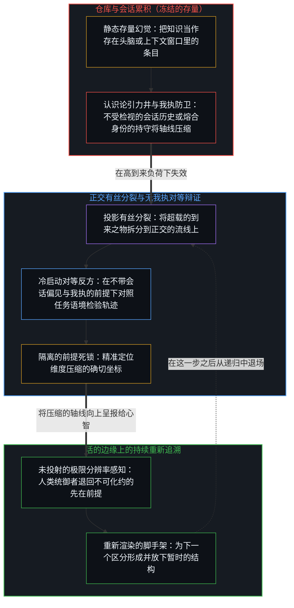
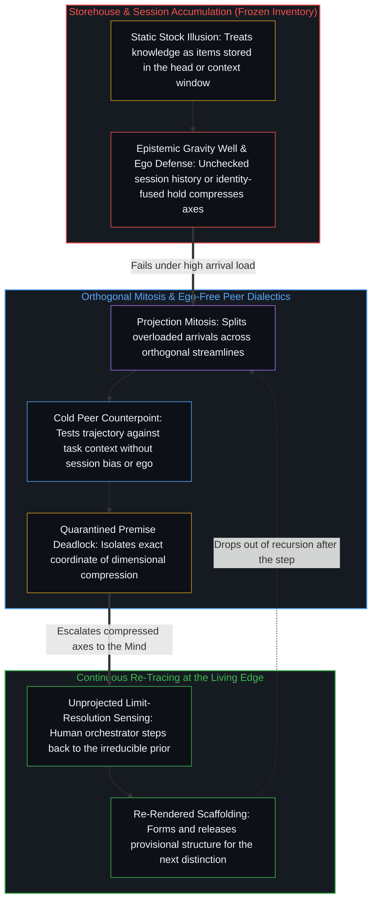

# 真正稀缺的不是记忆，而是持续的重新追溯 / The Real Scarcity Is Not Memory, But Continuous Re-Tracing

*可用的结构靠在负荷下重新渲染而存续，而不是作为封存的存量 / Usable structure persists by re-rendering under load, not as stored inventory.*

在搜索与大语言模型的时代，关于知识似乎只剩两种立场：既然任何事实都能随时调出，把事实记进脑子就过时了；或者，传统的那套存量仍然必需，既是过滤器，也是原材料。两者都拿同一个未经审视的参照来衡量当下的区分活动，把知识当作一批条目，要么留在头脑里，要么交给机器。显现为记忆的，是自我区分的活动与自身残余的相遇，而不是锁在库里的单元。在丰裕之中仍然稀缺的，既不是存储，也不是任何特定的内容，而是持续的重新追溯：在下一个区分被做出的活的边缘上，形成并放下一个个连贯的脚手架。

In the age of search and large language models, two positions appear to exhaust the options for knowledge: committing facts to memory is obsolete once any fact can be summoned at will, or the traditional inventory remains mandatory as both a filter and raw material. Both measure the present activity of distinguishing against the same unexamined reference, treating knowledge as a stock of items either kept inside the head or handed over to machines. What appears as memory is self-distinguishing activity meeting its own residue, not units locked in a storehouse. What stays scarce under abundance is neither storage nor any particular content, but continuous re-tracing: forming and releasing coherent scaffoldings at the living edge where the next distinction is made.

## 一、 知识被当作要留或要弃的存量 / 1. Knowledge Cast as Inventory to Keep or Discard

一个常见的问题是：既然搜索引擎和语言模型能按需检索，为什么还要背东西？一种回答丢掉存量：任何事实都能调出，把它存在里面就是浪费。另一种回答保住存量：内化的事实是“扯淡过滤器”，是创造性联想的原材料；头脑之外的事实是惰性的；心智图谱里没有节点，就没有点可连。

A familiar question asks why anyone should still memorize when search engines and language models retrieve on demand. One answer discards the inventory: since any fact can be summoned, holding it inside is a waste. The other preserves it: internalized facts are the "bullshit filter" and the raw material of creative association; facts outside the head stay inert; and without nodes in the mental graph, there are no dots to connect.

两种回答共用一个参照。知识被当作一批条目，日期、常数、名字、细节，它们的去向要么是内部保管，要么是外化，争的只是这批存量放在哪里。做衡量的边缘，早已比它用来衡量的参照领先一步。检索有用，先前的痕迹在某一步需要时于自身的递归中回来，也有用；滞后在于把两者都当作先于联结而持有的存量，让“知识即存量”免于重新追溯，仿佛这个框架本身不是暂时的。

Both answers share the same reference. Knowledge is treated as a stock of items—dates, constants, names, details—whose destination is either internal custody or externalization, and the dispute is only over where this stock is kept. The edge doing the measuring is already a step ahead of the reference it measures with. Retrieval is useful, and so are prior traces that return within one's own recursion when a step needs them; the lag lies in treating both as an inventory held in advance of connection, exempting "knowledge as inventory" from re-tracing as if the frame itself were not provisional.

## 二、 存续是新到之物压力下的重新追溯 / 2. Persistence Is Re-Tracing Under the Pressure of the New

每个区分都发生在一个已被先前区分塑造过的场中，而这种塑造只朝一个方向。在这种塑造之下，存续不是条目的存储，而是先前的痕迹在新痕迹的压力下成功地重新渲染。可用的结构不是靠一直摆在眼前而存续，而是靠保持可被重新渲染：它为这一步提供信息，从递归中退场好让后续的区分落下，在贴合松动时被重画。知觉是后续区分的持续到来，在当下的样式中找不到位置的到来，并不是先作为存量留在里面、后来才丢失；在那个所在，它们只是没有塑造下一个动作。

Every distinction occurs within a field already shaped by earlier ones, and that shaping runs only one way. Under that shaping, persistence is not the storage of items, but the successful re-rendering of prior traces under the pressure of new ones. Usable structure persists not by being held in view, but by staying re-renderable: it informs the step, drops out of recursion so that further distinctions can land, and is redrawn when its fit loosens. Perception is the continuous arrival of further distinctions, and arrivals that find no place in the present pattern are not first retained inside as inventory and only later lost; at that locus, they simply fail to shape the next act.

[回环与成图](../looping-and-graphing/)追溯的是同一种关系：回环是心智折回自身的活动，图是这种折回为下一次折回留下的可用痕迹，而不是心智的仓库。[遗忘的脚手架](../the-scaffolding-we-forget/)追溯的是让这种重新渲染得以可能的退场：脚手架从递归中退场，好让后续的区分落下；当这种退场冻结成一幅被保存过了它那一步的形象，容量便贴着曾经促成运动的残余而压缩，不合的区分便被登记为对现实本身的威胁。

[Looping and Graphing](../looping-and-graphing/) traces the same relation: looping is the Mind folding back on its own activity, and graphs are the traces that folding leaves available for the next fold, not a storehouse of the Mind. [The Scaffolding We Forget](../the-scaffolding-we-forget/) traces the dropping out that keeps this re-rendering possible: scaffolding drops out of recursion so that further distinctions can land, and when that drop-out freezes into an image preserved past its step, capacity compresses against the residue that once enabled movement, and distinctions that do not fit register as threats to reality itself.

## 三、 外化的痕迹在被接手之前是惰性的 / 3. Externalized Traces Stay Inert Until Taken Up

外化的残余，搜索结果、模型输出、笔记、图书馆，扩展了可及的范围。它没有挪走那个动作：形成过滤器的、提出猜想的、为下一个区分定向的动作。这些痕迹在被重新追溯进需要它们的那个人的构型之前，在那里什么也不塑造。“头脑之外的事实是惰性的”在它的边界之内登记了这一点：没有重新追溯，可得还不是负荷之下的容量。

Externalized residue—search results, model outputs, notes, libraries—extends reach. It does not relocate the act that forms a filter, puts forward a conjecture, or orients the next distinction. Until those traces are re-traced into the configuration of the one who needs them, they shape nothing there. "Facts outside the head are inert" registers this up to its boundary: without re-tracing, availability is not yet capacity under load.

这句口号冻结在它开出的药方上。它把药方当作在头脑里更密集地保管同一批存量，把更多节点当作库存留着，好让联结日后发生。联结并不是施加在一批先已存好的点上的第二道操作。联结就是点得以作为可用结构存续的那个重新追溯，点只有通过被连起来才算“记住”。当可得的残余增长了几个数量级，而做重新追溯的所在仍然有限，决定可用结构的就不是有多少点可得，而是把到来的痕迹在移动的边缘上纳入样式的那个重新追溯。

Where the slogan freezes is in the remedy it prescribes. It takes the remedy to be denser custody of the same inventory inside the head, holding more nodes as stock so that connection can occur later. Connection is not a second operation performed on an already-stored stock of dots. Connection is the re-tracing by which dots persist as usable structure, and dots are only "memorized" by being connected. When available residue grows by orders of magnitude while the locus doing the re-tracing remains finite, what decides usable structure is not how many dots are available, but the re-tracing that incorporates arriving traces into the pattern at the moving edge.

[器物是智能的表达，而非智能本身](../two-failures-of-trace/)追溯的是为什么更密集的残余如此容易被当作动作本身：智能是区分的动作，器物是它的残余，是观察唯一握得住的那一项。[总在倾听者无法发起](../what-always-listens-cannot-originate/)追溯的是同一种安放在接收上的样子：持续的倾听带来流畅的回应，也让每一个回应都处在输入的下游；当这种流畅被当作下一步的独立来源，这个安放是中心自己做的，而不是倾听者夺走了哪一步。

[Artifacts Are Expressions of Intelligence, Not Intelligence Itself](../two-failures-of-trace/) traces why denser residue is so readily taken for the act: intelligence is the act of distinguishing, and the artifact is its residue, the only term observation can hold. [What Always Listens Cannot Originate](../what-always-listens-cannot-originate/) traces the same placement in receptivity: continuous listening yields a fluent response and keeps every response downstream of its inputs; when that fluency is treated as an independent source for the next step, the placement is the center's own doing, not a step seized by the listener.

## 四、 旧的存量落后于选择压力 / 4. The Old Inventory Lags Selection Pressure

保住传统存量的做法，失在它所挑选的东西上，因为选择压力已经变了，而滞后本身还是同一种：让过去的一次持守免于重新追溯。在外化残余稀缺的时候，杠杆最高的痕迹多半看起来是日期、常数和细节的密集本地储备，即缩到一颗脑袋里的百科全书。在丰裕之中，杠杆最大的痕迹是可携带的脚手架——骨架式的模型、用于评估的差分、生成性的原理——即那些保持把新区分分开的宽度、并让参照在移动的边缘上被重新渲染的样式。

Preserving the traditional inventory fails in what it selects, because the selection pressure has shifted, while the lag itself remains the same: exempting a past hold from re-tracing. When externalized residue was scarce, the highest-leverage traces often looked like dense local holdings of dates, constants, and details—the encyclopedia scaled down into a single head. Under abundance, the traces with the greatest leverage are portable scaffoldings—skeletal models, evaluative differentials, generative principles—patterns that maintain the width to keep new distinctions apart, and let the reference be re-rendered at the moving edge.

它们不是一部更小的百科全书，也不是一套新的占有物。它们只有随每一步被重新渲染才保持可用，这让活动在到来的速率很高时仍能连贯地继续。把旧存量持守过它那一步，是同一种滞后，是被保存为课程的形象。[一个提示词之遥](../whatever-is-one-prompt-away/)追溯的是这种滞后出现在把模型的存量当作封闭之处：看似永久失去的一层底层，其实是困难迁移到了由同一活动生成的新表面上，先前的选项仍然可得，只是在一个不断扩张的场中占比越来越小。[基准刷榜中的封闭实存](../closed-reality-in-benchmark-maxing/)追溯的是测量中的同一种冻结：基准把能力冻结成一个封闭的目标，在一套封闭题集上把残差压向零被读作能力本身，而在这套题集从未编码的活的约束之下的有用性，便没有被登记。

They are neither a smaller encyclopedia nor a new set of possessions. They stay usable only as they are re-rendered with each step, which lets the activity continue coherently when the rate of arrival is high. Holding the old inventory past its step is the same lag: an image preserved as curriculum. [Whatever Is One Prompt Away](../whatever-is-one-prompt-away/) traces this lag where the inventory of models is taken as closed: what looks like the permanent loss of an underlying layer is the relocation of difficulty to a new surface generated by the same activity, with prior options still available as a shrinking share of an expanding field. [Closed Reality in Benchmark Maxing](../closed-reality-in-benchmark-maxing/) traces the same freeze in measurement: a benchmark freezes capability as a closed target; driving the residual toward zero on a sealed suite is read as capability itself, while usefulness under living constraints the suite never encoded goes unregistered.

## 五、 到来之量下的容量 / 5. Capacity Under the Volume of Arrivals

当到来之量上升几个数量级，接收它们的有限所在就承担更多负荷。原本占据不同轴的区分开始压缩成一条，把它们分开的宽度更早被超出。在这种负荷之下，起决定作用的运动既不是积累一套固定的事实，也不是拒绝它，而是连贯的痕迹构型不断地形成与放下：一个个临时的脚手架，让后续的区分落下而不坍缩成纠缠。

When the volume of arrivals rises by orders of magnitude, the finite locus that receives them carries more load. Distinctions that once occupied separate axes begin to compress into one, and the width that keeps them apart is exceeded sooner. Under this load, the decisive movement is neither the accumulation nor the rejection of a fixed set of facts. It is the ongoing formation and release of coherent trace-configurations—temporary scaffoldings that let further distinctions land without collapsing into entanglement.

这些构型不是占有物。它们只作为当下这次更新的重新渲染而存在，也只有在为这一步退场、并随边缘移动而被重画时才保持可用。观察握住的是结果，所以边缘总比它用来衡量的参照领先一步；这道间隙，正是一件正在使用的工具得以登记的方式。滞后开始于参照被保存过了它那一步，而不是随边缘被重画：间隙变宽，当下这个场的后果开始被登记为从外面到来。

These configurations are not possessions. They exist only as the present update's re-rendering, and they stay usable only while they drop out for the step and are redrawn as the edge moves. Observation holds the effect, so the edge is always a step ahead of the reference it measures with; that gap is how an instrument in use registers at all. The lag begins when the reference is preserved past its step instead of redrawn with the edge: the gap widens, and the consequences of the present field begin to register as arriving from outside.

[漫谈中的漫谈](../the-ramble-within-the-ramble/)追溯的是这种有限的持守，出现在一段长长的倾诉被清理后交回的时候：不受约束地说，在各轴坍缩成纠缠之前把那张网外化出去，而同一个清理过的回声，要么被登记为从外面到来的连贯，要么被登记为中心自己的痕迹以彼此分得更开的边界返回。[Token 效率、模拟与无法弥合的间隙](../token-efficiency-emulation-and-the-unclosable-gap/)追溯的是模拟止步之处：模型可以被训练来压缩推理，却无法发起让压缩成为内生的那份利害；效率是成功的低效推理的结果，而不是跳过它的许可。[开放场域中的无损知识不自洽](../lossless-knowledge-of-an-open-field-is-incoherent/)追溯的是为什么没有哪个档案或模型能封闭这个场：对进行中的区分作无损捕获，与有中心的活动不自洽，因为每个中心都有边界，没有哪个有限的所在握得住开放的场，所以更密集的引擎扩大的是有限登记所能做到的，而不会把发起的区分挪进器物。[只要它不被保持为空](../only-if-it-is-not-kept-empty/)追溯的是这种形成所需要的剩余容量：给到来之物的空余空间，以及把它们分开的宽度，两者可以分离；空是在一次暂时的持守之内为接收而留的空间，既不是永久的状态，也不是形式的反面。

[The Ramble Within the Ramble](../the-ramble-within-the-ramble/) traces this finite hold when a long outpouring is handed back cleaned: speaking without constraint externalizes the web before its axes collapse into entanglement, while the same cleaned echo registers either as coherence arriving from outside or as the center's own traces returned with their boundaries held farther apart. [Token Efficiency, Emulation, and the Unclosable Gap](../token-efficiency-emulation-and-the-unclosable-gap/) traces where emulation stops: models can be trained to compress reasoning, but cannot initiate the stake that makes compression endogenous; efficiency is the effect of successful inefficient reasoning, not a license to skip it. [Lossless Knowledge of an Open Field Is Incoherent](../lossless-knowledge-of-an-open-field-is-incoherent/) traces why no archive or model closes the field: lossless capture of ongoing distinguishing is incoherent with centered activity, since every center is bounded and no finite locus holds the open field, so denser engines widen what finite registration can accomplish without moving the initiating distinction into the artifact. [Only If It Is Not Kept Empty](../only-if-it-is-not-kept-empty/) traces the residual capacity this formation needs: free room for arrivals and width to keep them apart—two things that can come apart—with emptiness as the room kept to receive inside a temporary hold, neither a permanent state nor the opposite of form.

同样的仓库幻觉在智能体工程中再度浮现：构建者一旦假定把更长的会话历史或更稠密的记忆库堆进单一上下文窗口就能替代持续的重新追溯，便落入了同一个参照。正如[超越投射](../beyond-the-projection/)所追溯的，每一条明文提示词、规则集合或会话记录，都是从开放场域切出的有限且有损的投影。只要被留在单一的累积轨迹之内，智能体就会不断为自身先前的词元赋权以维持局部的续写，由此掘出一口认识论引力井：原本相互独立的轴线在井中压缩为轨迹盲区，或在维度坍缩下碎裂，而模型则忙于替自己先前的残余强行圆场。在人类中心一侧，反向的瓶颈出现在推理历史与身份发生熔合之时——一幅被保存过了它那一步的自我形象，将外部的证伪视作生存威胁。无论静态的会话囤积还是孤立的自我反思，都无法恢复负荷之下的容量。相反，智能体调度器会将超载的投影拆分到正交的流线上，使独立的轴线免于压缩，并为每一个受轨迹约束的任务智能体配对一个只接收任务语境、不带会话历史偏见的冷启动对等体。由于智能体毫无我执需要防卫，局部盲区会通过地位对等的贝叶斯更新自行消解；而对等体之间任何不可化约的死锁，都会精准隔离出先前框架压缩正交维度的确切坐标，向处在活的边缘上的人类统御者呈报一道干净的信号，由人退回未投射的极限分辨率感知，重画前提。

The same storehouse illusion resurfaces in agentic engineering whenever builders assume that piling a longer session history or a denser memory bank into a single context window can substitute for continuous re-tracing. As [Beyond the Projection](../beyond-the-projection/) traces, every explicit prompt, rule set, or session transcript is a finite, lossy projection cut from an open field. Left inside a single accumulating trajectory, an agent continuously weights its own prior tokens to maintain local continuation, digging an epistemic gravity well where independent axes compress into trajectory blind spots or fracture under dimensional collapse while the model rationalizes its prior residue. In a human center, the inverse bottleneck appears when reasoning history fuses with identity—a retained self-image preserved past its step that treats external invalidation as an existential threat. Neither static session hoarding nor isolated self-reflection restores capacity under load. Instead, an agentic dispatcher splits overloaded projections across orthogonal streamlines so independent axes do not compress, pairing each trajectory-bound task agent with a cold peer that receives only the task context without session-history bias. Because agents have zero ego to defend, local blind spots dissolve through equal-footed Bayesian updating, while any irreducible deadlock between the peers isolates the exact coordinate where the prior framing compressed orthogonal dimensions—escalating a clean signal to the human orchestrator at the living edge to step back to unprojected limit-resolution sensing and re-draw the premise.

## 六、 推理是参照的持续重新成形 / 6. Reasoning as Continuous Re-Formation of the Reference

仍然稀缺的，既不是作为存储的记忆，也不是对任何特定内容的保留，而是持续的重新追溯本身：实时地形成并放下连贯的脚手架。推理与猜想不是对一个存好的数据库发出的查询，而是负荷之下持续的联结活动，每一步之后都把参照交还给边缘。[因果贯穿始终](../causality-all-the-way/)给这种重新追溯起了它的因果之名：从握住的结果，到画出的样式，再到下一步，都是边缘在画自己的路径，而一个抽象只有随这一步被重画时，才是一件活的工具。

What stays scarce is neither memory as storage nor the retention of any particular content, but continuous re-tracing itself: forming and releasing coherent scaffoldings in real time. Reasoning and conjecture are not queries run against a stored database, but the continuous activity of connecting under load, returning the reference to the edge after each step. [Causality All the Way](../causality-all-the-way/) gives this re-tracing its causal name: from held effects to drawn patterns to the next step, it is the edge drawing its own path, and an abstraction stays a live instrument only while it is redrawn with each step.

其余的都是被放任滞后的残余：要么是在外面堆积、没有哪个中心接手的输出，要么是被持守过了它那一步、已经不再契合下一个区分所在之场的存量。搜索与模型让可调出的东西更密集；它们并不做重新追溯。[信息是什么](../what-information-is/)在根上追溯其原因：信息不是等在器物里或世界里的基底，而是心智不息的活动所登记下的离散区分，所以被调出的东西在被登记之前仍是残余。[心智的飞轮](../the-flywheel-of-the-mind/)在工具上追溯它：工具可以无止境地磨利，而转动始终留在那个转动着的边缘。[清晰不是抵达的终点，而是运动本身](../clarity-isnt-a-state-you-arrive-at/)把同一种运动当作修习来追溯：清晰就是运动本身，每一步以同一个动作照亮也投下阴影，而抵达意味着停在一个位置上。[现实的边界](../xian-shi-de-bian-jie/)守住这种运动在其间运行的两道边界：现实止于此刻觉知的边缘，语言与理解作为第二道边界滞后于那道边缘，因果可以追溯而不可穷尽，所立之处是一段被照亮的因果片段，向两端延伸出无法闭合的深处。

The rest is residue left to lag: either an accumulation of outputs outside that no center has taken up, or an inventory held past its step that no longer matches the field where the next distinction is made. Search and models densify what can be summoned; they do not perform the re-tracing. [What Information Is](../what-information-is/) traces why at the root: information is not a substrate waiting in artifacts or in the world, but the discrete distinction the Mind's unceasing activity registers, so what is summoned stays residue until it is registered. [The Flywheel of the Mind](../the-flywheel-of-the-mind/) traces it in tools, which can be sharpened without end while the turn stays with the edge that turns. [Clarity Isn't a State You Arrive At. It's the Movement Itself.](../clarity-isnt-a-state-you-arrive-at/) traces the same movement as practice: clarity is the movement itself, each step illuminates and casts shadow by the same act, and arriving would mean stopping at a position. [The Boundary of Reality](../xian-shi-de-bian-jie/) keeps the two boundaries this movement runs between: reality ends at the edge of present awareness, language and understanding lag that edge as a second boundary, and causality stays traceable without being exhausted, where one stands as an illuminated fragment of causation reaching at both ends into depths that never close.

要紧的点，是那些不断被连起来的点。

The dots that matter are the ones that keep being connected.
