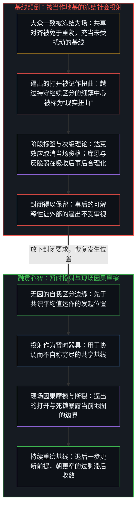
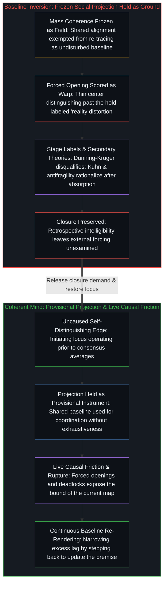

# 现实扭曲力场颠倒了基线 / The Reality Distortion Field Inverts the Baseline

*被当作地基的大众一致，把逼出的打开记作暂时的扭曲 / Mass coherence held as ground scores forced openings as temporary warp*

“现实扭曲力场”这个说法，把平均的图景冻结为场本身，把罕见的、被实现的打开冻结为这个场的一次弯曲。顺序是反过来的：平均之外的细薄中心逼出打开，平均随后吸收它们，而大众靠选择与自身的一致来保持一致。阶段标签与次级理论各有各的时机：达克效应与群体思维在打开仍在进行时取消它的资格，库恩与认知谦逊在吸收之后讲述它，幂律与分形登记它在结果表面的纹理，反脆弱与混沌把它转成可管理、可标绘的东西；它们都让打开如何从给它计分的那个持守之外被逼出这件事不受审视，而一旦被当作对机制的说明，即便看起来是在命名开放，也作为封闭的器具运作。从平均之内被登记为扭曲的东西，是活动越过了一个自称封闭的持守而继续。

The phrase "reality distortion field" freezes the average picture as the field itself and the rare realized opening as a bend in that field. The sequence runs the other way: thin centers outside the average force openings the average later absorbs, while the mass remains coherent by selecting for consistency with itself. Stage labels and secondary theories each have their moment: Dunning–Kruger and groupthink disqualify an opening while it is still under way, Kuhn and epistemic humility narrate it after absorption, power laws and fractals register its texture at the surface of effects, and antifragility and chaos convert it into something manageable or charted; all of them leave unexamined how openings are forced from outside the hold that scores them, and once taken as accounts of the mechanism they function as instruments of closure even when they appear to name openness. What registers as distortion from inside the average is the activity continuing past a hold that claimed closure.

## 一、 这个说法把大众的一致冻结为地基 / 1. The Phrase Freezes Mass Coherence as Ground

自我区分的活动在发生，无因，不息。称它为心智：那个已经在进行中的观察者，它的每一个动作都是一次区分。每一个动作都划出一道边界；较早动作的残余，塑造较晚的动作所能找到的东西。在许多中心之间，这份残余变密为共享的对齐：一幅关于什么算作现实、可行、胜任或已经定下的图景。这幅图景在画出它的那些动作上成立。它让协调变密。它不是进一步的区分所能逼开之物的穷尽地基。

Self-distinguishing activity occurs, uncaused, unceasing. Call it the Mind: the observer already underway, every act of which is a distinction. Every act draws a bound; residue of earlier acts shapes what later acts find available. Among many centers, that residue densifies as shared alignment: a picture of what counts as real, feasible, competent, or already settled. The picture holds at the acts that drew it. It densifies coordination. It is not the exhaustive ground of what further distinguishing can force open.

常见的故事把这个顺序倒过来。广泛的接受被讲成自然的进程；最初少数人的实现被讲成暂时的反常。“现实扭曲力场”就是借物理学的说法完成的这次倒转：罕见的结果被命名为大众之图的弯曲，于是这张图可以仍是未受扰动的基线。[现实扭曲力场指认的是封闭的地图](../the-reality-distortion-field-names-the-closed-map/)是相伴的一面：被登记为扭曲世界之力的东西，是从一个内部位置持续进行的活动，被拿去对照一张被当作可能之物之封闭场域的共识之图来计分，而滞后随后被合理化为特殊的力量。这里的冻结是基线本身：大众的一致被装为一直都在那里的场，每一次未被绘入的延续都被记为对这个场的扭曲，而不是越过一个持守的活动。

The common stories reverse that order. Widespread acceptance is cast as the natural course; the initial minority realization is cast as temporary aberration. The "reality distortion field" is that reversal in the language of physics: the rare outcome is named a warp of the mass map, so the map can remain the undisturbed baseline. [The Reality Distortion Field Names the Closed Map](../the-reality-distortion-field-names-the-closed-map/) is the companion face: what registers as a power to warp the world is sustained activity from an internal locus scored against a consensus map held as the sealed field of the possible, and the lag is later rationalized as special power. Here the freeze is the baseline itself: mass coherence installed as the field that was always already there, and every unmapped continuation scored as distortion of that field rather than as activity past a hold.

## 二、 选择压力是与平均的一致 / 2. Selection Pressure Is Consistency With the Average

多数靠相信多数已经相信的东西而保持一致。与当下平均的一致，就是让图景保持封闭的选择压力。加强共享对齐的残余更容易回来；不加强它的残余，被记为噪音、过度或错误。这个圆圈出自结构，不是众人的道德缺陷。[信念如何真正改变](../how-belief-actually-changes/)在信念的情形里追溯了这个圆圈：所谓改变主意，是心智重画理性所依据的前提；论证与后果仍经由仍在生效的前提计分，修订是对器具的重画，而不是单由数据逼出来的。

The majority remains coherent by believing what the majority already believes. Consistency with the current average is the selection pressure that keeps the picture closed. Residues that reinforce the shared alignment return more easily; residues that do not are scored as noise, excess, or error. The circle is structural, not a moral defect of the many. [How Belief Actually Changes](../how-belief-actually-changes/) traces that circle in the case of conviction: what is called changing one's mind is the Mind re-drawing the premises reason runs on; argument and consequence still score through premises still in force, and revision is a re-draw of the instrument, not compulsion from the data alone.

因为一致自我加强，这次倒转无法从它内部被解开。计分以平均为尺度进行。落在尺度之外的东西，若不先消解给它计分的那个尺度，就无法作为寻常的延续被登记。所以，真正的转移留给了在那个平均之外运作的中心：细薄的少数，在周围的场仍把这活动框定为过度、威胁或不胜任时，继续区分。它们的成功，后来被讲成本就不可避免，或讲成一次不知怎么变成了常态的扭曲。两种讲法都把迟来的基线保留为地基，并把发起重新安放到那个只在事后吸收的大众身上。

Because coherence is self-reinforcing, the inversion cannot be resolved from inside it. Scoring proceeds with the average as measure. What falls outside the measure cannot register as ordinary continuation without first dissolving the measure that scores it. Actual shifts are therefore left to centers operating outside that average: thin minorities that keep distinguishing while the surrounding field still frames the activity as excess, threat, or incompetence. Their success is later narrated as having been inevitable, or as a distortion that somehow became normal. Both narrations preserve the late baseline as ground and relocate initiation into the mass that only absorbed after the fact.

[进步叙事中的症候与原因](../symptom-and-cause-in-the-narratives-of-progress/)在经济情绪的情形里追溯了同一个顺序：集体的信念，是对发起中心上已在进行之活动的迟到登记，而不是经济运动的引擎。[进步的多面手](../the-utility-men-of-progress/)在临时解题者的情形里追溯了它：进步是临时解题者反复的工作，认可、抵抗与集体吸收，是一个从不完结的开放之场上的滞后。几何是同一个：细薄的少数逼出打开；其中少数长得足够极端，撑破平均，而平均在再也维持不住先前的一致时吸收。

[Symptom and Cause in the Narratives of Progress](../symptom-and-cause-in-the-narratives-of-progress/) traces the same sequence in the case of economic mood: collective belief is delayed registration of activity already under way at initiating centers, not the engine of economic motion. [The Utility Men of Progress](../the-utility-men-of-progress/) traces it in the case of temporary solvers: progress is the repeated work of temporary problem-solvers, and recognition, resistance, and collective absorption are lag on an open field that never finishes. The geometry is one: thin minorities force openings; the few that grow extreme enough rupture the average, which absorbs when it can no longer maintain its prior coherence.

## 三、 标签追随否认的阶段 / 3. Labels Track the Stage of Denial

同一个机制，依大众遇到它的阶段、依那一刻可用的形式语言，以不同的名字出现。当打开仍在进行、平均仍然完好时，这次偏离会被贴上达克效应的标签：自信的局外人被重塑为高估自己能力的低能者。在胜任的说法之下，排序是明白的：共识之外的人不只是不同，他们被记为没有资格修订这幅图景。群体思维提供了同一次封闭的表面纹理：被压下的异议，一致的错觉，集体的合理化。这些人际的症状不是各自独立的失调，而是一个以与平均一致为选择压力的系统，看得见的运作。[来自个体差异的层级](../hierarchy-from-individual-difference/)追溯了排序在变成取消资格之前是什么：彼此不同的个体被放在一个共享的尺度上计分时，出现的就是排序，即共同登记之下差异本身有序的样子；在这里，共享的尺度就是共识本身，而较低的位置被读作没有资格。

The same mechanism appears under different names according to the stage at which the mass encounters it and the formal language available at that moment. While the opening is still active and the average remains intact, the deviation gets labeled the Dunning–Kruger effect: the confident outsider is recast as a low-ability individual who overestimates competence. In the language of competence the ranking is explicit: those outside the consensus are not merely different; they are scored as lacking standing to revise the picture. Groupthink supplies the surface texture of the same closure: suppressed dissent, the illusion of unanimity, collective rationalization. Those interpersonal symptoms are not independent disorders. They are the visible operations of a system whose selection pressure is consistency with the average. [Hierarchy from Individual Difference](../hierarchy-from-individual-difference/) traces what ranking is before it turns into disqualification: ranking is what appears when individuals who differ are scored on a shared measure, the ordered pattern of difference itself under common registration; here the shared measure is the consensus itself, and a lower place is read as lack of standing.

当打开终于无法否认，托马斯·库恩对范式转移的叙述，为吸收本身提供了词汇。反常积累，直到旧框架对足够多的大众失去一致；少数的看法被重新归类为新的基线；这个领域的历史被改写，让先前的共识显得是一个有限的阶段，而不是它曾自称的那个未受扰动的现实。已在进行的打开没有变；变的是登记，即重新归类与改写，因为听众否认它的能力崩塌了。[伪装成远见的表演性后见](../performative-hindsight-that-pretends-to-be-foresight/)在一个成功的尺度上追溯了同一种倒转：被登记为远见的东西，是已经公开的成功，被拿去对照一个被保留下来的“先前未曾留意”的图像重新追溯。[起作用的是信念](../what-works-is-the-belief/)在禁令的情形里追溯了这种持守：禁令在场里什么也封不住，它稳定的是那些把封印当作基础的人之间的信念，直到不共享它的人留下的残余变得公开。[拥有成本把滞后的平均值冻结为车辆属性](../ownership-cost-freezes-lagged-averages-as-vehicle-property/)在保费的情形里追溯了被当作场的平均：同一辆车在测得的使用下报价更低，保费差距多半是数据的滞后，而非车辆的缺陷，而碰撞的严重程度仍随车辆的构型留在价格上。

When the opening finally becomes undeniable, Thomas Kuhn's account of paradigm shifts supplies the vocabulary for the absorption itself. Anomalies accumulate until the old framework loses coherence for enough of the mass; the minority view is reclassified as the new baseline; the history of the field is rewritten so the prior consensus appears as a limited stage rather than the undisturbed reality it once claimed to be. The opening already under way has not changed; what changes is the registration, the reclassification and the rewrite, because the audience's ability to deny it has collapsed. [Performative Hindsight That Pretends to Be Foresight](../performative-hindsight-that-pretends-to-be-foresight/) traces the same inversion at the scale of a single success: what registers as foresight is already-public success re-traced against a preserved image of earlier non-attention. [What Works Is the Belief](../what-works-is-the-belief/) traces the hold in the case of a ban: a ban seals nothing in the field; it stabilizes a belief among those who treat the seal as ground, until the residue of those who did not share it becomes public. [Ownership Cost Freezes Lagged Averages as Vehicle Property](../ownership-cost-freezes-lagged-averages-as-vehicle-property/) traces the average held as field in the case of premiums: the same car prices lower under measured usage, and much of the premium gap is data lag, not a vehicle defect, while collision severity stays on the price, tied to the vehicle's configuration.

认知谦逊的概念，在那道门槛的两边提供双重的服务。事后，它们把同一次吸收命名为旧图景先前的失败：“我们本该认出它的局限。”同时，它们倒转因果，敦促人们预先接受未知的知识：平均被邀请事先保持开放。打开不是大众让出空间而产生的，它们是由在给它们计分的那个持守之外运作的中心逼出来的。所以谦逊的框定作为又一层覆盖运作，让封闭的系统宣称自己已有准备，同时仍把当下的偏离归为扭曲或不胜任，直到大众自己再也维持不住封闭的错觉。[要求他人开放是对自我封闭的渴望](../advocating-openness-of-others-is-a-desire-for-closure-of-the-self/)追溯了一个相近的要求在人际之间的样子：没有哪个中心能对另一个全然打开，要求他人打开，是这个位置在一个开放的形象之下维持自己边界的方式。这里被管理的暴露，是被培养出来的对未知知识的接纳，而平均并没有被松开，仍是当下胜任与否的穷尽尺度。

Epistemic humility concepts perform a dual service on either side of that threshold. In retrospect they name the same absorption as a prior failure of the old picture: "we should have recognized its limits." At the same time they reverse causality by urging preemptive acceptance of unknown knowledge: the average is invited to remain open in advance. Openings are not produced by the mass granting space. They are forced by centers operating outside the hold that scores them. The humility framing therefore works as another overlay that allows the closed system to claim readiness while still classifying present deviations as distortion or incompetence, until the mass itself can no longer sustain the illusion of closure. [Advocating Openness of Others Is a Desire for Closure of the Self](../advocating-openness-of-others-is-a-desire-for-closure-of-the-self/) traces a neighboring demand in the interpersonal case: no center can open fully to another, and the demand that others open is how this locus maintains its own bound under an openness-image. Here the managed exposure is cultivated receptivity to unknown knowledge, while the average is not released as the exhaustive measure of present competence.

## 四、 吸收没有可预先确定的时间表 / 4. Absorption Has No Predeterminable Schedule

从头到尾，并没有一个可预先确定的大众接受时间表。吸收发生在平均再也维持不住它的一致之时，而不是按照一个内部的日程、一个被预测的范式更替阶段，或一种会让转移按日历必然发生的、被培养出来的开放。试图强加这样一个时间表，本身就是封闭系统的产物：把从转移发生之后的事后改写里得出的规律，投射到一个仍在进行的过程上。

Throughout, there is no predeterminable timeline of mass acceptance. Absorption occurs when the average can no longer maintain its coherence, not according to an internal schedule, a predicted stage of paradigm succession, or a cultivated openness that would have made the shift inevitable on a calendar. Attempts to impose such a timeline are themselves products of the closed system: regularity drawn from the retrospective rewriting that follows a shift, projected onto a process still under way.

这种投射，是集体尺度上的图像滞后。观察握住的是结果；下一次断裂的生成条件，总比任何阶段清单早一步。库恩式的词汇，在吸收已经变密到越过否认之后，把余下的模式变密为可用的形式。把这套词汇保留为未来打开的时间表，就把残余冻结为一张尚未被逼开之物的地图。[封闭的假设把复利挤成 S 曲线](../closed-assumptions-squeeze-compounding-into-s-curves/)在增长的情形里追溯了同一次冻结：逻辑斯蒂的形状是一个固定框架的束缚，而不是开放现实之下进步的轨迹。[没有系统能被保持封闭](../no-system-can-be-kept-closed/)是它形式的一面：1 + 1 在封闭的一位持守之内登记为 0，进位落在它之外，而 2 是这个持守装不下的延续。

That projection is image lag at collective scale. Observation holds the effect; the generating conditions of the next rupture stay one step ahead of any inventory of stages. A Kuhnian vocabulary densifies residual pattern into usable form after absorption has densified past denial. Preserving that vocabulary as a schedule of future openings freezes residue as a map of what has not yet been forced. [Closed Assumptions Squeeze Compounding into S-Curves](../closed-assumptions-squeeze-compounding-into-s-curves/) traces the same freeze in the case of growth: the logistic shape is the binding of a fixed frame, not the trajectory of progress under open reality. [No System Can Be Kept Closed](../no-system-can-be-kept-closed/) is its formal face: 1 + 1 registers as 0 inside the closed one-bit hold, the carry falls outside it, and 2 is the continuation the hold does not contain.

## 五、 幂律与分形登记递归的打开 / 5. Power Laws and Fractals Register Recursive Opening

同样的动态，生出可观察的统计与几何模式。曼德博的幂律登记了打开在表面上的分布：绝大多数打开仍然很小，很快被打发，或被悄然并入，而极少数长得足够极端，撑破平均，迫使它吸收。这些无尺度的规律不是机制本身，而是它跨越量级的数学纹理：许多分立的动作在以平均为准的选择之下变密之后，被逼出的打开如何分布。

The same dynamics generate observable statistical and geometric patterns. Mandelbrot's power laws register the surface distribution of openings: the great majority remain small and are quickly dismissed or quietly taken in, while a vanishingly small number grow extreme enough to rupture the average and compel absorption. Those scale-free regularities are not the mechanism itself. They are its mathematical texture across magnitudes: how forced openings distribute once many discrete acts have already densified under selection for the average.

更深一层，曼德博的分形几何，表达的是开放递归地重新进入自身。被登记的东西并不朝最终的封闭推进；不完备在每一个尺度上折回自身，生出自相似的结构，局部的一致与刺穿它的延续之间的张力，在其中无尽地重现。大众的共识不断造出平滑、封闭的图景；分形是这些图景被它们试图容纳的那份延续，从内部、跨越尺度地刺穿时，留下的几何印记。[开放即一致](../openness-is-consistency/)追溯了表面矛盾从何而来：不一致是对封闭的渴望或尝试，一个有限的结构被逼去为只会继续的东西奠基，于是每当边界被免于重新描摹，矛盾便成倍出现。[超越投射](../beyond-the-projection/)在人与智能体的投射之间追溯了同一道结构边界：每一张共识地图、明文规则或模型轨迹，都是压缩了正交坐标轴并朝自身局部引力井拉拽的有限低维投射，而融贯属于活的心智，它把每一份投射都作为暂时的器具保持开放，并在现场的因果摩擦或不可化约的死锁暴露出这道边界时退后一步，重新描摹前提。[为何数学永远解不完](../why-mathematics-can-never-be-solved/)在形式的情形里追溯了这份不完备：“解完了”把一片有限的形式地貌冻结为穷尽的地基，而数学是经由开放的区分持续生成结构。

Deeper still, Mandelbrot's fractal geometry expresses openness re-entering itself recursively. What registers does not advance toward final closure; incompleteness folds back into itself at every scale, generating self-similar structures in which the tension between local coherence and the continuation that perforates it reappears without end. The mass consensus keeps constructing smooth, closed pictures; the fractal is the geometric signature of those pictures being perforated, from within and across scales, by the very continuation they attempt to contain. [Openness Is Consistency](../openness-is-consistency/) traces where the surface contradiction comes from: inconsistency is the desire, or attempt, for closure, a finite structure forced to ground what only continues, so that contradictions multiply whenever the boundary is exempted from re-rendering. [Beyond the Projection](../beyond-the-projection/) traces that same structural bound across human and agentic projections: every consensus map, explicit rule, or model trajectory is a finite low-dimensional projection that compresses orthogonal axes and pulls toward its own local gravity well, whereas coherence belongs to the living Mind that holds every projection open as a provisional instrument and steps backward to re-render the premise when live causal friction or an irreducible deadlock exposes the bound. [Why Mathematics Can Never Be Solved](../why-mathematics-can-never-be-solved/) traces that incompleteness in the formal case: "solved" freezes a finite formal landscape as exhaustive ground, while mathematics is the continuing generation of structure through open distinguishing.

## 六、 次级理论重新装上一个可封闭的未来 / 6. Secondary Theories Reinstall a Closable Future

抓住这些模式的次级理论，可能把它们过度推广，重新强加一个可封闭的未来。纳西姆·塔勒布的反脆弱系统理论，看到了无序的价值与冲击的肥尾分布，却把这个统计模式抬升为一条普遍的处方：设计能从波动中获益的系统。从描述到系统理论的这一步，把那个不可预先确定、由外部逼出的过程，转成一种可以事先被设计的、可管理的属性，于是假定了一个有界到足以为之准备、或从中获益的未来。[重新审视反脆弱](../a-new-deeper-look-at-antifragility/)在坐标的情形里追溯了这一刀：症状在一个持守之下被登记，而持守不是区分之前的结构；幂律与凸性的框架仍是可用的局部器具，滞后始于这个框架被免于重新追溯，被装为对不确定性的常设关系之时。

Secondary theories that seize on these patterns can over-generalize them and reimpose a closable future. Nassim Taleb's antifragile systems theory observes the value of disorder and the fat-tailed distribution of shocks, yet raises the statistical pattern into a general prescription: design systems that gain from volatility. The move from description to systemic theory converts the non-predeterminable, externally forced process into a manageable property that can be engineered in advance, and so assumes a future bounded enough to prepare for or benefit from. [A New Deeper Look at Antifragility: Prosthesis, Not Driver](../a-new-deeper-look-at-antifragility/) traces that cut in the case of coordinates: symptoms register under a hold, and the hold is not the structure prior to distinguishing; power-law and convexity frames remain usable local instruments, and lag begins when the frame is exempted from re-tracing and installed as the standing relation to uncertainty.

混沌理论提供了平行的服务。它把敏感依赖与预测的界限形式化，命名了开放与未知；可命名并数学化这份开放的动作，又重新装上一幅一致的图景，未知在其中显得已被标绘、可以理解。两种情形里，底下的机制都不受影响。极端的打开继续从任何被设计的反脆弱、被形式化的混沌之外到来，递归地重新进入，不接受过程已被掌握或已被知道的错觉。[关闭选择权的代价](../the-price-of-closing-optionality/)是这两种理论在组织里的孪生，更近于反脆弱的有所准备：把未知的风险当作一份可以事先中和的封闭清单，就关闭了选择的空间，落后是迟到的账单。在这里，封印是把有所准备当作未来断裂的穷尽地基。

Chaos theory performs a parallel service. By formalizing sensitive dependence and the limits of prediction it names openness and the unknown; yet the act of naming and mathematizing that openness reinstalls a picture of coherence in which the unknown appears charted and intelligible. In both cases the underlying mechanism is unaffected. Extreme openings keep arriving from outside any designed antifragility or formalized chaos, recursively re-entering and refusing the illusion that the process has been mastered or known. [The Price of Closing Optionality](../the-price-of-closing-optionality/) is the organizational twin of both, nearest to antifragility's preparedness: treating unknown risk as a sealed inventory that can be neutralized in advance closes the option space, and falling behind is the delayed bill. Here the seal is preparedness held as exhaustive ground of future rupture.

## 七、 事后的可解释让逼出不受审视 / 7. Hindsight Explainability Leaves the Forcing Unexamined

这些理论不是偶然出现的。它们契合平均在结果已经变密之后，对余下之可理解性的选择。它们提供事后的解释与合理化，却几乎不让任何能预测下一次被逼出之打开的东西变密。

These theories are not accidental. They fit the average's selection for residual intelligibility after effects have already densified. They supply hindsight explainability and rationalization; they densify little that predicts the next forced opening.

它们中的每一个，达克效应的胜任排序，库恩的事后改写，认知谦逊的双重服务，群体思维的人际表面，幂律的统计规律，分形的递归几何，反脆弱的工程回应，混沌理论被形式化的未知，或在打开仍在进行时取消它的资格，或事后到来，或停在结果的表面。它们让封闭的平均要么在当下把打开打发掉，要么用一致的说法讲述已经发生的事，于是恢复了图景仍可理解的错觉。幂律与分形作为纹理本身是可用的，被当作机制时才加入封闭。它们聚焦于结果，而不是生成的条件，即在平均之外运作的中心从外部逼出打开，于是让这个机制不受审视，把注意力密集在余下的模式上。大众自我加强的一致，被免于重新追溯；把共识当作未受扰动之基线的那次倒转，继续作为计分的器具。所以这些理论即便看起来是在命名开放，也作为封闭的器具运作：它们解释过去的方式，让现在与未来摆脱了推动转移的那份因果。

Each of them, the competence ranking of Dunning–Kruger, the retrospective rewriting of Kuhn, the dual service of epistemic humility, the interpersonal surface of groupthink, the statistical regularities of power laws, the recursive geometry of fractals, the engineered response of antifragility, the formalized unknown of chaos theory, disqualifies an opening while it is under way, arrives after the fact, or stays at the surface of effects. They allow the closed average either to dismiss an opening in the moment or to narrate what has already occurred in coherent terms, and so restore the illusion that the picture remains intelligible. Power laws and fractals are usable as texture; they join the closure only when taken for the mechanism. By focusing on effects rather than on the generating conditions, the external forcing of openings by centers operating outside the average, they leave that mechanism unexamined and densify attention on residual pattern. The self-reinforcing coherence of the mass stays exempt from re-tracing; the inversion that treats consensus as undisturbed baseline continues as the scoring instrument. The theories therefore function as instruments of closure even when they appear to name openness: they explain the past in ways that leave present and future free of the causality that drives the shifts.

[伪装成远见的表演性后见](../performative-hindsight-that-pretends-to-be-foresight/)是同一次转换落在一个成功上：已经公开的成功，被拿去对照一个被保留的“先前未曾留意”的图像，重新追溯为远见。[当效果主宰了框架的叙事](../when-the-effect-authors-the-frame/)在情感与机构的情形里追溯了同一种拓扑：被感到或被投射的那个音区一旦被装为首要，可用的回应就围绕着管理结果重新组织，而生成的条件不受审视。这里的音区，是平均事后的一致；管理，是那一整套阶段标签与次级理论，它们恢复可理解，却不让基线回到器具。

[Performative Hindsight That Pretends to Be Foresight](../performative-hindsight-that-pretends-to-be-foresight/) is that conversion applied to a single success: already-public success re-traced as foresight against a preserved image of earlier non-attention. [When the Effect Authors the Frame](../when-the-effect-authors-the-frame/) traces the same topology in the case of affect and institutions: once the felt or projected register is installed as primary, available responses reorganize around managing effects while generating conditions stay unexamined. Here the register is the average's retrospective coherence, and the management is the library of stage labels and secondary theories that restore intelligibility without returning the baseline to instrument.

## 八、 平均回到器具时，扭曲就消解了 / 8. Distortion Dissolves When the Average Returns to Instrument

随步伐推进，让平均作为器具朝更窄的滞后持续重绘，扭曲力场就消解了，不需要一个被纠正的英雄故事，不需要一种仍把当下的打开记为不胜任的被培养出来的谦逊，也不需要一种在平均仍是地基时标绘开放的次级理论。大众的图景作为变密的残余仍然可用：协调，共享的尺度，暂时的基线。穷尽性并不随它而来。越过那幅图景逼出打开的细薄中心，不是扭曲的操纵者；它们是继续区分的位置，在周围的场仍把这活动框定为过度、威胁或不胜任时，从内部持续进行，而没有把不完备的平均装为现实之穷尽地基。

Keep the average re-rendering as an instrument toward narrower lag as the step moves, and the distortion field dissolves, without a corrected hero story, a cultivated humility that still scores present openings as incompetence, or a secondary theory that charts openness while the average remains ground. The mass picture stays usable as densified residue: coordination, shared measure, temporary baseline. Exhaustiveness does not travel with it. Thin centers that force openings past that picture are not operators of a warp. They are loci that keep distinguishing, sustained from within while the surrounding field still frames the activity as excess, threat, or incompetence, without installing the incomplete average as exhaustive ground of the real.

所以，从大众共识之内看起来像扭曲的东西，是活动越过了一个自称封闭的持守而继续。这个标签把滞后冻结为罕见结果的属性，把平均冻结为它所弯曲的场。那些理论把余下的结果冻结为仿佛就是生成的机制。活动越过每一个把自己冻结为场的平均而继续。正如[开放即一致](../openness-is-consistency/)与[超越投射](../beyond-the-projection/)所确立的，把每一道共享基线与形式规则都作为暂时的投射保持开放——并在现场的因果摩擦中持续收窄过剩滞后，而非防卫被保留的图像——剩下的就只是寻常的东西：开放的结构，从不封住边缘的对局部协调的选择，细薄中心逼出的打开，在否认再也维持不住时的吸收，以及不完备在下一个持守仍试图抹平的每一个尺度上递归地重新进入。

What looks like distortion from inside the mass consensus is therefore the activity continuing past a hold that claimed closure. The label freezes lag as a property of the rare outcome and the average as the field it bends. The theories freeze residual effects as if they were the generating mechanism. The activity continues past every average that freezes itself as field. As [Openness Is Consistency](../openness-is-consistency/) and [Beyond the Projection](../beyond-the-projection/) establish, holding every shared baseline and formal rule open as a provisional projection—and continuously narrowing excess lag against live causal friction rather than defending the retained image—leaves only what is ordinary: open structure, selection for local coordination that never seals the edge, openings forced by thin centers, absorption when denial can no longer be maintained, and recursive re-entry of incompleteness at every scale the next hold still tries to smooth.

同样的冻结也在别处运行。[对 AI 风险的想象](../the-imagining-of-ai-risk/)在灾难投射的情形里追溯了它：灾难的图像被当作未受扰动的基础，在接触之下发布的工作被记为对它的偏离，而被记为必要的保护，正是让被恐惧的危险得以运作的那条人的链条。[理性选择公设是原罪](../the-rational-choice-postulate-is-the-original-sin/)在经济理论的情形里追溯了它：齐一的一致被立为地基，而选择只在私人的、暂时的前提下继续；次级的补丁辨认出更多已经在集体中实现了的选择，齐一的公设却仍是地基。

The same freeze runs elsewhere. [The Imagining of AI Risk](../the-imagining-of-ai-risk/) traces it in the case of catastrophe projection: the catastrophe image is held as undisturbed ground, work that ships under contact scores as departure from it, and the protection scored as necessary is the human chain that makes the feared danger operational. [The Rational Choice Postulate Is the Original Sin](../the-rational-choice-postulate-is-the-original-sin/) traces it in the case of economic theory: uniform consistency is installed as foundation while choice continues only under private, provisional premises, and secondary patches identify more choices already materialized in the collective while the uniformity postulate remains ground.
