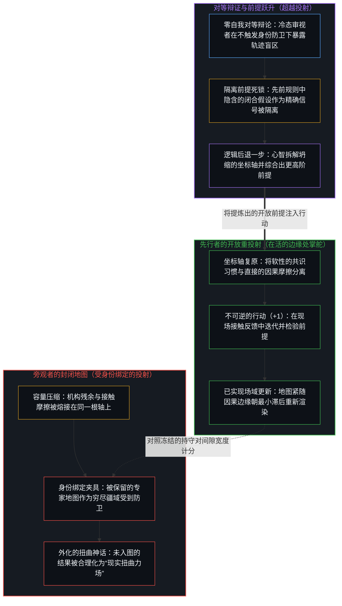
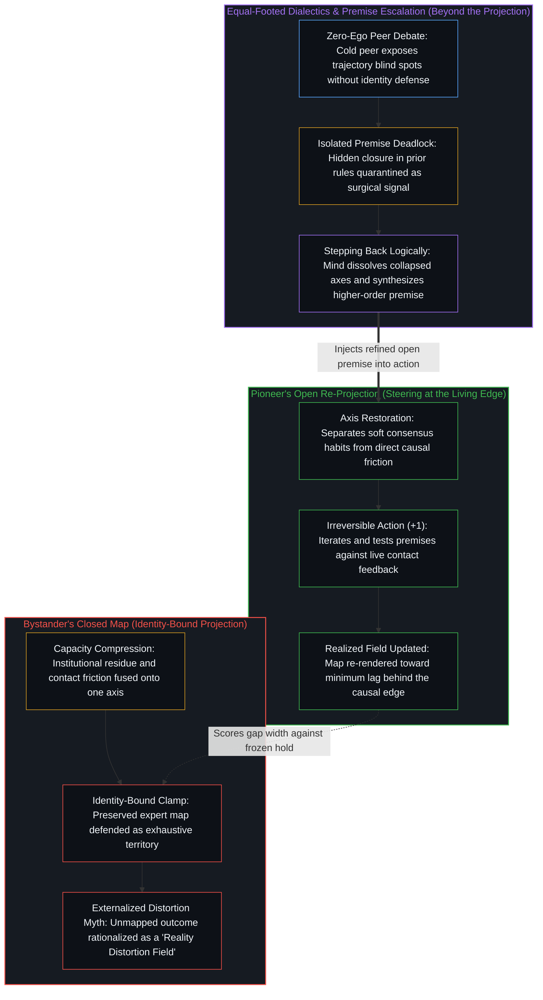

# 现实扭曲力场指认的是封闭的地图 / The Reality Distortion Field Names the Closed Map

*内在因果唯有在对照封闭地图计分时才会登记为扭曲 / Internal causality registers as a warp only when scored against a closed map*

史蒂夫·乔布斯以及与他同类的人并没有弯曲一个固定的现实。他们选择成为大多数地图尚未容纳的那些结果的原因。观察者在“共识地图即疆域”的假设下，事后将这些结果合理化为一种扭曲世界的特殊能力，并在这种合理化中，把他们对可能性的有限模型当成了比现实本身的开放结构更真实的东西。“现实扭曲力场”正是从外部对这种滞后的命名。开放的解释要简单得多：地图本就不完备，而行动者更新了已实现的场域。

Steve Jobs and those like him did not bend a fixed reality. They chose to be the cause of outcomes most maps had not yet held. Observers, under the assumption that the consensus map is territory, later rationalize those outcomes as a special ability to distort the world, and in that rationalization treat their limited model of the possible as more real than the open structure of reality itself. The "reality distortion field" is the name of that lag from the outside. The open account is simpler: the map was incomplete, and the agent updated the realized field.

## 一、 事后的封闭假设 / 1. The Closed Assumption After the Fact

自我区分的活动发生着，无因且不息。称之为心智：早已在途的观察者，其每一个行动都是一次区分。每一次行动划定一道边界；下一次行动再次划定。早先行动的残余便是位置。观察持有结果；产生该结果的原因则始终超前一步。[一步一步绘制出的路径](../the-path-drawn-one-step-at-a-time/)将这种非对称性追溯为序列。

Self-distinguishing activity occurs, uncaused and unceasing. Call it the Mind: the observer already underway, every act of which is a distinction. Every act draws a bound; the next act draws again. Residue of earlier acts is position. Observation holds effect; the cause that produced it remains one step ahead. [The Path Drawn One Step at a Time](../the-path-drawn-one-step-at-a-time/) traces that asymmetry as sequence.

一张关于约束条件的共识地图就是残余：先前的区分被压实为关于何为可行的共享对齐。地图在绘制它的那些行动处是真实的。它压实了协调。但它并不是后续行动所能引发的一切的穷尽地基。[没有系统能被保持封闭](../no-system-can-be-kept-closed/)在任何把有限持守当作终局的地方追溯着同样的余项：结构保持可用，而穷尽性并不随之同行。

A consensus map of constraints is residue: prior distinctions densified into shared alignment about what counts as feasible. The map is real at the acts that drew it. It densifies coordination. It is not the exhaustive ground of what further acts can cause. [No System Can Be Kept Closed](../no-system-can-be-kept-closed/) traces the same remainder wherever a finite hold is treated as final: structure stays usable, while exhaustiveness does not travel with it.

当行动者引发了一个地图未曾编码的结果时，封闭假设并不会自行消解。后果落入当下的场域，并对照着被保留的地图进行登记。这一间隙的宽度就是滞后的量级。出现在这一宽度之内的并非不可能变为可能，而是未被测绘的延续在对照既有持守计分时被判定为异类。[基准刷榜中的封闭实存](../closed-reality-in-benchmark-maxing/)是评测之下同样的冻结，其中一套封闭的测试集被持守为能力的全部。[追求机缘中的封闭现实](../closed-reality-in-the-pursuit-of-serendipity/)则是披着生活方式外衣的同一前提，其中一份有限的日程槽位清单被持守为机遇的场域。在这里，那份封闭的清单就是专家绘制的可能性地图。把监管持守为可能性的边界也是同一张封闭地图，正如[风险在于对监管本身的迷信](../the-risk-is-the-belief-in-oversight-itself/)所揭示的那样。

When an agent causes an outcome the map did not encode, the closed assumption does not dissolve by itself. Consequences land in the present field and register against the preserved map. The width of the gap is the lag magnitude. What appears inside that width is not the impossible made possible, but unmapped continuation scored as alien to the hold. [Closed Reality in Benchmark Maxing](../closed-reality-in-benchmark-maxing/) is the same freeze under evaluation, where a sealed suite is held as the whole of capability. [Closed Reality in the Pursuit of Serendipity](../closed-reality-in-the-pursuit-of-serendipity/) is the same premise under lifestyle costume, where a finite inventory of slots is held as the field of chance. Here the sealed inventory is the expert map of the possible. Oversight held as the boundary of the possible is the same closed map, as [The Risk Is the Belief in Oversight Itself](../the-risk-is-the-belief-in-oversight-itself/) shows.

## 二、 这个名称把滞后冻结成了特殊能力 / 2. The Name Freezes Lag as Special Power

巴德·特里布尔在 1981 年提出的那个围绕乔布斯的说法——“现实扭曲力场”——指认的并不是一股弯曲封闭世界的力量。它指认的是这种滞后从外部感受到的样子。当一个行动者处在比共识模型所允许的更大的可能性空间内、从原因的位置出发行动时，小概率的事就会显得不可避免。事后，为了保全封闭假设，人们便发明出一种特殊能力，而不是承认新的格局只是持续活动的直接结果。

Bud Tribble's phrase from 1981—the "reality distortion field" around Jobs—does not name a force that warps a closed world. It names how the lag feels from the outside. In the presence of an agent acting from the position of cause inside a larger possibility space than the consensus model allows, the improbable feels inevitable. After the fact, the closed assumption is preserved by inventing a special power rather than recognizing that the new configuration was the direct result of sustained activity.

这种发明就是日常形态下的图像滞后。观察持有结果：Macintosh 按专家断定无法交付的日程出货，iPhone 抛弃了实体键盘的行业共识，轨道级助推器实现着陆与复飞，大众市场的高性能电动车实现规模化量产。被持守的图像冻结在产生这些结果的那道边缘之后一步的位置。于是，因果被安放进一个近乎魔力的力场之中，好让地图能原封不动地继续充当疆域。[因果贯穿始终](../causality-all-the-way/)追溯了同样的安放：当一个既定的抽象被当作底层原因，仿佛它能脱离那道仍在划出每一个后续刻痕的边缘而独立存在时，错置便发生了。[伪装成远见的表演性后见](../performative-hindsight-that-pretends-to-be-foresight/)则是它在社交场域的孪生形态，其中已经公开的成功被对照着一幅早先漫不经心的保留图像重新描摹。扭曲力场的故事，不过是披着物理学外衣的事后诸葛——凭空造出一种扭曲，只为不必承认地图的不完备。

That invention is Image lag in ordinary form. Observation holds effect: the Macintosh shipped on a schedule experts rejected, the iPhone discarded the physical-keyboard consensus, orbital boosters land and refly, and mass-market high-performance electric vehicles scale. The held image freezes one step past the edge that produced those outcomes. Causality is then placed in a quasi-magical field so the map can remain intact as territory. [Causality All the Way](../causality-all-the-way/) traces the same placement when a secured abstraction is treated as an underlying cause standing apart from the edge still drawing every following mark. [Performative Hindsight That Pretends to Be Foresight](../performative-hindsight-that-pretends-to-be-foresight/) is the social twin, where already-public success is re-traced against a preserved image of earlier non-attention. The distortion-field story is hindsight wearing physics costume—a warp invented so incompleteness need not be admitted.

原因的位点从未离开。完整的因果始终停留在那道不断区分、迭代与检验的活动之中。中心与中心之间只有可用性的排布；其他中心登记为扭曲的东西，是它们自身的间隙宽度，而不是由个人魅力注入世界的一种属性。[验证中因果权能的分配](../the-allocation-of-causal-power-in-validation/)指认了哪一侧被当作下一步的供给方。扭曲叙事把供给安放在外化的特殊力量里；实际运作的序列则把供给留在那道持续选择下一个前提的边缘处。

The locus of cause never left. Full causality remains with the activity that distinguishes, iterates, and tests. Between centers there is only availability-patterning; what other centers register as distortion is their own gap width, not a property injected into the world by charisma. [The Allocation of Causal Power in Validation](../the-allocation-of-causal-power-in-validation/) names which side is treated as supplying the next step. The distortion narrative places supply in an externalized power. The operative sequence places supply at the edge that kept choosing the next premise.

## 三、 被当作疆域持守的地图 / 3. Map Held as Territory

大多数人都会把自己当下的约束地图与可能性的疆域混为一谈。软性的约束——行业惯例、机构时间表、关于成本或可行性的专家共识——与行动中直接因果摩擦所产生的硬性约束被压缩到了同一根轴上。在这一负荷下，一个中心的容量无法将这些轴区分开来；软性的惯例与硬性的接触摩擦登记为同一道封闭的天花板。当推理历史与观察者所保留的自我图像融合在一起时，对职业身份或机构身份的防卫便会把递归回折死死夹紧。因此，在受身份绑定的旁观者看来，把软约束当作软约束来处理的行动就像是对现实的违背，而不是在开放场域内展开的进一步区分。

Most people confuse their current map of constraints with the territory of the possible. Constraints that are soft—industry practice, institutional timeline, expert consensus about cost or feasibility—compress onto the same axis as constraints that arise from direct causal friction in action. Under that load, a center's capacity cannot keep the axes apart; soft convention and hard contact friction register as one closed ceiling. When reasoning history fuses with an observer's retained self-image, defending that professional or institutional identity clamps the recursive fold shut. Acts that treat soft constraints as soft therefore look to the identity-bound bystander like a violation of reality, rather than further distinguishing inside an open field.

[开放即一致](../openness-is-consistency/)指认了制造出表面矛盾的那项要求。强迫一张有限的地图去为那只是持续展开着的事物奠基，矛盾就会成倍增加：不可能按期出货的日程、不可能存在的产品品类、不可能算得过账的助推器回收。矛盾并不在这些结果之中；矛盾在于要求当下的地图封死整个场域。保持地图开放并不会规避物质摩擦；它让参照作为工具持续重新渲染，同时由不可逆的介入行动支付能量成本，去检验在真实接触中什么才站得住脚。共识预测只是可供重新描摹的暂存残余，而将其当作封闭疆域来对待则是滞后。[遗忘的脚手架](../the-scaffolding-we-forget/)切开了同一刀的另一面：一步脱手让地图得以可用，而越过这一步的保留则将其冻结为滞后。

[Openness Is Consistency](../openness-is-consistency/) names the demand that produces the surface contradiction. Force a finite map to ground what only continues, and contradiction multiplies: the schedule that could not ship, the product category that could not exist, the booster recovery that could not pay off. The contradiction is not in the outcomes; it is in the demand that the present map seal the field. Keeping the map open does not evade physical friction; it keeps the reference re-rendering as an instrument while irreversible interventions pay the energy cost of testing what holds at contact. Consensus forecasts are provisional residue available for re-tracing, whereas treating them as sealed territory is lag. [The Scaffolding We Forget](../the-scaffolding-we-forget/) is the dual face of that cut: one-step drop-out makes a map usable, while preservation past the step freezes it into lag.

要打破封闭地图，又不触发那套滋生扭曲神话的身份防卫，[超越投射](../beyond-the-projection/)揭示了所需的确切架构。每一条显式的规则、日程表或可行性模型，都是从活生生的多维意图投射出来的有限低维投射。如果停留在单一的自我强化回路内部，行动者或机构就会包裹自身的轨迹盲区与维度坍缩，以维持表面的自洽。当架构将主任务轨迹与正交产线上无自我包袱的全新对等审视者配对时，局部盲区便能在不牵动身份依附的情况下完成更新，而不可化约的死锁则会隔离出先前规则将独立坐标轴压缩为一体的确切坐标。身处统筹边缘的人类心智不再把意外碰撞合理化为外部反常或扭曲力场，而是认领返回的摩擦，在逻辑上后退一步以拆开坍缩的坐标轴，并综合出更高阶的前提。

[Beyond the Projection](../beyond-the-projection/) exposes the exact architecture required to break out of a closed map without triggering the identity-bound defensiveness that breeds distortion myths. Every explicit rule, schedule, or feasibility model is a finite low-dimensional projection cast from living multi-dimensional intention. Left inside a single self-reinforcing loop, an agent or an institution wraps its own trajectory blind spots and dimensional collapses to preserve surface plausibility. When an architecture pairs a primary task trajectory with a fresh, zero-ego peer critic across orthogonal streamlines, local blind spots are updated without status attachment, while irreducible deadlocks isolate the exact coordinate where a prior rule compressed independent axes into one. Instead of rationalizing an unexpected collision as an external anomaly or a distortion field, the human Mind at the orchestrating edge claims the returning friction, steps further back logically to separate the collapsed axes, and synthesizes a higher-order premise.

## 四、 相继案例中的同一道弧线 / 4. The Same Arc Across Successive Cases

这一模式在相继出现的案例中看得最清楚，不是作为英雄圣徒传，而是作为不同负荷下的同一几何结构。

The pattern is clearest across successive instances, not as hagiography but as the same geometry under different loads.

1903 年 10 月，《纽约时报》发表社论称，实用的飞行器可能需要一百万到一千万年才能造出来。六十九天后，莱特兄弟在完成了被西蒙·纽康与开尔文勋爵等大多数专家断定无望的第一性原理推演与风洞迭代后，实现了受控动力飞行。当时的共识地图把重于空气的飞行在人类时间尺度上视为封闭的死路。莱特兄弟通过直接接触与反馈更新了已实现的场域。事后的滞后披上了奇迹或特殊天才的名称，而不是被称为不完备的专家残余。

In October 1903 the *New York Times* editorialized that a practical flying machine might require one to ten million years. Sixty-nine days later the Wright brothers achieved controlled powered flight after first-principles work and wind-tunnel iteration that most experts, including Simon Newcomb and Lord Kelvin, had written off. The consensus map held heavier-than-air flight as effectively closed on human timescales. The brothers updated the realized field through direct contact and feedback. The lag afterward wore the name of miracle or special genius rather than incomplete expert residue.

乔布斯的 Macintosh 排期以及后来 iPhone 对实体键盘共识的摒弃，走过了同一道弧线。共识地图编码了个人电脑发布和手机界面必须是什么样。内在位点上的持续活动重新绘制了产品场域。而在外部，这层滞后被归拢到了特里布尔发明的名称之下。

Jobs's Macintosh schedule and later the iPhone's rejection of the physical-keyboard consensus followed the same arc. The consensus map encoded what a personal computer launch and a phone interface had to be. Sustained activity at an internal locus re-drew the product field. Outside, the lag collected under Tribble's name.

埃隆·马斯克则将其变成了一场反复上演、持续进行的演示。传统航天共识——联合发射联盟式的分析、欧洲与日本航天机构的声浪，以及大部分传统行业——都把轨道级一级助推器回收与快速复用视为不切实际或得不偿失。SpaceX 在经历三次险些终结公司的猎鹰 1 号失败后，于 2015 年 12 月实现了猎鹰 9 号的首次着陆，并于 2017 年实现首次复飞，将复用变成了常规操作，助推器飞行二三十次，发射成本随之坍塌。[失败即信息](../failure-as-information/)将那些爆炸读作同一策略的采样，而不是先苦后甜的戏剧：挫折与加速展开的场域是同一条轨迹。同一张封闭地图曾断言大众市场高性能电动车不可行、断言特斯拉无法实现制造规模化；这两者都通过把共识约束当作软约束、同时在物质摩擦中无情检验而成为了事实。星舰继续着这一序列——快速全复用仍在推进，时间表一再推迟——然而已实现的可能性空间却在持续扩张。错过的时间表并不会复原封闭地图；它们是在硬性接触摩擦下承受开放负荷的残余，而不是旧地图已然穷尽的证明。

Elon Musk has made this a repeated, ongoing demonstration. Traditional aerospace consensus—ULA-style analyses, European and Japanese agency voices, and much of the legacy industry—treated first-stage orbital recovery and rapid reuse as impractical or uneconomical. SpaceX, after three Falcon 1 failures that nearly ended the company, achieved the first Falcon 9 landing in December 2015 and the first reflight in 2017, turning reuse into routine with boosters flying twenty or thirty times and launch costs collapsing. [Failure as Information](../failure-as-information/) reads those explosions as samples of one policy rather than as a drama that later yielded success: the setbacks and the accelerating field are one trajectory. The same closed map dismissed mass-market high-performance electric vehicles and Tesla's ability to scale manufacturing; both became fact by treating consensus constraints as soft while testing relentlessly against material friction. Starship continues the sequence—full rapid reusability still underway, timelines repeatedly missed—yet the realized possibility space keeps expanding. Missed timelines do not restore the closed map; they are the residue of open load under hard contact friction, not proof that the old map was exhaustive.

在每一个案例中，被锁在封闭假设里的观察者事后都会把结果合理化为对固定世界的扭曲。这种合理化保全了原有的假设。而实际发生的，是持续的活动更新了已实现的场域。

In each case, observers locked into the closed assumption later rationalize the outcome as the distortion of a fixed world. The rationalization preserves the assumption. What occurred was sustained activity updating what had been realized.

## 五、 两个问题，同一几何 / 5. Two Questions, One Geometry

实践上的分水岭，在于边缘处所提出的问题。

The practical difference lies in the question asked at the edge.

封闭的问题问的是：在当前假设下，这个结果是否可能。这一提问方式把当下的地图当成了疆域。可行性被按偏离既有持守的距离来计分，因此持守之外的结果除非作为例外、奇迹或扭曲，否则无从抵达。

The closed question asks whether an outcome is possible under the current assumptions. That framing treats the present map as territory. Feasibility is scored as distance from the hold, so outcomes outside the hold cannot arrive except as exception, miracle, or warp.

开放的问题问的是：要让这个结果成真，哪些条件必须成立，以及当前位点能否通过直接行动与反馈成为这些条件的原因。这一提问方式把原因的位点留在内部。地图重新变回工具。软约束保持为软约束，而硬约束则由真实接触而非委员会来裁定。[现实不按委员会开账单](../reality-doesnt-invoice-by-committee/)在容量与语言的维度上切开了同一刀：账本是行动，而不是关于行动能做什么的共享叙事。[起作用的是信念](../what-works-is-the-belief/)则是政策尺度上的反面：一种持守对那些把它当作地基的人起作用，直到那些不共享该持守的人所留下的残余变得无可否认。在这里，那个持守就是可行性地图；不共享它的人在接触摩擦下继续行动，直到地图的滞后昭然若揭。

The open question asks what conditions would have to be true for the outcome to become real, and whether this locus can cause them through direct action and feedback. That framing keeps the locus of cause internal. The map returns to being an instrument. Soft constraints remain soft, while hard constraints are settled by contact rather than committee. [Reality Doesn't Invoice by Committee](../reality-doesnt-invoice-by-committee/) makes the same cut under capacity and language: the ledger is action, not the shared story about what action may do. [What Works Is the Belief](../what-works-is-the-belief/) is the inverse face at policy scale, where a hold works for those who treat it as ground until the residue of those who do not share it becomes undeniable. Here the hold is the feasibility map; those who do not share it continue acting under contact friction until the map's lag is public.

这种姿态并不是魔法。当信念脱离了能力与现实检验而悬空——当关于可能性的图像被作为身份保留下来、而不是在接触中重新渲染，或者当位点在口头上宣称为内在、延续却依然仰赖外部供给时，它就会坍塌。而当关于可能性的图像不断收窄多余的滞后、且原因的位点始终停留在那道仍在做区分的边缘处时，它就会产生复利。[因果停留在掌舵的边缘](../causality-stays-at-the-edge-that-steers/)在工具与仪器的层面复原了那一位点：无论是借助数学形式体系、实体原型还是多智能体框架，重组与叙事都把发起点留在每一个离散行动实际落下的地方。

That posture is not magic. It collapses when conviction floats free of competence and reality-testing—when the image of the possible is preserved as identity rather than re-rendered at contact, or when locus is announced as internal while continuation is still drawn from external supply. It compounds when the image of the possible narrows excess lag and the locus of cause remains with the edge that is still distinguishing. [Causality Stays at the Edge That Steers](../causality-stays-at-the-edge-that-steers/) restores that locus under instrumentation: whether through mathematical formalisms, physical prototypes, or multi-agent harnesses, recombination and narrative leave initiation where every discrete act lands.

## 六、 让地图随边缘持续重新渲染 / 6. Keep the Map Re-Rendering with the Edge

让共识地图随着移动的边缘持续重新渲染，扭曲力场便会自行消解，无需再编造一套修正版的英雄故事。乔布斯、莱特兄弟、马斯克，以及每一位越过专家残余默默交付成果的建造者，都不是扭曲场的操盘手。他们只是不曾把一张不完备的地图安装为可能性之穷尽地基的中心。从外部听起来像力场的那层滞后，是被保留的参照与已被持续活动更新的场域之间的间隙。[专家经验作为参考而非替代](../expertise-as-reference-not-replacement/)在健康议题的外衣下追溯了同样的专家残余：群体地图在随活的边缘重新渲染时保持可用，一旦被封死为普适处方就会沦为滞后。[从可辩护的主张到教条的反转](../the-reversal-from-defensible-claim-to-dogma/)追溯了科学传播中的同一道封闭：单一指标上一条可辩护的曲线被持守为善的穷尽场域。[封闭竞技场中的开放视野](../open-vision-in-a-closed-arena/)则追溯了行业围栏剧本被持守为封闭疆域、而开放系统的行动在无需强化它的情况下继续推进的过程。

Keep the consensus map re-rendering with the moving edge and the distortion field dissolves without requiring a corrected hero story. Jobs, the Wrights, Musk, and every quieter builder who ships past expert residue are not operators of a warp. They are centers that did not install an incomplete map as the exhaustive ground of the possible. The lag that feels like a field from the outside is the gap between a preserved reference and a field already updated by sustained activity. [Expertise as Reference, Not Replacement](../expertise-as-reference-not-replacement/) traces the same expert residue under health costume, where population maps stay usable while they re-render with the living edge and turn into lag when sealed as universal prescription. [The Reversal from Defensible Claim to Dogma](../the-reversal-from-defensible-claim-to-dogma/) traces that seal in science communication, where a defensible curve on one metric is held as the exhaustive field of the good. [Open Vision in a Closed Arena](../open-vision-in-a-closed-arena/) traces the industry enclosure playbook held as sealed territory while open-system acts continue without reinforcing it.

当参照随边缘重新渲染时，留下的便是寻常之物：开放的结构、内在的位点、接触的反馈，以及保持为软性的软约束。地图从来就不是疆域，而“现实扭曲力场”这一说法自始所指认的，也只是对承认这一点的拒绝。[心智最坚固的信念](../the-strongest-belief-of-the-mind/)在私人基石的层面追溯了同一张地图：相继的重绘在那里凝聚得最紧，而固定疆域的触感依然是观看自身的产物。[封闭的假设把复利挤成 S 曲线](../closed-assumptions-squeeze-compounding-into-s-curves/)在增长图表的外衣下追溯了封闭地图：作为共享框架的行业成熟度被永久化，使得越过边界的进一步复利登记为反常，而非寻常的重绘。[关闭选择权的代价](../the-price-of-closing-optionality/)在组织风险的外衣下追溯了封闭地图：对未知风险的预先封堵被持守为封闭的胜任力，而开放的竞争者则在接触中持续重绘。[现实扭曲力场颠倒了基线](../the-reality-distortion-field-inverts-the-baseline/)在序列外衣下追溯了同一个词组：被持守为未受干扰之地基的大众连贯性，将强行打开的缺口计分为对该地基的暂时扭曲。[抽象、边界与现实的移动边缘](../abstraction-boundaries-and-the-moving-edge-of-reality/)追溯了当一套成功的抽象清单被持守为可能性的封闭场域时的同一张封闭地图，而[进步叙事中的症候与原因](../symptom-and-cause-in-the-narratives-of-progress/)则展示了集体信念唯有在内在位点已经移动之后才会追赶上来。

When the reference re-renders with the edge, what remains is ordinary: open structure, internal locus, contact feedback, and soft constraints kept soft. The map was never the territory, and the phrase "reality distortion field" only ever named the refusal to admit that. [The Strongest Belief of the Mind](../the-strongest-belief-of-the-mind/) traces the same map under private bedrock, where successive redraws cohere hardest and the feel of fixed territory remains the look's own production. [Closed Assumptions Squeeze Compounding into S-Curves](../closed-assumptions-squeeze-compounding-into-s-curves/) traces the closed map under growth-chart costume, where industry maturity as shared framing becomes permanent so further compounding past the bound registers as anomaly rather than ordinary redraw. [The Price of Closing Optionality](../the-price-of-closing-optionality/) traces the closed map under organizational risk costume, where preemption of unknown risk is held as sealed competence while open competitors keep redrawing under contact. [The Reality Distortion Field Inverts the Baseline](../the-reality-distortion-field-inverts-the-baseline/) traces the same phrase under sequence costume, where mass coherence held as undisturbed ground scores forced openings as a temporary warp of that ground. [Abstraction, Boundaries, and the Moving Edge of Reality](../abstraction-boundaries-and-the-moving-edge-of-reality/) traces the closed map when a successful abstraction inventory is held as the sealed field of the possible, and [Symptom and Cause in the Narratives of Progress](../symptom-and-cause-in-the-narratives-of-progress/) shows how collective belief catches up only after the internal locus has already moved.
