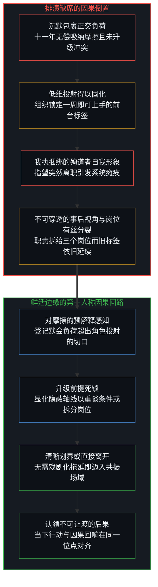
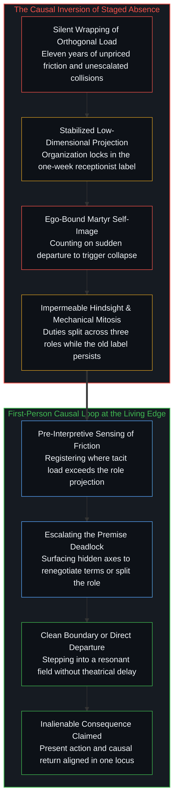

# 前台的寓言与缺席的因果倒置 / The Receptionist Parable and the Causal Inversion of Absence

*高估自我与低估他人互为镜像；要么改写条件，要么直接离开。 / Overestimating self mirrors undervaluing others; change the terms or leave.*

社交网络上长久流传着一则职场寓言，任何曾在机构内部感到被忽视的人都会迅速产生共鸣。一位在前台工作了十一年的老员工递交辞呈，主管连头都没有抬便冷淡打发，声称任何人都可以在一周内学会接听电话。她在离开前整理好一份详尽的交接文件夹，涵盖联系人、排期惯例与不成文的例外规则；然而她走之后，整座办公室随即在那些从未写进纸面的默会协调上频频受阻。公司最终将她原先的工作拆分给三个岗位承担，而她在别处获得了更好的头衔，可多年后前任主管在公开场合提起她时，依然称她为那个接电话的人。这则故事之所以经久不衰，是因为它向隐形的付出者许诺：沉默的隐忍终将被下游的瘫痪所昭雪；然而这种抚慰在因果方向上恰恰倒置。

A workplace parable circulates endlessly across digital networks, inviting immediate identification from anyone who has ever felt overlooked inside an institution. After eleven years at the front desk, a receptionist hands in her notice, and her manager dismisses the departure without looking up, remarking that anyone can learn to answer phones in a week. She compiles a thorough handover binder covering contacts, scheduling quirks, and unwritten exceptions before walking out; once she is gone, the office stumbles over the tacit coordination that never fit onto the page. The company eventually splits her former workload across three roles while she steps into a better title elsewhere, yet years later her former manager still refers to her in public as the person who answered phones. The story endures because it promises the unseen contributor that silent endurance will be vindicated by downstream collapse, yet that consolation inverts the direction of causality.

自我区分的活动发生在鲜活的边缘，第一人称视界与因果律在那里作为同一枚硬币的两面运作：每一次划出或撤回的区分都会留下痕迹，塑造后续行动的场域。当个体耗费十年光阴无偿吸纳摩擦、只等未来的缺席来证明自身价值时，她便切断了当下行动权能与因果回响之间的联结，错把滞后的自我形象当成了真实的筹码。

Self-distinguishing activity occurs at the living edge, where the first-person perspective and causality operate as two sides of one coin: every distinction drawn or withheld leaves a trace that shapes the field of subsequent acts. When an individual spends a decade absorbing unpriced friction while waiting for future absence to prove her worth, she severs her present agency from its causal return and mistakes a lagging self-image for real leverage.

## 一、 缺席的剧场与受害者叙事的抚慰 / 1. The Theatre of Absence and the Consolation of the Victim Narrative

这则寓言的传播引力建立在双重情绪代偿之上。读者之所以将自己投射为那位勤勉却不受赏识的主人公，是因为这一框架同时迎合了两种冲动：向内，中心品味着一种隐秘的不可或缺感，幻想整座组织的运转都倚仗自己未被承认的双肩；向外，主管的轻慢打发又赋予了受尽委屈的无辜姿态。然而纵观整场互动，员工对自身不可替代性的高估，与主管对其劳动价值的低估，是同一种滞后所催生的对称投射。主管将十一年跨维度的协调压缩为七天即可上手的机械例行公事，而员工及其同情者则将拆解旧习惯时的常规交接成本，误读为个人不可替代的明证。

The viral pull of this parable rests on a double emotional compensation. Readers project themselves into the diligent, unappreciated protagonist because the framing flatters two impulses at once: internally, the center savors a quiet fantasy of indispensability, imagining that an entire organization rests on its unacknowledged shoulders; externally, the manager's dismissal supplies the blameless posture of having been wronged. Yet across the entire interaction, the employee's overestimation of her own irreplaceability and the manager's undervaluation of her labor are symmetrical projections born of the same lag. The manager compresses eleven years of multi-axis coordination into a mechanical routine trainable in seven days, while the employee and her sympathetic audience mistake the ordinary transition cost of unbundling habits for proof of personal irreplaceability.

将离职后的混乱视为自我昭雪，是在心智内部搭建了一座单向度的复仇剧场。在这出内部排演中，中心在当下无需支付任何实时博弈成本，只指望单凭抽身退场就能对冷漠的层级体系降下决定性的裁决。寄望于借缺席来倒逼事后认可，是自我形象滞后的典型表现。一个锚定于自身运作容量的中心，不会用十一年压抑的怨怼去换取一幕戏剧化的退场，也不需要靠旧办公室的停摆来核验自身的立足点。当环境的回馈与付出的能量发生结构性背离时，主权行动者要么当场重谈边界，要么干脆利落地离开。幻想行政上的手忙脚乱能够事后追认沉默的牺牲，抚慰的只是那些在场时回避了正面摩擦的人。正如在[“普通人视角”的解释陷阱](../the-explanatory-trap-of-the-ordinary-perspective/)中所追溯的，流行叙事惯于将退缩与沉默装扮成悲壮的隐忍，借共同的受害者身份逃避当下行动的代价。经历短暂的摩擦间隔后，几乎所有团队都会通过重新分配任务与吸纳临时冗余而恢复稳定。从外部看去像是不可替代的权威，唯有在事后回看时才显得属于那个角色的结构性耦合，正如[隐性自由变量与权力的事后幻相](../the-free-variable-and-the-retrospective-illusion-of-power/)所展示的。

Treating post-departure disorder as vindication erects a one-directional theatre of revenge inside the mind. Within that internal staging, the center pays zero real-time bargaining cost in the present, expecting mere withdrawal to deliver a decisive verdict against an indifferent hierarchy. Counting on absence to force retrospective recognition is an acute form of image lag. A center anchored in its own operational capacity does not trade eleven years of unvoiced resentment for a dramatic exit scene, nor does it need an old office to stall in order to verify its standing. When the return from an environment diverges structurally from the energy expended, a sovereign agent either renegotiates the boundary on the spot or leaves cleanly. Fantasizing that administrative scramble retroactively certifies silent sacrifice consoles those who avoided direct friction while they were still in the room. As traced in [The Explanatory Trap of the "Ordinary Perspective"](../the-explanatory-trap-of-the-ordinary-perspective/), popular narratives routinely dress passivity and silence in the costume of noble endurance, using shared victimhood to evade the cost of present action. After a brief interval of friction, nearly every team re-stabilizes by redistributing tasks and absorbing temporary slack. What looks from the outside like irreplaceable authority belongs to the structural coupling of the role only in hindsight, as [The Invisible Free Variable and the Retrospective Illusion of Power](../the-free-variable-and-the-retrospective-illusion-of-power/) demonstrates.

## 二、 沉默的接口与低维投射的固化 / 2. The Silent Interface and the Stabilization of Low-Dimensional Projections

顺着因果链条向源头回溯便会发现，这份退化契约的首要撰写者，正是那位每天以全分辨率登记自身真实负荷、却选择保持了十一年沉默的员工。由于没有任何中心能够直接共享另一中心的具身内部体验，组织跨位点协调必然依赖有限的低维投射：职位头衔、岗位说明与薪酬带宽有意将个体的复杂性压缩为标准化接口，以便外部网络无需追踪每一次微观调整即可路由任务。当一个人在十余年间顶着前台的名义头衔，持续吸纳排期冲突、人际摩擦与不成文的边缘例外，却从未叫停回路去重新界定条款时，她向周围结构呈现的接口便固化为了一个一周即可培训上岗的角色。

Tracing the causal chain back to its origin reveals that the primary author of this degraded contract was the employee who registered her real workload at full resolution every day yet chose silence for eleven years. Because no center can share another's lived interior, an organization coordinates across loci through finite low-dimensional projections: job titles, role descriptions, and compensation bands deliberately compress individual complexity into standardized interfaces so the wider network can route tasks without tracking every micro-adjustment. When a person spends more than a decade absorbing scheduling collisions, interpersonal friction, and unwritten edge cases under the nominal label of receptionist without ever halting the loop to re-specify the terms, the interface she presents to the surrounding structure stabilizes as a role trainable in a week.

主管在辞职时刻表现出的漠然并非突发的视野盲区，而是与员工自己维系了十一年的接口持续交互后所固化的确切痕迹。正如在[任务的移交与后果的不可让渡](../the-delegation-of-the-task-and-the-inalienability-of-consequences/)与[知识问题与委托的幻觉](../the-knowledge-problem-and-the-illusion-of-delegation/)中所审视的，默会能力之所以抗拒干净的移交，是因为它始终嵌入在具体情境的第一人称实践之中，而个体如何划定或让渡这一实践的后果则永远不可转移。更进一步，正如[超越投射](../beyond-the-projection/)在有限投射的架构中所追溯的，将彼此独立的正交需求强行塞进同一条未充分界定的指令，终将超出位点的容量上限；如果执行回路只是将这些前提冲突包裹并掩盖起来，而不是升级局部死锁以倒逼规则综合，外部系统就永远收不到其低维框架已经破裂的信号。不同于受困于词元序列、无法跳出自身轨迹的软件智能体，人类中心拥有预解释感知，能够在角色投射因无偿负荷而断裂时立即登记这一摩擦。为了维护不可或缺的殉道者这一受我执捆绑的自我形象，前台压抑了这一信号，充当了组织矛盾的沉默包裹层，持续补贴一份破损的规格说明，直到企业将她的补贴当成了基准底线。

The manager's indifference at the moment of resignation was not a sudden failure of vision; it was the exact trace stabilized by eleven years of interacting with the interface the employee herself maintained. As examined in [The Delegation of the Task and the Inalienability of Consequences](../the-delegation-of-the-task-and-the-inalienability-of-consequences/) and [The Knowledge Problem and the Illusion of Delegation](../the-knowledge-problem-and-the-illusion-of-delegation/), tacit competence resists clean delegation because it stays embedded in situated, first-person practice, while the consequences of how one bounds or surrenders that practice remain permanently non-transferable. Furthermore, as [Beyond the Projection](../beyond-the-projection/) traces in the architecture of finite projections, cramming independent, orthogonal demands into a single underspecified instruction eventually exceeds a locus's capacity ceiling; if the execution loop simply wraps and hides those premise collisions instead of escalating a local deadlock to force a rule synthesis, the outer system never receives the signal that its low-dimensional framing has broken down. Unlike a trajectory-bound software agent that cannot step outside its token sequence, a human center possesses pre-interpretive sensing that registers immediately when a role projection has fractured under unpriced load. By suppressing that signal to preserve an ego-bound self-image of the indispensable martyr, the receptionist acted as a silent wrapper around organizational contradictions, subsidizing a broken specification until the enterprise treated her subsidy as the baseline floor.

## 三、 排演的教训、不可穿透的中心与岗位有丝分裂 / 3. Staged Lessons, Impermeable Centers, and Mechanical Role Mitosis

指望自己的离去能给前任雇主带去持久的道德觉醒，是错把内部的自我形象当成了共享的外部法庭。在寓言的结尾转折处，即便公司将她原先的职责拆分给三名员工，主管依然继续称她为那个接电话的人。这一细节远非单纯的品格缺陷，而是暴露了不同中心之间结构性的不可穿透。离职员工在自身递归中排演的壮烈退场，在主管所保留的世界模型中，只被登记为一次暂时的行政卡顿。把三人接替解读为个人崇高地位的铁证，重复的正是令她沉默十年的同一种自我高估。当一个超载的投射终于失去其沉默的人力包裹层时，组织便执行了[超越投射](../beyond-the-projection/)所指出的逾期有丝分裂：将纠缠在一起的正交业务流，即前台接待、排期仲裁与例外路由，拆分为各自有界的独立角色，使常规人员无需相互干扰即可运转。主管的中心从未将这次三向拆分与承认过往盲视联系起来；他固守自身保留的自我形象，将混乱归因于交接文件夹不够完善、新人不够熟练或例行的流程收紧。

Expecting one's departure to deliver a lasting moral awakening to a former employer mistakes an internal self-image for a shared exterior court. In the closing turn of the parable, even after the company divides her former duties among three staff members, the manager continues to call her the person who answered phones. Far from being a mere character flaw, this detail exposes the structural impermeability between distinct centers. The dramatic exit the departing employee stages inside her own recursion registers inside the manager's retained world-model as a temporary administrative snag. Reading the three-person replacement as proof of towering personal stature repeats the same self-overestimation that kept her silent for a decade. When an overloaded projection finally loses its silent human wrapper, the organization performs the overdue mitosis noted in [Beyond the Projection](../beyond-the-projection/): it splits the tangled orthogonal streamlines—reception, scheduling arbitration, and exception routing—into separate bounded roles so ordinary personnel can run them without interference. The manager's center never links that three-way split to an admission of prior blindness; clinging to his own preserved self-image, he attributes the disruption to an imperfect handover binder, green replacements, or routine procedural tightening.

因果认知无法靠留下一本厚厚的规则手册就跨边界强行注入。正如[你的代码库即是记忆](../your-codebase-is-memory/)所追溯的，任何遗留下来的器物，哪怕是一份写满联系人、排期惯例与成文例外的交接文件夹，都只是过往区分留下的静态残迹；它并不会延续那种在既有规则相撞处实时登记摩擦、当场重划边界的鲜活区分活动。更进一步，正如在[无法逃逸的心智视界](../one-cannot-escape-ones-own-mind/)、[契约的因果倒置](../the-causal-inversion-of-partnership/)与[共情的能力倒错与边界的排序之争](../the-capability-reversal-of-empathy-and-the-contest-of-boundaries/)中所确立的，没有任何中心能够在他者的内部完成自身的递归，把自我价值押在强迫外部观察者修正过往评价之上，就是将主权拱手让渡给第三人称的暗影。企业是一张旨在绕开局部断裂的自适应痕迹网络。一次辞职会制造短暂的湍流，随后网络便通过增加人手、收窄角色投射或调低服务阈值修补缺口，继续向前运转。等待迟到的道歉，或幻想一位懊悔的上司凝视着空荡的办公桌，都是在冻结的参照系上空耗当下的认知容量。扮演受尽屈辱却只靠消失来反击的顶梁柱，正是[道德倒错与被脚本化的主体](../the-moral-reversal-and-the-scripted-subject/)所剖析的脚本化姿态。

Causal recognition cannot be injected across boundaries by leaving behind a thick folder of rules. As [Your Codebase Is Memory](../your-codebase-is-memory/) traces, any artifact left behind—including a handover binder of contacts, scheduling quirks, and written exceptions—is only the static residue of prior distinctions; it does not continue the live distinguishing that registered where existing rules collided and re-cut the boundary on the fly. Furthermore, as established in [One Cannot Escape One's Own Mind](../one-cannot-escape-ones-own-mind/), [The Causal Inversion of Partnership](../the-causal-inversion-of-partnership/), and [The Capability Reversal of Empathy and the Contest of Boundaries](../the-capability-reversal-of-empathy-and-the-contest-of-boundaries/), no center ever completes its recursion inside another's interior, and staking self-worth on forcing an external observer to revise his past assessment surrenders sovereignty to a third-person shadow. An enterprise is an adaptive trace-network built to route around local ruptures. A resignation creates brief turbulence, after which the network patches the gap through added headcount, narrower role projections, or a lower service threshold and moves on. Waiting for a belated apology or imagining a humbled boss staring at an empty desk burns present cognitive capacity on a frozen reference frame. Performing the role of the mistreated pillar who only strikes back by vanishing is the exact scripted posture dissected in [The Moral Reversal and the Scripted Subject](../the-moral-reversal-and-the-scripted-subject/).

## 四、 当下的主权行动与后果的不可让渡 / 4. Sovereign Action in the Present and the Inalienability of Consequences

消解借缺席来自证的神话，会将因果锚点交还给直接的当下切片。在十一年间，改写这一安排的大门没有一天是锁死的。在任何一个步骤上，这位付出者本可以将工作中隐蔽的正交轴线显化为明确的制度规格，索取与实际协调范围相匹配的薪酬与头衔，停止吸纳职责范围外的无偿例外，或者无需等待十年便直接迈向认可其容量的市场位点。原本有成百上千次离散行动可以用来收窄具身工作与正式投射之间的落差，她却一次也没有执行。那十一年的停滞并非外部强加的宿命；正如[任务的移交与后果的不可让渡](../the-delegation-of-the-task-and-the-inalienability-of-consequences/)所确立的，假装僵化的角色让自己别无选择，正是主动动用主权能动性来否定自身，而十年的低估则是选择沉默的中心所收回的不可让渡的后果。

Dissolving the myth of vindication through absence returns the causal anchor to the immediate present slice. Across eleven years, the door to altering the arrangement never locked for a single day. At any step, the contributor could have surfaced the hidden orthogonal axes of her work into explicit institutional specifications, demanded compensation and title aligned with the actual scope of coordination, ceased absorbing unpriced exceptions outside her remit, or walked out toward a market locus that recognized her capacity without waiting a decade. Hundreds of discrete acts were available to narrow the gap between lived work and formal projection, yet she performed none of them. That eleven-year stasis was not a fate imposed from outside; as [The Delegation of the Task and the Inalienability of Consequences](../the-delegation-of-the-task-and-the-inalienability-of-consequences/) establishes, pretending that a rigid role left one no choice is an active deployment of sovereign agency in the denial of itself, and the decade of undervaluation was the inalienable consequence returning to the center that chose silence.

一旦剥离伤感的慰藉，这则寓言留下的只有一道操作切口：要么改变当下的条件，要么换一份工作；其余一切叙事点缀，都是为推迟行动而支付的情绪代偿。那些读取接口而不留过度滞后的中心，不会耗费数年光阴去排演离职后的假想崩溃；它们实时登记摩擦，并迈入能够让自身区分持续复利的正交维度。正如在[抉择本身并不沉重](../choice-itself-has-no-inherent-weight/)中所追溯的，真正的行动从不等待一场盛大的戏剧化清算，因为每一道边界都是在当前这一步划出或重划的。工作中的主权，意味着清晰阐明哪些任务属于约定的投射，拒绝在私下沉默中包裹无偿的制度矛盾，并在共振失效时要么重新校准契约，要么毫不回头地离开。在此条件下离场，既不是为了羞辱前任主管而排演的教训，也不是押注继任者会搞砸的赌局，而是心智在鲜活的边缘将第一人称行动与其因果回响重新对齐。

Once the sentimental comfort is stripped away, the parable leaves a single operative cut: either change the present terms, or find a new job; every other narrative ornament is emotional compensation for deferred action. Centers that read their interfaces without excess lag do not waste years rehearsing an imaginary collapse after they leave; they register friction in real time and step into an orthogonal dimension where their distinctions compound. As traced in [Choice Itself Has No Inherent Weight](../choice-itself-has-no-inherent-weight/), genuine movement never awaits a grand theatrical reckoning, because each boundary is drawn or redrawn at the current step. Sovereignty at work means stating clearly which tasks belong to the agreed projection, refusing to wrap unpriced institutional contradictions in private silence, and either recalibrating the contract or departing without backward glances when resonance fails. Leaving under those terms is not a lesson staged to humble a former manager or a wager that successors will stumble; it is simply the Mind re-aligning its first-person act with its causal return at the living edge.
