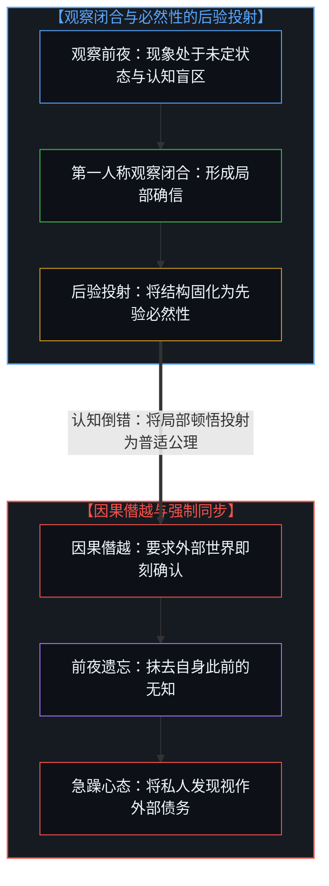
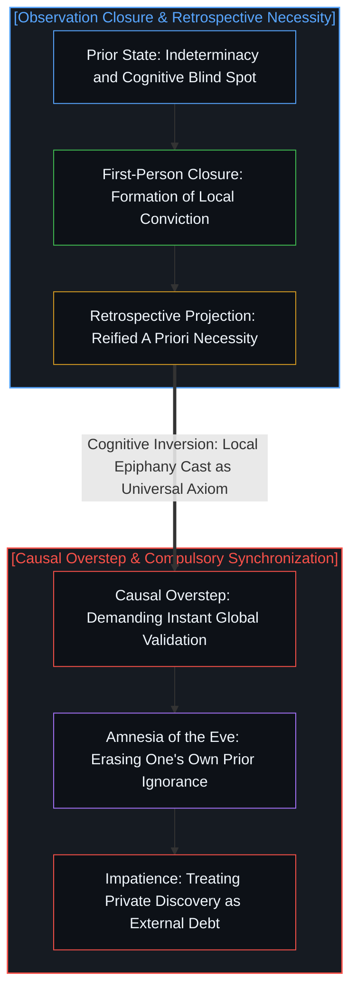
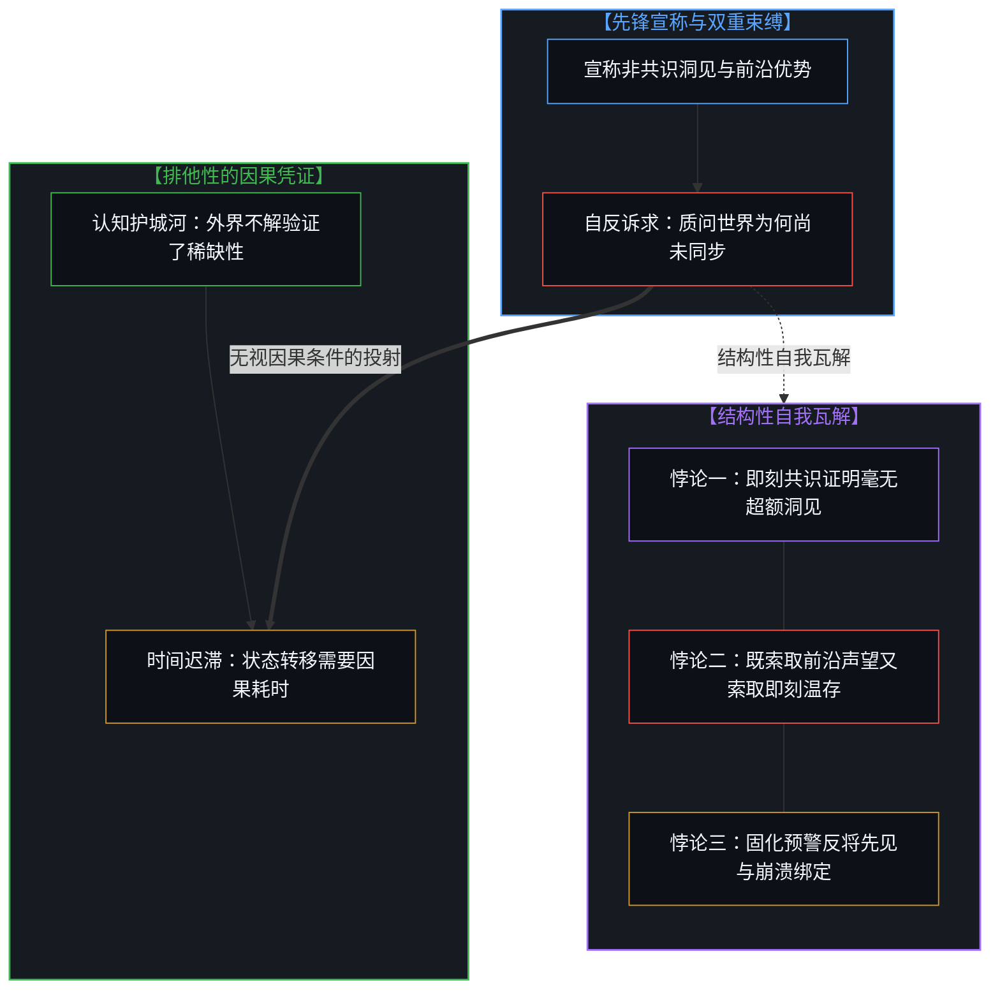
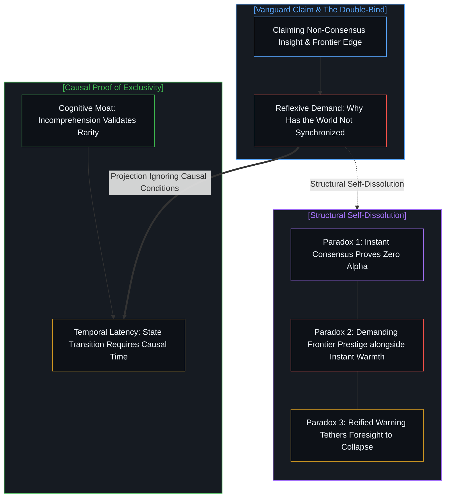

# 独见者的自反困境与必然性的后验投射 / The Reflexive Dilemma of Unique Insight and the Retrospective Projection of Necessity

*将局部顿悟投射为客观公理的倒错，在要求世界即时同步时陷入自反性瓦解。 / Projecting local realization as objective axiom collapses under the reflexive demand for instant consensus.*

在人类的观察经验中，普遍存在着一种认知倒错：一旦某个观察者在复杂的现实中识别出隐蔽的模式、技术断层或结构性的定价偏离，他便会迅速抹去自己此前所处的不确定状态，习惯性地假定该现象早已作为显见的事实存在，且理应被所有心智即刻接纳。随后，当他转过身来审视尚未同步更新的世界时，便陷入愤懑与困惑：为何其他人迟迟无法理解，为何整个系统没有齐步加速跟进？这种姿态包藏着自反性的矛盾：它在将局部的顿悟投射为客观公理的同时，也瓦解了自身所标榜的独见性的逻辑自洽。

A pervasive cognitive inversion inhabits human observation: the instant an observer discerns a hidden pattern, technological discontinuity, or structural mispricing within complex reality, they swiftly erase their own prior state of indeterminacy, habitually presuming the phenomenon pre-existed as an obvious fact that all Minds should immediately embrace. Turning around to gaze upon an un-updated world, the observer falls into indignation and perplexity: why do others fail to comprehend, and why has the systemic whole not accelerated in lockstep? This posture conceals a reflexive contradiction; in projecting a localized flash of insight as an objective axiom, it simultaneously dissolves the logical coherence of its own claimed distinction.

## 一、 必然性的后验投射与前夜的遗忘 / 1. The Retrospective Projection of Necessity and the Amnesia of the Eve

在任何具体的观察行为发生之前，特定现象对于观察者自身而言始终处于未定状态，在操作层面上等同于不存在。心智最初并不享有洞察该现象的特权，而是在嘈杂的不确定性中通过偶发探索摸索前行。然而，观察行为一旦闭合，认知坐标系便发生不可逆的锁定。观察者不仅将新识别出的模式客观化，还会回溯性地改写时间序列，将这一结构投射为向来具备不言自明的必然性。紧接着发生的是更进一层的倒错：观察者要求所有其他心智也必须即刻辨识并采纳这一发现，仿佛个人的视线就是通用的广播塔。

Prior to any discrete act of observation, a given phenomenon remains indeterminate for the observer, functioning in operational terms as nonexistent. The Mind enjoys zero initial entitlement to this perception, navigating noisy indeterminacy through contingent exploration. Yet the instant an observation closes, the cognitive coordinate frame undergoes irreversible lock-in. The observer does not merely objectify the newly discerned pattern; they retrospectively revise the temporal sequence, projecting the structure as having possessed self-evident necessity all along. A further inversion follows: the observer demands that every other Mind immediately recognize and adopt the finding, as though a personal line of sight constituted a universal broadcasting tower.

这种心理图式在资本配置与金融市场中表现得尤为清晰。当一个参与者发掘出一家自认为定价严重偏离的冷门企业并完成建仓，一股迫切的焦躁便随之袭来，渴望资产价格即刻暴涨。促成这种急躁的是一项因果假定：既然自己已经厘清了这家企业的优势，市场上的其余资本就应当在下一个日出时同步醒悟。在这番急切中被遗忘的事实是，就在买入决定的前一刻，这家企业对于该投资者本人同样处于盲区。将私人的后验顿悟强加于世界的时序节律，是把第一人称的发现当成了外部各方必须听令结清的强制债务。正如在[隐性自由变量与权力的事后幻相](../the-free-variable-and-the-retrospective-illusion-of-power/)与[切平面的行者与完美球面的踩空者](../the-walking-tangent-and-the-stumbling-sphere/)中所追溯的，察觉未被看见的不对称并注入未被登记的自由变量，发生在一处尚未测绘的起点——此时公共账本上既没有它的类目，也没有它的定价；唯有当这一变量在摩擦中激起回响并促成相变之后，它才会凝结为共识，因此抹去自身生成性试探的观察者，是把尚未载入账本的起点误认作了静态的必然。

This psychological schema manifests with stark clarity across capital allocation and financial markets. The moment a participant uncovers an obscure enterprise perceived as deeply mispriced and establishes a position, an urgent restlessness sets in, desiring the asset's price to surge instantaneously. Generating this impatience is a causal presumption: since the investor has mapped the company's merits, all remaining capital in the market ought to awaken to the same realization at the next sunrise. Forgotten in this haste is the fact that moments prior to purchase, the company occupied a blind spot for the investor as well. Imposing a private retrospective epiphany upon the temporal cadence of the world treats a first-person discovery as a compulsory debt that external parties must settle on command. As traced in [The Invisible Free Variable and the Retrospective Illusion of Power](../the-free-variable-and-the-retrospective-illusion-of-power/) and [The Walking Tangent and the Stumbling Sphere](../the-walking-tangent-and-the-stumbling-sphere/), perceiving an unseen asymmetry and injecting an unregistered free variable occurs at an unmapped onset where the shared ledger has no category or price for it; only after the variable reverberates through friction and forces a phase shift does it crystallize into consensus, so an observer who erases their own generative probe mistakes the unrecorded onset for static inevitability.

这种机制同样清晰地显现于科学优先权之争与日常的认知顿悟之中。在数学突破或理论发现达成之前的漫长岁月里，研究者在概念迷雾中徒劳摸索；然而一旦直觉火花点燃，心智便在瞬息之间将整条推导链条折叠为一个不言自明的整体。他在转瞬间抹去了自己多年来的困顿与迷茫，转而将同行的迟疑、审稿人的审慎以及学界的冷淡视作不可理喻：如此显明的结构，他们为何视而不见？他未能察觉的是，对于缺乏其私密试错轨迹的其他心智而言，那些被他在内部压缩的直觉脚手架与隐含语境，依然是一片未被照亮的重峦叠嶂。

This mechanism surfaces with equal clarity across scientific priority disputes and everyday intellectual epiphanies. Throughout the protracted years prior to a mathematical breakthrough or theoretical discovery, the researcher grapples fruitlessly within conceptual fog; yet the moment an intuitive spark ignites, the Mind collapses the entire inferential chain into a self-evident whole. Erasing years of personal disorientation in an instant, they regard the hesitation of peers, the caution of reviewers, and the cold indifference of the academy as baffling: how can they remain blind to something so plain? What they fail to register is that for other Minds lacking their private trail of trial and error, the intuitive scaffolding and implicit context they have internally compressed remain an unilluminated mountain range.

## 二、 独见性的形式自反悖论 / 2. The Formal Reflexive Paradox of Unique Insight

这种对即刻共鸣的执念，最终导向了无可调和的自反困境。超前洞见、技术创新或认知阿尔法得以成立的唯一因果凭证，正在于将它与共识分布隔开的结构性摩擦与信息不对称。当一项构想如先行者所标榜的那样独特且超前于主流分布时，它所依托的是特定而专门的局部脚手架；因此，身处不同约束条件下的行动者感到费解、迟疑或怀疑，恰恰是对该洞见独特性的直接验证。

This obsession with instantaneous resonance culminates in an irreconcilable reflexive dilemma. The singular causal proof of an advanced insight, technical innovation, or cognitive alpha lies in the structural friction and informational asymmetry separating it from the consensus distribution. Where a conception is as distinct and ahead of the prevailing distribution as the pioneer claims, it depends upon an idiosyncratic, specialized local scaffolding; hence, bewilderment, hesitation, or skepticism from actors situated under different constraints is the direct verification of the insight's distinctness.

然而，先行者的心智结构却坍缩为相互排斥的双重束缚：既索取伫立于无人前沿的声望与非对称回报，又拒绝承受非共识位置所固有的孤寂与时间迟滞，愤懑地责问他人为何无法理解或紧随其后。这一抱怨直接拆解了自身的前提：倘若一项洞见能够被大众无摩擦地吸收并即刻执行，它便不曾具备其所标榜的排他性，其认知溢价也会在轻松达成共识的瞬间消散。既索取孤明先发的殊荣，又索取全员喝彩的温存，是将相互冲突的标尺强行拼接在一起。正如在[模型永远无法成为第二重前沿](../the-model-never-becomes-a-second-edge/)与[阻力体感与速率差](../felt-resistance-and-the-speed-differential/)中所追溯的，一边怨恨速率差所产生的摩擦，一边又将该速率差奉为自身领先地位的定义，是不可调和的矛盾。

Yet the mental architecture of the vanguard collapses into a mutually exclusive double-bind: demanding both the prestige and asymmetric returns of standing upon an uncrowded frontier, while refusing to tolerate the solitude and temporal latency inherent to non-consensus positions, indignantly asking why others fail to comprehend or keep pace. This complaint dismantles its own premise: if an insight could be absorbed without friction and executed immediately by the general population, it never possessed the exclusivity claimed for it, and its cognitive premium would vanish the moment effortless consensus was achieved. Demanding the distinction of solitary foresight alongside the comforting warmth of unanimous applause stitches contradictory yardsticks together. As traced in [The Model Never Becomes a Second Edge](../the-model-never-becomes-a-second-edge/) and [Felt Resistance and the Speed Differential](../felt-resistance-and-the-speed-differential/), resenting the friction generated by a speed differential while treating that differential as the definition of one's lead is an irreconcilable contradiction.

即便将攫取非对称回报的动机置换为敲响系统性警钟的使命，因果性的自反约束也依然毫不动摇。灾变与系统性断裂源自无数微观变量的非线性发散，从未给予任何单一心智以确定性精度进行预测的特权。一旦预警者将局部的尾部风险直觉固化为不可逃避的铁律，要求整个系统听令急刹，他便步入了同样的矛盾：系统的平稳韧性会令其先见变得不可证伪或落空，唯有系统性崩溃才能坐实其警告的合法性。这恰恰构成了另一群人的反向镜像——那些为了维护固有自我模型而需要灾变永不降临的人，教条式地否定结构性脆弱；双方都在强迫动态的现实去核准私人的投射。在这种姿态下，心智非但没有保持超然，反而在不知不觉中将自身的认知证成与自己声称要避免的毁灭捆绑在了一起。

Even when replacing the motive of capturing asymmetric returns with the imperative of sounding systemic alarms, the reflexive constraints of causality remain unyielding. Catastrophes and systemic ruptures emerge from the non-linear divergence of countless microscopic variables; they offer zero privilege for any single Mind to forecast with deterministic precision. The moment a herald reifies a localized intuition of tail risk into inescapable certainty, demanding that the systemic whole brake on command, they walk into the same contradiction: the system's quiet resilience renders their foresight unfalsifiable or void, whereas only systemic collapse can ratify the legitimacy of their warning. This forms the inverse mirror of those who, needing the catastrophe never to arrive in order to protect an entrenched self-model, dogmatically dismiss structural vulnerability—both sides coerce dynamic reality to ratify a private projection. Under such a posture, rather than standing detached, the Mind unwittingly tethers its own epistemic validation to the very destruction it purports to avert.

## 三、 低阻沙盒与状态转移的承重成本 / 3. Low-Drag Sandboxes and the Load-Bearing Cost of State Transition

这种认知不对称在技术前沿与运行负荷碰撞之处同样剧烈回响。在当下围绕人工智能基准评测与企业落地的争论中，研究者在受控环境中观察到惊人的模型表现，转过身来却对组织机构在本地化部署上的审慎步伐困惑不解。然而，先行者在计算沙盒内的速度是由人为减阻维持的：固定输入分布、锁定评分函数，并将系统与跨部门摩擦及不断变动的法律责任隔离开来。在低摩擦的测试沙盒中滑行，将复杂的系统依赖压缩成了孤立的符号推理；而运作中的机构若要完成范式转换，则必须支付合规核验、异常处理以及维持工作流连续稳定的运行与制度成本。正如[验证的倒置](../the-reversal-of-verification/)所追溯的，受限边界内的基准评测或形式化检验，只能确立那些固定假设下的内部一致性，而非横跨运作机构承重负荷中未建模残余的融贯性；将沙盒产出当作自足的信任根据，要求机构无需在自身边界重新核验便直接采纳，颠倒了核验与信任之间的次序。

This cognitive asymmetry echoes with equal force where technical frontiers collide with operational load. In contemporary debates over artificial intelligence benchmarks and enterprise adoption, researchers observe extraordinary model performance in controlled environments, and turn around perplexed by the deliberate pace of on-premise organizational deployment. Yet the pioneer's velocity inside computational sandboxes is sustained by artificial drag reduction: fixing input distributions, locking scoring functions, and shielding the system from cross-departmental friction and shifting legal liabilities. Gliding through a low-friction testing sandbox collapses complex systemic dependencies into isolated symbolic inference; meanwhile, an operational institution seeking to execute a paradigm shift must pay the operational and institutional costs of compliance verification, exception handling, and continuous workflow stability. As [The Reversal of Verification](../the-reversal-of-verification/) traces, a benchmark or formal check inside a bounded hold establishes internal consistency under those fixed assumptions rather than coherence across the unmodeled residue of an operating institution's load; treating the sandbox output as a self-sufficient ground of trust that institutions should adopt without re-verifying at their own boundary reverses the order between verification and trust.

将减阻轨道上的局部加速误认为普适的能力，犯下了范畴倒错。无论是在金融市场中为资产重新定价，还是在企业网络中重构工作流，宏观的状态转移都需要耗费流动性、风险吸纳与协同的制度重组。轻装疾行是一回事，背负着系统存续的责任奔跑则是另一回事。正如在[调速者的幻觉与行动的活态摩擦](../the-fallacy-of-pacing-and-the-felt-friction-of-ground-truth/)与[未历摩擦的心智与借来的全能](../the-unfrictioned-mind-and-borrowed-omnipotence/)中所阐明的，承重机构的审慎节律并非认知迟钝，而是对防止系统坍塌所需因果资产负债表的直接吸纳。要求一列在暴风雨中穿行的满载货运列车去匹配空载试验车在平整轨道上的速度，是将外化阻力换来的便利，混淆成了规训负重者的特权。

Mistaking localized acceleration along a drag-reduced track for universal competence commits a categorical inversion. Whether re-pricing an asset across financial markets or restructuring workflows across enterprise networks, macroscopic state transitions demand liquidity, risk absorption, and coordinated institutional realignment. Moving rapidly is one condition; running while bearing systemic survival liabilities is another. As articulated in [The Fallacy of Pacing and the Felt Friction of Ground Truth](../the-fallacy-of-pacing-and-the-felt-friction-of-ground-truth/) and [The Unfrictioned Mind and Borrowed Omnipotence](../the-unfrictioned-mind-and-borrowed-omnipotence/), the deliberate cadence of load-bearing institutions is not cognitive sluggishness; it is the direct absorption of the causal balance sheet required to prevent systemic collapse. Demanding that a fully laden freight train navigating a tempest match the velocity of an unburdened test vehicle along a pristine track confuses externalized drag with an entitlement to discipline those carrying the weight.

面对世界的阻力，先行者习惯于将抗拒一分为二地归入两个道德范畴：承认物理定律与技术极限是合理的“客观约束”，却将制度防御、程序摩擦与利益博弈斥为多余的“病态惯性”。运作中的系统固然包含协调失败、局部寻租壁垒与自利耗散，但制度阻力作为一个整体并非可以凭主观意愿抹去的任意赘生物。那种道德划分本身预设了一个脱离一切具体承重处境的“无处之境”。在行动的地貌上，即便与局部的低效交织在一起，作为整体的摩擦并不带有先验的伦理极性。在先行者眼中显得落后的摩擦，对于身处其中的行动者而言，正是缓冲局部风险敞口、维系脆弱平衡所必需的因果资产负债表。泥泞不是道路的偏离，泥泞就是道路本身。将地面阻力指控为“病态”，是把自身对无摩擦通行的渴望，改写成了未经挣得的宇宙特权。

Confronting the world's drag, pioneers habitually bifurcate resistance into two moral categories: acknowledging physical laws and technical limits as legitimate "objective constraints," while dismissing institutional defense, procedural friction, and competing interests as dispensable "pathological inertia." Operating systems do contain coordination failures, localized rent-seeking barriers, and self-interested dissipation, yet institutional drag as a whole is not an arbitrary excrescence that can be wished away. That moral demarcation itself presupposes a View from Nowhere, floating detached from all situated loads. Across the terrain of action, even when intertwined with local inefficiencies, friction as a totality carries no a priori ethical polarity. What appears to the pioneer as backward friction represents, for the actors within it, the causal balance sheet necessary to buffer local exposure and sustain precarious equilibrium. The mire is not an aberration along the road; the mire is the road itself. Indicting ground resistance as "pathological" recasts one's desire for frictionless passage as an unearned cosmic entitlement.

## 四、 主权划界与活态心智的认知耐心 / 4. Sovereign Demarcation and the Epistemic Patience of the Living Mind

看清这一自反结构，使第一人称心智得以在独到洞见与地面摩擦的张力之间保持清晰的边界。心智既不会在取得前沿速度时陷入居高临下的傲慢，也不会在面对市场迟滞与普遍不解时堕入怨怼。它清楚地认识到：外部世界的延迟与距离，正是确保该项洞见尚未被同质化、尚未被剥夺非对称优势的护城河。迟缓不是对前沿远见的冒犯，而是复杂系统维持自身连续性所需的结构惯性。

Discerning this reflexive architecture allows the first-person Mind to keep its boundary clear amid the tension between unique insight and ground friction. The Mind neither falls into condescending pride upon achieving frontier velocity, nor succumbs to resentment when confronting market lag and general incomprehension. It recognizes that the world's delay and distance constitute the protective moat ensuring the insight has not yet been commoditized or stripped of its asymmetric edge. Sluggishness is not an insult to frontier foresight; it is the structural inertia required for a complex system to preserve continuity.

每一件工具与每一个认知模型，都是滞后于活态前沿至少一步的有限留痕。正如在[知识问题与委托的幻觉](../the-knowledge-problem-and-the-illusion-of-delegation/)与[任务的移交与后果的不可让渡](../the-delegation-of-the-task-and-the-inalienability-of-consequences/)中所确立的，突破性的进展只是特定因果坐标内的局部探索探针，从不是指挥全局演进时钟的全知控制塔；[你的代码库即是记忆](../your-codebase-is-memory/)也在外化的认知造物中追溯了同一道边界：即便是最凝练的区分知识库，也只是某一心智过往切分所留存的记忆，而非其他心智无需在自身负荷下重新描摹便可直接套用的自执行指令。当观察者发掘出一项非共识洞见时，融贯的回应是担起这一位置所固有的时间迟滞，在正交维度上重构自身的边界与防御，吸纳局部波动并完成操作闭环，而不是站在人造的减阻基座上，向背负重荷的行动者索要即刻的共识与同步。承重之地从未掉队；它审慎的步调，正是独到洞见得以保存并兑现其价值的因果舞台。

Every tool and cognitive model operates as a finite trace lagging the living edge by at least one step. As established in [The Knowledge Problem and the Illusion of Delegation](../the-knowledge-problem-and-the-illusion-of-delegation/) and [The Delegation of the Task and the Inalienability of Consequences](../the-delegation-of-the-task-and-the-inalienability-of-consequences/), breakthrough advances represent localized exploratory probes within specific causal coordinates, never an omniscient control tower directing the global progression clock; [Your Codebase Is Memory](../your-codebase-is-memory/) traces the same bound across externalized cognitive artifacts, where even the sharpest repository of distilled distinctions remains stored memory of one Mind's past cuts rather than a self-executing mandate that other Minds can adopt without re-tracing under their own load. When an observer uncovers a non-consensus insight, the coherent response is to shoulder the temporal latency intrinsic to that position, reconfiguring one's boundaries and defenses along an orthogonal axis to absorb localized variance and complete the operational loop, rather than standing upon an artificial drag-reduced pedestal to demand immediate consensus and synchronization from those bearing the weight. The ground of borne weight has never fallen behind; its deliberate pace is the causal stage upon which singular insights preserve and realize their value.
