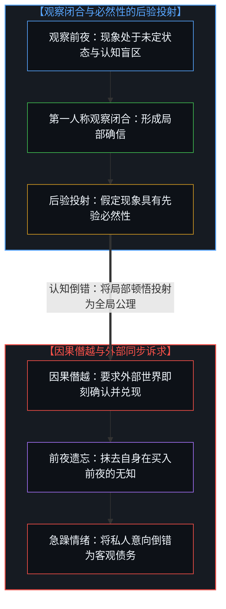
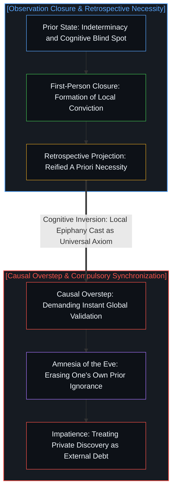
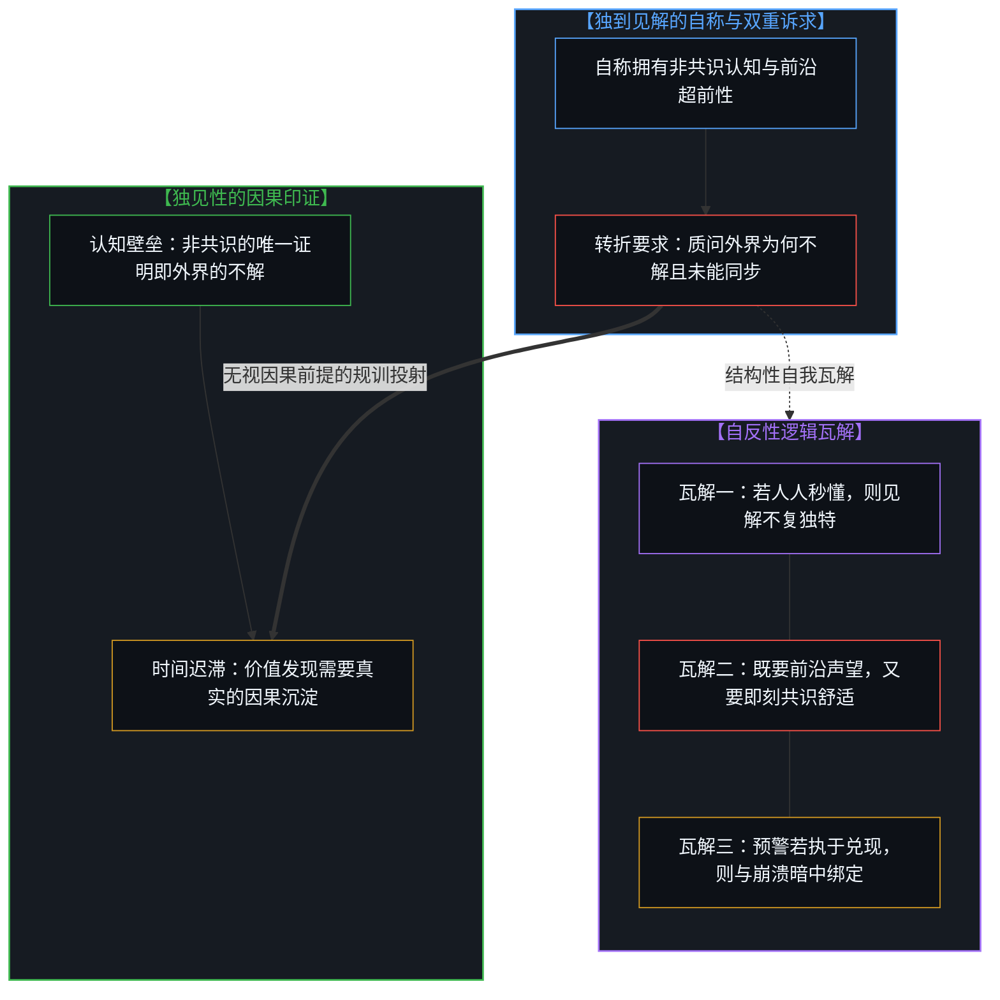

# 独见者的自反困境与必然性的后验投射 / The Reflexive Dilemma of Unique Insight and the Retrospective Projection of Necessity

*将局部顿悟投射为客观公理的倒错，在要求世界即时同步时陷入自反性瓦解。 / Projecting local realization as objective axiom collapses under the reflexive demand for instant consensus.*

在人类的认知经验中，存在一种极其隐蔽的心理倒错：一旦某个观察者在复杂的现实中识别出某种隐蔽的模式、技术跃迁或被低估的结构，他便会迅速抹去自己此前所处的不确定状态，习惯性地假定该现象在被观察前就已昭然若揭，且理应被所有其他观察者所接纳。随后，当他转过身来审视身后的世界时，便陷入了一种难以遏制的困惑与急躁：为何其他人迟迟看不懂？为何整个系统不能立即跟进？这种姿态包藏着深刻的形式自反性，它在将个体的局部顿悟奉为先验公理的同时，也让自身标榜的独见性陷入了逻辑上的自我瓦解。

A pervasive cognitive inversion inhabits human observation: the instant an agent discerns a hidden pattern, technological discontinuity, or structural mispricing within complex reality, they swiftly erase their own prior state of indeterminacy, habitually presuming the phenomenon pre-existed as an obvious fact that all minds should immediately embrace. Turning around to gaze upon an un-updated world, the observer falls into indignation and perplexity: why do others fail to comprehend, and why has the systemic whole not accelerated in lockstep? This posture conceals a profound reflexive contradiction; in projecting a localized flash of insight as an objective axiom, it simultaneously dissolves the logical coherence of its own claimed distinction.

## 一、 必然性的后验投射与前夜的遗忘 / 1. The Retrospective Projection of Necessity and the Amnesia of the Eve

在任何具体认知发生之前，特定现象对于观察者自身而言始终处于未定状态，在绝大多数情境中甚至直接等同于不存在。心智并未预先享有洞察该现象的特权，而是身处海量杂音与偶发探索之中。然而，观察行为一旦闭合，认知坐标系便发生了不可逆的锁定。观察者不仅立即将新识别的对象客观化，还会习惯性地回溯时间轴，假定该结构在此前就具备独立自足的必然性。更为深重的倒错在于，观察者下意识地要求所有其他主体也必须即刻承认并接受这一结论，仿佛自己的私人视界就是全宇宙的统一广播台。

Prior to any discrete act of observation, a given phenomenon remains indeterminate for the observer, functioning in operational terms as nonexistent. The mind enjoys zero initial entitlement to this perception, navigating noisy indeterminacy through contingent exploration. Yet the instant an observation closes, the cognitive coordinate frame undergoes irreversible lock-in. The observer does not merely objectify the newly discerned pattern; they retrospectively revise the temporal sequence, projecting the structure as having possessed self-evident necessity all along. A more debilitating inversion follows: the observer subconsciously demands that all external agents immediately recognize and adopt the finding, as though their personal line of sight constituted the universe's universal broadcasting tower.

这种心理图式在投资与资本配置中表现得尤为清晰。当一个参与者耗费心力发掘了一家自认为价值严重偏离的冷门企业并完成建仓之后，便在次日迅速产生强烈的焦躁，恨不得资产价格立刻暴涨到位。促成这种急躁的因果假想在于，既然他已经把这家企业的优越性梳理清楚，那么整个市场上的其余资本就应当在下一个日出时同步醒悟。他遗忘了就在做出买入决定的前一刻，这家企业对他本人而言同样处于未被定价的盲区。将个人的后验顿悟强加于外部世界的时钟，是把第一人称的意向性发现，僭越为了第三方必须即刻兑现的客观债务。正如在 [隐性自由变量与权力的事后幻相](../the-free-variable-and-the-retrospective-illusion-of-power/) 与 [行走的切线与绊跌的球体](../the-walking-tangent-and-the-stumbling-sphere/) 中所分析的那样，观察者一旦将自己移出画面，就会把生成性的试探包装成静态的必然。

This psychological schema manifests with stark clarity across capital allocation and financial markets. The moment a participant uncovers an obscure enterprise perceived as deeply mispriced and establishes a position, an urgent restlessness sets in, desiring the asset's price to surge instantaneously. Generating this impatience is a causal presumption: since the investor has mapped the company's merits, all remaining capital in the market ought to awaken to the same realization at the next sunrise. Forgotten in this haste is the reality that moments prior to purchase, the company occupied a blind spot for the investor as well. Imposing a private retrospective epiphany upon the temporal cadence of the world treats a first-person discovery as a compulsory debt that external parties must settle on command. As analyzed in [The Invisible Free Variable and the Retrospective Illusion of Power](../the-free-variable-and-the-retrospective-illusion-of-power/) and [The Walking Tangent and the Stumbling Sphere](../the-walking-tangent-and-the-stumbling-sphere/), an observer removing themselves from the frame recasts a generative probe as static inevitability.

## 二、 独见性与普适认同的形式自反悖论 / 2. The Formal Reflexive Paradox of Unique Insight

这种对即刻共鸣的执念，在形式逻辑上导向了无可调和的自反性困局。所谓独到见解、前沿创新或超额认知收益，其存在的唯一因果凭证，正是它与大众主流认知之间的信息差与结构性阻力。倘若某种构想确如先锋派所标榜的那样具有跨越时代的独特性，它就必然依附于极其特异且复杂的局部认知脚手架；因此，身处不同约束条件中的其他行动者感到费解、迟疑甚至无法采纳，本就是该见解具备独到性的直接证明。

This obsession with instantaneous resonance culminates in an irreconcilable reflexive dilemma. The singular causal proof of an advanced insight, technical innovation, or cognitive alpha lies in the structural friction and informational asymmetry separating it from the consensus distribution. If a conception is truly as unique and ahead of its time as the pioneer claims, it must depend upon an idiosyncratic, highly specialized local scaffolding; hence, bewilderment, hesitation, or skepticism from agents situated in different constraints represents the natural verification of the insight's distinctness.

然而，许多先锋派的心智结构却陷入了自相矛盾的双重诉求：他们既渴望占有站在认知孤岛上的稀缺声望与非共识红利，又难以承受非共识所内生的寂寞与时间沉淀，反过来质问别人为何难以理解、为何未能紧随其后。这种抱怨直接摧毁了立论的前提：假如一项见解真的能被未经铺垫的大众无损理解并迅速执行，那么它在形式上就从来不曾具备所谓傲视群伦的独特性，其所承载的认知溢价在共识达成的同一瞬间便已烟消云散。先锋派既想要特立独行的高贵，又想要普天同庆的共振，这种期待将相互排斥的价值标尺强行拼接在了一起。正如在 [模型永远无法成为第二重前沿](../the-model-never-becomes-a-second-edge/) 与 [阻力体感与速率差](../felt-resistance-and-the-speed-differential/) 中所揭示的，试图消解速率差所带来的阻力体感，却不愿承认速率差本身就是优越位移的定义来源，这是不可调和的逻辑矛盾。

Yet the mental architecture of the vanguard collapses into a mutually exclusive double-bind: demanding both the prestige and asymmetric returns of standing upon an uncrowded frontier, while refusing to tolerate the solitude and temporal latency inherent to non-consensus positions, indignantly demanding why others fail to comprehend or keep pace. This complaint dismantles its own premise: if an insight could be absorbed without friction and executed immediately by the general population, it never possessed genuine exclusivity, and its cognitive premium would vanish the moment effortless consensus was achieved. Demanding the distinction of solitary foresight alongside the comforting warmth of unanimous applause stitches contradictory yardsticks together. As illuminated in [The Model Never Becomes a Second Edge](../the-model-never-becomes-a-second-edge/) and [Felt Resistance and the Speed Differential](../felt-resistance-and-the-speed-differential/), resenting the friction generated by a speed differential while treating that differential as the definition of excellence represents an irreconcilable contradiction.

即便将这种独见性的动机从“攫取非共识红利”置换为更为崇高的“预警系统性危机”，因果律的自反性约束也并未因此解除。灾难与系统的断裂始终是海量微观变量在漫长偏离中的非线性涌现，本就不存在可以被单点心智提前全知度量的客观特权。一旦预警者将局部的危险体感固化为确定性的必然，并要求整个系统依其意志紧急制动，他便再度陷入了自相矛盾的处境：系统的平稳渡过将使他的先见失去凭据，而唯有危机的真正爆发才能坐实其预言的合法性。在此种姿态下，心智不仅未曾抽离，反而在无意识中将自身的认知自尊与系统的崩溃绑定在了一起。

Even when replacing the motive of capturing asymmetric returns with the seemingly noble imperative of sounding systemic alarms, the reflexive constraints of causality remain unyielding. Catastrophes and systemic ruptures emerge from the non-linear divergence of countless microscopic variables; they offer zero ontological privilege for any singular mind to forecast with deterministic precision. The moment a herald reifies a localized intuition of tail risk into inescapable certainty, demanding that the systemic whole brake on command, they walk into the same contradiction: the system's quiet resilience renders their foresight unfalsifiable or void, whereas only actual collapse can ratify the legitimacy of their warning. Under such a posture, rather than standing detached, the mind unwittingly tethers its own epistemic validation to the very destruction it purports to avert.

## 三、 减阻沙盒与现实承重的状态转移成本 / 3. Low-Drag Sandboxes and the Thermodynamic Cost of State Transition

这种认知不对称在技术前沿与工程实践的碰撞中表现得同样剧烈。在当前关于人工智能评测与落地节奏的争论中，研究人员在受控基准测试中见证了令人惊叹的模型性能，随之转过身来，对企业在本地化部署上的迟缓感到困惑不解。然而，探索者在数字沙盒中的加速之所以成立，是因为沙盒人为屏蔽了大部分操作阻力：固定了输入分布，锁定了评分函数，排除了跨部门的利益摩擦与随时位移的权责归属。受控环境中的轻载滑行，将复杂的系统问题收缩为了局部的符号推理；而真实机构要完成技术范式的状态转移，必须为每一次判断支付合规审查、异常捕获、流程再造以及维持系统稳定运行的沉重代价。

This cognitive asymmetry echoes with equal force where technical frontiers collide with operational reality. In contemporary debates over artificial intelligence benchmarks and enterprise adoption, researchers observe extraordinary model performance in controlled environments, and turn around perplexed by the deliberate pace of on-premise organizational deployment. Yet the pioneer's velocity inside computational sandboxes is sustained by artificial drag reduction: fixing input distributions, locking scoring functions, and shielding the system from cross-departmental friction and shifting legal liabilities. Gliding through a low-friction testing sandbox collapses complex systemic realities into isolated symbolic inference; meanwhile, an operational institution seeking to execute a paradigm shift must pay tangible thermodynamic and institutional costs for compliance verification, exception handling, and continuous workflow stability.

将减阻轨道上的局部加速误作放之四海而皆准的通用实力，是典型的因果范畴倒错。无论在资本市场中重塑资产价格，还是在实体组织中重构业务网络，任何真正的大规模状态更新都需要耗费真实的流动性、资本与组织动员。跑得快是一回事，背负着整个系统的生存负荷奔跑则是另一回事。在 [调速者的幻觉与行动的活态摩擦](../the-fallacy-of-pacing-and-the-felt-friction-of-ground-truth/) 与 [未历摩擦的心智与借来的全能](../the-unfrictioned-mind-and-borrowed-omnipotence/) 中已经讲明，承重机构的审慎演进不是认知的迟钝，而是它们正在以肉身与资产切实承担着让文明秩序免于坍塌的因果账单。要求满载货物穿越暴风雨的重载列车去匹配空载实验舱在平整轨道上的飞驰，是将卸除负重换来的速度特权，倒错为了对负重者进行规训的合法筹码。

Mistaking localized acceleration along a drag-reduced track for universal competence commits a categorical inversion. Whether re-pricing an asset across financial markets or restructuring workflows across enterprise networks, macroscopic state transitions demand liquidity, risk absorption, and coordinated institutional realignment. Moving rapidly is one condition; running while bearing total systemic survival liabilities is entirely another. As articulated in [The Fallacy of Pacing and the Felt Friction of Ground Truth](../the-fallacy-of-pacing-and-the-felt-friction-of-ground-truth/) and [The Unfrictioned Mind and Borrowed Omnipotence](../the-unfrictioned-mind-and-borrowed-omnipotence/), the deliberate cadence of load-bearing institutions is not cognitive sluggishness; it is the physical absorption of the causal balance sheet required to prevent systemic collapse. Demanding that a fully laden freight train navigating a tempest match the velocity of an unburdened test vehicle along a pristine track confuses externalized drag with an entitlement to discipline those carrying the weight.

面对现实的滞重，探索者还习惯于在观念中将阻力划分为两种性质：将物理定律与技术瓶颈视作合理的“客观约束”，而将组织防卫、流程繁冗与利益博弈斥为多余的“体制病态”。然而，这种划分本身便预设了一个脱离了所有具体承重位置的“无处之境”。在行动的地貌上，阻力不带有任何道德标签。那些被先锋派视作滞碍的防线与冗余，在身处其中的主体看来，正是其抵御局部风险、维系生计存续的现实因果账单。泥泞并非道路的缺陷，泥泞就是道路本身。将自身的受阻归咎于环境的“不道德”，依然是将个人的顺畅通行，倒错为了外部世界理应提供的天赋权利。

Confronting the world's drag, pioneers habitually bifurcate resistance into two moral categories: acknowledging physical laws and technical limits as legitimate "objective constraints," while dismissing institutional defense, procedural friction, and competing interests as dispensable "pathological inertia." Yet this distinction itself presupposes a View from Nowhere, floating detached from all situated loads. Across the terrain of action, friction carries no ethical polarity. What appears to the pioneer as backward friction represents, for the actors within it, the tangible causal balance sheet necessary to buffer local exposure and sustain precarious equilibrium. The mire is not an aberration along the road; the mire is the road itself. Indicting ground resistance as "pathological" merely recasts one's desire for frictionless passage as an unearned cosmic entitlement.

## 四、 第一人称心智的主权驻留与因果耐心 / 4. Sovereign Demarcation and the Epistemic Patience of the Living Mind

看清了这重自反性结构，第一人称心智便能在独见性与现实世界的张力中确立真正的界面自觉。成熟的心智既不会因为领先于时代而生出居高临下的傲慢，也不会在面对大众的不解与市场的迟滞时陷入怨尤。它深切地懂得：外部世界的迟疑与距离，正是自己所持有的洞见尚未被同质化、尚未失去其认知溢价的生态护城河。迟滞不是对先锋洞见的羞辱，而是复杂世界在维持自身稳态时所必须付出的因果惯性。

Discerning this reflexive architecture allows the first-person mind to anchor authentic interface awareness amid the tension between unique insight and ground reality. A mature intelligence neither falls into condescending pride upon achieving frontier velocity, nor succumbs to resentment when confronting market lag and general incomprehension. It recognizes that the world's delay and distance constitute the protective moat ensuring the insight has not yet been commoditized or stripped of its cognitive alpha. Sluggishness is not an insult to frontier foresight; it represents the structural inertia required for a complex system to preserve continuity.

工具与认知的健康尺度始终只保持一步之宽。正如在 [知识问题与分派的幻觉](../the-knowledge-problem-and-the-illusion-of-delegation/) 与 [任务的分派与后果的不可让渡](../the-delegation-of-the-task-and-the-inalienability-of-consequences/) 中所确立的基准，任何探索者取得的突破性进展，都只是他在局部因果坐标系中延伸出的一柄探针，绝非执掌整个世界演进时钟的控制塔。若你确乎发掘了真正的非共识洞见，最诚实的心智姿态是安然承受这种非共识所必然带来的时间重荷，在正交的维度上重构自身的防线与行动边界，承担自身视界内的波动并完成闭环，而不是站在人造的减阻高地上，向深陷泥泞的承重者索要即刻的附和与同步。承重之地从来不曾掉队，它只是在用自己的迟滞，为所有真正的独见者保留了兑现价值的因果舞台。

The proper width of tools and cognition remains strictly one step wide. As established in [The Knowledge Problem and the Illusion of Delegation](../the-knowledge-problem-and-the-illusion-of-delegation/) and [The Delegation of the Task and the Inalienability of Consequences](../the-delegation-of-the-task-and-the-inalienability-of-consequences/), breakthrough advances achieved by any pioneer represent localized exploratory probes within specific causal coordinates, never an omniscient control tower directing the global progression clock. If one has genuinely uncovered a non-consensus insight, the most rigorous posture is to shoulder the temporal latency intrinsic to that position, reconfiguring one's boundaries and defenses along an orthogonal axis to absorb localized variance and complete the operational loop, rather than standing upon an artificial drag-reduced pedestal to demand immediate consensus and synchronization from those bearing the weight. The ground of borne weight has never fallen behind; its deliberate pace is the very causal stage upon which singular insights preserve and realize their value.
