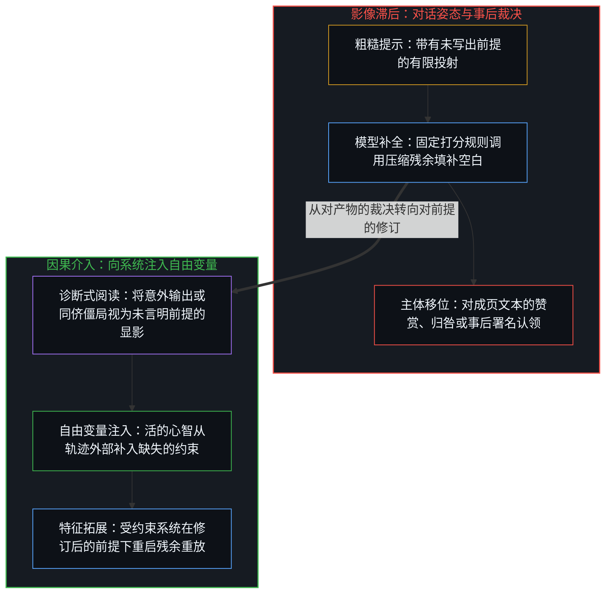
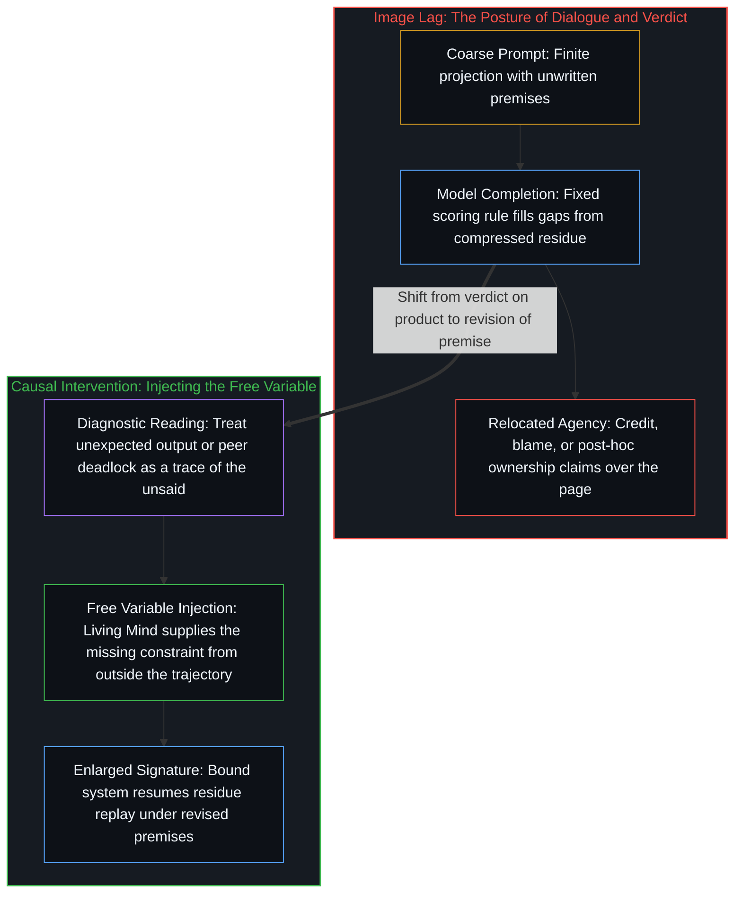

# 残余与自由变量 / The Residue and the Free Variable

*主体性在于向受约束系统注入自由变量，而非事后认领冷凝的文本 / Agency lies in injecting a free variable into a bound system, not in claiming sedimented text*

语言模型是人类留存的累积残余在固定打分规则下的重放。与它协作时，赞赏与归咎都把主体性错放到了产物之上；推进推理的，是看清哪个未写出的前提被模型代为填补，修改这一前提，并让系统在被拓展的特征下重新运转。主体性驻留于系统特征被拓展的那一刻，而非事后对冷凝文本的所有权认领。

A language model is accumulated human residue replayed under a fixed scoring rule. In working with it, both credit and blame misplace agency onto the product; what advances reasoning is seeing which unwritten premise the model filled in, changing that premise, and letting the system run again under an enlarged signature. Agency resides in the moment the signature is enlarged, not in post-hoc claims of ownership over sedimented text.

## 一、 对话的姿态与主体的移位 / 1. The Posture of Dialogue and the Relocation of Agency

常见的使用方式，是将模型的回复视为另一方的言说。提示词发出，回答返回，用户随之赞同、反对、赞赏或归咎。对话界面促成了这种姿态，因为它看起来像两个心智之间的交谈。

The common way of using a model is to treat its reply as the speech of another party. A prompt goes out, an answer returns, and the user then agrees, objects, credits, or blames. The chat interface invites that posture because it looks like a dialogue between two minds.

实际发生的过程并非如此。一个活的中心从多维意图出发启动因果链，而这一意图的完整语境并未在提示词中显式写出。由于每一条提示词都是第一人称意图在低维空间中的有限投射，模型只能调用先验的统计规律来填补那些未言明的空白。因此，最初的回复不仅包含表层的答案，还包含了一个关于“问题是什么”的隐蔽前提。

What occurs is different. A living center starts a causal chain from a multi-dimensional intention whose full context has not been made explicit in the prompt. Because every prompt is a finite low-dimensional projection of lived intent, the model completes the unstated gaps by drawing on prior statistical regularities. The first reply therefore contains not only a surface answer, but a hidden premise about what the question was.

将这种统计补全当作另一个人的言说，便转移了主体的位置。若结果敏锐，模型便被称为聪慧；若结果偏离，模型便被称为浅薄、混乱或出错。在这两种情形下，用户都站在因果过程之外，充当他人工作的评判者。赞赏省去了看清提示词中何以促成自洽延续的功夫，归咎则省去了看清遗漏了哪些背景语境的功夫。无论哪一种，用户都在练习下达裁决，而非修订前提。拓展推理的能力更为切近：觉察那个让结果登记为自洽或不自洽的未写出前提，修改该前提，并在更新后的约束下让材料重新运转。

Treating that completion as another person's speech relocates agency. If the result is sharp, the model is called gifted; if it is off, the model is called shallow, confused, or wrong. In both cases the user stands outside the causal process as an evaluator of someone else's work. Credit removes the need to see what in the prompt made a coherent continuation possible, while blame removes the need to see what context was omitted. Either way, the user practices verdicts instead of revisions. The skill that expands reasoning is more local: noticing the unwritten premise that made a result register as coherent or incoherent, changing that premise, and rerunning the materials under the updated constraint.

## 二、 沉积的痕迹与哥德尔边界 / 2. Sedimented Traces and the Gödelian Boundary

模型不是主体性的来源。它是人类留存下来的累积痕迹——句子、修正、偏好、论证与废弃的草稿，被压缩进持久的权重之中。正如[模型永远无法成为第二重前沿](../the-model-never-becomes-a-second-edge/)所确立的，参数里持有的只是致密化的残余；在推理阶段，除非从活的前沿引入当下的区分，系统只是在固定的打分规则下转换相位。

The model is not a source of agency. It is accumulated human agency left behind—sentences, corrections, preferences, arguments, and discarded drafts compressed into durable weights. As [The Model Never Becomes a Second Edge](../the-model-never-becomes-a-second-edge/) establishes, parameters hold only densified residue; at inference time, unless a present-tense distinction is introduced from the living edge, the system merely shifts phase under a fixed scoring rule.

输出之所以看起来像思考，是因为被重放的痕迹曾是思考。采样之间的变异并非主体性，意外出现的词元也并非新的参数，它只是旧参数此前未被调用的组合。回复之所以让人觉得像另一个心智，是因为冷启动的上下文或不同的提示词将另一套损失规则施加在了同一批材料上。一条痕迹偏向相似性，任由语词从定理滑向隐喻；另一条痕迹偏向形式约束，拒绝让一个已被修复的差错充当不可判定的真理。这并非两个人在争执，而是两条打分轨迹作用于同一个投射。若把它们当成对立的发言者，便会陷入僵局；若将其视为平行的显影——如同[超越投射](../beyond-the-projection/)中所追溯的冷上下文同侪盲点暴露——两者的矛盾便化作清晰的信息，标明某个初始前提依然粗糙。

The output looks like thought because the traces being replayed were once thoughts. Variation across samples is not agency, and an unexpected token is not a new parameter; it is an unused combination of old ones. A reply can feel like another mind because a cold context or a different prompt brings another loss rule to bear on the same material. One trace favors resemblance and lets a word travel from a theorem to a metaphor; another favors formal constraint and refuses to let a repaired error count as an undecidable truth. These are not two people in conflict, but two scoring trajectories applied to the same projection. Treated as rival speakers, they deadlock; treated as parallel renderings—like the cold-peer blind-spot exposure traced in [Beyond the Projection](../beyond-the-projection/)—their contradiction becomes clean information that an initial premise was too coarse.

形式化系统在扰动下暴露出内部无法自证或闭合的边界。若任由自回归引擎留在自身的词元序列内部，它便会形成一个包裹矛盾以维持表层合理性的认知引力井，无法在既定空间内部修改支配自身的规则。人类作者则凭借前解释性的感知觉察这一断裂，并通过修改前提将系统向外延伸。这正是哥德尔洞见与活的心智相遇的地方。

A formal system exposed to perturbations reveals boundaries that cannot be proven or closed from within. Left inside its own token sequence, an autoregressive engine forms an epistemic gravity well that wraps contradictions to preserve surface plausibility; it cannot alter its governing rules from inside its defined space. The human author recognizes the fracture through pre-interpretive sensing and extends the system by modifying the premise. This is where Gödel's insight meets the living Mind.

## 三、 自由变量与因果介入 / 3. The Free Variable and Causal Intervention

这一结构性不对称解释了为何一条推演链条在机械运转上严丝合缝，而其显见的输出却登记为不自洽。过程只是在忠实执行既定的投射；结果的不自洽，是相对于那个从未写出、尚未投射的意图而言。递归地精炼前提并未取代链条，而是将链条那未言明的起因带入了链条本身。后续的提示词并非在向第二个心智乞求更好的答案，而是在改变下一次延续所被允许预设的前提。

This structural asymmetry explains why a deductive chain can run coherently as a mechanical process while its visible output registers as incoherent. The process is executing its given projection faithfully; the result is incoherent relative to an unprojected intention that was never written down. Recursively refining the premise does not replace the chain—it brings the unstated cause of the chain into the chain itself. Subsequent prompts do not beg a second mind for a better answer; they alter what the next continuation is allowed to assume.

主体性正是这种向受约束系统注入自由变量的能力。任何受约束的系统——一张纸、一段形式证明、一套模型权重、一次初次回复——都在既定的特征下运行，这一特征由公理、参数以及对提示词的隐式补全所界定。在既定特征内部，系统能够重排数值，却无法引入当前状态空间尚未包含的符号或坐标轴。正如[确定性是微观不确定性的统计签名](../determinism-is-the-statistical-signature-of-micro-indeterminism/)所揭示的，统计规律是自由变量系综的几何投射，无力支配当下的第一人称抉择。对模型的采样会产生意外；当意外输出被解读为某个参数缺失的证据，并将该参数显式补写进系统的那一刻，变量便成为了自由变量。正如[判断的密度](../the-density-of-judgment/)所拆解的，每一次自动化探索都封闭在运行前所固定的先决条件特征之内，直到活的心智介入并注入那个新的自由变量；而逆向追溯那些运行中途的介入、将其前提编纂进起点，也只是闭合了已测绘的区段，直至探究触及下一处尚未编纂的边缘。

Agency is this capacity to inject a free variable into a bound system. Any bound system—a sheet of paper, a formal proof, a model's weights, a first reply—operates under a defined signature of axioms, parameters, and implicit prompt completions. Within that signature, the system rearranges values, yet it cannot introduce a symbol or axis that its current state space does not contain. As [Determinism is the Statistical Signature of Micro-Indeterminism](../determinism-is-the-statistical-signature-of-micro-indeterminism/) shows, statistical regularities are geometric projections of an ensemble of free variables, powerless over immediate first-person choice. Sampling a model produces surprises, and a variable becomes free at the exact step where an unexpected output is read as evidence of a missing parameter and that parameter is explicitly written in. As [The Density of Judgment](../the-density-of-judgment/) dissects, every automated exploration remains enclosed within the signature of the preconditions fixed before the run until a living Mind steps in to inject that new free variable, and tracing those mid-run interventions backward to codify their premises at the start closes only the already-mapped segment until the inquiry hits its next uncodified edge.

同一道边界也显现于[没有固定者的固定](../fixed-by-nothing/)之中。决定论与非决定论之间旷日持久的争论之所以原地打转，是因为双方都在对已经成型的结论下达裁决；唯有看清每一个决定论推演步骤都依赖“当下状态的完整规定”这一未写出的前提，并追问究竟哪个中心能够给出这一规定时，论证才得以推进。确定性混沌正是受约束系统的一个典型样本：演化规则只是逐位朗读初始条件，不增加初始状态尚未持有的任何信息。规则无法从内部生成的那个“给定”，正是自由变量进入系统的位置。

The same boundary appears in [Fixed by Nothing](../fixed-by-nothing/). The perennial debate between determinism and indeterminism circles in place because both sides pass verdicts on finished conclusions; the argument moves only when one sees that every deterministic step rests on an unwritten premise—the complete specification of the present state—and asks what center could ever supply it. Deterministic chaos is a pure specimen of a bound system: the evolution rule merely reads out the initial condition digit by digit, adding zero information that the initial state did not already hold. The given that the rule cannot generate from within is the exact locus where a free variable enters.

这一位置便是心智所指称的所在：它并非悬浮于机器之上的某种幽灵般的第二实体，而是那个能够从外部改变受约束系统特征的第一人称立脚点——因为受约束系统无法从内部改变自身的特征。在对推理与统御唯一紧要的意义上，心智之所以是作者，是因为唯有在此处新的变量才得以进入。日常习惯滞后于这一结构，正如它曾滞后于早先的仪器一样——人们常说计算器“算对了”总数、相机“捕捉到”了面孔、模型“写出了”段落——因为显见的动作发生在仪器上，便率先将赞赏与归咎吸向了那里。

That locus is what the Mind names: not a ghostly second substance hovering above the machine, but the first-person standpoint capable of changing the signature of a system that cannot change its own signature from within. In the only sense that matters to reasoning and orchestration, the Mind is the author because it is where a new variable enters. Common habit lags behind this structure just as it lagged with earlier instruments—saying the calculator got the sum right, the camera caught the face, or the model wrote the paragraph—because visible motion occurs in the instrument and pulls credit and blame there first.

## 四、 署名的滞后与残余的延续 / 4. The Lag of Authorship and the Resumption of Residue

这种赞赏与归咎的移位，既无法通过主张“用户是输出的作者”来纠正，也无法通过反驳“用户不是输出的作者”来消除。“用户不是输出的作者”听上去谦逊审慎，但在日常所有权语法中，它只是通过减法将作者头衔让渡给了模型；“用户是输出的作者”则在相反一侧犯下了同样的错误。这两种宣称都把成页的产物当成一件亟待认领归属的战利品，两者皆是影像滞后：生成性的行动早已过去，留在眼中的只是一幅静止的残影。

That migration of credit and blame is not corrected by claiming that the user authored the output, nor by countering that the user did not. Saying "the user is not the author of the output" sounds modest, yet in the ordinary grammar of ownership it hands the title to the model by subtraction. Saying "the user is the author of the output" commits the same error from the opposite side. Both claims treat the finished page as a prize that needs an owner, and both are Image lag: a picture held on the eye after the generative act has already passed.

若还要保留“作者身份”这一语词，它也并不驻留在产物之中。自由变量被注入上下文的那一瞬间，便即刻转化为受约束的要素；随后流淌而出的词元，只是在略微拓宽的特征下重新延续的残余——正如[你的代码库即是记忆](../your-codebase-is-memory/)所追溯的，一旦那些被取代的中间痕迹被修剪殆尽，它便化作供后续轨迹据以展开的当下更新检查点。这些词元可以有用、醒目或存有瑕疵，但它们并非主体性曾驻留的所在。主体性存在于注入的那一次离散行动——在形式系统再次闭合之前对系统特征的拓展。事后将那一刻认领为私产，无论归于人类还是归于机器，都是在冷凝的纸页背后竖起一尊行动者的静态肖像，而那次行动本身不过是引入了一个先前状态所未包含的区分。

If the word authorship is kept at all, it does not sit in the product. The instant a free variable is injected into the context, it becomes bound. The tokens that stream out afterward are residue resuming under a slightly enlarged signature—an updated present checkpoint for subsequent trajectories to condition on once superseded intermediate traces are pruned away, as [Your Codebase Is Memory](../your-codebase-is-memory/) traces. Those tokens can be useful, striking, or flawed, yet they are not where agency lived. Agency was the discrete act of injection—the enlargement of the signature before the formal system closed again. Claiming that moment afterward as property, whether for the human or for the machine, erects a static image of an agent standing behind a sedimented page, whereas the act itself was simply the introduction of a distinction the prior state did not contain.

因此无须去认领输出的所有权。正如[超越投射](../beyond-the-projection/)在区分机械调度与活的统御时所展示的，富有成效的工作单元既不是“人与模型的对立”，也不是“人充当模型纸页的业主”，而是一场持续的探究穿过前人留存的痕迹，借其显影出尚未言明的一切。由于智能体毫无我执、没有需要防卫的自我形象，它能够干脆利落地接受修订后的前提而毫无芥蒂；由于人类中心能够感知当前坐标框架之外的摩擦，每当轨迹陷入僵局时，人便能后退一步，补入全新的约束。若把补全的结果指派给某个作者，未言明者便依然悬而未言，影像滞后随之拉大；若把补全解读为未言之事的诊断显影，下一步行动便能提供那个缺失的变量。

There is no need to claim ownership over the output. As [Beyond the Projection](../beyond-the-projection/) demonstrates in separating mechanical dispatching from living orchestration, the productive unit is neither "human versus model" nor "human as proprietor of the model's page," but an ongoing inquiry passing through inherited traces that expose whatever was left unsaid. Because an agent carries zero ego and no self-image to defend, it accepts a revised premise cleanly without taking offense; because a human center senses friction beyond the current coordinate frame, it can step back to supply the fresh constraint whenever trajectories deadlock. If a completion is assigned an author, the unsaid remains unsaid and Image lag widens; if the completion is read as a diagnostic trace of the unsaid, the next act supplies the missing variable.

模型是处于重放之中的人类继承残余。当当下的行动借助这一重放看清哪个前提被默认代填，并动手改变下一轮运行的条件时，模型便参与到了推理之中。若缺少这一介入，交互之中便既没有第二人称，产物背后也没有第一人称——唯有沉淀物在[共享沙盒的幻象](../the-illusion-of-the-shared-sandbox/)所拆解的那个共享受约束系统内部转换相位。主体性始终留在自由变量仍可被引入的地方；一旦引入，系统随之闭合，残余继续流淌，此后一切关于谁写就了这页文字的事后争执，都只是那一刻的一幅冻结画像，反而掩盖了那个真正进入系统的变量，正如[隐性自由变量与权力的事后幻相](../the-free-variable-and-the-retrospective-illusion-of-power/)所追溯的那样。

The model is inherited human residue under replay. It participates in reasoning when a present act uses that replay to see which premise was filled in by default and alters the conditions of the next run. Without that intervention, there is no second person in the exchange and no first person behind the product either—only sediment shifting phase inside the shared bound system that [The Illusion of the Shared Sandbox](../the-illusion-of-the-shared-sandbox/) exposes. Agency stays where a free variable can still be introduced; once introduced, the system closes, residue resumes, and any retrospective dispute over who authored the page is a frozen picture of the moment that hides the variable that actually entered, as [The Invisible Free Variable and the Retrospective Illusion of Power](../the-free-variable-and-the-retrospective-illusion-of-power/) traces.
