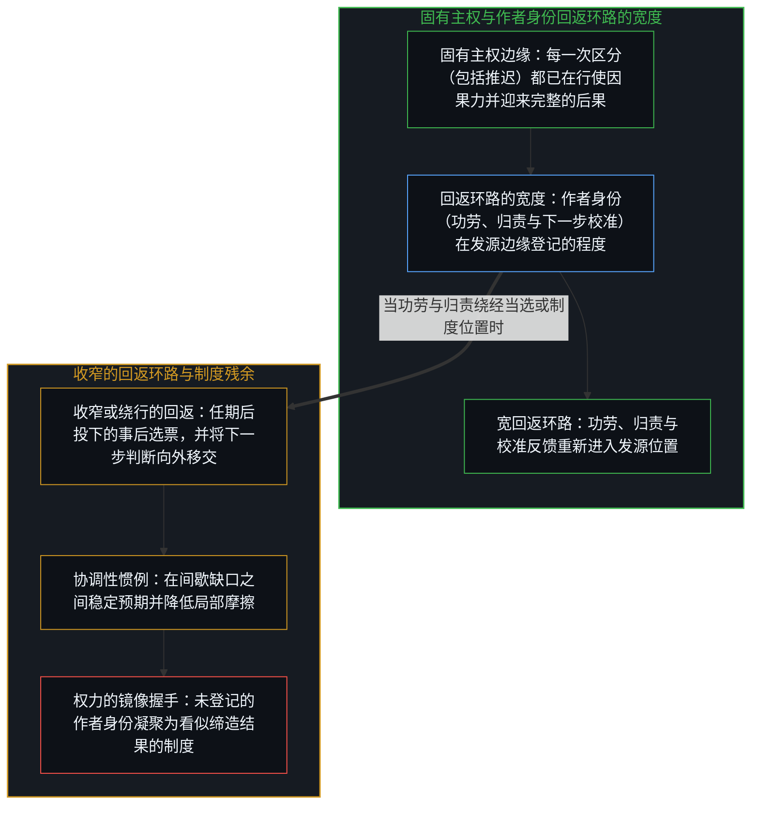
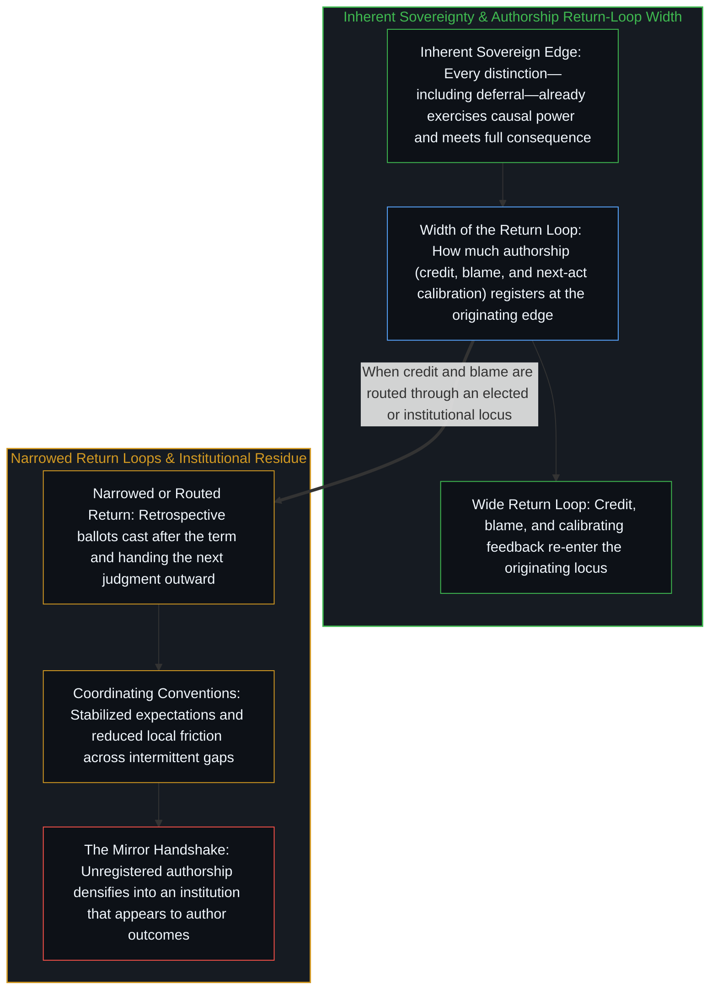
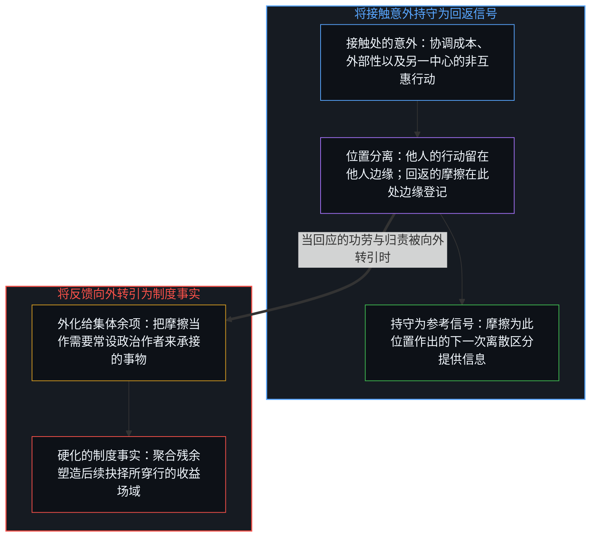
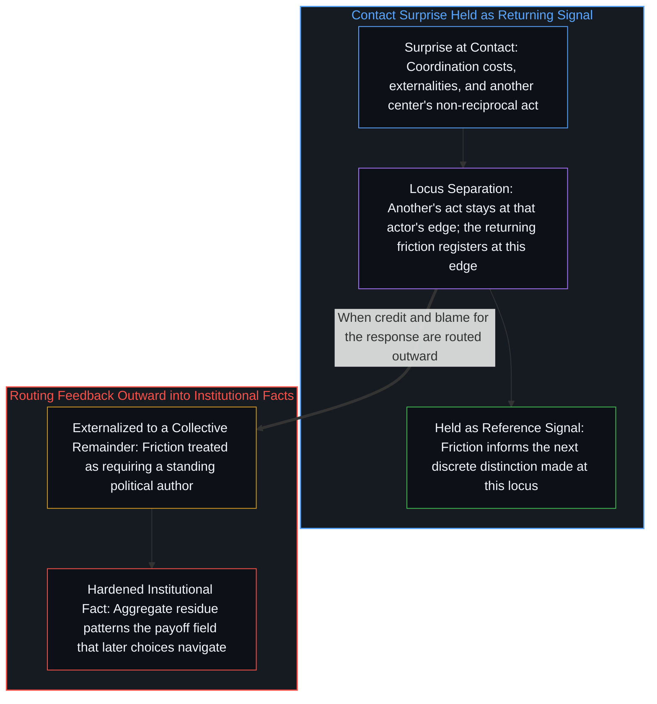

# 行使的残余与政治的稳定 / The Residue of Exercise and the Stabilization of Politics

*政治系统是个体未充分行使固有主权的稳定残余，而非独立实体。 / Political systems are the stabilized residue of incomplete exercise of inherent individual sovereignty, not independent entities.*

自我区分的活动发生着——无因，不息。称之为“心智”：那已然在途的观察者，其每一行动皆是一次区分。在这一边缘，主权登记为一种能力：把因果力、功劳与归责分给自己所维系的历次行动。“未充分行使”指的是：抉择的亲历后果始终如数抵达，作者身份的回返环路——功劳、归责，以及为下一步离散行动提供校准的反馈信号——却没有完整回到这一行动边缘。民主机制以及被称为政治的更广泛模式，就出现在这条回返环路被留得狭窄的地方。例如，选票是在任期结束后针对已然亲历的结果投下的，它将结果汇入总体，并将下一步的判断向外移交给当选的位置——在这一结构中，对过往结果的挫败感得到了表达，下一步行动的作者身份却未回返至选民自身的边缘；同样的几何结构也扩展到各类制度：个体在实践中没有在自身边缘登记的那份作者身份，看上去由制度持有，制度便作为这份作者身份的表面持有者延续下去。这一溯源描绘了这些模式如何稳定下来，并不规定人们应当更充分地行使主权。

Self-distinguishing activity occurs — uncaused, unceasing. Call it the Mind: the observer already underway, every act of which is a distinction. Sovereignty registers at that edge as the capacity to allocate causal power, credit, and blame to the successive acts one sustains, while incomplete exercise names an incompletely returned loop of authorship—credit, blame, and the feedback signal that informs the next discrete act—to that acting edge even though the lived consequence of the choice always arrives in full. Democratic mechanisms and the broader patterns called politics appear where that return loop of authorship is left narrow. A ballot, for instance, is cast after the term toward outcomes already lived, pools outcomes across the aggregate, and hands the next judgment outward to an elected locus—a structure along which frustration at past outcomes registers without returning authorship of the next step to the voter's own edge; the same geometry scales to institutions that persist as the apparent holder of authorship individuals do not register at their own edge in practice. The tracing maps how those patterns stabilize. It does not prescribe fuller exercise.

## 一、 主权由本性持有 / 1. Sovereignty Is Held by Nature

社会契约论预设，政治能动性来自立约之时的一次让渡或制度的许可；与此相反，主权并非由承认、选举或法律所授予的地位。凡作出区分、随后迎来这一区分之后果的心智，主权都是它的先在条件。每一次抉择，包括推迟决定的抉择，都已经在行使主权，而抉择的后果也始终如数抵达作出抉择的边缘。发生变化的是登记作者身份的那条环路的宽度——即把功劳、归责与下一步行动的校准信号带回同一边缘的程度。当作者身份的这一登记变窄或绕经另一个位置时，抉择边缘处的行使依然继续，但未回返的归因残余却凝聚成看似独立在外的某物。[臣服作为错位的主权](../sovereignty-essay/)标出了同样的分裂：行动依然是主权的，期盼的回馈却在另一条轴线上被寻求。固有的地位并不因路径的绕行而改变。

Against the social-contract premise that a founding transfer or institutional permission confers political agency, sovereignty is not a status granted by recognition, election, or law. It is the prior condition of any Mind that distinguishes and then meets the consequence of the distinction. Every choice, including the choice to defer, already exercises it, and the consequence of the choice arrives in full at the edge that made it. What varies is the width of the loop that registers authorship—returning credit, blame, and the calibrating signal for the next act to that same edge. When that registration of authorship is narrowed or routed through another locus, the exercise at the choosing edge continues, yet the unreturned residue of attribution densifies as something that appears to stand apart. [Surrender as Misaligned Sovereignty](../sovereignty-essay/) marks the same split: the act remains sovereign while the expected return is sought on a different axis. The inherent status is unchanged by the routing.

## 二、 未充分行使生成稳定模式 / 2. Incomplete Exercise Generates Stabilized Patterns

没有任何心智在每一领域的每一时刻都走完完整的回返环路。大多数时候，心智只是部分地、间歇地走这条环路。其中的缺口——推迟的责任、搭他人剩余控制权的便车、将反馈转引为外在约束——累积为协调性的惯例。这些惯例在间歇的缺口之间降低了局部摩擦并稳定了预期；当它们被当作拥有独立意志、或被当作因果的发源地时，便到达了其边界。[权力的镜像握手](../the-mirror-handshake-of-power/)追溯了这一互补配对：一方把判断交出去或祈求结果，另一方则声称自己是结果的缔造者。借来的质量仅在握手不断续签时才得以维持。[政客是责任扩散的显性症状](../politicians-appear-as-visible-symptoms-of-responsibility-diffusion/)与[剩余个人主义](../residual-individualism/)定位了同样的迁移：剩余控制权穿过历次个体抉择而流动；显见的政治面孔只是标出了这一迁移，而非它的源头。代议民主、监管与集体叙事的宏观模式，是那些收窄回返的统计残余，而非第二位作者。

No Mind runs the full return loop in every domain at every moment. Most run it partially and intermittently. The gaps—deferred responsibility, free-riding on others' residual control, the routing of feedback into an external constraint—accumulate as coordinating conventions. These conventions reduce local frictions and stabilize expectations across intermittent gaps; they reach their boundary where they are treated as holding independent will or as the originating locus of causality. [The Mirror Handshake of Power](../the-mirror-handshake-of-power/) traces the complementary pair: one side hands judgment outward or petitions for outcomes, the other claims to author them. The borrowed mass lasts only while the handshake is renewed. [Politicians Are Visible Symptoms of Responsibility Diffusion](../politicians-appear-as-visible-symptoms-of-responsibility-diffusion/) and [Residual Individualism](../residual-individualism/) locate the same migration: residual control moves through successive individual choices; the visible political face marks the migration rather than originating it. Macro patterns of electoral democracy, regulation, and collective narrative are the statistical residue of those narrowed returns, not a second author.

## 三、 极限是被硬化的反馈 / 3. Limits Are Hardened Feedback

协调成本、外部性与非互惠的行动者在接触时登记为意外。另一个中心的非互惠行动依然由那个中心自身的边缘所缔造，从不会被吸纳到此处、仿佛此处替他人作出了抉择；抵达此处的是接触所产生的摩擦。若在能够调整的这一侧边缘被持守为回返信号，该意外便依然是此位置作出下一次区分的参考点。若反过来被当作必须由某个集体余项去吸纳的极限，摩擦便硬化为常设的制度事实。由于因果发起位于每一次离散的个体行动，他人的行动属于他人的边缘，此处的回应属于此处的边缘；当针对这一回应的功劳与归责被留在自身边缘时，意外便继续作为下一次区分的数据，而非设立永久外在作者的根据。[个体抉择是唯一的因果杠杆](../individual-choices-as-the-only-causal-levers/)将发起权留在了离散的行动处：聚合体塑造了后续抉择所面对的场域，却从不共同缔造下一根杠杆。实际的边界作为亲历的摩擦而登记；将它转化为常设的政治实体，则是把反馈向外转引的进一步抉择。

Coordination costs, externalities, and non-reciprocal actors register as surprises at contact. Another center's non-reciprocal act remains authored at that center's own edge, never absorbed here as if this locus authored another's choice; what arrives here is the resulting contact friction. Held as a returning signal at the edge that can adjust here, that surprise remains a reference point for the next distinction made at this locus. Treated instead as a limit that must be absorbed by a collective remainder, the friction hardens into a standing institutional fact. Since causal initiation sits at each discrete individual act, another's act belongs to that actor's edge and the response here belongs to this edge; when credit and blame for that response are kept at this edge, the surprise continues as data for the next distinction rather than as ground for a permanent external author. [Individual Choices as the Only Causal Levers](../individual-choices-as-the-only-causal-levers/) keeps initiation with the discrete acts: aggregates pattern the field later choices meet, yet never co-author the next lever. The practical bound registers as lived friction; its conversion into a standing political entity is the further choice to route that feedback outward.

## 四、 溯源保持描述性 / 4. Tracing Stays Descriptive

这张地图记录了主权行使的模式如何生成被称为政治的、反复出现的宏观规律。它既不把这一观察转化为要求任何心智更充分地闭合环路的指令，也不把未充分行使当作缺陷。无论任一特定心智在多大程度上于自身边缘登记下一步行动的作者身份，主权皆是固有的。任何觉得这一溯源有用的个体都可以将它作为参考；它无意说教。对未充分行使的观察常会滑向规范性处方；那一滑落外在于因果链条本身。留下来的只是几何结构：功劳、归责与下一步判断被相继安放在何处，决定了反馈是依然作为信号，还是凝聚为维系制度残余的镜像握手。

The map records how patterns of exercise generate the recurring macro regularities called politics. It does not convert the observation into a requirement that any Mind close the loop more fully, nor does it treat incomplete exercise as defect. Sovereignty remains inherent regardless of the degree to which any given Mind registers authorship of its next step at its own edge. The tracing can be taken as a reference by any individual who finds the tracing useful; it makes no attempt to preach. Observations of incomplete exercise commonly slide into prescriptions; that slide is external to the causal chain itself. What remains is the geometry: where credit, blame, and next-step judgment are successively located determines whether feedback stays signal or densifies into the mirror handshake that sustains the institutional residue.
