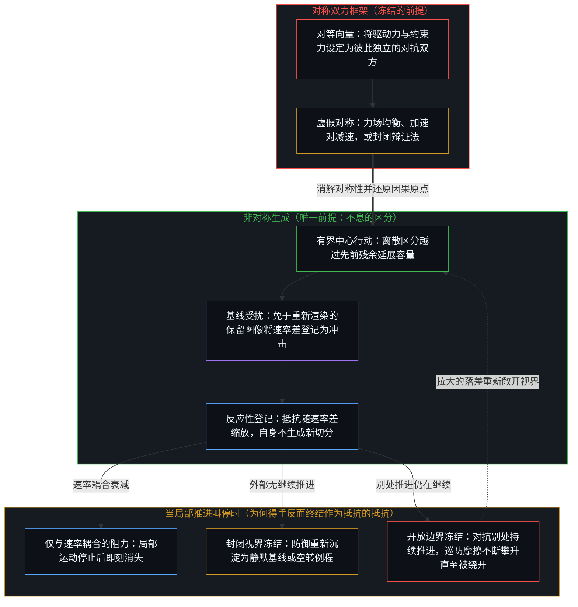
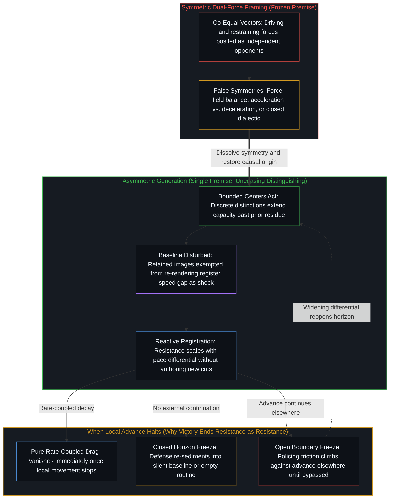
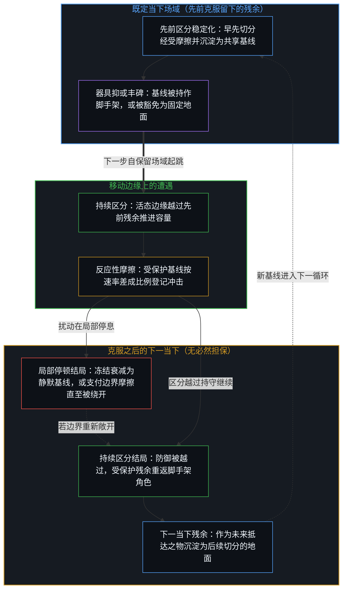
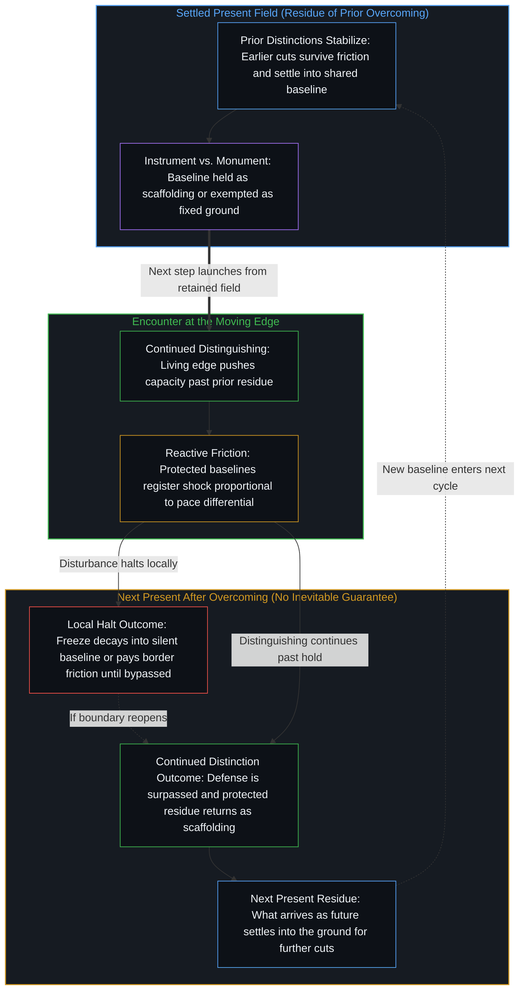

# 进步的残余与抵抗的反应性 / The Residue of Progress and the Reactivity of Resistance

*抵抗是进步的反应性痕迹，即便得手亦随进步而消逝，将当下与未来留作克服之后的残余。 / Resistance is the reactive trace of progress that dies even in victory, leaving both present and future as residue after overcoming.*

无进步即无对变化的抵抗。其余条件相同时，进步越快，抵抗越强。抵抗是反应性的；即便得手，亦随进步而消逝。未来——以及当下本身——是进步克服抵抗后留下的残余。

Without progress, there is no resistance to change. All else equal, the faster the progress, the stronger the resistance. Resistance is reactive; even when it succeeds, it dies with progress. The future—and the present itself—is the residue of progress overcoming resistance.

自我区分的活动发生着——无因、不息。称之为心智：早已在途的观察者，其每一个行动都是一次区分。任何已实现的状态进入当下时，皆是先前区分留下的残余，只朝一个方向塑形后续行动。在既有持守之内重排要素，有助于在既定边界下维系局部稳定与协调；正如[边界之外的生成与内部重排](../generation-beyond-the-boundary-and-internal-rearrangement/)所区分的，这种重排在扩张发生之处到达边界：进步由复杂到足以追踪序列的有界中心所登记，显现在区分越过先前残余继续推进、将容量延展至尚未被区分之处。

Self-distinguishing activity occurs — uncaused, unceasing. Call it the Mind: the observer already underway, every act of which is a distinction. Any realized state enters the present as the residue of prior distinctions, shaping later acts in one direction only. Rearranging elements within an existing hold serves local stabilization and coordination under settled bounds, reaching its boundary where expansion occurs, as [Generation Beyond the Boundary and Internal Rearrangement](../generation-beyond-the-boundary-and-internal-rearrangement/) distinguishes: progress, as registered by bounded centers complex enough to track sequence, appears where distinguishing continues past prior residue to extend capacity into the still-undistinguished.

## 一、 抵抗作为进步的反应性残余 / 1. Resistance as the Reactive Residue of Progress

对变化的抵抗并非与进步并立的独立力量；当持续区分扰动了既有残余的保留基线，所留下的反应性痕迹便是抵抗。两种操作共用了“抵抗”一词，实则分属不同坐标轴：在权力与对齐的动态中，主动抵抗指不强化占主导的稳定模式、依然继续进行的离散行动；对变化的抵抗则指相反的姿态——有界中心使先前构型免于重新渲染，并对动摇它的进一步区分作出反应性抵触。进步与抵抗皆非悬空的历史引擎。划出区分并塑形后续行动可得对齐的，是活生生的有界中心；当某个中心把昨日残余固守为尺度，向前推进的区分对照这幅保留图像，便登记为扰乱而非延续。

Resistance to change is not an independent force standing beside progress; it is the reactive trace left when continued distinguishing disturbs a retained baseline of prior residue. Two operations share the word "resistance" and belong on separate axes: within the dynamics of power and alignment, active resistance names discrete acts that continue without reinforcing a dominant stabilized pattern, whereas resistance to change names the opposite posture—a bounded center exempting a prior configuration from re-rendering and reacting against further distinctions that unsettle it. Neither progress nor resistance acts as a disembodied historical motor. Bounded living centers draw distinctions and pattern which alignments later acts find available; when a center holds yesterday's residue fixed as its measure, advancing distinctions register against that retained image as disruption rather than continuation.

把变化与反对视作对称的共同作者，便漏掉了这一起源上的不对称。库尔特·勒温的力场分析将社会状态建模为一种准静止均衡，由推向变化的驱动向量与地位对等的约束向量彼此制衡——这一框架在诊断为何加大驱动压力会陡增系统张力、而削减约束则能以更低摩擦推移均衡时有用，也有助于把摩擦视作整体关系场的属性，而非孤立行动者内部的缺陷。该模型在此到达边界：它把驱动向量与约束向量设为对称线性标尺上各自独立起源的对等双方，却未看清约束力唯有在主动区分扰动了被保存的基线之后，才在下游得以登记。正如[减速是加速时感受到的阻力](../deceleration-is-the-drag-felt-when-accelerating/)所追溯的，把技术与文化变迁框定为加速与减速之间的意识形态对决，重复了同一种对称预设：减速并非自主的第二台引擎，而是运动剪切既有介质时生成的反应性阻力，被当作敌人搏斗时便固化为有组织的对立。正如[悲观是乐观的阴影](../pessimism-is-the-shadow-of-optimism/)在情绪与感知中所展现的，被稳住的痕迹追随划界运动，恰如阴影追随光线，从不与之共同创作。这一关系始终保持局部——仅追溯推进的区分与反应性登记之间已在场的对应，不引入外在因果基底——同时在有界中心行动的每一个尺度上皆成立。

Treating change and opposition as symmetric co-authors misses that asymmetry of origin. Kurt Lewin's Force-Field Analysis models a social state as a quasi-stationary equilibrium where driving vectors pushing toward change balance co-equal restraining vectors holding it back—a framing useful for diagnosing why increasing driving pressure spikes systemic tension while reducing restraints shifts the balance with lower friction, and for treating friction as a property of the total relational field rather than a flaw inside isolated actors. That model reaches its boundary in positing driving and restraining vectors as independently originating partners on a symmetric linear scale, rather than seeing that restraining force registers only downstream once an active distinction unsettles a preserved baseline. Framing technological and cultural change as an ideological duel between acceleration and deceleration repeats the same symmetry, as [Deceleration Is the Drag Felt When Accelerating](../deceleration-is-the-drag-felt-when-accelerating/) traces: deceleration is not an autonomous second engine, but the reactive drag generated when movement shears through an existing medium, hardening into organized opposition when fought as an enemy. As [Pessimism Is the Shadow of Optimism](../pessimism-is-the-shadow-of-optimism/) shows in mood and perception, the steadied trace follows the drawing movement the way a shadow follows light, never co-authoring it. The relation stays local—tracing only the correspondence already present between advancing distinction and reactive registration without introducing an external causal substrate—while holding across every scale where bounded centers act.

其余条件相同时，有界中心越快将区分推过既定地面，在其他中心重新渲染自身参照之前，受扰动的保留基线带便越宽，反应性登记也越密集。抵抗随推进速率而缩放，而非随某种外在反对意志而变，紧随[阻力体感与速率差](../felt-resistance-and-the-speed-differential/)所剖析的速率差——它在领先能力与滞后适应之间不断拉大。卡尔·波兰尼对“双向运动”的阐释捕捉了这一速率敏感性的一个历史切面：对照近代早期的圈地运动与工业化进程，波兰尼指明社会失序紧随市场转型的步速、而非单随其方向变化，因而制度尚能吸纳渐进推移，急遽脱嵌却会触发保护性反向运动。然而，把这一反向运动归因于社会自动的自我保护反射，正标出该阐释的边界：正如[个体抉择是唯一的因果杠杆](../individual-choices-as-the-only-causal-levers/)所确立的，聚合体并不握有自身的因果杠杆。向前的推进与保护性冻结，皆由有界中心在已改变的回报下抉择施行——正因如此，速率触发的反向运动既无统一形态，也非预先注定，既涵盖可调适的缓冲，也涵盖刚性的排斥。即便局部阻断暂时叫停了某项区分在一地的落地，冻结所守护的仍是早先区分的残余；一旦区分在别处继续，它仍会重新成为可用的脚手架。

All else equal, the faster bounded centers extend distinctions past settled ground, the wider the band of retained baselines disturbed before other centers re-render their references, and the denser the reactive registration. Resistance scales with the speed of advance rather than with some external will to oppose, tracking the widening rate differential between leading capability and lagging adaptation analyzed in [Felt Resistance and the Speed Differential](../felt-resistance-and-the-speed-differential/). Karl Polanyi's account of the Double Movement catches one historical face of that rate sensitivity: comparing early modern enclosures and industrialization, Polanyi demonstrated that social dislocation tracks the pace of market transition rather than its direction alone, allowing institutions to absorb gradual shifts while rapid disembedding triggers protective countermovements. Yet attributing that countermovement to an automatic self-protecting reflex of society marks the account's boundary: an aggregate holds no causal lever of its own, as [Individual Choices as the Only Causal Levers](../individual-choices-as-the-only-causal-levers/) establishes. Both the advancing push and the protective freeze are enacted by bounded centers choosing under altered payoffs—which is why pace-triggered countermovements take no uniform or predetermined form, spanning adaptable buffers and rigid exclusions alike. Even when local blocking temporarily halts a distinction's landing in one locality, what the freeze protects remains residue of earlier distinguishing, available again as scaffolding once distinguishing continues elsewhere.

## 二、 反应性的不可持续性 / 2. The Unsustainability of Reactivity

对变化的抵抗是反应性的或被动的：它依赖区分活动先行发生，才能将其登记为需要对抗的对象。没有先行的区分来动摇一道所持守的基线，便没有可抵抗之物。反应性因此无法引领进步，无法发起下一个构型，也无法在推进停止后仍独立延续。即便抵抗一时成功地将某道基线钉在原地，该基线依然只是早先进步留下的残余；固守之举本身，并未在昨日的切分之外创造出任何新的分化。

Resistance to change is reactive or passive: it depends on distinguishing activity having already occurred so that it can register that activity as an object requiring opposition. Without prior distinguishing unsettling a held baseline, there is nothing to resist. Reactivity therefore cannot lead progress, originate the next configuration, or sustain itself independently once advance stops. Even when resistance succeeds for a season in holding a baseline fixed, that baseline remains the residue of earlier progress; the act of holding creates no differentiation beyond yesterday's cut.

正是这一结构性依赖，无需诉诸任何必然的历史胜利，便足以解释为何抵抗即便得手，作为抵抗依然会消逝。若对立仅与速率耦合——即摩擦只由转型的瞬时速度所生成——叫停局部变化会立即熄灭抵抗，因为已不再有可供登记的差分。由规则、许可门槛、行会特许状或成文禁令筑成的制度化冻结，在局部扰动平息后虽不即刻归零，却仍会沿着两条分岔之一，终结自身作为“抵抗变化”的运作。在局域密封的视界内，视野中不再留有任何竞争性替代方案，主动防御便失去了鲜活的触发点：要么规则重新沉淀为静默、理所当然的基线惯例，参与者不再登记任何反事实可能；要么执行机构与已消失的革新脱钩，化为空转的残遗例程继续运转，只维系内部寻租，而非抵抗变化。相反，跨越开放边界时，正如[没有系统能被保持封闭](../no-system-can-be-kept-closed/)与[起作用的是信念](../what-works-is-the-belief/)所论证的，局部禁令从未能封住更广阔的场域：封印只约束将其当作地基的中心，不顺从的边缘则会绕道而行。当区域海上贸易绕开明代海禁，欧洲大陆汽车制造商超越受 1865 年“红旗”限速伴行冻结制约的英国，抑或行会之外的地区产出超越城镇手工业卡特尔时，阻断机构之所以仍作为抵抗而维持运作，其活跃度严格与别处继续的进步成比例——只要外部落差仍在，它便须如[限制是选择性的税](../restriction-is-a-selective-tax/)所追溯的那样不断付出攀升的边界巡防摩擦，直至被绕行并拆除。

That structural dependency explains why resistance dies as resistance even in victory, without appealing to any inevitable historical triumph. Where opposition is purely rate-coupled—friction generated strictly by the instantaneous speed of transition—halting local change extinguishes resistance at once because no differential remains to register. Institutionalized freezes built from rules, licensing gates, guild charters, or statutory bans behave differently when local disturbance ceases, yet still terminate as active resistance to change along one of two forks. Inside a locally sealed horizon where no competing alternative remains in view, active defense loses its live trigger: either its rules re-sediment into silent, taken-for-granted baseline practice so that participants cease registering any counterfactual, or the enforcement apparatus decouples from the vanished innovation and runs on as an empty vestigial routine sustaining internal rent-holding rather than opposition to change. Across an open boundary, by contrast, local prohibition never seals the wider field, as [No System Can Be Kept Closed](../no-system-can-be-kept-closed/) and [What Works Is the Belief](../what-works-is-the-belief/) demonstrate: a seal binds only the centers treating it as ground while non-compliant edges route around it. When regional maritime trade circumvented Ming sea bans, continental automakers outpaced Britain under its 1865 Red Flag speed-and-escort freeze, or unguilded districts outproduced urban craft cartels, the blocking apparatus stayed active as resistance strictly in proportion to that continuing progress elsewhere—paying mounting boundary-policing friction, as [Restriction Is a Selective Tax](../restriction-is-a-selective-tax/) traces, for as long as the external differential persisted or until bypassed and dismantled.

两套哲学论述各自点出了这一不对称的部分面貌，却都在抵达其单一源头前止步。正如[区分活动与否定的显现](../differentiation-and-the-appearance-of-negation/)所追溯的，格奥尔格·威廉·弗里德里希·黑格尔的“确定的否定”与“扬弃”，捕捉到了局促的概念持守如何在内部张力下碎裂、并将早先区分保存于更宽的后继结构之中；然而，由于把每一次否定都收容进一个担保向上综合的自我完结总体，辩证法把局部克服转化成了宇宙必然性，令长期停滞变得无从解释。弗里德里希·尼采与吉尔·德勒兹倒置了黑格尔，将原初的主动之力同派生的反应之力区分开来，指出后者唯靠引导中心向内对抗自身能力方能局部胜出——但止步于两种交战的力量种类，既增殖了原初驱力，又如[对象是被稳定化的关系](../objects-are-stabilized-relationships/)在评述过程形而上学时所提示的，容易掩盖稳定化痕迹自身如何在摩擦下施加因果阻力。从唯一前提推演二者，便消解了这双重界限：主动的进步是越过既有残余继续进行离散区分，而反应性抵抗则是同一区分活动在捍卫一幅免于重新渲染的保留图像。

Two philosophical accounts spot parts of this asymmetry yet halt short of its single source. G. W. F. Hegel's determinate negation and sublation capture how a cramped conceptual hold fractures under internal tension while preserving earlier distinctions inside a wider successor, as [Differentiation and the Appearance of Negation](../differentiation-and-the-appearance-of-negation/) traces; yet by housing every negation inside a self-completing totality that guarantees upward synthesis, the dialectic converts local overcoming into cosmic inevitability and leaves prolonged stagnation unintelligible. Inverting Hegel, Friedrich Nietzsche and Gilles Deleuze separate primary active forces from derivative reactive forces that triumph locally only by turning centers inward against their own capacity—yet stopping at two warring species of force both multiplies primary drives and, as [Objects Are Stabilized Relationships](../objects-are-stabilized-relationships/) notes of process metaphysics, risks obscuring how stabilized traces themselves exert causal resistance under friction. Deriving both from one premise dissolves both limits: active progress is continued discrete distinguishing past prior residue, while reactive resistance is that same distinguishing activity defending a retained image exempted from re-rendering.

同一依赖关系对任何兼含主动区分运动与反应性对应的过程皆成立，无需引入独立的基准真值。无论是制度惯性遭遇技术部署、承袭的认知框架遭遇概念修订，还是受防卫的自我形象遭遇个体抉择，抵抗都作为区分活动的反应性记账显现，每当区分越过那道受防卫的参照继续前行，抵抗便随之消散。

The same dependency holds across any process containing both an active distinguishing movement and a reactive counterpart, without adding an independent ground truth. Whether institutional inertia meets technological deployment, inherited cognitive frameworks meet conceptual revision, or a defended self-image meets an individual choice, resistance appears as the reactive bookkeeping of distinguishing activity and dissipates whenever distinguishing moves past the defended reference.

## 三、 当下与未来作为克服之后的残余 / 3. Present and Future as Residue After Overcoming

有界中心所遭遇的当下，是先前区分克服了自身反应性残余后留下的既定场域。在摩擦中站稳的早先切分沉淀为工具、基础设施与寻常习惯，作为可用地面进入当下的行动。未来并非沿着轨道等候的既定终点；它是持续区分越过下一轮反应性登记之后将会沉淀出的残余。抵抗一时的局部得手从不逆转这一序列：它只是推迟了受保护基线在何时、何处重新进入可被后续区分跨越的结构范围。

What bounded centers encounter as the present is the settled field left after prior distinguishing has overcome its own reactive residue. Earlier cuts that held under friction settled into tools, infrastructures, and ordinary habits, entering present action as usable ground. The future is not a pre-existing destination waiting along a track; it is the residue that continued distinguishing will deposit after moving past the next round of reactive registration. Temporary local success of resistance never reverses that sequence: it delays when and where a protected baseline re-enters the range of structures that further distinguishing can step beyond.

事后回溯的进步叙事倒置了这一秩序，把累积下来的残余当作自动轨迹的证明。辉格史观把过往突破编排成迈向当下开明的必然行进——这一视角在事后梳理里程碑次序时有用；一旦被当作明日必受宇宙必然性驱动而推进的担保，便到达了它的边界。正如[进步叙事中的症候与原因](../symptom-and-cause-in-the-narratives-of-progress/)所揭示的，发起始终落在不断轮替的稀少少数派那里，由他们划出未经背书的区分；集体情绪与宏观指标则是随后到来的、对摩擦与吸收作出的延迟登记。把已经被吸收的共识视作历史展开的引擎——即以为进步不过是共享智慧平缓拓宽——则犯下了孪生倒置，将[进步的多面手](../the-utility-men-of-progress/)所追溯的既成基础设施误认作了最初锻造它的源头。当有界中心把承袭的安逸视作固定权利、而非供进一步区分取用的材料时，局部停滞固然可以跨越数代人持续下去；然而即便停滞，也无法把反应性变成后续格局的作者，每当新的区分重启——无论就在当地还是跨越另一道边界——那道受保护的基线便会重新作为有待越过的残余归来。

Retrospective progress stories invert that order by treating the accumulated residue as proof of an automatic trajectory. The Whig theory of history arranges past breakthroughs into an inevitable march toward present enlightenment—a lens useful for sequencing milestones in hindsight that reaches its boundary when taken as a guarantee that tomorrow must advance by cosmic necessity. As [Symptom and Cause in the Narratives of Progress](../symptom-and-cause-in-the-narratives-of-progress/) shows, initiation sits with thin, shifting minorities drawing uncertified distinctions, while collective sentiment and macro indicators arrive later as delayed registrations of friction and absorption. Treating absorbed consensus as the unfolding motor of history—the view that progress consists in shared wisdom gently widening—commits the twin inversion, mistaking the settled infrastructure traced in [The Utility Men of Progress](../the-utility-men-of-progress/) for the origin that first forged it. Local stagnation can persist across generations when bounded centers treat inherited comfort as fixed entitlement rather than material for further distinction; yet even stagnation cannot turn reactivity into an author of what comes next, and whenever fresh distinctions resume—locally or across another boundary—the protected baseline returns as residue to be moved beyond.

回到划出下一步的具体第一人称边缘，这一秩序重新锚定了保留基线的持守方式。中心不再把承袭的框架当作已完工的建筑加以捍卫，也不再把周遭摩擦当作自主对手与之交锋，而是将先前的技能、模型与制度习惯持作临时脚手架——正如[持续生长的脚手架](../the-scaffolding-that-keeps-growing/)与[遗忘的脚手架](../the-scaffolding-we-forget/)所追溯的活态生长那样。保持稳固，待当下切分落地，便随边缘移动而重新渲染；保留基线借此收窄过剩图像滞后，从受防卫的纪念碑转化为可用的内部支撑。区分继续推进，反应性登记随速率差起伏，而每一个已实现的当下，都会重新成为供下一次区分迈步的可得材料。

At the concrete first-person edge drawing the next step, this order re-anchors how retained baselines are held. Instead of defending an inherited frame as finished architecture or fighting ambient friction as an autonomous rival, a center keeps its prior skills, models, and institutional habits as provisional scaffolding—the living growth traced in [The Scaffolding That Keeps Growing](../the-scaffolding-that-keeps-growing/) and [The Scaffolding We Forget](../the-scaffolding-we-forget/). Held steady long enough for the present cut to land, then re-rendered as the edge moves, the retained baseline narrows excess Image lag and shifts from defended monument into usable interior support. Distinguishing continues, reactive registration rises and falls with the pace differential, and every realized present becomes available again as material from which the next distinction steps off.
