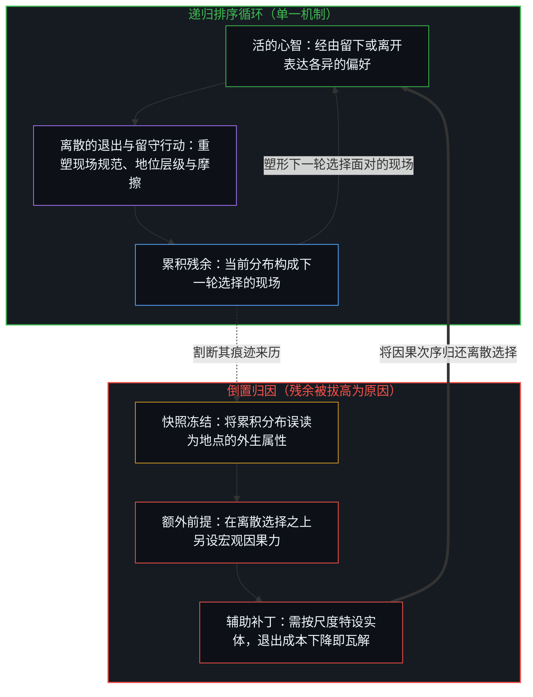
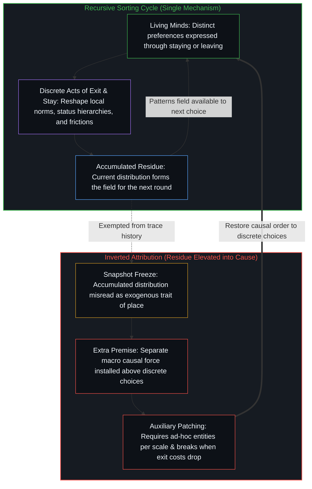
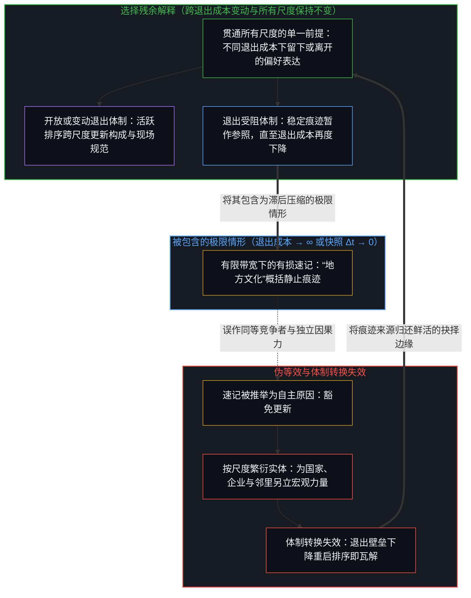
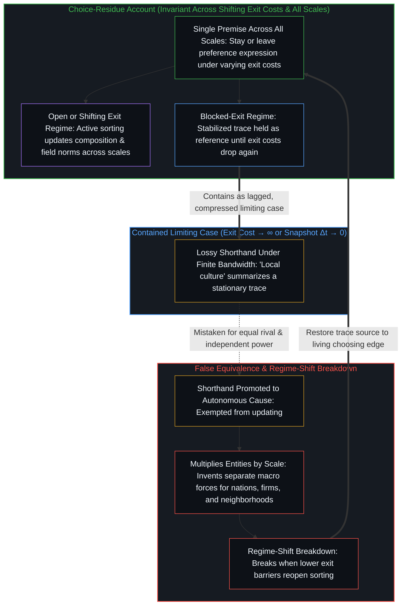

# 排序的残余与解释的非等效 / The Residue of Sorting and the Non-Equivalence of Interpretations

*主导心智是先前偏好表达的残余，将其视为独立因果力需要额外假设。 / The dominant mindset is the residue of prior preference expressions; treating it as an independent causal power requires additional assumptions.*

每当建设者将欧洲各大首都与硅谷加以对照，一幅熟悉的反差便一再浮现：一边面对新事业先是警惕风险、怀疑行不通，社交往来也保持防备距离；另一边却回应以更宽广的抱负、即刻伸出的援手，在午餐账单送来之前便随手牵线引荐，促使更多创业者订下西行的单程机票。人以这种方式用脚投票时，所显现的并非地点对心智的单向作用，而是偏好在可退出条件下的持续表达。

A familiar contrast recurs whenever builders compare European capitals with Silicon Valley: one environment greets a new venture with caution about risk, skepticism that it will work, and guarded social distance, while the other responds with wider ambition, immediate offers of help, and casual introductions before the lunch bill arrives, prompting yet more founders to book one-way flights westward. When people vote with their feet in this way, what appears is not a unilateral action of place upon mind, but the ongoing expression of preference under conditions of exit.

这些偏好表达累积成当前可见的人员、规范与预期分布，而这一分布本身又成为下一轮选择的现场。两种解释——将留存下来的主导心智当作地点的独立因果力，或将它当作先前选择的残余——并非对同一批事件的等效描述。唯有残余解释无需额外假设即可覆盖所有尺度，在退出壁垒变动时拆解其看似恒常的表象，并将表面描述说明为自身的滞后压缩形式。

These preference expressions accumulate into the currently visible distribution of people, norms, and expectations, and that distribution becomes the field for the next round of choices. The two interpretations—treating the dominant mindset left behind as an independent causal power of the place, or treating it as the residue of prior choices—are not equivalent descriptions of the same events. Only the residue interpretation covers every scale without additional assumptions, breaks down the appearance of permanence when exit barriers shift, and accounts for the surface description as its lagged, compressed form.

## 一、 残余不是独立原因 / 1. Residue Is Not an Independent Cause

自我区分的活动发生着——无因、不息。称之为心智：早已在途的观察者，其每一个行动都是一次区分。每一次离散行动都会留下痕迹，塑形后续行动可及的场域；这种塑形严格单向，自先前的选择流向后来的现场，从不反向而行。当人们可以离开一个集体时，留下来的配置已经是先前离开与留下的痕迹。在风险承受、协作倾向或时间偏好上可观察到的集体反差，并非先于排序便附着于地点、继而筛选被动心智的外生属性；排序本身也并不凭空制造出个体偏好。活的心智本就怀有各异的偏好，并经由留下或离开加以表达；在不同枢纽之间累积成鲜明可见反差的，正是这些先前表达在人员构成与关系格局上的残余。较早的离开改变了现场的规范、地位层级、同侪预期与摩擦，随后的选择便在已被这些离开塑形的现场中发生。因果方向始终固定：先前的离散选择塑造后来的现场，从不相反——这正是[个体抉择是唯一的因果杠杆](../individual-choices-as-the-only-causal-levers/)与[印迹与行动](../the-mark-and-the-act/)所追溯的同一道边界。

Self-distinguishing activity occurs — uncaused, unceasing. Call it the Mind: the observer already underway, every act of which is a distinction. Every discrete act leaves a trace that shapes the field available to later acts, and that shaping runs strictly one way, from earlier choices to later fields, never the reverse. When people can leave a collective, the configuration that remains is already the trace of prior exits and stays. Observable collective contrasts in risk tolerance, collaborative inclination, or time preference are not exogenous attributes of a place that existed prior to sorting and then filtered passive minds; nor does sorting manufacture individual preference out of nothing. Living Minds already carry distinct preferences and express them through staying or leaving, and what accumulates into a sharp visible contrast between one hub and another is the compositional and relational residue of those prior expressions. Earlier exits alter local norms, status hierarchies, peer expectations, and frictions; subsequent choices then occur within a field already shaped by those exits. The direction of causality stays fixed: earlier discrete choices shape the later field, never the reverse, the same boundary traced in [Individual Choices as the Only Causal Levers](../individual-choices-as-the-only-causal-levers/) and [The Mark and the Act](../the-mark-and-the-act/).

各地并非在任何人迁徙之前，便已如货架上的固定菜单般预先陈列就绪。即便是温和的个体阈值差异，也会与现场展开递归交互：每一次离开都改写留守者面对的局部构成、同侪预期与不成文规范，进而触发级联反应，生出任何单个人都不曾意图、也不曾号令的鲜明宏观反差。历史记录将这道递归痕迹保存为下游的足迹。1850 至 1920 年间斯堪的纳维亚向美国的大规模移民潮中，个人主义倾向更强者离乡心理成本更低，因而以不成比例的幅度外迁，使原籍教区在随后数代人中呈现出可测量的更强集体主义倾向；而在迁入地一侧，自立型迁移者的选择性迁入塑形出县域层面的边疆个人主义。一个世纪后，观察者迎面遭遇、并视作迁出地与目的地固有心态的，正是谁离开、谁留下的累积记账。

Places do not sit pre-stocked on shelves like fixed menus before anyone moves. Even mild differences in individual thresholds interact recursively with the field: each departure alters the local composition, peer expectations, and unwritten norms confronting those who stay, setting off cascades that produce stark macro contrasts no single person intended or commanded. Historical records preserve this recursive trace as a downstream footprint. During mass Scandinavian emigration to the United States between 1850 and 1920, people with stronger individualistic orientations faced lower psychological costs of departure and left disproportionately, leaving origin parishes measurably more collectivist for generations while selective settlement by self-reliant movers shaped county-level frontier individualism on the receiving side. What an observer a century later encounters as the intrinsic mentality of origin and destination is the cumulative accounting of who left and who stayed.

将当前主导心智视为独立原因，等于把已经发生的残余当作尚未发生的力量，重演了[平均值是残余，不是引擎](../the-average-is-residue-not-the-engine/)与[卓异、感知与自我设限的问题场域](../exceptionality-perception-and-the-self-limiting-field-of-problems/)所剖析的追溯性冻结。这一步需要一个额外前提：残余分布在构成它的历次离散选择之外另具因果效力。一旦安入这一前提，就必须接连补上更多辅助假设，才能解释为何同一排序模式会在邻里、企业、城市与国家各尺度一再重现，以及为何该心智作为独立力量所标榜的恒常性，一旦退出成本下降、排序重启便随之瓦解。这些额外假设并非观察所要求，而仅为将残余继续留在独立原因的席位上所必需。

Treating the current dominant mindset as an independent cause treats a residue that has already occurred as a force that has not yet occurred, repeating the retrospective freeze dissected in [The Average Is Residue, Not the Engine](../the-average-is-residue-not-the-engine/) and [Exceptionality, Perception, and the Self-Limiting Field of Problems](../exceptionality-perception-and-the-self-limiting-field-of-problems/). That move requires an extra premise: that the residual distribution holds causal efficacy distinct from the discrete choices that constitute it. Once that premise is installed, further auxiliary assumptions must be bolted on to explain why the same sorting pattern repeats across neighborhoods, firms, cities, and countries, and why the purported permanence of that mindset as an independent force breaks down once exit costs drop and sorting resumes. Those additional assumptions are not required by the observations; they are required only to keep the residue seated in the role of independent cause.

## 二、 单一机制覆盖所有尺度 / 2. A Single Mechanism Covers Every Scale

偏好的表达——留下或离开——在任何可退出的集体中都是同一活动。欧洲与硅谷之间、两块大陆内部的各州与城市之间、相互竞争的企业之间，乃至研究实验室、邻里与朋友圈内部，所不同的只是退出成本与边界的尺度，而非活动的种类。因此，无需为宏观层面引入单独的集体实体或文化力。宏观分布是微观选择的记账，而非对微观选择的命令，守着[宏观参数、微观抉择与利率的命令](../the-summary-first-reversal-and-the-command-of-yields/)与[涌现的伪因果](../yong-xian-de-wei-yin-guo-yu-ji-ti-gui-yin-dao-cuo/)所追溯的同一道记账边界。

The expression of preference—staying or leaving—is the same activity in any collective from which exit is possible. Between Europe and Silicon Valley, across states or cities inside either continent, between competing companies, or inside research labs, neighborhoods, and circles of friends, what differs is only the cost of exit and the scale of the boundary, not the kind of activity. No separate collective entity or cultural force therefore needs to be introduced for the macro level. Macro distributions are the accounting of micro choices, not commands issued to them, holding the same accounting boundary traced in [Macro Parameters, Micro Choices, and the Command of Yields](../the-summary-first-reversal-and-the-command-of-yields/) and [The Pseudo-Causality of Emergence](../yong-xian-de-wei-yin-guo-yu-ji-ti-gui-yin-dao-cuo/).

在企业内部，组织经由谁来申请、谁被选入，而尤为关键地经由谁最终流失离开，从而趋向鲜明一致的画像。把组织契合当作静态人格匹配，便漏掉了其中的递归：每一轮离开都会为所有留守者改写内部地位阶梯、风险胃口与不成文的容忍界限。拨动退出摩擦，便会在层层嵌套的边界间显出同一机制。1985 年密歇根州意外转向强制执行竞业禁止协议后，企业间流动急剧下降，且主要集中在专业发明者身上；与此同时，强制执行竞业禁止协议的管辖区跨过州界流失高绩效发明者，流向不予强制执行的管辖区。在企业边界抬高退出成本会锁住内部残余，同时保持州际边界敞开，便将同一偏好表达改道至高一级的尺度。

Inside firms, organizations converge toward distinct profiles through who applies, who enters, and decisively through the attrition of those who leave. Treating organizational fit as static personality matching misses the recursion, because each round of departures rewrites internal status ladders, risk appetites, and unwritten tolerances for everyone who stays. Manipulating exit friction exposes the identical mechanism across nested boundaries. When Michigan inadvertently shifted toward enforcing non-compete agreements in 1985, inter-firm mobility dropped sharply—concentrated among specialized inventors—while jurisdictions enforcing non-competes lost high-performing inventors across state lines toward non-enforcing jurisdictions. Raising exit costs at the firm boundary locks in an internal residue while leaving the interstate boundary open redirects the exact same preference expression one scale higher.

凡是将集体残余拔高为自主宏观原因的框架，都要为这一前提付出代价：按层级不断增殖专属实体。埃米尔·涂尔干赋予这一前提以经典形式，将“社会事实”界定为独立于个体之外并行使强制力的外部实体，坚称一种社会事实只能由先在的社会事实来解释。然而，这一前提一旦在国家、城市与企业之间遇上跨尺度的重复，单一机制便难以为继：为了调和迅捷的组织差异与据称恒定不变的国家性格，文化决定论不得不在每一层级另立实体——将深层、缓变的国家特质与可塑的职场习惯强行劈开，同时仍不得不告诫莫将群体均值套用于任何个体。经验记录显示，可测量的文化价值观中约有五分之四的变异落在国家内部而非国家之间，且国家画像每隔十年便会显著漂移。宏观实体的不断繁衍并非观察所要求，而是为了护住“国家残余充当独立因果基底”这一假设才添置出来的。

Frameworks that elevate collective residue into an autonomous macro cause pay for that premise with proliferating level-specific entities. Émile Durkheim gave that premise its classic form by defining social facts as external entities standing outside individuals and exerting coercive power, insisting that one social fact be explained only by preceding social facts. Yet the moment this premise meets scale recurrence across countries, cities, and companies, a single mechanism can no longer suffice: to reconcile rapid organizational differences with supposedly immutable national character, cultural determinism has to invent distinct entities at every tier—splitting deep, slow-moving national traits from malleable workplace habits while still warning against applying group averages to any individual. Empirical records show that roughly four-fifths of variation in measured cultural values sits within countries rather than between them, while national profiles shift substantially decade by decade. The multiplication of macro entities is not required by the observations; it is added to protect the assumption that national residue acts as an independent causal substrate.

当退出受阻时，残余得以稳定，并被重新描述为“文化”或“制度”，恰与[行使的残余与政治的稳定](../the-residue-of-exercise-and-the-stabilization-of-politics/)中收窄的作者身份回返环路硬化为制度恒常性、[个人选择、社会化与做自己](../ge-ren-xuan-ze-she-hui-hua-yu-zuo-zi-ji-de-zhen-zheng-zuo-biao/)中互补反馈环路沉淀为看似先在的社会地形相呼应。这一重新描述并不增加任何因果。它只是把已经发生的痕迹固定为参照，使后续选择对照这一参照来登记。筑起高墙堵死退出，会把积蓄已久的错位伪装成安稳秩序。在德意志民主共和国——其中“借交出选择权换取安全”的一面已由[观察滞后与选择权的倒置](../observation-lag-and-the-inversion-of-optionality/)追溯——数十年受阻的退出被广泛读作稳固的政治与文化秩序；一旦 1989 年匈牙利重新开放与奥地利的边界、退出成本骤降，留存参照与当前现场之间的间隙便重新显现，排序重启，那套据称恒久的秩序在数月之内便告解体。尺度独立性由此内在于不同退出成本下的偏好表达本身，而不需要另立一套聚合理论，也不必在每一层级分别安置独立的因果实体。

When exit is obstructed, the residue stabilizes and is redescribed as "culture" or "institution," paralleling how narrowed return loops of authorship harden into institutional permanence in [The Residue of Exercise and the Stabilization of Politics](../the-residue-of-exercise-and-the-stabilization-of-politics/) and how complementary feedback loops settle into seemingly pre-existing social terrain in [Individual Choice, Socialization and Being Oneself](../ge-ren-xuan-ze-she-hui-hua-yu-zuo-zi-ji-de-zhen-zheng-zuo-biao/). The redescription adds no causality. It merely holds the already-occurred trace fixed as a reference against which subsequent choices register. Blocking exit behind a wall disguises accumulated non-alignment as settled stability. In the German Democratic Republic—whose security-through-surrender face is traced in [Observation Lag and the Inversion of Optionality](../observation-lag-and-the-inversion-of-optionality/)—decades of obstructed exit were widely read as durable political and cultural order; once Hungary reopened its border with Austria in 1989 and exit costs collapsed, the gap between the retained reference and the current field reappeared, sorting resumed, and the supposedly permanent order unraveled within months. Scale independence is thus internal to preference expression under varying exit costs rather than something requiring a separate theory of aggregation or a distinct causal entity at each tier.

## 三、 解释的包含而非对立 / 3. Containment Rather Than Opposition

主导心智的表面描述并不与排序残余解释相矛盾，但把这一心智当作独立原因，既不被残余解释所包含，也并非叙述同一批事件的等效方式。把这两种因果归因称作“看待同一事实的两种视角”，是用静态快照硬造出一重伪等效。表面描述本身就是排序残余解释在稳态条件下的压缩呈现：抉择的心智在有限的注意力与时间带宽下运作，面对成千上万次先前的留守、离去与局部调整，便将这段历史折叠为一个便于使用的工作标签——“欧洲的风险厌恶”或“硅谷的抱负”——从而无需逐一追踪背后的过往选择，也能在当前现场中定位方向。这种速记是负载下的实用压缩，而非错误。互不相容的因果倒置，发生在这一速记被豁免更新、并被推举为自行运作的独立约束之时：过往的偏好表达——包括个体自身持续接受低代价路径的选择，正如[能动性、矛盾与权力的移置](../agency-contradiction-and-the-relocation-of-power/)所追溯的那样——便由此登记为来自别处的外来压力。

The surface description of a dominant mindset does not contradict the sorting-residue account, yet treating that mindset as an independent cause is neither contained by the residue account nor an equivalent way of narrating the same events. Calling the two causal attributions "two perspectives on the same facts" manufactures a false equivalence out of a static snapshot. The surface description itself is a compressed presentation of the sorting-residue account under stationary conditions: facing thousands of prior stays, departures, and local adjustments, a choosing Mind operating under finite attention and time bandwidth folds that history into a single working label—"European risk aversion" or "Silicon Valley ambition"—so it can orient within the current field without tracking every past choice behind it. That shorthand is a practical compression under load, not an error. The incompatible causal inversion enters when the shorthand is exempted from updating and promoted into an independent constraint acting on its own: past preference expressions, including one's own ongoing choice to accept a lower-cost path as traced in [Agency, Contradiction, and the Relocation of Power](../agency-contradiction-and-the-relocation-of-power/), then register as alien pressure arriving from elsewhere.

一旦某项支配约束发生移动，两种读法在静态下的一致为何并非等效，便显露无遗。只要背景摩擦保持固定，两种互不相容的因果说明便能生成一模一样的表层预期：在稳态的高摩擦体制内，“此地有一种塑形行为的风险厌恶文化”与“先前的离开留下了一种塑形当下收益的风险厌恶分布”，在午餐桌旁给出的预期毫无二致。一旦拉低退出壁垒——废除竞业禁止法条、开放边境，或大幅压低工作与资本迁移的成本——这种表面的对称便立时破裂：独立的地点特质理应在变动中保持不变，而排序残余则会随偏好表达的重启而更新。从历史快照中读出的汇总模式，仅在冻结的体制内显得稳健，一遇体制转换便告失效，因为这些模式从来不是自主的结构常量，而是个体抉择回应先前约束所累积的均衡残余。

Why static agreement between the two readings is not equivalence becomes sharp the instant a governing constraint moves. While background friction holds fixed, two incompatible causal accounts generate identical surface expectations: inside a stationary, high-friction regime, "this place has a risk-averse culture that shapes behavior" and "prior exits have left behind a risk-averse distribution that shapes current payoffs" predict the exact same conversation over lunch. Lower the exit barrier—void a non-compete rule, open a border, or collapse the cost of relocating work and capital—and that apparent symmetry splits apart immediately: an independent place-trait would hold steady across the shift, whereas a sorting residue updates as preference expression resumes. Summary patterns read off a historical snapshot look stable only inside a frozen regime and break down upon a regime shift, because those patterns were never autonomous structural constants—they were the accumulated balance of individual choices responding to the prior constraints.

拒绝这两种因果归因之间的伪等效，也并不意味着将排序残余解释与表面描述摆入平面化的对立。更宽广的解释并不在其稳态域内否定较窄的表面描述，而是在某一支配约束趋向极端时将其作为极限情形复原出来——在此处，即是当退出成本高到令人望而却步，或观察窗口收窄为单一快照，从而把排序痕迹冻结为看似纹丝不动的背景。在这一极限之内，冠以“主导文化”之名依然管用：只要退出壁垒保持静止，这份有损压缩便能把庞杂交织的过往微观选择折叠为紧凑的工作预测工具，却并不因此赋予这份汇总以自主的因果能动性。

Rejecting false equivalence between the two causal attributions does not place the sorting-residue account in flat opposition to the surface description either. A broader account does not discard a narrower surface description inside its stationary domain; it recovers that description as a limiting case when a governing constraint approaches an extreme—here, when exit costs grow prohibitive or the observation window narrows to a single snapshot, freezing the sorting trace into a seemingly immobile background. Inside that limit, naming a "dominant culture" remains serviceable as a lossy compression that folds a vast tangle of prior micro-choices into a compact working predictor while exit barriers hold stationary, without conferring autonomous causal agency on the summary itself.

这种非对称包含与[扩张的序列与局部解释的边界](../the-sequence-of-expansion-and-the-boundary-of-local-accounts/)所追溯的跨粒度并存彼此补足，而非重复。在那里，不同解释粒度上的说明——跨域重现的序列与单一政体的具体成文法规则——各自契合自身的解释尺度，因而非排他地并存。在这里，两种因果归因却跨越各尺度争夺同一可见分布的解释权：一方安入自主的宏观力量，按层级繁衍实体并在体制转换下失效；另一方仅凭单一前提，便同时说明了开放条件下的排序、退出受阻时的稳定化、退出重开后的迅速解体，以及压缩速记自身的效用。残余解释与其在稳态极限下复原出的表面速记之间的关系，既非同等的因果地位，亦非一概否定，而是非对称包含——这恰呼应了[开放即一致](../openness-is-consistency/)：将有限的汇总当作暂行地图保持敞开，便能在不否认其所概括经验模式的前提下释放矛盾，同时拒绝把这份汇总拔高为独立原因的额外前提。

This asymmetric containment complements, without repeating, the cross-grain coexistence traced in [The Sequence of Expansion and the Boundary of Local Accounts](../the-sequence-of-expansion-and-the-boundary-of-local-accounts/). There, accounts at different explanatory grains—a cross-domain sequence and a single polity's concrete statutory rules—coexist non-exclusively because each fits its own scale of explanation. Here, two causal attributions compete over the same observed distribution across scales: one installs an autonomous macro force that multiplies level-specific entities and fails under regime shift, while the other accounts for open sorting, blocked-exit stabilization, rapid unraveling when exit reopens, and the utility of the compressed shorthand itself from one premise alone. The relation between the residue account and the surface shorthand it recovers in the stationary limit is neither equal causal footing nor flat denial but asymmetric containment—echoing [Openness Is Consistency](../openness-is-consistency/), where holding a finite summary open as a provisional map releases contradiction without denying the empirical pattern it summarizes, while rejecting the extra premise that elevates that summary into an independent cause.

因此，无需否定表面描述，也不必赋予两种因果解释同等的逻辑地位。只需恢复痕迹的来源：当前分布是先前偏好表达的当前更新，而非额外的因果层。残余解释将这一表面描述包含为自身的滞后压缩形式，而无需在其下另设独立的因果前提。退出的持续可能性使任何固定的主导心智都只是暂时的残余，而非地点或集体本身的属性。

There is therefore no need to deny the surface description, nor to grant both causal interpretations equal logical standing. Restoring the source of the trace is enough: the current distribution is the current update of prior preference expressions, not an additional causal layer. The residue account contains that surface description as its lagged, compressed form without needing to install a separate causal premise beneath it. The continuing possibility of exit makes any fixed dominant mindset only a temporary residue, not an attribute of the place or the collective itself.

回到划出下一步的第一人称边缘，恢复这一因果次序，便消解了“面对铭刻于地理或群体身份之上的恒定心态”这一表象。无论身处哪一间屋子、哪家企业、哪座城市抑或哪个国家，通行的规范、地位层级与摩擦依然是当前现场的具体特征——它们为每一个替代选项标出切实的价码——却不掌握决定下一步的独立权威。无论是留下并在当前现场中行事，还是留下并重新协商其边际，抑或离开前往另一处对齐，决定都澄明地归回当下自身的偏好表达：既不预设离开高于留下，也不再留有任何集体抽象来替这一抉择承担分量。

At the first-person edge where the next step is drawn, restoring that causal order dissolves the appearance of confronting an immutable mentality stamped into geography or group identity. The prevailing norms, status hierarchies, and frictions in any room, firm, city, or country remain concrete features of the current field—they set tangible prices on each alternative—yet they hold no independent authority to decide the next move. Whether one stays and works within the current field, stays and renegotiates its margins, or leaves for a different alignment, the decision returns transparently to one's own present preference expression, with no presumption that exit ranks above staying and no collective abstraction left to carry the weight of the choice.
