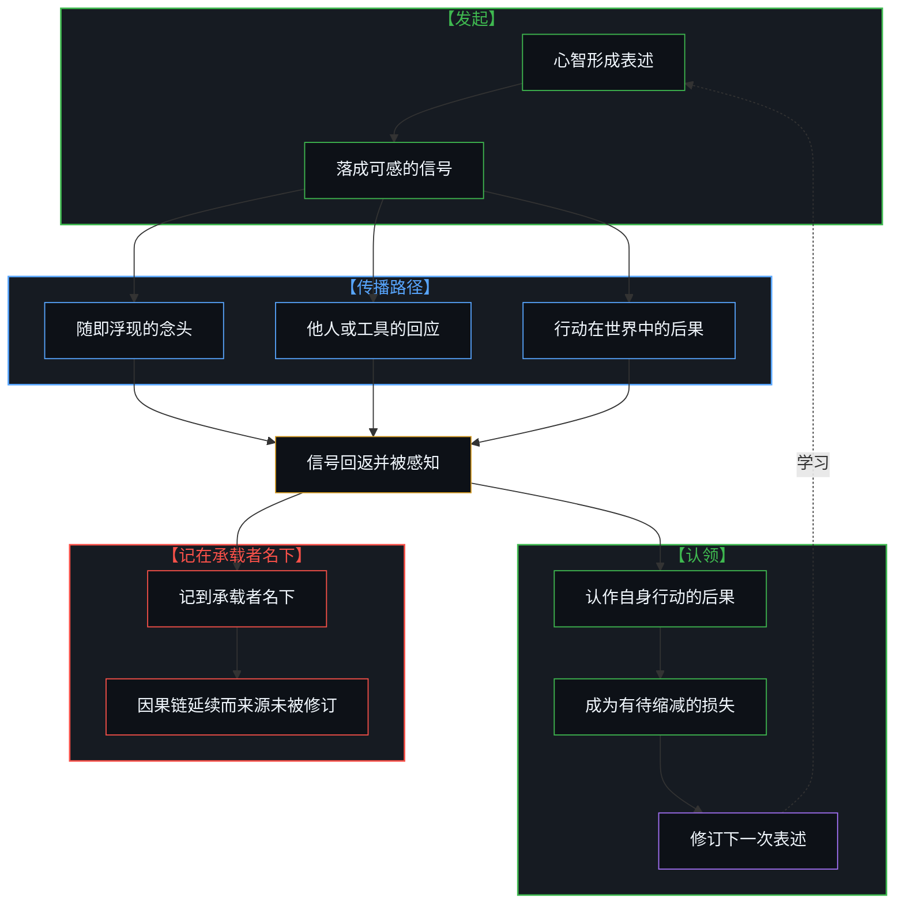
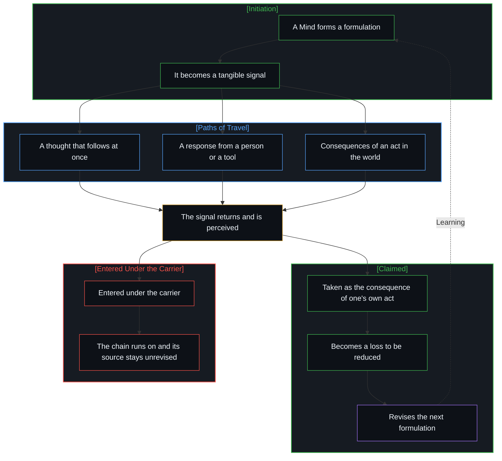

# 回返的信号与认领 / The Returning Signal and Its Claim

*信号唯有被发起它的心智认领才成为学习 / A returning signal becomes learning only when the Mind that sent it claims it*

心智把任何一个念头落成可感的信号，就启动了一条因果链，而这条链的一部分会折返回来：或是一个随即浮现的念头，或是另一个人的一句回应，或是一件工具的输出，或是一次行动在世界中激起的后果。流行的读法把折返回来的东西当作第二方发来的消息——一位令人失望的偶像，一台读错了意思的机器，一个持不同意见的对手——并在那里结账。顺着因果次序看，这些是同一件事：信号回到了发起它的心智。它只在被这颗心智认领为自身行动的后果时才成为学习；一旦归到别处，因果链照常延续，来源却无从修订。

Every formulation a Mind turns into a tangible signal starts a causal chain, and part of that chain comes back: as a thought that follows at once, as another person's response, as a tool's output, as the consequence of an act in the world. The prevailing reading takes what comes back as a message from a second party — a hero who disappointed, a machine that misread, an opponent who disagreed — and settles the account there. Followed in causal order, these are one event: a signal returning to the Mind that sent it. It becomes learning only where that Mind claims it as the consequence of its own act; assigned elsewhere, the chain runs on as before and its source stays unrevised.

## 一、 信号经由承载者回返 / 1. The Signal Returns by Way of a Carrier

没有哪个回返的信号是赤裸抵达的。它总要经由某个承载者：另一个人的一句话，一件工具的输出，一个价格，一副疲惫的身体。因为它经由承载者而来，日常的句式便把承载者写成了作者：他让人失望，市场惩罚了谁，机器误解了谁，证据更新了谁的看法。在这些句子里，发起者一律站在宾语的位置上，事情仿佛是从对面开始的。

No returning signal arrives bare. It always comes by way of a carrier: another person's sentence, a tool's output, a price, a tired body. Because it comes through the carrier, ordinary grammar writes the carrier in as its author: he disappointed me, the market punished me, the machine misunderstood me, the evidence updated me. In each of these sentences the initiator stands in the object position, and the matter appears to begin on the other side.

回返的东西并不只是回声。它带着发起者未曾放进去的成分：出乎预料之处，推不动之处。发起者正是在这种摩擦里，把对面认作另一颗发起因果链的心智，或认作不随己意而动的阻力。于是同时到达的有两样：关于承载者的消息，以及发起者自身行动的后果——当初选择了仰望谁，一句话留下了多大的空隙，站到了哪个立场上。流行的读法只收下前一样。就承载者而言它可以够用：对偶像或机器的评断，只要评断者尚未察觉到它盖不住的差别，就照常可用；它不够用的地方恰好在发起者自己的行动上，而能够修订发起者的只有这一部分。

What returns is not merely an echo. It carries what the initiator never put in: the unexpected, and what will not give way when pushed. It is in this friction that the initiator takes the other side to be another Mind starting causal chains of its own, or a resistance that does not move as wished. So two things arrive together: news about the carrier, and the consequence of the initiator's own act — whom one chose to look up to, how much a sentence left open, which position one took. The prevailing reading keeps only the first. As far as the carrier goes it can serve: a judgment of the hero or of the machine stays usable for as long as the one judging perceives no difference it fails to cover. Where it runs out is exactly at the initiator's own act, and that is the only part that can revise the initiator.

## 二、 仰望、解读与辩论 / 2. Admiration, Interpretation, and Debate

仰望是最常见的一种。把一个领域里的卓越当作一般判断力的载体，就是把本应由自己做出的裁决寄放到另一个人身上。此后从那个人身上回来的一切，无论是与有荣焉还是失望，都是这次寄放的后果。一位评论者谈到某位数学家修订演讲幻灯片时[写道](https://x.com/cremieuxrecueil/status/2109465620274458708)，这次修订正在“更新”他对此人的看法，又说想到自己是仰望着此人长大的，他感到难过。难过作为感受无可非议，但它站在判词之后，并不为判词增添前提；它所哀悼的那份仰望，是仰望者自己的行动。把失望记成关于偶像的事实，寄放裁决的做法便逃过了修订，由下一位偶像原样继承。超越自己的偶像之所以就是长大，是因为被修订的是这个做法，而不是给某个人的评分。

Admiration is the most common form. To take excellence in one field as a carrier of judgment in general is to lodge with another person a ruling that was one's own to make. Whatever then comes back from that person, reflected glory and disappointment alike, is the consequence of that lodging. A commentator, on a mathematician revising his lecture slides, [wrote](https://x.com/cremieuxrecueil/status/2109465620274458708) that the revision "is updating me" about the man, and that it made him sad to have grown up looking up to him. As a feeling the sadness is beyond dispute, but standing after the verdict it adds no premise to the verdict; and the looking up that it mourns is the admirer's own act. Entered as a fact about the hero, the disappointment leaves the practice of lodging one's ruling elsewhere unrevised, for the next hero to inherit intact. Outgrowing one's heroes is growing up because what gets revised is that practice, and not the score given to one person.

解读是第二种。一句话越短，容得下的彼此相容的读法越多，意图不在文字里；读者用自己的先验填满空隙，再把填好的东西记到说话者名下，称之为“你的意思”。语言模型把这件事做得最流畅，因为填进去的是参数中沉淀的无数既往读法，[模型永远无法成为第二重前沿](../the-model-never-becomes-a-second-edge/) 说过那里只有残余；只给它一句话，它便会自行搭出一个“你所暗示的更强主张”，好让回答显得两面兼顾。以求真为设计目标并不能免除这一点：这个目标的前提是真相在世界或文本之中，无须提问者在场即可取回，而被问的是什么要由发问的心智来定。边界之内它依然好用，只要把每一份扩写当作有待否证的假设，它就能把一句话所容许的读法摊开，这是任何人都无法独自为自己的话做到的。对说话者而言，扩写与原话之间的落差量出的是原话留下的空隙；对读者而言，读出来的东西是自己的行动。

Interpretation is the second. The shorter a sentence, the more mutually compatible readings it admits, and intent is not in the text; a reader fills the gap from their own priors and enters the result under the speaker's name as "what you meant". A language model does this most fluently, because what it fills in is the sediment of countless earlier readings held in its parameters, where, as [The Model Never Becomes a Second Edge](../the-model-never-becomes-a-second-edge/) puts it, there is only residue; given a single sentence, it will build "the stronger claim you suggest" by itself so that its answer can look balanced. Having truth-seeking as a design goal does not exempt it: that goal rests on the premise that the truth lies in the world or in the text and can be retrieved without the asker present, while what is being asked is fixed by the Mind that asks. Inside that boundary it stays useful: with every expansion held as a hypothesis to be disconfirmed, it lays out the readings a sentence admits, which no one can do alone for their own words. For the speaker, the distance between the expansion and the sentence measures what the sentence left open; for the reader, what was read out of it is one's own act.

辩论是第三种。轮流发言的形式看上去像两个立场在争一个共同的命题，可抵达任何一方的都只是信号，被回应的是己方对这个信号形成的解读。于是辩论的每一方，都是一个人在同自己对他人意见的解读辩论。把对方认作另一颗心智，依据的是从第一人称出发的类比，而这一类比不延伸到模型，[感知者与痕迹的不可坍缩](../the-perceiver-and-the-trace/) 划过这条线；与模型的往来更接近一颗心智借外部皮层进行的自我斟酌，[活的外部皮层](../a-living-external-cortex/) 讨论过这种仪器。但在两种情形里，回应都不自带被吸收的效力。把目标定为被对方理解，是把自己的意图交给对方的投影，[理解的非对称性](../the-asymmetry-of-understanding/) 追踪过由此打开的无尽误解；责怪镜子读错与为原话辩护，则是同一个向外记账的动作的两面。

Debate is the third. The form of alternating turns looks like two positions contesting a shared proposition, yet what reaches either side is only a signal, and what gets answered is the reading that side forms of it. Each party to a debate is therefore one person debating their own interpretation of the other's opinion. Taking the other to be another Mind rests on analogy from the first person, and that analogy does not extend to a model, a line drawn in [The Perceiver and the Trace Cannot Collapse](../the-perceiver-and-the-trace/); an exchange with a model is closer to one Mind deliberating with itself through an external cortex, the instrument considered in [A Living External Cortex](../a-living-external-cortex/). In both cases, though, the response does not carry its own uptake. Making it the goal to be understood hands one's intent to the other's projection, and [The Asymmetry of Understanding](../the-asymmetry-of-understanding/) follows the endless misreadings this opens; faulting the mirror for misreading and defending the original sentence are two faces of the same outward entry.

## 三、 认领使信号成为损失 / 3. The Claim Turns a Signal into a Loss

这些情形是同一个回路。心智形成一个表述并把它落成信号；信号沿某条路径传播，或立刻折成一个念头，或经他人与工具返回，或化为行动进入世界，其后果未必都能被发起者感知。即使被感知，回返的信号也还只是一个事件。唯有发起它的心智把它认作自身行动的后果，它才成为一个有待缩减的差距，也就是损失函数；学习指的就是这一步，而不是此前的任何一步。

These cases are one loop. A Mind forms a formulation and turns it into a signal; the signal travels along some path, folding at once into a thought, or coming back through other people and tools, or entering the world as an act whose consequences the initiator may or may not perceive. Even when perceived, the returning signal is still only an event. Only when the Mind that sent it takes it as the consequence of its own act does it become a gap to be reduced, which is what a loss function is; learning names this step and no step before it.

“反馈使人学习”的通行说法，预设了信号自带被吸收的效力。同一次失败、同一句回应、同一份失望，在一颗心智那里改写了下一次表述，在另一颗那里穿堂而过，这个预设在哪里不够用由此可见。它在工程化的场景里依然成立，因为那里的认领已经事先做出：训练模型所用的损失函数，是设计者选定的差距，模型自身并不认领什么。

The common saying that feedback teaches presupposes that a signal carries its own uptake. The same failure, the same response, the same disappointment rewrites the next formulation in one Mind and passes straight through another, which shows where the presupposition runs out. It still holds in engineered settings, because there the claim has been made in advance: the loss function used to train a model is a gap its designer chose, and the model itself claims nothing.

认领也不是自责。责备无论指向承载者还是指向自己，都仍是一份判词，把信号结算在某个人头上；认领只是把回返的东西当作关于自身模型的信息。功劳亦然：把一次跃进记在工具名下，与把一次失手记在工具名下，是同一个动作，[框架的倒置与驾驶位的主权非对称](../the-inversion-of-the-harness-and-the-driver-seat-asymmetry/) 追踪过前一种。

Nor is a claim self-blame. Blame, whether aimed at the carrier or at oneself, is still a verdict that settles the signal on someone; a claim only takes what returned as information about one's own model. Credit works the same way: entering a leap under the tool's name and entering a slip under the tool's name are one move, and [The Inversion of the Harness and the Sovereignty of the Driver's Seat](../the-inversion-of-the-harness-and-the-driver-seat-asymmetry/) follows the first.

## 四、 无须第二方的闭合 / 4. Closure Without a Second Party

把信号记在承载者名下并非无用。合同、评审、纠错与分工，都靠这种记法来安排接下来由谁做什么；在需要协调多人行动的地方，它是一件趁手的工具。它做不到的只有一件事：让发起者学到东西。账记在哪里是约定，后果落在哪里是因果，[数字火箭、同行审查与因果闭环的稀释](../the-dilution-of-the-causal-loop-and-the-misallocation-of-agency/) 与 [任务的移交与后果的不可让渡](../the-delegation-of-the-task-and-the-inalienability-of-consequences/) 已经说明后者不随前者移动；记到别处所改变的，只是后果能否修订它的来源。

Entering a signal under its carrier is not useless. Contracts, reviews, corrections and the division of work all rely on such entries to arrange who does what next; wherever the acts of many have to be coordinated, it is a handy tool. There is one thing it cannot do: let the initiator learn. Where an account is entered is a convention, and where a consequence lands is causal; [Digital Rockets, Peer Review, and the Dilution of the Causal Loop](../the-dilution-of-the-causal-loop-and-the-misallocation-of-agency/) and [The Delegation of the Task and the Inalienability of Consequences](../the-delegation-of-the-task-and-the-inalienability-of-consequences/) have shown that the second does not move with the first. What entering it elsewhere changes is only whether the consequence can revise its source.

失望被认领，修订的是寄放裁决的做法，其中没有可哀悼之物，失去的只是一段滞后。误读被认领，显出的是那句话留了多少未说。对手的反驳被认领，成为衡量自身表述的一把尺。未被认领时，因果链照旧延续，后果照旧到来，只是来源维持原样。回路的闭合不需要第二方，也没有第二方能够代为闭合。

Disappointment, once claimed, revises the practice of lodging one's ruling with another; nothing in it calls for mourning, since what is lost is a stretch of lag. A misreading, once claimed, shows how much the sentence left unsaid. An opponent's rebuttal, once claimed, becomes a measure of one's own formulation. Unclaimed, the chain runs on as before and the consequences arrive as before, with the source left as it was. Closing the loop needs no second party, and no second party can close it in one's place.
