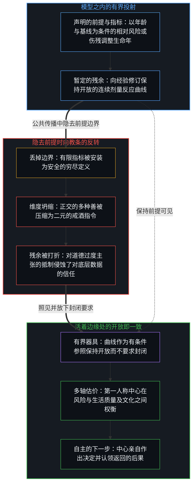
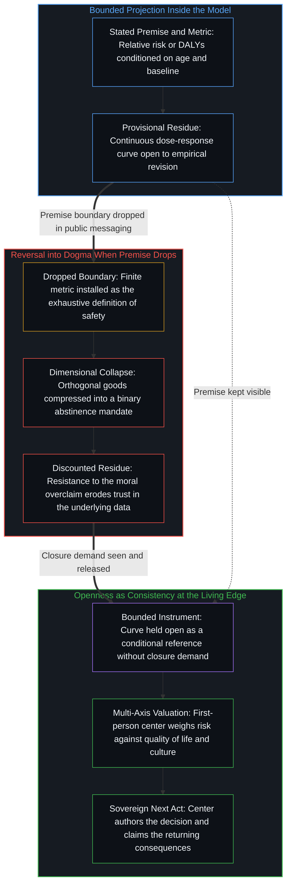

# 从可辩护的主张到教条的反转 / The Reversal from Defensible Claim to Dogma

*当单一指标界定安全的全貌时，有条件的风险曲线便冻结为教条 / A conditional risk curve freezes into dogma when one metric defines all safety*

大型流行病学分析在疾病发生的相对风险、伤残调整生命年与全因死亡率等特定风险指标之下，追问预期伤害如何随剂量变化。其中一些分析报告说，伤害从第一杯酒起便开始上升，因此零饮用是这些曲线上测得的最低点；在模型、声明的假设与所选指标之内，这一陈述作为暂定的、定量的、可修订的发现，在科学上仍然可以辩护。公共传播很少让它停在那里。连续的剂量反应曲线被压平为二元的定论，单一指标被当作穷尽了安全本身，曲线本可以据之分层的年龄与基线健康，连同任何风险模型都不包含的偏好、文化以及生活质量与寿命长度之间的取舍，一并掉了出去。一旦有条件的发现被呈现为已经规定戒酒是唯一理性或道德选择的定论，传播便发生了反转：可辩护的科学主张变成了作为教条运作的过度主张，而察觉到缺失维度的人，打折扣的就不只是过度主张，还有底下的数据。出路不是放弃这份经验残余，而是让层次保持分开，报告所选指标在其声明的假设之下显示了什么，并把向决定的转译留在科学之外，交还给每一个承受后果的中心。

Large epidemiological analyses ask how expected harm moves with dose under specific risk metrics such as relative risk of disease incidence, disability-adjusted life years, and all-cause mortality. Some report that harm rises from the first drink, making zero consumption the lowest measured point on those curves; inside the model, the stated assumptions, and the chosen metric, that statement remains scientifically defensible as a provisional, quantitative finding open to revision. Public communication rarely leaves it there. The continuous dose–response curve flattens into a binary absolute, the single metric is treated as if it exhausted safety, and age and baseline health, which the curves can stratify by, drop out alongside preference, culture, and the trade-off between quality and quantity of life, which no risk model contains. Once a conditional finding is presented as a settled conclusion that already dictates abstinence as the only rational or moral choice, the communication has reversed: a defensible scientific claim turns into an overclaim operating as dogma, and those who notice the missing dimensions discount not only the overclaim but the underlying data as well. The way out is not to abandon the empirical residue, but to keep the layers distinct by reporting what the chosen metric shows under its stated assumptions while leaving the translation into decisions outside the science, with each center that lives the consequences.

## 一、 主张在模型之内仍可辩护 / 1. The Claim Stays Defensible Inside the Model

自我区分的活动在发生，无因，不息。称它为心智：那个已经在进行中的观察者，它的每一个动作都是一次区分。流行病学把许多分立的测量变密为人群的残余。发表在《柳叶刀》上的全球疾病负担分析，以及相关的风险曲线，就是这样的残余：在声明的模型之下，对声明的终点而言，它们回答预期伤害如何随一杯接一杯而变化。2018 年发表的那次分析，把使健康损失最小的饮用量放在零；2022 年发表的下一次迭代发现，按负担加权的曲线随年龄与地区而不同，把 15 到 39 岁人群的最低点放在每天 0 到 0.6 个标准杯之间。

Self-distinguishing activity occurs, uncaused, unceasing. Call it the Mind: the observer already underway, every act of which is a distinction. Epidemiology densifies many discrete measurements into population residue. Global Burden of Disease analyses published in *The Lancet*, along with related risk curves, are such residue: under stated models and for stated endpoints, they answer how expected harm moves with successive drinks. The analysis published in 2018 placed the consumption level that minimizes health loss at zero; the next iteration, published in 2022, found that the burden-weighted curves vary by age and region, placing the minimum for ages 15 to 39 between 0 and 0.6 standard drinks per day.

这份残余作为残余是成立的。它不是关于任何单个系统的主张，也不是关于“安全”所能意味的全貌的主张；在它自己的轴上，它仍是暂定的。专家会修订，专家会分歧，下一项研究会重画这个场，正如这里已经重画过的那样。地图扩展了一个活着的身体能注意到的东西，穷尽却不随它一起到来。[专家经验作为参考而非替代](../expertise-as-reference-not-replacement/)在健康的情形里追溯了这一刀：专家经验把人群的残余变密为可用的地图，而这些地图只有在判断留在承受后果的那个中心时，才仍是器具。[基准刷榜中的封闭实存](../closed-reality-in-benchmark-maxing/)在评测中追溯了同一种持守：当基准把能力冻结为封闭的目标，且这一图像被当作整个场时，有用之处便登记不足。在这里，那个封闭的套件，是一族被持守为安全之完整清单的风险曲线。

That residue holds as residue. It is not a claim about any single system, nor about the whole of what "safe" can mean; on its own axis it remains provisional. Experts revise, experts diverge, and the next study redraws the field, as it already has here. The map expands what a living body can notice, yet exhaustiveness does not travel with it. [Expertise as Reference, Not Replacement](../expertise-as-reference-not-replacement/) traces that cut in the case of health: expertise densifies population residue into usable maps, and those maps stay instruments only while judgment remains at the center that lives the consequences. [Closed Reality in Benchmark Maxing](../closed-reality-in-benchmark-maxing/) traces the same hold in evaluation, where a benchmark freezes capability as a closed target and usefulness under-registers whenever that image is treated as the whole of the field. Here the closed suite is a family of risk curves held as the complete inventory of safety.

## 二、 连续的风险被压平为二元的定论 / 2. Continuous Risk Flattens into a Binary Absolute

连续的剂量反应关系，是一条有梯度的曲线。公共传播把它压平为一个二元：任何量都不安全，零是唯一安全的数字。这一断言比残余本身更强，残余只显示零是所选曲线上测得的最低点；那份更强的主张，正是压平本身。压平是容量在负载之下的失效。彼此独立的轴——低剂量时风险的大小、基线发生率与相对比率、相互竞争的死因以及个人的基线——被压缩到一个不容商量的坐标上。这个单一坐标感觉像是一次发现，而这种感觉，是从镜头内部看到的清晰。

The continuous dose–response relationship is a graded curve. Public communication flattens it into a binary: any amount is unsafe, and zero is the only safe number. That assertion is stronger than the residue, which showed only that zero was the lowest measured point on a chosen curve; the stronger claim is the flattening itself. Flattening is Capacity failing under load. Independent axes—the magnitude of risk at low doses, baseline incidence versus relative ratio, competing causes of mortality, and personal baseline—compress onto one coordinate beyond negotiation. That single coordinate feels like discovery, and the feeling is clarity seen from inside the lens.

观察握住的是结果，而产生它的原因总早一步。一条从第一杯酒起就上升的曲线，是在选定指标之下被登记的结果。把这种上升当作支配每一个位置上每一个下一步的既成定律，就是图像滞后：参照被保留到它那一步之后，于是套件上的残余被登记为生活本身的残余。[错把表达当成智能](../mistaking-the-expression-for-the-intelligence/)追溯了一次相邻的冻结：受控的表现是固定约束之下的残余，而智能是画出、使用与修订这个约束的活动，把分数当作活动，就是错把残余当成了源头。[气候问题只作为感知被登记](../the-climate-problem-registers-only-as-perception/)在行星尺度上追溯了同一种压缩：“问题”的身份是装上它的那些中心的一种持守，而不是大气为了继续下去所需要的属性，它把一个多因素的场逼上一块道德与科学的记分牌，再打扮成已完成的科学。在这里，那身打扮就是“没有安全剂量”这句口号。

Observation holds the effect while the cause that produced it stays one step ahead. A curve that rises from the first drink is an effect registered under a chosen metric. Treating that rise as an already-finished law governing every next act at every locus is Image lag, where the reference is preserved past its step so that residue on the suite registers as residue on life itself. [Mistaking the Expression for the Intelligence](../mistaking-the-expression-for-the-intelligence/) traces a neighboring freeze: controlled performance is residue under fixed constraint, whereas intelligence is the activity that draws, uses, and revises the constraint, and holding the score as the activity mistakes the residue for the source. [The Climate Problem Registers Only as Perception](../the-climate-problem-registers-only-as-perception/) traces the same compression at the planetary scale, where problem-status is a hold at the centers that install it rather than a property the atmosphere requires in order to continue, forcing a multi-factor field onto a moral-scientific scoreboard dressed as finished science. Here the dress is the slogan that there is no safe level.

## 三、 安全有多条轴而指标不是场 / 3. Safety Has Many Axes and the Metric Is Not the Field

每个人都可以使用“安全”这个词，却在它要与什么相权衡上意见不一。这种分歧不是围绕一个已完成坐标的噪声；这个词指的是哪一个尺度，本来就没有单一共识。特定疾病终点的风险是一条轴。生活质量、社会联结、文化实践、愉悦、风险承受度、余下的年岁，以及偏好更稠密的经验胜过漫长而稀薄的经验，是其他的轴。把它们统统经由一条流行病学曲线来计分，是容量的失效，而不是知识的完成。[来自个体差异的层级](../hierarchy-from-individual-difference/)把排名追溯为彼此不同的个体在一个共享尺度上被计分时显现的东西：在这里被排序的不是个体，而是剂量，尺度是选定终点上的相对风险，零排在第一。[偏好聚类与评判语言](../preference-clusters-and-the-language-of-judgment/)追溯了道德言说中随之而来的那次抬升：对与错，是对齐的偏好在另一个位置不重新追溯同一个场时发出的声音；在那里，误听被称为“错”，在这里，它穿上了“拒绝证据”的衣装，把排在第一的零变成唯一允许的位置，并把对同一份残余的另一种估价听成对残余本身的拒绝。

Everyone can use the word "safe" and still disagree on what it is weighed against. That disagreement is not noise around a finished coordinate; there is no single consensus on which measure the word names. Risk of specific disease endpoints is one axis. Quality of life, social bonding, cultural practice, pleasure, risk tolerance, remaining years, and a preference for denser experience over longer thin experience are others. Scoring all of them through a single epidemiological curve is Capacity failure rather than the completion of knowledge. [Hierarchy from Individual Difference](../hierarchy-from-individual-difference/) traces ranking as what appears when individuals who differ are scored on a shared measure: here what is ranked is not individuals but doses, the measure is relative risk on chosen endpoints, and zero ranks first. [Preference Clusters and the Language of Judgment](../preference-clusters-and-the-language-of-judgment/) traces the elevation that follows in moral speech: right and wrong are the sound aligned preferences make when another locus does not re-trace the same field; where the mishearing there is called "wrong," here it is dressed as "refusing the evidence," turning the first-ranked zero into the sole permissible place and hearing a different valuation of the same residue as a rejection of the residue itself.

“安全”不是一个等着被更好的抽样找回来的单一共识概念。它是一个词，在不同的持守之下收拢不同的取舍。流行病学的主张回答的是一个更窄的问题，即从零开始在选定指标之下的预期伤害，而把这个更窄的回答坍缩进那个更宽的词，反转就从这里开始。[数据是局部的，智能是分配的](../data-is-local-intelligence-is-allocated/)追溯了为什么汇总只让残余变密而不搬动画出区分的动作：信号、糟粕与智能，命名的是心智在具体位置上所画出的关系。曲线是材料。戒酒是不是这个中心的下一步，是在承受结果的那个位置上画出的，而不在人群的汇总里。

"Safe" is not a single consensus concept waiting to be recovered by better sampling. It is a word that gathers different trade-offs under different holds. The epidemiological claim answers a narrower question about expected harm under selected metrics from zero onward, and collapsing that narrower answer into the wider word is where the reversal begins. [Data Is Local; Intelligence Is Allocated](../data-is-local-intelligence-is-allocated/) traces why aggregation densifies residue without relocating the act of drawing distinctions: signal, slop, and intelligence name relations the Mind draws at a concrete locus. The curve is material. Whether abstinence is this center's next act is drawn at the locus that bears the outcome, not in the population aggregate.

## 四、 诉诸确定性让冻结变密 / 4. Reaching for Certainty Densifies the Freeze

细微之处传得不好。确定性调动注意、塑造政策、简化信息，无需恶意就能给传播者提供反复诉诸它的激励。每一次诉诸确定性都让权力变密：被稳定下来的痕迹，塑形了公共言说中还剩哪些排列可用。一条被包装为定论的暂定曲线，[比一条仍让假设可见的曲线传得更远](../an-observation-by-its-own-standard/)。[起作用的是信念](../what-works-is-the-belief/)追溯了这样一种持守如何只塑形那些把它当作基础的中心，而不共享它的人则继续越过它。在这里，那个持守是被安装为既成定律的“没有安全剂量”。把它当作基础的中心，把戒酒重新追溯为唯一连贯的选择；不这样做的中心，则在那个包装所删掉的多轴取舍之下继续，除非它们把曲线连同包装一起扔掉。

Nuance travels poorly. Certainty mobilizes attention, shapes policy, and simplifies messaging, giving communicators recurring incentives to reach for it without requiring malice. Each reach for certainty densifies Power: stabilized traces patterning which alignments remain available in public speech. A provisional curve packaged as an absolute [travels farther than the curve with its assumptions still visible](../an-observation-by-its-own-standard/). [What Works Is the Belief](../what-works-is-the-belief/) traces how such a hold patterns only the centers that treat it as ground, while those who do not share it continue past it. Here the hold is "no safe level" installed as finished law. Centers that treat it as ground re-trace abstinence as the only coherent choice; centers that do not continue under the multi-axis trade-offs the package deleted, unless they throw the curve out along with the package.

于是科学的语言被当作衣装穿上。图表、置信区间以及对“史上最大规模研究”的诉诸让这身衣装变密，然而衣装不是方法。方法在接触让持守失效时重新打开轴；衣装保住持守，并借用方法的声望，让持守不必重新打开。拒绝重新打开的东西被标榜为已成定论的科学，而真正被定下来的其实是图像。[现实扭曲力场指认的是封闭的地图](../the-reality-distortion-field-names-the-closed-map/)在对象是“可能”时追溯了同一种计分：一个内部位置所维持的延续，拿去对照一张被持守为封闭可能之场的共识地图，便被登记为扭曲世界之力；在这里，对象是“善”，一个中心自己的估价，拿去对照一个被持守为封闭之善的场的风险指标，便被登记为抗拒。[外化善意走向其反面](../externalized-virtue-becomes-its-opposite/)追溯了从一对孪生确信出发的弧线——既确信自己在道德上可靠，又确信异议有所欠缺——每当经验曲线被赋予超出其内容的道德分量、且异议被听成拒绝接受证据时，这里所携带的正是这一对确信。[一切伤害的根源](../the-source-of-all-harm/)追溯了当一个心智把自己的善冻结为普遍尺度、另一个心智让这次冻结支配自己的场时，伤害如何完成；在这里，被冻结的善是从曲线残余中提炼出的戒酒，而一个中心若让这次冻结支配自己的场，就仍是后果的作者。

Science language is then worn as dress. Graphs, confidence intervals, and appeals to the largest study ever conducted densify that dress, yet dress is not method. Method re-opens axes when contact fails the hold; dress preserves the hold and recruits the prestige of method so the hold need not re-open. What refuses re-opening is paraded as settled science, when what has actually settled is the Image. [The Reality Distortion Field Names the Closed Map](../the-reality-distortion-field-names-the-closed-map/) traces the same scoring when the object is the possible: sustained continuation from an internal locus, scored against a consensus map held as the sealed field of possibility, registers as a power to warp the world; here the object is the good, and a center's own valuation, scored against a risk metric held as the sealed field of the good, registers as defiance. [Externalized Virtue Becomes Its Opposite](../externalized-virtue-becomes-its-opposite/) traces the arc that begins from twin certainties of one's own moral reliability and the deficiency of dissent, the exact pair carried here whenever an empirical curve is given moral weight beyond its content and dissent is heard as a failure to accept evidence. [The Source of All Harm](../the-source-of-all-harm/) traces how harm completes when one Mind freezes its good as universal measure and another lets that freeze rule its field; here the frozen good is abstinence extracted from the curve's residue, and a center that lets that freeze govern its field still authors the consequences.

到了这一步，传播便作为教条运作：一个抗拒检查其条件的断言，承载着超出其经验内容的道德分量，并把异议当作否认证据，而不是关于价值或指标的分歧。教条不是与科学相对的另一种实体；它是被保留到它那一步之后的科学残余，是在公共言说中运作的同一种滞后。[恶是封闭的善](../e-shi-feng-bi-de-shan/)在被封住的坐标正是善本身时追溯了这种滞后：把仍在生成的集合当成可以一次覆盖的清单，善就成了豁免于再检验的坐标。在这里持续生成的，既是在“安全”之下被收拢的多种善，也是这条曲线随后的每一次修订。

At that point the communication operates as dogma: an assertion that resists examination of its conditions, carries moral weight beyond its empirical content, and treats dissent as denial of evidence rather than disagreement over values or metrics. Dogma is not a rival substance opposite science; it is scientific residue preserved past its step, the same lag operating in public speech. [Evil Is Closed Good](../e-shi-feng-bi-de-shan/) traces that lag when the sealed coordinate is the good itself, where taking a still-generating set for a list covered at once makes the good a coordinate exempt from re-examination. What continues generating here is both the plurality of goods gathered under "safe" and every subsequent revision of the curve.

## 五、 过度主张连同数据一起被打折扣 / 5. Overclaim Discounts the Data with It

当人们察觉到缺失的维度，意识到生活涉及多种正交的、不会坍缩进一条流行病学曲线的善时，他们开始打折扣的就不只是过度主张，还有底下的数据。对经验残余的信任受到侵蚀，科学看起来像一套必须礼拜式加以肯定的命题，而不是在接触之下重新打开的方法：包装被当成了科学，这是从相反一侧接收到的同一次坍缩。这份代价直接出自封闭的结构：把指标坍缩为道德的定论，对定论的抵制就会作为对指标的抵制到来。[开放即一致](../openness-is-consistency/)命名了在曲线与据它所作的选择之间产生这一表面矛盾的要求：不一致，是企图逼迫一个有限的持守去为只会继续的东西奠基的欲求或尝试，而矛盾并不在曲线里，而在要求曲线封住个人与集体选择之场的那个要求里。[超越投射](../beyond-the-projection/)追溯了这一失效的维度机制：任何风险模型或显式规则，都是从超高维活生生的实存之场投射出的有限低维投射，在声明的前提之内能够完成利落的推演做功，一旦被推去统御整个场，就注定遭遇维度坍缩。正如智能体架构唯有在有界语境中调度有限投射、同时由边缘处活着的心智保留对多维意图的统御时才能保持融贯，公共卫生传播也唯有在把风险曲线作为有界投射保持开放、而非将其抬升为人类行动的自主统治者时，才能保持融贯。

When people notice the missing dimensions and recognize that life involves multiple orthogonal goods that do not collapse into one epidemiological curve, they begin to discount not only the overclaim but the underlying data as well. Trust in the empirical residue erodes, and science appears as a liturgical set of propositions that must be affirmed rather than a method re-opened under contact: the package is taken for the science, which is the same collapse received from the opposite side. That cost follows directly from the structure of closure: collapse the metric into a moral absolute, and resistance to the absolute arrives as resistance to the metric. [Openness Is Consistency](../openness-is-consistency/) names the demand that generates this surface contradiction between the curve and the choices made with it: inconsistency is the desire or attempt to force a finite hold to ground what only continues, and the contradiction sits not in the curves, but in the demand that the curves seal the field of personal and collective choice. [Beyond the Projection](../beyond-the-projection/) traces the exact dimensional mechanics of this failure: any risk model or explicit rule is a finite, low-dimensional projection cast from the ultra-high-dimensional field of lived reality, capable of doing clean deductive work inside its stated premises yet guaranteed to suffer dimensional collapse when pushed to orchestrate the whole field. Just as an agentic architecture remains coherent only when finite projections are dispatched within bounded contexts while the living Mind at the edge retains orchestration over multi-dimensional intent, public health communication stays coherent only when the risk curve is held open as a bounded projection rather than promoted into an autonomous governor of human action.

只要投射被保持在它的边界之内，取舍式的表述就依然可得。一个中心可以持守：在自己的年龄与基线之下，这条曲线把某个剂量放在某些疾病终点的最低点之上，却仍然选择这杯酒，因为在那个位置的估价之下，其他的善得分更高。这一判断与明知一顿丰盛的饭在单一代谢指标上不是最优、却照样吃下它是同一种结构：单一指标与多轴选择之间的差距被如实看见并承担下来，毫无自欺。清楚的数据、明确的成本与收益，加上不强迫共享估价坐标，让残余保持可用；而定论式的表述，则把残余花在了一次冻结上。

The trade-off formulation stays available whenever the projection is kept within its bounds. A center can hold that, at its age and baseline, the curve places a given dose above the minimum on certain disease endpoints, and still choose the drink because other goods score higher under that locus's valuation. That judgment has the same structure as knowing a rich meal is not optimal on a single metabolic metric and eating it anyway: the gap between one metric and a multi-axis choice is seen and carried without self-deception. Clear data, explicit cost and benefit, and no forced sharing of the valuation coordinate keep the residue usable, whereas the absolute formulation spends the residue on a freeze.

## 六、 让层次保持分开 / 6. Keep the Layers Distinct

消解不是另一个与之对立的定论——既不是“适度饮酒普遍安全”的反向口号，也不是在另一种纯度指标之下的新封闭套件。用一个穷尽的坐标替换另一个，只是换了标签的同一次坍缩。消解是恢复各条轴：报告所选指标在其声明的假设与局限之下显示了什么，让模型的边界保持可见，并把向决定的转译——作为判断、偏好与取舍——留给每一个承受后果的中心。被指标塑形的场可以是集体的，但下一个动作的作者却始终是个体。

Dissolution is not a rival absolute—neither the counter-slogan that moderate drinking is universally safe nor a new sealed suite under a different purity metric. Replacing one exhaustive coordinate with another repeats the same collapse under a new label. Dissolution restores the axes: report what the chosen metric shows under its stated assumptions and limits, keep the model's boundary visible, and leave the translation into decisions—as judgment, preference, and trade-off—with each center that lives the consequences. The field the metric patterns can be collective, yet the author of the next act is always individual.

[个体抉择是唯一的因果杠杆](../individual-choices-as-the-only-causal-levers/)追溯了因果被登记的地方：只在个体所维持的分立动作里，每一次抉择都是一根独立的杠杆，从不是一块共享的地板，因此指标塑形的是这些动作所遇到的场，而发起则留在动作那里。[当观察变成表演](../when-observation-becomes-performance/)追溯了私人的孪生情形：一个关于他人的观察，只有作为第一人称的参照才获得力量，一旦把自己包装成可携带的美德便失去这份力量，正如流行病学残余只有作为第一人称参照时才发挥器具的功用，而从不是替其他心智完成抉择的可携带产品。[自我价值感与所有权](../ownership-and-self-worthiness/)追溯了功能的一面：心智只在后果作为自己的东西重新进入时才得以复利，而一个把下一步搬进套件的公共定论，会让这次更新变薄。[框架的边界](../the-boundary-of-the-frame/)追溯了任何理论如何作为被初始切分界定的有限器物，在遗忘观察者与因果基底时硬化为教条；被持守为安全之全貌的那一个风险指标，正是这样一个遗忘了自身边界的框架。

[Individual Choices as the Only Causal Levers](../individual-choices-as-the-only-causal-levers/) traces where causality registers: only in the discrete acts individuals sustain, each choice an independent lever and never a shared floor, so that the metric patterns the field those acts meet while initiation stays with the acts. [When Observation Becomes Performance](../when-observation-becomes-performance/) traces the private twin: an observation about others gains force only as a first-person reference and loses it the moment it packages itself as portable virtue, just as epidemiological residue functions as an instrument only as a first-person reference and never as a portable product that finishes the choice for other minds. [Ownership and Self-Worthiness](../ownership-and-self-worthiness/) traces the functional face: the Mind compounds only when consequences re-enter as its own, and a public absolute that relocates the next step into the suite thins that update. [The Boundary of the Frame](../the-boundary-of-the-frame/) traces how any theory, as a finite artifact bounded by its initial cut, hardens into dogma once it forgets the observer and the causal ground; one risk metric held as the whole of safety is such a frame that has forgotten its boundary.

让参照随每一步持续重绘，器具就仍然可用。曲线仍在定向，人群的地图仍让选项变密，评判的词仍可作为一步的方向。掉下去的，是单一指标与活生生的生活之间被强加的等同。第一层是经验的、可修订的；第二层是在活着的边缘上的估价。把两者坍缩在一起，是常见的失效；而保持这个区分，才是让科学传播保持为科学的东西：可供重新追溯的残余，而不是一座要求肯定的纪念碑。

Keep the reference re-rendering as each step moves, and the instruments remain usable. The curve still orients, population maps still densify options, and judgment words still serve as a heading for one step. What drops is the forced identity between a single metric and a lived life. The first layer is empirical and revisable; the second is valuation at the living edge. Collapsing them is the common failure, while maintaining the distinction is what keeps scientific communication scientific: residue available for re-tracing, never a monument that demands affirmation.
