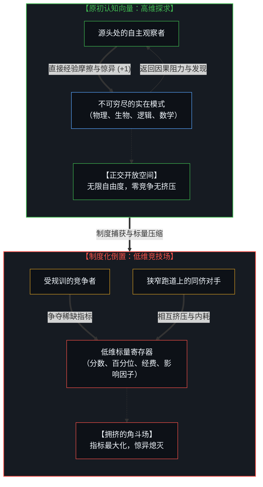
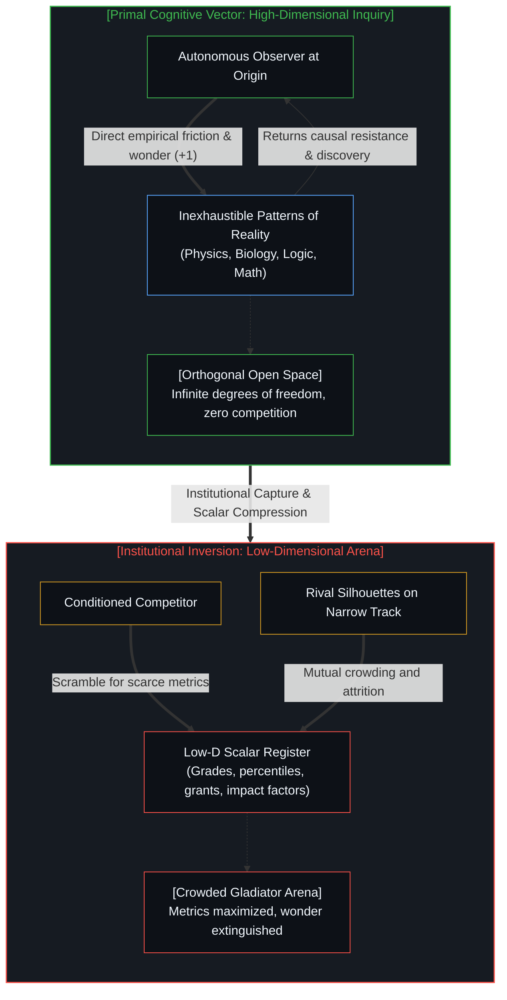
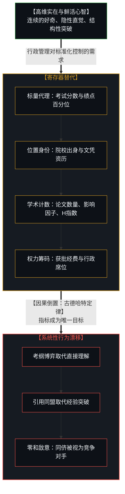
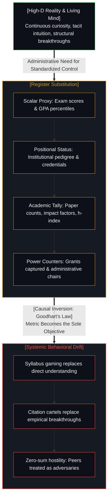
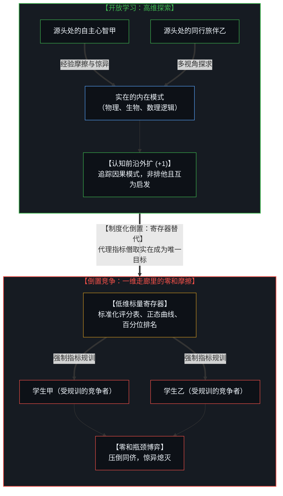
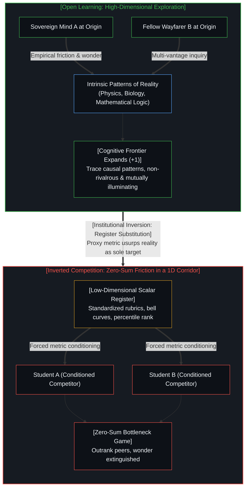
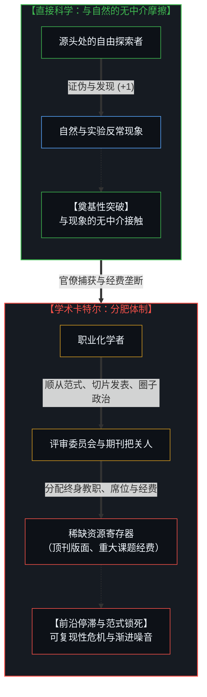
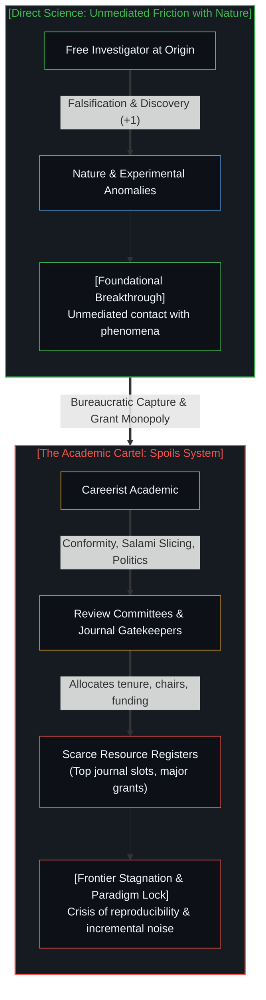
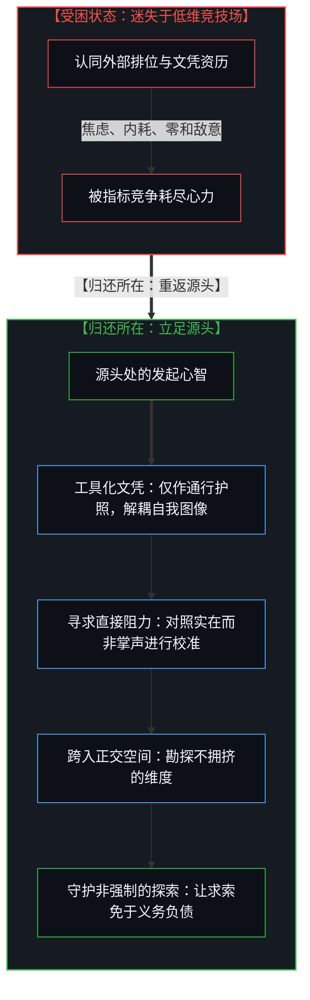
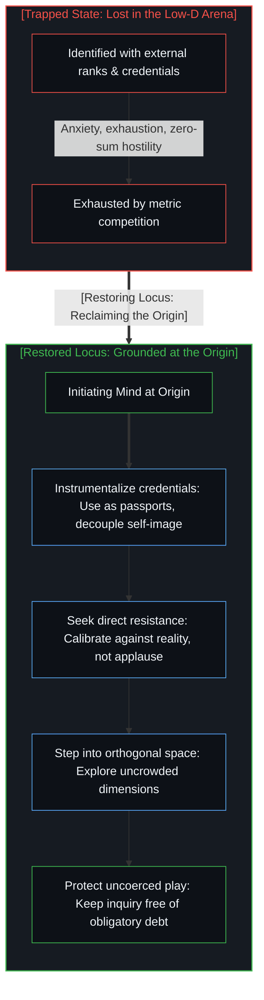

# 教育与科学的倒置 / The Inversion of Education and Science

*从把握实在到零和竞技场 / From Grasping Reality to the Zero-Sum Arena*

教育始于对实在模式的开放探索，却在制度化中坍缩为同侪排位的零和竞赛；科学发现始于对未知的直接探求，却在学术官僚化中转向对声望、经费与行政权力的争夺。当对鲜活疆域的高维探索被对低维指标的追逐所取代，原本用以延展心智的器具，便成了围困心智的高墙。

Education begins as an open exploration of the patterns of reality, yet institutionalization collapses it into a zero-sum contest of peer ranking. Scientific discovery begins as direct inquiry into the unknown, yet academic bureaucratization turns it into a scramble for prestige, funding, and administrative power. When high-dimensional exploration of the living territory is replaced by the pursuit of low-dimensional metrics, the instruments built to extend the Mind become the very walls that confine it.

## 一、 原初起点：与不可穷尽之实在的直接摩擦 / 1. The Primal Origin: Direct Friction with Inexhaustible Reality

在心智的源头处，学习与发现从来不是为了战胜另一个人而兴起的。

At the origin of the Mind, learning and discovery never arise to conquer another person.

观察一个尚未被正规学校教育规训的孩子：当她蹲在泥地上追随一只搬运草籽的蚂蚁，或是把木块一层层搭高、再看着它们在重力下坍塌时，她的注意力正与那片疆域直接接触。她唯一对话的对象，是不可穷尽的物理世界：重力、摩擦、结构平衡、代谢节律。在行动与后果之间，没有评分量表、及格百分位或监考官的介入。在每一次试错中，心智登记下实在那不随意愿转移的阻力，并在追踪其模式的过程中，不断叠加自身的区分容量。

Watch a child who has not yet been conditioned by formal schooling: when she crouches in the dirt to follow an ant carrying a seed, or when she stacks wooden blocks only to watch them tumble under gravity, her attention is in direct contact with the territory. Her sole interlocutor is the inexhaustible physical world: gravity, friction, structural equilibrium, metabolic rhythm. No rubrics, passing percentiles, or proctors stand between the act and its consequence. In every trial and error, the Mind registers the unyielding resistance of reality and, in tracing its patterns, compounds its own capacity to distinguish.

这同样是科学发现的火种。无论是在修道院花园里清点皱粒豌豆的孟德尔，还是在专利局书桌旁推演电动力学对称性的爱因斯坦，第一人称观察原点都直接朝向未知。在探索者与反常现象之间，没有行政委员会充当中介。不因主观愿望而退让的阻力是唯一的检验，因果是唯一的法则。

This is likewise the spark of scientific discovery. Whether Gregor Mendel is counting wrinkled peas in a monastery garden or Albert Einstein is tracing the symmetries of electrodynamics beside a patent clerk's desk, the first-person observer origin faces outward toward the unknown. No administrative committee mediates between the investigator and the anomaly. Resistance that does not yield to wish is the only test; causality is the only law.

从观察者的几何结构来看，实在的疆域蕴含着潜在无限的自由度。在未被制度指标捕获时，认知的图景是敞开的：一万个探索者可以沿着一万条正交轴线出发，彼此的路径互不碰撞；一颗心智对流体湍流的洞见，不仅不会挤占另一颗心智对突触传递的洞见，反而在共享的场域中开启出新的正交维度。正因为**探求是非排他的**，高维疆域足以容纳并行的漫步者，无需任何两个观察者为了“谁占有更多自然规律”而彼此争斗。

From the geometry of the observer, the territory of reality holds potentially infinite degrees of freedom. Uncaptured by institutional metrics, the cognitive landscape is open: ten thousand explorers can set out along ten thousand orthogonal axes without their paths ever colliding; one Mind's insight into fluid turbulence does not crowd out another's insight into synaptic transmission, but instead opens a further orthogonal dimension across the shared field. Because **inquiry is non-rivalrous**, the high-dimensional territory has room for parallel travelers without two observers ever needing to fight over who owns a larger share of nature's regularities.

然而，一旦这种开放的探索被导入大规模制度化，因果便发生了倒转。

Yet the moment this open exploration is routed through mass institutionalization, causality inverts.

## 二、 制度化与低维寄存器的统摄 / 2. Institutionalization and the Tyranny of the Low-Dimensional Register

为什么教育与科学的制度化会如此稳定地倒转它们的方向？

Why does institutionalizing education and science so reliably invert their direction?

其机制在于**行政规模化与信息压缩的边界**。

The mechanism lies in the **limits of administrative scaling and informational compression**.

任何大规模行政机构若要跨越庞大的人群与时间跨度进行协调，都必须将活动压缩为标准化、可重复的标记。官僚机构无法直接登记一个孩子注意力中闪现的好奇火花，也无法读取一位研究者在独处中检验假说时不言自明的严谨。高维的认知共鸣、隐性技艺与结构性突破是连续且依赖具体语境的，无法被原封不动地录入集中化的账本。

For any large-scale administrative apparatus to coordinate across vast populations and time spans, it must compress activity into standardized, repeatable tokens. A bureaucracy cannot directly register the spark of curiosity in a child's attention, nor can it read the unspoken rigor of a researcher testing a hypothesis in solitude. High-dimensional cognitive resonance, tacit craft, and structural breakthroughs are continuous and context-dependent; they cannot be entered raw into a centralized ledger.

为了让这片场域对行政管理可读，机构执行了陡峭的维度压缩：**用低维标量寄存器替代高维的鲜活疆域。** 在教育中，学生对实在模式的把握被压缩为标准化考试的分数，不可重复的成长轨迹被压平为班级百分位；在科学中，对未知反常现象的探勘被坍缩为论文篇数、期刊影响因子与引用计数，而实验检验的分量则被压平为获批的经费数额与占据的行政席位。

To make the field legible to administration, the institution executes a steep dimensional compression: **it substitutes a low-dimensional scalar register for the high-dimensional living territory.** In education, a student's grasp of reality's patterns is compressed into a standardized test score, and an unrepeatable trajectory of growth is flattened into a class percentile; in science, the probing of uncharted anomalies is collapsed into paper counts, journal impact factors, and citation tallies, while the weight of experimental testing is flattened into grant dollars captured and administrative chairs occupied.

这就是**寄存器替代**：原本作为探求之管理足迹的指标，最终僭取了它所标记的探求，机构把自己的账目当成了实在。正如[作为职业的数学不是作为追求的数学](../math-as-a-career-is-not-math-as-a-pursuit/)所追溯的，每一项分数、学位、头衔或引用计数都只是某项活动留下的残余；当追求领跑时，标记指回工作本身，可一旦标记被当得比它所代表的东西更实在，因果便发生倒转，凡是能以更低代价产出该标记的做法都会顶替探求本身。

This is **Register Substitution**: a metric devised as an administrative footprint of inquiry ends up usurping the inquiry it marked, and the institution mistakes its own ledger for reality. As [Math as a Career Is Not Math as a Pursuit](../math-as-a-career-is-not-math-as-a-pursuit/) traces, every score, degree, title, or citation count is only the residue left by an activity; while the pursuit leads, the marker points back to the work, but once the marker is held as more substantial than what it represents, causality reverses and whatever produces the marker at lower cost replaces the inquiry itself.

一旦这一替代锁死，古德哈特定律便随之生效：**当一个度量指标变成目标本身时，它就不再是一个好的度量。** 由于低维标量寄存器——第一名的排位、稀缺的期刊版面、封顶的基金池——在构造上就是位置性的零和博弈，原本敞开的多维场域便被收束进一条狭窄的一维瓶颈。

Once this substitution locks in, Goodhart's Law follows by necessity: **when a measure becomes a target, it ceases to be a good measure.** Because low-dimensional scalar registers—rank #1, scarce journal slots, capped grant pools—are positional and zero-sum by construction, an open multi-dimensional field is funneled into a narrow one-dimensional bottleneck.

## 三、 教育的倒置：从破译模式到竞技场 / 3. The Inversion of Education: From Decoding Patterns to the Arena

当学校教育的目标从追踪实在的模式转向在机构寄存器上压倒同侪时，日常学习的结构便发生了倒置。

When the aim of schooling shifts from tracing the patterns of reality to outranking peers on the institutional register, the daily structure of learning inverts.

数学成形于刻画几何、变换与对称的精确语言，物理成形于对物质与能量相互作用的探求，历史成形于对人类因果链条的追踪。每一门学科都开启了一扇通往高维实在的独特窗口。然而在标准化的竞技场内，**每一门学科都被剥离了催生它的问题源头，简化为一本应试套路的目录。**

Mathematics took shape as a precise language for geometry, transformation, and symmetry; physics as an inquiry into the interaction of matter and energy; history as a tracing of human causal chains. Each discipline opens a distinct window onto high-dimensional reality. Yet inside the standardized arena, **every discipline is stripped of the problem that gave rise to it and reduced to a catalog of exam routines.**

在这条流水线上，如果一个学生被某个方程背后的机制所吸引，停下来花三个小时去检验它的边界，评分进度表就会惩罚这次绕行：那三个小时本可以用来刷完十套标准化题集。在以优化排位为目标的体制内，剧本之外的好奇被登记为负资产，停下来理解疆域本身反而成了拖慢提分速度的累赘。

Along this conveyor belt, if a student becomes fascinated by the mechanism behind an equation and pauses for three hours to test its boundary, the grading schedule penalizes the detour: those three hours could have been spent drilling ten standardized problem sets. Within a rank-optimizing regime, unscripted curiosity registers as a liability, and pausing to understand the territory becomes a drag on score velocity.

同样的压缩也重塑了学习者之间的关系：在开放的探求中，同侪是同行的旅伴，各自从前沿的不同角度带回观察所得；而在制度化的竞技场中，**每一个同侪在结构上都被置于争夺固定配额的对手位置。**

The same compression reshapes relations between learners: in open inquiry, peers are fellow travelers, each bringing back observations from a different angle of the frontier; in the institutional arena, **every peer is structurally positioned as a rival for a fixed quota.**

由于评分曲线与录取名额分配的是固定的百分位，另一个学生的高分直接缩窄了剩余的席位。本可探索正交维度的诸多心智，被压缩进同一条排位走廊。理解麦克斯韦方程组的对称性并不会产生任何制度信号，除非它能转化为比邻座同学高出三分的分差。

Because grading curves and admission quotas allocate fixed percentiles, another student's high score directly narrows the remaining slots. Minds capable of exploring orthogonal dimensions are compressed into a single ranking corridor. Understanding the symmetry of Maxwell's equations yields no institutional signal unless it translates into a margin of three points over the classmate at the next desk.

本为延展心智触角而设的制度化学校教育，最终运作成了一座分拣磨坊——**将开放的探索裁剪成恰好塞进机读记分卡固定格位的形状**。

Conceived to extend the reach of the Mind, institutionalized schooling ends up operating as a sorting mill that **trims open-ended exploration to fit the fixed slots of a machine-readable scorecard**.

## 四、 科学的蜕变：从求真到声望、经费与学阀同盟 / 4. The Degeneration of Science: From Truth to Prestige, Funding, and Cartels

如果说基础教育的倒置收窄了成长中的心智，那么制度化科学的倒置，则直接让前沿本身的发现陷入停滞。

Where the inversion of basic schooling narrows the developing Mind, the inversion of institutional science stalls discovery at the frontier itself.

现代科学共同体创立之初，其运作前提凝缩在英国皇家学会的格言中——“不随人言”（以事实为证）：**无论研究者的资历多么显赫、权威多么稳固，只要实验中的反常现象与假说相抵触，假说就必须让步。**

At the founding of the modern scientific community, its operational premise was captured in the Royal Society's motto, *Nullius in verba* ("Take nobody's word for it"): **no matter how decorated a researcher's pedigree or how entrenched an authority, when an experimental anomaly contradicts a hypothesis, the hypothesis must yield.**

然而，随着科学研究扩张为由国家拨款、高校终身教职序列与产业赞助共同供养的官僚复合体，问责的方向发生了逆转。

Yet as scientific research scaled into a bureaucratic complex funded by state appropriations, university tenure lines, and industrial sponsorships, the direction of accountability reversed.

在当今的学术机器内部，日常激励与对实在的检验经常背道而驰。

Inside today's academic machinery, daily incentives routinely diverge from the testing of reality.

### 1. 计件式的论文磨坊 / 1. The Piecework Paper Mill

在“不发表就出局”的法则下，研究者被当作手稿的计件生产者来考核。为了最大化产出数量，学者在激励下将一项完整的探求切成多篇单薄的渐进式论文（香肠切片式发表），让期刊塞满数以百万计罕有人读、罕有复现、脱离因果摩擦的出版物。

Under the rule of "Publish or Perish," researchers are evaluated as piecework producers of manuscripts. To maximize output counts, scholars are incentivized to slice a single inquiry into multiple thin, incremental papers (salami slicing), filling journals with millions of publications that are rarely read, rarely replicated, and detached from causal friction.

### 2. 风险规避与对异见的清洗 / 2. Risk-Aversion and the Purge of Heterodoxy

奠基性的突破始于修正既有前提。然而在由共识委员会主导的基金评审制度下，**一份申请能否获批经费，恰恰取决于那些其既有框架正被该申请所挑战的专家是否批准。** 在主流范式内修修补补的稳妥变体能够顺利过审，而质疑基础假设的工作则在实验尚未启动前就因断绝资源而枯竭。

Foundational breakthroughs begin by revising accepted premises. Yet under a grant-review system governed by consensus committees, **a proposal's funding depends on the approval of the very specialists whose established framework it challenges.** Safe, incremental variations on prevailing paradigms pass review smoothly, while work that questions foundational assumptions is starved of resources before an experiment can be run.

### 3. 引用同盟与声望寻租 / 3. Citation Cartels and Prestige Rent-Seeking

当职业生存挂钩于引用指标时，精力便流向互引小圈子、委员会公关与会议结盟。声望运作成一种可兑换为重大课题经费、机构席位与行政权力的通货，将开放的探求变成维护自身地位分配的行会体制。

Where career survival tracks citation metrics, energy flows into reciprocal citation cliques, committee networking, and conference alliances. Prestige functions as a currency convertible into major grants, institutional seats, and administrative authority, turning open inquiry into a guild system that defends its own allocation of status.

物理现象不在乎影响因子与大学捐赠基金；可在官僚机构内部，没有这些标记的研究者连走上实验台的资格都会被剥夺。**反常现象留在实验里等待检验，而资源分配却在委员会会议室里拍板。**

Physical phenomena are indifferent to impact factors and university endowments; yet inside the bureaucracy, a researcher without those tokens is denied access to the laboratory bench. **The anomaly waits in the experiment, while allocation is decided in the committee room.**

## 五、 自主破局：重建与实在的直接接触 / 5. The Sovereign Escape: Restoring Direct Contact with Reality

当制度激励将教育与科学拉向低维竞技场时，个体心智如何保持自身的定向？

When institutional incentives pull education and science toward the low-dimensional arena, how does an individual Mind keep its bearings?

任何一个观察者都无需等待庞大的官僚机构完成改革，就能在自身所在之处收回因果主动权。这一陷阱只有在心智把机构记分卡采纳为自我图像、用外部排位而非眼前的疆域来衡量自身运动时，才会发生作用。

No single observer needs to wait for massive bureaucracies to reform before reclaiming causal agency at home. The trap operates only while the Mind adopts the institutional scorecard as its own self-image, measuring its movement against external ranks rather than the territory in front of it.

重建心智与实在之间的直接回路，取决于四个所在上的位移。

Re-establishing a direct loop between the Mind and reality turns on four shifts in locus.

### 1. 工具化文凭，解耦内在价值 / 1. Instrumentalize Credentials, Decouple Inner Worth

外部的文凭、分数、同行评议与头衔，只是穿行于机构沙盒的行政护照——它们是用于社会协调的接口，而不是心智容量的度量。**把考官的记分卡当作自身价值的尺度，就是把掌舵的前沿交给了低维代理。** 当文凭只被当作外部器具持有时，通过考核便只是一项务实的例行事务，而心智的主航道始终锚定在追踪实在之上。

External diplomas, grades, peer reviews, and titles function as administrative passports for moving through institutional sandboxes—interfaces for social coordination, not measures of a Mind's capacity. **Treating an examiner's scorecard as the measure of one's own worth hands the steering edge over to a low-dimensional proxy.** When credentials are held strictly as external instruments, passing an evaluation remains a practical routine while the Mind's primary trajectory stays anchored in tracing reality.

### 2. 寻求会“反咬”的摩擦 / 2. Seek Friction That Bites Back

开放探求与排位表演之间的区分，体现在反馈的来源上：**信号究竟来自现象那不退让的阻力，还是来自评估者的认可？** 引擎能否运转、代码能否编译并通过边界测试、疗法能否遏制疾病、证明能否严丝合缝地成立——这些来自无法被奉承或游说的媒介。至于主管是否满意、委员会是否授予名次，则是行政剧场内部的社会信号。对照会反咬的阻力进行校准，才能磨砺心智的因果触角。

The distinction between open inquiry and positional performance shows up in the source of the feedback: **does the signal return from the unyielding resistance of the phenomenon, or from the approval of an evaluator?** Whether an engine runs, whether code compiles and passes its edge cases, whether a treatment halts a disease, or whether a proof holds without a gap—these are responses from a medium that cannot be flattered or lobbied. Whether a supervisor is pleased or a committee awards a rank is a social signal inside an administrative theater. Calibrating against resistance that bites back is what sharpens a Mind's causal reach.

### 3. 正交跨入高维空间 / 3. Step Orthogonally into High-Dimensional Space

当一万名竞争者挤在同一条一维跑道上争夺头部百分位时，出路不是在同一条轴线上更拼命地内卷，而是**跨入一个正交维度**。正如[阴影与无限](../the-shadow-and-the-infinite/)所追溯的，实在蕴含着不可穷尽的自由度。当人群在饱和的范式内部微调渐进参数时，独立的观察者可以连接两个相距遥远的领域，或探究共识所忽略的反常现象——从而开启一条竞争归零的新轴线。

When ten thousand competitors crowd onto a single one-dimensional track to fight over the top percentiles, the way out is not to grind harder along the same axis, but to **step into an orthogonal dimension**. As [The Shadow and the Infinite](../the-shadow-and-the-infinite/) traces, reality holds inexhaustible degrees of freedom. Where the crowd optimizes incremental parameters inside a saturated paradigm, an independent observer can connect two distant domains or investigate an anomaly the consensus ignores—opening an axis where competition drops to zero.

### 4. 守护作为自由游玩的探求 / 4. Protect Inquiry as Free Play

正如[理解的非对称性](../the-asymmetry-of-understanding/)所确立的，**开放的潜能一旦被转化为强制的义务，便随之闭合。** 把学习变成道德义务或职业算计，会让注意力受制于外部审计。保留一片不受指标巡查的空地——花一个下午研读土壤微生物学，只为弄懂雨水落在干土上的气息；或是在深夜推演一个几何证明，只为看清它的结构如何咬合，不为发表、不为变现、也不为博取掌声——才能护住那份不受胁迫的好奇，而一切新的区分皆由此发端。

As [The Asymmetry of Understanding](../the-asymmetry-of-understanding/) establishes, **the moment an open potential is turned into a compulsory obligation, it closes.** Turning learning into a moral duty or a career calculation subjects attention to an external audit. Keeping an unpoliced clearing free of metrics—spending an afternoon studying soil microbiology simply to understand the scent of rain on dry earth, or working through a geometric proof at midnight simply to see how its structure locks together, without publishing, monetizing, or seeking applause—preserves the uncoerced curiosity from which every new distinction begins.

## 六、 结语：做实在的探索者，不做剧场的角斗士 / 6. Epilogue: Explorers of Reality, Not Gladiators of the Theater

制度化的悖论深植于此：为带领年轻人领略世界之辽阔而建起的庞大学校体系，最终把他们关进教室，为百分位的小数点终日焦灼；为支持发现而汇聚的百亿科研基金，最终把探索者捆在申报表格与委员会政治上。

The institutional paradox runs deep: vast school systems built to introduce the young to the breadth of the world end up confining them in rooms where they fret over fractions of a percentile, and billion-dollar research endowments assembled to support discovery end up binding investigators to grant forms and committee politics.

然而，那座竞技场的高墙并没有封顶。在评分量表与评审专家组之外，当年直面开普勒、达尔文与法拉第的同一片开放宇宙依然可以直接触及：引力波依然以光速横穿星系，光子依然在双缝间描绘干涉条纹，遗传序列依然在每一个活细胞内部折叠与复制。实在无需评奖委员会的背书，因果的连贯也并不依赖任何官僚机构的核准。

Yet the walls of that arena have no ceiling. Outside the grading rubric and the review panel, the same open cosmos that confronted Kepler, Darwin, and Faraday remains directly accessible: gravitational waves still cross galaxies at the speed of light, photons still trace interference fringes through twin slits, and genetic sequences still fold and replicate inside every living cell. Reality requires no endorsement from a prize committee, and causal coherence depends on no bureaucratic board.

正因为考卷、文凭与文献档案都只是过往切分留下的外化记忆痕迹（[你的代码库即是记忆](../your-codebase-is-memory/)），放下木剑与纸质记分牌、走出低维竞技场，便能让心智鲜活的第一人称前沿重返那片敞开、不受巡查的实在疆域。

Because exam sheets, diplomas, and literature archives are only externalized memory traces of prior cuts ([Your Codebase Is Memory](../your-codebase-is-memory/)), setting down the wooden sword and the paper scorecard to step out of the low-dimensional arena returns the Mind's living first-person edge to the open, unpoliced territory of reality.
