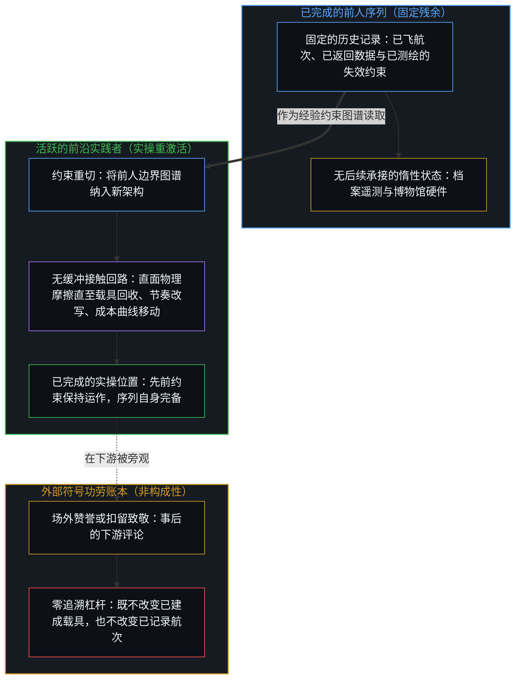
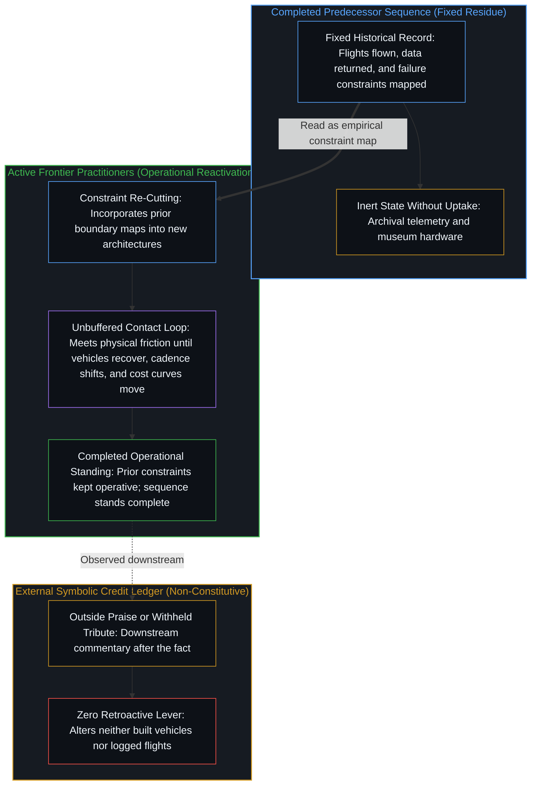
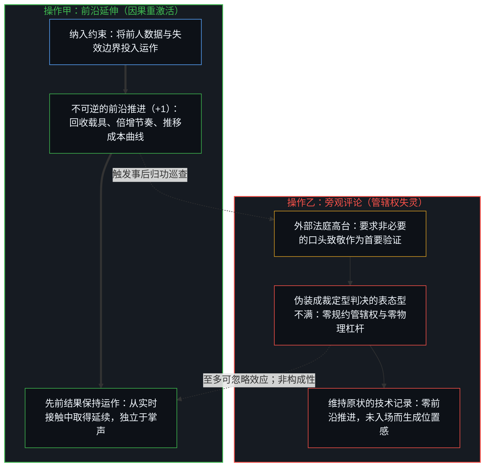
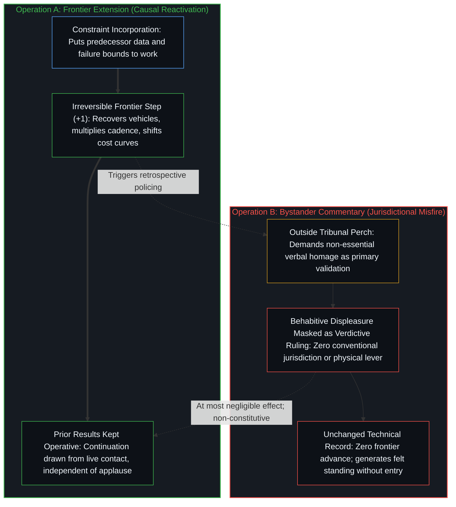

# 旁观评论者的倒置 / The Reversal of the Bystander Commentators

*把非必要的口头归功置于推进前沿之上，倒置了后续使用使过往记录保持运作的次序 / Placing non-essential verbal crediting above advancing the frontier reverses the order by which subsequent use keeps prior records operative*

每当一项工程或科学突破推移了实操前沿，场边便会传来一种熟悉的诘难：正在推进的建造者及其支持者被指责未能向先行的前辈巨人献上足够的口头敬意。这种诘难把回顾性言说当作维持历史意义的所在，并将场外评论者推上裁断既成推进的仲裁席。顺着行动与残余的次序追溯，呈现出的恰是相反的顺序：已完成的成就始终是固定的历史记录，直至后来的实践者把那些已测绘的约束投入运作、产出进一步可测量的推进；而在前沿立足的位置，凭这不可逆的一步本身便已确立，无论旁观者指派还是扣留功劳。一旦承认口头归属作为档案索引指针的有界效用，而非进步的构成性条件，心智唯有站上承接而来的工作并继续向前推进，才能使其保持鲜活。

Whenever an engineering or scientific breakthrough shifts an operational frontier, a familiar objection arrives from the sidelines: active builders and their proponents are faulted for failing to pay sufficient verbal homage to the giants whose earlier work preceded them. That objection treats retrospective speech as what sustains historical significance and installs outside commentators as arbiters over completed advances. Tracing the sequence of action and residue shows the opposite order: finished achievements remain fixed historical records until later practitioners put those mapped constraints to work in a further measurable advance, and standing at the frontier holds through that irreversible step itself regardless of whether onlookers assign or withhold credit. Once verbal attribution is granted its bounded utility as an archival index pointer rather than a constitutive condition of progress, a Mind keeps inherited work alive only by standing on it and moving further.

## 一、 惰性历史记录与后续使用的重激活 / 1. Inert Historical Records and Reactivation Through Subsequent Use

过往成就作为已完成的序列而立。它们的记录——已飞的航次、已返回的数据、已测绘的约束——是固定的。由于已完成的行动只在场中留下持久印记，却不会在印记内留下第二个心智，归档的突破并不会自行延续区分——这正是[你的代码库即是记忆](../your-codebase-is-memory/)沿代码、权重与制品，以及[印迹与行动](../the-mark-and-the-act/)沿环境痕迹所追溯的边界。持续的操作相关性，只在后来的实践者纳入这些结果、对照当下条件重切仍能承重的部分，并产出进一步可测量的推进时才显现。后来的工作通过使用先前的工作而将其重新激活。没有这种进一步的使用，先前的结果便仍是惰性的历史事实，与[判断力不是可囤积的存量](../judgment-is-not-a-stock/)中未经修剪、脱离实时证伪而持有的旧结论并无二致。

Past achievements stand as completed sequences. Their records—flights flown, data returned, constraints mapped—are fixed. Because a completed act leaves a durable mark in the field without leaving a second Mind inside the mark, an archived breakthrough does not continue distinguishing on its own, the boundary traced across code, weights, and artifacts in [Your Codebase Is Memory](../your-codebase-is-memory/) and across environmental traces in [The Mark and the Act](../the-mark-and-the-act/). Ongoing operational relevance appears only when later practitioners incorporate those results, re-cut what still bears load against present conditions, and produce further, measurable advances. The later work reactivates the earlier work by using it. Without that further use, the earlier results remain inert historical facts, no different from unpruned conclusions held without live falsification in [Judgment Is Not a Stock](../judgment-is-not-a-stock/).

轨道发射史将这一运作序列具体呈现出来。在1981年至2011年间的135次任务中，航天飞机以全尺寸规模测绘了轨道再入、部分硬件回收与飞行后翻修的边界，记录下铺设在铝合金机体上的约24,000块逐一定制外形的二氧化硅防热瓦、海上回收的固体助推器、每次发射一次性消耗的外贮箱、长达数月的整备周转周期，以及近地轨道每千克约54,500美元的有效载荷成本。2011年7月，随着“亚特兰蒂斯”号滑行停稳，整支机队便成为博物馆硬件与档案遥测数据：无论礼仪性的赞颂还是公共舆论的沉默，都无法让轨道器再度升空，也无法削减哪怕一小时的翻修工时。后继工程师把其中的维护瓶颈读作一张有待绕开或解决的经验约束图谱，由此重新激活了这份来之不易的边界记录：先是在猎鹰9号上，通过干式垂直动力着陆将复用限定在亚轨道一级，把单枚助推器的周转周期压缩至9天，在单一自然年内超越航天飞机三十年的任务总数，并将发射报价降至每千克约2,720美元；继而在星舰上，用机械销钉固定在不锈钢箭体上的标准化六边形陶瓷瓦，直接重构25马赫轨道再入工程。

Orbital launch history makes that operational sequence concrete. Across 135 missions between 1981 and 2011, the Space Shuttle mapped orbital entry, partial hardware recovery, and post-flight refurbishment at full scale, logging roughly 24,000 individually contoured silica thermal-protection tiles over an aluminum airframe, ocean-recovered solid boosters, an expended external tank on every launch, multi-month processing turnarounds, and payload costs near $54,500 per kilogram to low Earth orbit. Once *Atlantis* rolled to a stop in July 2011, the fleet became museum hardware and archival telemetry: neither ceremonial praise nor public silence could fly an orbiter again or trim a single refurbishment hour. Subsequent engineers reactivated that hard-won boundary record by reading its maintenance bottlenecks as an empirical constraint map to design around or resolve—first on Falcon 9, isolating reuse to the suborbital first stage via dry vertical propulsive landings, compressing single-booster turnaround to nine days, surpassing the Shuttle's thirty-year mission total within a single calendar year, and cutting launch pricing near $2,720 per kilogram; and then on Starship, directly re-engineering Mach-25 orbital entry with standardized, mechanically pinned hexagonal ceramic tiles over stainless steel.

那句被拿来训斥在场建造者的格言，最初描述的恰恰是这种实操延展。1159年，索尔兹伯里的约翰在《元逻辑学》中记下沙特尔的伯纳德那幅十二世纪意象；1675/76年2月，艾萨克·牛顿在将薄膜光学推进到笛卡尔与罗伯特·胡克之外时致信胡克，写下看得更远是因为站在巨人的肩膀上——这一比喻命名的是一处抬升后的立足视点，其检验标准在于比前人看到更多、看得更远，从不是要求后来者停在平台上向后鞠躬。即便在罗伯特·默顿将引证与冠名权建模为制度奖励通货的科学社会学（《站在巨人的肩膀上》，1965；《社会理论和社会结构》，1968）内部，奠基性工作达到最紧密的运作延续，也恰恰是在默顿所称的“并入性湮没”之中：先前的发现深植于工作仪器与日常基线，以至实践者不再专门点名其首创者。当显式引证因约束已悄然在现役硬件与方程内部运转而退去时，历史工作恰处于最具活力的状态，由此暴露出符号化的功劳记账与因果接续在何处分道扬镳。

The aphorism invoked to scold active builders originally described this exact operational extension. When John of Salisbury recorded Bernard of Chartres's twelfth-century image in the *Metalogicon* (1159)—and when Isaac Newton wrote to Robert Hooke in February 1675/76, while extending thin-film optics beyond Descartes and Hooke, that seeing further came by standing on the shoulders of giants—the figure named an elevated vantage tested by seeing more and further than predecessors could see, never a requirement to pause on the platform and bow backward. Even within Robert K. Merton's sociology of science (*On the Shoulders of Giants*, 1965; *Social Theory and Social Structure*, 1968), which models citations and eponymy as institutional reward currency, foundational work reaches its densest operational continuity in what Merton termed *obliteration by incorporation*: prior discoveries become so thoroughly built into working instruments and everyday baselines that practitioners stop explicitly naming their originators. Where explicit citation drops away because the constraint now operates silently inside active hardware and equations, historical work is at its most alive, exposing where symbolic credit-counting diverges from causal continuation.

## 二、 行动边缘赢得的位置无需外部归功 / 2. Standing Earned at the Operational Edge Without External Credit

实践者通过站立并推进这一事实而赢得其位置。正是他们的载具得以回收、节奏得以改变、成本曲线得以移动。在行动发生之处，第一人称视角与不可逆的因果性作为同一枚硬币的两面一并运作：将设计付诸硬件、直面未建模的气动与热流摩擦、读取故障遥测数据、持续迭代直至助推器完好着陆，这一切皆发生在[数字火箭、同行审查与因果闭环的稀释](../the-dilution-of-the-causal-loop-and-the-misallocation-of-agency/)所追溯的无缓冲接触回路之内。一旦这些抉择沉淀为回收的箭级与入账的载荷，这一序列便已完成。正如[没有外部记账员](../no-outside-scorekeeper/)所确立的，第三人称的宣判对已封存的时间切片毫无因果杠杆；这一位置的成立无须外部指派功劳，扣留功劳也不会改变已经建成的载具或已经记录的航次。

The practitioners earn their standing by the fact of standing and advancing. They are the ones whose vehicles recover, whose cadence changes, whose cost curves move. At the point of action, the first-person perspective and irreversible causality operate as two sides of one coin: committing designs to hardware, meeting unmodeled aerodynamic and thermal friction, reading failure telemetry, and iterating until boosters land intact all occur inside the unbuffered contact loop traced in [Digital Rockets, Peer Review, and the Dilution of the Causal Loop](../the-dilution-of-the-causal-loop-and-the-misallocation-of-agency/). Once those choices settle into recovered stages and logged payloads, that sequence is already complete. Just as [No Outside Scorekeeper](../no-outside-scorekeeper/) establishes that third-person verdicts hold zero causal lever over a sealed time-slice, no external assignment of credit is required for the standing to hold, and no withholding of credit alters the vehicles already built or the flights already logged.

这种实操位置同样有别于以公民美德为建造者辩护的熟悉路数——其中最著名的是西奥多·罗斯福1910年在索邦大学的演讲：他宣称“功劳属于身处竞技场中的人”，哪怕满面尘土与汗水，哪怕“在敢于行大事时归于失败”。那种反驳依然留在符号化的功劳法庭之内：它恳请看客把奖杯从批评者手中转颁给卖力的拼搏者，同时把汗水与英勇的失败本身当作目的。累积性的工程与科学，既不靠功劳分配运转，也不靠被道德化的苦难驱动。在竞技场内耗费气力却未能闭合功能回路，同样会让先前的边界记录停留在惰性状态，与坐在看台上旁观并无不同；而闭合回路，也无须任何评奖委员会来核准箭级已经着陆。把累积的承认或声望当作驱动能力的力量，便重演了[拥有更多从不是原因](../having-more-is-never-the-cause/)所消解的那种冻结——把下游的可见度残余，误认作持续产出并更新工作的当下抉择。

This operational standing also parts company with the familiar civic-virtue defense of builders—most famously Theodore Roosevelt's 1910 Sorbonne address declaring that "the credit belongs to the man who is actually in the arena," marred by dust and sweat, even when he "fails while daring greatly." That rebuttal remains inside the symbolic credit court: it petitions onlookers to transfer the trophy from the critic to the strenuous striver while treating sweat and valiant failure as ends in themselves. Cumulative engineering and science run on neither credit allocation nor moralized suffering. Expending effort inside an arena without closing a functional loop leaves prior boundary records just as inert as watching from the stands, and closing the loop requires no prize committee to ratify that the stage landed. Treating accumulated recognition or prestige as the force that drives capability repeats the freeze dissolved in [Having More Is Never the Cause](../having-more-is-never-the-cause/), where downstream visibility residue is mistaken for the ongoing choices that produce and renew the work.

## 三、 旁观者法庭的倒置与两种非等价操作 / 3. The Bystander Tribunal Reversal and Two Non-Equivalent Operations

旁观评论者倒置了这一顺序。他们把向先人作口头的、非必要的归功这一要求，当作验证推进的首要行动。他们站在序列之外自居为法官，评判当前的实践者是否“充分尊重”了过去。这类评论以纠偏者的面目出现，却不产出任何进一步的推进，也让技术记录维持原状。脱离了制造或测试硬件的接触面代价，评论者的递归便锁死在受防卫的自我形象周围：对优越历史判断的主张，由此生成了一种无须参与竞技场的位置感。这处免付代价的高台，正是[未经自我审视的批判者](../the-unexamined-critic/)所剖析的批判看台，并与[旁观者洞察的悖论](../the-paradoxical-nature-of-bystander-insights/)所追溯的观察冻结相伴而行——把在生成行动之外截取的一帧快照，误当作支配工作本身的规则。

Bystander commentators reverse the order. They treat the demand for verbal, non-essential crediting of predecessors as the primary act that validates the advance. From outside the sequence they position themselves as judges of whether the current practitioners have "respected" the past sufficiently. The commentary presents itself as corrective, yet it produces no further advance and leaves the technical record unchanged. Severed from the contact-surface cost of building or testing hardware, the commentator's recursion clamps around a defended self-image: the claim of superior historical judgment thereby generates a sense of standing without participating in the arena. That untaxed perch is the same critical balcony examined in [The Unexamined Critic](../the-unexamined-critic/), paired with the observational freeze traced in [The Paradoxical Nature of Bystander Insights](../the-paradoxical-nature-of-bystander-insights/), where a snapshot taken outside the generating act is mistaken for a rule governing the work itself.

这两种操作并不等价——它们既不是对同一事件的对称视角，也不是分量相当的竞争性阐释。一种延伸了前沿，并由此使先前结果保持运作；另一种则指派或扣留口头归功，却并不如此。约翰·兰肖·奥斯汀在《如何以言行事》（1962）中对规约性施为话语与物理行动所作的区分，阐明了回顾性的归功巡查为何触不到它所评判的序列：裁判作出的“裁定型”宣判（“出局！”），唯有在赋予说话者指定管辖权的约定规约内部才能改变比赛状态；而看台上的观众高喊“出局！”因缺乏指定管辖权，即便在比赛内部也会失灵而归于无效，更遑论左右非规约性的工程摩擦。因遗漏致敬而训斥建造者，是将表达社交不满的“表态型”话语，包装成对既成硬件的“裁定型”判决。这种失灵的话语，对于工作照常推进的实践者至多只有可忽略的效应——正如[验证中因果权能的分配](../the-allocation-of-causal-power-in-validation/)所追溯的，他们从实时检验而非外部核准中取得区分的延续。把旁观者的裁决视为结果的构成要素，或视为实践者位置的必要条件，便是扭曲。这一序列并不需要那种框架才成为它所是。

The two operations are not equivalent—not symmetric perspectives on a shared event, and not rival interpretations of equal weight. One extends the frontier and thereby keeps prior results operative. The other assigns or withholds verbal credit and does not. J. L. Austin's distinction between conventional performatives and physical actions in *How to Do Things with Words* (1962) clarifies why retrospective credit-policing fails to touch the sequence it judges: an umpire's *verdictive* call ("Out!") alters a game state only inside an agreed convention that grants the speaker appointed jurisdiction, whereas a spectator's shout of "Out!" from the stands lacks appointed jurisdiction and misfires as void even inside the game, let alone over non-conventional engineering friction. Scolding builders for omitted homage packages a *behabitive* expression of social displeasure as if it were a *verdictive* ruling over completed hardware. That misfire has, at most, negligible effect on the practitioners whose work continues regardless, drawing continuation from live testing rather than external ratification as [The Allocation of Causal Power in Validation](../the-allocation-of-causal-power-in-validation/) traces. Treating the bystanders' adjudication as constitutive of the outcome, or as a necessary condition for the practitioners' standing, is the distortion. The sequence does not require that framing to be what it is.

## 四、 回顾性言语的前提边界 / 4. The Premise Boundary of Retrospective Speech

认为恰当承认过往巨人便是尊重的决定性形式，这一信念依赖于一个前提：历史意义是由回顾性的言语行动而非后续的使用所维持的。在其局部适用范围内，明确的归属标注承担着切实的索引工作：文献引证、代码提交历史与具名引用压缩了共享档案中的检索路径，使实践者得以追溯来源、核查原始假定，并定位早期设计在何处触及上限。然而一旦脱离活跃的实操承接，向过往名字致以仪式性的敬礼便会摊薄为一枚低维社交符号——这正是[登记共鸣的表面](../the-surface-that-registers/)所追溯的表层动态：援引受尊崇的源头在说话者一端登记为立场对齐，却未将底层的任何一条约束链向前推进。一旦搁置“回顾性言语维持意义”这一前提，边界便显现出来：口头归功是可选的评论；推进本身才是重新激活。前者可以存在或缺失，而不改变后者。

The belief that proper acknowledgment of past giants is the decisive form of respect rests on the premise that historical significance is sustained by retrospective speech acts rather than by subsequent use. Within its local range, explicit attribution performs a practical indexing job: citations, commit histories, and named references compress search paths across shared archives so practitioners can retrieve provenance, inspect original assumptions, and locate where an earlier design met its limit. Detached from active operational uptake, however, a ritualized salute to past names thins into a low-dimensional social token—the surface dynamic traced in [The Surface That Registers](../the-surface-that-registers/), where invoking a revered source registers at the speaker's end as alignment while carrying none of the underlying constraint chain forward. Where the retrospective-speech premise is set aside, the boundary appears: verbal credit is optional commentary; the advance itself is the reactivation. The former can be present or absent without changing the latter.

无论心智承接的是飞行遥测、数学定理、代码库，还是一组随笔，止步于回顾性评论都会让它停留在对符号化敬意的审计上，而踏上这些约束则会敞开下一个问题。只要仍站在地面上伸手指认，过往巨人的肩膀便毫无意义。承接而来的痕迹，唯有在行动的心智用自己的双脚站上去、检验旧边界在当下载荷下于何处让位，并亲自承担下一步的代价时，才保持鲜活。

Whether a Mind inherits flight telemetry, mathematical theorems, a codebase, or a body of essays, stopping at retrospective commentary keeps it auditing symbolic deference, whereas stepping onto those constraints opens the next problem. The shoulders of past giants mean nothing while pointed at from the ground. Inherited traces stay alive only where an acting Mind stands on them with its own feet, tests where the old boundary gives way under present load, and bears the cost of the next step.
