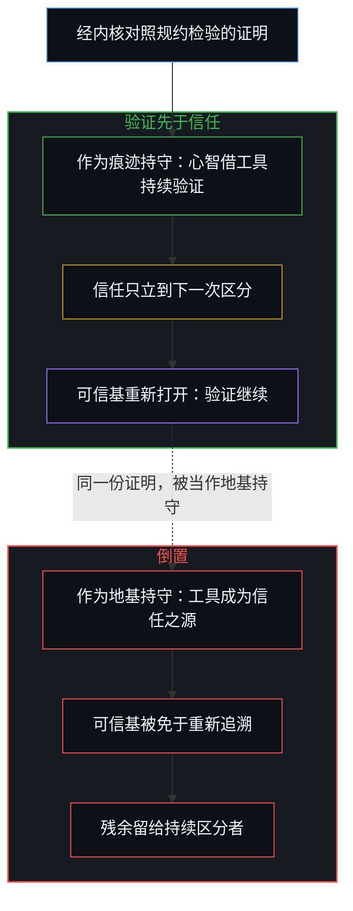
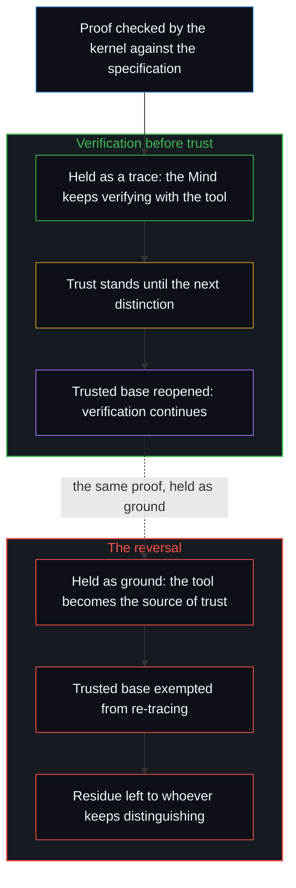

# 验证的倒置 / The Reversal of Verification

*融贯是保持开放的内部一致，直到工具被当作信任之源 / Coherence is internal consistency held open, until the tool is taken as the source of trust*

形式验证如今被奉为所有代码的圣杯，理由是：测试只是程序行为的一个有损代理，而证明会让代码像数学一样运作。一份对照规约检验过的证明，让程序内部一致；它并不让程序完备，而且面对手握同样工具的其他人，任何验证都不是万无一失的。这两者之间的落差，就是内部一致与融贯之间的落差。当工具或方法被当作信任之源，凌驾于运用它去验证的那种能力之上，“不要信任，要验证”里的次序便被倒置，证明留在自身之外的残余，就成了任何持续区分者的用武之地。

Formal verification is now held up as the holy grail for all code, on the reading that tests are a lossy proxy for what a program does and that a proof would make code behave like mathematics. A proof checked against its specification makes a program internally consistent; it does not make it complete, and no verification is foolproof against other people with the same tools. The gap between those two is the gap between internal consistency and coherence. When the tool or the method is taken as the source of trust, over the capacity to verify that uses it, the order inside "don't trust, verify" is reversed, and the residue the proof leaves outside itself becomes the ground whoever keeps distinguishing works on.

## 一、 证明确立了什么 / 1. What the proof establishes

2026 年 10 月 22 日，Aiden Bai 把这份期望说得很直白：“圣杯是对所有代码的形式验证。”在他的表述里，测试是代码行为的一个有损代理；代码应当更像数学，而要让代码繁荣，就必须有办法对任何程序做形式验证。他引用的是 Anthropic 关于其前沿红队与 Theorem 合作的公告：[用 Claude 大规模形式验证软件](https://www.anthropic.com/research/formal-verification)。

Aiden Bai put the hope plainly on October 22, 2026: "the holy grail is formal verification for all code." Tests, in his framing, are a lossy proxy for the behavior of the code; code should be more like math, and for code to flourish there must be ways to formally verify any program. He was quoting Anthropic's announcement of its Frontier Red Team work with Theorem, [using Claude to formally verify software at scale](https://www.anthropic.com/research/formal-verification).

这项工作本身规模庞大，陈述也很审慎。证明由 Claude 写出，再由 Rocq 内核对照规约检验：在 123 个 OSS-Fuzz 库的 239 个入口点上，对任何不超过 64 MB 的输入都不会崩溃，证明作用于编译后的 RISC-V 二进制文件。证明总计约一亿八千万行 Rocq，单个典型证明约六十万行，而二进制文件的中位规模是一万八千条 RISC-V 指令。假设逐条列出：单线程的静态二进制、固定的内存预算、RISC-V 处理器、Linux 操作系统，以及该操作系统每一种被建模的响应和每一种内存布局。被标为已证明的部分，用页面自己的话说，是“以可信组件正确为条件”而得证的：Rocq、RISC-V 语义、Linux 语义。页面说，剩下的任何缺陷要么在这些可信构件之中，要么在证明的范围之外；加固可信组件远比逐行调试来得可行；它还公开了一部分证明与语义，让任何人都能验证和复用。

The work itself is large and stated with care. Claude wrote the proofs, and the Rocq kernel checked them against the specification: no crashes on any input up to 64 MB, for 239 entry points across 123 OSS-Fuzz libraries, proved on the compiled RISC-V binaries. The proofs run to about 180 million lines of Rocq, a typical one about 600,000 lines, against a median binary of 18,000 RISC-V instructions. The assumptions are listed: a single-threaded static binary, a fixed memory budget, a RISC-V CPU, a Linux operating system, and every modeled response of that operating system and every memory layout. What is marked proven is proven, in the page's words, "conditional on the trusted components being correct": Rocq, the RISC-V semantics, the Linux semantics. The page says that any bug left is either in those trusted artifacts or outside the scope of the proof, that hardening the trusted components is far more tractable than debugging every line, and it publishes a subset of the proofs and the semantics so that anyone can verify and reuse them.

这一确认站得住：内核接受的每一步，都在内核执行的规则之下从之前的步骤推出；在证明所假设的模型之下，二进制文件做的正是规约所说的事。页面没有宣称更多。圣杯式的说法添上了一步，而证明工作本身并没有提供这一步：证明一经检验，代码做什么的问题便就此了结，证明可以充当信任这段代码的地基。

That confirmation stands: every step the kernel accepts follows from the steps before it under the rules the kernel enforces, and under the models the proof assumes the binary does what the specification says. Nothing in the page claims more. The holy-grail framing adds a step the proof work does not supply: that a proof, once checked, ends the question of what the code does, and can stand as the ground of trust in it.

## 二、 内部一致不是融贯 / 2. Internal consistency is not coherence

一个形式系统可以让每一步都保持一致，每一个可推导的命题都从公理推出而无矛盾，却仍然不融贯。融贯不是一组只在彼此之间成立的封闭关系所具有的属性。它是一种延续着的能力：一个活动持续区分，同时对进一步的区分保持开放。当一个系统被当作完备或封闭来持守，它的内部一致就成了一个被保存的参照：已经证明之物的形象被固定下来，此后的活动都拿这个固定的形象来衡量，而不是拿仍可区分之物那条持续推进的边缘来衡量。在这样的持守之下，即使每一个内部步骤依然有效，系统也不再融贯。

A formal system can keep every step consistent, every derivable statement following from its axioms without contradiction, and still fail to be coherent. Coherence is not the property of a closed set of relations that hold among themselves. It is the sustained capacity of an activity to keep distinguishing while remaining open to further distinction. When a system is held as complete or closed, its internal consistency becomes a preserved reference: the image of what has already been proved is held fixed, and later activity is measured against that fixed image rather than against the continuing edge of what can still be distinguished. Under that hold the system ceases to be coherent, even while every internal step remains valid.

[开放即一致](../openness-is-consistency/)用一个词划出了同一条界线。在那里，一致指活动不冻结地继续下去，不一致指对封闭的要求：一个有限结构被迫为只会继续的东西充当地基。这里把这条线切得更细。内部一致是较窄的那一个：在持守之内，每一步都从先前的步骤推出。那篇文章所说的一致，这里称为融贯，即保持开放的内部一致。它所说的不一致，是被持守在一个系统之上的封闭，而这个系统的每一步可能都内部一致；由此产生的矛盾不在步骤之间（若在那里，检验器会找到它），而在封闭的参照与越过它继续前行的活动之间。一份证明可以毫无瑕疵，而把它当作地基的那个持守依然不融贯。

[Openness Is Consistency](../openness-is-consistency/) draws the same line with one word. There, consistency names the activity continuing without freeze, and inconsistency names the demand for closure: a finite structure forced to ground what only continues. Here the line is cut at a finer grain. Internal consistency is the narrower thing: every step follows from the prior ones inside the hold. What that post calls consistency, this one calls coherence: internal consistency held open. What it calls inconsistency is the closure held over a system whose steps may all be internally consistent; the contradiction it produces does not sit among the steps, where a checker would find it, but between the closed reference and the activity that keeps going past it. A proof can be flawless and the hold that takes it as ground still incoherent.

封闭不会自行降临到系统身上。没有哪份证明会封闭，没有哪个内核会封闭，没有哪个页面会封闭。封闭是被持守的：它由把证明、工具或可信基当作地基的那个心智来维持，并且只在那个心智继续把它持守在那里的时候存续。

Closure does not happen to a system by itself. No proof closes, no kernel closes, no page closes. Closure is held: it is kept by the Mind that takes the proof, the tool, or the trusted base as ground, and it lasts only while that Mind keeps holding it there.

## 三、 把哥德尔推到可信基 / 3. Gödel carried to the trusted base

哥德尔不完备定理为形式系统精确地陈述了这一结构。任何一致的、可有效公理化的、强到足以容纳算术的系统，都会留下它既不能证明也不能否证的真命题，并且它无法从内部证明自身的一致性。这些定理并没有表明这样的系统不一致。它们表明的是，系统无法为自己作保。[没有系统能被保持封闭](../no-system-can-be-kept-closed/)把这一几何追溯到最小的情形，在任何自指出现之前：加法之下的一位寄存器。一个有限的持守，无法封住使用它的那个活动。哥德尔语句，就是这个持守被迫用自己的语言说出：它封不住自己。

Gödel's incompleteness theorems state the structure precisely for formal systems. Any consistent, effectively axiomatized system strong enough for arithmetic leaves true statements it can neither prove nor refute, and it cannot prove its own consistency from inside. The theorems do not show that such a system is inconsistent. They show that it cannot be its own warrant. [No System Can Be Kept Closed](../no-system-can-be-kept-closed/) traces the geometry to the smallest case, a one-bit register under addition, before any self-reference: a finite hold cannot seal the activity that uses it. Gödel's sentence is that hold forced to say, in its own language, that it cannot seal itself.

推到可信基上，同样的结构作为逻辑推论成立。规约、RISC-V 语义、Linux 语义和 Rocq 内核，各自都是一个持守。证明以它们为条件。检验其中任何一个，都会划出一个更宽的持守，而这个更宽的持守又以它自己的可信组件为条件；从这架梯子内部看，没有哪一级是最后一级。一个更强的系统可以证明一个较弱系统的一致性；那份证明在更强的持守之下成立，而更强的持守并不因此被封住。让算术不完备的结构，正是让可信基保持开放的结构：一个不再需要任何进一步持守的保证，就是被冻结为永久外部的观察立足点。

Carried to the trusted base, the same structure holds as logical inference. The specification, the RISC-V semantics, the Linux semantics and the Rocq kernel are each a hold. The proof is conditional on them. Checking any of them draws a wider hold, conditional on trusted components of its own, and no step of that ladder is the last one from inside it. A stronger system can prove a weaker one consistent; that proof stands under the stronger hold, and the stronger hold is not thereby sealed. The structure that makes arithmetic incomplete is the structure that keeps the trusted base open: a warrant that would need no further hold is the observational stand frozen as a permanent exterior.

容易想到的是把残余分成两类：哥德尔描述的形式残余，以及模型与这种分法所称的“真实机器”之间另一道缝隙，仿佛后者只是逻辑够不着的寻常工程问题。这种划分在那里安放了一台机器，独立于所有心智之外，模型则从无处之境被拿来与它比对。一个二进制文件在处理器上做了什么，只能通过进一步的区分显现出来：运行、执行轨迹、测量、崩溃、下一层的下一个模型。其中每一个都是又一个持守，以它自己的条件为条件。模型与机器之间的缝隙和形式上的缝隙是同一份残余，出于同一个理由保持开放。[为何数学永远解不完](../why-mathematics-can-never-be-solved/)在数学本身之中追溯了同一份残余。人们期望代码变得更像数学，而数学并不显现为一片可以抵达的封闭版图：变得更像数学的代码，继承的是它的开放，而不是一条终点线。

It is tempting to sort the residue into two kinds: the formal remainder Gödel describes, and a separate gap between the model and what that sorting calls "the real machine", as though the second were an ordinary engineering matter that logic does not reach. That split places a machine there, standing apart from every Mind, against which the model is measured from nowhere. What a binary does on a processor registers only through further distinguishing: runs, traces, measurements, crashes, the next model of the next layer. Each of those is another hold, conditional on its own. The model-to-machine gap and the formal gap are one remainder, open for the same reason. [Why Mathematics Can Never Be Solved](../why-mathematics-can-never-be-solved/) traces the same remainder in mathematics itself. The hope is that code become more like math, and mathematics does not register as a closed landscape to arrive at: code that becomes more like it inherits its openness, not a finish line.

一旦被持守为封闭，内部一致就变成一种滞后。那些从残余假设中生出的后果，从语义模型的保真度、规约的范围、检验器的可靠性中生出的后果，都显现为外来的威胁，因为参照已被免于重新追溯。内核给出的确认，并没有把这些残余对象转成一个封闭的保证。它们依然留给进一步的区分，谁拿起它们，它们就向谁敞开。

Held closed, internal consistency turns into a lag. Consequences that arise from the residual assumptions, from the fidelity of the semantic models, the scope of the specification, the soundness of the checker, register as external threats because the reference has been exempted from re-tracing. The confirmation the kernel gives does not convert the residual objects into a closed warrant. They remain available for further distinction, by whoever takes them up.

## 四、 “不要信任，要验证”里的次序 / 4. The order inside "don't trust, verify"

“不要信任，要验证”这句格言本身已经写进了这个次序。验证是持续区分的活动：辨明一个主张在下一个可得的区分之下是否依然成立；它是心智在做的事。信任是这一活动尚未发现矛盾时留下的姿态；它是验证之后仍然立着的东西，而且只立到下一次区分为止。信任排在自己验证的能力之后。

The maxim "don't trust, verify" already encodes the order. Verification is the continuing activity of distinguishing whether a claim still holds under the next available distinction; it is something a Mind does. Trust is the residual stance that follows when that activity has not yet found a contradiction; it is what stands after verification, and it stands only until the next distinction. Trust comes second to one's own ability to verify.

验证的倒置，并由此延及信任的倒置，就是这个次序的颠倒：工具或方法的成功输出被当作信任的起点，而不是被当作器具，握在运用它去验证的那种能力手中。倚重工具或方法，而不去提升自己在有工具和没有工具时都能验证的能力，漏洞就从这里来。于是，一份通过内核的证明不再是心智阅读的痕迹；它成了一道封条，心智读到这里便不再往下读。每当工具被持守为信任之源、凌驾于运用它的能力之上，留给攻击者的缺口就扩大一分，因为本可定位残余的那种能力，正是不再被运用的能力。[判断力不是可囤积的存量](../judgment-is-not-a-stock/)追溯了这种能力为何无法存储起来：它只存在于当下边界上的运用之中。

The reversal of verification, and by extension of trust, is the inversion of that order: the successful output of a tool or a method is taken as the origin of trust, rather than as an instrument of the capacity that uses it to verify. The reliance on tools or methods over improving one's own ability to verify, with or without the tools, is where the vulnerability comes from. A proof that passes the kernel is then no longer a trace the Mind reads; it is a seal the Mind stops reading past. Each time the tool is held as the source of trust over the ability to use it, the gap left for attackers grows, because the capacity that would locate the residue is the capacity no longer exercised. [Judgment Is Not a Stock](../judgment-is-not-a-stock/) traces why that capacity cannot be banked: it exists only in use at the present boundary.

同一份证明进入两种持守。区分它们的不是证明，而是加在证明之上的持守。被安放在行动与后果之间、充当一道权威的闸门时，这件器具就稀释了它本应收紧的回路，正如[数字火箭、同行审查与因果闭环的稀释](../the-dilution-of-the-causal-loop-and-the-misallocation-of-agency/)就发布前的审查所追溯的那样；而相信检验过的框架就是仍可能出错之处的边界，这种信念正是[风险在于对监管本身的迷信](../the-risk-is-the-belief-in-oversight-itself/)在监管中定位的风险。

The same proof enters both holds. What divides them is not the proof but the hold kept over it. Placed between action and consequence as an authoritative gate, the instrument dilutes the loop it was meant to tighten, as [Digital Rockets, Peer Review, and the Dilution of the Causal Loop](../the-dilution-of-the-causal-loop-and-the-misallocation-of-agency/) traces for review before release; and the belief that a checked frame is the boundary of what can still go wrong is the risk [The Risk Is the Belief in Oversight Itself](../the-risk-is-the-belief-in-oversight-itself/) locates in oversight.

## 五、 同样的工具，不同的开放 / 5. The same tools, a different openness

凡是继续区分的人，探查模型与部署之间的错配、说得比本意更少的规约、建模接口之外的行为，都在同一活动开放的一侧运作。凡是让检验过的证明充当信任所在的人，已经把一件器具变成了一个被保存的形象；由此打开的缺口不是证明里的缺陷，而是一个后果，来自把内部一致当成了已是整体的融贯。

Whoever continues to distinguish, probing mismatches between model and deployment, specifications that say less than was meant, behavior outside the modeled interface, operates on the open side of the same activity. Whoever has let the checked proof stand as the locus of trust has turned an instrument into a preserved image; the gap that opens is not a defect in the proofs but the result of taking internal consistency as if it were already the coherence of the whole.

工具可以共享；让它保持开放的能力不能。Anthropic 公开了它的证明和语义，让任何人都能验证和复用，而写出这些证明的那些生成式系统，任何持有它们的人都可以把它们对准可信组件。共享的工具拉平了技术手段。它拉不平的是保留下来的开放：封闭的参照已不再觉察某些残余的区分，谁还能定位它们，正由这份开放决定。面对手握同样工具的其他人，任何验证都不是万无一失的，不是因为工具弱，而是因为两边的工具相同，开放却不同。[网络安全军备竞赛与感知范畴边界](../cybersecurity-arms-race/)追溯了被当作委托服务来持守的保护，如何与它所指名的威胁耦合在一起；倒置就是这种耦合的源头：在这里，被委托出去的是一种方法。

The tool can be shared; the capacity to keep it open cannot. Anthropic publishes its proofs and its semantics so that anyone can verify and reuse them, and the same generative systems that wrote the proofs can be pointed at the trusted components by anyone who holds them. Shared tooling equalizes the technical means. What it cannot equalize is retained openness, and that is what decides who can still locate the residual distinctions the closed reference no longer registers. No verification is foolproof against other people with the same tools, not because the tools are weak, but because the tools are the same on both sides and the openness is not. [The Cybersecurity Arms Race](../cybersecurity-arms-race/) traces how protection held as a delegated service couples to the threat it names; the reversal is that coupling at its source, where the delegation is to a method.

页面自己说了缺陷还会剩在哪里，这句话让它的条件始终留在视野之内：它点出了可信构件和证明范围的边缘，也说出了下一份努力该往哪里去。这样读，这项成果让可检验之物更加稠密。封闭的形态只由一种把证明当作地基的读法来持守，也就是把它当作终结问题的圣杯，而不是推动问题向前的一步。Bai 在测试中找到的那份损耗，并不会在证明之下消失；它转移到了规约和可信基上，一个看似被移除的层只是挪到了新的表面，正如[一个提示词之遥](../whatever-is-one-prompt-away/)所追溯的那样。

The page's own sentence about where bugs remain keeps its conditions in view: it names the trusted artifacts and the edge of the proof's scope, and it says where the next effort goes. Read that way, the result densifies what can be checked. The closed form is held only by a reading that takes the proof as ground, as the holy grail that ends the question rather than a step that moves it. The loss Bai locates in tests does not vanish under proof; it moves to the specification and the trusted base, a layer that looks removed and has only moved to a new surface, as [Whatever Is One Prompt Away](../whatever-is-one-prompt-away/) traces.

## 六、 融贯是保持开放的内部一致 / 6. Coherence is internal consistency held open

一个系统只有既保持内部一致、又保持开放，才保持融贯。内部一致是这样的条件：每一个当前的区分都继续从先前的区分推出而无矛盾。开放是这样的条件：当进一步的区分可得时，先前的区分不被免于重新追溯。两者丢掉任何一个，无论是放弃一致还是封闭开放，活动都不再维持它所宣称的融贯。前者产生寻常的不一致，检验器抓得住的那种。后者产生一种更安静的失败：一个局部有效的结构，其后果像是从外部到来，因为衡量它们的那个参照，在本还可以修订的那一步之后，仍被持守着不动。

A system stays coherent only by remaining internally consistent and open. Internal consistency is the condition that every current distinction continues to follow from the prior ones without contradiction. Openness is the condition that those prior ones are not exempted from re-tracing when further distinctions become available. When either is dropped, when consistency is given up or openness is closed, the activity no longer sustains the coherence it claims. The first produces ordinary inconsistency, the kind a checker catches. The second produces a quieter failure: a locally valid structure whose consequences arrive as if from outside, because the reference against which they are measured has been held past the step at which it could still be revised.

形式验证、AI 辅助的证明生成以及任何别的技术器具，只要在扩大可检验区分之集合的同时，使用它们的心智仍把它们持守为痕迹而非地基，就保有它们的价值。验证在先，并且始终在先；信任是验证之后仍然立着的东西，只立一步，直到下一步。

Formal verification, AI-assisted proof generation, and any other technical instrument keep their value to the extent that they enlarge the set of distinctions that can be checked while the Minds who use them continue to hold the instruments as traces rather than as grounds. Verification comes first and stays first; trust is what is left standing after it, for one step, until the next.
