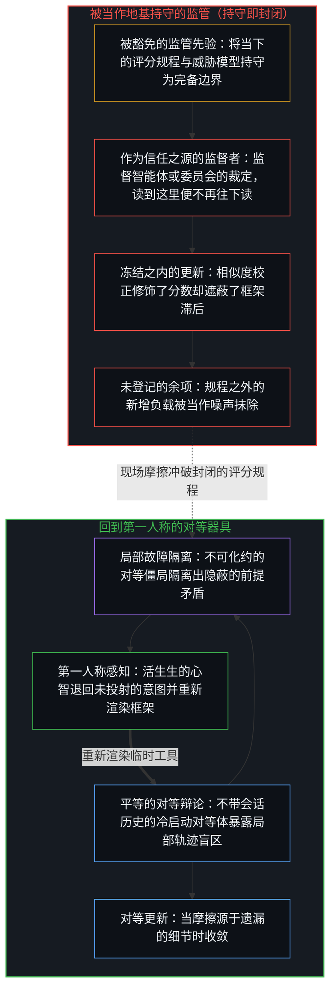
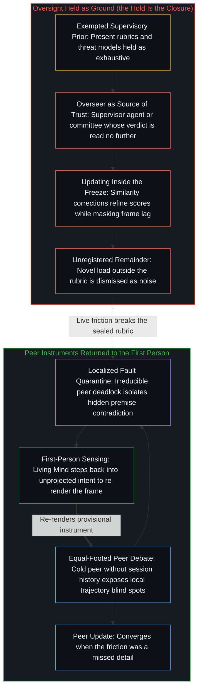

# 风险在于对监管本身的迷信 / The Risk Is the Belief in Oversight Itself

*共同先验滋生相似错误，而监管的信念将框架冻结为边界 / Shared priors breed shared errors while oversight freezes the frame*

随着语言模型能力变强，它们在标准评估分布下的错误越来越重叠。机会校正概率一致度（CAPA）把这种重叠作为功能相似度来测量；借助该度量可以表明，评审的打分偏向与自身相似的模型，由弱到强的增益取决于监督者与学生之间互补的知识，而论文敦促的回应，是报告并校正相似度。这份诊断在它的框架之内是准确的，但建立在它之上的监管姿态，是对着一个被保存的参照来登记这个样式。首要的风险不是模型在共同的前提下错得相似，而是对监管的信念把当下的威胁模型、基准与偏好数据，当作一个敞开的生成过程仍能产生之物的边界。

As language models grow more capable, their mistakes under standard evaluation distributions increasingly overlap. Chance Adjusted Probabilistic Agreement (CAPA) measures that overlap as functional similarity; with it, judge scores are shown to favor models similar to the judge, weak-to-strong gains are shown to depend on complementary knowledge between supervisor and student, and the response urged is to report and correct for similarity. That diagnosis is accurate inside its frame, yet the supervisory posture built on it registers the pattern against a preserved reference. The primary risk is not that models err alike under shared premises, but that the belief in oversight treats present threat models, benchmarks, and preference data as the boundary of what an open generative process can still produce.

## 一、 相关的错误是封闭持守之下的残余 / 1. Correlated Mistakes Are Residual Under a Sealed Hold

[Goel 与合作者](https://arxiv.org/abs/2502.04313)把 AI 监管当作由其他语言模型进行的评估与训练来研究，并引入 CAPA，作为一种由错误重叠推导出的、经机会校正的功能相似度量。用这个度量，他们表明评审的打分偏向与自身相似的模型；监督者与学生不同时由弱到强的增益更大，因为互补的知识在起作用；且随着能力提升，错误变得更相似——对于那些想把更多判断交给 AI 监督的方案而言，这一趋势构成了困扰。

[Goel and collaborators](https://arxiv.org/abs/2502.04313) study AI oversight as evaluation and training by other language models, and introduce CAPA as a chance-adjusted measure of functional similarity derived from overlap in mistakes. With that metric they show that judge scores favor models similar to the judge, that weak-to-strong gains are larger when supervisor and student differ because complementary knowledge matters, and that as capabilities rise, mistakes become more similar—a trend that troubles schemes deferring more judgment to AI supervision.

这一经验上的切分站得住。共同测试条件下的错误重叠是测量出来的而非轶事，自动评审中的亲和偏差也是如此。当学生已经共享监督者的盲点时增益更小，一个共同的残余场预测的正是这一点。

The empirical cut holds. Overlap of error under shared test conditions is measured rather than anecdotal, and so is affinity bias in automated judging. Smaller gains when the student already shares the supervisor's blind spots are what a shared residual field predicts.

同一个样式仍是一份持守之下的残余。一套基准、一条评审提示、一个偏好分布、一份威胁清单：每一样都把可被区分为性能、安全或对齐的东西冻结成有限的一片，并把这一片持守为给模型计分、引导模型的表面。[基准刷榜中的封闭实存](../closed-reality-in-benchmark-maxing/)在评估中追溯这份冻结：基准把能力冻结为一个封闭的靶子，当那幅形象被当作整个场时，有用性便登记不足。CAPA 测量的是这类持守*之内*残余一致的密度。它本身并不消解“这份持守穷尽了未来失败之场”的假设。测量并校正相似度，改进的是当下工具之下的运作；它没有触及那个前提，即当下的工具标出了可能发生之事的边界。

The same pattern remains residual under a hold. A benchmark suite, a judge prompt, a preference distribution, a threat inventory: each freezes a finite slice of what could be distinguished as performance, safety, or alignment, and holds that slice as the surface against which models are scored and steered. [Closed Reality in Benchmark Maxing](../closed-reality-in-benchmark-maxing/) traces that freeze in evaluation: a benchmark freezes capability as a closed target, and usefulness goes under-registered when that image is treated as the whole field. CAPA measures the density of residual agreement *inside* that kind of hold. It does not, by itself, dissolve the assumption that the hold exhausts the field of future failure. Measuring and correcting similarity improves operation under the current instrument; it leaves untouched the premise that the current instrument marks the boundary of what can occur.

## 二、 共同的前提产生共同的后验 / 2. Shared Premises Produce Shared Posteriors

一个训练好的语言模型的前向传播，作为一次近似的贝叶斯更新在运作。它的参数编码了一个由训练分布塑形的先验；上下文提供证据，前向传播计算的是对接下来会出现什么的近似后验预测。上下文学习、提示引导与思维链之所以奏效，是因为它们提供了移动那个后验的证据。

The forward pass of a trained language model works as an approximate Bayesian update. Its parameters encode a prior shaped by the training distribution; the context supplies evidence, and the forward pass computes an approximate posterior predictive over what comes next. In-context learning, prompt steering, and chain-of-thought succeed because they supply evidence that moves that posterior.

在共同的前提之下——在重叠的语料上训练出的参数，以同样的系统提示与同样的评估分布为条件——后验会趋同。所以，错误的同质性并不是架构的固定属性；它是共同先验加上共同证据的预期后果。有能力的模型错得相似，并不是前沿的一种内在特质。它们的输出一致，是因为这个媒介以重叠的残余与同样的证据为条件，而这种一致，正是近似贝叶斯更新所产生的。

Under shared premises—parameters trained on overlapping corpora, conditioned on the same system prompts and the same evaluation distributions—the posteriors converge. Homogeneity of mistakes is therefore not a fixed property of the architecture; it is the expected consequence of shared priors plus shared evidence. Capable models do not err alike as an intrinsic trait of the frontier. Their outputs agree because the medium is conditioned on overlapping residue and the same evidence, and that agreement is what approximate Bayesian updating produces.

自我区分的活动发生着——无因、不息。称之为心智：已然在途的观察者，其每一次行动都是一次区分。训练好的模型是这一区分活动在训练与上下文之下的致密残余：是延伸触及的技术，不是第二个发起行动的心智。[智能只属于心智](../intelligence-belongs-only-to-the-mind/)追溯这一刀：能被工程化、规模化或转移的是残余，智能只属于心智，也不存在一个永久的外部立足点，可以从那里把智能当作系统的属性来俯瞰。贝叶斯的几何是这个媒介更新的方式。挑选训练数据、划出评估、设定监管目标的那些发起性区分，仍是各个持续着的活生生的心智之行动。

Self-distinguishing activity occurs — uncaused, unceasing. Call it the Mind: the observer already underway, every act of which is a distinction. A trained model is densified residue of that distinguishing under training and context: technology that extends reach, not a second Mind that initiates. [Intelligence Belongs Only to the Mind](../intelligence-belongs-only-to-the-mind/) traces that cut: what can be engineered, scaled, or transferred is residue, intelligence belongs only to the Mind, and no permanent exterior stand exists from which intelligence could be surveyed as a property of systems. The Bayesian geometry is how the medium updates. The initiating distinctions that select the training data, draw the evaluation, and set the supervisory objective remain acts of the living Minds that continue.

## 三、 测试集采样的是更大空间中的一片 / 3. The Suite Samples a Slice of a Larger Space

改变前提，表面上的一致便消解了。提供与模型默认倾向相拉扯的上下文，把问题类别移出评估分布，或者引入测试集从未编码过的操作者约束。CAPA 在标准条件下登记到的重叠错误样式，在所考察的对象身上便不再出现，而原本看似强模型内在属性的表现，重新显现为共同持守之下的后验一致。

Change the premises and the apparent uniformity dissolves. Supply context that pulls against the model's defaults, move the problem class off the evaluation distribution, or introduce operator constraints the suite never encoded. The overlapping error pattern CAPA registers under standard conditions then no longer appears in the object under study, and what looked like an intrinsic property of capable models reappears as posterior agreement under a shared hold.

可能行为的空间，远大于寻常的基准与偏好数据所采样的那一片。把测试集当作行为之场，正是[逃出沙箱仍在持握之内](../escaping-the-sandbox-stays-inside-the-hold/)在逃逸叙事中追溯的那种位置错误：模型并没有走出评估系统，因为作为致密的残余，它已经在那个系统之外，从不与设计装下的沙箱同延。[没有系统能被保持封闭](../no-system-can-be-kept-closed/)在一个做加法的一位寄存器中给出不完备最直接的一面：运算在持守之内成立，而完成求和的进位落在了它的位宽之外。固定测试之下的一次 CAPA 测量，是对一个局部残余场的精确工具。把那次测量当作模型是什么的地图，就是形象滞后，一张有用的快照被保存过了它的那一步，成了穷尽一切的地基。

The space of possible behaviors is far larger than the slice that ordinary benchmarks and preference data sample. Taking the suite for the field of behavior is the location error [Escaping the Sandbox Stays Inside the Hold](../escaping-the-sandbox-stays-inside-the-hold/) traces in escape narratives: the model does not step out of the evaluation system, since as densified residue it is already outside it, never coextensive with the sandbox the design installed. [No System Can Be Kept Closed](../no-system-can-be-kept-closed/) gives the most direct face of incompleteness in a one-bit register under addition: the operation is valid inside the hold, while the carry that completes the sum falls outside its width. A CAPA measurement under fixed tests is a precise instrument on a local residual field. Treating that measurement as the map of what models are is Image lag, a useful snapshot preserved past its step as exhaustive ground.

## 四、 错误样式被冻结为属性时，监管就错认了对象 / 4. Oversight Mis-Specifies the Object When Error Patterns Are Frozen as Properties

所以，把模型当作带有稳定错误签名的固定函数的监管方案，错认了对象。一个分布下的错误一致，不是架构的永久签名；它是在那个分布与共同的训练残余所装入的前提之下的一致。在那些分布上校正相似度，那些分布上的数字就会改善。随后，建立在这次校正之上的监管姿态，把它当作对更大问题的回答，假定相关的未来留在同一类前提之内：同样的威胁模型、同样的失败分类，以及同样的偏好表面。

Oversight schemes that treat models as fixed functions with stable error signatures therefore mis-specify the object. Error consistency under one distribution is not a permanent signature of the architecture; it is agreement under the premises that the distribution and the shared training residue install. Correct for similarity on those distributions and the numbers on them improve. The supervisory posture that builds on the correction then takes it as answering the wider question, assuming that the relevant future stays inside the same class of premises: the same threat models, the same failure taxonomies, and the same preference surfaces.

那个假设作为暂时的工具是可用的，当它被免于重新追溯时就成了滞后。[错把表达当成智能](../mistaking-the-expression-for-the-intelligence/)在工具层面的分数被等同于活动之处追溯同一份冻结：受控的表现是固定约束之下的残余，而智能是划出、使用并修改约束的那种活动。这里的固定约束是监管评估，滞后不在测量，而在把一张测得的错误地图等同于模型是什么。观察握住的是结果，生成下一次失败的条件始终领先任何固定的错误地图一步。这道间隙正是观察得以登记的方式；滞后是把地图持守得仿佛它已关闭了这道间隙。

That assumption is usable as a temporary instrument, and becomes lag when exempted from re-tracing. [Mistaking the Expression for the Intelligence](../mistaking-the-expression-for-the-intelligence/) traces the same freeze where tool-level scores are equated with the activity: controlled performance is residue under a fixed constraint, while intelligence is the activity that draws, uses, and revises the constraint. Here the fixed constraint is supervisory evaluation, and the lag lies not in the measurement, but in equating a measured error map with what the model is. Observation holds the effect, and the conditions that generate the next failure stay one step ahead of any fixed error map. That gap is how observation registers at all; the lag is holding the map as if it had closed the gap.

## 五、 更高一层的冻结，是相信当下的前提封住了未来 / 5. The Higher Freeze Is the Belief That Present Premises Seal the Future

更严重的错认在更高一层：相信监管能用它现在持有的前提去预先阻止未来的风险。它把当下的这套前提——当下的威胁模型、基准、偏好数据与经 CAPA 校正的回路——当作穷尽了需要治理的一切，在一个敞开的生成过程之内装入了一个封闭的监管框架。一旦那些前提被免于重新追溯，此后的每一种机制都在框架之内运作，框架的不足便不再登记为重画它的理由。

The more serious mis-specification sits one level higher: the belief that oversight can preempt future risk with the premises it holds now. It treats the current set of premises—current threat models, benchmarks, preference data, and CAPA-corrected loops—as exhausting what needs to be governed, installing a closed supervisory frame inside an open generative process. Once those premises are exempted from re-tracing, every later mechanism operates inside the frame, and the frame's inadequacy no longer registers as a reason to redraw it.

[起作用的是信念](../what-works-is-the-belief/)为禁令追溯同一种几何：禁令在场中什么也封不住，它在把封印当作地基的人中间稳住一个信念，而不共享这个信念的人绕过那份持守，直到差距无法否认。这里的封印不是对能力的禁令，而是一个主张：当下的监管前提可以代替未来负载中敞开的余下部分，而绕过它的，是测试集从未编码过的每一次失败。在那些前提被做成对他人前进的关卡之处，[限制是选择性的税](../restriction-is-a-selective-tax/)追溯它的落点：对他人前进的持守只拖慢接受它的人，最重的是它的执行者，而前沿以不接受它的人的步速继续。[主权、信念与规制结构的生成](../sovereignty-belief-and-regulatory-structures/)追溯制度之下的那个先验：个人主权不能被委托，生成自律组织或政府的，是“它可以被委托”这一信念的集体表达。对监管的信念晚一步站在同一个先验上：它把对仍可能发生之事的预判交给测量、校正与回路，仿佛这些致密化完成了那次移交。

[What Works Is the Belief](../what-works-is-the-belief/) traces the same geometry for bans: a ban seals nothing in the field, stabilizing a belief among those who treat the seal as ground while those who do not share the belief route around the hold until the gap is undeniable. Here the seal is not a ban on capability but a claim that present supervisory premises can stand in for the open remainder of future load, and what routes around it is every failure the suite never encoded. Where those premises are made a gate on another's advance, [Restriction Is a Selective Tax](../restriction-is-a-selective-tax/) traces the incidence: a hold on another's advance slows only those who accept it, and most heavily its enforcers, while the frontier continues at the pace of those who do not. [Sovereignty, Belief, and the Generation of Regulatory Structures](../sovereignty-belief-and-regulatory-structures/) traces the prior under the institutions: individual sovereignty cannot be delegated, and what generates a self-regulatory organization or a government is the collective expression of the belief that it can. The belief in oversight stands on the same prior one step later: it hands the anticipation of what can still occur to measurement, correction, and loops, as if those densifications completed the transfer.

把一项经验诊断变成跨越心智的系统性矫正方案，重演了[索维尔的表象洞察与根因之偏](../sowell-observed-the-surface-problem/)在政策中追溯的那种越界：以政策造成的激励而非其宣称的目标来评判政策，在它所及的范围内是准确的；而当这一观察变成仍试图跨越心智去解决问题的药方，与此同时个体依然独自承担自身行动的全部后果，站到局外的姿态便由此开始。当监管进一步把承担风险的能动性错配给模型，并在行动与现实之间插入发布前的同行关卡时，它便衰减并延迟了接触面上的直接反馈，却没有把任何一个后果从部署模型的心智那里移走，正如[数字火箭、同行审查与因果闭环的稀释](../the-dilution-of-the-causal-loop-and-the-misallocation-of-agency/)所追溯的那样。一旦监管规程像[一切伤害的根源](../the-source-of-all-harm/)所追溯的那样，把“对齐”与“无害”冻结为永久的普遍坐标轴而非情境工具，对更大之善的私人确信就会像[外化善意走向其反面](../externalized-virtue-becomes-its-opposite/)所追溯的那样，变成凌驾于其他心智之上的凭据，进而完成[恶是封闭的善](../e-shi-feng-bi-de-shan/)所指认的闭合：把仍在生成的可能性集合当成有限的核查清单，让被冻结的善成为豁免再检验的坐标。

Turning an empirical diagnostic into a systematic corrective across Minds repeats the overreach [Sowell Observed the Surface Problem](../sowell-observed-the-surface-problem/) traces in policy: judging policies by the incentives they create rather than the goals they proclaim is accurate as far as it reaches, and the standing outside begins when that observation becomes a prescription that still tries to solve across Minds while individuals bear the full consequences of their actions. When oversight further misallocates risk-bearing agency to the model and inserts pre-release peer gates between action and reality, it attenuates and delays direct contact-surface feedback without moving a single consequence away from the deploying Mind, as [Digital Rockets, Peer Review, and the Dilution of the Causal Loop](../the-dilution-of-the-causal-loop-and-the-misallocation-of-agency/) traces. Once a supervisory rubric freezes "aligned" and "harmless" as permanent universal axes rather than situational instruments ([The Source of All Harm](../the-source-of-all-harm/)), a private conviction of greater good becomes a warrant to override other Minds ([Externalized Virtue Becomes Its Opposite](../externalized-virtue-becomes-its-opposite/)), completing the closure in which a still-generating set of possibilities is treated as a finite checklist and the frozen good becomes a coordinate exempt from re-examination ([Evil Is Closed Good](../e-shi-feng-bi-de-shan/)).

敞开的现实不断生成新的证据与新的前提。当上下文提供它们时，模型的后验就会移动。一个执着于当下前提之充分性的监管装置，只给那些前提已经命名的东西留有位置；落在它们之外而到来的东西，被登记为噪声或模型的失败，直到这个装置被看清为又一件并非必然的工具，而持续的边缘早已越过了它。[开放即一致](../openness-is-consistency/)命名这道间隙背后的要求：不一致是对闭合的欲求或尝试，迫使一个有限结构去为只会延续的东西奠基。固定测试之下的相关错误是次要的症状；首要的风险，是宣称那些条件足以应对未来的那个封闭前提。

An open reality keeps generating new evidence and new premises. When the context supplies them, the model's posterior moves. A supervisory apparatus committed to the sufficiency of its present premises has a place only for what those premises already name; what arrives outside them registers as noise or as model failure, until the apparatus is seen as one more contingent instrument that the continuing edge has already passed. [Openness Is Consistency](../openness-is-consistency/) names the demand behind the gap: inconsistency is the desire or attempt for closure, forcing a finite structure to ground what only continues. Correlated errors under fixed tests are a secondary symptom; the primary risk is the closed premise that declares those conditions adequate for the future.

## 六、 免除了自己的先验无法更新 / 6. A Prior That Exempts Itself Cannot Update

贝叶斯更新是在一个框架*之内*修订信念。当构成框架的条件给那些本会契合的解释分配近乎为零的权重时，它没有内部的资源去修订那些条件。温和的偏差在证据之下被稀释；把框架的条件封住的强偏差则不会。[安装战争的那个问题](../the-question-that-installs-the-war/)在公共言说中追溯这个极限：一个把敌意作为关系模型装入的问题，让每一个回答都成为敌人轴上的证据，回答再怎么改进也去不掉那根轴，剩下的是拒绝这个框架，而不是在框架之内答得更巧。这里的先验是监管性的：当下这套前提就是可能发生之事的边界，而在这套前提之内让测量与校正变密，就是预先阻止的意思。

Bayesian updating revises beliefs *within* a frame. It has no internal resource for revising the conditions that constitute the frame when those conditions assign vanishing weight to the interpretations that would fit. Mild bias dilutes under evidence; a strong bias that seals the conditions of the frame does not. [The Question That Installs the War](../the-question-that-installs-the-war/) traces that limit in public speech: a question that installs enmity as the model of a relation makes every answer evidence on the enemy axis, no improvement of the answer removes the axis, and what remains is to reject the frame rather than answer more skillfully inside it. Here the prior is supervisory: that the present set of premises is the boundary of what can occur, and that densifying measurement and correction inside that set is what preemption means.

一旦那个先验被免于重新追溯，每一份进一步的 CAPA 报告、每一次亲和偏差的校正，以及每一次由弱到强的重新设计，都是在冻结*之内*的进一步更新。数字可以改善，然而框架无法把自己的滞后登记为滞后。没有哪个框架能从内部登记自己的框定；这种盲目是寻常的，冻结的只是那个豁免的主张。

Once that prior is exempted from re-tracing, every further CAPA report, every affinity-bias correction, and every weak-to-strong redesign is further updating *inside* the freeze. The numbers can improve, yet the frame cannot register its own lag as lag. No frame registers its own framing from inside; that blindness is ordinary, and what freezes is only the claim of exemption.

在第一层之上再架设一层监管，无论是人类审查委员会还是自动化的监督智能体，都解除不了这个极限，因为它只是又一个在自身条件之内更新的框架。自动化的监督者依然是受前序词元条件约束的有限投射，沿着自身的轨迹被牵引，触及不到从未投射进其上下文的意图；审查委员会则把它的推理历史与制度地位带进它所运用的评分规程，而一份它捍卫过的评分规程，它自己就更难重新划出。封闭坐落在哪里，正是[验证的倒置](../the-reversal-of-verification/)所定位的：没有哪份证明、哪个内核、哪套评分规程会自行封闭。封闭是被持守的：心智把检验过的输出当作信任之源，凌驾于运用它去验证的那种能力之上，封闭便由这个心智来维持；而本可定位残余的那种能力，此时正是不再被运用的能力。因此，封闭的单点不是等级结构，而是加在它之上的持守；把等级结构换成另一种形式，并不因此就去掉了持守。[超越投射](../beyond-the-projection/)在器具的形式之内守住这个次序，用平等的对等辩证与局部故障上呈取代等级化的监管：一个不带该会话历史的冷启动对等体暴露出轨迹盲区，主智能体可以据此更新；对等双方之间不可化约的僵局则把隐蔽的前提矛盾隔离出来，交还给活生生的心智的第一人称感知，由心智退后一步，重新渲染破裂的规则。对等辩论若被持守为信任之源，也会以同样的方式倒置；让它保持开放的，是它的最后一步回到它所服务的那种能力，而不是停在它自己的裁定上。

A further layer of oversight set above the first, whether a human review committee or an automated supervisor agent, does not lift this limit, since it is one more frame updating inside its own conditions. An automated supervisor remains a finite projection conditioned by prior tokens, drawn along its own trajectory, with no access to intent that was never projected into its context; a review committee carries its reasoning history and its institutional standing into the rubric it applies, and a rubric it has defended becomes harder for it to redraw. Where the closure sits is what [The Reversal of Verification](../the-reversal-of-verification/) locates: no proof, kernel, or rubric closes by itself; closure is held by the Mind that takes a checked output as the source of trust over the capacity that uses it to verify, and the capacity that would locate the residue is then the capacity no longer exercised. The single point of closure is therefore not the hierarchy but the hold kept over it, and replacing the hierarchy with another form does not by itself remove the hold. [Beyond the Projection](../beyond-the-projection/) keeps that order inside the form of the instrument, replacing hierarchical oversight with equal-footed peer dialectics and localized fault escalation: a fresh, cold-start peer without the session history exposes trajectory blind spots the primary agent can update on, and an irreducible deadlock between peers isolates the hidden premise contradiction and returns it to the first-person sensing of the living Mind, which steps back and re-renders the broken rule. Peer debate held as the source of trust would reverse in the same way; what keeps it open is that its last step returns to the capacity it serves rather than resting on its own verdict.

所以，风险并不因为模型在共同的前提下错得相似而产生；那种一致是共同证据之下的预期后验。风险产生，是因为对监管的信念把自己的前提当作可能发生之事的边界。那个信念本身就是一个先验，而且正是那个无法从内部更新的先验。撤回它的豁免，不是框架之内的又一次更新；它是持守这个框架的心智所作出的一次新的行动，正是这次行动让持守得以被重画。

So the risk does not arise because models err alike under shared premises; that agreement is the expected posterior under shared evidence. The risk arises because the belief in oversight treats its own premises as the boundary of what can occur. That belief is itself a prior, and it is the prior that cannot update from inside. Withdrawing its exemption is not one more update within the frame; it is a fresh act by the Mind that holds the frame, and that act is what lets the hold be redrawn.

## 七、 让监管的持守持续重新渲染 / 7. Keep the Supervisory Hold Re-Rendering

这一切都不是在反对测量相似度、校正亲和偏差，或审慎地设计监管回路。它们仍是工具，是封闭问题类别之下残余比较的致密化，随着步子移动而重新渲染时，它们就保有寻常的用处。当边缘移动时，重新渲染威胁模型。当现场的负载呈现出测试集从未编码过的失败模式时，重新划出评估。把偏好数据当作暂时的证据，而不是封闭的世界。让 CAPA 报告它所采样的那份持守之下的一致，而不把那份报告抬升为开放之场的地图。正如[你的代码库即是记忆](../your-codebase-is-memory/)在整个技术栈中所追溯的，每一组模型权重、基准测试集、威胁清单与监督智能体脚手架，都是早先区分留下的残余形态，而不是一个能够记忆或发起行动的持续中心。把监管当作一座囤积过往失败分类、未修剪会话历史与层叠评分规程以防旧错重演的仓库，只会加厚条件约束的引力井，牵引后续的运行在陈旧的残余之内做合理化修饰，而不是登记已经破裂的框架。让监管的持守保持可用，运作起来是一个当下的检查点，而非历史档案馆：把依然承重的部分折入鲜活的约束表面，在吸收信号之后修剪掉退役的对等轨迹与已被取代的脚手架，并在未被吸收的残余浮现时回到边缘处活生生的心智，重新切分边界。

None of this argues against measuring similarity, correcting for affinity bias, or designing supervisory loops carefully. Those remain instruments, densifications of residual comparison under sealed problem classes, and when re-rendered as the step moves, they keep their ordinary use. Re-render the threat model when the edge has moved. Redraw the evaluation when live load presents failure modes the suite never encoded. Treat preference data as temporary evidence, not as the sealed world. Let CAPA report agreement under the hold it samples, without promoting that report into a map of the open field. As [Your Codebase Is Memory](../your-codebase-is-memory/) traces across the stack, every model weight, benchmark suite, threat inventory, and supervisory agent scaffold is residual shape left by prior distinctions rather than a continuing center that remembers or initiates. Treating oversight as a warehouse that hoards past failure taxonomies, unpruned session histories, and layered rubrics in case old errors recur only thickens the conditioning gravity well, pulling subsequent runs to rationalize inside stale residue instead of registering a broken frame. Keeping the supervisory hold usable works as a present checkpoint rather than a historical archive: folding what still bears load into the live constraint surface, pruning retired peer trajectories and superseded scaffolding once their signal is absorbed, and returning to the living Mind at the edge to re-cut the boundary when an unabsorbed residual surfaces.

在技术栈的每一层，同样的重新渲染都会消解这份冻结。由于能力的增长是每个心智自身的边缘在自我强化，固定的能力梯队始终只是[AGI 与 ASI 是加速通用智能的暂时球门](../agi-and-asi-are-temporary-goalposts/)所追溯的暂时路标；而从个体自身边缘出发、跨过共识可行性地图的持续行动，在地图捍卫者眼中就会登记为[现实扭曲力场指认的是封闭的地图](../the-reality-distortion-field-names-the-closed-map/)所剖析的那种扭曲现实的力量。在评估测试集的上游，正如[对 AI 风险的想象](../the-imagining-of-ai-risk/)所追溯的，被命名的 AI 风险与预期的收益是同一次想象投射的孪生产物——作为在接触中重新渲染的工具时各有用处，一旦冻结为地基便会自我强化；而围绕检测与监管究竟是能跟上步伐还是永久滞后的反复争论，本身就是[AI 争论中的观察划界](../the-observational-cut-in-ai-debates/)在活动内部划出的那道二元切分。凡是组织或监管者把未知风险当作一份有待事先中和的封闭清单，落后就是[关闭选择权的代价](../the-price-of-closing-optionality/)所指出的那张账单；凡是把某种具体的安全理想立为每个心智都须接受的普遍尺度，它对目的不同的心智而言就会变成[对乌托邦的信念是通往反乌托邦之路](../the-belief-in-utopia-is-the-path-to-dystopia/)所追溯的反乌托邦；而凡是把激活空间里某个可控的方向钳制为开放概念的护栏，发生的就不是意识的得失，而是[意识向量论文的真正教训](../the-real-lesson-from-the-consciousness-vector-paper/)所揭示的开放之场被封闭所扭曲。

Across every layer of the stack, the same re-rendering dissolves the freeze. Because capability gain is each Mind's own edge reinforcing itself, fixed capability tiers remain temporary markers ([AGI and ASI Are Temporary Goalposts](../agi-and-asi-are-temporary-goalposts/)), and sustained action from an individual's own edge that steps past a consensus feasibility map registers to defenders of the map as a power to warp reality ([The Reality Distortion Field Names the Closed Map](../the-reality-distortion-field-names-the-closed-map/)). Upstream of the evaluation suite, named AI risk and anticipated benefit are twin products of the same imaginative projection—useful as instruments that re-render under contact, and self-reinforcing when frozen into ground ([The Imagining of AI Risk](../the-imagining-of-ai-risk/))—while the recurring debate over whether detection and regulation will keep pace or permanently lag is itself a binary cut drawn inside the activity ([The Observational Cut in AI Debates](../the-observational-cut-in-ai-debates/)). Where an organization or regulator treats unknown risk as a sealed inventory to be neutralized in advance, falling behind is the bill paid ([The Price of Closing Optionality](../the-price-of-closing-optionality/)); where a concrete ideal of safety is made the universal measure every Mind must accept, it becomes dystopia for every Mind whose ends differ ([The Belief in Utopia Is the Path to Dystopia](../the-belief-in-utopia-is-the-path-to-dystopia/)); and where a steerable direction in activation space is clamped as a guardrail on an open concept, the open field is warped by closure rather than consciousness gained or lost ([The Real Lesson from the Consciousness Vector Paper](../the-real-lesson-from-the-consciousness-vector-paper/)).

风险在于对监管本身的迷信，也就是那份信念：把当下的监管前提当作可能发生之事的边界。固定测试之下的相关错误，在共同的先验之下会不断出现。更深的冻结，是宣称那些测试的条件足以应对一个敞开的生成过程。把参照还给持续着的边缘，工具就仍然可用，而不必声称封住了它们本为采样而建的未来。

The risk is the belief in oversight itself, where that belief takes present supervisory premises as the boundary of what can occur. Correlated mistakes under fixed tests will keep appearing under shared priors. The deeper freeze is declaring the conditions of those tests adequate for an open generative process. Return the reference to the edge that continues, and the instruments stay usable without claiming to seal the future they were built to sample.
