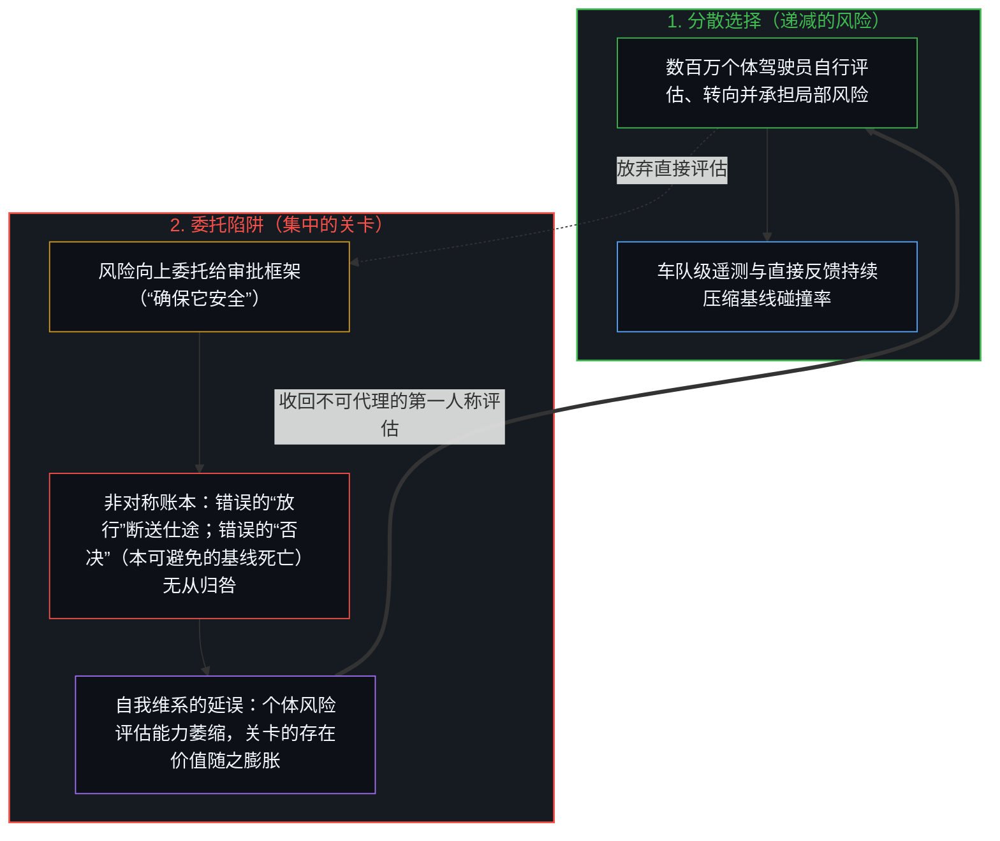
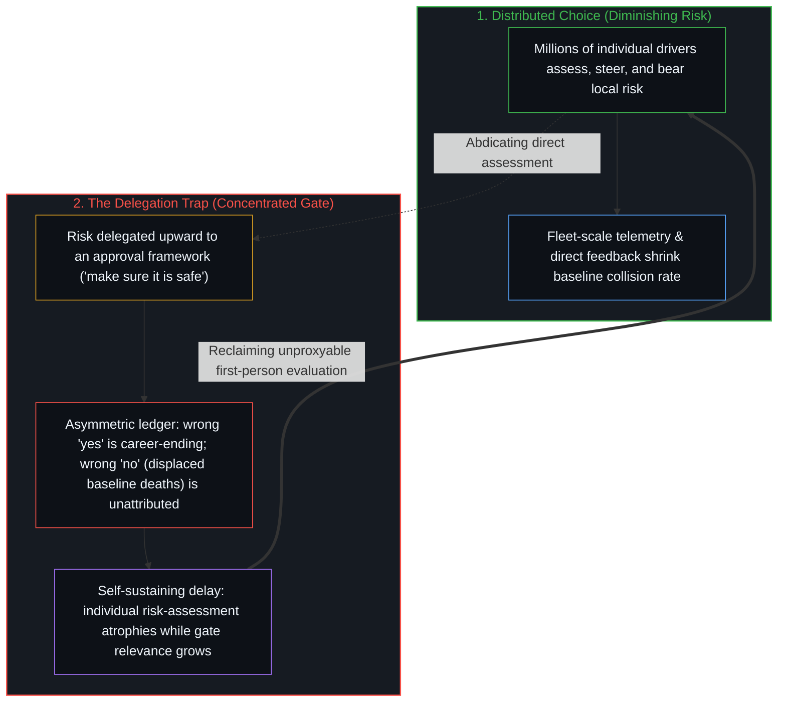

# 你委托的风险就是你创造的风险 / The Risk You Delegate Is the Risk You Create

*将风险委托给集中审批关卡，会使问责集中而伤害依然分散，致使原本可由分散选择缩减的隐患在自我维系的延误中持续存在。 / Delegating risk to a central gate concentrates accountability while the harm stays distributed, so a hazard that distributed choice would shrink persists through a self-sustaining delay.*

美国公路上每年约有四万人丧生。NHTSA在大约94%的撞车事故中将关键原因——即事故因果链上的最后一项事件——归于驾驶员：分心、酒驾或药驾、疲劳、误判。这一年度死亡人数年复一年维持在这个量级附近，是人类驾驶车辆的基线代价。

Approximately 40,000 people die on American roads every year. NHTSA assigns the critical reason—the last event in the crash's causal chain—to the driver in roughly 94% of crashes: distraction, impairment, fatigue, misjudgment. That annual toll holds near that level year after year as the baseline cost of humans operating vehicles.

没有任何机构为此担责。当这一数字维持不变时，没有哪个监管者会面临审查，也不会有头条新闻报道。这是前制度化的风险——分散在数以百万计的个体决策之中，每一次决策都很微小，也没有委托给任何人。你开车，你承担风险，而在汇总层面上它始终隐形，因为没有任何单一实体承接它。

No institution is accountable for this. No regulator faces scrutiny when the number holds steady. No headline runs. It is pre-institutional risk—distributed across millions of individual decisions, each one small, none of them delegated to anyone. You drive, you bear the risk, and it stays invisible in aggregate because no single entity holds it.

如今出现了一套降低这一风险的效果可以测量的系统。特斯拉基于超过76亿英里的车队行驶里程报告称，受监督版FSD的碰撞率比全美平均水平低数倍。数据由企业自行报告，统计方法归特斯拉自有，用户群体存在自我筛选，且系统仍有赖人类驾驶员兜底。这些因素都至关重要，理应接受独立核验。然而即便大幅折算——哪怕把报告中七倍的安全性提升砍到两倍——信号依然清晰：一套在大规模部署后每年能避免数千人丧生的系统已经存在。

Now a system emerges that measurably reduces this risk. Tesla reports, from over 7.6 billion fleet miles, that FSD (Supervised) produces collision rates multiple times lower than the national average. The data is self-reported, the methodology is Tesla's own, the users self-select, and the system includes a human driver as backstop. All of that matters and deserves independent verification. Yet even discounted heavily—cut the reported sevenfold improvement to twofold—the signal is clear: a system exists that, at scale, would prevent thousands of deaths annually.

## 一、 委托的动作 / 1. The Delegation Move

每个个体本可自行选择如何接触这套新系统——亲自试用、评估并调整——风险却被委托了出去。“总得有人确保它是安全的。”这个“有人”变成了一座机构：监管部门、标准制定机构、审批框架。个体向后退却，机构顺势介入。正如[主权、信念与规制结构的生成](../sovereignty-belief-and-regulatory-structures/)所揭示的，监管机构正是由“风险可以移交”这一信念构筑而成的。

Rather than each individual choosing their own exposure to the new system—trying it, assessing it, adjusting—the risk gets delegated. "Someone should make sure this is safe." That someone becomes an institution: a regulatory body, a standards agency, an approval framework. The individual steps back. The institution steps in. Regulators are built from the belief that this risk can be handed over, as [Sovereignty, Belief, and the Generation of Regulatory Structures](../sovereignty-belief-and-regulatory-structures/) shows.

这听起来像是负责任，实则是负责任的反面。风险一旦委托给机构，便在性质上发生了蜕变。监管者此刻对新系统的任何故障背负着高度集中的问责。如果他们批准了FSD，随后一起车祸登上了头条，这项批准就会遭到严厉审视。仕途就此断送，调查随之启动。一次错误的“放行”，其代价对机构而言是显眼的、可归咎的、灾难性的。

This feels like responsibility. It is its opposite. The moment risk delegates to an institution, it transforms in kind. The regulator now holds concentrated accountability for any failure of the new system. If they approve FSD and a crash makes headlines, the approval is scrutinized. Careers end. Investigations launch. The cost of a wrong "yes" is visible, attributable, and catastrophic for the institution.

而一次错误的“否决”——在每天110起基线死亡中，原本可由更优系统在延误期间避免的那些死亡——其代价却是隐形的。没有人为现状担责。哪怕更优系统提早一年部署就能避免那些车祸，也没有哪个监管者会因为这些原本不会发生的事故而接受调查。这笔代价由陌生人承受，四散分布、无从归咎，在做出决策的机构眼中处于结构性的盲区。

The cost of a wrong "no"—the deaths among the 110 daily baseline fatalities that the better system would have displaced over the delay—is invisible. No one is accountable for the status quo. No regulator is investigated for the crashes that would not have occurred had the better system been deployed a year earlier. That cost is borne by strangers, distributed, unattributable, and structurally invisible to the institution making the decision.

于是机构做出了理性的优化：将可归咎的新型故障压到最低。由于不可归咎的持续伤害留在了它的账本之外，这部分伤害便不被纳入权衡，而那些本可避免的死亡则在路网中持续发生。这不是出于恶意，也不是出于无能，而是源于决策与问责集中于关卡、伤害却依然分散在承受者身上的几何结构。

So the institution optimizes rationally: minimize attributable novel failure. Because the unattributable ongoing harm stays outside its ledger, that harm goes unweighed while the displaced deaths continue across the road network. Not through malice, not through incompetence—through the geometry of how decision and accountability concentrate at the gate while the harm remains distributed across the people who bear it.

## 二、 自我维系的回路 / 2. The Self-Sustaining Loop

此时，机构的存在意义变成了管理这一风险。它的经费、权力和存在价值，都仰赖于该风险持续需要被管理。审批流程越复杂，机构就越显必要；延误拖得越久，流向监管而非部署的资源就越多。机构无需密谋去延续风险——它用不着这么做。它的激励结构会自动完成这一切。

The institution now exists to manage the risk. Its funding, authority, and relevance depend on the risk continuing to require management. The more complex the approval process, the more necessary the institution becomes. The longer the delay, the more resources flow toward oversight rather than deployment. The institution does not conspire to perpetuate risk—it does not need to. Its incentive structure does the work automatically.

与此同时，交出责任的个体丧失了判断能力。“这套系统安全吗？”变成了“监管机构批准它了吗？”——这是截然不同的两个问题，后者用机构的裁定取代了直接的评估。因为委托让亲自评估变得多余，个体评估风险的能力便随之萎缩。这加深了对机构的依赖，继而抬高了机构的必要性，助长了机构的保守倾向，进一步拉长了延误。

Meanwhile, the individual who delegated the responsibility loses capacity. "Is this system safe?" becomes "has the regulator approved it?"—a different question altogether, one that substitutes institutional judgment for direct assessment. The individual's ability to evaluate risk atrophies because the delegation made it unnecessary. This increases dependence on the institution, which increases the institution's necessity, which increases its conservatism, which increases the delay.

而个体自身的驾驶行为——在大约94%的撞车事故中，关键原因都被归于驾驶员——却从未进入新系统审批关卡的账本。驾照发放与交通执法确立了一般规则，却没有任何关卡为每一次日常出行签字放行，也没有任何关卡在自身的资产负债表上背负汇总的基线伤亡。这一基线游离在审批关卡的问责结构之外，对关卡而言始终隐形，恰恰因为没有任何单一机构为此买单。

And the individual's own driving—where the driver is assigned the critical reason in roughly 94% of crashes—never enters the approval gate's ledger for the new system. Licensing and traffic enforcement set general rules, yet no gate signs off on each ordinary trip or carries the aggregate baseline toll on its balance sheet. That baseline sits outside the approval gate's accountability structure, invisible to the gate precisely because no single agency is billed for it.

回路就此闭合：委托风险这一动作，造就了维系延误的条件。机构的存在价值仰赖于风险持续需要被管理；个体的弃权则抽走了原本能够缩减隐患的直接介入。初衷在于减少伤害的委托，反倒成了拉长伤害的机制。

The loop closes: the act of delegating risk generates the conditions that sustain the delay. The institution's relevance depends on the risk continuing to require management. The individual's abdication removes the direct engagement that would diminish the hazard. The delegation, undertaken to reduce harm, becomes the mechanism that prolongs it.

## 三、 跨法域的证据 / 3. The Evidence Across Jurisdictions

这一结构在自动驾驶的整体格局中清晰可见。在车队级受监督自动驾驶的部署上，随着碎片化的监管框架让委托层级成倍增加，欧洲落后北美数年。每个司法管辖区都设立各自的制度关卡，每一道关卡都围绕自身的可归咎账本做最优化，汇总起来的延误便在国境线之间层层叠加。部署原本可在延误期间避免的伤亡在道路上持续累积，四散分布，且归咎不到任何人头上。

This structure is visible across the autonomous driving landscape. On fleet-scale supervised self-driving deployment, Europe sits years behind North America as fragmented regulatory frameworks multiply the delegation layers. Each jurisdiction creates its own institutional gate, each gate optimizes for its own attributable ledger, and the aggregate delay compounds across borders. The casualties that deployment would have displaced over that delay accumulate on the road, distributed and attributed to no one.

每一场涉及FSD的碰撞都会触发制度性反应：立案调查、专项质询、潜在的限制措施。机构必须做出反应——当可归咎的故障发生时，它的合法性取决于能否采取看得见的行动。而同一时期发生的数千起人为失误车祸，却不会引发对等的反应。这种非对称并非出于偏见，而是源于结构。机构只能看见其问责结构所能识别的事物，因为它的成文规则手册只是过往切分的外化记录，而非身处掌舵前沿的活态观察者：正如[总在倾听者无法发起](../what-always-listens-cannot-originate/)与[你的代码库即是记忆](../your-codebase-is-memory/)所揭示的，静态的监管核查表只保存着先前区分的形状，既无法发起当下的评估，也无法承担审批关卡所强加的延误后果。

Every FSD-involved crash triggers institutional response: investigations, probes, potential restrictions. The institution must respond—its legitimacy depends on visible action when attributable failure occurs. No equivalent response exists for the thousands of human-error crashes that occur in the same period. The asymmetry is not bias; it is structural. The institution can only see what its accountability structure makes legible, because its codified rulebook is an externalized record of past cuts rather than a living observer at the steering edge: as [What Always Listens Cannot Originate](../what-always-listens-cannot-originate/) and [Your Codebase Is Memory](../your-codebase-is-memory/) show, a static regulatory checklist holds only the shape of earlier distinctions and can neither originate a present evaluation nor bear the consequence of the delay the gate enforces.

特斯拉的数据尽管存在种种局限，却代表着制度框架难以消化的一类事实：在车队规模上对相对风险展开的直接测量。机构手中的工具是个案审查、标准合规与审批关卡——没有一样是为了权衡基线伤害在总体上能被削减多少而设计的。这组数据回答的，是一个机构在结构上就无法提出的问题。正如[数字火箭、同行审查与因果闭环的稀释](../the-dilution-of-the-causal-loop-and-the-misallocation-of-agency/)所追溯的，同行审查与安全体制正是通过稀释因果回路来制造风险的。

Tesla's data, for all its limitations, represents something the institutional framework cannot easily process: a direct, fleet-scale measurement of comparative risk. The institution's tools are incident review, standards compliance, and approval gates—none of which are designed to weigh aggregate displacement of baseline harm. The data speaks to a question the institution is not structured to ask. Peer review and safety regimes create risk by diluting the loop, as [Digital Rockets, Peer Review, and the Dilution of the Causal Loop](../the-dilution-of-the-causal-loop-and-the-misallocation-of-agency/) traces.

## 四、 机制揭示了什么 / 4. What the Mechanism Reveals

常规叙事将机构定位为挡在危险技术与脆弱公众之间的保护屏障。但在这一叙事之下运转的结构却截然不同：机构的存在价值仰赖于持续的风险管理，个体的委托削薄了直接的风险评估能力，而由此产生的延误，恰恰拉长了双方原本试图避免的伤害。

The conventional framing positions institutions as the safeguard between dangerous technology and a vulnerable public. The structure operating beneath that framing is different: the institution's relevance depends on ongoing risk management, the individual's delegation thins direct risk-assessment capacity, and the resulting delay prolongs the very harm both parties sought to avoid.

这并非针对监管本身的反对意见，而是一项结构性观察：把风险委托给集中的问责结构，会使决策与归咎集中起来，同时让伤害依然分散，致使原本可由分散采纳不断缩减的隐患在自我维系的延误中持续存在。在分散模式下——数百万个体自行选择接触一套持续改进的系统——隐患会随着每多开一英里所带来的系统精进而不断缩减。而在集中模式下——制度关卡以规避可归咎的新型故障为优化目标——关卡没有任何问责压力去缩减无从归咎的基线伤害，因为现状的代价从未计入它的账本。[限制是选择性的税](../restriction-is-a-selective-tax/)从执行一侧追溯了同一结构：为关卡配备人员并维持其运转，会把容量耗费在复制延误上，而前沿依然按照那些不受该关卡约束的法域与驾驶者的步伐向前推进。禁令同样是委托出去的风险；[起作用的是信念](../what-works-is-the-belief/)表明，它只是在那些把关卡当成根基的人当中稳固了信念，而并未封住整个场域。

This is not an argument against regulation as such. It is a structural observation: delegating risk to concentrated accountability structures concentrates the decision and the blame while leaving the harm distributed, so a hazard that distributed adoption would shrink persists through a self-sustaining delay. The distributed version—millions of individuals choosing exposure to an improving system—shrinks the hazard as the system improves with each mile driven. The concentrated version—institutional gates that optimize against attributable novel failure—has no accountability pressure to shrink the unattributed baseline, because the cost of the status quo is never entered on its ledger. [Restriction Is a Selective Tax](../restriction-is-a-selective-tax/) traces the same structure from the side of enforcement: staffing and maintaining the gate spends capacity reproducing the delay, while the frontier advances at the pace of jurisdictions and drivers not bound by it. A ban is delegated risk too; [What Works Is the Belief](../what-works-is-the-belief/) shows it stabilizes belief among those who treat the gate as ground rather than sealing the field.

你委托的风险就是你创造的风险——这不是悖论，而是机制。只要更安全的系统被拦在审批关卡之后，它原本可在延误期间避免的死亡就会持续发生，因为用来汇总管理风险的制度结构只权衡可归咎的新型故障，却把无从归咎的基线留在了账本之外。[气候问题只作为感知被登记](../the-climate-problem-registers-only-as-perception/)也是披着行星外衣的同一套装置：各个解决方案层级的经费与存在价值，都仰赖于问题在一套封闭指标上持续需要被管理。正如[“物理学才是定律”的障眼法](../the-sleight-of-hand-in-physics-is-the-law-and-the-friction-of-reality/)所展示的，把规则当成物理定律掩盖了委托的动作；而如何面对这一机制，始终取决于你自己。

The risk you delegate is the risk you create—not as paradox, but as mechanism. Wherever a safer system is held behind an approval gate, the deaths it would have displaced over the delay persist because the institutional structure built to manage risk in aggregate weighs attributable novel failure while leaving the unattributed baseline off its ledger. [The Climate Problem Registers Only as Perception](../the-climate-problem-registers-only-as-perception/) is the same apparatus under planetary costume: solution layers whose funding and relevance depend on the problem continuing to require management on a closed set of measures. Treating a rule as physical law disguises the delegation, as [The Sleight of Hand in "Physics Is the Law"](../the-sleight-of-hand-in-physics-is-the-law-and-the-friction-of-reality/) shows; how you meet the mechanism stays yours.
