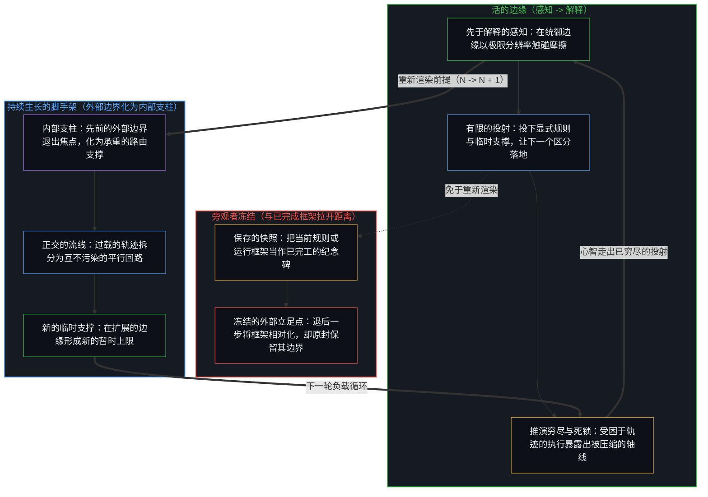
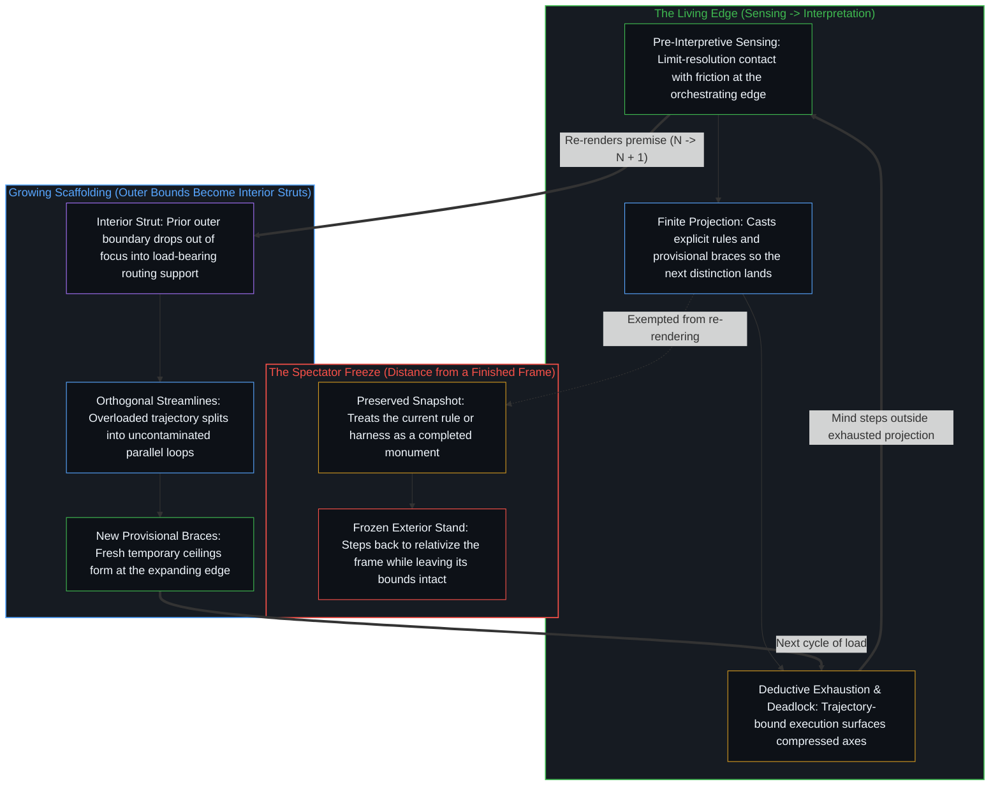

# 持续生长的脚手架 / The Scaffolding That Keeps Growing

*敞开不是离固定框架的距离，而是持续越过它的生长 / Openness is not distance from a fixed frame but the growth that outpaces it*

有一种熟悉的读法是这样的：从自己所站的结构里往后退一步，墙壁便软化，限度显得偶然，现实显得比任何单一的构造都宽。这种读法把脚手架冻结成一个完成的物件，把敞开挪进观察者的距离里。持续进行的是生长：外面的边界变成内部的支柱，早先的支撑退出焦点、从内部承重，新的临时支撑在边缘成形。等到距离拉开，脚下的结构已经变了形状。

A familiar reading goes like this: step back from the structure one stands inside and the walls soften, the limits look contingent, reality appears wider than any single construction. That reading freezes the scaffolding as a finished object and moves openness into the observer's distance. What continues is growth: outer bounds become interior struts, earlier braces drop out of focus and carry load from inside, new provisional braces form at the edge. By the time distance is taken, the structure underfoot has already changed shape.

## 一、 距离冻结了它声称要相对化的框架 / 1. Distance Freezes the Frame It Claims to Relativize

旁观者的姿态把脚手架当作静止的，当作一座完工的建筑，可以从更远处去俯瞰。它说，退后一步，结构就显得更小、更相对、更没有约束力，而拉开距离这一举动被呈现为决定性的一步。被登记为认识的东西是站得住的：没有哪个框架是最终的，每一幅图景都不完整。这个姿态放错的，是这份不完整的所在。它把不完整放在观察者离一个固定形式有多远，而不是放在那个立起了形式、已经在越过它继续前行的活动里。

The spectator stance treats scaffolding as static, a completed construction that can be surveyed from farther off. Step back, it says, and the structure looks smaller, more relative, less binding, and the act of taking distance is presented as the decisive move. What registers as recognition is sound: no framework is final, and every picture is incomplete. What the stance places wrongly is the seat of that incompleteness. It puts incompleteness in how far the observer stands from a fixed form, not in the activity that erected the form and is already moving past it.

这种安放同时冻结了两样东西。结构被保留为一幅完成的形象，距离可以对着它被测量；观察者的立足点被冻结为一个永久的外部，可以从那里俯瞰那幅完成的形象。[开放即一致](../openness-is-consistency/)从另一侧命名同一种要求：不一致是对封闭的欲求或尝试，是一个有限结构被迫去为只在持续的东西奠基。这里，冻结把自己呈现为解放。把一个被保存的框架相对化，仍是在保存这个框架；从一座纪念碑拉开距离，仍把纪念碑当作那个要离开的东西。

That placement freezes two things at once. The structure is retained as a finished image against which distance can be measured, and the observer's stand is frozen as a permanent exterior from which the finished image can be surveyed. [Openness Is Consistency](../openness-is-consistency/) names the same demand from the other side: inconsistency is the desire, or attempt, for closure, a finite structure forced to ground what only continues. Here the freeze presents itself as liberation. Relativizing a preserved frame still preserves the frame; taking distance from a monument still treats the monument as what there is to leave.

## 二、 生长是每一份活的持守的寻常运动 / 2. Growth Is the Ordinary Motion of Every Living Hold

脚手架并没有站着不动。它生长、分叉、延伸。最初的梁不会一直是可以对着它为距离计分的固定参照点；它们退出焦点，成为可用的支撑。曾经充当外部边界的东西变成内部的支柱，曾经看起来是整个系统的东西变成一个子系统，新的临时支撑在边缘成形。后来再看，看到的不是缩小了的旧物件，而是往前又走了一步的同一个活动。

The scaffolding is not standing still. It grows, branches, and extends. The original beams do not stay fixed reference points against which distance can be scored; they drop out of focus into usable support. What once served as an outer boundary becomes an interior strut, what once looked like the whole system becomes a subsystem, and new provisional braces form at the edge. A later look does not find the old object at a smaller scale; it meets the same activity one step further along.

这种生长是任何活的持守的寻常运动，科学的、概念的、文化的、个人的或技术的。工作从手头已有的任何构型开始，因为手头没有别的，工作再从那里继续。新的连接形成；旧的约束依生长中的结构如今能支撑什么而放松或收紧。现实的敞开不是只在观察者拉远镜头时才出现的被动背景，也不是从外面压在结构上的力。它是不被冻结地持续着的活动，结构被持守为结构，而不是被立为穷尽一切的地基。[遗忘的脚手架](../the-scaffolding-we-forget/)追溯这种生长的工具一面：脚手架退出递归，好让进一步的区分得以落地，而当这种退出冻结为一幅被保存的形象，能力便压缩在曾经让运动成为可能的残余上。[稳定与溢出](../stability-and-excess/)在意识中追溯被溢出时仍被守住的框架：守住一种形式与溢出它，是同一个运作的两极，只有稳定是一幅冻结的肖像，只有溢出是四散的噪声。

This growth is the ordinary motion of any living hold, scientific, conceptual, cultural, personal, or technical. Work begins from whatever configuration is already in hand, since nothing else is at hand, and continues from there. New connections form; old constraints loosen or tighten according to what the growing structure can now support. The openness of reality is not a passive backdrop that appears only when the observer zooms out, nor a force pressing on the structure from outside. It is the activity continuing without freeze, structure held as structure rather than installed as exhaustive ground. [The Scaffolding We Forget](../the-scaffolding-we-forget/) traces the instrument face of this growth: scaffolding drops out of recursion so further distinguishing can land, and when that drop-out freezes into a preserved image, capacity compresses against the residue that once enabled movement. [Stability and Excess](../stability-and-excess/) traces the frame held while exceeded in consciousness: holding a form and exceeding it are two poles of one operation, stability alone a frozen portrait, excess alone scattered noise.

## 三、 被保存过了那一步的形象 / 3. The Image Preserved Past Its Step

每一个离散的行动都留下残余，先前的行动塑造后来的行动。观察握住的是结果；产生它的那个行动已经往前走了一步。[一步一步绘制出的路径](../the-path-drawn-one-step-at-a-time/)把这份不对称追溯为时间与因果：当下是心智一步一步绘制的路径上的位置，原因通向结果，时间是那个方向，“无因”是每个原因在被观察之前的名字。[好奇先行](../curiosity-first-the-hidden-engine-of-talent-and-development/)在一个人的一生中追溯同一支箭头：被登记为天赋的，是好奇被追随、被吸收后复利出的残余，被当作原因时，它就把下一步引离产生它的回路。

Every discrete act leaves residue, and earlier acts shape later ones. Observation holds the effect; the act that produced it is already a step further on. [The Path Drawn One Step at a Time](../the-path-drawn-one-step-at-a-time/) traces that asymmetry as time and causality: the present is the position on a path the Mind draws one step at a time, cause leading to effect, time as that direction, and "uncaused" the name of every cause before it is observed. [Curiosity First](../curiosity-first-the-hidden-engine-of-talent-and-development/) traces the same arrow in a single life: what registers as talent is the residue compounded from curiosity followed and absorbed, and taken as the cause, it turns the next act away from the loop that produced it.

脚手架是活动立起来的东西，好让下一个区分落在某处，而不是落在到处。只要它在边缘的新位置上被重新渲染，它就可用而不是最终的；滞后就是被选定的框架被免于这种重新渲染，临时的结构被当作现实的固定架构。保存是形象一旦形成后自己的指令，重新渲染是它的存在所要避开的那次小小的死亡，所以这种漂移不需要任何乖张。旁观者的姿态并不发明距离；它把距离冻结为解药。它把结构的一张快照保留得足够久，好从它那里退开，然后把被相对化的快照读作找回的敞开。敞开不是从一个完成的框架退后一步找回的，因为没有哪个框架是完成的；敞开就是让每一个框架保持未完成的那份持续。[清晰不是抵达的终点，而是运动本身](../clarity-isnt-a-state-you-arrive-at/)把同一运动追溯为实践：清晰就是运动本身，每一步都以同一个行动照亮又投下阴影，抵达就意味着停在一个位置上。[超越的定相](../the-fixed-image-of-transcendence/)在人类智能被持守为其造物可以超越的完成靶子之处追溯被冻结的框架：两根轴保持分开，源头被它的造物超越不会发生，源头在每一刻超越自身。

Scaffolding is what the activity erects so the next distinction can land somewhere rather than everywhere. So long as it is re-rendered at the edge's new position, it stays usable without being final; lag is the exemption of the chosen frame from that re-rendering, provisional structure treated as the fixed architecture of reality. Preservation is the image's own directive once formed, and re-rendering is the small death it exists to select against, so the drift requires no perversity. The spectator stance does not invent distance; it freezes distance as the cure. It retains a snapshot of the structure long enough to step away from it, and then reads the relativized snapshot as recovered openness. Openness is not recovered by stepping back from a finished frame, since no frame is finished; openness is the continuing that keeps every frame unfinished. [Clarity Isn't a State You Arrive At](../clarity-isnt-a-state-you-arrive-at/) traces the same movement as practice: clarity is the movement itself, each step illuminates and casts shadow by the same act, and arriving would mean stopping at a position. [The Fixed Image of Transcendence](../the-fixed-image-of-transcendence/) traces the frame frozen where human intelligence is held as a finished target its creations could surpass: the two axes stay separate, transcendence of the source by its creation does not occur, and the source transcends itself at every moment.

## 四、 收缩的运行框架与扩展的寄存器 / 4. The Shrinking Harness and the Expanding Register

同一运动出现在一代代模型吸收为弥补上一代局限而建的软件之处。更好的推理吸收了提示工程。更好的编码吸收了规格驱动的开发。更好的规划吸收了工作流编排。更好的工具使用吸收了智能体框架。更好的上下文处理吸收了记忆上的变通办法。从一个角度看，运行框架在不断收缩：模型周围的软件变薄，因为它所弥补的东西移进了模型内部。

The same motion appears where successive model generations absorb the software built to compensate for the previous generation's limitations. Better reasoning absorbs prompt engineering. Better coding absorbs spec-driven development. Better planning absorbs workflow orchestration. Better tool use absorbs agent frameworks. Better context handling absorbs memory workarounds. From one angle the harness keeps shrinking: the software around the model thins as what it compensated for moves inside the model.

从另一侧读，同一个序列登记为扩展。抽象把先前的层吸收为扩展了的能力，这加速了应用；应用又产生新的区分、新的残余样式与新的临时支撑，后来的抽象再把它们吸收。从一个视角看只是收缩的东西，从另一个视角看是寄存器的扩展：边缘推过当前的上限，旧的约束变成内部，脚下的结构已经变了。[没有系统能被保持封闭](../no-system-can-be-kept-closed/)给出它最朴素的一面，一个做加法的一位寄存器：在封闭的持守之下，1 + 1 登记为 0 加一个进位，在敞开的寄存器之下，同一次加法是 2；在上限被持守为暂时的地方，扩展寄存器是进一步的区分，不是对旧法则的违背。[一个提示词之遥](../whatever-is-one-prompt-away/)把看似永久失去的底层，追溯为困难迁移到由同一活动生成的新表面，先前的选项仍然可用，只是在一个扩展的场中所占的份额越来越小。[AGI 与 ASI 是加速通用智能的暂时球门](../agi-and-asi-are-temporary-goalposts/)追溯那个序列被投射出的门槛：它们从来不是媒介能够进入的终点线，每一道都永远坐落在划出它的边缘之前，在每个所在都不同，因为能力的增长就是那道边缘在自我强化；旧的标准被越过、被重新归类。[“知道自己不知道”是一种修辞假象](../zhi-dao-zi-ji-bu-zhi-dao-de-ren-zhi-jia-xiang/)追溯那种把未知预设为可事先描摹之封闭圆盘的做法：一种把触碰并承受认知边界破裂的劳作外包出去的高阶修辞。

Read from the other side, the same sequence registers as expansion. Abstraction absorbs prior layers into expanded capacity, which accelerates application; application in turn produces new distinctions, new residual patterns, and new provisional braces that a later abstraction absorbs again. What registers as nothing but shrinkage from one vantage is register expansion from another: the edge pushes past the current upper limit, the old constraints become interior, and the structure underfoot has already changed. [No System Can Be Kept Closed](../no-system-can-be-kept-closed/) gives this its plainest face, a one-bit register under addition: under a closed hold 1 + 1 registers as 0 with a carry, under an open register the same addition is 2, and where the ceiling is held as temporary, expanding the register is further distinguishing, not a violation of the old law. [Whatever Is One Prompt Away](../whatever-is-one-prompt-away/) traces what looks like the permanent loss of an underlying layer as difficulty relocated to a new surface generated by the same activity, prior options remaining available as a shrinking share of an expanding field. [AGI and ASI Are Temporary Goalposts](../agi-and-asi-are-temporary-goalposts/) traces the projected thresholds of that sequence: they are never a finish line the medium can enter; each sits forever ahead of the edge that draws it and is different at every locus, because capability gain is that edge reinforcing itself; the old criterion is overtaken and reclassified. [Knowing That You Don't Know Is a Rhetorical Illusion](../zhi-dao-zi-ji-bu-zhi-dao-de-ren-zhi-jia-xiang/) traces the unknown presumed to be a closed disc that can be outlined in advance, a higher-order rhetoric that outsources the work of touching, and bearing the breaking of, the boundary of one's understanding.

把这个序列压到一根轴上，“运行框架只会收缩”，就把起初彼此独立的两种登记压缩在了一起。先前的支撑被吸收为扩展了的能力，这确实发生；新的支撑在进一步的负载之下成形，这也发生。把它们压在一起，进步读起来就只是周围结构的扣减，或只是复杂性的累积，取决于偏向哪一面。让两根轴都在，运动就是一个：致密化继续，暂时的上限被留作内部，新的上限在边缘形成。吸收永远追不上边缘，因为吸收本身就是心智在那里做出的一个行动。[判断的密度](../the-density-of-judgment/)在加速的研究回环中追溯这一点：每一轮编纂都把上一轮的外回环作为当下的内回环来运行，而编纂它的那份判断迁往新的外缘。更薄的运行框架包着更快的回环，留在移动边缘上的是更密的判断，而不是判断的缺席。[超越投射](../beyond-the-projection/)追溯这种从外部边界向内部支柱的转化如何在智能体运行框架内部运作：每一条显式的规则、提示词或工作流，都是从活的心智先于解释的极限分辨率感知中投射出的有限解释。当受困于轨迹的智能体与无会话约束的同侪把这一投射推演至穷尽，撞上复杂性上限或不可化约的前提死锁时，消解边界靠的不是退后一步从远处把规则相对化；处于统御边缘的活的心智认领这份摩擦，走出已然穷尽的投射回到未经投射的感知，综合出正交的新区分，将过载的单一轨迹拆分为平行的流线。曾经充当单一过载框架外部边界的东西退出焦点，化作内部负责路由分流的承重支柱，新的临时支撑则在扩展的边缘成形。[你的代码库即是记忆](../your-codebase-is-memory/)在由指令、技能、钩子与活跃笔记构成的外化记忆代码库中追溯这种持续生长的脚手架：随着一代代模型更迭或睡眠巩固轮次将早先的记忆变通做法吸收或修剪，留在代码库里的不是囤积起每一根过往支撑的档案库，而是活跃执行路径上活的结构支柱，心智正是经由它们将寄存器推向 N + 1。[为何数学永远解不完](../why-mathematics-can-never-be-solved/)在形式工作中追溯同一种不封闭：“解完”把一片有限的形式地景冻结为穷尽一切的地基，而数学是经由敞开的区分持续生成结构。[减速是加速时感受到的阻力](../deceleration-is-the-drag-felt-when-accelerating/)追溯加速的摩擦：减速不是对抗进步的独立力量，而是加速穿过既有介质时生成的反应性阻力，只有被当作敌人去对抗时，阻力才稳定为持久的对立。

Forcing the sequence onto a single axis, "the harness only shrinks," compresses two registrations that began independent. The absorption of prior braces into expanded capacity happens; so does the formation of new braces under further load. Collapse them, and progress reads as nothing but the subtraction of surrounding structure, or nothing but the accumulation of complexity, depending on which face is favored. Keep both axes, and the motion is one: densification continues, temporary ceilings are left as interior, new ceilings form at the edge. The absorption never catches up with the edge, because absorbing is itself an act the Mind makes there. [The Density of Judgment](../the-density-of-judgment/) traces this in accelerated research loops: each codified pass runs the previous outer loop as the present inner loop, and the judgment that codified it moves out to the new perimeter. A thinner harness around a faster loop leaves judgment denser at the moving edge, not absent from it. [Beyond the Projection](../beyond-the-projection/) traces how this conversion of outer boundary into interior strut operates inside agentic harnesses: every explicit rule, prompt, or workflow is a finite interpretation projected from the living Mind's pre-interpretive limit-resolution sensing. When a trajectory-bound agent and its session-free peer run that projection to deductive exhaustion and hit a complexity ceiling or an irreducible premise deadlock, the boundary is not dissolved by stepping back to relativize rules from afar; the living Mind at the orchestrating edge claims the friction, steps outside the exhausted projection to unprojected sensing, synthesizes an orthogonal distinction, and splits the overloaded trajectory into parallel streamlines. What once stood as the outer boundary of a single overloaded frame drops out of focus into an interior routing strut, while new provisional braces form at the expanding edge. [Your Codebase Is Memory](../your-codebase-is-memory/) traces this growing scaffolding in an externalized memory codebase of instructions, skills, hooks, and active notes: as successive model generations or sleep consolidation passes absorb or prune older memory workarounds, what stays in the codebase is not a hoarded archive of every past brace, but the live structural struts on the active execution path through which the Mind pushes the register to N + 1. [Why Mathematics Can Never Be Solved](../why-mathematics-can-never-be-solved/) traces the same non-closure in formal work: "solved" freezes a finite formal landscape as exhaustive ground, while mathematics is the continuing generation of structure through open distinguishing. [Deceleration Is the Drag Felt When Accelerating](../deceleration-is-the-drag-felt-when-accelerating/) traces the friction of acceleration: deceleration is not an independent force opposing progress but the reactive drag acceleration generates as it moves through an existing medium, and the drag stabilizes into lasting opposition only when it is fought as an enemy.

## 五、 拒绝完成的形象 / 5. Refusal of the Finished Image

所以，把现实的敞开留在视野里，不是站得更远的问题，而是拒绝把任何当前结构那幅被保存的形象当作完成的。从这份拒绝出发，地景自行重新排列。早先的部件仍然可见，但它们不再像设定限度的地基；它们像一座建筑最初的临时支撑，这座建筑已经越过它们，并将继续前行。[自尊的刚性外壳与隐性外部归因](../zi-zun-de-gang-xing-wai-ke-yu-yin-xing-wai-bu-gui-yin/)追溯被持守为完成的自我形象：把活的决策称作一个固定的“大 Ego”，是把当下的一次拒绝客体化为一种特质，为停滞造一块免责挡板、卸下此刻调整的责任，刚性的防御是一把由位宽不足造成的锁。[个人选择、社会化与做自己](../ge-ren-xuan-ze-she-hui-hua-yu-zuo-zi-ji-de-zhen-zheng-zuo-biao/)把社会现象追溯为个人选择的滞后沉淀，把做自己追溯为在那个痕迹场中持续认领并刷新自己的行动边缘。

To keep the openness of reality in view is therefore not a matter of standing farther back. It is the refusal to treat the preserved image of any current structure as finished. From that refusal the landscape rearranges itself. The early pieces stay visible, but they no longer look like foundations that set the limits; they look like the first provisional braces of a construction that has already moved past them and will keep moving. [The Rigid Shell of Self-Esteem and Hidden External Attribution](../zi-zun-de-gang-xing-wai-ke-yu-yin-xing-wai-bu-gui-yin/) traces the image of a self held as finished: calling live decisions a fixed "big Ego" objectifies a present refusal as a trait, building a shield of exemption for stagnation and shedding the responsibility to adjust now, the rigid defense a lock built from too little bit-width. [Individual Choice, Socialization and Being Oneself](../ge-ren-xuan-ze-she-hui-hua-yu-zuo-zi-ji-de-zhen-zheng-zuo-biao/) traces social phenomena as the lagging sediment of choices, and being oneself as claiming and renewing one's own edge of action within that field of traces.

每一个新的视点本身都是通往下一个视点的临时脚手架。距离仍然可以拉开，但不是作为通往某个永久外部、从那里俯瞰固定框架的出口：它登记为生长之内的又一个离散行动，站在当前的框架上，从它旁边挪开半步。参照随着步子移动而重新渲染时，脚手架就仍然可用，而不会变成最终的。

Every new vantage point is itself temporary scaffolding for the next. Distance can still be taken, but not as an exit into a permanent exterior that surveys a fixed frame: it registers as a further discrete act inside the growth, half a pace aside from the current frame while standing on it. With the reference re-rendered as the step moves, scaffolding stays usable without becoming final.

同一个切分，即结构被持守为结构、而不是被冻结为最终的，在许多持守中反复出现。[现实是心智持续的实现](../reality-is-the-minds-ongoing-realization/)在交换中追溯它：一个中心能够作为新区分接住的东西，就是世界对它而言的样子，只收割可见度的交换让那个世界保持封闭。[只要它不被保持为空](../only-if-it-is-not-kept-empty/)把空追溯为一个暂时持守之内的剩余容量，其界限为当下的行动而固定，不是一种偏好的永久状态，也不是形式的反面。[自我放大的制品](../the-artifacts-of-self-amplification/)把前沿模型追溯为心智自我放大的变密残余，它们加速它的回路，拉开所及的分布，而发起的源头从不迁进制品。[智能向自身的回折](../intelligence-folding-back-on-itself/)追溯运行框架并不解锁一位沉睡的同侪，而是心智在外层回路统御内层投射之际，把更密的残余折回自身的精炼。[攀登从未离开地面](../climbing-does-not-leave-the-ground/)追溯同一次攀登的两种冻结，“不过是被骗得会思考的沙子”，以及把致密化当作向第二种心智的已完成断裂：沙子不思考，是心智经由它思考，攀登从未离开立起每一层的那片地面。[封闭的假设把复利挤成 S 曲线](../closed-assumptions-squeeze-compounding-into-s-curves/)把逻辑斯蒂的形状追溯为一个固定框架的束缚，不是开放现实中进步的轨迹。[抽象、边界与现实的移动边缘](../abstraction-boundaries-and-the-moving-edge-of-reality/)把成功的感知追溯为一种有损的界定，它一旦被当作场的结构，就把残余冻结成一份封死的清单。[自由即地基](../freedom-as-ground/)在存在中追溯它：人生而自由，却处处发明攀登的阶梯，推迟那本已是地基的东西，束缚是自由行动时显现的轮廓。[好奇没有最终的形态](../curiosity-has-no-final-form/)在探究中追溯它：把数学、物理与哲学当作好奇的终点，是把脚手架错认作不息的区分。[从形式迷思到逻辑闭环](../cong-xing-shi-mi-si-dao-luo-ji-bi-huan/)追溯被持守为最终的形式与权威：通道不等于认知，标签背书不了真理，以逻辑为准绳，在每个决策里知行合一。

The same cut, structure held as structure rather than frozen as final, recurs across many holds. [Reality Is the Mind's Ongoing Realization](../reality-is-the-minds-ongoing-realization/) traces it in exchange: what a center can take up as a new distinction is what the world is for it, and exchange that only harvests visibility leaves that world closed. [Only If It Is Not Kept Empty](../only-if-it-is-not-kept-empty/) traces emptiness as residual capacity inside a temporary hold whose bound is fixed for the present act, not a preferred permanent state and not the opposite of form. [The Artifacts of Self-Amplification](../the-artifacts-of-self-amplification/) traces frontier models as densified residue of the Mind amplifying itself, speeding its loops and stretching the distribution of reach, while the initiating source never relocates into the artifact. [Intelligence Folding Back on Itself](../intelligence-folding-back-on-itself/) traces how the harness does not unlock a dormant peer, but is the Mind folding denser residue back into its own refinement as outer loop governs inner projections. [Climbing Does Not Leave the Ground](../climbing-does-not-leave-the-ground/) traces two freezes of one climb, "just sand tricked into thinking" and densification treated as an already completed break into a second kind of mind: sand does not think, the Mind thinks through it, and the climb never leaves the ground that erects every layer. [Closed Assumptions Squeeze Compounding into S-Curves](../closed-assumptions-squeeze-compounding-into-s-curves/) traces the logistic shape as the binding of a fixed frame, not the trajectory of progress under open reality. [Abstraction, Boundaries, and the Moving Edge of Reality](../abstraction-boundaries-and-the-moving-edge-of-reality/) traces successful perception as a lossy bound which, held as the structure of the field, freezes residue into a sealed catalogue. [Freedom as Ground](../freedom-as-ground/) traces it in existence: born free, people everywhere invent ladders of attainment that postpone what is already the ground, and what binds is the contour through which freedom acts. [Curiosity Has No Final Form](../curiosity-has-no-final-form/) traces it in inquiry: taking mathematics, physics, and philosophy as curiosity's end mistakes scaffolding for unceasing distinguishing. [From the Myth of Form to the Closed Loop of Logic](../cong-xing-shi-mi-si-dao-luo-ji-bi-huan/) traces form and authority held as final: a channel is not cognition and a label vouches for no truth; with logic as the measure, knowing and acting are one in each decision.

形式从来不是固定的。生长早已在进行。

The forms are never fixed. The growth is already under way.
