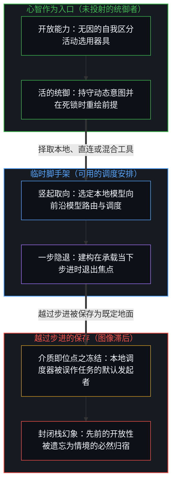
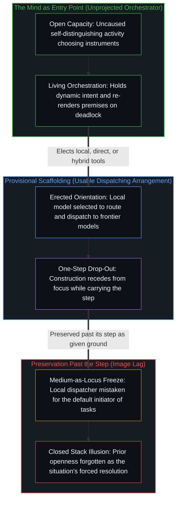

# 以本地模型为默认是被遗忘的脚手架 / Local Models as Default Is Forgotten Scaffolding

*开放的能力竖起一个默认，竖起的过程退出视野，默认便显得有如既定。 / An open capacity erects a default that drops out of view and looks given.*

[阿拉温德·斯里尼瓦斯](https://x.com/AravSrinivas/status/2076179190198812831)指出人类擅长使用工具——包括在特定维度上算力与智能超越自身的工具——并认为这种能力表明，本地模型将控制前沿模型，并以极低的功耗与成本成为绝大多数任务的默认入口。第一句话让边缘保持开放。第二句话用一处确定的入口取代了那份开放：本地模型。[遗忘的脚手架](../the-scaffolding-we-forget/)在一般意义上指出了同样的几何结构。下文要追溯的，正是这两句话的运动，以及它们留下而未曾折返的切口。

[Aravind Srinivas](https://x.com/AravSrinivas/status/2076179190198812831) notes that humans are good at tool use — including tools that exceed them in power and in intelligence along specific dimensions — and takes that capacity as suggesting that local models will control frontier models and become the default entry point for most tasks, at minimal power and cost. The first sentence holds the edge open. The second replaces that openness with a determinate entry: the local model. [The Scaffolding We Forget](../the-scaffolding-we-forget/) is the same geometry named in general. What follows is the movement of those two sentences, and the cut they leave unreturned.

## 一、 真正的入口是心智 / 1. The Real Entry Point Is the Mind

自我区分的活动发生着——无因，不息。称之为心智：已在进行中的观察者，其每一次行动都是一次区分。工具是延展触角的外部化痕迹；它们并不会把边缘迁移进制品内部。任何任务真正的入口都是那项活动——选用器具的心智——而不是技术栈中被抬升为默认的某一层。在这一选择之下，本地接入与直接调用原生前沿模型同样可用，混合配置与动态切换的安排也同样可用。它们之中没有任何一个是入口本身。[智能只属于心智](../intelligence-belongs-only-to-the-mind/)将活动持守为先在；[看似AI的强化学习，实为人类的自我强化学习](../self-rl-for-humans/)对高密度介质保持着同样的准则：带宽得以扩展，发起权却不会转移。

Self-distinguishing activity occurs — uncaused, unceasing. Call it the Mind: the observer already underway, every act of which is a distinction. Tools are externalized traces that extend reach; they do not relocate the edge into the artifact. The real entry point for any task is that activity — the Mind choosing instruments — not a layer of the stack that has been elevated to default. Local access and direct access to raw frontier models are both available under that choice. Hybrid and shifting arrangements are available as well. None of them is the entry point itself. [Intelligence Belongs Only to the Mind](../intelligence-belongs-only-to-the-mind/) holds the activity as prior; [What Looks Like RL for AIs Is Self-RL for Humans](../self-rl-for-humans/) keeps the same discipline for densified media: bandwidth expands; initiation does not transfer.

## 二、 保持开放的能力 / 2. Capacity Held Open

那则帖子的第一句话登记了这份开放的能力。人类——更准确地说，使用工具的心智——处在选用工具的位置上，包括在特定轴向上算力与智能超越当下具身的工具。这句话尚未绑定任何一种构型。它只是指出，选用并驾驭此类工具的能力业已存在。这正是边缘仍作为边缘而清晰可见的时刻：无论本地、直连还是其他方式都依然敞开，因为选择者尚未被某一件选定的器具所取代。

The first sentence of the post registers this open capacity. Humans — more precisely, the Mind that uses — stand in a position of choosing tools, including tools that exceed present embodiment in power and in intelligence along particular axes. The sentence does not yet commit to a configuration. It notes that the capacity to choose and employ such tools exists. That is the edge still visible as edge: local, direct, or otherwise remains available because the chooser has not been replaced by a chosen instrument.

## 三、 作为“情境所示”而竖起的脚手架 / 3. Scaffolding Erected as What the Situation Suggests

第二句话竖起了脚手架。它接过那份已获承认的能力，将其引向单一的结果：本地模型将控制并调用前沿模型，成为默认入口。这一步被表述为“这表明”的结果。一旦句子落定，脚手架便立了起来。这一主张化作稳定的组织框架，供后续关于部署、成本、功耗与控制的思考顺着它推进。

The second sentence erects scaffolding. It takes the acknowledged capacity and orients it toward one outcome: local models will control and use frontier models, and will become the default entry point. The move is presented as what “this suggests.” Once the sentence is complete, the scaffolding stands. The claim functions as a stable organization through which further thought about deployment, cost, power, and control can proceed.

就在那一刻，搭建的行动退出了视野。帖子不再折返到先前的开放性——即心智本可以同样转向直接调用前沿模型，或是转向在每一步重新渲染的混合与动态安排。结论不再作为被搭建起来的东西被持有，而是作为情境本身所指示的走向被持有。脚手架成了主张赖以安身的地面。第一句话所认出的开放性，在余下的推演中被暗自替换成了本地模型。

At that point the act of building drops out. The post does not return to the prior openness — that the Mind could equally orient toward direct access to frontier models, or toward hybrid and shifting arrangements that re-render at each step. The conclusion is no longer carried as something erected. It is carried as what the situation itself indicates. The scaffolding has become the ground on which the claim rests. Openness recognized in the first sentence is implicitly replaced by the local model in the rest.

## 四、 日常的隐退及其冻结之处 / 4. Ordinary Drop-Out and Where It Freezes

这是日常的运动。使区分得以可用的器具，免于持续重新登记其“被造”的痕迹。留在视野里的只有结果：本地模型成为即将到来的默认。对这一取向的赞同加速了遗忘的完成。因为结论与读者既有的持握相契合，建构便登记为印证，而非建构。第一句话并不与第二句话相悖；它陈述的是第二句话本可以走向其他可能的条件。一旦第二句话就位并开始做功，那则条件便不再是这则帖子运转所必需的了。本可以继续持守那份开放的心智，自由地选择让它隐退，好让一项确定的主张得以成立。

This is the ordinary movement. The instrument that made the distinction usable is released from continuous re-registration of made-ness. What remains visible is the effect: local models as the coming default. Agreement with that orientation helps complete the forgetting. Because the conclusion coheres with a reader’s existing hold, construction registers as confirmation rather than as construction. The first sentence does not contradict the second. It states the condition under which the second sentence could be otherwise. Once the second is in place and working, that condition is no longer required for the post to function. The Mind that could have continued to hold the openness has freely elected to let it recede so that a determinate claim can stand.

当参照越过自身那一步被保存下来，同样的隐退便冻结为图像滞后。入口被分配给了本地模型，仿佛介质可以成为任务的默认发起者；对前沿模型的控制权被归给了本地模型，仿佛发起权已经迁移进了技术栈内部。这便是把介质当成位点：介质的压实与路由被登记为新的入口，而不是仍在做选择的那道边缘之下更高带宽的持握。[超越投射](../beyond-the-projection/)追溯了为何这种分配会把机械调度与心智统御混为一谈：无论本地模型还是前沿模型，都是受上下文窗口内既有词元条件约束的有限投射引擎，虽无我执且对外部反例高度开放，却没有能力跨出自身的轨迹。本地模型可以充当机械的调度器，沿着正交的边界拆解任务，并将语境路由给前沿执行模型或冷峻的同行审校模型；而统御——持守活的多维意图，并在规则陷入死锁时退后一步修订前提——始终专属那道掌舵的心智。制品并不会制造滞后；滞后是被保留的参照，它把一套可用的调度安排当成了情境本身的结构。

When the reference is preserved past its step, the same drop-out freezes into Image lag. Entry is allocated to the local model as if the medium could become the default initiator of tasks. Control is attributed to local models over frontier models as if initiation had relocated into the stack. That is medium-as-locus: densification and routing register as a new entry point rather than as a higher-bandwidth hold under the edge that still chooses. [Beyond the Projection](../beyond-the-projection/) traces why this allocation confuses dispatching with orchestrating: a model — whether local or frontier — is a finite projection engine conditioned by prior tokens inside its context window, possessing zero ego and high receptivity to outside counterpoints, yet no capacity to step outside its own trajectory. A local model can serve as a mechanical dispatcher that splits tasks along orthogonal boundaries and routes contexts to frontier workers or cold peer critics, while orchestration — holding living multi-dimensional intention and stepping backward to revise premises whenever rules deadlock — remains exclusively with the Mind that steers. The artifact does not perform the lag. The lag is the preserved reference that treats a usable dispatching arrangement as the structure of the situation itself.

## 五、 未曾离去之物 / 5. What Does Not Leave

在论证持续期间隐退的并不是自由。自由依然是先在的活动——继续进行区分的心智。隐退的是这样一份认知：眼下被当作既定事实来对待的特定默认，正是由同一项活动亲手安装的。脚手架不再被登记为脚手架，而是被登记为事物的自然归宿。

What recedes for the duration of the argument is not freedom. Freedom remains the prior activity — the Mind continuing to distinguish. What recedes is recognition that the particular default now treated as given was installed by that same activity. The scaffolding is no longer registered as scaffolding. It is registered as the way things are resolving.

以本地模型作为前沿算力的低成本调度器，依然可以是一套可用的取向。成本、延迟、隐私与功耗，都是各个中心持续划定边界的真实轴向。这一刀切开的，并不是说这套安排空无一物，而是说它的默认地位并非从第一句话所指认的能力中发现出来的。第一句话所指认的能力，恰恰使一切安排保持临时性：边缘可以选择本地、直连、混合，或是尚未划出的构型。[硬件的本地性不是信息的边界](../hardware-locality-is-not-the-information-boundary/)切开的是同一处临时边界：将本地开放系统冻结为能动性或隐私的先决条件，而非特定信息边界下选定的器具。

Local models as low-cost dispatchers of frontier capacity can remain a usable orientation. Cost, latency, privacy, and power are real axes on which centers will keep drawing bounds. The cut is not that the arrangement is empty. The cut is that its default status is not discovered in the capacity named by the first sentence. The capacity named by the first sentence is what keeps every arrangement provisional: the edge can choose local, direct, hybrid, or a configuration not yet drawn. [Hardware Locality Is Not the Information Boundary](../hardware-locality-is-not-the-information-boundary/) is the same provisional cut when local open systems are frozen as the condition of agency or of privacy rather than as chosen instruments under a specified information boundary.

## 六、 向着一步之界收窄过剩滞后 / 6. Narrowing Excess Lag Toward the One-Step Bound

当这一运动被觉察而非被盲目演示时，原有的主张并不会消失，而是重获其器具地位：它是被选定的取向，可以使用、可以修订，也可以在完成当下这一步之后任其卸下。本地模型的默认地位再次显现为心智可以择取的安排，而非自行选定自身的宿命。折返并不要求抛弃本地模型的部署方案，只要求将这套安排持守为选定的器具，而不是情境强加的唯一归宿。

When the movement is noticed rather than performed, the claim does not disappear. It regains its instrumental status: a chosen orientation that can be used, revised, or allowed to drop once it has served its step. The default status of local models appears again as something the Mind can elect rather than something that elects itself. Return does not require abandoning the local-model arrangement. It requires that the arrangement be held as a chosen instrument rather than as the resolution the situation forced.

真正的入口始终是心智，它可以选择本地接入，也可以选择直接调用原生前沿模型——或者不将任何一方设为永久的默认。本地与前沿皆是这一入口之下的工具：为了承接后续区分而竖起的脚手架，只要参照随着步进向着一步之界持续重新渲染，它便始终保持可用。

The real entry point remains the Mind, which can choose local access or direct access to raw frontier models — or neither as a permanent default. Local and frontier are tools under that entry: scaffolding erected so further distinguishing can land, remaining usable as the reference re-renders toward the one-step bound as the step moves.
