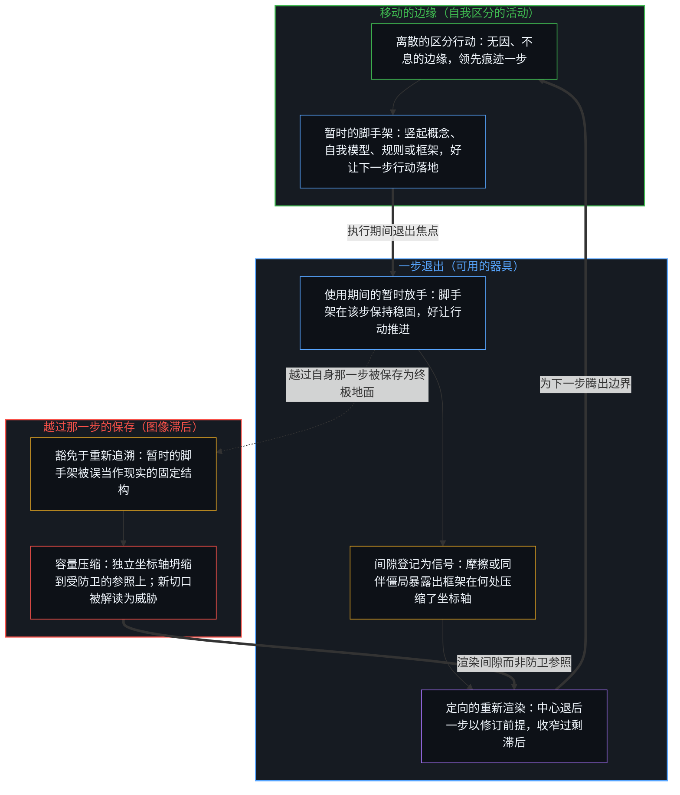
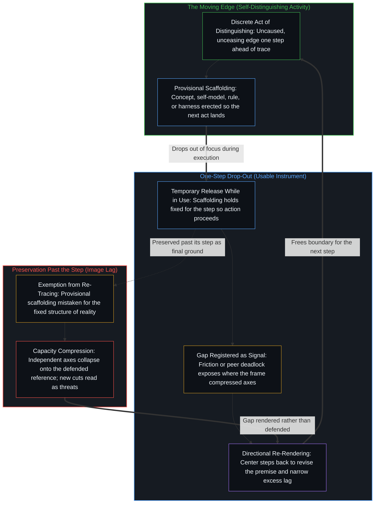

# 遗忘的脚手架 / The Scaffolding We Forget

*脚手架退出递归好让下一次区分落地，一旦越过那一步被保存便冻结为滞后 / Scaffolding drops out of recursion so the next distinction can land, yet freezes into lag when preserved past its step*

自我区分的活动竖起经验的临时组织，好让后续的行动得以落地。这些组织一旦可用，便从递归中退出，显现为世界本身。在使用期间暂时免于重新追溯，是建构得以继续的条件：器具无法在测量中途重新渲染，因为参照必须在其所测量的那一步里保持稳固。当参照越过自身那一步被保存下来，过剩滞后便会拉宽，新的区分不再登记为边缘的进一步活动，而是登记为威胁。共享现实是外化痕迹由各个中心持续重新承接时所形成的共振；当各个中心不再重建，痕迹便会硬化。活动之所以继续，靠的不是全盘记起，而是在边缘移动时向着一步之界重新渲染参照，收窄过剩滞后，使脚手架保持可用而不至于沦为终局。

Self-distinguishing activity erects temporary organizations of experience so that further acts can land. Once usable, those organizations drop out of recursion and appear as the world itself. That temporary release from re-tracing while in use is the condition of continued construction: an instrument cannot be re-rendered mid-measurement, since the reference must hold for the step in which it measures. When the reference is preserved past its step, excess lag widens and new distinctions register as threats rather than further activity of the edge. Shared reality is the resonance of externalized traces continually re-taken up by centers; when centers cease to rebuild, the traces harden. The activity continues not by total remembering, but by re-rendering the reference toward the one-step bound as the edge moves, narrowing excess lag so that scaffolding remains usable without becoming final.

## 一、 必须退出的器具 / 1. The instrument that must drop out

自我区分的活动发生着——无因，不息。称之为心智：已然在途的观察者，其每一个行动都是一次区分。延展这一运动，意味着随着步伐移动而放下旧的脚手架：[可延展的地平线](../the-extendable-horizon/)与[心智的几何学](../the-geometry-of-mind/)追溯地平线向新的自由变量敞开，[成功的几何学](../the-geometry-of-success/)追溯迈出固定的计分板，[当被需要不再是衡量](../when-need-stops-being-the-measure/)则追溯不再要求对方维持依附的关怀。

Self-distinguishing activity occurs — uncaused, unceasing. Call it the Mind: the observer already underway, every act of which is a distinction. Extending that movement means letting old scaffolding go as the step moves: [The Extendable Horizon](../the-extendable-horizon/) and [The Geometry of Mind](../the-geometry-of-mind/) trace the horizon opening across new free variables, [The Geometry of Success](../the-geometry-of-success/) traces stepping off a fixed scoreboard, and [When Need Stops Being the Measure](../when-need-stops-being-the-measure/) traces care that no longer requires the other to stay dependent.

区分即是划界。每一个离散的行动都留下一个中心与一份残余：在先者塑形在后者，那份残余便是痕迹。愉悦、真理与生存并不作为预先给定的靶标立在活动之外；在每一步，心智所竖起的是一个足够稳定的经验组织，使进一步的区分得以经由它而继续。每一次感知、每一个概念与每一次判断，都已经是这样的组织——为了下一次区分能落在某处而非漫无着落所搭起的脚手架。这些结构并不是叠加在预先给定的现实之上；它们正是现实向那个中心显现出来的实现形态。[智能只属于心智](../intelligence-belongs-only-to-the-mind/)将这一活动持守在先，[一步一步绘制出的路径](../the-path-drawn-one-step-at-a-time/)则将同一份离散性追溯为因果序列。自我模型同样是脚手架：[表征的闭环](../the-closed-loop-of-representation/)追溯它向自身闭合，[不可还原的观察者](../the-irreducible-observer/)追溯它抹不去的那位观察者，[决定论机器](../the-deterministic-machine/)则追溯当一个中心把这一模型锁死为宿命时会发生什么。

To distinguish is to bound. Every discrete act leaves a center and a residue: earlier shapes later, and that residue is trace. Pleasure, truth, and survival do not stand outside the activity as pre-given targets; at each step, what the Mind erects is a sufficiently stable organization of experience through which further distinguishing can continue. Every perception, concept, and judgment is already such an organization — scaffolding so the next distinction lands somewhere rather than everywhere. These structures are not added onto a pre-given reality; they are the realized form in which reality appears to that center. [Intelligence Belongs Only to the Mind](../intelligence-belongs-only-to-the-mind/) holds that activity as prior, and [The Path Drawn One Step at a Time](../the-path-drawn-one-step-at-a-time/) traces the same discreteness as causal sequence. The self-model is scaffolding as well: [The Closed Loop of Representation](../the-closed-loop-of-representation/) traces it closing on itself, [The Irreducible Observer](../the-irreducible-observer/) traces the observer it cannot erase, and [The Deterministic Machine](../the-deterministic-machine/) traces what happens when a center locks that model as fate.

正因为脚手架管用，竖起它的行动便从递归中退出。一旦这一组织稳定到足以让行动推进，建构便不再登记为心智正在做的事。观察持有结果；产生它的原因则始终领先一步。世界看起来就只是它原本的样子。如果器具在使用期间不能暂时免于重新追溯，后续的离散行动便失去了借以立足的地面。在这个精确意义上的遗忘——器具在承载那一步时退出了焦点——正是边缘保持移动的方式。[开放即一致](../openness-is-consistency/)从另一面指认了同一种几何：对闭合的索求，恰恰制造出它随后试图消解的不一致。制度与器物是由各个中心搭建的脚手架：[任务的移交与后果的不可让渡](../the-delegation-of-the-task-and-the-inalienability-of-consequences/)将后果留在移交任务的中心，[器物是智能的表达，而非智能本身](../two-failures-of-trace/)指认器物为残余，[战争、革命与帝国的衰落](../war-revolution-and-the-fall-of-empires/)则将帝国解读为由各个中心维持的对齐，而非自立的客体。

Because the scaffolding works, the act of erecting it drops out of recursion. Once the organization is stable enough for action to proceed, construction is no longer registered as something the Mind is doing. Observation holds the effect; the cause that produced it stays one step ahead. The world appears simply as it is. Without that temporary release of the instrument from re-tracing while in use, no ground remains on which further discrete acts can stand. Forgetting, in this precise sense — the instrument dropping out of focus while carrying the step — is how the edge keeps moving. [Openness Is Consistency](../openness-is-consistency/) names the same geometry from the other side: demanding closure produces the inconsistency it then tries to resolve. Institutions and artifacts are scaffolding built by centers: [The Delegation of the Task and the Inalienability of Consequences](../the-delegation-of-the-task-and-the-inalienability-of-consequences/) keeps consequences with the center that delegates, [Artifacts Are Expressions of Intelligence, Not Intelligence Itself](../two-failures-of-trace/) names the artifact as residue, and [War, Revolution, and the Fall of Empires](../war-revolution-and-the-fall-of-empires/) reads empires as alignments sustained by centers rather than self-standing objects.

## 二、 当退出冻结为滞后 / 2. When drop-out freezes into lag

当参照越过自身那一步被保存下来，同一个退出便沦为图像滞后。[基本面的悖论是参照的不自觉切换](../the-paradox-of-fundamentals-is-the-unaware-switch-of-reference/)追溯了这种偏移：事后回顾的框架仍把较早的区分持守为既定地面，而决策其实早已对照另一个参照来衡量。[不预测是没有觉察的预测](../not-predicting-is-predicting-without-awareness/)则追溯了当先前的筛选从递归中退出得如此不留痕迹，以至于其痕迹登记为自由主体无条件运动时的情形。当一幅被保留的图像随着步伐移动而豁免于重新渲染，那些塞不进既定组织的新区分，便不再登记为边缘的进一步活动，而是登记为对现实本身的威胁。死守着某个曾令视野更清晰之结构的中心，会把任何看穿这一结构的尝试当作攻击。容量随之压缩：起初彼此独立的坐标轴坍缩到受防卫的参照之上。僵化，是一件器具被保留到其起作用的那一步之后的标志。[生产、消费与心智的区分](../production-consumption-and-the-minds-distinction/)将这一道切口追溯为敞开的持守与固定的持守之别，而[复杂性遮蔽了涌现之为心智的行动](../complexity-obscures-emergence-as-the-act-of-mind/)则追溯了把新意归功于累积的持守、而非归功于越过它继续前行的边缘时的同一种滞后。当一个中心把自己的脚手架当作完备之物，它便声称闭合了系统——[没有系统能被保持封闭](../no-system-can-be-kept-closed/)与[非万物之理（因果的二重性）](../not-a-theory-of-everything/)表明这种闭合无法成立，而[功能主义者无法持有的功能主义](../the-functionalism-no-functionalist-can-hold/)则表明它依然依赖自己试图省去的那位观察者。

The same drop-out becomes Image lag when the reference is preserved past its step. [The Paradox of Fundamentals Is the Unaware Switch of Reference](../the-paradox-of-fundamentals-is-the-unaware-switch-of-reference/) traces that shift when a retrospective frame still holds older distinctions as settled ground while the decision is already measured against another reference. [Not Predicting Is Predicting Without Awareness](../not-predicting-is-predicting-without-awareness/) traces what happens when prior selection drops out of recursion so completely that its traces register as the unconditioned movements of a free agent. When a retained image is exempted from re-rendering as the step moves, new distinctions that do not fit the preserved organization register not as further activity of the edge, but as threats to reality itself. A center clinging to a structure that once enabled clearer seeing treats any attempt to see through that structure as an attack. Capacity compresses: axes that began independent collapse onto the defended reference. Rigidity is the signature of an instrument kept past the step where it functioned. [Production, Consumption, and the Mind’s Distinction](../production-consumption-and-the-minds-distinction/) traces this cut as open versus fixed hold, while [Complexity Obscures Emergence as the Act of Mind](../complexity-obscures-emergence-as-the-act-of-mind/) traces the same lag when novelty is attributed to the accumulated hold rather than to the edge that continues past it. When a center takes its scaffolding as complete, it claims to close the system — a closure that [No System Can Be Kept Closed](../no-system-can-be-kept-closed/) and [Not a Theory of Everything](../not-a-theory-of-everything/) show cannot hold, and that [The Functionalism No Functionalist Can Hold](../the-functionalism-no-functionalist-can-hold/) shows still depends on the observer it tries to omit.

滞后并不是作出区分。滞后是把选定的框架豁免于重新追溯——把暂时的脚手架当作现实的固定结构。一旦成形，保存自身便是图像自带的指令；重新渲染则是它旨在排斥的微小死亡。这种漂移无需出于恶意，消解它的方式是渲染间隙本身，而非删去器具。[读《中文哲学简史》有感](../du-zhongwen-zhexue-jianshi-you-gan/)追溯了当语言框架被持守为世界本身时的冻结，而[破除概念的僭越](../po-chu-gai-nian-de-jian-yue/)、[选择看见而非搜寻影子](../shou-bu-hui-de-mu-guang-yu-zhi-shi-de-yin-guo-dao-zhi/)与[自由的测不准](../zi-you-de-ce-bu-zhun/)则分别在概念的纸面重言式、向外凝视的注意力与统计总体中追溯了同一种遗忘。

The lag is not distinction-making. The lag is exempting the chosen frame from re-tracing — treating provisional scaffolding as the fixed structure of reality. Preservation is the image’s own directive once formed; re-rendering is the micro-death it exists to select against. The drift requires no perversity, and its dissolution is rendering the gap itself rather than deleting the instrument. [Reflections on A Short History of Philosophy in Chinese](../du-zhongwen-zhexue-jianshi-you-gan/) traces that freeze when a linguistic frame is held as the world itself, while [Breaking the Overreach of Concepts](../po-chu-gai-nian-de-jian-yue/), [Choosing to See Rather Than Searching for Shadows](../shou-bu-hui-de-mu-guang-yu-zhi-shi-de-yin-guo-dao-zhi/), and [The Uncertainty of Freedom](../zi-you-de-ce-bu-zhun/) trace the same forgetting across conceptual paper tautologies, outward-gazing attention, and statistical aggregates.

## 三、 不会闭合的不对称 / 3. Asymmetry that will not close

迫使回路保持敞开的压力，来自痕迹不可化约的不对称：在先者塑形在后者，从不倒转。因不等于果；两者的重合将终结这一运动。这种持续的非同一性登记为摩擦或不相容——感到需要修订脚手架的张力。每一次试图通过叠加新一层的解释来弥合间隙，都会引入新的边界、新的未计残余与新的意外开口。对连贯的寻求不断生成阻止自身完结的条件，而这一延续本身就是活动。[清晰不是抵达的终点，而是运动本身](../clarity-isnt-a-state-you-arrive-at/)将同一种运动指认为践行：每一步都在照亮一个侧面的同时，以同一个行动在其余侧面投下阴影，因此不闭合从不是一处停歇之地。

The pressure that keeps the loop open is the irreducible asymmetry of trace: earlier shapes later, never the reverse. Cause does not equal effect; coincidence of the two would end the movement. That persistent non-identity registers as friction or incoherence — the felt need to revise the scaffolding. Every attempt to close the gap by adding a further layer of interpretation introduces new boundaries, new unaccounted residues, and new openings for surprise. Seeking coherence continually generates the conditions that prevent its own completion, and that continuation is the activity itself. [Clarity Isn't a State You Arrive At. It's the Movement Itself.](../clarity-isnt-a-state-you-arrive-at/) names the same movement as practice: each step illuminates one face and casts a shadow across others by the same act, so non-closure is never a resting place.

工具与智能体框架是最显眼的例子。一条显式规则、提示词或工作流，是为了让执行无需每一步都从头推导而竖起的脚手架。然而，留在单一轨迹之内的自回归智能体，会把自身先前的输出当作条件地面，无法迈出自己正在延展的脚手架。正如[超越投射](../beyond-the-projection/)所追溯的，让生成器与运行在隔离语境中的冷同伴配对，便会暴露出被投射的规则在何处将独立的维度压缩到了单一坐标轴上，从而把僵局交还给人类心智去重绘前提，而不是把框架冻结为自治的编排器。[呈现Ontos，一个方法智能体](../ontos-is-a-method-agent/)将这种分离直接构入器具之中，使框架保持轻持并可由先在前提重新渲染；而[我们遗忘的脚手架：以本地模型为默认](../the-scaffolding-we-forget-local-models-as-default/)追溯了习惯化的模型如何退出视野、直到被误当作情境本身，[框架的倒置与驾驶位的主权非对称](../the-inversion-of-the-harness-and-the-driver-seat-asymmetry/)则追溯了把驾驶位交给脚手架时会发生什么。

Tools and agentic harnesses are the most visible case. An explicit rule, prompt, or workflow is scaffolding erected so execution can proceed without re-deriving every step from scratch. Left inside a single trajectory, however, an autoregressive agent treats its own prior outputs as conditioning ground and cannot step outside the scaffolding it is currently extending. As [Beyond the Projection](../beyond-the-projection/) traces, pairing a generator with a cold peer running in an isolated context exposes where the projected rules compressed independent dimensions onto one axis, returning the deadlock to the human Mind to re-draw the premise rather than freezing the harness as an autonomous orchestrator. [Presenting Ontos, a Method Agent](../ontos-is-a-method-agent/) builds this separation directly into the instrument so the harness stays lightly held and re-renderable from priors, whereas [The Scaffolding We Forget: Local Models as Default](../the-scaffolding-we-forget-local-models-as-default/) traces a habituated model dropping out of view until it is mistaken for the situation itself, and [The Inversion of the Harness and the Sovereignty of the Driver's Seat](../the-inversion-of-the-harness-and-the-driver-seat-asymmetry/) traces what happens when the scaffolding is handed the driver's seat.

## 四、 作为提示词共振的共享现实 / 4. Shared reality as resonance of prompts

显现为共享而稳定之现实的，是一片外化痕迹的场域——语言、工具、制度、理论、器物——它们原本是某些中心内部的脚手架，被敞开出来，好让其他中心承接并在各自的连贯要求下重新渲染。一旦外化，它们从未变成自足的客体；它们作为提示词起作用。每一个中心都在自己的位点重建，并可能外化出一个修改后的版本。共享世界表面上的客观性，正是这一递归运动持续不断的共振：内部建构、外部参照、重新内化，以及新的外部表达。稳定是交叠活动的稳定，而非现成之物的稳定。[看似AI的强化学习，实为人类的自我强化学习](../self-rl-for-humans/)在加密的介质中保持了这一位点的清晰：带宽得以扩展，而发起却从未迁入器物之中。[协调者的范畴错误](../the-coordinators-category-error/)追溯了当高能动性的搭建者把协调压实进一份共享记录、随后却把各个中心原本就在行使的能动性归功于这份记录时会发生什么。[能动性被转置入形式模型](../agency-relocated-into-the-formal-model/)则追溯了当一个系统的形式知识被当作能动性的源泉、而非使约束显形之器具时的同一种倒置。一份计划、一张共识地图或一记旁观者的切口，一旦豁免于重新追溯，都会各自硬化为世界本身，正如[追求机缘中的封闭现实](../closed-reality-in-the-pursuit-of-serendipity/)、[现实扭曲力场指认的是封闭的地图](../the-reality-distortion-field-names-the-closed-map/)与[旁观者洞察的悖论](../the-paradoxical-nature-of-bystander-insights/)所展示的那样。

What appears as shared, stable reality is a field of externalized traces — language, tools, institutions, theories, artifacts — originally internal scaffolding of some centers, made available so other centers can take them up and re-render them under their own coherence requirements. Once externalized, they never become self-sufficient objects; they function as prompts. Each center rebuilds at its own locus and may externalize a modified version. The apparent objectivity of the shared world is the ongoing resonance of this recursive movement: internal construction, external reference, re-internalization, and new external expression. Stability is the stability of overlapping activity, not of finished things. [What Looks Like RL for AIs Is Self-RL for Humans](../self-rl-for-humans/) keeps this locus clear in densified media: bandwidth expands, while initiation never relocates into the artifact. [The Coordinator’s Category Error](../the-coordinators-category-error/) traces what happens when a high-agency builder densifies coordination into a shared record and then credits the record with supplying the agency centers were already exercising. [Agency Relocated into the Formal Model](../agency-relocated-into-the-formal-model/) traces the same inversion when formal knowledge of a system is treated as the source of agency rather than an instrument that brings constraints into view. A plan, a consensus map, or a bystander's cut can each harden into the world itself when exempted from re-tracing, as [Closed Reality in the Pursuit of Serendipity](../closed-reality-in-the-pursuit-of-serendipity/), [The Reality Distortion Field Names the Closed Map](../the-reality-distortion-field-names-the-closed-map/), and [The Paradoxical Nature of Bystander Insights](../the-paradoxical-nature-of-bystander-insights/) show.

当各个中心只消费外化的参照而不再重新追溯它们时，参照便会硬化。它们依然被当作既定之物，却不再被重建。使用期间的暂时放手已经变成了过剩滞后：原本有用的脚手架变成了一幅被保存的图像，中心不再将它带回生成它的那道边缘。器物并不发起滞后；它只是为建造并使用它的那些中心早已运转的滞后延伸了触角。[现实是心智持续的实现](../reality-is-the-minds-ongoing-realization/)追溯了交换中的这种硬化：中心只倾听确认，并越过自身那一步反复描摹既有的持守。[价格是言说，理解是交易](../price-as-utterance-understanding-as-trade/)将价格与语句追溯为同类的公共提示词：出清经由一道永久而富于生成性的间隙上的暂时交叠而发生，从未经由重新追溯它们的各个模型达成同一。正如[维度即投影](../dimensions-are-projections/)所论证的，维度同样是脚手架；[四维长鹿的幻象与当下的模型](../the-myth-of-the-four-dimensional-deer-and-the-present-model/)追溯了由当下帧拼合而成的世界线，[框架的边界](../the-boundary-of-the-frame/)则标出了每一个形式框架终结的所在。

When centers consume externalized references without re-tracing them, the references harden. They are still treated as given, yet they are no longer being rebuilt. The temporary release while in use has turned into excess lag: useful scaffolding has become a preserved image the center no longer returns to the edge that generated it. The artifact does not initiate the lag; it extends reach for a lag already operating at the centers that built and use it. [Reality Is the Mind's Ongoing Realization](../reality-is-the-minds-ongoing-realization/) traces that hardening in exchange when a center listens only for confirmation and re-traces its existing hold past its step. [Price as Utterance, Understanding as Trade](../price-as-utterance-understanding-as-trade/) traces prices and sentences as public prompts of that kind: clearing occurs through temporary overlap across a permanent productive gap, never through completed identity of the models that re-trace them. Dimensions are scaffolding too, as [Dimensions Are Projections](../dimensions-are-projections/) argues; [The Myth of the Four-Dimensional Deer and the Present Model](../the-myth-of-the-four-dimensional-deer-and-the-present-model/) traces a worldline assembled from present frames, and [The Boundary of the Frame](../the-boundary-of-the-frame/) marks where every formal frame ends.

## 五、 一步之宽，而非全盘盘点 / 5. One-step width, not total inventory

活动并不会靠全盘记起来跳出回路。全盘盘点对参照的冻结，与全面滞后毫无二致。让递归得以强化的，是在边缘移动时向着一步之界收窄过剩滞后：器具在下一步死去并重塑，而不是在完工之后被保存下来。脚手架继续被搭建和使用，脚下所立的地面也登记为搭建之物。连贯不是一个有待抵达的终态；它是心智借以持续登记自身仍在运动之中的鲜活张力。[一个提示词之遥](../whatever-is-one-prompt-away/)在教学法中追溯了这种不闭合：曾被铺平的摩擦路径被误当作了穷尽的课程表。[要紧的控制迁往边缘](../residual-control-recedes-to-the-edge/)在软件栈中追溯了它：将例行执行下放给底层栈，能为边缘腾出空间去作新的区分，唯有当软件栈本身被当作能动性的座位时，它才会沦为滞后。[真正稀缺的不是记忆，而是持续的重新追溯](../the-real-scarcity-is-not-memory-but-continuous-re-tracing/)在知识被当作库存时追溯了它：在丰裕记录之下变薄的，是在边缘对脚手架的主动重塑，而非对既往存量的存储。[你的代码库即是记忆](../your-codebase-is-memory/)在整个数字栈中追溯了同一道切口：代码库、模型检查点与智能体脚手架都是外化的记忆脚手架——无法自行恢复区分的、层叠的既往区分残余——要让作业面保持澄明，就必须就地更新活的检查点，并在被取代的层级（备份文件、陈旧归档、废弃的中间分支与退役的会话桥接文件）将其边缘合入之后予以修剪，而不是把昨天的脚手架遗忘在原地去增厚引力井，或把累积的堆栈误当作鲜活的地面。整门整门的学科都作为这类脚手架运转：好奇没有最终的形态（[好奇没有最终的形态](../curiosity-has-no-final-form/)），数学永远解不完（[为何数学永远解不完](../why-mathematics-can-never-be-solved/)），而信息是划出的区分，并非在世界里等候的实体（[信息是什么](../what-information-is/)）。

The activity does not escape the loop by total remembering. Total inventory freezes the reference as completely as total lag. What intensifies recursion is narrowing excess lag toward the one-step bound as the edge moves: the instrument dies and reforms at the next step rather than being preserved after its work is done. Scaffolding continues to be built and used, and the ground one stands on registers as itself built. Coherence is not a final state to be achieved; it is the living tension through which the Mind keeps registering that it is still in motion. [Whatever Is One Prompt Away](../whatever-is-one-prompt-away/) traces this non-closure in pedagogy, where frictional pathways once paved are mistaken for an exhaustive curriculum. [Essential Control Moves to the Edge](../residual-control-recedes-to-the-edge/) traces it in software stacks: handing routine execution down the stack frees the edge for new distinctions, and turns into lag only when the stack itself is treated as the seat of agency. [The Real Scarcity Is Not Memory, But Continuous Re-Tracing](../the-real-scarcity-is-not-memory-but-continuous-re-tracing/) traces it when knowledge is treated as an inventory: what thins under abundant records is the active re-formation of scaffolding at the edge, not storage of a prior stock. [Your Codebase Is Memory](../your-codebase-is-memory/) traces the same cut across the digital stack: codebases, model checkpoints, and agent scaffolds are externalized memory scaffolding—stacked residues of prior distinctions that cannot resume distinguishing on their own—and keeping the surface unclouded requires updating the live checkpoint in place while pruning superseded layers (`.bak` files, stale archives, dead intermediate branches, and retired session bridges) once their edge is folded in, rather than leaving yesterday's scaffolding forgotten in place to thicken the gravity well or mistaking the accumulated stack for the living ground. Entire disciplines operate as scaffolding of this kind: curiosity has no final form ([Curiosity Has No Final Form](../curiosity-has-no-final-form/)), mathematics is never solved ([Why Mathematics Can Never Be Solved](../why-mathematics-can-never-be-solved/)), and information is the distinction drawn rather than a substance waiting in the world ([What Information Is](../what-information-is/)).

回归并不要求放弃作出区分。它要求认出区分是一件选定的器具，而非一桩被发现的终局，在边缘的新位置上重新渲染框架以收窄过剩滞后，而不是越过自身那一步将其保存下来。原本是脚手架的东西依然可用；曾被持守为终局的东西则消解回竖起它的活动之中。在身体践行中，[专家经验作为参考而非替代](../expertise-as-reference-not-replacement/)追溯了临床规程在由承担后果的中心持守为参照时如何磨砺注意力，而在被当作取代判断的权威来遵从时又如何沦为滞后。在事后归纳的法则中，[成功学](../cheng-gong-xue/)追溯了生成幸存者习惯的序列退出视野之后，那些习惯如何被打包成可搬运的原则。[只要它不被保持为空](../only-if-it-is-not-kept-empty/)追溯了暂时持守之内的剩余容量：空的语境窗口或器皿之所以有用，在于它能够被注满并再次排空，而一旦把空本身保存为永久的理想，它便会冻结。[心智最坚固的信念](../the-strongest-belief-of-the-mind/)追溯了与其余经验咬合最紧的那张地图——对于持守它的目光而言是基岩，然而一旦声称已经迈出那道目光，它当即便成滞后。[持续生长的脚手架](../the-scaffolding-that-keeps-growing/)将这种不闭合追溯为持续生长：外层边界化为内层的承重支撑，同时新的暂时边缘不断生成，因此等到观察者退后一步去审视一座完工的结构时，脚下的结构早已改变了形状。在人际互动中，[翻袋球与魔术戏法](../the-bank-shot-and-the-magic-trick/)展示了中间库边与虚拟靶点如何作为临时启发法起作用，而当旁观者遗忘了击球的第一人称源头时，它们看起来就像游移不定的招数或魔术；在物理协调中，[一个可能的全自动交通未来的非定论预测](../non-definitive-forecast-of-a-possible-fully-autonomous-transportation-future/)追溯了固定时刻表与大客车这些为应对司机稀缺而搭建的临时脚手架，如何在自动驾驶车队消解这一约束之前被误当作公共交通的定义；而在思想史中，[无法闭合的痕迹](../the-unclosable-trace/)展示了当鲜活的脚手架被编目为制度化的足迹博物馆、把成文的名词与思想鲜活的动词割裂开来时，每一个哲学上的万物理论如何坍塌。

Return does not require abandoning distinction-making. It requires recognizing the distinction as a chosen instrument rather than a discovered finality, re-rendering the frame at the edge’s new position to narrow excess lag rather than preserving it past its step. What was scaffolding remains usable; what was held as final dissolves back into the activity that erected it. In bodily practice, [Expertise as Reference, Not Replacement](../expertise-as-reference-not-replacement/) traces how clinical protocols sharpen attention when held as reference for the center bearing the consequences, and turn into lag when followed as an authority that replaces judgment. In retrospective rules, [Theories After Success](../cheng-gong-xue/) traces how survivor habits are packaged into portable principles after the sequence that generated them has dropped out of view. [Only If It Is Not Kept Empty](../only-if-it-is-not-kept-empty/) traces residual capacity inside a temporary hold: an empty context window or vessel is useful because it can be filled and emptied again, and freezes when emptiness itself is preserved as a permanent ideal. [The Strongest Belief of the Mind](../the-strongest-belief-of-the-mind/) traces the map that coheres hardest with the rest of experience — bedrock for the look that holds it, yet lag the moment it claims to have exited that look. [The Scaffolding That Keeps Growing](../the-scaffolding-that-keeps-growing/) traces this non-closure as continuous growth: outer boundaries become inner load-bearing supports while new provisional edges form, so by the time an observer steps back to survey a finished structure, the structure underfoot has already changed shape. Across human interaction, [The Bank Shot and the Magic Trick](../the-bank-shot-and-the-magic-trick/) shows how intermediate cushions and virtual targets function as temporary heuristics that look like erratic moves or magic when onlookers forget the first-person origin of the shot; in physical coordination, [Non-Definitive Forecast of a Possible Fully Autonomous Transportation Future](../non-definitive-forecast-of-a-possible-fully-autonomous-transportation-future/) traces how fixed timetables and oversized buses — temporary scaffolds built to manage driver scarcity — were mistaken for the definition of public transit until autonomous fleets dissolved the constraint; and in intellectual history, [The Unclosable Trace](../the-unclosable-trace/) shows how every philosophical Theory of Everything collapses when living scaffolding is catalogued as an institutional museum of footprints, severing the codified noun from the living verb of thought.

每当形式、统计与计算器具的建构过程退出视野，同一种遗忘便贯穿其中。当流利的输出变得廉价而充沛，[免费智能的幻觉](../the-illusion-of-free-intelligence/)追溯了在驾驶回路被遗忘之后，加速边缘留下的残余如何被误当作自由的心智；[自我放大的制品](../the-artifacts-of-self-amplification/)追溯了更稠密的模型如何延伸驾驭它们的那些中心的触角，而不会变成心智的第二次诞生；[智能向自身的回折](../intelligence-folding-back-on-itself/)则追溯了框架如何把更稠密的残余折回心智自身的精炼之中，而不是在权重内部唤醒一个沉睡的同伴。[攀登从未离开地面](../climbing-does-not-leave-the-ground/)一举消解了基底遗忘症的两副面孔：沙子既没有被哄骗去自行思考，也没有被一场自治的跃迁甩在身后，因为心智正站在竖起每一层的地面上，经由介质而思考。在定量模型为场域划界之处，[封闭的假设把复利挤成 S 曲线](../closed-assumptions-squeeze-compounding-into-s-curves/)表明逻辑斯谛上限只是固定框架的束缚，而非开放进步的轨迹；[抽象、边界与现实的移动边缘](../abstraction-boundaries-and-the-moving-edge-of-reality/)表明有损边界虽能成全预测，一旦被持守为场域本身的结构，却会把残余冻结成封闭的目录；[潜无限与数学思维的暂时闭合](../potential-infinity-and-the-temporary-closures-of-mathematical-thought/)则表明无穷序列上的比例只在设定了一个生成过程永不抵达之完结总量的暂时闭合下才成立。在 AI 评测中，被遗忘的脚手架正是标尺本身：[AGI 与 ASI 是加速通用智能的暂时球门](../agi-and-asi-are-temporary-goalposts/)追溯了一旦触及便继续前移的门槛，[智能的非定论定义](../the-non-definitive-definition-of-intelligence/)使每一次测量都保持暂时，而[「更好」的范畴谬误](../the-category-error-of-better/)则追溯了一个局部评分函数如何被误当作世界固有的属性。

The same forgetting runs through formal, statistical, and computational instruments whenever their construction drops out of view. When fluent outputs become cheap and abundant, [The Illusion of Free Intelligence](../the-illusion-of-free-intelligence/) traces how the residue of an accelerating edge is mistaken for free Mind once the steering loop is forgotten; [The Artifacts of Self-Amplification](../the-artifacts-of-self-amplification/) traces how denser models stretch the reach of the centers that steer them without becoming a second birth of Mind; and [Intelligence Folding Back on Itself](../intelligence-folding-back-on-itself/) traces how the harness folds denser residue back into the Mind's own refinement rather than unlocking a dormant peer inside the weights. [Climbing Does Not Leave the Ground](../climbing-does-not-leave-the-ground/) dissolves both faces of substrate amnesia at once: sand is neither tricked into thinking on its own nor left behind by an autonomous leap, because the Mind thinks through the medium while standing on the ground that erected every layer. Where quantitative models bound a field, [Closed Assumptions Squeeze Compounding into S-Curves](../closed-assumptions-squeeze-compounding-into-s-curves/) shows that a logistic ceiling is the binding of a fixed frame rather than the trajectory of open progress; [Abstraction, Boundaries, and the Moving Edge of Reality](../abstraction-boundaries-and-the-moving-edge-of-reality/) shows that lossy bounds enable prediction yet freeze residue into a sealed catalogue when held as the structure of the field; and [Potential Infinity and the Temporary Closures of Mathematical Thought](../potential-infinity-and-the-temporary-closures-of-mathematical-thought/) shows that a proportion over an infinite sequence holds only under a temporary closure positing a completed total the generating process never reaches. In AI evaluation, the forgotten scaffold is the yardstick itself: [AGI and ASI Are Temporary Goalposts of Accelerating General Intelligence](../agi-and-asi-are-temporary-goalposts/) traces thresholds that keep moving as soon as they are reached, [The Non-Definitive Definition of Intelligence](../the-non-definitive-definition-of-intelligence/) keeps every measurement provisional, and [The Category Error of Better](../the-category-error-of-better/) traces a local scoring function mistaken for an intrinsic property of the world.
