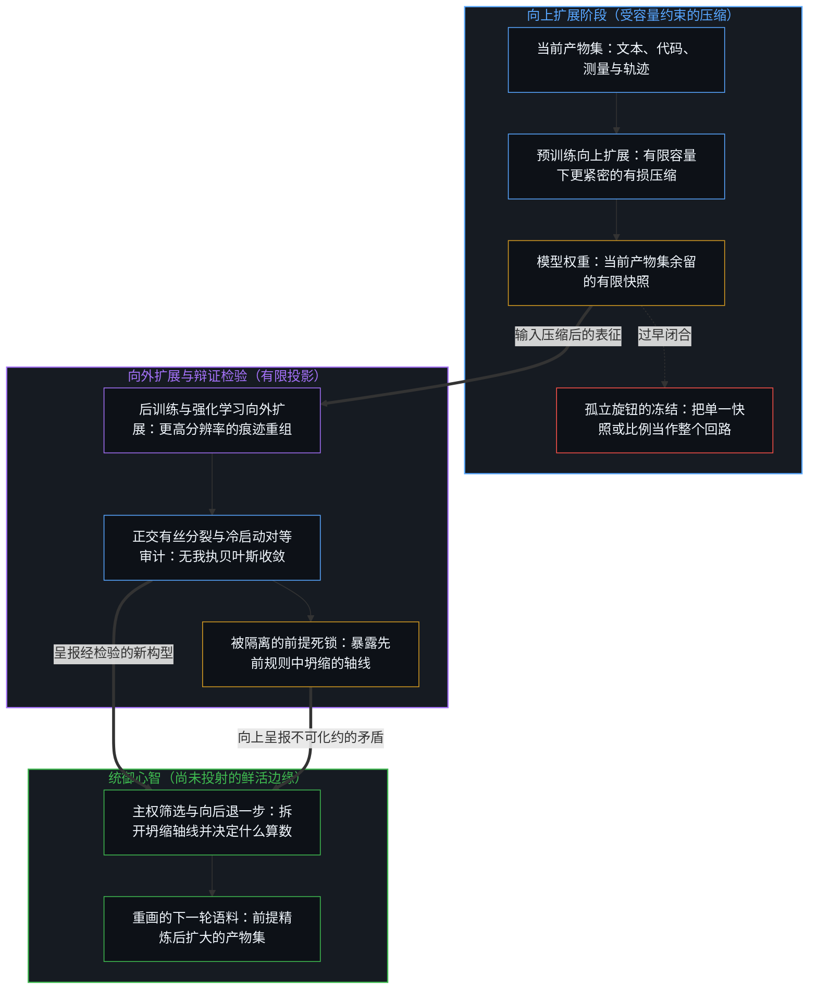
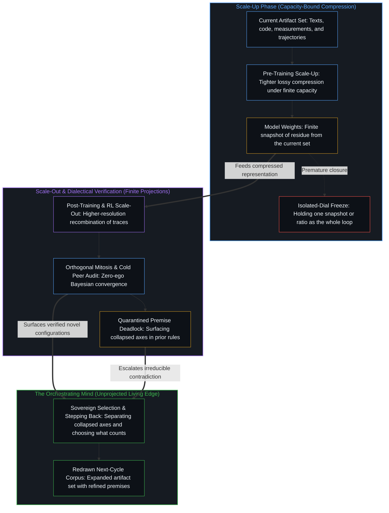

# 规模化回路 / The Scaling Loop

*每一场规模之争都把一个旋钮定格为全部，而判断不断重画回路的边界 / Every scaling debate freezes one dial as judgment redraws the loop's bound*

当下关于人工智能的讨论，几乎总是从一个规模问题开始：模型有多少参数，预训练用了多少词元，数据与参数的最优比例是多少，推理成本如何重塑算力最优的前沿。这些问题各自考察的都是一个真实的局部机制。但它们都还没有点出这些局部机制在其中运转的循环：把既有的产物集压得更紧，以更高的分辨率重组出前所未有的构型，再由鲜活心智的判断决定哪些新构型重新汇入数据流。

Contemporary discussion of artificial intelligence almost invariably begins with a question about scale: how many parameters the model has, how many tokens went into pre-training, what the optimal ratio of data to parameters is, and how inference cost reshapes the compute-optimal frontier. Each of these questions examines a real local mechanism. None of them yet names the circulation in which those mechanisms operate: tighter compression of a given artifact set, higher-resolution recombination into configurations never seen before, and the judgments of living minds that decide which of those configurations re-enter the stream.

## 一、 向上扩展压缩既有的产物集 / 1. Scale-Up Compresses a Given Artifact Set

向上扩展是预训练的工作。它把现有的知识产物——文本、代码、测量与轨迹——视为既定的语料，对其作层层递进的压缩。一代又一代的模型把同样的底层规律压得更紧、更全，残余的误差更少。经典的缩放定律文献几乎都在处理这一种操作。

Scale-up is the work of pre-training. It treats the existing collection of knowledge artifacts—texts, code, measurements, and trajectories—as a given corpus and subjects that corpus to progressive compression. Successive generations of models pack the same underlying regularities more tightly, more completely, and with fewer residual errors. The classical scaling literature is almost entirely concerned with this operation.

Kaplan 等人（2020）拟合出的指数，鼓励这个领域让参数增长得比数据快。Hoffmann 等人（2022）随后修正了这种分配，表明算力最优的训练大约需要每个参数配二十个词元，两者应当同步增长。后来的工作把整个生命周期的推理成本也算进来，进一步细化了这幅图景：一旦模型要被调用数十亿次，深度过训练的较小模型反而更可取。混合专家架构又引入了一层区分：总参数量决定能容纳多少痕迹规律，激活参数与有效深度则决定模型在单次前向传递中能撑起多长的因果链。这些争论都还在向上扩展的范围之内。它们问的是如何最好地压缩一份给定的产物集，还没有问这份集合本身如何扩张。

Kaplan et al. (2020) fitted an exponent that encouraged the field to grow parameters faster than data. Hoffmann et al. (2022) later corrected the allocation, showing that compute-optimal training requires roughly twenty tokens per parameter and that the two should increase in tandem. Subsequent work refined the picture further by incorporating lifetime inference cost, revealing that heavily over-trained smaller models can be preferable once a model is called billions of times. Mixture-of-experts architectures introduced yet another distinction: total parameter count governs the volume of trace regularities that can be held, while activated parameters and effective depth govern the length of causal chains the model can sustain across a pass. All of these debates remain inside the scale-up regime. They ask how best to compress a given artifact set; they do not yet ask how the set itself expands.

正如[开放场域中的无损知识不自洽](../lossless-knowledge-of-an-open-field-is-incoherent/)从容量的一侧所追溯的，没有哪一份有限的记录，能把仍在进行的区分活动闭合起来。由于预测与压缩是在有限容量下运转的同一对偶，模型的权重始终只是当前产物集余留的一帧有损、受容量约束的快照，而非对开放场域的完整捕获。若把这一帧快照当作整个过程的上限，就把压缩的某一个瞬间冻结成了回路的边界；[层层皆是语境](../context-engineering-essay/)追溯的，正是同一种冻结如何披上语境工程的外衣。

As [Lossless Knowledge of an Open Field Is Incoherent](../lossless-knowledge-of-an-open-field-is-incoherent/) traces from the side of capacity, no finite registration can close a distinguishing activity that is still underway. Because prediction and compression are one dual operating under finite capacity, a model's weights are always a lossy, capacity-bound snapshot of residue from the current set rather than a completed capture of an open field. Taking that snapshot for the ceiling of the process freezes a single moment of compression as the bound of the loop, the same freeze that [Context All the Way Down](../context-engineering-essay/) traces in the dress of context engineering.

## 二、 向外扩展重组出前所未有的构型 / 2. Scale-Out Recombines into Artifacts That Never Appeared

当压缩后的表征进入后训练、长程强化学习与真实世界的交互压力之下，向外扩展便开始了。预训练权重中受控的有损性留下了生成余裕，使模型不再只是检索或插值，而是以更高的分辨率把碎片重新拼合，生成原始训练分布中从未出现过的候选构型。这些新构型——合成数据、提纯的偏好信号、成功的环境轨迹与应用日志——经筛选留存后，重新注入数据管线。产物集由此不再静止。每一次经检验的重组，都在扩大下一轮向上扩展要去压得更紧的那份集合。

Scale-out begins once the compressed representation is placed under the pressure of post-training, long-horizon reinforcement learning, and real-world interaction. Controlled lossiness in the pre-trained weights leaves the generative slack through which the model ceases merely retrieving or interpolating and instead reassembles fragments at higher resolution into candidate configurations that never appeared in the original training distribution. Those novel configurations—synthetic data, refined preference signals, successful environment trajectories, and application logs—are then selectively retained and re-injected into the data pipeline. The artifact set therefore ceases to be static. Every verified recombination enlarges the collection that the next scale-up cycle will compress more tightly.

两个过程构成相互咬合的反馈回路：更紧的压缩产出更干净的候选续写，改善后训练；更高分辨率的重组产出更丰富的产物，扩展接下来的预训练。[看似AI的强化学习，实为人类的自我强化学习](../self-rl-for-humans/)把因果坐标守得很清楚：合成数据并不是一条自己吞吃尾巴的蛇，而是经由人类的区分——选择、过滤、偏好、评估与目标的重新设计——不断重塑的外化痕迹余留。若把这片持续生成的场封存为一份固定存量，就落入了[数据是局部的，智能是分配的](../data-is-local-intelligence-is-allocated/)所追溯的那种冻结。

The two processes form interlocking feedback loops: tighter compression yields cleaner candidate continuations that improve post-training; higher-resolution recombination yields richer artifacts that expand subsequent pre-training. [What Looks Like RL for AIs Is Self-RL for Humans](../self-rl-for-humans/) keeps the causal locus clear: synthetic data is not an autonomous snake eating its own tail, but externalized trace residue continually reshaped by human distinctions—selection, filtering, preference, evaluation, and objective redesign. Sealing that continuously generated field into a fixed stock is the freeze traced in [Data Is Local, Intelligence Is Allocated](../data-is-local-intelligence-is-allocated/).

同一时期的一次实验让这份余裕变得可见。GLM-5.3 保持了与 GLM-5.2 相同的基座、架构与参数量，用一个月转动后训练这一个旋钮，投入长程环境与强化学习。收益随之显现。这次实验并没有把其他旋钮拧到尽头；它显示的是，这些旋钮不必同步拧动，而余裕就等在循环中被固定得最久的那个阶段里，也就是最后才被当作一枚独立旋钮来拧的那个阶段。

A contemporaneous experiment makes the slack visible. GLM-5.3 held the same base, architecture, and parameter counts as GLM-5.2, and turned the post-training dial for a month on long-horizon environments and reinforcement learning. The gains show. The experiment does not exhaust the other dials; it shows they need not be turned in lockstep, and that the slack waits in whichever phase of the circulation was held fixed longest, the last to be turned as a dial of its own.

## 三、 孤立的旋钮把一个阶段冻结为整体 / 3. Isolated Dials Freeze One Phase as the Whole

每一场技术争论，都把某个局部机制当成脱离循环的独立环节来考察。关于每参数词元比例或 Chinchilla 最优性的争论，处理的是压缩内部的效率。关于稀疏性、激活参数与总参数的争论，处理的是痕迹存储容量与多步推演深度之间的内部取舍。关于推理时算力或刻意过训练的讨论，处理的是部署的经济形态。即便是对后训练与长程强化学习的强调，虽然指出了一个此前未充分扩展的旋钮，也仍倾向于把这个旋钮当作独立变量，而不是一个持续循环系统中的一个阶段。每一场讨论在它所选的框架内都成立，但那个框架本身，只是一个运动整体的一帧定格。把这样一块局部的天花板安放为进步的轨迹，就是[封闭的假设把复利挤成 S 曲线](../closed-assumptions-squeeze-compounding-into-s-curves/)所追溯的那种冻结。

Each technical debate holds one local mechanism as if it were independent of the circulation. Debates over tokens-per-parameter ratios or Chinchilla optimality address the internal efficiency of compression. Arguments about sparsity and activated versus total parameters address the internal trade-off between trace storage capacity and multi-step traversal depth. Discussions of inference-time compute or deliberate over-training address the economic shape of deployment. Even the emphasis on post-training and long-horizon reinforcement learning, while identifying a previously under-scaled dial, still tends to treat that dial as an independent variable rather than as one phase of a continuously circulating system. Each conversation holds within its chosen frame, yet that frame is only a single still of a moving whole. Installing such a local ceiling as the trajectory of progress is the freeze traced in [Closed Assumptions Squeeze Compounding into S-Curves](../closed-assumptions-squeeze-compounding-into-s-curves/).

## 四、 判断重画边界 / 4. Judgment Redraws the Bound

算力与架构只是回路之内的工具；重画回路边界的，是一个个具体心智有所取舍的判断。正是这些心智决定哪些新生成的构型经受得住与持续活动的接触而留存下来，哪些探索方向值得再投入算力，哪些偏好信号重新进入数据流。因为产物集的边界由活着的注意力而非任何封闭的算法划定，这个系统的边缘从来不会沉淀为一份完成了的清单。

Compute and architecture are instruments inside the loop. What redraws the loop's bound is the selective judgment of particular minds. Those minds decide which newly generated configurations survive contact with ongoing activity, which directions of exploration merit further compute, and which preference signals re-enter the data stream. Because the boundary of the artifact set is drawn by living attention rather than by any closed algorithm, the edges of the system never settle into a finished inventory.

在这里，[超越投射](../beyond-the-projection/)与[开放场域中的无损知识不自洽](../lossless-knowledge-of-an-open-field-is-incoherent/)揭示了向外扩展的探索与人类的判断如何彼此咬合、却又不坍缩到同一条轴线上的结构机制。由于每一条显式的提示词、奖励量表或规则集，都是鲜活意图在有限容量下的有损投影，单个智能体沿着自身的词元轨迹向外扩展时，不可避免地会筑起一口认识论引力井：它要么把注意力收窄进轨迹盲区，要么在多个正交要求被压缩进同一条指令的边缘情形下发生维度坍缩而碎裂。然而，正因为智能体毫无我执，也没有需要防卫的保留自我图像，调度智能体便可以沿正交的并行流线拆分超载的投影，并为每一条任务轨迹配对一个只接收任务语境的全新冷启动对等体。局部盲区随即在对等的贝叶斯更新中自动收敛，而任何不可化约的前提死锁则被隔离并向上呈报。智能体可以大规模地调度、路由并穷尽有限投影，却无法统御回路本身：当某条流线因自相矛盾的规则而陷入死锁时，唯有作为统御者的人类持有尚未投射的、具有极限分辨率的第一人称感知，能够在逻辑上向后退一步，拆开坍缩的轴线，并注入更高阶的前提。每一次这样的人类选择，都重画了什么算作值得压缩的知识、什么算作值得放大的重组。正如[你的代码库即是记忆](../your-codebase-is-memory/)所追溯的，由于模型权重、语料库与智能体脚手架皆是早先区分留下的层叠残余，重画这道边界并不是把每一条中间轨迹都囤积成一座更沉重的货仓：正如同一次训练运行只保留当下的活跃检查点、而非已被取代的每一步梯度更新，舍弃暂态的会话拖累并就地重切当前的产物检查点，才能剪除死去的脚手架，使下一轮循环得以在更锐利的约束表面上展开。[心智的飞轮](../the-flywheel-of-the-mind/)追溯的正是这种转动：工具这道槽可以无止境地磨深，转动却从不因此转移到槽里。而从[生产、消费与心智的区分](../production-consumption-and-the-minds-distinction/)看，同一份语料，在封闭的框定下像一池有限的存量，在框定保持敞开时，却继续作为分化流淌下去。

Here [Beyond the Projection](../beyond-the-projection/) and [Lossless Knowledge of an Open Field Is Incoherent](../lossless-knowledge-of-an-open-field-is-incoherent/) expose the structural mechanics of how scale-out exploration and human judgment interlock without collapsing onto a single axis. Because every explicit prompt, reward rubric, or rule set is a lossy, capacity-bound projection of lived intent, a single agent scaling out along its own token trajectory inevitably builds an epistemic gravity well: it narrows focus into trajectory blind spots or fractures under dimensional collapse at edge cases where orthogonal requirements were compressed into one instruction. Yet because agents have zero ego and no retained self-image to defend, an agentic dispatcher can split overloaded projections across orthogonal streamlines and pair each task trajectory with a fresh cold peer holding only the task context. Local blind spots then converge automatically through equal-footed Bayesian updating, while any irreducible premise deadlock is quarantined and escalated upward. Agents can dispatch, route, and exhaust finite projections at scale, but they cannot orchestrate the loop itself: when a streamline deadlocks over contradictory rules, only the human orchestrator holds the unprojected, limit-resolution first-person sensing required to step backward logically, separate the collapsed axes, and inject a higher-order premise. Every such act of human selection redraws what counts as knowledge worth compressing and what counts as recombination worth amplifying. As [Your Codebase Is Memory](../your-codebase-is-memory/) traces, because model weights, corpora, and agent scaffolds are stacked residues of prior distinctions, redrawing that bound is not warehousing every intermediate trajectory into a heavier heap: just as a training run keeps the live checkpoint rather than every superseded gradient step, discarding transient session drag and re-cutting the present artifact checkpoint in place prunes dead scaffolding so the next cycle conditions on a sharper constraint surface. [The Flywheel of the Mind](../the-flywheel-of-the-mind/) traces this turning: the tool is a groove that can be deepened without end, and the turn never passes into the groove. And as [Production, Consumption, and the Mind's Distinction](../production-consumption-and-the-minds-distinction/) shows, the corpus that appears as a finite pool under a closed register keeps differentiating whenever the register stays open.

由此得到的，是一个多层次、没有终点的循环。产物集没有封闭的清单，因为下一次选择会重画边界。任何一个时刻的技术争论——无论聚焦于参数增长、数据比例、稀疏性、推理成本还是后训练配方——照亮的都是一个持续运动的整体之内的局部机制。维持这个整体、并不断重新界定它的，是在掌舵边缘处一个个具体心智的判断。

The result is a multi-level, open-ended circulation. The artifact set has no closed inventory, because the next selection redraws the bound. The technical debates of any given moment—whether focused on parameter growth, data ratios, sparsity, inference cost, or post-training recipes—illuminate local mechanisms inside a continuously moving whole. The whole itself is sustained and continually redefined by the judgments of particular minds at the edge that steers.
