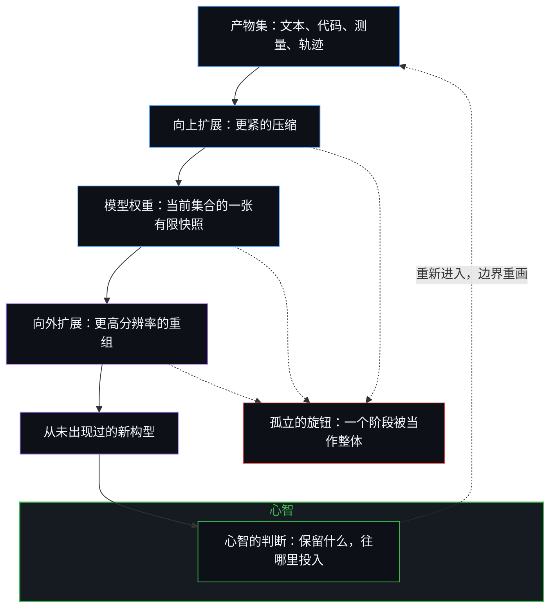
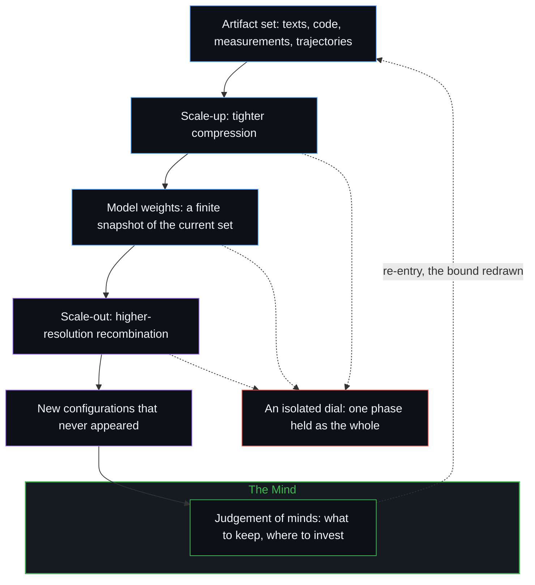

# 规模化回路 / The Scaling Loop

*每一场规模之争都把回路的一个旋钮定格为全部，而回路的边界随每一次取舍重画 / Each scaling debate freezes one dial as the whole of a loop whose bound is redrawn at every selection.*

当下关于人工智能的讨论，几乎总是从一个规模问题开始：模型有多少参数，预训练用了多少 token，数据与参数的最优比例是多少，推理成本如何重塑算力最优的边界。这些问题各自考察的都是一个真实的局部机制。但它们都还没有点出这些局部机制在其中运转的回路：把既有的产物集压得更紧，以更高的分辨率重组出前所未有的构型，再由心智的判断决定哪些新构型回流。

Contemporary discussion of artificial intelligence almost invariably begins with a question about scale: how many parameters the model has, how many tokens went into pre-training, what the optimal ratio of data to parameters is, how inference cost reshapes the compute-optimal frontier. Each of these questions examines a real local mechanism. None of them yet names the process in which those mechanisms circulate: tighter compression of a given artifact set, higher-resolution recombination into configurations never seen before, and the judgements that decide which of those configurations re-enter the stream.

## 一、 向上扩展压缩既有的产物集 / 1. Scale-Up Compresses a Given Artifact Set

向上扩展是预训练的工作。它把现有的知识产物——文本、代码、测量与轨迹——视为既定的语料，对其作层层递进的压缩。一代又一代的模型把同样的底层信息压得更紧、更全，残余的误差更少。经典的缩放定律文献几乎都在处理这一种操作。

Scale-up is the work of pre-training. It treats the existing collection of knowledge artifacts—texts, code, measurements and trajectories—as a given corpus and subjects that corpus to progressive compression. Successive generations of models pack the same underlying information more tightly, more completely, and with fewer residual errors. The classical scaling literature is almost entirely concerned with this operation.

Kaplan 等人（2020）拟合出的指数，鼓励这个领域让参数增长得比数据快。Hoffmann 等人（2022）随后修正了这种分配，表明算力最优的训练大约需要每个参数二十个 token，两者应当同步增长。后来的工作把整个生命周期的推理成本也算进来，进一步细化了这幅图景：一旦模型要被调用数十亿次，过度训练的较小模型可能更可取。混合专家架构又引入了一层区分：总参数量决定能存下多少知识，激活参数与有效深度决定模型能撑起多长的因果链。这些争论都还在向上扩展的范围之内。它们问的是如何最好地压缩一份给定的产物集，还没有问这份集合本身如何扩张。

Kaplan et al. (2020) fitted an exponent that encouraged the field to grow parameters faster than data. Hoffmann et al. (2022) later corrected the allocation, showing that compute-optimal training requires roughly twenty tokens per parameter and that the two should increase in tandem. Subsequent work refined the picture further by incorporating lifetime inference cost, revealing that heavily over-trained smaller models can be preferable once a model is called billions of times. Mixture-of-experts architectures introduced yet another distinction: total parameter count governs the volume of knowledge that can be stored, while activated parameters and effective depth govern the length of causal chains the model can sustain. All of these debates remain inside the scale-up regime. They ask how best to compress a given artifact set; they do not yet ask how the set itself expands.

正如[开放场域中的无损知识不自洽](../lossless-knowledge-of-an-open-field-is-incoherent/)从容量的一侧所追溯的，没有哪一份有限的记录，能把仍在进行的区分闭合起来。一个模型的权重，只是当前产物集的一帧有限快照。若把这一帧当作整个过程的上限，就把压缩的某一个瞬间冻结成了回路的边界；[层层皆是语境](../context-engineering-essay/)追溯的，正是同一种冻结如何装扮成语境工程的样子。

As [Lossless Knowledge of an Open Field Is Incoherent](../lossless-knowledge-of-an-open-field-is-incoherent/) traces from the side of capacity, no finite registration can close a distinguishing that is still underway. A model's weights are a finite snapshot of the current set. Taking that snapshot for the ceiling of the process freezes a single moment of compression as the bound of the loop, the same freeze that [Context All the Way Down](../context-engineering-essay/) traces in the dress of context engineering.

## 二、 向外扩展重组出前所未有的构型 / 2. Scale-Out Recombines into Artifacts That Never Appeared

当压缩后的表征进入后训练、长程强化学习与真实世界的交互，向外扩展便开始了。此时，模型不再只是检索或插值，而是以更高的分辨率把碎片重新拼合，生成原始训练分布中从未有过的构型。这些新构型——合成数据、提纯的偏好信号、成功的环境轨迹与应用日志——经筛选留存后，重新注入数据管线。产物集由此不再静止：每一次成功的重组，都在扩大下一轮向上扩展要去压得更紧的那份集合。

Scale-out begins once the compressed representation is placed under the pressure of post-training, long-horizon reinforcement learning and real-world interaction. Here the model is no longer merely retrieving or interpolating; it is reassembling fragments at higher resolution into configurations that never appeared in the original training distribution. Those novel configurations—synthetic data, refined preference signals, successful environment trajectories and application logs—are then selectively retained and re-injected into the data pipeline. The artifact set therefore ceases to be static. Every successful recombination enlarges the collection that the next scale-up cycle will attempt to compress more tightly.

两个过程构成相互咬合的反馈回路：更紧的压缩产出更干净的合成数据，改善后训练；更高分辨率的重组产出更丰富的产物，改善接下来的预训练。[看似AI的强化学习，实为人类的自我强化学习](../self-rl-for-humans/)守着同样的分寸：合成数据并不是一条自己吞吃尾巴的蛇，而是经由人类的区分——选择、过滤、偏好、评估与目标的重新设计——不断重塑的余留。若把这片持续生成的场封存为一份有限的清单，就落入了[数据是局部的，智能是分配的](../data-is-local-intelligence-is-allocated/)所追溯的那种冻结。

The two processes form interlocking feedback loops: tighter compression yields cleaner synthetic data that improves post-training; higher-resolution recombination yields richer artifacts that improve subsequent pre-training. [What Looks Like RL for AIs Is Self-RL for Humans](../self-rl-for-humans/) keeps the same discipline: synthetic data is not an autonomous snake eating its own tail but residue continually reshaped by human distinctions—selection, filtering, preference, evaluation and objective redesign. Sealing that continuously generated field into a finite inventory is the freeze traced in [Data Is Local; Intelligence Is Allocated](../data-is-local-intelligence-is-allocated/).

同一时期的一次实验让这份余裕变得可见。GLM-5.3 保持了与 GLM-5.2 相同的基座、架构与参数量，用一个月转动后训练这一个旋钮，投入长程环境与强化学习。收益随之显现。这次实验并没有把其他旋钮拧到尽头，它显示的是：这些旋钮不必同步拧动，而余裕多半藏在被固定得最久的那个阶段里，也就是最后才被当作一枚独立旋钮来拧的那个阶段。

A contemporaneous experiment makes the slack visible. GLM-5.3 held the same base, architecture and parameter counts as GLM-5.2, and turned the post-training dial for a month on long-horizon environments and reinforcement learning. The gains show. The experiment does not exhaust the other dials. It shows they need not be turned in lockstep, and that the slack is often in whichever phase was held fixed longest, the last to be turned as a dial of its own.

## 三、 孤立的旋钮把一个阶段冻结为整体 / 3. Isolated Dials Freeze One Phase as the Whole

每一场技术争论，都把某个局部机制从循环中剥离出来单独考察。关于每参数 token 比例或 Chinchilla 最优性的争论，处理的是压缩内部的效率。关于稀疏性、激活参数与总参数的争论，处理的是记忆容量与推理深度之间的内部取舍。关于推理时算力或刻意过度训练的讨论，处理的是部署的经济形态。即便是近来对后训练与长程强化学习的强调，虽然正确地指出了一个此前被低估的旋钮，也仍倾向于把这个旋钮当作一个独立变量，而不是一个持续循环的系统中的一个阶段。每一场讨论在它所选的框架内都言之成理，但那个框架本身，只是一个运动整体的一帧定格。把这样一块局部的天花板当作进步的轨迹，就是[封闭的假设把复利挤成 S 曲线](../closed-assumptions-squeeze-compounding-into-s-curves/)所追溯的那种冻结。

Each technical debate holds one local mechanism as if it were independent of the circulation. Debates over tokens-per-parameter ratios or Chinchilla optimality address the internal efficiency of compression. Arguments about sparsity and activated versus total parameters address the internal trade-off between memorization capacity and reasoning depth. Discussions of inference-time compute or deliberate over-training address the economic shape of deployment. Even the recent emphasis on post-training and long-horizon reinforcement learning, while correctly identifying a previously under-scaled dial, still tends to treat that dial as an independent variable rather than as one phase of a continuously circulating system. Each conversation is valid within its chosen frame, yet that frame is only a still of a moving whole. Installing such a local ceiling as the trajectory of progress is the freeze traced in [Closed Assumptions Squeeze Compounding into S-Curves](../closed-assumptions-squeeze-compounding-into-s-curves/).

## 四、 判断重画边界 / 4. Judgement Redraws the Bound

算力与架构只是回路之内的工具；重画回路边界的，是一个个具体心智有所取舍的判断。正是这些心智决定哪些新生成的构型有意思到值得保留，哪些探索方向值得再投入算力，哪些偏好信号被允许重新进入数据流。因为产物集的边界由活着的注意力而非任何封闭的算法划定，这个系统的边缘从来不会沉淀为一份完成了的清单。每一次人的选择，都重画了什么算作值得压缩的知识、什么算作值得放大的重组。[心智的飞轮](../the-flywheel-of-the-mind/)追溯的正是这种转动：工具这道槽可以无止境地磨深，转动却从不因此转移到槽里。而从[生产、消费与心智的区分](../production-consumption-and-the-minds-distinction/)看，同一份语料，在封闭的框定下像一池有限的存量，在框定保持敞开时，却继续作为分化流淌下去。

Compute and architecture are instruments inside the loop. What redraws the loop's bound is the selective judgement of particular minds. Those minds decide which newly generated configurations are interesting enough to keep, which directions of exploration merit further compute, and which preference signals are allowed to re-enter the data stream. Because the boundary of the artifact set is drawn by living attention rather than by any closed algorithm, the edges of the system never settle into a finished inventory. Every act of human selection redraws what counts as knowledge worth compressing and what counts as recombination worth amplifying. [The Flywheel of the Mind](../the-flywheel-of-the-mind/) traces this turning: the tool is a groove that can be deepened without end, and the turn never passes into the groove. And as [Production, Consumption, and the Mind's Distinction](../production-consumption-and-the-minds-distinction/) shows, the corpus that appears as a finite pool under a closed register keeps differentiating whenever the register stays open.

由此得到的，是一个多层次、没有终点的过程。产物集没有封闭的清单，因为下一次选择会重画边界。任何一个时刻的技术争论，无论聚焦于参数增长、数据比例、稀疏性、推理成本还是后训练配方，照亮的都是一个持续运动的整体之内的局部机制。维持这个整体、并不断重新界定它的，是一个个具体心智的判断。

The result is a multi-level, open-ended process. The artifact set has no closed inventory, because the next selection redraws the bound. The technical debates of any given moment, whether focused on parameter growth, data ratios, sparsity, inference cost or post-training recipes, illuminate local mechanisms inside a continuously moving whole. The whole itself is sustained and continually redefined by the judgements of particular minds.
