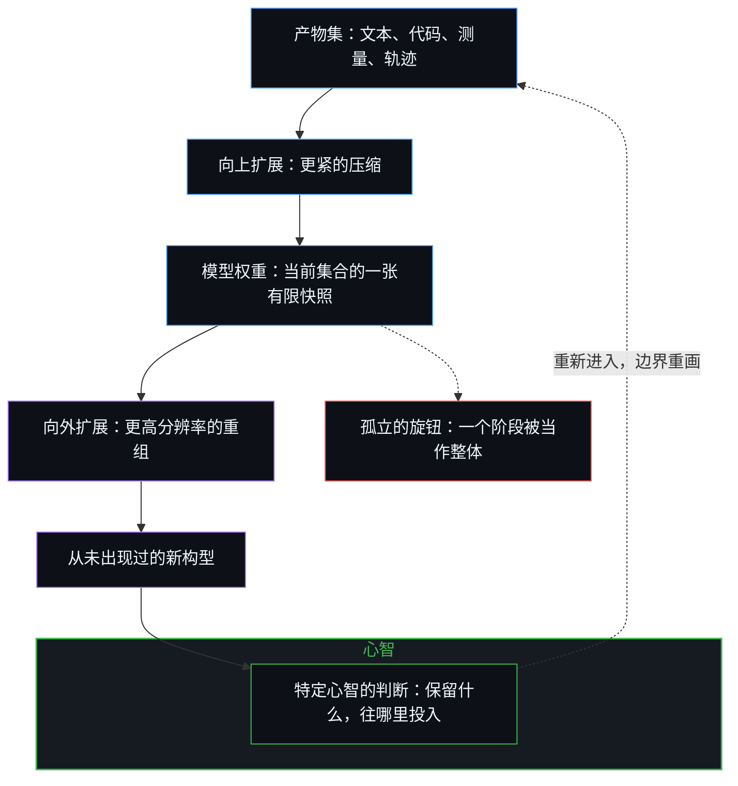
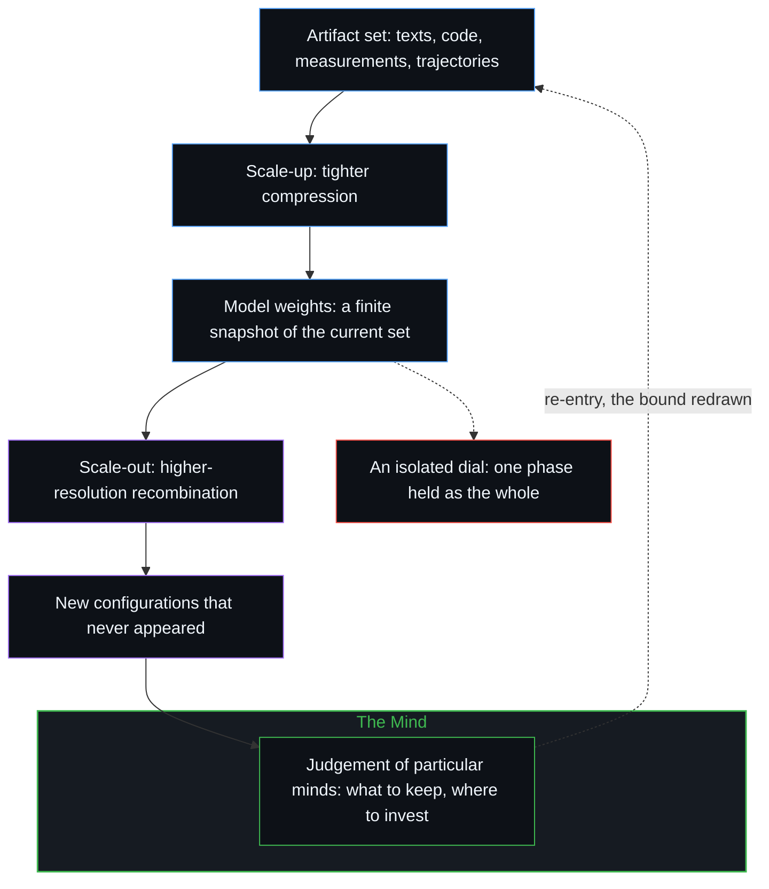

# 规模化回路 / The Scaling Loop

*每一场规模之争都冻结了回路的一个旋钮，而回路的边界随每一次选择重画 / Each scaling debate freezes one dial of a loop whose bound is redrawn at every selection.*

当下关于人工智能的讨论，几乎总是从一个规模问题开始：模型有多少参数，预训练用了多少 token，数据与参数的最优比例是多少，推理成本如何重塑算力最优的边界。这些问题各自考察的都是一个真实的局部机制。它们还都没有说出这些机制在其中循环的那个过程：对给定产物集更紧的压缩，以更高分辨率重组出从未出现过的构型，以及决定这些构型中哪些重新进入的判断。

Contemporary discussion of artificial intelligence almost invariably begins with a question about scale: how many parameters the model has, how many tokens went into pre-training, what the optimal ratio of data to parameters is, how inference cost reshapes the compute-optimal frontier. Each of these questions examines a real local mechanism. None of them yet names the process in which those mechanisms circulate: tighter compression of a given artifact set, higher-resolution recombination into configurations that never appeared, and the judgements that decide which of those configurations re-enter.

## 一、 向上扩展压缩一个给定的产物集 / 1. Scale-Up Compresses a Given Artifact Set

向上扩展是预训练的工作。它把现有的知识产物，文本、代码、测量、轨迹，当作一份给定的语料，对这份语料施以逐步的压缩。一代又一代的模型把同样的底层信息压得更紧、更全，残余的误差更少。经典的缩放定律文献几乎都在处理这一种操作。

Scale-up is the work of pre-training. It treats the existing collection of knowledge artifacts, texts, code, measurements and trajectories, as a given corpus and subjects that corpus to progressive compression. Successive generations of models pack the same underlying information more tightly, more completely, and with fewer residual errors. The classical scaling literature is almost entirely concerned with this operation.

Kaplan 等人（2020）拟合出的指数，鼓励这个领域让参数增长得比数据快。Hoffmann 等人（2022）随后修正了这种分配，表明算力最优的训练大约需要每个参数二十个 token，两者应当同步增长。后来的工作把整个生命周期的推理成本也算进来，进一步细化了这幅图景：一旦模型要被调用数十亿次，过度训练的较小模型可能更可取。混合专家架构又引入了一层区分：总参数量决定能存下多少知识，激活参数与有效深度决定模型能撑起多长的因果链。这些争论都还在向上扩展的范围之内。它们问的是如何最好地压缩一份给定的产物集，还没有问这份集合本身如何扩张。

Kaplan et al. (2020) fitted an exponent that encouraged the field to grow parameters faster than data. Hoffmann et al. (2022) later corrected the allocation, showing that compute-optimal training requires roughly twenty tokens per parameter and that the two should increase in tandem. Subsequent work refined the picture further by incorporating lifetime inference cost, revealing that heavily over-trained smaller models can be preferable once a model is called billions of times. Mixture-of-experts architectures introduced yet another distinction: total parameter count governs the volume of knowledge that can be stored, while activated parameters and effective depth govern the length of causal chains the model can sustain. All of these debates remain inside the scale-up regime. They ask how best to compress a given artifact set; they do not yet ask how the set itself expands.

[开放场域中的无损知识不自洽](../lossless-knowledge-of-an-open-field-is-incoherent/)从容量的一侧讲同一种压缩：没有哪一份有限的记录，能把仍在进行的区分闭合起来。一个给定模型的权重，是当前集合的一张有限快照。把这张快照当作这个过程的终极上限，就把压缩的一个瞬间冻结成了回路的地板。[层层皆是语境](../context-engineering-essay/)讲的是同一种冻结装扮成语境工程的样子。

[Lossless Knowledge of an Open Field Is Incoherent](../lossless-knowledge-of-an-open-field-is-incoherent/) traces the same compression from the side of capacity: no finite registration closes a distinguishing that keeps going. A given model's weights are a finite snapshot of the current set. Treating that snapshot as the ultimate limit of the process freezes one moment of compression as the floor of the loop. [Context All the Way Down](../context-engineering-essay/) is the same freeze dressed as context engineering.

## 二、 向外扩展重组出从未出现过的产物 / 2. Scale-Out Recombines into Artifacts That Never Appeared

一旦压缩后的表征被置于后训练、长程强化学习与真实世界交互的压力之下，向外扩展就开始了。在这里，模型不再只是检索或插值，而是以更高的分辨率，把碎片重新组装成原始训练分布中从未出现过的构型。这些新构型，合成数据、精炼过的偏好信号、成功的环境轨迹、应用日志，随后被有选择地保留下来，重新注入数据管线。产物集因此不再是静止的。每一次成功的重组，都扩大了下一轮向上扩展要去压得更紧的那份集合。

Scale-out begins once the compressed representation is placed under the pressure of post-training, long-horizon reinforcement learning and real-world interaction. Here the model is no longer merely retrieving or interpolating; it is reassembling fragments at higher resolution into configurations that never appeared in the original training distribution. Those novel configurations, synthetic data, refined preference signals, successful environment trajectories and application logs, are then selectively retained and re-injected into the data pipeline. The artifact set therefore ceases to be static. Every successful recombination enlarges the collection that the next scale-up cycle will attempt to compress more tightly.

两个过程构成相互咬合的反馈回路：更紧的压缩产出更干净的合成数据，改善后训练；更高分辨率的重组产出更丰富的产物，改善接下来的预训练。[看似AI的强化学习，实为人类的自我强化学习](../self-rl-for-humans/)守着同样的分寸：合成数据是被人类的区分重新塑形的余留，经过选择、过滤、偏好、评估与目标的重新设计，而不是一条自己吞吃尾巴的蛇。[数据是局部的，智能是分配的](../data-is-local-intelligence-is-allocated/)讲的是把这片持续生成的场封存为一份有限清单时的冻结。

The two processes form interlocking feedback loops: tighter compression yields cleaner synthetic data that improves post-training; higher-resolution recombination yields richer artifacts that improve subsequent pre-training. [What Looks Like RL for AIs Is Self-RL for Humans](../self-rl-for-humans/) keeps the same discipline: synthetic data is residue reshaped by human distinctions, selection, filtering, preference, evaluation and objective redesign, not an autonomous snake eating its own tail. [Data Is Local; Intelligence Is Allocated](../data-is-local-intelligence-is-allocated/) is the freeze when that continuously generated field is sealed as a finite inventory.

同一时期的一次实验让这份余裕变得可见。GLM-5.3 保持了与 GLM-5.2 相同的基座、架构与参数量，用一个月转动后训练这一个旋钮，投入长程环境与强化学习。收益是看得见的。这次实验并没有把其他旋钮转完，它显示的是：这些旋钮不必一起转，而余裕多半就藏在最后才被当作独立变量的那个阶段里。

A contemporaneous experiment makes the slack visible. GLM-5.3 held the same base, architecture and parameter counts as GLM-5.2, and turned the post-training dial for a month on long-horizon environments and reinforcement learning. The gains register. The experiment does not finish the other dials. It shows they need not be turned together, and that the slack is often in the phase last treated as independent.

## 三、 孤立的旋钮把一个阶段冻结为整体 / 3. Isolated Dials Freeze One Phase as the Whole

每一场技术争论，都把一个局部机制当作独立于循环之外。关于每参数 token 比例或 Chinchilla 最优性的争论，处理的是压缩内部的效率。关于稀疏性、激活参数与总参数的争论，处理的是记忆容量与推理深度之间的内部取舍。关于推理时算力或刻意过度训练的讨论，处理的是部署的经济形态。即便是近来对后训练与长程强化学习的强调，虽然正确地指出了一个此前被低估的旋钮，也仍倾向于把这个旋钮当作一个独立变量，而不是一个持续循环的系统中的一个阶段。每一场讨论在它所选的框架内都是准确的，而这个框架是一个运动整体的一张快照。[封闭的假设把复利挤成 S 曲线](../closed-assumptions-squeeze-compounding-into-s-curves/)讲的是把一个局部的天花板装成进步的轨迹时的那种冻结。

Each technical debate holds one local mechanism as if it were independent of the circulation. Debates over tokens-per-parameter ratios or Chinchilla optimality address the internal efficiency of compression. Arguments about sparsity and activated versus total parameters address the internal trade-off between memorization capacity and reasoning depth. Discussions of inference-time compute or deliberate over-training address the economic shape of deployment. Even the recent emphasis on post-training and long-horizon reinforcement learning, while correctly identifying a previously under-scaled dial, still tends to treat that dial as an independent variable rather than as one phase of a continuously circulating system. Each conversation is accurate within its chosen frame. The frame is one snapshot of a moving whole. [Closed Assumptions Squeeze Compounding into S-Curves](../closed-assumptions-squeeze-compounding-into-s-curves/) is that freeze when a local ceiling is installed as the trajectory of progress.

## 四、 判断重画边界 / 4. Judgement Redraws the Bound

算力与架构是回路之内的工具。重画回路边界的，是特定心智有选择的判断。这些心智决定哪些新生成的构型有意思到值得保留，哪些探索方向值得再投入算力，哪些偏好信号被允许重新进入数据流。因为产物集的边界由活着的注意力划定，而不是由任何封闭的算法划定，这个系统的边缘从来不是一份完成了的清单。每一次人的选择，都重画了什么算作值得压缩的知识、什么算作值得放大的重组。[心智的飞轮](../the-flywheel-of-the-mind/)讲的就是这种转动：槽可以无止境地磨深，转动却不会为了槽而离开。[生产、消费与心智的区分](../production-consumption-and-the-minds-distinction/)从敞开与固定的差别讲同一对两极：在封闭的框定之下看似一个有限池子的语料，在框定保持敞开时，继续作为分化延续下去。

Compute and architecture are instruments inside the loop. What redraws the loop's bound is the selective judgement of particular minds. Those minds decide which newly generated configurations are interesting enough to keep, which directions of exploration merit further compute, and which preference signals are allowed to re-enter the data stream. Because the boundary of the artifact set is drawn by living attention rather than by any closed algorithm, the edges of the system are never a finished inventory. Every act of human selection redraws what counts as knowledge worth compressing and what counts as recombination worth amplifying. [The Flywheel of the Mind](../the-flywheel-of-the-mind/) is that turn: the groove can be sharpened without end, and the rotation does not leave for the groove. [Production, Consumption, and the Mind's Distinction](../production-consumption-and-the-minds-distinction/) traces the same polarity as the difference between an open hold and a fixed one: the corpus that looks like a finite pool under a closed register continues as differentiation when the register stays open.

由此得到的，是一个多层次、没有终点的过程。产物集没有封闭的清单，因为下一次选择会重画边界。任何一个时刻的技术争论，无论聚焦于参数增长、数据比例、稀疏性、推理成本还是后训练配方，照亮的都是一个持续运动的整体之内的局部机制。这个整体本身，由特定心智的判断维持，并不断被重新界定。

The result is a multi-level, open-ended process. The artifact set has no closed inventory, because the next selection redraws the bound. The technical debates of any given moment, whether focused on parameter growth, data ratios, sparsity, inference cost or post-training recipes, illuminate local mechanisms inside a continuously moving whole. The whole itself is sustained and continually redefined by the judgements of particular minds.
