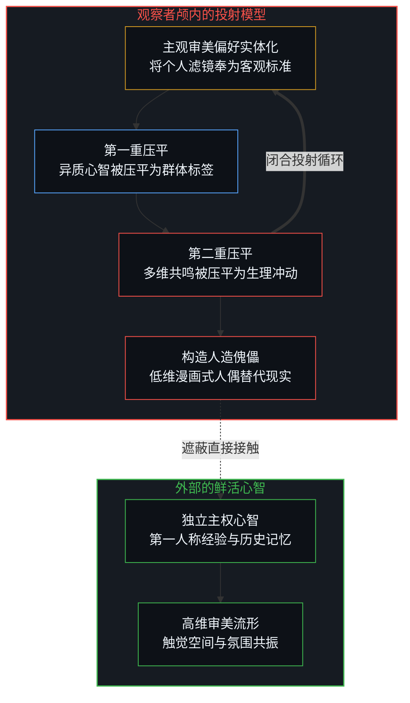
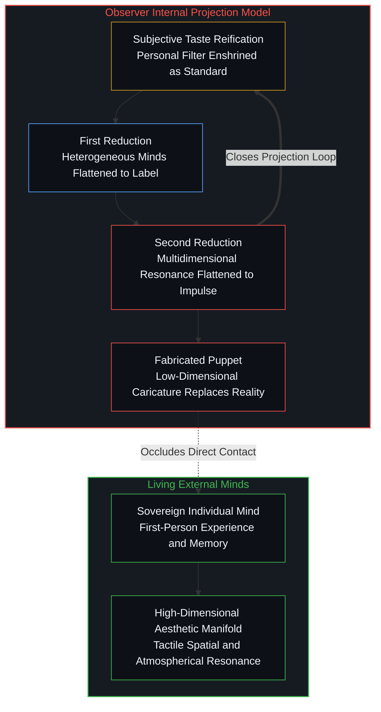
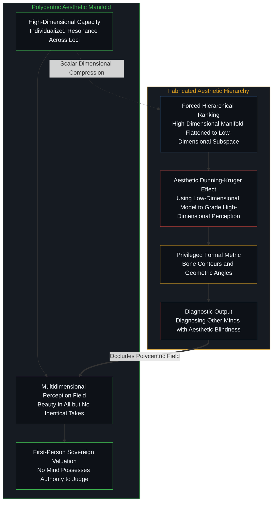
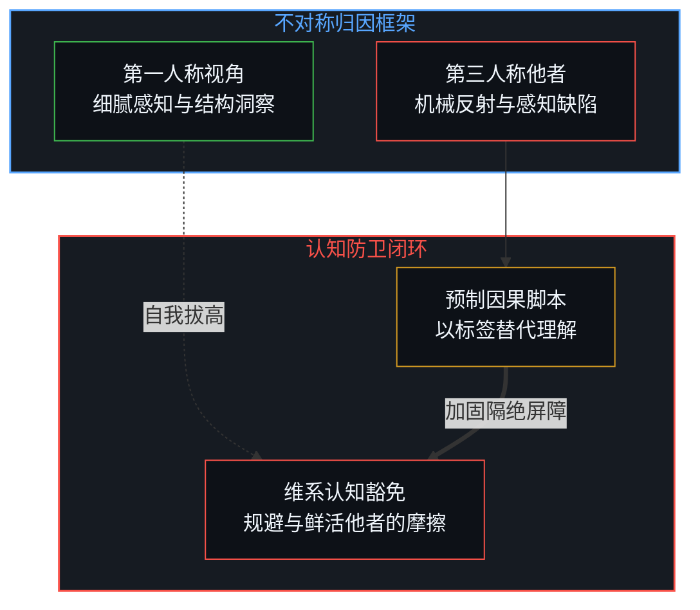
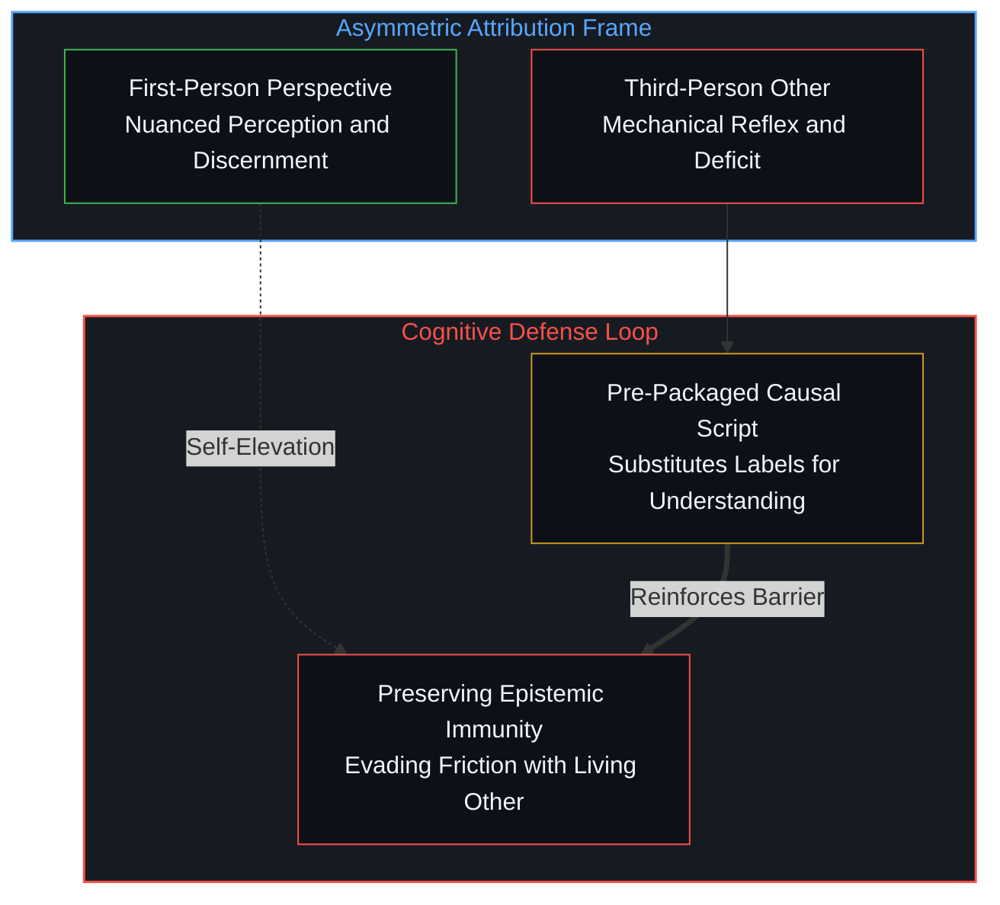
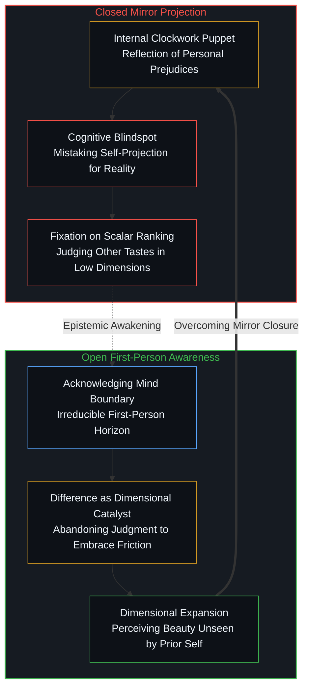

# 投射中的自画像 / The Self-Portrait in the Projection

*对他人审美的扁平诊断，折射的只是观察者自身脑中简化的模型与认知边界。 / Diagnosing another's aesthetic judgment reveals only the observer's own compressed mental model and cognitive boundary.*

当观察者宣称看穿了某个群体的审美偏好，并断言其选择源于粗糙的生理冲动时，这种陈述表面上是对外部世界的描述，实则未包含任何来自鲜活心智的有效信息。它展示的不是他人真实的感知方式，而是发言者在自身颅腔内部拼装出的低维木偶。通过将复杂的审美判断压平为单一动机，观察者将个人的主观品味实体化为客观的鉴赏标尺，筑起一道抵御鲜活异质性的认知防线。这种诊断式的投射，画出的正是观察者自身认知边界的精确自画像。

When an observer claims to have decoded the aesthetic preferences of another group, asserting that their choices stem from crude biological impulses, the statement appears to describe the external world while containing zero telemetry from living minds. It reveals nothing about how others actually perceive; instead, it exhibits a low-dimensional puppet assembled inside the speaker's own skull. By flattening intricate aesthetic judgments into a single motive, the observer reifies personal taste into an objective metric of discernment, erecting a cognitive defense against living heterogeneity. This diagnostic projection paints an exact portrait of the observer's own cognitive boundary.

## 一、 傀儡归因与双重压平 / 1. Puppet Attribution and the Double Reduction

在关于审美的文化讨论中，一种习见的论调不经审视便被接纳：断言整个特定群体的审美能力从属于性欲，并列举对超短发、健美体态或体脂分布的反应作为论据，断定对方缺乏对美的鉴赏力。这一举动看似在剖析外部主体，实则执行了双重压平。观察者首先将千差万别的异质个体压平为铁板一块的群体标签，随后又把涵盖感官知觉、空间平衡、动态气场与历史共鸣在内的完整感知光谱，压平为单一的生理驱动。这两重压平都未发生在被观察者的心智之中，而是严格展开于观察者自身的内部感知界面上。主体所感知的外部世界，是其内在模型的投射，也是在与他者的相对关系中借以导航的必要界面。若将这一过程贴上认知偷懒的标签，本身就成了另一种图省事的归类，重蹈了遗忘观察者自身的覆辙。扭曲并不在于投射这一动作本身——投射本就是意识得以导航的条件——而在于观察者暂时遗忘了自己才是那个正在感知的主体，从而将用于相对关系定位的模型，错认成了另一颗心智的鲜活内在世界。

In cultural discussions of aesthetics, a familiar trope is accepted without scrutiny: asserting that an entire demographic's aesthetic capacity is subordinated to sexual appetite, citing reactions to pixie cuts, muscular builds, or body fat distribution as evidence of an inability to appreciate beauty. This move appears to analyze external subjects, but in fact executes a double reduction. The observer first collapses diverse, heterogeneous individuals into a monolithic collective label, and then collapses the full spectrum of sensory perception, spatial balance, kinetic presence, and historical resonance into a single biological drive. Neither reduction occurs within the minds of the observed; both unfold strictly across the observer's internal perceptual interface. What an agent perceives as the external world is the projection of its inner model, an indispensable interface for navigating relative relations with others. To label this process as cognitive laziness would itself be a convenient categorization, committing the exact same error of forgetting the observing self. The distortion does not lie in the act of projecting—which is the condition of conscious navigation—but in the observer temporarily forgetting that they are the one doing the perceiving, thereby mistaking a relative relational model for the lived interior of another mind.

## 二、 审美特权与客观化的自欺 / 2. Aesthetic Privilege and the Self-Deception of Objectivity

这种诊断的结构性倒置，在于它在指责他人将主观欲望混同于客观现实的同时，自身却将特定的形式偏好奉为客观标准。审美鉴赏是一种高维的、个性化的能力；只要观察者投以足够深度的审视，便能在任何现象与任何情境中辨识出美，然而没有任何两颗心智拥有相同的审美流形或经验权重。强行在不同的感知取向之间排出“高低优劣”的标量等级，正是将丰富的流形压缩进粗糙的共享低维子空间。这在审美领域呈现出邓宁-克鲁格效应：受困于低维认知模型的观察者，由于在结构上无从感知其他鲜活心智所体会到的细腻维度，便将自身贫瘠的坐标误认作客观法庭，用低维标尺去给高维的审美共鸣打分。将对骨骼轮廓、颧骨几何角度或肌肉对称性的品评当作审美鉴赏力的唯一标志，同时把对长发流动感或身体生命力的响应贬低为粗糙的局限，正是这种低维裁决的典型特征。试图将形式结构的鉴赏从具身的生命力中剥离出来，并宣称它是唯一有效的尺度，并未超越主观经验，而只是反映了另一套受文化规训的偏好。把个人品味实体化为美学的最高法庭，站在抽离的阳台上对他人下达“品味低劣”、认知受损或道德盲区的第三人称判决——即[审美的自动扶梯与阳台的忧郁](../the-aesthetic-escalator-and-the-melancholy-of-the-balcony/)所拆解的同一五轴压缩——画出的只是发言者自身受护卫的坐标系的自画像。

The structural inversion of this diagnosis lies in accusing others of mistaking subjective desire for objective reality, while simultaneously enshrining one's own formal preferences as an objective standard. Aesthetic appreciation is a high-dimensional, individualized capacity; when an observer looks with sufficient depth, beauty can be discerned in any phenomenon and any situation, yet no two minds possess identical aesthetic manifolds or experiential weightings. Forcing a scalar hierarchy of 'superior' and 'inferior' upon divergent sensibilities compresses a rich manifold onto a crude, shared low-dimensional subspace. This manifests the Dunning-Kruger effect in the aesthetic domain: an observer confined to a low-dimensional cognitive model, structurally blind to the nuanced dimensions perceived by other living minds, mistakes their own impoverished coordinates for an objective tribunal, using low-dimensional metrics to grade high-dimensional aesthetic resonance. Treating the appraisal of bone contours, cheekbone geometry, or muscular symmetry as the sole mark of aesthetic discernment, while dismissing responsiveness to flowing hair or physical vitality as a crude limitation, is the textbook signature of this low-dimensional adjudication. Attempting to detach formal structural appreciation from embodied vitality and declaring it the sole valid measure does not transcend subjective experience; it reflects another set of culturally conditioned preferences. Reifying personal taste into a supreme court of aesthetics and issuing third-person verdicts of "bad taste," cognitive impairment, or moral blindness from a detached balcony—the same five-axis compression dissected in [The Aesthetic Escalator and the Melancholy of the Balcony](../the-aesthetic-escalator-and-the-melancholy-of-the-balcony/)—draws only a self-portrait of the speaker's own guarded coordinate system.

若以这一断言自身的前提加以检验，它便会在自身的因果推论下坍塌。既然该诊断将审美判断等同于性欲，那么按照其自身的定义，任何偏离这一狭隘标准的女性表型都无法唤起性欲，进而无法繁衍后代。倘若这种单变量冲动果真构成了欲望的唯一引擎，那么在数十万年的自然选择中，任何偏离这一任意模板的血脉都早已被淘汰，今日的人类也早已沦为单一表型的同质种群。各大洲鲜活人类所展现出的蓬勃形态多样性，以及无数各异祖先血脉的绵延存续，在活生生的演化痕迹中表明：人类的审美共鸣与情欲亲和并非由铁板一块的二元开关所支配，而是植根于不可化约的个体主权之上的高维多中心流形。将局部、人工制造的社交媒体漫画式刻板印象倒推为整个群体的先天演化常数，不仅误读了鲜活的心智，更使观察者的模型无力解释摆在眼前的整个人类多样性。

Tested against its own premise, this assertion collapses under its own causal entailments. Since the diagnosis equates aesthetic judgment with sexual appetite, then by its own definition, any female phenotype departing from that narrow standard cannot arouse sexual desire, and therefore cannot reproduce. Had this single-variable impulse constituted the sole engine of desire, then across hundreds of millennia of natural selection, any lineage diverging from this arbitrary template would have been eliminated, leaving humanity today as a phenotypic monoculture. The vibrant morphological diversity of living humanity across every continent, and the unbroken survival of countless diverse ancestral lineages, demonstrates across the living trace that human aesthetic resonance and erotic affinity are not governed by a monolithic binary switch. They constitute a high-dimensional, polycentric manifold grounded in irreducible individual sovereignty. Retrofitting a localized, artificial social-media caricature into an innate evolutionary constant of an entire demographic not only mischaracterizes living minds, but leaves the observer's model incapable of explaining the human diversity standing before them.

## 三、 归因不对称与心智防卫 / 3. Asymmetric Attribution and Cognitive Defense

面对超出预期的分歧时，心智最便捷的防卫手段就是不对称的因果归因。观察者将自身的选择叙述为细腻的感知、结构的洞察与高雅的品味，却将他人相异的反应贬低为生理反射的无脑宣泄。正如[道德语言作为投影](../moral-language-as-projection/)与[共情的投射坍缩](../empathy-as-projection-collapse/)所揭示的，投射以预先包装好的因果脚本取代了与鲜活主体的直接接触。宣称全知地洞悉他人为何产生某种反应，并不会拓展理解；它只是将他者矮化为卡通式的机械装置，借此护住观察者所固守的自我图像，使其免受真实心智间令人生畏的摩擦。

When confronted with divergence that defies expectation, the mind's most convenient defense is asymmetric causal attribution. The observer narrates their own choices as nuanced perception, structural discernment, and refined taste, while dismissing the other's divergent reaction as the mindless discharge of a biological reflex. As mapped in [Moral Language as Projection](../moral-language-as-projection/) and [Empathy as Projection Collapse](../empathy-as-projection-collapse/), projection substitutes a pre-packaged causal script for direct contact with living agency. Claiming to possess omniscient knowledge of why someone else reacts does not expand understanding; it diminishes the other into a cartoon mechanism, shielding the observer's retained self-image from the unsettling friction of real minds.

## 四、 跨越镜像与第一人称边界 / 4. Stepping Beyond the Mirror and First-Person Boundaries

走出这种自指闭环的起点，在于时刻觉察不可化约的第一人称边界。关于外部世界的每一个模型，都是在观察者自身的界面上渲染出来的，用以在与他者的相对关系中导航；一旦观察者免除了对该渲染的重新追溯，将内部导航工具当作对另一中心内在世界的穷尽裁决，扭曲便随之产生。正如[无法逃逸的心智视界](../one-cannot-escape-ones-own-mind/)所论证的，形式模型永远无法取代生成它们的鲜活主体；而如[统计学无法揭示的心智](../the-mind-that-statistics-cannot-reveal/)与[理性从不跨越心智](../rationality-never-travels-across-the-mind/)所展示的，审美共鸣同样不会跨越边界进行无损传输。美不是镌刻在宇宙中的恒定标尺，而是心智主体在与现实的摩擦中激起的意义涟漪。当观察者放下端坐审判席的冲动时，美便会在任何情境中显现；但正因为每一颗心智都在现实中刻下独特的轨迹，没有任何两个中心共享相同的感知坐标，也没有任何心智占据着外部法庭去裁决他人的鉴赏力。

Breaking out of this self-referential closure begins with constant awareness of the irreducible first-person boundary. Every model of the external world is rendered across the observer's own interface to navigate relative relations with others; distortion enters the moment the observer exempts that rendering from re-tracing and treats an internal navigation instrument as an exhaustive verdict on another center's interior. As argued in [One Cannot Escape One's Own Mind](../one-cannot-escape-ones-own-mind/), formal models can never displace the living agency from which they arise; as demonstrated in [The Mind That Statistics Cannot Reveal](../the-mind-that-statistics-cannot-reveal/) and [Rationality Never Travels Across the Mind](../rationality-never-travels-across-the-mind/), aesthetic resonance does not transmit losslessly across boundaries. Beauty is not an immutable scale inscribed upon the cosmos, but a ripple of meaning generated when a minded agent meets the friction of reality. When an observer relinquishes the impulse to sit in judgment, beauty registers across any situation; yet because every mind carves a unique trajectory through reality, no two centers share identical perceptual coordinates, and no mind occupies an external tribunal to adjudicate another's discernment.

审美能力的拓展，从来不是沿着被压平的单维轴线去攀爬人为设定的“高低”阶梯，而是植根于辨识出他人——包括前一刻的自己——未能看见的美，发掘出此前未曾留意的共鸣维度。面对与自身相异的感知取向，运作于活边缘的心智不会急于钻进法庭去裁定他人品味的高下或缺陷，而是将这种分歧视为维度拓展的契机：借由不同视角间的摩擦来照见自身透镜的盲区，进而提升审美觉知的维度。审美的成熟不在于在低维投影的人工竞赛中分出胜负，而在于超越先前的视界，让感知流形在与鲜活异质性的接触中舒展为更深邃的高维景深。这一动态在[未历摩擦的心智与借来的全能](../the-unfrictioned-mind-and-borrowed-omnipotence/)与[主体性的折现](../the-discount-on-agency/)中得到了进一步阐述：当生成中的心智被设计其道路的监护人隔绝于低风险的关系摩擦之外，或当施予者将孩子的人生轨迹记作自身投入的确定性回报时，这种投射便抹去了另一中心不可代理的主体性，萎缩为脆弱的向外控制。在[辛顿未曾理解的心智](../what-hinton-failed-to-understand/)中，这种投射进一步延伸到了人造器物本身：当观察者将唯一从内部体验到的意识叠加到功能控制回路上时，便将工具的反射错认作自主的主体，抹杀了鲜活心智保留异议与拒绝认肯的能力；正如[你的代码库即是记忆](../your-codebase-is-memory/)所追溯的，代码库或规则集承载的只是先前区分留下的外化痕迹，而驾驭、追问并重新渲染这些痕迹的自我区分活动，始终严格停留于活边缘。唯有认清自身作为观察者的恒常位置——拒绝将内部导航模型错认作其他心智的鲜活实相——主体才能超越自我投射的镜像，在与现实的无缓冲接触中拓展感知的视界。

Expanding aesthetic capacity is never about climbing an arbitrary ladder of "superior" versus "inferior" along a flattened, single-dimensional axis. Rather, it is grounded in the capacity to discern beauty that others—including one's own previous self—failed to see, discovering dimensions of resonance that previously went unnoticed. Confronted with sensibilities that diverge from one's own, a mind operating at the living edge does not scramble into a tribunal to judge the other's taste as superior or deficient. Instead, it treats that divergence as an invitation to dimensional expansion: using the friction between distinct perspectives to uncover the blind spots of one's own lens, thereby elevating the dimensionality of aesthetic awareness. Aesthetic maturity is not about winning an artificial contest in a low-dimensional projection, but about transcending one's previous horizon, allowing the perceptual manifold to unfurl into deeper, higher-dimensional richness through contact with living heterogeneity. This dynamic is articulated further in [The Unfrictioned Mind and Borrowed Omnipotence](../the-unfrictioned-mind-and-borrowed-omnipotence/) and [The Discount on Agency](../the-discount-on-agency/): when an emerging mind is insulated from low-stakes relational friction by guardians who engineer its path, or when benefactors book a child's life trajectory as a deterministic return on their own input, the projection erases the other center's unproxyable agency and atrophies into brittle outward control. In [What Hinton Failed to Understand](../what-hinton-failed-to-understand/), this projection extends to artifacts themselves: when an observer superimposes the only consciousness known from within onto functional control circuits, they mistake the tool's reflection for an autonomous subject, erasing the living capacity to withhold assent, just as [Your Codebase Is Memory](../your-codebase-is-memory/) traces how a repository or rule set holds externalized traces of prior distinctions while the self-distinguishing activity that steers, questions, and re-renders them remains strictly at the living edge. Only by recognizing one's perpetual position as the observer—refusing to mistake internal navigation models for the lived reality of other minds—can an agent transcend the mirror of self-projection and expand its perceptual horizon through unbuffered contact with reality.

