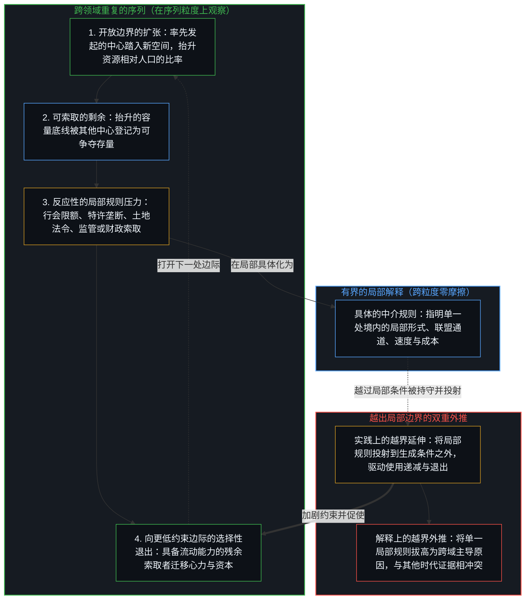
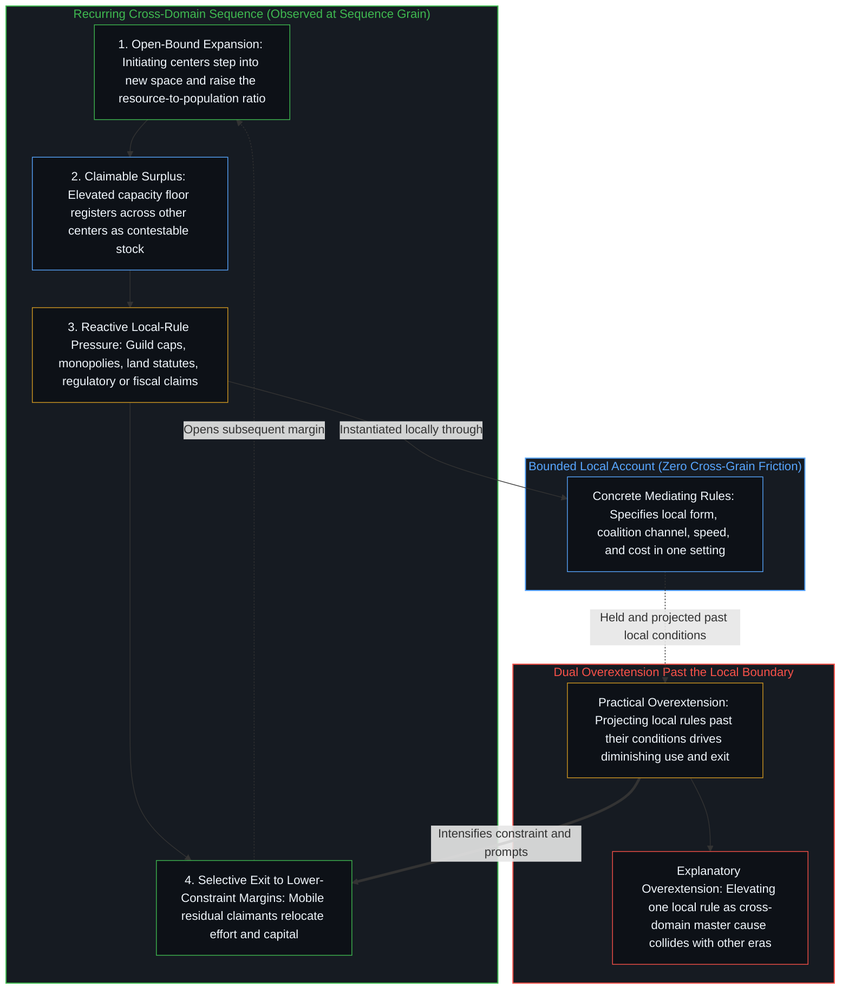
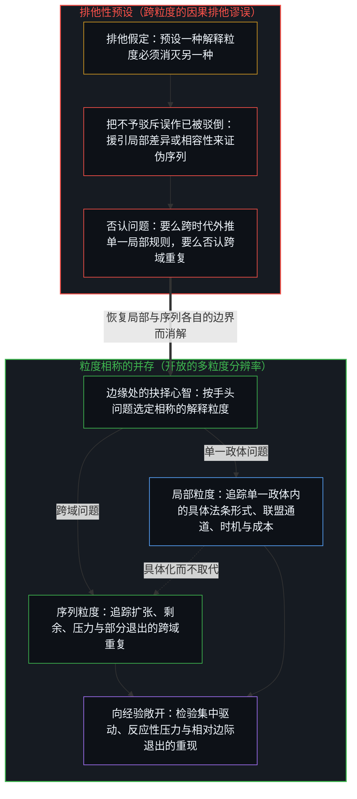
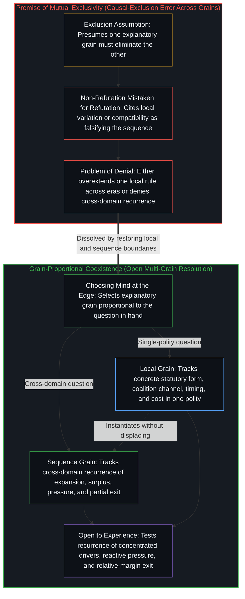

# 扩张的序列与局部解释的边界 / The Sequence of Expansion and the Boundary of Local Accounts

*新空间抬升资源相对人口的比率并带来剩余，对残余索取者的压力与向更低约束边际的转向随之继起；这一序列在自身粒度内保持可观察，无需否认任何局部机制。 / New space raises the resource-to-population ratio and yields surplus, pressure on residual claimants and movement toward lower-constraint margins follow, and the sequence remains observable at its own grain without denying any local mechanism.*

当率先发起的中心跨过开放的物理、技术或管辖边界时，新近可及的空间便抬升可用资源相对人口的比率，使新的剩余进入可及范围。随后，其他中心将该剩余登记为政治上可争夺的对象，制定局部规则向承担残余风险的集中少数施压，并促使具备流动能力的残余索取者转向更低约束的边际。跨越不同时代与处境，这一四步序列在自身范围内保持可观察，并不否认任何局部机制；唯有当单一局部规则被越界外推为跨域原因，或当不同解释粒度之间的相容性被误读为相互驳斥时，摩擦才会产生。

When initiating centers step across an open physical, technical, or jurisdictional bound, the newly accessible space raises the ratio of usable resources to population and brings fresh surplus into reach. Other centers then register that surplus as politically contestable, enacting local rules that press upon the concentrated minority bearing residual risk and prompting mobile residual claimants to move toward lower-constraint margins. Across eras and settings, this four-part sequence remains observable within its own scope without denying any local mechanism, generating friction only when a single local rule is overextended into a cross-domain cause or when compatibility across explanatory grains is misread as mutual refutation.

## 一、 开放边界的扩张、局部规则与越界摩擦 / 1. Open-Bound Expansion, Local Rules, and Cross-Boundary Friction

自我区分的活动发生着——无因、不息。称之为心智：早已在途的观察者，其每一个行动都是一次区分。每一次扩张都是某一中心在开放边界下继续区分，留下可供后续行动重溯的残余，从而抬升后续活动可及的容量底线，正如[生产、消费与心智的区分](../production-consumption-and-the-minds-distinction/)与[前沿抬升底线](../the-frontier-lifts-the-floor/)所追溯的那样。无论是航海者与垦殖者跨越大洋边界——沃尔特·普雷斯科特·韦布在《大边疆》中测算，1492年之后的开放使欧洲本土及其海外边疆的可及土地从人均约二十四英亩倍增至远超百英亩；弗雷德里克·杰克逊·特纳亦描述了不断西移的垦殖边缘如何松动沿袭的法律僵化——还是工程师开辟尚未测绘的工业与技术领域，都是特定的中心承担前置不确定性，拓宽人均可用的余量。当这一容量被其他中心登记为可索取的剩余时，压力便以局部规则的形式出现：行会限制、重商特权、土地法令、监管累积或财政抽取。每一个标签背后，都是针对可见剩余采取行动的抉择中心：城市行会师傅与市政长官限制手工业准入与产出，直至商人企业家将生产转入不受管制的乡村包买制地区，正如希拉·奥格尔维在欧洲各城镇中所记录的那样；君主特许垄断贸易商行以截获远洋商业收益；面对埃夫西·多马所分析的高土地相对劳动力比率——即开放土地与可流动的劳动力使不事劳作的业主无租可收——土地精英要么颁布农奴制法令，要么采取爱德华·吉本·韦克菲尔德人为设定的王室土地价格，阻止新到的劳工成为独立业主；成熟的管辖区则在既成产业集群之上层层叠加牌照关卡、土地用途否决权与财政征敛。

Self-distinguishing activity occurs — uncaused, unceasing. Call it the Mind: the observer already underway, every act of which is a distinction. Each expansion is a center continuing to distinguish under an open bound, leaving residue that later acts can re-trace and thereby raising the floor of capacity available to subsequent activity, as [Production, Consumption, and the Mind's Distinction](../production-consumption-and-the-minds-distinction/) and [The Frontier Lifts the Floor](../the-frontier-lifts-the-floor/) trace. Whether navigators and settlers cross oceanic bounds—the post-1492 opening Walter Prescott Webb measured in *The Great Frontier* as multiplying accessible land across the European metropolis and its overseas margins from roughly twenty-four acres per person to well over a hundred, alongside the moving western settlement edge Frederick Jackson Turner described as loosening inherited legal rigidities—or engineers open unmapped industrial and technical domains, particular centers bear upfront uncertainty and widen usable slack per person. When that capacity is registered by other centers as claimable surplus, pressure appears in the form of local rules: guild restrictions, mercantilist privileges, land statutes, regulatory accumulation, or fiscal extraction. Behind each label stand choosing centers acting on visible surplus: urban guild masters and municipal magistrates capping craft entry and output until merchant-entrepreneurs route production into unregulated rural putting-out districts, as Sheilagh Ogilvie documented across European towns; monarchs chartering monopoly trading houses to capture oceanic commerce; landed elites facing Evsey Domar's high land-to-labor ratio—where open land and mobile labor leave zero rent for non-working proprietors—enacting serfdom statutes or Edward Gibbon Wakefield's artificial Crown land prices to keep arriving workers from becoming independent proprietors; and mature jurisdictions layering licensing gates, land-use vetoes, and fiscal levies onto established industrial clusters.

这些规则在其产生的具体时地内可被充分描述；它们并不因此成为序列本身的一般原因。在有界的历史对照空间内，制度主义解释——例如道格拉斯·诺斯的产权框架，以及达龙·阿西莫格鲁、西蒙·约翰逊与詹姆斯·罗宾逊对1500年后大西洋贸易的比较——准确指明了既有的行政约束如何中介局部轨迹：在君主专制的西班牙与葡萄牙，海外横财被导入王室垄断；而在英格兰与尼德兰，处于王室特许状之外的商人残余索取者则得以留存收益，并博弈争取议会制衡。然而正如[平均值是残余，不是引擎](../the-average-is-residue-not-the-engine/)所确立的，制度只是先前自我选择与执行抉择稳定下来的残余，而非站在抉择个体前方的外部作者。将某一种起中介作用的制度安排拔高为跨时代自足的主导原因，便无法解释：为何每当新的剩余变得可争夺，这一四步循环就会在迥然不同的法律传统中重现。序列只登记：一旦剩余被认作可争夺，压力便出现，一部分残余索取者寻求更低约束的边际。越界延伸同时在两个层面上运作：在实践上，当既得者将在局部条件下形成的规则越过自身那一步继续持守并扩大其管辖范围——正如城市行会游说王公去稽查乡村农舍作坊，或成熟政体中的既得联盟将旧有许可法典投射到新兴产业之上——这种不断加宽的约束便会诱发[继承的残余与索取的必要](../inheritance-as-residue-and-the-need-for-extraction/)所追溯的资本使用递减，并促使具备流动能力的建设者依循[正交的拒绝](../the-orthogonal-refusal/)的几何结构抽身离场。局部解释若止于自身边界，与此无摩擦；若将某一局部规则延伸为跨域的一般解释，则与其他时地的证据产生摩擦。

Those rules can be fully described inside the concrete time and place that produced them; they do not thereby become the general cause of the sequence itself. Within a bounded historical contrast space, institutionalist accounts—such as Douglass North's property-rights framework and Daron Acemoglu, Simon Johnson, and James Robinson's comparison of post-1500 Atlantic trade—accurately specify how pre-existing executive constraints mediated local trajectories, funneling overseas windfalls into royal monopolies in absolutist Spain and Portugal while allowing merchant residual claimants outside royal charter in England and the Netherlands to retain gains and bargain for parliamentary checks. Yet as [The Average Is Residue, Not the Engine](../the-average-is-residue-not-the-engine/) establishes, institutions are the stabilized residue of prior self-selection and enforcement choices rather than exterior authors standing ahead of choosing individuals. Elevating one mediating institutional arrangement into a self-sufficient master cause across eras leaves unexplained why the four-part cycle reappears across wholly different legal traditions whenever fresh surplus turns contestable. The sequence registers only that once surplus is recognized as contestable, pressure arises and some residual claimants seek lower-constraint margins. Overextension operates on two fronts at once: practically, when incumbents hold a rule formed under local conditions past its step and extend its jurisdiction—as when urban guilds lobbied princes to police rural cottages or incumbent coalitions in settled polities project legacy permitting codes onto emerging industries—that widening constraint induces the diminishing capital use traced in [Inheritance as Residue and the Need for Extraction](../inheritance-as-residue-and-the-need-for-extraction/) and prompts mobile builders to walk away in the geometry of [The Orthogonal Refusal](../the-orthogonal-refusal/). A local account that remains within its own boundary generates no friction with this; an account that extends one local rule as a general explanation across domains generates friction with evidence from other times and places.

## 二、 集中的驱动与反应性的广泛阻力 / 2. Concentrated Drivers and Broad Reactive Resistance

驱动活动保持集中。发明、企业与区域的生产力贡献呈高度偏斜分布；少数中心承担残余风险与残余索取权，多数中心则是那些增益的净使用者或再分配者。这种集中并非固定的人群种姓——不同的心智依其选择承担的不确定承诺而踏上或离开前沿——然而凡复利在无缓冲的摩擦下运转之处，结果都会急剧汇聚于右尾。各独立领域的下游经验记录将这种偏斜登记为足迹而非地基：在亨德里克·贝森宾德的全周期股票核算中，1926年以来约4%的美国上市股票，以及横跨四十二个经济体约2.4%的全球股票，创造了超出短期国库券的全部股市净财富，其余多数仅与现金回报持平；在弗雷德里克·谢勒与迪特马尔·哈霍夫以及列奥尼德·科根及其合作者测算的专利价值分布中，前十分之一的发明获取了超过五分之四的私人经济回报，并驱动了总体生产率的跃升；在查德·西弗森调查的四位数细分制造业内部以及经合组织的企业队列中，投入相当的可测要素时，第九十百分位与前5%的前沿工厂产出的产值接近第十百分位同行的两倍，而正如威廉·克尔与弗雷德里克·罗伯特-尼古所记录的，风险投资与专利活动也紧密集聚于少数几个都市枢纽之内；而在[私人残差与社会剩余的因果次序](../the-causal-order-of-private-residuals-and-social-surplus/)所追溯的威廉·诺德豪斯战后非农经济核算中，创新者仅留存约2.2%的技术剩余作为私人残差，约97.8%则经由更低的价格与扩展的能力扩散至使用者手中。正因为诱发事前风险承担的私人残差只占如此微薄的边际，而下游收益却广泛铺开，针对这一集中尾部的抽取，便对源头处的不确定承诺能否延续施展出不成比例的杠杆效应。

Driving activity remains concentrated. Inventive, firm-level, and regional contributions to productivity are highly skewed; a smaller set of centers bears residual risk and residual claim, while the majority are net users or redistributors of those gains. That concentration is not a fixed demographic caste—different minds step onto or off the frontier according to the uncertain commitments they choose to bear—yet wherever compounding runs under unbuffered friction, outcomes pool sharply in the right tail. Downstream empirical records across independent fields register this skewness as footprint rather than ground: in Hendrik Bessembinder's lifetime equity accounting, roughly four percent of listed United States equities since 1926 and roughly 2.4 percent of global stocks across forty-two economies generated all net stock-market wealth above short-term Treasury bills while the remaining majority matched cash returns; in patent-value distributions measured by F. M. Scherer and Dietmar Harhoff and by Leonid Kogan and co-authors, the top decile of inventions captures over four-fifths of private economic returns and drives aggregate productivity surges; within narrow four-digit manufacturing industries surveyed by Chad Syverson and across OECD firm cohorts, ninetieth-percentile and top-five-percent frontier plants produce nearly double the output of tenth-percentile peers from comparable measured inputs while venture capital and patenting cluster tightly inside a handful of metropolitan hubs, as William Kerr and Frédéric Robert-Nicoud document; and in William Nordhaus's postwar nonfarm accounting, traced in [The Causal Order of Private Residuals and Social Surplus](../the-causal-order-of-private-residuals-and-social-surplus/), innovators retained roughly 2.2 percent of technological surplus as private residual while roughly 97.8 percent diffused to users through lower prices and expanded capability. Because the private residual that induces ex-ante risk-bearing occupies so thin a margin while downstream benefits spread broadly, extraction aimed at that concentrated tail exerts disproportionate leverage over whether uncertain commitments continue at the origin.

阻力则更为广泛且呈反应性：它在剩余已被识别为政治上可争夺之后才形成，围绕可比较的标识与即时可辨的登记对齐，而非发起新的开放边界。正如[生产的不透明与消费的权重](../the-opacity-of-production-and-the-weight-of-consumption/)所追溯的，开放边界生产背后的被否弃设计、资本维护与纠错对外部观察者保持不透明，而既成的资产负债表与消费标识却极易在庞大的地位排序与投票联盟之间广播开来。在长期的管辖稳定之中，分利联盟——行会、牌照委员会、关税游说集团与财政索取者——便依曼瑟·奥尔森所追溯的模式围绕可见剩余不断积聚，[战争、革命与帝国的衰落](../war-revolution-and-the-fall-of-empires/)将其定位于共享治理中心上的容量压缩：心力由此从正和区分转向配额防卫与租金捕获。由于在多数决的发声场域内处于人数劣势——即阿尔伯特·赫希曼在内部发声与外部退出之间指认的结构性不对称——持有可携技能、流动资本或可迁移设计的残余索取者，便有选择地转向更低约束的边际。正如弗雷德·香农针对十九世纪宅地垦殖“均质安全阀”读法所论证的那样，退出并不会均匀抬升整个人群：由于迁徙与进入边疆需要门槛资本与可携技能，具备流动能力的残余承担中心率先离去，有时反而抽空内部发声，使原管辖区进一步由索取型联盟主导。方向由集中的驱动设定；阻力延迟并部分改向那一向量，却并未取消净扩张的历史观察。局部机制调节压力的速度、形式与成本；它们并不取代序列重复出现这一可检验的规律。

Resistance is broader and reactive: it forms after surplus has been recognized as politically contestable and aligns around comparable markers and immediately legible registers rather than initiating new open bounds. As [The Opacity of Production and the Weight of Consumption](../the-opacity-of-production-and-the-weight-of-consumption/) traces, the rejected designs, capital maintenance, and error-correction behind open-bound production stay opaque to outside observers, whereas settled balance sheets and consumptive markers broadcast readily across large status and voting coalitions. Across prolonged jurisdictional stability, distributional coalitions—guilds, licensing boards, tariff lobbies, and fiscal claimants—accumulate around visible surplus in the pattern Mancur Olson traced and [War, Revolution, and the Fall of Empires](../war-revolution-and-the-fall-of-empires/) locates in capacity compression on a shared governing center, steering effort from positive-sum differentiation into quota defense and rent capture. Outnumbered inside majoritarian voice arenas—the structural asymmetry Albert O. Hirschman identified between internal voice and external exit—residual claimants holding portable competence, liquid capital, or transferable designs selectively move toward lower-constraint margins. As Fred Shannon demonstrated against uniform safety-valve readings of nineteenth-century homesteading, exit does not lift an entire population evenly: because relocation and frontier entry require threshold capital and portable skill, mobile residual-bearing centers depart first, sometimes draining internal voice and leaving the origin jurisdiction even more dominated by extractive coalitions. Direction is set by the concentrated drivers; resistance delays and partially redirects that vector without canceling the historical observation of net expansion. Local mechanisms modulate the speed, form, and cost of the pressure; they do not replace the testable regularity that the sequence repeats.

## 三、 解释粒度的并存与排他性预设的消解 / 3. Coexistence Across Grains and Dissolving the Premise of Mutual Exclusivity

这一观察因此保持非排他。它不在局部域内与任何具体规则竞争，只约束那些声称某一局部机制足以解释跨域重复的说法。正如[开放即一致](../openness-is-consistency/)所确立的，经验描述在其得以登记的条件之内成立，唯有当某一有限解释被强行用来闭合整个场域时，矛盾才会出现。在解释方法论中，希拉里·普特南与杰里·福多关于多重可实现性的观察，捕捉了同一结构序列如何在不同处境下经由各异的局部机制得以具体化——中世纪佛兰德斯的市政行会条例、近代早期莫斯科公国的农奴制法令、殖民时期澳大利亚的王室土地定价，或是成熟工业枢纽中的行政许可与税负累积——局部差异并不证伪这一重复出现的模式。艾伦·加芬克尔对结构性对照空间与局部对照空间的区分，连同斯蒂芬·亚布洛与詹姆斯·伍德沃德针对金在权“因果排他性”前提提出的因果相称性判准，析出了两种粒度为何不会彼此排挤：一项局部法令与“解释单一政体内压力为何采取特定法律形式、联盟路径与速度”相称，用于解释争夺与部分退出为何在该法令从未存在之处依然重现则失之过窄；反之，序列与跨域重复相称，对局部成文法细节则保持缄默。那些援引局部制度差异作为反证来否定序列的批评者——或是把序列不在局部域内驳斥具体规则视为承认失败的人——都是跨粒度搬入了因果排他性，把“不予驳斥”与范围自律误认作已被驳倒。在局部制度精度与序列层级的定框之间作出选择，是受手头问题支配的上游分辨率决断，正如[精度与分辨率](../precision-and-resolution/)所追溯的那样。

The observation therefore remains non-exclusive. It does not compete with any concrete rule inside its local domain; it constrains only those accounts that claim one local mechanism suffices to explain recurrence across domains. As [Openness Is Consistency](../openness-is-consistency/) establishes, empirical descriptions hold within the conditions under which they register, and contradiction appears only when one finite account is forced to close the entire field. In the methodology of explanation, Hilary Putnam and Jerry Fodor's observation of multiple realizability captures how one structural sequence is instantiated through distinct local mechanisms across settings—municipal guild ordinances in medieval Flanders, serfdom decrees in early modern Muscovy, Crown land pricing in colonial Australia, or permitting and tax accumulation in mature industrial hubs—without local variation falsifying the recurring pattern. Alan Garfinkel's separation of structural from local contrast spaces, together with Stephen Yablo and James Woodward's criterion of causal proportionality against Jaegwon Kim's causal-exclusion premise, isolates why the two grains do not crowd each other out: a local statute is proportional to explaining why pressure took a specific legal form, coalition path, and speed inside one polity, yet over-specific for explaining why contestation and partial exit recur where that statute never existed, whereas the sequence is proportional to cross-domain recurrence and silent on local statutory detail. Critics who cite local institutional variation as evidence against the sequence—or who treat the sequence's refusal to refute local rules inside their domains as an admission of failure—import causal exclusion across grains, mistaking non-refutation and scope discipline for refutation. Choosing between local institutional precision and sequence-level framing is an upstream resolution judgment governed by the question in hand, as [Precision and Resolution](../precision-and-resolution/) traces.

序列本身继续受制于经验：剩余识别、更广压力与部分退出是否再次出现，以及残余索取活动是否保持不成比例的集中。在经验中界定一处边疆的，并非免于物理或成文法摩擦的真空——横渡大西洋面对风暴与王室特许状，十九世纪西进垦殖面对干旱地理与领地法院——而是盘根错节的再分配与行政许可羁绊相较于定居腹地出现相对减轻，将起约束作用的障碍从多数决联盟的否决权，转回集中的残余索取者能够主动压缩的物理与工程摩擦。当代向轨道与国际水域的退出，直接展现出这种集中与这一相对梯度。面对加利福尼亚州与特拉华州日益收紧的监管、行政许可及公司治理羁绊，埃隆·马斯克将 SpaceX 的公司注册地、总部以及星舰的制造与发射业务迁出上述管辖区，转至得克萨斯州星城，同时将近地轨道开辟为活跃的工业边际：凭借猎鹰9号助推器的快速复用与星舰的持续迭代，SpaceX 将每公斤入轨发射成本压低了一个数量级，进而承担起全球绝大多数的入轨运载质量，并在近地轨道部署星链以绕开地面电信瓶颈；残余的国家监督与美国联邦航空管理局的发射审查虽会延缓单次飞行节奏，却并未逆转轨道容量的复利扩张。2026年11月18日，帕尔默·拉奇披露了 SLAB 的详情——这座位于国际水域的离岸工业平台在2014年出售 Oculus 之后播下种子，2017年估值十亿美元，按一千年服役寿命进行工程设计，旨在州与市政法令之外开展金属加工、医学研究与治疗、海水淡化、石油精炼及化学工程——他明确将海洋平台框定为类比于西进扩张的工业减压阀。走向公海后，远洋波浪载荷、船旗国海事规则与港口海关依然不为零，但跨出层层累积的市政区划与州级许可否决权，便使监管羁绊相较于陆上管辖区大幅降低，从而将多方政治阻滞转回集中的建设者能够直接解决的海洋工程与资本迭代问题。

The sequence itself remains subject to experience: whether surplus recognition, broader pressure, and partial exit reappear, and whether residual-claim activity stays disproportionately concentrated. What defines a frontier in experience is not a vacuum free of physical or statutory friction—Atlantic crossings confronted storms and royal charters, and nineteenth-century westward settlement confronted arid geography and territorial courts—but a relative reduction of entrenched redistributive and permitting encumbrance compared to the settled interior, shifting the binding obstacle from majoritarian coalition vetoes back to physical and engineering friction that concentrated residual claimants can actively compress. Contemporary exits into orbit and international waters exhibit both that concentration and that relative gradient directly. Facing tightening regulatory, permitting, and corporate-governance encumbrance in California and Delaware, Elon Musk shifted SpaceX's corporate domicile, headquarters, and Starship manufacturing and launch operations out of those jurisdictions to Starbase in Texas while opening low Earth orbit as an active industrial margin: through rapid Falcon 9 booster reuse and ongoing Starship iteration, SpaceX collapsed orbital launch cost per kilogram by an order of magnitude, came to carry the overwhelming majority of global upmass to orbit, and deployed Starlink across low Earth orbit to route past terrestrial telecom bottlenecks, while residual national supervision and Federal Aviation Administration launch reviews delay individual flight cadences without reversing the compounding expansion of orbital capacity. On November 18, 2026, Palmer Luckey detailed SLAB—an offshore industrial platform in international waters seeded after the 2014 Oculus sale, valued at one billion dollars in 2017, and engineered toward a one-thousand-year service life to conduct metal processing, medical research and treatment, desalination, oil refining, and chemical engineering outside state and municipal statutes—explicitly framing ocean platforms as an industrial relief valve analogous to westward expansion. Moving onto the high seas leaves open-ocean wave loads, maritime flag rules, and port customs non-zero, yet stepping outside accumulated municipal zoning and state permitting vetoes lowers regulatory encumbrance sharply relative to onshore jurisdictions, converting multi-party political blockage back into marine engineering and capital iteration that concentrated builders can solve directly.

局部边界被认出时，序列与局部解释可以并存于同一过程的不同粒度；将二者当作互相排斥的理论，才是产生否认问题的步骤。认出这两重边界，便将判断交还给在当下边缘行动的心智。在探究中，这一心智选定与手头问题相称的粒度——当说明特定管辖区内的成文法形式、联盟通道与转型成本时审视局部规则，当追踪剩余一旦变得可争夺后跨时代重现的模式时则退回序列层级，而不将跨粒度的相容性误认作驳斥。在行动中，面对不断加重的局部羁绊，建设者或资本配置者并不等待无摩擦的真空，而是踏入制度约束相对下降的边际，压缩下一次开放边界区分所余留的物理与工程成本。

When local boundaries are recognized, the sequence and local accounts can coexist as different grains of the same process; treating them as mutually exclusive theories is the step that generates the problem of denial. Recognizing both boundaries returns judgment to the Mind acting at the present edge. In inquiry, that Mind selects the grain proportional to the question in hand—examining local rules when accounting for statutory form, coalition channels, and transition cost inside a specific jurisdiction, and stepping back to the sequence when tracking what recurs across eras once surplus becomes contestable, without mistaking compatibility across grains for refutation. In action, a builder or allocator confronting rising local encumbrance does not wait for a frictionless vacuum, but steps into margins where institutional constraint drops relatively and compresses the remaining physical and engineering cost of the next open-bound distinction.
