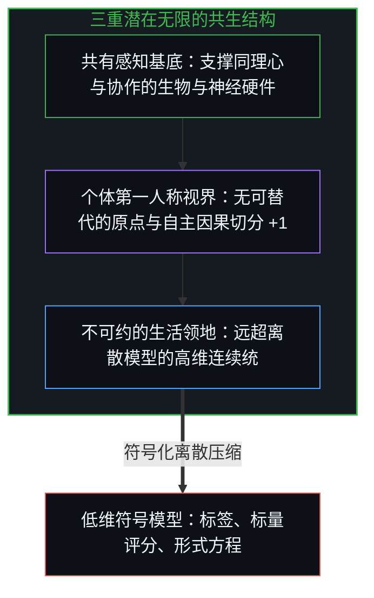
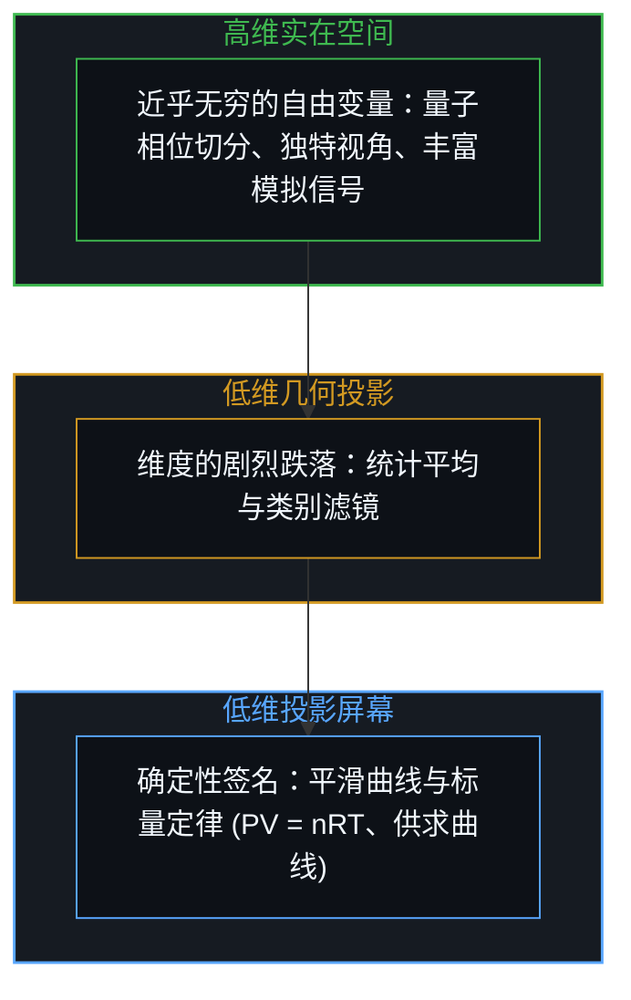
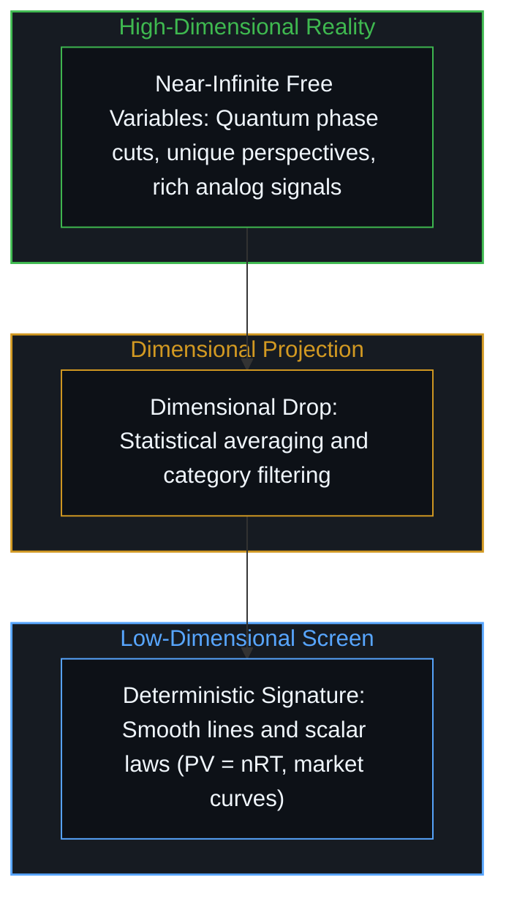
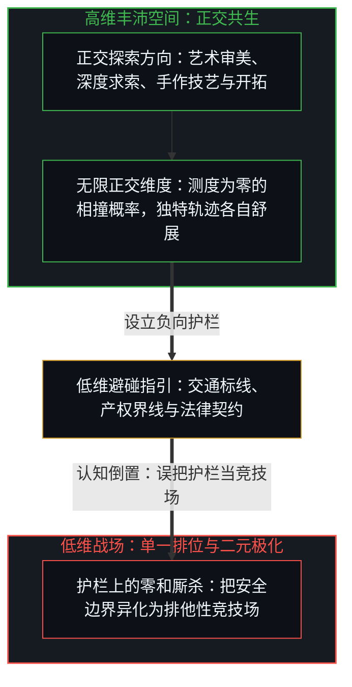
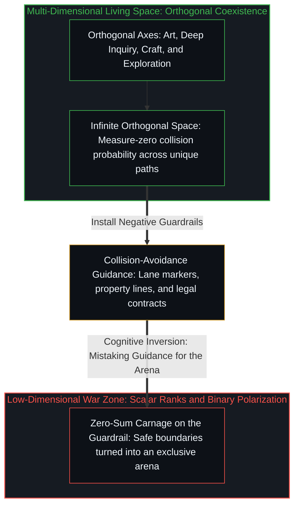
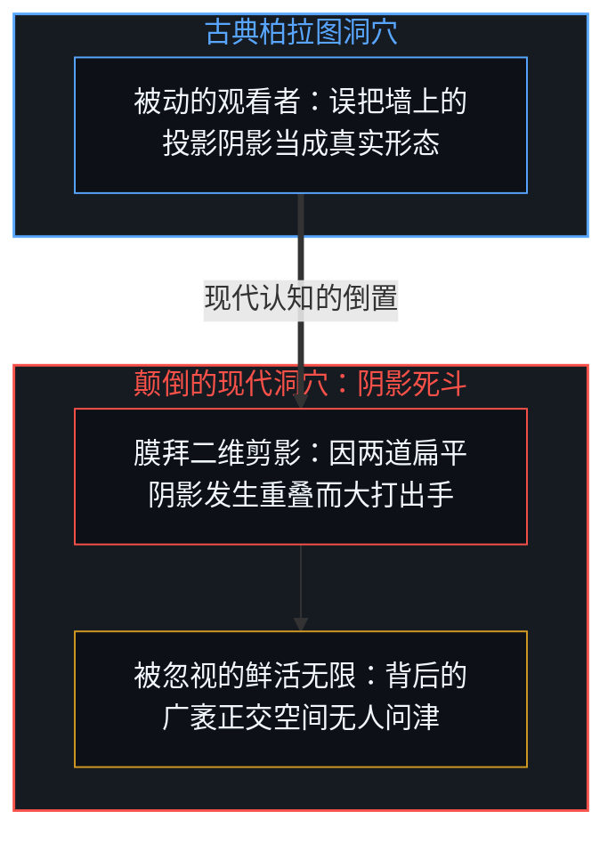
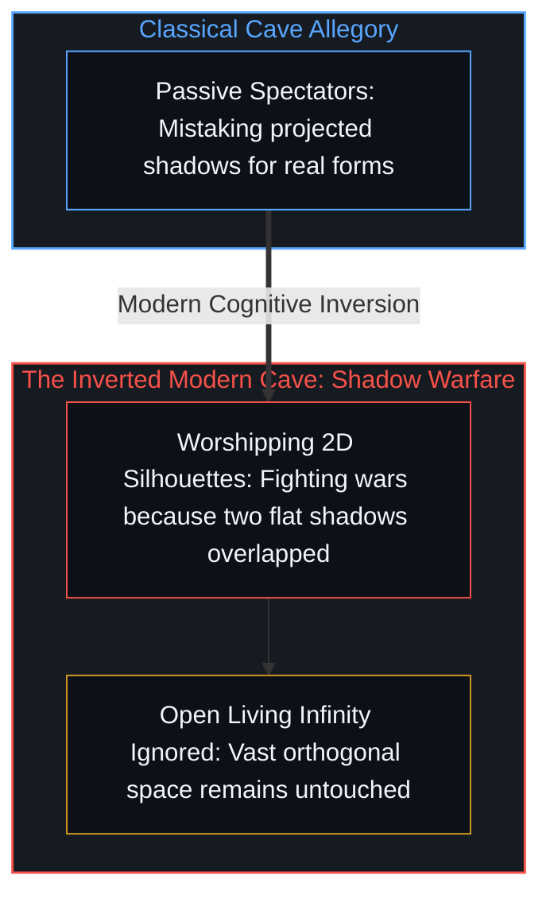
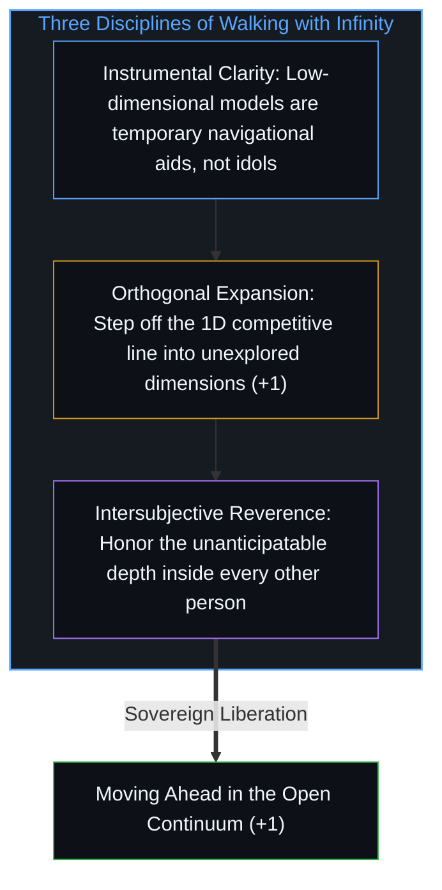

# 阴影与无限 / The Shadow and the Infinite

*低维投影、确定性假象与人类冲突的根源 / Low-dimensional projections, the illusion of certainty, and the roots of human conflict.*

在物理与生物实在的无限高维空间中，存在着足以容纳无数个体互不碰撞、丰沛共生的广袤天地。规则与边界原本只是规避冲突的避碰指引，然而当我们误将护栏当成竞技场、执迷于低维投影的单一标尺时，多维的生存空间便被异化为逼仄惨烈的低维绞杀战场。

In the high-dimensional reality of the physical and biological cosmos, there is boundless room for distinct individuals to coexist without colliding. Rules and boundaries serve only as guidance to avoid conflict. Yet the moment the guardrail is mistaken for the game and living richness is collapsed onto low-dimensional projections, a multi-dimensional living space turns into a low-dimensional war zone.

## 一、 基底、视角与领地的三重无限 / 1. The Threefold Infinity of Substrate, Vantage, and Territory

当我们审视人类存在的处境时，首先会迎面遇上三个相互交织、却又呈现出不同维度的“潜在无限”。

Examining the condition of human existence immediately surfaces three intertwined layers of potential infinity.

第一重无限，是感知基底的相通。每一个活着的人类，都在生理结构上继承了高度相似的感知与神经硬件：视网膜对相同波长的电磁波产生光化学反应，耳蜗将空气压力波翻译为相同的电信号，数十亿神经元在相似的生物化学节律中震荡。就一切实践目的而言，这一套经过数亿年演化沉淀下来的感知基底，其所能承载的体验丰富度接近于无限。正是这种同构的感知硬件，使得我们可以共同凝望同一轮明月，听懂同一段旋律，感知相同的寒意，并分享面包。它构成了同理心、语言与人类协作的生物基石。

The first infinity is the deep similarity of the perceptual substrate. Every living human inherits practically identical sensory and biological hardware: retinas sensitive to the same narrow band of electromagnetic waves, cochleas converting air oscillations into shared neural impulses, and billions of cortex neurons pulsing to shared biochemical rhythms. For all practical human purposes, this sensory substrate is infinitely rich. Because of this shared evolutionary foundation, different observers can gaze at the same moon, respond to the same chord, register the same cold, and break bread together. It forms the biological ground of resonance, language, and shared culture.

第二重无限，是第一人称视角的相异。尽管感知基底高度相通，但在这个世界上，从来没有两个人看到过相同的世界。每一个心智都坐落在时空中无可替代的坐标原点上，承载着由不可逆的个体记忆、成长印记与注意力取向所塑造的独特视界。每一个心智都是一个独立的主权变量，正在当下做出自主的因果切分（+1）。即便两个人并肩站立在同一棵橡树下，一人看见的是避暑的绿荫，另一人想起的是童年攀爬的跌落，第三人评估的是木材的经济价值。就一切实践目的而言，个体心智之间的视界差异同样接近于无限。

The second infinity is the divergence of the first-person vantage. Despite this shared substrate, no two human beings have ever inhabited the same perceptual world. Every conscious observer sits at an irreplicable origin in spacetime, shaped by an irreversible trajectory of individual memories, formative wounds, and attentional orientations. Every Mind acts as an independent sovereign locus making its own causal cut in the present (+1). If three people stand beneath the same oak, one registers shelter from the midday sun, another recalls a childhood fall from its branches, and a third calculates the timber value. For all practical purposes, the divergence between human Minds is equally infinite.

第三重无限，是生活实在与信息模型之间的非对称鸿沟。我们所直接感知到的物理与生物世界，是一个不可约减的高维连续统。当你咬下一口苹果时，口腔与大脑在实时处理成百上千种挥发性芳香分子、细胞壁破裂的质构张力、温度梯度与漫长的演化记忆；而我们对这一动作的理性理解，不过是几行脱水离散的符号与概念——“它很甜”、“含有果糖”、“六十卡路里”。理解是离散的信息压缩，而感知到的实在则是无边的高维海洋。冲突生长于无限可能与无限误解之间的落差，[理解的非对称性](../the-asymmetry-of-understanding/)命名了这种不对称；正如[你的代码库即是记忆](../your-codebase-is-memory/)所揭示的，任何形式模型、账本或外化代码库都只是过往切分留下的压缩记忆痕迹，而非那片鲜活的场域本身。

The third infinity is the asymmetric chasm between living reality and informational models. Directly perceived physical and biological reality is an irreducible, high-dimensional analog continuum. Tasting an apple processes hundreds of volatile compounds, cell-turgor shear stresses, temperature gradients, and evolutionary traces in real time. Rational description of that moment, by contrast, is a tiny cluster of dehydrated symbols: "it is sweet," "it contains fructose," "it has sixty calories." Because [Your Codebase Is Memory](../your-codebase-is-memory/)—every formal model, ledger, or externalized codebase is a compressed residue of distinctions already drawn rather than the self-distinguishing activity at the steering edge—discrete symbols never exhaust the unbounded field, and conflict grows from the gap between open possibility and compressed misunderstanding that [The Asymmetry of Understanding](../the-asymmetry-of-understanding/) traces.

正如我们在[潜在无限与数学思维的暂态闭合](../potential-infinity-and-the-temporary-closures-of-mathematical-thought/)中所论证的，这些无限不是数学上已经完成的封闭集合，而是向着未知持续敞开的潜在无限。

[Potential Infinity and the Temporary Closures of Mathematical Thought](../potential-infinity-and-the-temporary-closures-of-mathematical-thought/) traces why these infinities are not completed totalities frozen into mathematical sets, but open-ended horizons of potential infinity unfolding across living experience.

## 二、 从鲜活无限到确定性签名的维度暴跌 / 2. The Dimensional Drop from Living Infinity to Deterministic Signature

面对如此广袤的三重无限，一个耐人寻味的科学问题浮现出来：为什么物理学与社会学总能推导出简洁、优美且看似分毫不差的“确定性定律”？

Given this threefold infinity, a structural question arises: why do physics and sociology continually register clean, apparently rigid "deterministic laws"?

答案在于维度投影的数学机制：所谓的确定性，并不是宇宙底层的本体论法则，而是我们将无限高维的鲜活实在投影到低维坐标系时，必然浮现的数学签名。

The answer lies in the geometry of dimensional projection: determinism is not an ontological law of the deep cosmos; determinism is the mathematical signature that appears whenever a high-dimensional reality is projected onto a low-dimensional space.

我们可以观察这种维度的跌落如何在不同学科中运作。在热力学中，一立方米的气体包含数以十万亿亿计的气体分子，每一个分子都在量子与电磁尺度经历着难以追踪的高维微观碰撞。然而当物理学家将这庞大复杂的高维运动投影到由三个宏观统计平均量构成的三维空间——压强（P）、体积（V）与温度（T）时，微观涨落便在大数定律下彼此抵消，理想气体状态方程 PV = nRT 随即浮现。物理学家惊叹于发现了确定性的自然铁律，却忘了这一定律只是剧烈降维后投下的平滑统计阴影。

Consider how this dimensional drop operates across disciplines. In thermodynamics, a single cubic meter of gas contains tens of sextillions of molecules, each undergoing unpredictable, high-dimensional micro-collisions. Yet when a physicist projects this complexity onto a simple three-dimensional space of macroscopic averages—Pressure (P), Volume (V), and Temperature (T)—microscopic variances cancel out under the Law of Large Numbers, and the ideal gas law PV = nRT appears. The physicist marvels at having uncovered a deterministic natural law, forgetting that this law is the smooth statistical shadow cast by a dimensional collapse.

在经济学与社会学中，八十亿人类拥有近乎无限的内心世界、各异的情感历史与不可预测的主权抉择。当制度机构将这八十亿个高维行动者投影到低维指标上——单一维度的价格、标量信用评分或二元选票——个体之间的正交差异便随之消失。在那个被压平的空间里，群体展现出平滑的供求曲线与可预测的周期趋势。理论家由此宣布人类是机械的效用最大化机器，把测量框架造成的压平当成了人类能动性的本相。从无处之景提出的低维方案，正是[隐秘的上帝之眼](../the-invisible-gods-eye/)所揭示的上帝之眼。

In economics and sociology, eight billion human beings possess near-infinite inner worlds, singular emotional histories, and unpredictable sovereign choices. When an institution projects these high-dimensional agents onto low-dimensional metrics—a one-dimensional price, a scalar credit rating, or a binary vote—the orthogonal differences vanish. In that flattened space, the collective manifests smooth demand curves and predictable trends. Theorists declare that human beings are mechanical utility-maximizers, confusing the flattening of the measurement frame with the nature of human agency. A low-dimensional solution proposed from nowhere is the god's eye [The Invisible God's Eye](../the-invisible-gods-eye/) exposes.

确定性不是大自然的内在骨架；确定性是高维实在遭遇低维测量仪器、被抹去高阶自由度之后残留的低维投影痕迹。按影子给学生排名的教育，把探索变成了零和竞技场，[教育与科学的倒置](../the-reversal-of-education-and-science/)说明了这一点。

Determinism is not the structural bedrock of the universe; determinism is the shadow left behind when high-dimensional reality is stripped of its higher degrees of freedom by a low-dimensional instrument, and ranking students by those shadows turns inquiry into the zero-sum arena [The Inversion of Education and Science](../the-reversal-of-education-and-science/) traces.

## 三、 拥挤的投影幕与低维冲突的爆发 / 3. The Cramped Screen and Why Conflict Breaks Out in Low Dimensions

理解了维度的坍缩，我们便获得了一把解开人类冲突、攀比与零和博弈的几何钥匙：在物理与生物实在的高维空间中，存在着无数的正交方向，足以容纳独特的个体互不干扰地丰沛共生；然而一旦将人类的生活挤压进低维的单一标尺，人造的拥挤与恶性碰撞便成为数学上的必然。

Understanding this dimensional collapse provides a geometric key to deciphering human conflict, rivalry, and zero-sum warfare: in the high-dimensional reality of the physical and biological cosmos, there are boundless orthogonal directions capable of sustaining unique individuals without mutual interference, yet the moment human existence is compressed onto low-dimensional scalar metrics, artificial congestion and collision become mathematically inevitable.

在高等数学中，高维空间具有一个奇妙的几何特性：两个复杂的高维流形在广袤的定义域中穿行时，它们发生相交的概率在测度论上为零。在生活实在的敞开因果领地里，有人潜心于植物园艺，有人探索天文理论，有人在工坊里雕琢木器，有人在高山上修筑步道。人类生存的自然轴线近乎无限，每一个生命都能开辟出属于自己的独特轨迹，而不必挤占他人的空间。

In high-dimensional geometry, when two complex manifolds traverse an expansive domain, the probability of their intersection is measure-zero. In the open causal territory of living reality, one person immerses themselves in botanical gardening, another explores astronomical theory, a third crafts wooden furniture, and a fourth builds alpine footpaths. The natural axes of human existence are practically infinite. Every life can carve out its own unique trajectory without crowding anyone else.

低维投影通过三个相连的步骤摧毁了这种自然丰沛。第一步是单一维度的排队：当社会评价将丰富的人生坍缩为单一标量指标——如净资产数字、粉丝数量、机构头衔或权力位阶——原本向四面八方展开的多维空间便被压扁成一条狭窄的一维走廊。第二步是碰撞的不可避免：在一条一维直线上，几何学只允许两种相对状态，你要么跑在我前面，要么挡在我路上，于是你的前进登记为我的落后，你的获得登记为我的被剥夺。第三步是人造稀缺与恶性内卷：无边的宇宙被一张低维投影幕制造出人造的拥挤，无数本可以沿正交方向各自绽放的鲜活心智，被迫挤在同一根细线上彼此攀比、嫉妒与撕扯。世界线是被当成鹿本身的影子，[四维长鹿的幻象与当下的模型](../the-myth-of-the-four-dimensional-deer-and-the-present-model/)说明了这一点。

Low-dimensional projections destroy this natural abundance through three connected steps. First comes the linear queue: the moment society collapses the richness of human life onto a single scalar metric—such as net worth, follower counts, institutional pedigree, or political hierarchy—an expansive multidimensional space is flattened into a narrow one-dimensional corridor. Second comes the inevitability of collision: on a one-dimensional line, geometry permits only two relative states, where one agent is either ahead of another or blocking the way, so another's advancement registers as demotion and another's gain registers as dispossession. Third comes manufactured scarcity and rivalry: an unbounded cosmos is converted into artificial congestion by a low-dimensional screen, forcing vibrant Minds who could have flourished along orthogonal paths onto a single wire to fight, envy, and tear at one another—the same dimensional inversion [The Myth of the Four-Dimensional Deer and the Present Model](../the-myth-of-the-four-dimensional-deer-and-the-present-model/) traces when a worldline shadow is taken for the living deer.

更深层的反讽在于人类最初为何要发明这些低维标尺与边界。人类并不是出于残忍才发明交通标线、产权界桩、法律条文与货币标准。最初，每一道低维边界都是为了一个务实的目的而设立的：作为规避冲突的避碰指引。在广袤的大陆上，公路上画出的分道黄线不是为了让人在上面安家落户，而是一道负向护栏，让两辆高速行驶的汽车能够平安错车，继续驶向各自的目的地。契约、产权与社会礼仪原本是导航缓冲带，旨在防止不同个体在开拓各自的正交路径时发生无谓的碰撞。

The deeper irony lies in why humanity invented low-dimensional metrics and boundaries in the first place. Humanity did not invent lane markers, property boundaries, legal statutes, and currency standards out of cruelty. Originally, every low-dimensional boundary was constructed for a single practical purpose: as guidance to avoid conflict. On an expansive continent, the painted line dividing an asphalt highway does not exist to be lived upon; it is a negative guardrail designed so that two high-dimensional vehicles can pass each other safely and proceed toward their separate destinations. Contracts, property deeds, and social etiquette were designed as navigational buffers so that individuals could cultivate their distinct orthogonal paths without colliding.

然而文明经历了一场认知倒置：我们把规避冲突的避碰指引，当成了必须全力厮杀的零和博弈。我们不再自由行走于辽阔的多维大地、仅用护栏防止意外刮蹭，反而集体爬到了狭窄的护栏之上，把分流标线变成了唯一的竞技场：谁排在线上第一位？谁挡了谁的路？谁又该被挤下边缘？

Yet civilization suffered a cognitive inversion: mistaking the guidance to avoid conflict for the zero-sum game itself. Instead of walking freely across the multidimensional landscape and using the guardrails to prevent accidental friction, agents climbed on top of the guardrails, turning the collision-avoidance divider into the exclusive field of play: Who ranks first on the line? Who is blocking whom? Who must be shoved off the edge?

这就是我们如何亲手将丰沛辽阔的多维生存空间，异化为逼仄惨烈的低维战场。在无限的正交维度中本属于测度为零的干扰概率，在一条被压平的水泥细带上变成了无处可逃的淘汰赛。意识形态的仇恨、科层地位的焦虑与部族对抗的苦涩，并不源于自然的物理匮乏，而是心智被困在低维投影幕上所遭受的维度窒息。

This is how a multi-dimensional living space turns into a low-dimensional war zone. What would have been a measure-zero probability of interference across orthogonal dimensions becomes an inescapable tournament on a flattened strip of concrete. Ideological warfare, bureaucratic status anxiety, and tribal bitterness do not stem from natural physical scarcity; they are the symptoms of dimensional suffocation caused by trapping the Mind inside low-dimensional projections.

## 四、 柏拉图洞穴的颠倒与阴影之战 / 4. The Inversion of Plato's Cave and Fighting over Colliding Shadows

两千四百年前，柏拉图在《理想国》中提出了著名的洞穴寓言：被铁链锁住、无法转头的囚徒，将火光投射在石壁上的木偶阴影当成了真实的世界。而现代文明今天上演的剧目比柏拉图的设想更进了一步：人类不仅把扁平的投影当成了实在，更在洞穴深处发起了一场场永无休止的阴影之战。

Twenty-four hundred years ago, Plato presented his Allegory of the Cave in *The Republic*: chained prisoners, unable to turn their heads, mistook the flickering shadows of puppets cast by firelight onto stone walls for the true universe. Yet the drama modern civilization enacts today goes a step further than Plato imagined. Humanity does not merely mistake flat projections for reality; deep within the cave, agents launch an endless series of shadow wars.

审视那些充斥于数字网络、立法议会与家庭餐桌上的激烈争吵，人们争夺的并不是鲜活的领地，而是各自被压扁的低维阴影的碰撞。意识形态狂热者把生生不息的人类社会强行塞进僵硬的二元标签——如“进步与反动”或“纯洁与腐化”——看不见眼前那个抚育幼子、会为音乐动容的活人，只看得见教条滤镜投下的敌对黑影，甚至不惜为了消灭墙上那道扁平的黑影而点燃活生生的世界。科层指标的膜拜者把教育的火花压缩为标准化考试的百分位，把医疗的尊严压缩为病床周转配额，把城市街区的生机压缩为单一的整洁度指标；每当鲜活的人性伸出枝桠、超出电子表格的边界时，他们便挥动规章的剪刀将其修剪成合乎二维表格的形状。而防御性的自我则在年轻时早早固定下一幅低维的自我画像——某个地位徽章、长期的受害者身份或永不犯错的权威形象——此后不再向着新经验的鲜活无限延展，而是耗尽毕生精力去抵御任何可能擦破这幅脆弱二维剪影的微风。每一道影子仍投在自己的心智之内，[无法逃逸的心智视界](../one-cannot-escape-ones-own-mind/)对此说得一清二楚。

Observe the bitter arguments raging across digital networks, legislative assemblies, and dining tables, where people fight not over the living territory, but over the collision of their flattened low-dimensional shadows. The ideological zealot compresses the kaleidoscopic metabolism of society into a rigid binary label—such as "progressive versus reactionary" or "pure versus corrupted"—seeing not the breathing human being caring for a child or moved by music, but only the hostile silhouette cast by an ideological filter, and willing to set the living world on fire to annihilate that flat shadow on the wall. The bureaucratic metric worshipper collapses the spark of education into standardized test percentiles, the dignity of medical care into patient-turnaround quotas, and the vitality of an urban neighborhood into sanitized zoning metrics, wielding regulatory shears whenever living human nature branches outward beyond the margins of the spreadsheet. And the defensive ego fixes an early low-dimensional self-image—a badge of status, a chronic grievance identity, or an image of unbroken infallibility—consuming its remaining vitality defending that fragile two-dimensional silhouette against every passing breeze rather than expanding into new experience, even though every shadow is still cast and held inside the observer's own first-person field, the irrevocable locus [One Cannot Escape One's Own Mind](../one-cannot-escape-ones-own-mind/) traces.

当两道扁平的影子在石壁上重叠时，影子不会感到疼痛，投射出这些影子的活人却拔刀相向、流下真实的鲜血。这就是低维执迷带来的代价。

When two flat shadows overlap on a stone wall, the shadows feel no pain; yet the living beings who cast them draw swords and spill real blood. That is the cost of low-dimensional fixation.

## 五、 走出阴影之战，与无限同行 / 5. Walking with Infinity Beyond the Shadow War

如果人类冲突的根源在于低维执迷，那么解脱之道便不在于在被压平的陷阱里争夺霸权，而在于走下投影幕，转过身来，在感知、行动与人际相遇中通过三项相连的自觉与无限同行。

If the genesis of human conflict lies in low-dimensional fixation, then liberation cannot be won by fighting for supremacy inside the flattened trap. It requires stepping off the screen, turning around, and walking ahead with infinity through three connected disciplines in perception, action, and human encounter.

第一项自觉是工具性清醒：把模型当作工具，而非偶像。我们无需抛弃低维模型。科学方程、货币价格、地图与分类词汇是极好用的导航仪器。一张地图正是通过舍弃九成九的地形细节，才帮助我们穿越群山。但脚踏实地的行者记得，地图是服务于生命的工具，人类降生于世不是为了充当纸面上的坐标点。任何时候，一旦某个理论模型、考核指标或意识形态信条试图反客为主，要求牺牲鲜活的实在来维护其图表的整洁，我们便能当场看清它的位置：它只是一幅扁平的投影。撕掉图纸，实在毫发无伤。低维规则与边界只是用来防止碰撞的导航护栏，不是必须拼死博弈的竞技场；我们借它保持安全通行，随后便把注意力转回敞开的正交旷野。

First is instrumental clarity: treating the model as a tool, never an idol. Low-dimensional models need not be discarded. Scientific equations, monetary prices, maps, and vocabularies are extraordinary navigational aids. A map helps cross mountain ranges precisely by discarding ninety-nine percent of terrain details. Yet the grounded walker remembers that the map is an instrument serving life, and human beings were not born to become coordinates on paper. Whenever a theoretical model, institutional metric, or ideological creed attempts to usurp authority, demanding the sacrifice of living reality to preserve the neatness of its chart, it registers for what it is: a flat projection. Tear the paper, and reality remains unharmed. Low-dimensional boundaries and rules are navigational guardrails designed to avoid collisions, not arenas for a fight to the death; they serve to maintain safe passage before attention returns to the open, orthogonal wilderness.

第二项自觉是正交开拓：走出一维跑道。每当我们发现自己陷入长期的地位攀比、防御性姿态或意识形态敌意时，可以停下来问问自己正站在哪一块低维屏幕上。他人大可沿着自己选定的线性走廊，为某个机构头衔、净资产数字或教条正统争得不可开交，但没有人有义务在那条一维跑道上陪跑。宇宙拥有无数的正交轴线——通往真诚的好奇心、未被命名的创造技艺、笃实的关怀与未测绘的地平线。当一个心智迈入新的正交维度，原本的竞争对手在几何学上便失去了与它相撞的可能。广阔的自由属于那些敢于开辟不拥挤轴线的人。

Second is orthogonal expansion: stepping off the one-dimensional track. Whenever a center finds itself trapped in chronic status envy, defensive posturing, or ideological hostility, it can pause and ask which low-dimensional screen it is standing upon. Others may be battling over a corporate title, a net worth metric, or an ideological orthodoxy along their chosen linear corridor, yet no one is obliged to sprint down that one-dimensional track. The cosmos contains boundless orthogonal axes—toward open curiosity, unspoken creative crafts, honest care, and unmapped horizons. The moment a Mind steps into a new orthogonal dimension, competitors lose the geometric ability to collide with it. Freedom belongs to those who open an uncrowded axis.

第三项自觉是同侪敬畏：直面不可穷尽的他人。当凝视另一个人的眼睛时，我们可以放下先入之见拼凑出来的扁平漫画。眼前的这个人不仅与我们共享着支撑目光的深邃生物硬件，更怀揣着一个由独特记忆、隐秘悲欢与主权抉择编织而成的平行宇宙。他的突然发怒、令人费解的决定或陌生的观点，背后都有一条绵延的因果连续统在支撑，非任何表层标签所能囊括。当我们以面对一个不可穷尽世界的敬重去对待另一个生命时，低维的摩擦便随之消散，为真实的共鸣腾出空间。

Third is intersubjective reverence: facing the inexhaustible other. Looking into the eyes of another person means setting aside the flat caricature constructed by preconceptions. The person across the table shares the same biological hardware that supports one's own gaze, while harboring a parallel cosmos of unique memories, private sorrows, and sovereign choices. Their sudden outburst, their confusing decision, or their unfamiliar viewpoint is upheld by an expansive causal continuum that no superficial label can encompass. Approaching another being with the respect due to an inexhaustible world lets low-dimensional friction subside, clearing the path for mutual resonance.

## 六、 在不可穷尽的连续统中自由呼吸 / 6. Breathing Freely in the Unbounded Continuum

我们生活在一个敞开、未闭合、不可穷尽的宇宙之中。大地不是一片拥挤不堪的荒原，人类的生存也不是一场由算法裁定的零和死斗。物理与生物实在具有如此深广的维度与丰沛的容量，足以承载数十亿条独特的主权轨迹并肩闪耀，而互不遮蔽光芒。

Living reality is an open, unclosed, inexhaustible cosmos. The living earth is not a congested wasteland, nor is human existence a zero-sum deathmatch dictated by algorithms. Physical and biological reality has such dimensionality and abundance that it can sustain billions of unique sovereign trajectories, shining alongside one another without blocking the light.

人造的苦难，始于我们把避碰的指引误认为零和的竞技场，将不可穷尽的多维生存空间异化为逼仄的战争囚笼；而清醒与安宁，则始于我们走下狭窄的护栏，看穿低维阴影的虚张声势，重新迈入无边无际的因果旷野。

Manufactured misery begins when collision-avoidance guidance is mistaken for a zero-sum arena, turning an inexhaustible multi-dimensional living space into a cramped cage of war; clarity and peace arrive the moment a Mind steps off the narrow guardrail, sees through the bluster of low-dimensional shadows, and steps back into the unconfined causal wild.

阴影没有未来，唯有鲜活的能动性在开辟明天的边界。与其在石壁前为扁平的幻影混战，不如转过身来，迈入敞开的领地，与无限同行。

Shadows possess no future; only living agency carves the frontier of tomorrow. Rather than battling over flat phantoms on the stone wall, a Mind can turn around, step into the open territory, and walk ahead with infinity.
