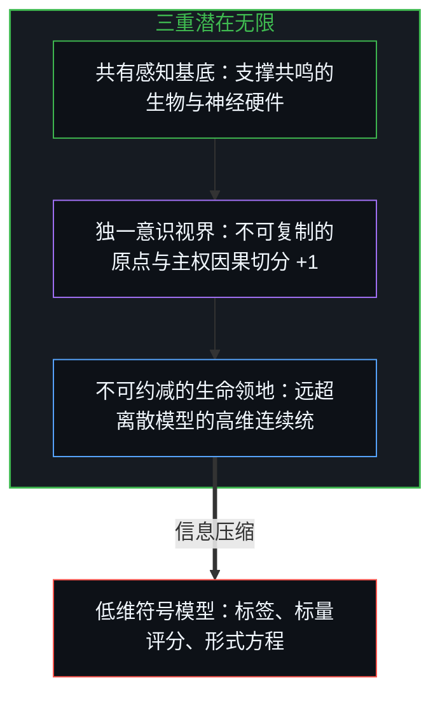
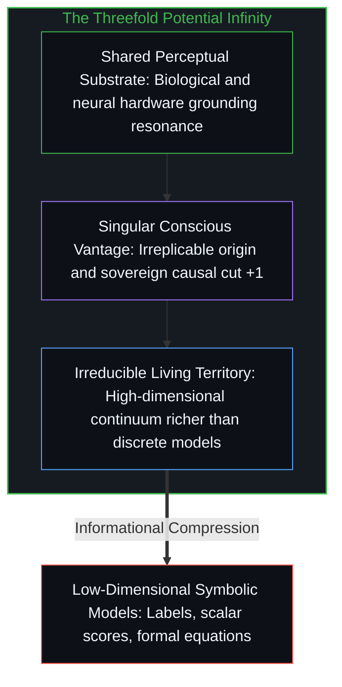
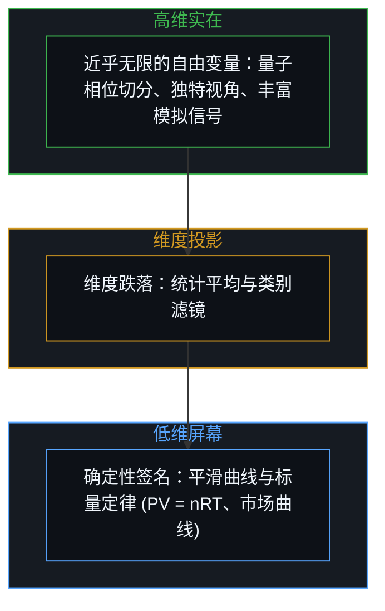
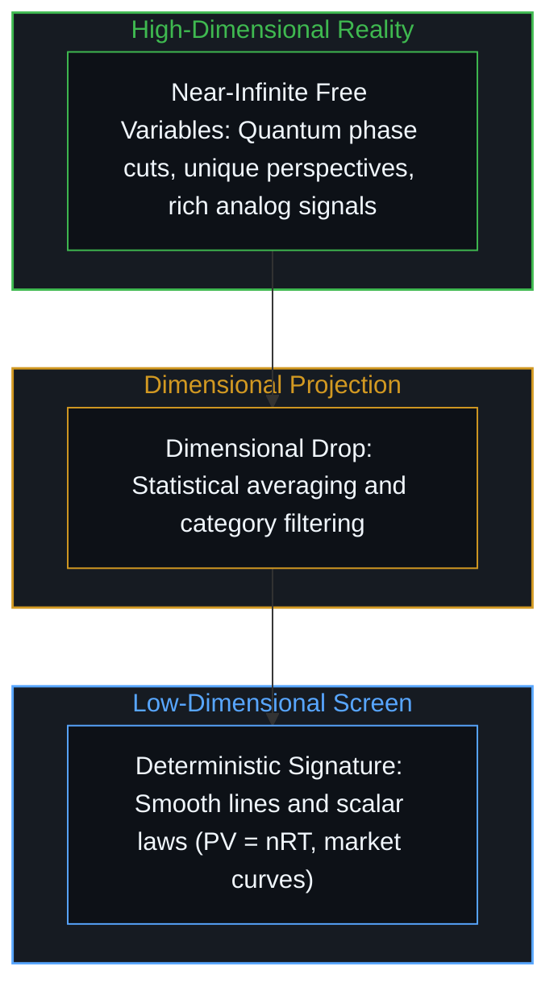
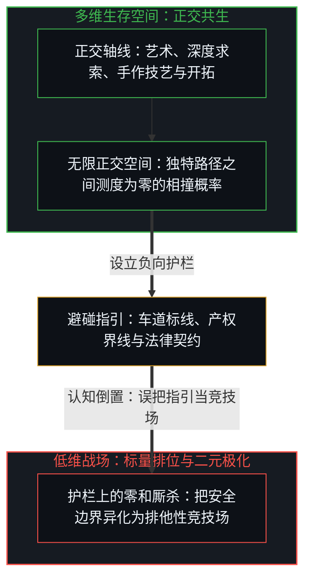
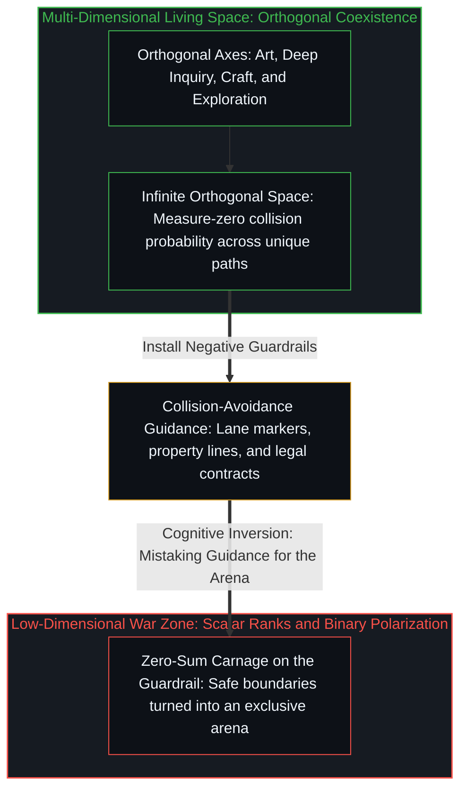
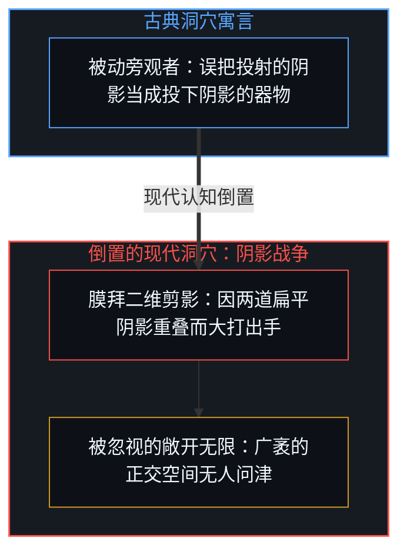
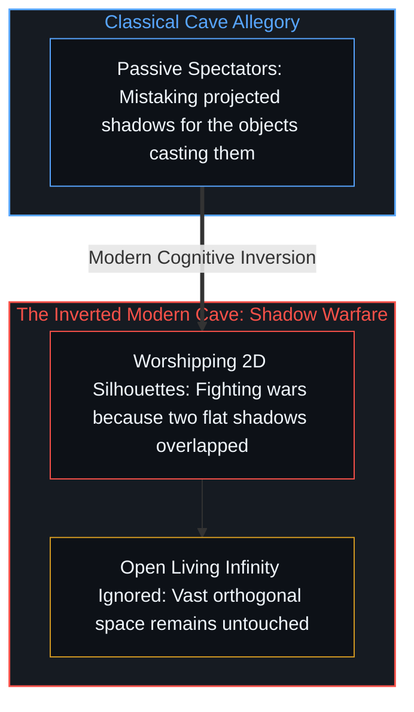
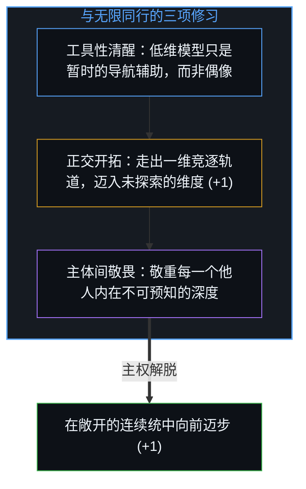
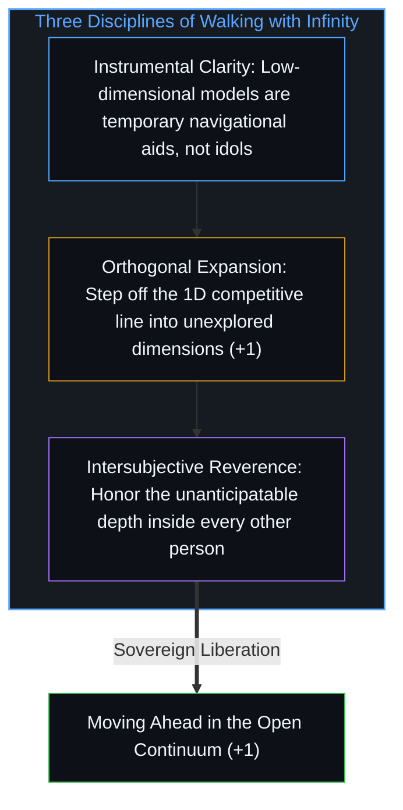

# 阴影与无限 / The Shadow and the Infinite

*将高维实在坍缩为低维阴影会滋生确定性幻象，并将避碰护栏异化为厮杀战场。 / Collapsing high-dimensional reality into low-dimensional shadows breeds illusions of certainty and turns guardrails into war zones.*

在物理与生物实在的高维空间中，存在着足以容纳不同个体互不碰撞、并肩共生的广袤天地。规则与边界原本只是规避冲突的避碰指引。然而一旦把护栏误当成博弈本身、把鲜活的丰沛坍缩为低维投影，多维的生存空间便退化为逼仄的低维战场。

In the high-dimensional reality of the physical and biological cosmos, there is boundless room for distinct individuals to coexist without colliding. Rules and boundaries serve only as guidance to avoid conflict. Yet the moment the guardrail is mistaken for the game and living richness is collapsed onto low-dimensional projections, a multi-dimensional living space turns into a low-dimensional war zone.

## 一、 基底、视角与领地的三重无限 / 1. The Threefold Infinity of Substrate, Vantage, and Territory

自我区分的活动无因且不息地发生，第一人称视角与因果性作为同一枚硬币的两面同步运转。在任何一个离散瞬间，意识中主动分辨出的自由度都是有限的，但这一边界从不固定或闭合；随着注意力不断做出新的区分（+1），边界持续移动并敞开。在人类存在的境况中，这一未闭合的前沿显现为三重相互交织的潜在无限。

Self-distinguishing activity occurs—uncaused, unceasing—with the first-person perspective and causality operating as two sides of the same coin. At any discrete instant, the degrees of freedom actively resolved in awareness are strictly finite, yet that boundary is never fixed or closed; it shifts and opens continuously as attention draws new distinctions (+1). Across human existence, this unclosed frontier surfaces as three intertwined layers of potential infinity.

第一重无限，是感知基底的深度相通。每一个活着的人类，都在生理结构上继承了高度一致的感官与生物硬件：视网膜对同一窄带电磁波产生光化学反应，耳蜗将空气振动转化为可比的神经脉冲，数十亿皮层神经元在相近的生物化学节律中脉动。尽管在任意单一时刻都是有限的，这一演化基底所能登记的体验组合在一切人类实践意义上都保持敞开。正因为这种同构的具身结构，来自不同观察者的返回痕迹得以彼此强化——让不同的心智能够凝望同一轮明月，回应同一组和弦，感知相同的寒意，并坐在一起分食面包。它构成了共鸣、语言与共有文化的生物基石。

The first infinity is the deep convergence of the perceptual substrate. Every living human inherits closely aligned sensory and biological hardware: retinas sensitive to the same narrow band of electromagnetic waves, cochleas converting air oscillations into comparable neural impulses, and billions of cortical neurons pulsing to kindred biochemical rhythms. While finite at any single moment, the experiential combinations this evolutionary substrate can register remain open-ended for all practical human purposes. Because of this convergent embodiment, returning traces from distinct observers can reinforce one another—allowing different Minds to gaze at the same moon, respond to the same chord, register the same cold, and break bread together. It forms the biological ground of resonance, language, and shared culture.

第二重无限，是第一人称视角的发散。跨越共有基底的共鸣是彼此强化，从不是共享同一个内部世界：从来没有两个人栖居在同一个感知世界里。每一个有意识的观察者都坐落在时空中不可复制的原点上，由不可逆的个体记忆、成长创伤与注意力取向塑造成型。每一个心智都作为独立的主权中心，在当下做出自主的因果切分（+1）。三个人站在同一棵橡树下，一人登记到正午烈日下的荫蔽，另一人回想起童年从树枝上跌落的经历，第三人则估算着木材的价值。由于每个中心的递归都沿着各自的路径复利累积，人类心智之间的发散同样保持敞开。

The second infinity is the divergence of the first-person vantage. Resonance across a shared substrate is mutual reinforcement, never a shared interior: no two human beings have ever inhabited the same perceptual world. Every conscious observer sits at an irreplicable origin in spacetime, shaped by an irreversible trajectory of individual memories, formative wounds, and attentional orientations. Every Mind acts as an independent sovereign center making its own causal cut in the present (+1). If three people stand beneath the same oak, one registers shelter from the midday sun, another recalls a childhood fall from its branches, and a third calculates the timber value. Because each center's recursion compounds along its own path, the divergence between human Minds is equally open-ended.

第三重无限，是鲜活实在与信息模型之间的非对称鸿沟。直接感知到的物理与生物实在是不可约减的高维模拟连续统。品尝一口苹果时，生命前沿在实时处理成百上千种挥发性芳香化合物、细胞膨压的剪切应力、温度梯度与演化痕迹；而对这一时刻的理性描述，不过是一小簇脱水的离散符号：“它很甜”、“含有果糖”、“六十卡路里”。正如[你的代码库即是记忆](../your-codebase-is-memory/)所揭示的——任何形式模型、账本或外化代码库都只是过往已作区分留下的压缩残迹，而非掌舵前沿正在发生的自我区分活动本身——离散符号永远无法穷尽无边的场域，而冲突便生长于敞开的可能性与压缩的误解之间的落差，即[理解的非对称性](../the-asymmetry-of-understanding/)所追溯的结构。

The third infinity is the asymmetric chasm between living reality and informational models. Directly perceived physical and biological reality is an irreducible, high-dimensional analog continuum. Tasting an apple processes hundreds of volatile compounds, cell-turgor shear stresses, temperature gradients, and evolutionary traces at the living edge. Rational description of that moment, by contrast, is a tiny cluster of dehydrated symbols: "it is sweet," "it contains fructose," "it has sixty calories." Because [Your Codebase Is Memory](../your-codebase-is-memory/)—every formal model, ledger, or externalized codebase is a compressed residue of distinctions already drawn rather than the self-distinguishing activity at the steering edge—discrete symbols never exhaust the unbounded field, and conflict grows from the gap between open possibility and compressed misunderstanding that [The Asymmetry of Understanding](../the-asymmetry-of-understanding/) traces.

[潜无限与数学思维的暂时闭合](../potential-infinity-and-the-temporary-closures-of-mathematical-thought/)追溯了为什么这些无限不是冻结在数学集合中的已完成总体，而是通过连续区分活动不断展开的潜在无限视界。

[Potential Infinity and the Temporary Closures of Mathematical Thought](../potential-infinity-and-the-temporary-closures-of-mathematical-thought/) traces why these infinities are not completed totalities frozen into mathematical sets, but open-ended horizons of potential infinity unfolding through successive acts of distinction.

## 二、 从鲜活无限到确定性签名的维度跌落 / 2. The Dimensional Drop from Living Infinity to Deterministic Signature

面对这一三重潜在无限，一个结构性问题随之浮现：为什么物理学与社会学总能登记到简洁、看似刚性的“确定性定律”？

Given this threefold potential infinity, a structural question arises: why do physics and sociology continually register clean, apparently rigid "deterministic laws"?

答案在于维度投影的几何结构：确定性并不是深层宇宙的本体论法则；确定性是将高维实在投影到低维坐标空间时浮现出的数学签名。

The answer lies in the geometry of dimensional projection: determinism is not an ontological law of the deep cosmos; determinism is the mathematical signature that appears whenever a high-dimensional reality is projected onto a low-dimensional coordinate space.

审视这种维度跌落如何在不同学科中运作。在热力学中，一立方米气体包含数以十万亿亿计的分子，每个分子都在经历高维微观碰撞。当物理学家将这一复杂运动投影到由三个宏观平均量构成的三维空间——压强（P）、体积（V）与温度（T）时，微观涨落在大数定律下彼此抵消，理想气体状态方程 PV = nRT 随即显现。在其括号限定的工程适用范围内，这一压缩是可靠的工具；倒置始于观察者惊叹自己发现了确定性的自然铁律，却忘记该方程只是舍弃底层自由度之后投下的平滑统计阴影。

Consider how this dimensional drop operates across disciplines. In thermodynamics, a single cubic meter of gas contains tens of sextillions of molecules, each undergoing high-dimensional micro-collisions. When a physicist projects this complexity onto a three-dimensional space of macroscopic averages—Pressure (P), Volume (V), and Temperature (T)—microscopic variances cancel out under the Law of Large Numbers, and the ideal gas law PV = nRT appears. Within its bracketed engineering scope, this compression is a reliable instrument; the inversion begins when the observer marvels at having uncovered a deterministic iron law of nature, forgetting that the equation is a smooth statistical shadow cast by discarding the underlying degrees of freedom.

在经济学与社会学中，八十亿人类拥有敞开的内心世界、独特的情感历史与不可约减的主权抉择（+1）。当制度机构将这些高维行动者投影到低维指标上——一维的价格、标量信用评分或二元选票——他们的正交差异便从图表上消失。在那个被压平的子空间里，群体呈现出平滑的需求曲线与规律性趋势。这一投影在宏观协调中颇具效用，但当理论家宣布人类是机械的效用最大化者、把测量框架造成的压平与人类能动性的本相混为一谈时，模型便触及了其成立前提的边界。从想象的外部视角提出的低维公式，正是[隐秘的上帝之眼](../the-invisible-gods-eye/)所揭示的上帝之眼。

In economics and sociology, eight billion human beings possess open-ended inner worlds, singular emotional histories, and irreducible sovereign choices (+1). When an institution projects these high-dimensional agents onto low-dimensional metrics—a one-dimensional price, a scalar credit rating, or a binary vote—their orthogonal differences vanish from the chart. In that flattened subspace, the collective manifests smooth demand curves and regular trends. Useful for macro-scale coordination, the projection reaches its boundary when theorists declare that human beings are mechanical utility-maximizers, confusing the flattening of the measurement frame with the nature of human agency. A low-dimensional formula proposed from an imagined exterior is the god's eye [The Invisible God's Eye](../the-invisible-gods-eye/) exposes.

确定性不是宇宙的结构基岩；确定性是高维实在被低维仪器剥离高阶自由度之后留下的编译阴影，而按这些阴影给学生排名，便把求索变成了[教育与科学的倒置](../the-reversal-of-education-and-science/)所追溯的零和竞技场。

Determinism is not the structural bedrock of the universe; determinism is the compiled shadow left behind when high-dimensional reality is stripped of its higher degrees of freedom by a low-dimensional instrument, and ranking students by those shadows turns inquiry into the zero-sum arena [The Inversion of Education and Science](../the-reversal-of-education-and-science/) traces.

## 三、 逼仄的屏幕与低维冲突为何爆发 / 3. The Cramped Screen and Why Conflict Breaks Out in Low Dimensions

追溯这一维度坍缩，便获得了一把解开人类冲突、攀比与零和厮杀的几何钥匙：在物理与生物实在的高维空间中，无数的正交方向足以支撑独特的个体互不干扰地共存，然而一旦将人类存在压缩到低维标量指标上，人造的拥挤与碰撞便在数学上不可避免。

Tracing this dimensional collapse provides a geometric key to deciphering human conflict, rivalry, and zero-sum warfare: in the high-dimensional reality of the physical and biological cosmos, boundless orthogonal directions sustain unique individuals without mutual interference, yet the moment human existence is compressed onto low-dimensional scalar metrics, artificial congestion and collision become mathematically inevitable.

在高维几何中，当两个复杂流形穿行于广袤的定义域时，它们相交的概率在测度论上为零。在生命实在的敞开因果领地里，一人潜心于植物园艺，另一人探索天文理论，第三人雕琢木制家具，第四人修筑高山步道。人类存在的正交轴线不可穷尽，允许每个中心开辟独特的轨迹，而不必挤占另一中心的位点。

In high-dimensional geometry, when two complex manifolds traverse an expansive domain, the probability of their intersection is measure-zero. In the open causal territory of living reality, one person immerses themselves in botanical gardening, another explores astronomical theory, a third crafts wooden furniture, and a fourth builds alpine footpaths. The orthogonal axes of human existence are inexhaustible, allowing each center to carve out a distinct trajectory without crowding another's locus.

低维投影通过三个相连的步骤摧毁了这种丰沛。第一步是线性排队：当社会评价将人类生活的丰沛坍缩为单一标量指标——如净资产、粉丝数量、机构出身或政治位阶——辽阔的多维空间便被压扁成一条狭窄的一维走廊。第二步是碰撞的必然性：在一条一维直线上，几何结构只允许两种相对状态，一个行动者要么排在另一人前面，要么挡住去路，于是他人的前进登记为自身的降级，他人的收获登记为自身的被剥夺。第三步是人造稀缺与全序困局：正如[坐标系、心智与自由度](../coordinate-systems-mind-and-degrees-of-freedom/)所追溯的，将正交轨迹压缩到单一垂直阶梯上会同时困住阶梯的两端——既让顶端的极少数人陷入意义真空，因为压缩的标量数字无法支撑高维因果共鸣，又将绝大多数人锁入长期的向上攀比。把那条拥挤的一维投影误当成实在本身，正是[四维长鹿的幻象与当下的模型](../the-myth-of-the-four-dimensional-deer-and-the-present-model/)所揭示的把世界线阴影当成活鹿的同一维度倒置。

Low-dimensional projections destroy this abundance through three connected steps. First comes the linear queue: when social evaluation collapses the richness of human life onto a single scalar metric—such as net worth, follower counts, institutional pedigree, or political hierarchy—an expansive multidimensional space is flattened into a narrow one-dimensional corridor. Second comes the inevitability of collision: on a one-dimensional line, geometry permits only two relative states, where one agent is either ahead of another or blocking the way, so another's advancement registers as demotion and another's gain registers as dispossession. Third comes manufactured scarcity and total-ordering entrapment: as [Coordinate Systems, the Mind, and Degrees of Freedom](../coordinate-systems-mind-and-degrees-of-freedom/) traces, compressing orthogonal trajectories onto a single vertical ladder traps both ends of the hierarchy—starving the tiny minority at the top in a meaning vacuum because a compressed scalar numeral cannot sustain high-dimensional causal resonance, while locking the vast majority into chronic upward comparison. Mistaking that crowded one-dimensional projection for reality is the same dimensional inversion [The Myth of the Four-Dimensional Deer and the Present Model](../the-myth-of-the-four-dimensional-deer-and-the-present-model/) exposes when a worldline shadow is taken for the living deer.

更深层的反讽在于人类最初为何要发明低维指标与边界。人类并不是出于残忍才发明车道标线、产权界桩、法律条文与货币标准。最初，每一道低维边界都是为了务实的协调目的而建造的：作为规避冲突的避碰指引。在广袤的大陆上，沥青公路中间画出的分道线不是为了让人在上面安家落户，而是一道负向护栏，让两辆高维行驶的车辆能够安全错车，继续驶向各自的目的地。契约、地契与公共协议原本是导航缓冲带，旨在让个体在耕耘各自的正交路径时免于相撞。

The deeper irony lies in why humanity invented low-dimensional metrics and boundaries in the first place. Humanity did not invent lane markers, property boundaries, legal statutes, and currency standards out of cruelty. Originally, every low-dimensional boundary was constructed for a practical coordination purpose: as guidance to avoid conflict. On an expansive continent, the painted line dividing an asphalt highway does not exist to be lived upon; it is a negative guardrail designed so that two high-dimensional vehicles can pass each other safely and proceed toward their separate destinations. Contracts, property deeds, and public protocols were built as navigational buffers so that individuals could cultivate their distinct orthogonal paths without colliding.

然而，当一个中心将自身保留的自我画像与公共标尺上的排位焊接在一起时，认知倒置便随之发生：规避冲突的避碰指引，被误当成了零和博弈本身。行动者不再穿行于多维大地、仅把护栏当作低摩擦的参考子空间，反而纷纷爬到护栏顶端，把防撞分隔带变成了排他性的竞技场：谁排在线上第一位？谁挡了谁的路？谁又必须被推下边缘？

Yet when a center fuses its retained self-image with its standing on the shared ruler, a cognitive inversion follows: the guidance to avoid conflict is mistaken for the zero-sum game itself. Instead of moving across the multidimensional landscape and using the guardrails as a low-friction reference subspace, agents climb on top of the guardrails, turning the collision-avoidance divider into the exclusive field of play: Who ranks first on the line? Who is blocking whom? Who must be shoved off the edge?

这就是多维生存空间如何退化为低维战场。在正交维度间本属于测度为零的干扰概率，在一条被压平的水泥窄带上变成了无处可逃的锦标赛。意识形态战争、科层地位焦虑与部族积怨，并不源于自然的物理匮乏；它们是心智将自身递归锁死在低维投影上时爆发的维度窒息症状。

This is how a multi-dimensional living space turns into a low-dimensional war zone. What registers as a measure-zero probability of interference across orthogonal dimensions becomes an inescapable tournament on a flattened strip of concrete. Ideological warfare, bureaucratic status anxiety, and tribal bitterness do not stem from natural physical scarcity; they are the symptoms of dimensional suffocation when the Mind clamps its recursion onto low-dimensional projections.

## 四、 柏拉图洞穴的倒置与重叠阴影之战 / 4. The Inversion of Plato's Cave and Fighting over Colliding Shadows

两千四百年前，柏拉图在《理想国》中提出了洞穴寓言：被铁链锁住、无法转头的囚徒，将火光投射在石壁上的木偶阴影当成了世界本身。然而每当低维指标被实体化时，上演的剧目比柏拉图的设想更进了一步。行动者不仅把扁平的投影误当成实在，更在洞穴深处掀起了一场场永无休止的阴影之战。

Twenty-four hundred years ago, Plato presented his Allegory of the Cave in *The Republic*: chained prisoners, unable to turn their heads, mistook the flickering shadows of puppets cast by firelight onto stone walls for the world itself. Yet the drama enacted whenever low-dimensional metrics are reified goes a step further than Plato imagined. Agents do not merely mistake flat projections for reality; deep within the cave, they launch an endless series of shadow wars.

不同于设想洞穴之外存在着静态永恒“理型”的古典柏拉图主义，先于扁平阴影而存在的，是未经压缩的超高维第一人称因果场域——鲜活中心在其中持续做出区分（+1）。洞穴的石壁也不是第三人称容器中的外部石面。正如[向量、坐标系与自指心智](../the-mind-as-vector-and-coordinate-system/)所确立的，当一个心智遭遇另一个心智时，它会将对方的多维轨迹作为向内的点积投影到自身的主轴上，同时剥离正交残差。在数字网络、立法议会与餐桌上爆发的激烈争吵中，人们争夺的不是鲜活的领地，而是这些被压扁的投影在各自参考系内部的碰撞。意识形态狂热者将社会千变万化的新陈代谢压缩为僵硬的二元标签——如“进步与反动”或“纯洁与腐化”——看不见眼前那个照料幼子、会为音乐动容的活人，只看得见意识形态滤镜投下的敌对剪影，甚至甘愿点燃活生生的世界去消灭墙上那道扁平阴影。科层指标膜拜者把教育的火花坍缩为标准化考试百分位，把医疗的尊严坍缩为病患周转配额，把城市街区的生机坍缩为消毒般的分区指标；每当鲜活的人性向外伸出枝桠、超出电子表格的边缘时，便挥动规章的剪刀加以修剪。而防御性的自我则围绕早年形成的低维自我画像——某个地位徽章、长期的委屈身份或永不犯错的姿态——将自身的递归折页死死夹紧，不再随着新经验重绘，而是耗尽剩余容量去抵御任何拂过这幅脆弱二维剪影的微风，即便每一道阴影都投射并保持在观察者自身的第一人称界面之内——即[无法逃逸的心智视界](../one-cannot-escape-ones-own-mind/)所追溯的不可让渡位点。

Unlike classical Platonism—which imagined static, eternal Forms waiting outside the cave—what lies prior to the flat shadow is the uncompressed, ultra-high-dimensional first-person causal field where living centers continuously draw distinctions (+1). Nor is the cave wall an external stone surface in a third-person container. As [The Mind as Vector and Coordinate System](../the-mind-as-vector-and-coordinate-system/) establishes, when one Mind encounters another, it projects the other's multidimensional trajectory onto its own primary axis as an inward dot product, stripping away the orthogonal residual. In the bitter arguments raging across digital networks, legislative assemblies, and dining tables, people fight not over the living territory, but over the collision of these flattened projections inside their own reference frames. The ideological zealot compresses the kaleidoscopic metabolism of society into a rigid binary label—such as "progressive versus reactionary" or "pure versus corrupted"—seeing not the breathing human being caring for a child or moved by music, but only the hostile silhouette cast by an ideological filter, and willing to set the living world on fire to annihilate that flat shadow on the wall. The bureaucratic metric worshipper collapses the spark of education into standardized test percentiles, the dignity of medical care into patient-turnaround quotas, and the vitality of an urban neighborhood into sanitized zoning metrics, wielding regulatory shears whenever living human nature branches outward beyond the margins of the spreadsheet. And the defensive ego clamps its recursive fold shut around an early low-dimensional self-image—a badge of status, a chronic grievance identity, or a posture of unbroken infallibility—consuming its remaining capacity defending that fragile two-dimensional silhouette against every passing breeze rather than re-rendering with new experience, even though every shadow is cast and held inside the observer's own first-person interface, the irrevocable locus [One Cannot Escape One's Own Mind](../one-cannot-escape-ones-own-mind/) traces.

当两道扁平的阴影在投影幕上重叠时，阴影不会感到疼痛；然而将自身投影异化为外物的活人却拔刀相向，用血肉支付不可逆的代价。这就是低维固着带来的代价。

When two flat shadows overlap on the projection screen, the shadows feel no pain; yet the living beings who alienate their own projections draw blades and pay the irreversible cost in flesh and blood. That is the price of low-dimensional fixation.

## 五、 走出阴影之战，与无限同行 / 5. Walking with Infinity Beyond the Shadow War

既然人类冲突源于将觉知锁死在压缩投影上，解脱便无法通过在被压平的陷阱里争夺霸权来赢得。消解这一冻结，意味着走下投影屏幕，转过身来，在感知、行动与人际相遇中通过三项相连的修习与敞开的无限同行。

Because human conflict is generated by clamping awareness onto a compressed projection, liberation cannot be won by fighting for supremacy inside the flattened trap. Dissolving the freeze means stepping off the screen, turning around, and walking ahead with open infinity through three connected disciplines in perception, action, and human encounter.

第一项是工具性清醒：把模型当作可替换的工具，从不当作偶像。低维模型无需被抛弃。科学方程、货币价格、地图与词汇表都是高杠杆的导航辅助。一张地图正是通过舍弃九成九的地形细节，才帮助行者翻越群山。但脚踏实地的行者记得，地图是服务于生命前沿的工具，人类降生于世不是为了充当纸面上的坐标点。任何时候，一旦某个理论模型、制度指标或意识形态信条被保留超过其适用步——要求牺牲鲜活实在来维护其图表的整洁——它便登记为过剩的镜像滞后：一幅被误当成地基的扁平投影。重绘或放下这张图表，鲜活的场域便毫发无伤。低维边界与规则只是用来避免碰撞的导航护栏，不是拼死搏杀的竞技场；它们的作用是维持安全通行，随后让注意力回到敞开的正交旷野。

First is instrumental clarity: holding the model as a replaceable instrument, never an idol. Low-dimensional models need not be discarded. Scientific equations, monetary prices, maps, and vocabularies are high-leverage navigational aids. A map helps cross mountain ranges precisely by discarding ninety-nine percent of terrain details. Yet the grounded walker remembers that the map is an instrument serving the living edge, and human beings were not born to become coordinates on paper. Whenever a theoretical model, institutional metric, or ideological creed is preserved past its step—demanding the sacrifice of living reality to protect the neatness of its chart—it registers as excess Image lag: a flat projection mistaken for ground. Re-render or set down the chart, and the living field remains unharmed. Low-dimensional boundaries and rules are navigational guardrails designed to avoid collisions, not arenas for a fight to the death; they serve to maintain safe passage before attention returns to the open, orthogonal wilderness.

第二项是正交开拓：走出一维轨道。每当一个中心发现自身陷入长期的地位攀比、防御性姿态或意识形态敌意时，可以审视自己正站在哪一块低维屏幕上。他人大可沿着自己选定的线性走廊，为某个企业头衔、净资产指标或意识形态正统争得不可开交，但没有任何心智有义务留在那条一维轨道上陪跑。宇宙包含无数的正交轴线——通往敞开的好奇心、未测绘的创造技艺、直接的照料与新的因果前沿。当一个心智向新的正交维度转向九十度，并支付行动不可逆的能量代价（+1）时，旧直线上的竞争者在几何上便失去了与它相撞的能力。主权自由属于那些开辟不拥挤轴线的心智。

Second is orthogonal expansion: stepping off the one-dimensional track. Whenever a center finds itself trapped in chronic status envy, defensive posturing, or ideological hostility, it can inspect which low-dimensional screen it is standing upon. Others may battle over a corporate title, a net worth metric, or an ideological orthodoxy along their chosen linear corridor, yet no Mind is obliged to remain on that one-dimensional track. The cosmos contains boundless orthogonal axes—toward open curiosity, unmapped creative crafts, direct care, and new causal frontiers. The moment a Mind pivots ninety degrees into a new orthogonal dimension and pays the irreversible energy cost of action (+1), competitors on the old line lose the geometric ability to collide with it. Sovereign freedom belongs to those who open an uncrowded axis.

第三项是主体间敬畏：直面不可穷尽的他人。凝视另一个人的眼睛，意味着放下由先入之见拼凑出的向内扁平投影。餐桌对面的那个人既共享着支撑共鸣的生物基底，又从一个由独特记忆、隐秘悲欢与主权抉择构成的独立第一人称原点出发运作，其正交残差超出了任何外部观察者的基向量。对方的突然爆发、陌生决定或相异观点，背后都有一条辽阔的因果历史在支撑，非任何标量标签所能囊括。在不把另一中心强行压入单一坐标轴的前提下走近对方，低维摩擦便会平息，在不让渡各自位点的同时为相互共鸣腾出场域。

Third is intersubjective reverence: facing the inexhaustible other. Looking into the eyes of another person means setting aside the flat inward projection constructed by preconceptions. The person across the table shares the biological substrate that enables resonance, while operating from an independent first-person origin of unique memories, private sorrows, and sovereign choices whose orthogonal residual exceeds any external observer's basis. Their sudden outburst, their unfamiliar decision, or their divergent viewpoint is upheld by an expansive causal history that no scalar label can encompass. Approaching another center without forcing them onto a single coordinate axis lets low-dimensional friction subside, clearing the field for mutual resonance without either center surrendering its locus.

## 六、 在无边的连续统中自由呼吸 / 6. Breathing Freely in the Unbounded Continuum

生命实在是一个敞开、未闭合、不可穷尽的连续统。大地不是一片拥挤不堪的荒原，人类存在也不是一场由标量算法裁定的零和死斗。物理与生物实在承载着如此深广的维度与丰沛度，足以支撑数十亿条独特的主权轨迹并肩展开，而互不遮蔽光芒。

Living reality is an open, unclosed, inexhaustible continuum. The living earth is not a congested wasteland, nor is human existence a zero-sum deathmatch dictated by scalar algorithms. Physical and biological reality carries such dimensionality and abundance that it sustains billions of unique sovereign trajectories unfolding alongside one another without blocking the light.

人造的苦难，始于把避碰指引误认为零和竞技场，将不可穷尽的多维生存空间异化为逼仄的战争囚笼；而澄明则始于心智走下狭窄的护栏，收回投射在自身界面内部的低维阴影，重新迈入无拘无束的因果旷野。

Manufactured misery begins when collision-avoidance guidance is mistaken for a zero-sum arena, turning an inexhaustible multi-dimensional living space into a cramped cage of war; clarity arrives the moment a Mind steps off the narrow guardrail, reclaims the low-dimensional shadows cast inside its own interface, and steps back into the unconfined causal wild.

阴影没有未来，唯有鲜活的能动性在雕刻明天的边界。与其在石壁前为扁平的幻影混战，心智随时可以转过身来，迈入敞开的领地，与无限同行。

Shadows possess no future; only living agency carves the frontier of tomorrow. Rather than battling over flat phantoms on the stone wall, a Mind can turn around, step into the open territory, and walk ahead with infinity.
