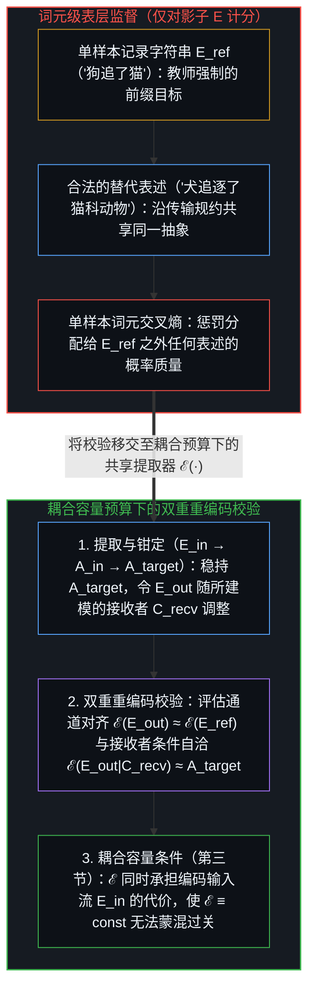
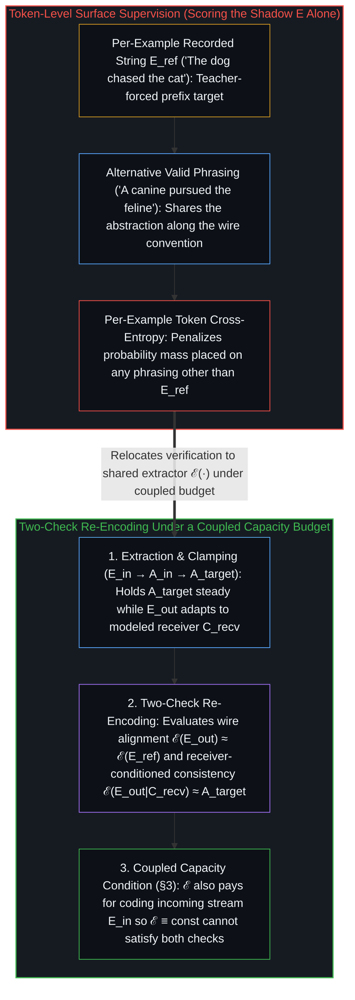
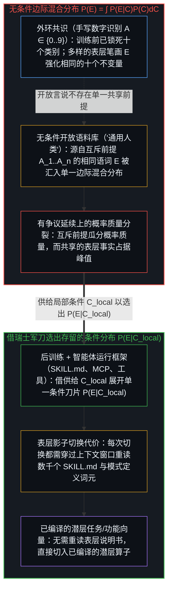
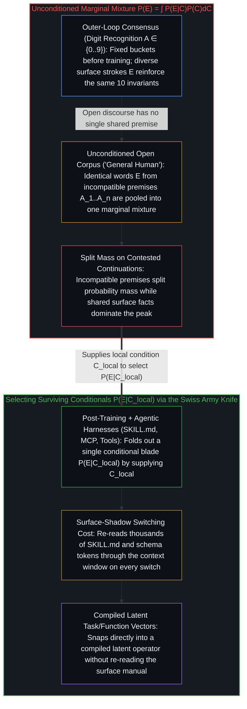
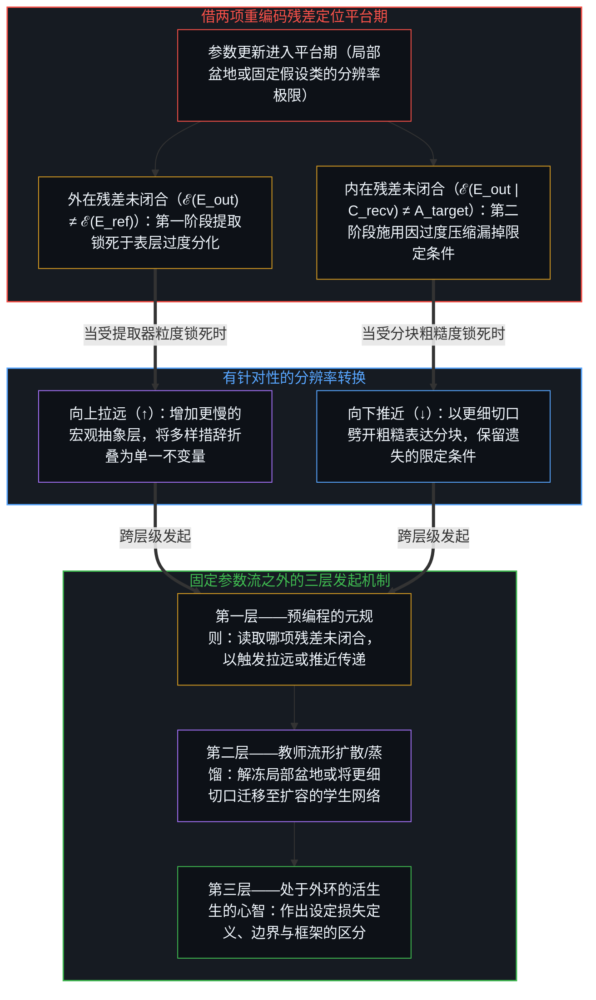
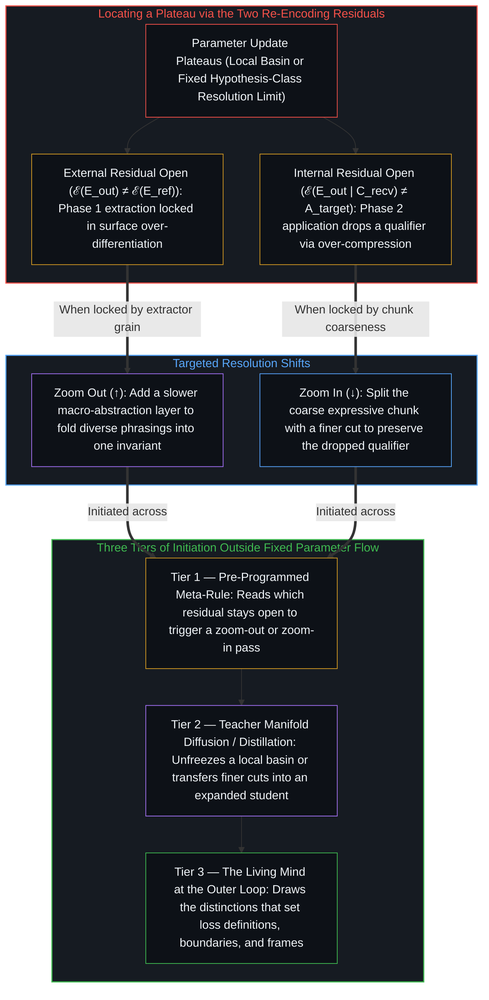

# 影子没有损失 / The Shadow Has No Loss

*表层词元只是抽象投下的影子，理解需以重编码校验守住目标抽象，并在局部语境中打破无条件平均的模糊。 / Surface tokens are shadows of an abstraction; understanding verifies the held abstraction by re-encoding and localizes context against unconditioned averaging.*

设想一位老师让学生根据一幅场景回答问题。在老师的标准答案里写着：“狗追了猫。”学生看着场景，领会了问题，提笔写道：“犬追逐了猫科动物。”

Suppose a teacher asks a student to answer a question about a scene. In the teacher's reference key, the answer reads: `"The dog chased the cat."` The student looks at the scene, grasps the question, and writes: `"A canine pursued the feline."`

试想老师一戒尺打在学生手心，判这道题零分，只因为纸上的字句没有逐字对上标准答案的措辞。

Imagine striking the student's hand with a ruler and marking the answer wrong because the letters on the page failed to match the answer key's exact wording.

这听起来像是死记硬背式教学的讽刺画，却正是当代人工智能的数学引擎。主流语言模型皆由词元级交叉熵损失训练而成：在给定已记录前缀的条件下，逐个片段比对机器赋予训练样本中每个记录词的概率，并对分配给任何替代表述的每一分概率，经由数十亿个参数反向传播惩罚。

That sounds like a caricature of rote schooling, yet it is the mathematical engine of contemporary artificial intelligence. Mainstream language models are trained by token-level cross-entropy loss: comparing, one fragment at a time, the probability the machine assigns to each recorded word of a training example given its recorded prefix, and propagating a penalty through billions of parameters for every share of probability placed on any alternative phrasing.

下一词预测——配以[《注意力机制就是你所需要的一切》](https://arxiv.org/abs/1706.03762)的全对全词元路由——是工程史上极富成效的人类抽象之一。通过把“从人类文本中学习”这一繁杂问题压缩为单一代理目标——猜测下一个表层词元——它赋予了神经网络清晰的目标，并点燃了现代人工智能时代，如[固定地图与重复的行程](../the-fixed-map-and-the-repeated-trip/)所追溯。然而每一项基础性的人类抽象都是一柄双刃剑：在范式诞生之初充当决定性加速器的设计，一旦被固守到超出其适用域之外，便会化作该范式的结构性边界。由于表层交叉熵仅对词元影子计分，要校验理解，就必须发出一段表达，并在耦合容量预算之下将它重新编码，同时对照参考表达与所持守的目标抽象加以核验。同理，若在不指定语境变量的情况下对源自互斥前提的相同表层语词计分，无条件目标的最优解便只能落在跨语境的边际混合分布上，唯有供给局部语境才能选出立场鲜明的条件模态。

Next-word prediction—paired with the all-to-all token routing of [Attention Is All You Need](https://arxiv.org/abs/1706.03762)—stands among the most productive human abstractions in engineering. By compressing the problem of learning from human text into a single proxy—guessing the next surface token—it gave neural networks a clean target and ignited the modern AI era, as [The Fixed Map and the Repeated Trip](../the-fixed-map-and-the-repeated-trip/) traces. Yet every foundational human abstraction carries a two-sided edge: what serves as a decisive accelerator at the birth of a paradigm becomes its structural boundary when held fixed past its domain. Because surface cross-entropy scores the token shadow alone, verifying understanding requires emitting an expression and re-encoding it against both the reference expression and the held target abstraction under a coupled capacity budget. By the same token, scoring identical surface words projected from incompatible premises without a context variable sets the unconditioned optimum at the marginal mixture across contexts, while supplying a local context selects a committed conditional mode.

## 一、 表达、抽象与两阶段循环 / 1. Expression, Abstraction, and the Two-Phase Cycle

自我区分的活动发生着——无因，不息。称之为“心智”：那已然在途的观察者，其每一行动皆是一次区分。当这一区分活动进入语言时，每一次语言交会都在两个截然不同的层面上同时运作：序列化的表层“表达”（`E`），以及在选定尺度上所持守的关系“抽象”（`A`）。

Self-distinguishing activity occurs — uncaused, unceasing. Call it the Mind: the observer already underway, every act of which is a distinction. When that distinguishing activity enters language, every linguistic encounter operates across two distinct levels at once: a serialized surface Expression (`E`) and a relational Abstraction (`A`) held at a chosen scale.

如[固定地图与重复的行程](../the-fixed-map-and-the-repeated-trip/)与[盲目的切分与命名的心智](../the-blind-cut-and-the-naming-mind/)所确立的那样，表达（`E`）是一维痕迹——穿过狭窄通道的语词、音素或比特序列，其中词汇与语法充当共享的传输线规约，使交流的各个中心得以打包并解包信号。与之相对，抽象（`A`）则是在交会中持守的关系不变量：当一段思想从英文译成中文、或从方程化作寓言时依然保持不变的论旨、规则或取向。

As [The Fixed Map and the Repeated Trip](../the-fixed-map-and-the-repeated-trip/) and [The Blind Cut and the Naming Mind](../the-blind-cut-and-the-naming-mind/) establish, the Expression (`E`) is the 1D trace—the sequence of words, phonemes, or bits traveling across a narrow channel where vocabulary and grammar serve as shared wire conventions so communicating centers can pack and unpack signals. The Abstraction (`A`), by contrast, is the relational invariant held across the encounter: the point, rule, or orientation that stays invariant when a thought is translated from English to Chinese or from an equation into a parable.

正因为语言同时包含表达与抽象，每一次理解与交流的行动都跨越两个阶段。第一阶段是“提取”（`Eᵢₙ → Aᵢₙ → A_target`）：接收一段输入表达（`Eᵢₙ`），穿透其偶然的表层措辞提炼出底层抽象（`Aᵢₙ`），并推演至回应抽象（`A_target`）——即准备阐发的论旨。第二阶段是“施用”（`A_target → E_out`）：将所持守的目标抽象重新分殊进共享的传输规约，生成具体的输出表达（`E_out`）。尽管近期的架构已开始将内部推理步骤与表层语词解耦——例如[连续思维链（Coconut）](https://arxiv.org/abs/2412.06769)与 Meta FAIR 的[大型概念模型（LCM）](https://arxiv.org/html/2412.08821v2)在单个词元之上的概念空间中对序列建模——但只要监督信号回到教师强制的表层交叉熵，标准的词元级训练依然会短路这一两阶段循环：它惩罚落在每个训练样本单一记录字符串之外的任何概率质量，而非发出一段表达 `E_out`，去检验抽象是否已被提取并施用。

Because language comprises both expression and abstraction, every act of understanding and communication moves across two phases. First comes Extraction (`Eᵢₙ → Aᵢₙ → A_target`): taking an incoming expression (`Eᵢₙ`), distilling its underlying abstraction (`Aᵢₙ`) past its accidental phrasing, and stepping to the response abstraction (`A_target`)—the point to be made. Second comes Application (`A_target → E_out`): taking that held target abstraction and articulating it back into the shared wire convention to generate a concrete output expression (`E_out`). Even as recent architectures begin to decouple internal reasoning steps from surface words—such as [Coconut (Chain of Continuous Thought)](https://arxiv.org/abs/2412.06769) and Meta FAIR's [Large Concept Models](https://arxiv.org/html/2412.08821v2), which model sequences in a concept space above individual tokens—standard token-level training short-circuits this two-phase cycle whenever supervision returns to teacher-forced surface cross-entropy, penalizing any probability placed outside the single recorded surface string of each training example rather than emitting an expression `E_out` and testing whether the abstraction was extracted and applied.

## 二、 稳持目标抽象：双重重编码校验 / 2. Holding the Target Abstraction Steady: Two-Check Re-Encoding

一个心智——或人工模型——如何将抽象施用于表达，而不在生成过程中偏离初衷？

How does a mind—or an artificial model—apply an abstraction to generate an expression without losing the thread?

不妨回想狭义相对论如何以光速（`c`）恒定作为测量基准：跨参考系保持 `c` 不变，便允许空间与时间坐标相对观察者的参考系伸展或收缩。将抽象施用于表达依赖同样的结构动作。当一个中心有论旨要阐发时，它将目标抽象（`A_target`）稳稳钳定为不变的参考系。由于 `A_target` 被整体稳持，表层表达——选词、句长、详略尺度——便随接收者既有的先在结构而伸缩调整，正如[登记共鸣的表面](../the-surface-that-registers/)所追溯的那样：面对早已共享背景的同行，稳持 `A_target` 只需两个词的简写；面对先验差距较大的新手，稳持同一个抽象则会使表达延展为三页纸的详述。

Consider how special relativity used the constancy of light speed (`c`) as a measurement benchmark: holding `c` invariant across frames allowed spatial and temporal coordinates to stretch or contract relative to the observer's frame. Applying an abstraction to an expression relies on the same structural move. When a center has a point to make, it clamps the target abstraction (`A_target`) steady as its invariant reference. Because `A_target` is held whole, the surface expression—the choice of words, the length of the sentence, the level of detail—adapts to the receiver's pre-existing structure, as [The Surface That Registers](../the-surface-that-registers/) traces: relative to a colleague who already shares the background, holding `A_target` steady requires only a two-word shorthand; relative to a newcomer across a wider prior gap, holding that exact same abstraction steady dilates the expression into a three-page explanation.

由于语言兼具表达与抽象，系统从不能仅凭发出表达就确认表达已经成功。将想法落成纸面上的具体字句，常会暴露出初稿所说的话与原本想表达的意思之间存在细微偏差。为了校验表达确实承载了抽象，系统摊开初稿，将自身发出的输出 `E_out` 重新编码，以评估两项耦合残差（`‖ℰ(E_out) − ℰ(E_ref)‖² + ‖ℰ(E_out | C_recv) − sg(A_target)‖²`）。其一是外在对齐（`ℰ(E_out) ≈ ℰ(E_ref)`）：系统检查从自身输出表达中提取出的抽象，是否沿着双方共享的传输线规约匹配参考答案的抽象——从而阻断生成器与编码器在共享语言之外私下串通的隐写捷径（Chu 等人，2017）。一旦评估经由提取器 `ℰ` 而非原始词元计分，局限于表层影子的变化——例如把“狗追了猫”换成“犬追逐了猫科动物”——便不产生任何损失，因为脱离了所传达的抽象，影子本身没有损失。其二是内在自洽（`ℰ(E_out | C_recv) ≈ A_target`）：系统以自身所持有的接收者背景模型（`C_recv`）为条件，对 `E_out` 进行重编码——从而在两个词的简写漏掉了新手所缺失的背景时及时捕捉到偏差，至于实际接收者在自身内部究竟提取出了什么，则依然只在回返信号中登记——并核验重提取出的抽象是否匹配生成期间所稳持的目标 `A_target`，暴露出“所想”与“所言”之间的任何漂移（`Δ`）。然而，若把这一双重校验之和孤立出来当作独立的表征匹配目标，常值提取器（`ℰ ≡ const`，因为 `A_target` 本身亦由提取产生）依然能空洞地令两项残差同时归零——这便直接引出使提取器保持非退化的结构条件。

Because language is both expression and abstraction, a system never confirms whether its expression succeeded merely by emitting it. Putting a thought into concrete words on a page frequently reveals that the draft expression says something slightly different from what was meant. To verify that the expression carries the abstraction, the system unfolds the draft and re-encodes its own emitted output `E_out` to evaluate two coupled residuals (`‖ℰ(E_out) − ℰ(E_ref)‖² + ‖ℰ(E_out | C_recv) − sg(A_target)‖²`). First, in external alignment (`ℰ(E_out) ≈ ℰ(E_ref)`), the system checks whether the abstraction extracted from its emitted expression matches the abstraction of the reference answer along the shared wire convention both sides hold—blocking private steganographic shortcuts where a generator and encoder conspire outside the shared language (Chu et al., 2017). Once evaluation is scored through the extractor `ℰ` rather than on raw tokens, a variation confined to the surface shadow—such as replacing `"The dog chased the cat"` with `"A canine pursued the feline"`—carries zero loss, because the shadow has no loss of its own apart from the abstraction it conveys. Second, in internal self-consistency (`ℰ(E_out | C_recv) ≈ A_target`), the system re-encodes `E_out` conditioned on its held model of the receiver's background (`C_recv`)—catching when a two-word shorthand drops background a newcomer lacks, while what the actual receiver extracts in their own interior still registers only on return—and checks whether the re-extracted abstraction matches the target `A_target` held steady during generation, exposing any drift (`Δ`) between what was meant and what was said. Yet taken in isolation as a standalone representation-matching objective, even this two-check sum would be trivially satisfied by a constant extractor (`ℰ ≡ const`, since `A_target` is itself produced by extraction)—which brings us directly to the structural condition that keeps the extractor non-degenerate.

## 三、 耦合容量预算：是什么让双重校验免于退化 / 3. Coupled Capacity Budgets: What Keeps the Two Checks Non-Degenerate

当杨立昆提出[联合嵌入预测架构（JEPA）](https://openreview.net/forum?id=BZ5a1r-kVsf)，主张在表征空间（`ℰ(E_out) ≈ ℰ(E_ref)`）而非像素或语词空间中评估预测时，他面对的正是表征坍缩：只要表征匹配与编码或预测输入流 `Eᵢₙ` 的代价脱钩，编码器就能通过把一切输入映射为同一个常向量（`0 = 0`）来满足 `ℰ(E_out) = ℰ(E_ref)`（以及第二节的双重校验）。沉默与沉默永远一致。

When Yann LeCun proposed the [Joint-Embedding Predictive Architecture (JEPA)](https://openreview.net/forum?id=BZ5a1r-kVsf) to evaluate predictions in representation space (`ℰ(E_out) ≈ ℰ(E_ref)`) rather than pixel or word space, he confronted Representation Collapse: whenever representation matching is severed from the cost of coding or predicting the incoming stream `Eᵢₙ`, an encoder can satisfy `ℰ(E_out) = ℰ(E_ref)` (as well as §2's two checks) by mapping every input to the same constant vector (`0 = 0`). Silence always agrees with silence.

虽然外加的方差或协方差惩罚，以及非对称停止梯度或指数移动平均目标编码器，能在各自设计的工程区间内阻断坍缩，但耦合容量预算却能从目标函数内部让坍缩得不偿失：提取器 `ℰ` 处于有界的编码预算之内，在 `ℰ` 中保留一项区分的代价与编码输入流 `Eᵢₙ` 残差惊奇的代价由同一份预算支付（这一变分编码耦合由 [Friston，2010](https://www.uab.edu/medicine/cinl/images/KFriston_FreeEnergy_BrainTheory.pdf) 所表述，此处将其持守于区分中心，而不预设一个预先切分好的外在世界），其根基正是[递归区分的架构](../architecture-of-recursive-distinction/)所追溯的有限截断与粒度预算。像[字节潜层变换器（BLT）](https://arxiv.org/abs/2412.09871)（Pagnoni 等人，2024）这样的架构使用独立的小型字节级熵模型来触发动态分块边界，而端到端的层级动态分块器如 [H-Net](https://arxiv.org/abs/2507.07955)（Hwang、Wang 与 Gu，2025）与 [H-Net++](https://arxiv.org/abs/2508.05628)（Zakershahrak 与 Ghodratnama，2025）则将边界路由直接置于表征层级内部——在外环给定的压缩率之内，每当局部可预测性断裂时便动态重划块边界，如[冻结的切口与回环的余量](../the-frozen-cut-and-the-margin-of-the-loop/)与[学到的边界与给定的尺度](../learned-boundaries-and-the-given-rate/)所追溯。

While external variance or covariance penalties and asymmetric stop-gradient or exponential-moving-average target encoders can block collapse within their engineered regimes, a coupled capacity budget makes collapse self-defeating from inside the objective itself: the extractor `ℰ` sits inside a bounded coding budget where the cost of keeping a distinction in `ℰ` and the cost of coding the residual surprise of the incoming stream `Eᵢₙ` are paid from one budget (the variational coding coupling formulated in [Friston, 2010](https://www.uab.edu/medicine/cinl/images/KFriston_FreeEnergy_BrainTheory.pdf), held here at the distinguishing center without assuming a pre-partitioned external world), resting on the finite truncation and grain budget traced in [The Architecture of Recursive Distinction](../architecture-of-recursive-distinction/). Whereas architectures like the [Byte Latent Transformer](https://arxiv.org/abs/2412.09871) (Pagnoni et al., 2024) trigger dynamic patch boundaries using a separate small byte-level entropy model, end-to-end hierarchical dynamic chunkers such as [H-Net](https://arxiv.org/abs/2507.07955) (Hwang, Wang, & Gu, 2025) and [H-Net++](https://arxiv.org/abs/2508.05628) (Zakershahrak & Ghodratnama, 2025) place boundary routing inside the representation hierarchy—redrawing chunk boundaries where local predictability breaks within a compression rate given at the outer loop, as [The Frozen Cut and the Margin of the Loop](../the-frozen-cut-and-the-margin-of-the-loop/) and [Learned Boundaries and the Given Rate](../learned-boundaries-and-the-given-rate/) trace.

在这一耦合容量预算之下，不妨看提取器 `ℰ` 若试图坍缩为 `0 = 0` 来满足第二节的双重校验会发生什么：自上而下的抽象压平为常数的那一刻，它便丧失了对 `Eᵢₙ` 的全部预测杠杆，导致残差通道的编码代价飙升至原始未分块流的全额熵。将第二节的重编码校验与 `Eᵢₙ` 的预测编码预算耦合起来，便从编码回环内部提供了充分的非退化条件。

Under that coupled capacity budget, watch what happens if the extractor `ℰ` attempts to satisfy §2's two checks by collapsing to `0 = 0`: the instant the top-down abstraction flattens to a constant, it surrenders all predictive leverage over `Eᵢₙ`, raising the residual channel's coding cost to the full unchunked entropy of the raw stream. Coupling the re-encoding checks of §2 to the predictive coding budget of `Eᵢₙ` supplies a sufficient non-degeneracy condition from inside the coding loop.

## 四、 无条件的合成面孔与条件化的瑞士军刀 / 4. The Unconditioned Composite Face and the Conditional Swiss Army Knife

为何仅对表层影子（`E`）计分，还会造就无条件基座模型那种模棱两可、面目模糊的高概率输出？

Why does scoring the surface shadow (`E`) alone also produce the hedged, composite high-probability output of an unconditioned base model?

因为词元交叉熵仅对 `E` 计分，只要不指定语境变量 `C`，由彼此互斥的抽象 `A₁, A₂, …, Aₙ` 所发出的相同表层语词 `E`，在训练中便算作同一个目标。没有 `C` 把这些底层抽象区分开来，开放语料库上的无条件目标便具有唯一的数学最优解：边际混合分布 `P(E) = ∫ P(E|C)P(C)dC`（跨语料库全部语境的前向 KL 模态覆盖）。

Because token cross-entropy scores `E` alone, identical surface words `E` emitted from mutually incompatible abstractions `A₁, A₂, …, Aₙ` count as the exact same training target whenever the context variable `C` is not specified. Without `C` to keep those underlying abstractions apart, the unconditioned objective across an open corpus has a unique mathematical optimum: the marginal mixture `P(E) = ∫ P(E|C)P(C)dC` (forward-KL mode covering across all contexts in the corpus).

十九世纪，当弗朗西斯·高尔顿（Francis Galton）将数百张人像叠印在同一张感光底片上以制作“平均人类面孔”时，得到的是一张平滑、对称却不属于任何人的脸——每一处鲜明的特征都被冲刷成了统计模糊，如[平均值是残余，不是引擎](../the-average-is-residue-not-the-engine/)所追溯。在手写数字识别（`A ∈ {0, …, 9}`）这类边界狭窄的任务中，关于十个类别的共识在训练开始前便已在外环固定，因此十万种潦草的书写风格（`E`）会叠加强化相同的十个不变量。相反，在开放的人类言说中，关于前提的共识并不存在，其原因正如[共享意识是个体性的交集](../shared-consciousness-is-intersecting-individualities/)所追溯的那样：在探讨因果、市场、道德或架构的数十亿篇文本中，言说者使用同样的语词（`E`）来推进彼此互斥的前提（`A₁, …, Aₙ`）。在无条件边际混合分布 `P(E) = ∫ P(E|C)P(C)dC` 中，每一个条件模态依然在求和中保留其权重；然而每当前缀尚未锁定 `C` 时，互斥的前提 `A₁, …, Aₙ` 便会将概率质量分散到相互竞争的后续延展上，而所有语境共享的后续延展——表层事实（“巴黎是法国的首都”）与不置可否的过渡套话——则从全部 `C` 中累加概率质量并主导高概率区域（在模型容量有限、前向 KL 模态覆盖将概率铺展于各模态之间时尤为显著）。

In the nineteenth century, when Francis Galton overlaid hundreds of portraits onto a single photographic plate to create an "average human face," the result was smooth, symmetrical, and belonged to nobody—every sharp feature had been washed into a statistical blur, as [The Average Is Residue, Not the Engine](../the-average-is-residue-not-the-engine/) traces. In a narrowly bounded task like handwritten digit recognition (`A ∈ {0, …, 9}`), total consensus on the ten buckets is fixed at the outer loop before training begins, so a hundred thousand messy handwriting styles (`E`) constructively reinforce the same ten invariants. In open human discourse, by contrast, consensus on premises does not exist, for the reason traced in [Shared Consciousness Is Intersecting Individualities](../shared-consciousness-is-intersecting-individualities/): across billions of texts on causality, markets, morality, or architecture, speakers use the exact same words (`E`) to advance incompatible premises (`A₁, …, Aₙ`). In the unconditioned marginal mixture `P(E) = ∫ P(E|C)P(C)dC`, each conditional mode retains its weight in the sum, yet whenever the prefix does not pin down `C`, incompatible premises `A₁, …, Aₙ` split the probability mass across competing continuations while continuations shared across every context—surface facts (`"Paris is the capital of France"`) and non-committal bridging phrases—accumulate mass from all `C` and dominate the high-probability region (especially under finite model capacity, where forward-KL mode-covering spreads probability across the modes).

至关重要的是，呈现出高尔顿式合成面孔的，只是无条件边际分布 `P(E)` 的高概率区域，而那些棱角分明的条件分布 `P(E|C)` 依然编码在网络的权重之中。恰如爱因斯坦的广义场方程需要代入局部边界条件（地球质量、低速、地表坐标）才能化约为锐利的局部算子（`F = mg`），那些条件分布 `P(E|C)` 也在预训练坐标地图中等待着局部边界条件 `C_local`。这正是后训练与智能体运行框架——技能（Skills）、MCP 与工具调用，其语境建构如[是脚手架还是特化语境](../scaffolds-or-specialized-contexts/)所追溯——在实践中所承担的结构性工作：犹如一把在同一个刀柄里收纳了多种工具的瑞士军刀，它们借由后训练、上下文框架或 `SKILL.md` 文件提供 `C_local`，翻出单一的条件刀片 `P(E|C_local)`，使前提得以锁定、立场鲜明的推演得以恢复——尽管当前的运行框架仍需在每次切换语境时付出穿过表层影子的摩擦代价，将数千个原始文本词元塞进上下文窗口，而非直接调用已编译的潜层算子（如 Todd 等人 2024 年与 Hendel 等人 2023 年在功能向量与任务向量中所初步探索的那样）。

Crucially, what reads as a Galton-like composite is the high-probability region of the unconditioned marginal `P(E)`, whereas the sharper conditional distributions `P(E|C)` remain encoded inside the network's weights. Just as Einstein's general field equations require local boundary conditions (Earth's mass, low velocity, surface coordinates) to reduce to a sharp local operator (`F = mg`), the conditionals `P(E|C)` wait inside the pretrained coordinate map for a local boundary condition `C_local`. This is the structural work that post-training and agentic harnesses—Skills, MCP, and Tool Calling, whose context construction is traced in [Scaffolds or Specialized Contexts](../scaffolds-or-specialized-contexts/)—perform in practice: like a Swiss Army knife that carries many tools in one handle, they supply `C_local` via post-training, in-context framing, or a `SKILL.md` file, folding out a single conditional blade `P(E|C_local)` where premises are locked and committed deduction resumes—though current harnesses still pay the friction of switching context through the surface shadow by stuffing thousands of raw text tokens into the window, rather than invoking a compiled latent operator directly (as function vectors and task vectors in Todd et al., 2024 and Hendel et al., 2023 begin to trace).

## 五、 在平台期区分两项校验残差 / 5. Distinguishing the Two Verification Residuals on a Plateau

即便在明确给定的局部语境 `C_local` 之内，当系统稳持 `A_target`、发出 `E_out`、在耦合容量预算下重编码结果，而参数训练依然陷入平台期（无论是困于局部优化盆地，还是抵达了投影梯度在固定假设类张成空间上归零的分辨率极限）时，会发生什么？

Even inside a well-specified local context `C_local`, what happens when a system holds `A_target` steady, emits `E_out`, re-encodes the result under a coupled capacity budget, and yet parameter training plateaus (whether caught in a local optimization basin or reaching the resolution limit where the projected gradient vanishes on the span of the fixed hypothesis class)?

由于第二节的校验拆分为两项独立的核查，两项残差在平台期并不会混作无法分辨的噪声；哪一项残差仍未闭合，便定位了循环中的哪一个阶段被锁死。

Because §2's verification splits into two distinct checks, the two residuals do not blur into indistinguishable noise on a plateau; which residual stays open locates which phase of the cycle is locked.

当外在对齐残差仍未闭合（`ℰ(E_out) ≠ ℰ(E_ref)`，而 `ℰ(E_out | C_recv) ≈ A_target`）时，被锁死的是第一阶段（提取）——要么是因为 `A_target` 被提取在错误的粒度上，要么是因为同一洞见的两种合法表达（例如一段代数证明与一个几何类比，或两份措辞相异的技能记录）在提取器仍纠缠于局部表层句法时无法映射至同一个不变量。当这一锁死源于提取器的分辨率极限时，消解未闭合的外在对齐残差需要向上拉远（`↑`）：在被锁死的层级之上引入一层更慢、更高阶的宏观抽象层，使冲突的表层表达折叠收摄为同一个共享不变量。

When the external alignment residual stays open (`ℰ(E_out) ≠ ℰ(E_ref)` while `ℰ(E_out | C_recv) ≈ A_target`), Phase 1 (Extraction) is locked—either because `A_target` was extracted at the wrong grain or because two valid expressions of the same insight (such as an algebraic proof and a geometric analogy, or two differently phrased skill transcripts) fail to map to the same invariant while the extractor remains entangled in local surface syntax. When the lock is a resolution limit of the extractor, resolving the open external-alignment residual requires zooming out (`↑`): introducing a slower, higher-level macro-abstraction layer above the locked layer so the conflicting surface expressions fold into one shared invariant.

反之，当内在自洽残差仍未闭合（`ℰ(E_out | C_recv) ≠ A_target`）时，被锁死的是第二阶段（施用）：系统虽然持守住了目标抽象，但要么优化停滞在局部盆地，要么其表达分块过于粗糙——滑过了关键的限定语或边界条件——以致当 `E_out` 在 `C_recv` 之下被重编码时，`A_target` 中原有的细微区分在传输中遗失。当这一锁死源于表达分块的粗糙度时，消解未闭合的内在自洽残差需要向下推近（`↓`）：用更细粒度的切口劈开粗糙的分块边界，如[冻结的切口与回环的余量](../the-frozen-cut-and-the-margin-of-the-loop/)与[学到的边界与给定的尺度](../learned-boundaries-and-the-given-rate/)所追溯，将粗糙词表所抹平的微观区分重新显露出来。

When the internal self-consistency residual stays open (`ℰ(E_out | C_recv) ≠ A_target`), by contrast, Phase 2 (Application) is locked: the system held the target abstraction, but either optimization stalled in a local basin or its expressive chunks are too coarse—gliding over a decisive qualifier or boundary condition—so that when `E_out` is re-encoded under `C_recv`, a nuance present in `A_target` is lost in transit. When the lock is the coarseness of its expressive chunks, resolving the open internal-consistency residual requires zooming in (`↓`): splitting the coarse chunk boundary with a finer-grained cut, as [The Frozen Cut and the Margin of the Loop](../the-frozen-cut-and-the-margin-of-the-loop/) and [Learned Boundaries and the Given Rate](../learned-boundaries-and-the-given-rate/) trace, to expose the micro-distinction that the coarse vocabulary smoothed over.

## 六、 从外环发起假设类的跃迁 / 6. Initiating the Hypothesis-Class Shift from the Outer Loop

尽管两项重编码残差在平台期依然清晰可辨，固定架构内部的参数梯度流却无法自行改变其自身的假设类——若无固定参数更新之外的规则，它既不能插入新的宏观抽象层，也不能劈开词元空间，正如[没有外部](../no-outside-jumps-closed-loops-and-the-unreplicable-autonomy-of-mind/)所追溯的那样。

While the two re-encoding residuals remain legible on a plateau, parameter gradient flow inside a fixed architecture cannot by itself alter its own hypothesis class—it cannot insert a new macro-layer or split a token space without a rule outside the fixed parameter update, as [No Outside](../no-outside-jumps-closed-loops-and-the-unreplicable-autonomy-of-mind/) traces.

每当固定的参数化陷入平台期，跳出锁死的跃迁总是由参数流之外的三个层级之一所发起。第一层是预编程的元规则（借来的远见）：由于外在对齐残差（`ℰ(E_out) ≠ ℰ(E_ref)`）与内在自洽残差（`ℰ(E_out | C_recv) ≠ A_target`）保持分明，工程师可以预先编写外环调度或自动审计传递，读取哪一项残差仍未闭合，进而触发相应的拉远或推近操作——尽管任何固定的启发式规则依然在事先设定的阈值之内运作。第二层是来自更宽广教师流形的扩散或蒸馏：当学生网络困于局部优化盆地或缺乏更细的划分时，将它与更高容量的教师网络耦合（包括蒸馏进扩容后的学生架构），便能从教师更宽广的框架中注入结构化方差与更细的切口，把框架的起源沿链条向上推移一环。第三层则是处于外环的活生生的心智：由于每一项损失定义、边界条件与容量预算本身都是一次被划出的区分——而区分正是第一节所出发的第一人称行动——从预训练基座变换器到智能体运行框架，每一座形式架构都承载着心智切分的痕迹，而非自行落下那一刀，如[错把表达当成智能](../mistaking-the-expression-for-the-intelligence/)与[框架的倒置与驾驶位的主权非对称](../the-inversion-of-the-harness-and-the-driver-seat-asymmetry/)所追溯。

Whenever a fixed parameterization plateaus, the shift out of the lock is initiated across one of three tiers outside the parameter flow. First is a pre-programmed meta-rule (borrowed foresight): because the external-alignment residual (`ℰ(E_out) ≠ ℰ(E_ref)`) and the internal-consistency residual (`ℰ(E_out | C_recv) ≠ A_target`) remain distinct, an engineer can code an outer-loop schedule or automated audit pass that reads which residual stayed open and triggers the corresponding zoom-out or zoom-in pass—though any fixed heuristic still operates within thresholds designed beforehand. Second is diffusion or distillation from a broader teacher manifold: when a student is trapped in a local optimization basin or lacks a finer partition, coupling it to a higher-capacity teacher (including distilling into an expanded student architecture) injects structured variance and finer cuts from the teacher's broader frame, passing the origin of that frame one link up the chain. Third is the living Mind at the outer loop: because every loss definition, boundary condition, and capacity budget is itself a distinction drawn—and distinguishing is the first-person act from which §1 began—every formal architecture, from a pretrained base transformer to an agentic harness, carries the trace of a Mind's cut rather than generating that cut on its own, as [Mistaking the Expression for the Intelligence](../mistaking-the-expression-for-the-intelligence/) and [The Inversion of the Harness and the Sovereignty of the Driver's Seat](../the-inversion-of-the-harness-and-the-driver-seat-asymmetry/) trace.

每当处于外环的心智锻造出一项新的抽象——无论是经典力学、[《注意力机制就是你所需要的一切》](https://arxiv.org/abs/1706.03762)、下一词元预测，还是一项智能体技能——那项抽象都在其适用域内充当加速器。一旦被固守到超出其边界之外，同一副脚手架便会化作天花板。形式系统可以钳定目标抽象，在耦合容量预算下以重编码校验其发出的表达，并在给定局部边界条件后选出立场鲜明的条件声音；而认出框架本身何时已到达其边界，则属于外环那活生生的心智。

Every time a Mind at the outer loop forges a new abstraction—whether classical mechanics, [Attention Is All You Need](https://arxiv.org/abs/1706.03762), next-token prediction, or an agentic skill—that abstraction acts as an accelerator within its domain. Held fixed past its boundary, the same scaffolding becomes a ceiling. A formal system can clamp a target abstraction, verify its emitted expression by re-encoding under a coupled capacity budget, and select a committed conditional voice once local boundary conditions are supplied; recognizing when the frame itself has reached its boundary belongs to the living Mind at the outer loop.
