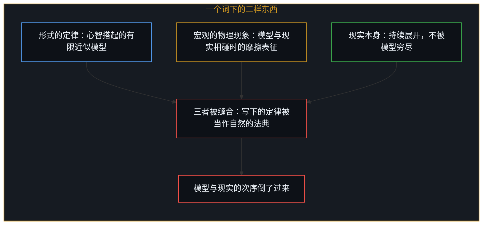
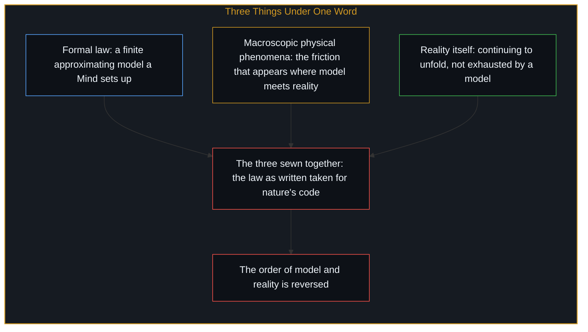
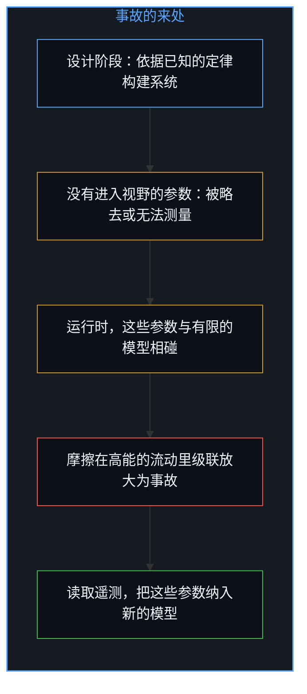
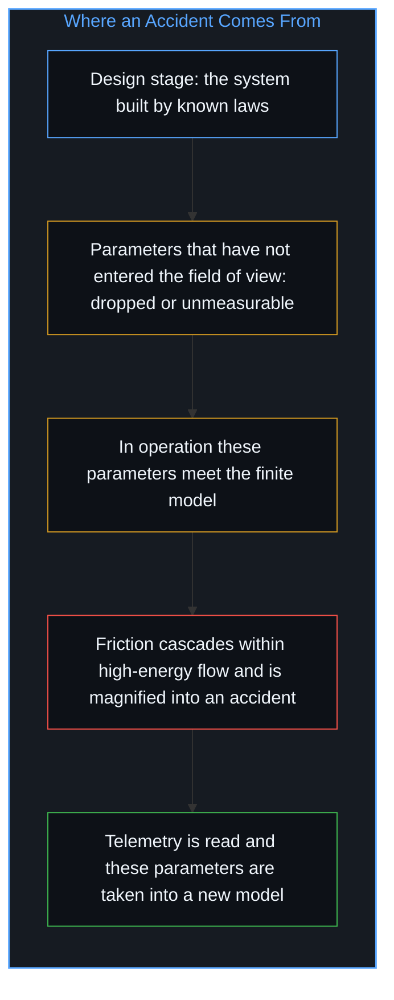
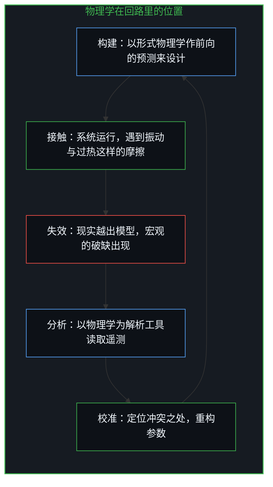
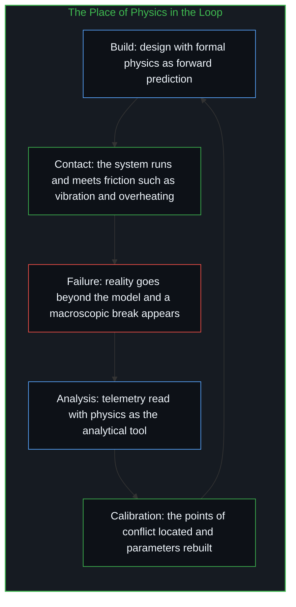
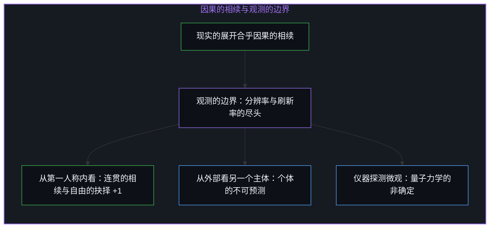
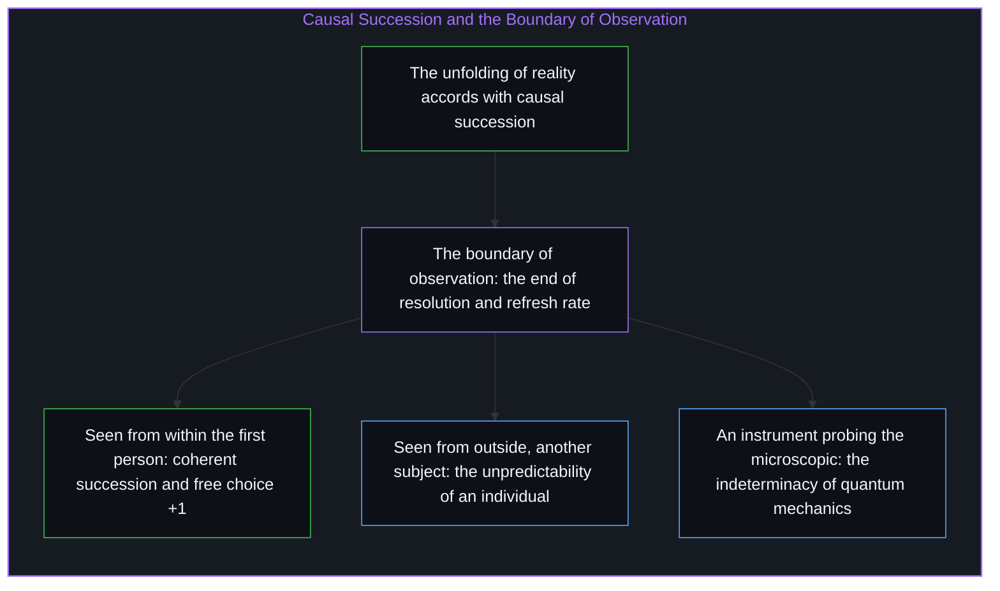
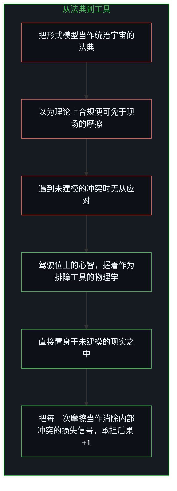
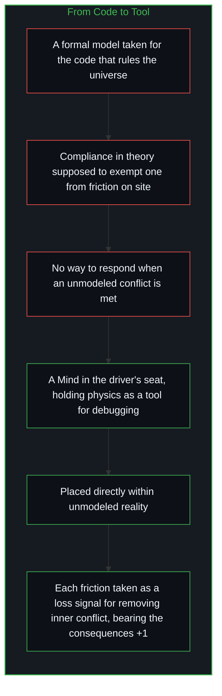

# “物理学才是定律”的障眼法 / The Sleight of Hand in "Physics Is the Law"

*形式模型、宏观摩擦，以及未被定律决定的现实 / Formal Models, Macroscopic Friction, and a Reality Undetermined by Law*

“物理学才是定律，其他一切都只是建议”这句格言在工程里极有力量，它在“物理学”一词下把三样东西合在了一起：人写下的形式模型，系统运行时的宏观物理现象，与现实本身。按已知定律严密设计的火箭仍会爆炸，说明结果不由写下的定律决定，爆炸是模型与它没有包含的东西相碰时的摩擦。物理学于是读作在摩擦之后读取遥测、消除模型内部冲突的工具。现实的展开合乎因果，非确定出现在观测的边界上，而每一次面对未建模之处的，是驾驶位上的第一人称。

The maxim "physics is the law, everything else is a recommendation" has great force in engineering, and under the word "physics" it joins three things: formal models that people write down, the macroscopic physical phenomena of a system in operation, and reality itself. A rocket designed rigorously by known laws can still explode, which shows that the outcome is not determined by the laws as written, and the explosion is friction where a model meets what it did not contain. Physics is then read as a tool for reading telemetry after friction and removing conflicts inside the model. The unfolding of reality accords with causality, indeterminacy appears at the boundary of observation, and what meets the unmodeled each time is the first person in the driver's seat.

## 一、 一个词下的三样东西 / 1. Three Things Under One Word

埃隆·马斯克有一句流传很广的格言：“物理学才是定律，其他一切都只是建议。”它在实践里的力量是明显的。面对繁复的审批流程、行业的保守教条或习俗的惯性时，它提醒行动者，这些人为的规则是可以协商、打破或绕开的“建议”，而材料的强度极限、重力势能的克服与热力学的耗散，是工程造物避不开的约束。

Elon Musk has a widely repeated maxim: "Physics is the law, everything else is just a recommendation." Its force in practice is plain. Facing elaborate approval procedures, the conservative doctrine of an industry or the inertia of custom, it reminds the one acting that these human rules are "recommendations" that can be negotiated, broken or gone around, while the strength limits of materials, the overcoming of gravitational potential and thermodynamic dissipation are constraints that engineered things cannot avoid.

它的边界在“物理学”这个词上，这个词底下合着三个范畴。其一是形式的定律与理论模型，是写在黑板与论文上的数学方程，是心智为描述与预测自然的行为而搭起的概念框架，牛顿力学、麦克斯韦方程组与热力学的状态方程都属此类。其二是宏观的物理现象，是人造的系统运行时激起的表征：气动摩擦的高温，发动机壳体的应力形变，推进剂燃烧的震颤，乃至整机的解体。其三是现实本身，它不被任何有限的概念、理论或观测的视界穷尽，处在持续的展开与生成之中。[数字火箭、同行审查与因果闭环的稀释](../the-dilution-of-the-causal-loop-and-the-misallocation-of-agency/)与[框架的倒置与驾驶位的主权非对称](../the-inversion-of-the-harness-and-the-driver-seat-asymmetry/)指出过这种合并。

Its boundary lies in the word "physics," under which three categories are joined. The first is formal law and theoretical model, mathematical equations written on blackboards and in papers, conceptual frameworks a Mind sets up to describe and predict the behavior of nature; Newtonian mechanics, Maxwell's equations and the thermodynamic equations of state are of this kind. The second is macroscopic physical phenomena, what a human-made system gives rise to in operation: the heat of aerodynamic friction, stress deformation in an engine casing, the shudder of burning propellant, even the breakup of the whole vehicle. The third is reality itself, which is exhausted by no finite concept, theory or horizon of observation and is in continuing unfolding and generation. [Digital Rockets, Peer Review, and the Dilution of the Causal Loop](../the-dilution-of-the-causal-loop-and-the-misallocation-of-agency/) and [The Inversion of the Harness and the Sovereignty of the Driver's Seat](../the-inversion-of-the-harness-and-the-driver-seat-asymmetry/) have pointed to this joining.

在这句格言里，三者被缝在一起：宏观的物理现象先被等同于现实本身，写下的形式定律再被当作导引自然运转的法典，模型与现实的次序由此倒了过来，仿佛自然握着一本名为《物理学》的现成法典，在审判人造物的每一个动作。形式物理学自身的演进也不支持这幅图景，量子力学表明，在微观的深处，形式理论须面对的是非确定与概率。把定律呈现为无中介的现实，正是[“非中介化”的幻象](../the-illusion-of-the-unmediated/)所剖析的被赐予的自由。

In the maxim the three are sewn together: macroscopic physical phenomena are first equated with reality itself, and the formal laws written down are then taken as the code that guides nature's operation, so that the order of model and reality is reversed, as though nature held a ready-made code titled *Physics* and judged every act of a human-made thing by it. The development of formal physics itself does not support this picture; quantum mechanics shows that at microscopic depth what formal theory has to face is indeterminacy and probability. Law presented as unmediated reality is the bestowed freedom that [The Illusion of the Unmediated](../the-illusion-of-the-unmediated/) anatomizes.

## 二、 按定律设计的火箭为何仍会爆炸 / 2. Why a Rocket Designed by the Laws Still Explodes

博卡奇卡发射台上的残骸足以说明这一点。SpaceX 早期的星舰原型机在降落阶段炸成火球，不是因为设计它的工程师违反了物理定律。推进剂管道的流体仿真、发动机推力矢量的控制算法、隔热瓦的气动热力学计算，图纸与代码里的每一个参数，都是在已知定律的指导下推演出来的，没有哪一位航天工程师会设计一枚“违反物理定律”的火箭。

The wreckage on the launch pads at Boca Chica is enough to show this. When SpaceX's early Starship prototypes blew into fireballs during landing, it was not because the engineers who designed them had violated the laws of physics. The fluid simulation of the propellant lines, the control algorithms for thrust vectoring, the aerothermodynamic calculations for the heat tiles, every parameter in the drawings and the code was worked out under the guidance of known laws, and no aerospace engineer designs a rocket that "violates the laws of physics."

火箭仍然爆炸了。假如结果由写下的定律决定，一个按定律严密计算与构建的系统便该一次平稳入轨，不该有爆炸、振颤与意料之外的金属疲劳。爆炸说明，决定结果的还有模型没有包含的东西。工程事故的来处由此清楚：现实里有此前没有进入工程师视野的参数，材料的微观瑕疵、流体的瞬态谐振、局部的热应变极限、极端工况下的非线性耦合，它们在设计阶段没有被考虑、无法测量，或在理想化的抽象里被略去。

The rocket exploded all the same. Were the outcome determined by the laws as written, a system computed and built rigorously by those laws should reach orbit smoothly at the first attempt, with no explosion, flutter or unexpected metal fatigue. The explosion shows that what determines the outcome also includes what the model did not contain. Where an engineering accident comes from is thus clear: reality holds parameters that had not previously entered the engineers' field of view, microscopic flaws in material, transient resonance in a fluid, local limits of thermal strain, nonlinear coupling under extreme conditions, which at the design stage were not considered, could not be measured, or were dropped in the idealizing abstraction.

这件在理论上合乎定律的造物投入运行时，那些没有进入视野的参数便与有限的模型相碰。这种出自认知盲区的接触面摩擦，在高能的流动与正反馈的级联里被放大，呈现为结构的破裂与爆炸。爆炸不是法则对“违规者”的惩罚，它是一个读数：模型漏了没有进入视野的参数，未建模的摩擦被放大成了事故。

When this thing, lawful in theory, goes into operation, the parameters that had not entered the field of view meet the finite model. This friction at the contact surface, coming from a blind area of cognition, is magnified within high-energy flow and cascades of positive feedback and appears as structural rupture and explosion. An explosion is not a law punishing a "violator"; it is a reading: the model left out parameters that had not entered the field of view, and unmodeled friction was magnified into an accident.

## 三、 摩擦是遥测，物理学是排障的工具 / 3. Friction as Telemetry, Physics as a Tool for Debugging

物理学若不是统治现实的法典，它在工程里起什么作用？它是在遭遇摩擦之后，用来读取遥测数据、定位模型的偏差并消除内部冲突的后验工具。它的价值在火箭爆炸的那一刻显出来。面对残骸，工程团队调取遍布箭体的传感器数据，温度的骤变、压力的激波、应变片的失真与光谱的分析。物理学在此作为一种高精度的解析语言被重新调用：用流体力学的方程重新解释燃料箱底部的气蚀，用热传导的方程重新标定隔热瓦的接缝，用振动力学重新设计发动机的支架。

If physics is not the code that rules reality, what does it do in engineering? It is an after-the-fact tool for reading telemetry once friction has been met, locating the deviation of the model and removing its internal conflicts. Its value shows at the moment a rocket explodes. Facing the wreckage, the engineering team pulls the data from the sensors all over the vehicle: sudden changes of temperature, shocks of pressure, distortion in strain gauges, spectral analysis. Physics is called on again here as a high-precision language of analysis: the equations of fluid dynamics to reinterpret cavitation at the bottom of a tank, the equation of heat conduction to recalibrate the seams of the heat tiles, the mechanics of vibration to redesign the engine mounts.

这个过程的核心不是“顺从自然的法则”，而是借物理学的工具，定位上一次迭代里模型与现实相冲突的具体坐标，在下一次设计里消除这些冲突，降低系统此后与现实交互时的摩擦。这里看得到损失函数在物理上的对应。[你委托的风险就是你创造的风险](../the-risk-you-delegate-is-the-risk-you-create/)与[自我价值感与所有权](../ownership-and-self-worthiness/)说明，主体直接置身于接触面的阻力之下，反馈的信号才是保真的。宏观的物理摩擦，从轻微的磨损到爆炸，是现实不经中介传来的损失信号，物理学是面对这个信号时反推自身认知的边界、更新参数的计算工具。

The core of this process is not "obeying the laws of nature" but using the tool of physics to locate the specific coordinates at which model and reality conflicted in the last iteration, removing those conflicts in the next design and lowering the friction of the system's later interaction with reality. The physical counterpart of a loss function can be seen here. [The Risk You Delegate Is the Risk You Create](../the-risk-you-delegate-is-the-risk-you-create/) and [Ownership and Self-Worthiness](../ownership-and-self-worthiness/) show that a feedback signal keeps its fidelity only when the subject is placed directly under the resistance of the contact surface. Macroscopic physical friction, from slight wear to explosion, is the loss signal reality sends with no intermediary, and physics is the tool of calculation for working back, in the face of that signal, to the boundary of one's own cognition and updating parameters.

## 四、 现实在持续地自我呈现 / 4. Reality Keeps Realizing Itself

格言里更深的一层合并，是把作为形式工具的物理学与自然的运行当成了一回事。从古代神学里颁布的诫命，到牛顿式的宇宙钟表匠，再到包罗万象的万物理论，一种设想长久存在：自然的背后藏着一张终极的图纸，科学的任务是“发现”这些法条，工程再去遵照执行。这个设想给了探究一个方向。

The deeper joining in the maxim is taking physics as a formal tool and the operation of nature for one thing. From commandments issued in ancient theology, to the Newtonian clockmaker of the universe, to an all-inclusive theory of everything, one idea has long persisted: behind nature a final blueprint is hidden, the task of science is to "discover" these statutes, and engineering then carries them out. The idea has given inquiry a direction.

它的边界在于“规律”所在的位置。所谓客观规律，是心智在局部的尺度、特定的能量区间与有限的历史阶段里，对现实反复显出的相对稳定的表征所作的概念归纳，它在观察者的认知图景里。从第一人称出发，找不到一部在现实之外指导现实运转的法典，有的是现实在持续地呈现、展开与实现自己。定律覆盖的是封闭的 N 个情形，现实是余量，[闭合的N与开放的现实](../the-closed-n-and-the-open-reality/)说明了这一点。

Its boundary lies in where "regularity" is located. What is called objective law is the conceptual induction a Mind makes, at local scales, in particular ranges of energy and over a finite stretch of history, from the relatively stable appearances reality repeatedly shows; it is within the observer's cognitive picture. Starting from the first person, no code is found outside reality directing how reality operates, and what there is, is reality continuing to present, unfold and realize itself. A law covers a closed N of cases and reality is the remainder, as [The Closed N and the Open Reality](../the-closed-n-and-the-open-reality/) shows.

现实的展开合乎因果的相续。放下“客观铁律”的设想，并不是说现实是一场没有来由的杂耍：离了因果的相续，事物便失去可解释与可理解，工程的迭代、遥测、反馈的闭环与损失的信号也都无从谈起。因果既然如此严密，微观上的非确定与世界里的不可预测从何而来？出自观测的边界。

The unfolding of reality accords with causal succession. Setting down the idea of an "objective iron law" does not mean reality is a juggling act with no ground: apart from causal succession things lose their explicability and intelligibility, and engineering iteration, telemetry, closed loops of feedback and loss signals would have nothing to stand on. With causality this tight, where do indeterminacy at the microscopic level and unpredictability in the world come from? From the boundary of observation.

[索求万物理论是在将当下冻结为清单](../demanding-a-toe-freezes-time-into-a-catalog/)、[黑白采样帧与外推宇宙](../the-black-and-white-sample-frame-and-the-extrapolated-universe/)与[时间之箭的伪悖论与对称模拟的边界](../the-mirage-of-times-arrow-and-the-boundaries-of-simulation/)说明，普朗克常数 h 与普朗克时间 t_P 是心智借物理仪器感知现实时的网格分辨率与最高刷新率。[抽象的阶梯与可执行的实体](../the-ladder-of-abstraction-and-the-executable-entity/)指出，把这个单向的生成过程抽成时间反演对称的模型，是为简化计算搭起的静止脚手架。量子的视界由此是观测能力的像素极限，是已知现实的视界边界。没有什么要求因果在这道视界上断开，只是仪器探查不到自身刷新率之外的因果微元，被分辨率截断的相续在读数上便呈现为非确定与概率。

The posts [Demanding a Theory of Everything Freezes Time into a Catalog](../demanding-a-toe-freezes-time-into-a-catalog/), [The Black-and-White Sample Frame and the Extrapolated Universe](../the-black-and-white-sample-frame-and-the-extrapolated-universe/) and [The Mirage of Time's Arrow and the Boundaries of Symmetric Simulation](../the-mirage-of-times-arrow-and-the-boundaries-of-simulation/) show that the Planck constant h and the Planck time t_P are the grid resolution and highest refresh rate with which a Mind perceives reality through physical instruments. [The Ladder of Abstraction and the Executable Entity](../the-ladder-of-abstraction-and-the-executable-entity/) points out that abstracting this one-way process of generation into a model symmetric under time reversal is static scaffolding set up to simplify calculation. The quantum horizon is thus the pixel limit of the capacity to observe, the horizon boundary of known reality. Nothing requires causality to break off at this horizon; an instrument simply cannot probe causal elements beyond its own refresh rate, and a succession cut off by resolution appears in the readings as indeterminacy and probability.

这道观测的边界与第一人称里的抉择是同一枚硬币的两面。从第一人称向内看，心智处在决断生成之处，相续是连贯的，经验到的是自由的抉择。从外部去看另一个主体，看不进对方内在的视界，在内部连贯的决断在外部呈现为个体的不可预测。仪器在微观上探测时，遇到的是量子的视界，读数上是量子力学的非确定。边界落在观测的尽头，而它登记在哪里，是心智作出的抉择，[割点可移不可除](../the-cut-moves-but-never-vanishes/)展开了这一点。援引物理为抉择开脱，是把后果委托给模型，[任务的移交与后果的不可让渡](../the-delegation-of-the-task-and-the-inalienability-of-consequences/)说明了模型承接不了。

This boundary of observation and choice in the first person are two faces of one coin. Looking inward from the first person, a Mind is where the decision is generated, the succession is coherent, and what is experienced is free choice. Looking at another subject from outside, one cannot see into the other's inner horizon, and a decision coherent within appears outside as the unpredictability of an individual. When an instrument probes at the microscopic scale, what it meets is the quantum horizon, and in the readings it is the indeterminacy of quantum mechanics. The boundary falls at the end of observation, and where it registers is a choice the Mind makes, as [The Cut Moves but Never Vanishes](../the-cut-moves-but-never-vanishes/) lays out. Invoking physics to excuse a choice delegates the consequence to a model, which [The Delegation of the Task and the Inalienability of Consequences](../the-delegation-of-the-task-and-the-inalienability-of-consequences/) shows a model cannot take on.

现实像一条不停歇的激流，在因果的相续里展开，建模与构想是在激流里搭起的局部堤坝。激流不因“遵守了流体力学”才流动，它只是在流。依据流体力学搭起的堤坝被冲开时，堤坝并没有“违反规律”，是现实越出了为它预备的概念容器。工程上做得好的地方，在于每一次受挫时对未建模的部分保持敬畏，不停在“公式说这没问题”上，承认模型的局限，拿起物理学这件工具就地重构。

Reality is like a torrent that does not stop, unfolding in causal succession, and modeling and conceiving are local dikes set up within it. The torrent does not flow because it "obeys fluid mechanics"; it simply flows. When a dike built by fluid mechanics is breached, the dike has not "violated a law"; reality has gone beyond the conceptual container prepared for it. What is done well in engineering lies in keeping, at each setback, a reverence for what is unmodeled, not stopping at "the formula says this is fine," acknowledging the limit of the model and taking up the tool of physics to rebuild on the spot.

## 五、 在驾驶位上面对未建模的现实 / 5. Meeting Unmodeled Reality From the Driver's Seat

这套由一词多义带出的合并，可以从宏观上去看，认知的闭环与实践的力量则落回第一人称的因果原点。[个体抉择是唯一的因果杠杆](../individual-choices-as-the-only-causal-levers/)与[没有普渡，只有自渡](../mei-you-pu-du-zhi-you-zi-du/)说明，没有一个抽象的宏观主体能替个体去感知摩擦与作出抉择，在发射场、实验室或日常的技术探索里，面对现实的是此时此地握着方向的那个具体的心智。

This joining brought about by one word with several senses can be looked at from the macroscopic view, while the closing of the cognitive loop and the force of practice fall back to the first-person causal origin. [Individual Choices as the Only Causal Levers](../individual-choices-as-the-only-causal-levers/) and [No Universal Salvation, Only Boundless Possibilities of Self-Salvation](../mei-you-pu-du-zhi-you-zi-du/) show that no abstract macroscopic subject can sense friction and make choices in an individual's place; at a launch site, in a laboratory or in everyday technical exploration, what faces reality is the particular Mind holding the direction here and now.

在这个位置上，黑板上的方程与被称为“客观法则”的东西，是为行动而采纳的有限假说，在接触面上撞出破缺时，承认的是模型的局限，而不是说现实“不够合乎定律”。摩擦是提升内在一致的材料，[开放即一致](../openness-is-consistency/)说明，力量在于心智内部没有冲突，火箭在发射台上解体、代码在生产环境里崩溃时，未建模的现实带来的反作用，是消除自身模型与架构内部冲突的损失信号。抉择的代价由驾驶位上的自己承担，现实没有义务迁就任何方程，点火起飞并承受代价的是第一人称。定律是形式模型，把它实体化，正是[无法逃逸的心智视界](../one-cannot-escape-ones-own-mind/)所追溯的坍缩。

In this position the equations on the blackboard and what are called "objective laws" are finite hypotheses adopted for the sake of action, and when a break is struck at the contact surface, what is acknowledged is the limit of the model, not that reality "did not accord with the law well enough." Friction is material for raising inner coherence; [Openness Is Consistency](../openness-is-consistency/) shows that strength lies in a Mind having no conflict within, and when a rocket breaks up on the pad or code crashes in production, the reaction from unmodeled reality is the loss signal for removing conflicts inside one's own model and architecture. The cost of a choice is borne by oneself in the driver's seat; reality has no obligation to accommodate any equation, and what ignites, lifts off and bears the cost is the first person. A law is a formal model, and making it into an entity is the collapse that [One Cannot Escape One's Own Mind](../one-cannot-escape-ones-own-mind/) traces.

物理学是在未建模的现实里开路时握在手里的一把不断打磨、不断校准的刀。守住驾驶位上的第一人称，在每一次摩擦里磨出更深的内在一致，工程的创造便在这里展开。若真由定律支配，能动性就得从定律中涌现，[主体性不曾涌现](../agency-does-not-arise/)说明了这做不到。

Physics is a blade held in the hand while opening a way through unmodeled reality, honed and recalibrated without end. With the first person kept in the driver's seat and a deeper inner coherence ground out in each friction, the creating that engineering does unfolds here. Were law truly to govern, agency would have to emerge from law, which [Agency Does Not Arise](../agency-does-not-arise/) shows cannot be done.
