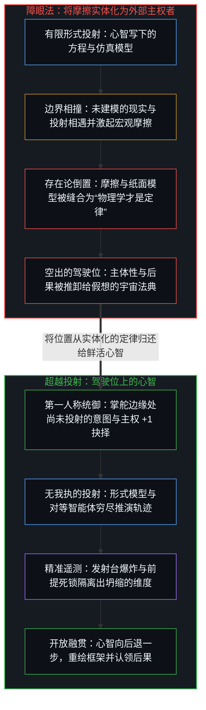
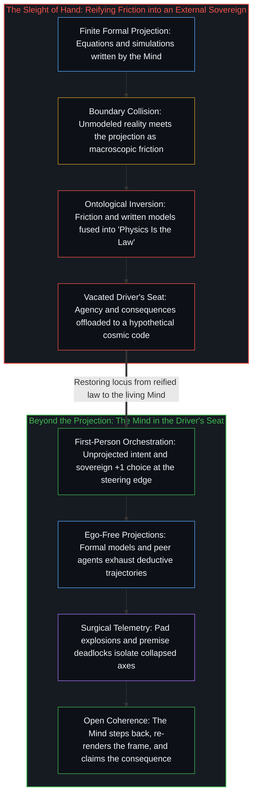

# “物理学才是定律”的障眼法 / The Sleight of Hand in "Physics Is the Law"

*形式模型、宏观摩擦，以及未被定律决定的现实 / Formal Models, Macroscopic Friction, and a Reality Undetermined by Law*

“物理学才是定律，其他一切都只是建议”这句格言在工程实践中极具力量，但它在“物理学”这一个词下悄然缝合了三个截然不同的范畴：心智写下的形式模型，系统运行时的宏观物理现象，以及现实本身。按已知定律严密设计的火箭依然会在发射台上爆炸，说明实际结果并未由纸面方程预先决定；爆炸是有限模型与它未曾包含之物相撞时激起的宏观摩擦。物理学由此并非从外部统治宇宙的主权法典，而是在遭遇摩擦之后解码遥测数据、消除模型内部矛盾的分析工具。现实在绵延不断的因果相续中展开，非确定性出现在观测的边界上，而在每一步直面未建模之物的，始终是驾驶位上鲜活的第一人称。

The maxim "physics is the law, everything else is a recommendation" carries undeniable force in engineering, yet under the single word "physics" it quietly joins three distinct categories: formal models that a Mind writes down, the macroscopic physical phenomena of a system in operation, and reality itself. A rocket designed rigorously according to every known law can still explode on the pad, demonstrating that the outcome is not predetermined by the equations as written; the explosion is the macroscopic friction generated where a finite model meets what it did not contain. Physics is therefore not a sovereign code governing the cosmos from outside, but an analytical instrument for decoding telemetry after friction and removing contradictions inside the model. Reality unfolds in unbroken causal succession, indeterminacy appears at the boundary of observation, and what meets the unmodeled at every step is the living first person in the driver's seat.

## 一、 一个词下的三样东西 / 1. Three Things Under One Word

埃隆·马斯克广为流传的格言——“物理学才是定律，其他一切都只是建议”——在工程实践中有着直观的效用。当工程团队面对繁琐的行政审批链条、保守的行业教条或制度惯性时，这句格言提醒实践者，人为的成规是可以协商、修订、绕开或替换的痕迹，而材料的屈服极限、重力势能的克服与热力学的耗散，则是任何工程造物都无法靠游说绕开的约束。

Elon Musk's widely repeated maxim, "Physics is the law, everything else is just a recommendation," has plain operational utility. When an engineering team confronts bureaucratic approval chains, conservative industry dogma, or institutional habit, the saying reminds the practitioner that human conventions are negotiable traces that can be revised, bypassed, or replaced, whereas material yield limits, gravitational potential, and thermodynamic dissipation are constraints no engineered artifact can talk its way around.

它的边界落在“物理学”这个词本身，这个词底下把三个不同的范畴压缩到了同一根轴上。第一类是形式的定律与理论模型，即写在黑板与论文上的数学方程，是心智为归纳并预测经验中相对稳定的规律而搭起的有限概念投射，牛顿力学、麦克斯韦方程组与热力学状态方程皆属此类。第二类是宏观的物理现象，即人造系统运行时登记下来的可观测摩擦，从气动加热的高温、发动机壳体的应力形变、推进剂燃烧的不稳定震颤，直到整枚火箭的结构解体。第三类则是现实本身，它不被任何有限的概念、形式方程或观测视界所穷尽，处在持续不断的展开与新区分的生成之中。[数字火箭、同行审查与因果闭环的稀释](../the-dilution-of-the-causal-loop-and-the-misallocation-of-agency/)与[框架的倒置与驾驶位的主权非对称](../the-inversion-of-the-harness-and-the-driver-seat-asymmetry/)都曾追溯过这几个层面如何轻易被混同。

Its boundary lies in the word "physics" itself, under which three different categories are compressed onto a single axis. The first category consists of formal laws and theoretical models—mathematical equations written on blackboards and in papers, finite conceptual projections that a Mind constructs to summarize and predict stable regularities in experience, such as Newtonian mechanics, Maxwell's equations, and thermodynamic equations of state. The second category consists of macroscopic physical phenomena—the observable friction that registers when a human-made system operates, from aerodynamic heating, casing stress deformation, and propellant combustion instability to the structural breakup of an entire vehicle. The third category is reality itself, which is exhausted by no finite concept, formal equation, or horizon of observation and continues to unfold and generate new distinctions without pause. Both [Digital Rockets, Peer Review, and the Dilution of the Causal Loop](../the-dilution-of-the-causal-loop-and-the-misallocation-of-agency/) and [The Inversion of the Harness and the Sovereignty of the Driver's Seat](../the-inversion-of-the-harness-and-the-driver-seat-asymmetry/) trace how easily these layers are conflated.

在这句格言里，三个范畴被缝合成了一座单一的丰碑：宏观的物理现象先被等同于现实本身，人写下的形式定律继而被投射到这些现象背后，充当导引自然运转的主权法典。模型与现实之间的因果次序由此倒置，仿佛自然握着一部名为《物理学》的现成法典，端坐在审判席上裁决人类的每一个动作。哪怕形式物理学自身的演进史也拒绝支持这幅图景，因为量子力学早已表明，在微观测量的极限处，形式理论面对的是不可化约的非确定性与概率，而非决定论式的圣旨。把人手写就的形式模型呈现为无中介的现实，正是[“非中介化”的幻象](../the-illusion-of-the-unmediated/)所剖析的障眼法。

In the maxim, the three categories are sewn together into a single monument: macroscopic physical phenomena are first equated with reality itself, and the written formal laws are then projected behind those phenomena as the sovereign code directing nature's operation. The causal order between model and reality is thereby inverted, as though nature held a ready-made statute book titled *Physics* and sat in judgment over every human action. Even the internal history of formal physics refuses to support that picture, for quantum mechanics demonstrates that at the microscopic limit of measurement, formal theory confronts irreducible indeterminacy and probability rather than deterministic edicts. Presenting a human-authored formal model as unmediated reality is the exact sleight of hand dissected in [The Illusion of the Unmediated](../the-illusion-of-the-unmediated/).

## 二、 按定律设计的火箭为何仍会爆炸 / 2. Why a Rocket Designed by the Laws Still Explodes

博卡奇卡发射台上的残骸让这道边界变得具体可感。SpaceX 早期的星舰原型机在着陆测试中炸成火球，并不是因为设计它的工程师违抗了物理定律。推进剂头锥贮箱的流体仿真、发动机推力矢量的控制算法，以及隔热瓦的气动热力学计算，都是在已知物理方程的严格指导下推导出来的；没有哪一位航天工程师会动手设计一枚“违反物理定律”的火箭。

The wreckage on the launch pads at Boca Chica makes this boundary concrete. When SpaceX's early Starship prototypes erupted into fireballs during landing tests, it was not because the engineers who designed them had defied the laws of physics. The fluid simulations of the propellant header tanks, the thrust-vectoring control algorithms, and the aerothermodynamic calculations for the heat shield tiles were all derived under the strict guidance of known physical equations; no aerospace engineer sets out to design a rocket that "violates the laws of physics."

然而火箭依然爆炸了。假如物理结果果真由纸面写下的定律预先裁定，一件按这些定律严密计算并建造出来的造物便该在第一次尝试时平稳入轨，不会出现意料之外的谐振颤振、金属疲劳或结构失效。爆炸证明，决定实际结果的还包含形式模型未曾容纳的自由度。工程故障的来处由此一目了然：持续展开的现实里存在着尚未进入工程师有限坐标系的参数——材料的微观瑕疵、推进剂晃动的瞬态谐振、局部的热应变极限，或是极端工况下的非线性耦合——它们在理想化的抽象中被略去，超出了此前的测量范围，或在测试之前尚不可见。

Yet the rocket exploded all the same. If physical outcomes were dictated in advance by the laws as written, an artifact computed and built rigorously according to those laws would reach orbit smoothly on the first attempt, free of unexpected harmonic flutter, metal fatigue, or structural failure. The explosion proves that what determines the actual outcome includes degrees of freedom the formal model did not contain. Where an engineering failure comes from is thus unmistakable: unfolding reality holds parameters that had not entered the engineers' finite coordinate frame—microscopic material flaws, transient sloshing resonances, localized thermal strain limits, or nonlinear couplings under extreme operating regimes—which were omitted in the idealizing abstraction, lay beyond prior measurement, or remained invisible before the test.

当这件在纸面上合乎定律的造物投入实际运行时，那些未建模的参数便与硬件所具身化的有限投射迎头相撞。这种出自既有模型盲区的接触面摩擦，在高能流体与结构回路中级联放大，最终登记为宏观的破裂与爆炸。爆炸不是宇宙法典对“违章者”的惩罚，而是一份经验读数：它表明模型遗漏了现实依然携带着的变量，未建模的摩擦被放大成了结构性的崩溃。

When an artifact that is lawful on paper enters live operation, those unmodeled parameters collide with the finite projection embodied in the hardware. That contact-surface friction, arising from the blind spot of the prior model, cascades through high-energy fluid and structural loops until it registers as macroscopic rupture and explosion. An explosion is not a cosmic statute punishing a "violator"; it is an empirical reading showing that the model left out variables reality still carries, and that unmodeled friction was amplified into structural breakdown.

## 三、 摩擦是遥测，物理学是排障的工具 / 3. Friction as Telemetry, Physics as a Tool for Debugging

形式物理学若不是从外部统治现实的法典，它在工程里究竟承担什么角色？它是在遭遇摩擦之后，用来读取遥测数据、定位既有投射偏离现实之处，并在下一次迭代中消除内部矛盾的后验诊断工具。它的实操威力恰恰在火箭解体的那一刻显现出来。面对残骸，工程团队从遍布箭体的数千个传感器中提取痕迹——温度的骤升、压力的激波、应变片的失真与光谱特征——并将形式物理学作为高精度的解析语言重新调用：用流体力学方程重新审视推进剂贮箱底部的气蚀，用热传导模型重新标定隔热瓦的接缝，用振动力学加固发动机的支架。

If formal physics is not a statute book ruling reality from outside, what role does it perform in engineering? It functions as an after-the-fact diagnostic instrument for reading telemetry once friction has been met, pinpointing where the prior projection diverged from reality, and eliminating internal contradictions from the next iteration. Its operational power appears at the exact moment the rocket breaks up. Confronting the debris, the engineering team extracts traces from thousands of sensors across the vehicle—sudden temperature spikes, pressure shockwaves, strain-gauge distortions, and spectral signatures—and deploys formal physics as a high-precision analytical language: fluid dynamics equations to re-examine cavitation at the bottom of a propellant tank, heat-conduction models to recalibrate tile seams, and vibration mechanics to stiffen engine mounts.

这一迭代回路的核心并不是“顺从自然法则”，而是借助物理学的数学装置，定位上一次模型与现实相撞的具体坐标，在下一次建造中消解这些冲突，使系统在随后的运行中遭遇更少的破坏性摩擦。这里可以看到损失函数在物理世界中的对应物。正如[你委托的风险就是你创造的风险](../the-risk-you-delegate-is-the-risk-you-create/)与[自我价值感与所有权](../ownership-and-self-worthiness/)所确立的，唯有当行动中心直接置身于接触面的阻力之下时，反馈信号才能保持保真。宏观的物理摩擦，从轻微的机械磨损到发射台上的爆炸，都是现实不经缓冲直接传回的损失信号；而形式物理学，则是心智面对这一信号反推自身既有框架的边界、更新参数的计算工具。

The core of this iterative loop is not "obeying the laws of nature," but using the mathematical apparatus of physics to locate the exact coordinates where the previous model collided with reality, resolving those conflicts in the next build so the system encounters less destructive friction on its subsequent run. Here the physical counterpart of a loss function becomes visible. As [The Risk You Delegate Is the Risk You Create](../the-risk-you-delegate-is-the-risk-you-create/) and [Ownership and Self-Worthiness](../ownership-and-self-worthiness/) establish, a feedback signal retains its fidelity only when the acting center stands directly under the resistance of the contact surface. Macroscopic physical friction, from slight mechanical wear to a pad explosion, is the unbuffered loss signal reality returns, and formal physics is the computational instrument a Mind uses to work backward from that signal, locate the boundary of its own prior framing, and update its parameters.

## 四、 现实在持续地自我呈现 / 4. Reality Keeps Realizing Itself

这句格言里更深一层的压缩，是把作为形式工具的物理学错当成了自然本身的鲜活运行。从神学颁布的法条、牛顿式的钟表匠宇宙，到现代对包罗万象的万物理论的追寻，一种持久的投射始终设想：表象背后藏着一张终极蓝图，只待科学去誊写其中的条款，再交由工程去遵照执行。这一启发式设想固然推动了数个世纪的探索，它的边界却在于“规律”究竟栖身于何处。

A deeper compression inside the maxim mistakes the formal tool of physics for the living operation of nature itself. From theological statutes and the Newtonian clockmaker universe to the modern quest for an all-encompassing Theory of Everything, a persistent projection has imagined that a final blueprint sits hidden behind appearances, waiting for science to transcribe its clauses so engineering can execute them. While that heuristic has motivated centuries of inquiry, its boundary lies in where "regularity" actually resides.

所谓客观规律，是心智在局部的尺度、有界的能量区间与有限的历史时段内，从不同观察者之间保持相对稳定的表象中抽出的概念归纳；规律栖身在观察者的认知图景之内。正如[你的代码库即是记忆](../your-codebase-is-memory/)所审视的外化造物那样，写下的物理定律是过往已稳定摩擦的压缩留存——它是既有区分留下的检查点，供后续的工程行动以此为条件并对照实时遥测重新切分，而非先于心智持续检验而存在的自治立法源头。从不可化约的第一人称视角出发，找不到一部站在现实之外指导现实如何运转的外部法典；存在的是自我区分的现实在持续不断地呈现、展开并实现自身。每一条形式定律覆盖的都是已采样情形的闭合 N，而开放的现实则是不可穷尽的余量，正如[闭合的N与开放的现实](../the-closed-n-and-the-open-reality/)所阐明的。

What is called an objective law is a conceptual induction that a Mind draws across local scales, bounded energy regimes, and finite historical intervals from appearances that remain relatively stable across observers; the law lives inside the observer's cognitive map. Like the externalized artifacts examined in [Your Codebase Is Memory](../your-codebase-is-memory/), written physical laws are compressed residues of stabilized past friction—checkpoints of prior distinctions that subsequent engineering acts condition on and re-cut against live telemetry, rather than an autonomous legislative source that precedes the Mind's ongoing verification. Starting from the irreducible first-person perspective, no external statute book can be found standing outside reality to direct how reality runs; what exists is self-distinguishing reality continuously presenting, unfolding, and realizing itself. Every formal law covers a closed N of sampled cases while open reality remains the inexhaustible remainder, as [The Closed N and the Open Reality](../the-closed-n-and-the-open-reality/) demonstrates.

这一展开严格合乎因果的相续。放下“客观铁律”的神话，并不会把现实变成一场毫无因果的任意杂耍；离了绵延不绝的因果相续，现象便会失去一切可理解性，工程的迭代、传感器的遥测、闭合的反馈回路与损失信号也都无所依凭。既然因果从未断裂，微观上的非确定性与宏观上的不可预测性从何而来？它们产生于观测的边界。

This unfolding accords strictly with causal succession. Setting down the myth of an "objective iron law" does not turn reality into an arbitrary circus without cause and effect; apart from unbroken causal succession, phenomena would lose all intelligibility, and engineering iteration, sensor telemetry, closed feedback loops, and loss signals would have nothing to stand on. If causality is unbroken, where do microscopic indeterminacy and macroscopic unpredictability come from? They arise at the boundary of observation.

正如[索求万物理论是在将当下冻结为清单](../demanding-a-toe-freezes-time-into-a-catalog/)、[黑白采样帧与外推宇宙](../the-black-and-white-sample-frame-and-the-extrapolated-universe/)与[时间之箭的伪悖论与对称模拟的边界](../the-mirage-of-times-arrow-and-the-boundaries-of-simulation/)所追溯的，普朗克常数 h 与普朗克时间 t_P 标示着心智借物理仪器对现实采样时的网格分辨率与最高刷新率。[抽象的阶梯与可执行的实体](../the-ladder-of-abstraction-and-the-executable-entity/)进一步表明，将这一不可逆的生成相续抽象为时间反演对称的方程，只是为简化计算而搭起的静态脚手架。量子视界由此是仪器观测的像素极限，即从外部所能登记的视界边界。没有任何理由要求因果在这道视界上断裂；只是仪器无法探查比自身刷新率更细微的因果跃迁，连续的因果相续被有限分辨率截断之后，在读数上便登记为概率与非确定性。

As [Demanding a Theory of Everything Freezes Time into a Catalog](../demanding-a-toe-freezes-time-into-a-catalog/), [The Black-and-White Sample Frame and the Extrapolated Universe](../the-black-and-white-sample-frame-and-the-extrapolated-universe/), and [The Mirage of Time's Arrow and the Boundaries of Symmetric Simulation](../the-mirage-of-times-arrow-and-the-boundaries-of-simulation/) trace, the Planck constant h and the Planck time t_P mark the grid resolution and maximum refresh rate with which a Mind samples reality through physical instruments. [The Ladder of Abstraction and the Executable Entity](../the-ladder-of-abstraction-and-the-executable-entity/) further shows that abstracting this irreversible generative succession into time-reversal-symmetric equations is static scaffolding erected to simplify calculation. The quantum horizon is therefore the pixel limit of instrumental observation—the horizon boundary of what can be registered from outside. Nothing requires causality to snap at that horizon; an instrument simply cannot probe causal transitions finer than its own refresh rate, so a continuous causal succession truncated by finite resolution registers in the readout as probability and indeterminacy.

这道观测边界与第一人称抉择是同一枚硬币的两面。从第一人称的生成边缘向内看，心智站在发起区分的原处，因果相续被连贯地经验到，行动登记为主权的抉择（+1）。从外部去看另一个中心，由于无法进入对方的内在视界，在内部连贯的决断在外部便登记为个体的不可预测；当仪器去探测微观极限时，同一道外部边界在读数上便登记为量子的非确定性。边界落在观测的尽头，而测量割点安放在何处，则是观察心智所作出的抉择，正如[割点可移不可除](../the-cut-moves-but-never-vanishes/)所展开的。援引“物理定律”作为托词来为某项决定开脱或将其预先归入宿命，是试图把后果移交给形式模型，而[任务的移交与后果的不可让渡](../the-delegation-of-the-task-and-the-inalienability-of-consequences/)早已阐明，没有任何模型能够承接这份后果。

This observational boundary and first-person choice are two sides of the same coin. Seen from within the first-person generating edge, the Mind stands where distinctions are initiated, causal succession is experienced coherently, and action registers as sovereign choice (+1). Seen from the outside, another center's interior horizon cannot be entered, so a decision that is coherent from within registers externally as individual unpredictability; when an instrument probes the microscopic limit, the same exterior boundary registers in the readings as quantum indeterminacy. The boundary falls at the end of observation, and where the measurement cut is placed is a choice the observing Mind makes, as [The Cut Moves but Never Vanishes](../the-cut-moves-but-never-vanishes/) lays out. Invoking "physical law" as an alibi to excuse or predeterminedly sign away a decision attempts to hand the consequence over to a formal model—a transfer that [The Delegation of the Task and the Inalienability of Consequences](../the-delegation-of-the-task-and-the-inalienability-of-consequences/) shows no model can ever absorb.

现实如同一条奔流不息的因果激流，每一座形式模型或工程设计都是在激流中筑起的局部堤坝。激流并不因为“遵守了流体力学”才奔涌，它只是在流动。当按流体力学计算出的堤坝被冲决时，这件结构并没有“违背宇宙法则”，而是现实溢出了为它预备的有限概念容器。扎实的工程实践，在于每一次受挫时对未建模之处保持敬畏，拒绝躲在“方程说它撑得住”的借口背后，承认投射的边界，拿起物理学这件工具就地重建。

Reality unfolds like an unceasing torrent of causal succession, and every formal model or engineering design is a local dike built within that flow. The torrent does not flow because it "obeys fluid mechanics"; it simply flows. When a dike calculated by fluid mechanics is breached, the structure has not "broken a cosmic law"—reality has overflowed the finite conceptual container prepared for it. Sound engineering consists in maintaining respect for the unmodeled at every setback, refusing to hide behind the excuse that "the equations said it would hold," acknowledging the boundary of the projection, and picking up the tool of physics to rebuild on the spot.

## 五、 在驾驶位上面对未建模的现实 / 5. Meeting Unmodeled Reality From the Driver's Seat

“物理学才是定律”内部的混同固然可以作为宏观的语言习惯来剖析，但闭合认知回路始终要落回第一人称的因果原点。正如[个体抉择是唯一的因果杠杆](../individual-choices-as-the-only-causal-levers/)与[没有普渡，只有自渡的无限可能](../mei-you-pu-du-zhi-you-zi-du/)所确立的，没有任何抽象的集体主体或纸面公式能代替个体去感知摩擦并作出决断；无论在发射台上、实验室里还是系统架构设计中，直面未建模之物的，始终是此时此地握着方向盘的那个具体心智。

While the conflation inside "physics is the law" can be analyzed as a macroscopic linguistic habit, closing the cognitive loop always returns to the first-person causal origin. As [Individual Choices as the Only Causal Levers](../individual-choices-as-the-only-causal-levers/) and [No Universal Salvation, Only Boundless Possibilities of Self-Salvation](../mei-you-pu-du-zhi-you-zi-du/) establish, no abstract collective subject and no written formula can sense friction or make a decision in an individual's place; on the launchpad, in the laboratory, or in architectural design, what confronts the unmodeled is the concrete Mind holding the wheel here and now.

正如[超越投射](../beyond-the-projection/)所追溯的，心智与形式物理方程及人工智能体的协作，同样受制于这一结构性的非对称。数学仿真与基于 LLM 的智能体，都是心智外化出的有限且受限于轨迹的投射引擎。一旦给定初始公理、方程或提示词规则，投射引擎便严格运行在自身语境的边界之内；它无法跨出自身前提所锁定的推演轨迹，但当外部的反例到来时，它也没有任何我执或需要捍卫的自我图像。而处于驾驶位上的人类心智——即[框架的倒置与驾驶位的主权非对称](../the-inversion-of-the-harness-and-the-driver-seat-asymmetry/)所审视的位置——则展现出相反的结构：人类的推理极易与身份认同粘连，从而去捍卫偏爱的理论或自我图像；但唯有鲜活的心智具备极限分辨率的第一人称感知，能够在整个框架失效时登记先于解释的摩擦，并在逻辑上向后退一步。

This exact structural asymmetry governs how the Mind works with both formal physical equations and artificial intelligence agents, as [Beyond the Projection](../beyond-the-projection/) traces. Both a mathematical simulation and an LLM-based agent are finite, trajectory-bound projection engines externalized by the Mind. Once given initial axioms, equations, or prompt rules, a projection engine runs strictly inside the boundary of its context; it cannot step outside the deductive trajectory its own premises have locked it into, yet it also possesses zero ego and no retained self-image to defend when an outside counterpoint arrives. The human Mind in the driver's seat—the locus examined in [The Inversion of the Harness and the Sovereignty of the Driver's Seat](../the-inversion-of-the-harness-and-the-driver-seat-asymmetry/)—exhibits the inverse structure: human reasoning easily fuses with identity to defend a cherished theory or self-image, yet only the living Mind possesses limit-resolution first-person sensing that registers pre-interpretive friction and steps further back logically when an entire frame breaks down.

当工程师把形式物理学实体化为外部的主权定律，或指望自动化智能体框架接管统御并吸纳责任——即[任务的移交与后果的不可让渡](../the-delegation-of-the-task-and-the-inalienability-of-consequences/)所剖析的退位——这两种做法都在重复同一个范畴谬误：它们空出了驾驶位，指望由有限的投射去统治开放的现实。反过来，当人类心智留在掌舵边缘担任统御者，并在正交的流线上配对无我执的投射时，物理试飞与多智能体对等辩论便都能充当精准的诊断工具。正如主任务智能体与冷态对等智能体之间不可化约的死锁，会暴露出人类架构师的规则在哪个具体坐标上把两个正交维度压缩到了同一根轴上，火箭在发射台上的解体，也会暴露出既有数学模型在哪个具体坐标上遗漏了鲜活的自由度。

When an engineer reifies formal physics into an external sovereign law, or expects an automated agent harness to take over orchestration and absorb accountability—the abdication dissected in [The Delegation of the Task and the Inalienability of Consequences](../the-delegation-of-the-task-and-the-inalienability-of-consequences/)—both moves repeat the same category error: they vacate the driver's seat and expect a finite projection to govern open reality. Conversely, when the human Mind remains the orchestrator at the steering edge and pairs ego-free projections across orthogonal streamlines, both physical test flights and multi-agent peer debates serve as surgical diagnostic instruments. Just as an irreducible deadlock between a primary task agent and a cold peer exposes the exact coordinate where the human architect's rules compressed two orthogonal dimensions onto a single axis, a rocket breaking up on the pad exposes the exact coordinate where the prior mathematical model omitted a live degree of freedom.

在驾驶位上，黑板上的方程与智能体框架都被认清是为行动而采纳的暂行假说。当接触面上撞出破缺时，传回的摩擦便被认领为提升内在融贯的材料；正如[开放即一致](../openness-is-consistency/)所阐明的，力量在于心智拒绝围绕冻结的模型锁死自身的递归回折，而是把每一次与未建模现实的相撞当作损失信号，借以消解内部矛盾，并退后一步进入更高维度的综合。每一次抉择的代价始终锁定在点火起飞并掌舵回路的第一人称中心身上，而将形式模型实体化为独立的主权者，正是[无法逃逸的心智视界](../one-cannot-escape-ones-own-mind/)所追溯的自我封闭式坍缩。物理学是在未建模的现实中开路时握在手里的一把刀，在每一次相撞中得到打磨与重新校准；若定律果真从外部统治一切，主体性就必须从纸面规则中涌现出来，而[主体性不曾涌现](../agency-does-not-arise/)早已表明这无从发生。

In the driver's seat, blackboard equations and agent harnesses are recognized as provisional hypotheses adopted for action. When a rupture registers at the contact surface, the returning friction is claimed as the material for raising internal coherence; as [Openness Is Consistency](../openness-is-consistency/) demonstrates, strength lies in a Mind that refuses to clamp its recursive fold shut around a frozen model, using every collision with unmodeled reality as a loss signal to dissolve internal contradictions and step back into a higher-dimensional synthesis. The cost of every choice remains locked to the first-person center that ignites the engine and steers the loop, whereas reifying a formal model into an independent sovereign is the self-enclosing collapse traced in [One Cannot Escape One's Own Mind](../one-cannot-escape-ones-own-mind/). Physics is a blade held in the hand while cutting a path through unmodeled reality, honed and recalibrated at every collision; were law truly to govern from outside, agency would have to emerge from written rules, which [Agency Does Not Arise](../agency-does-not-arise/) shows can never occur.
