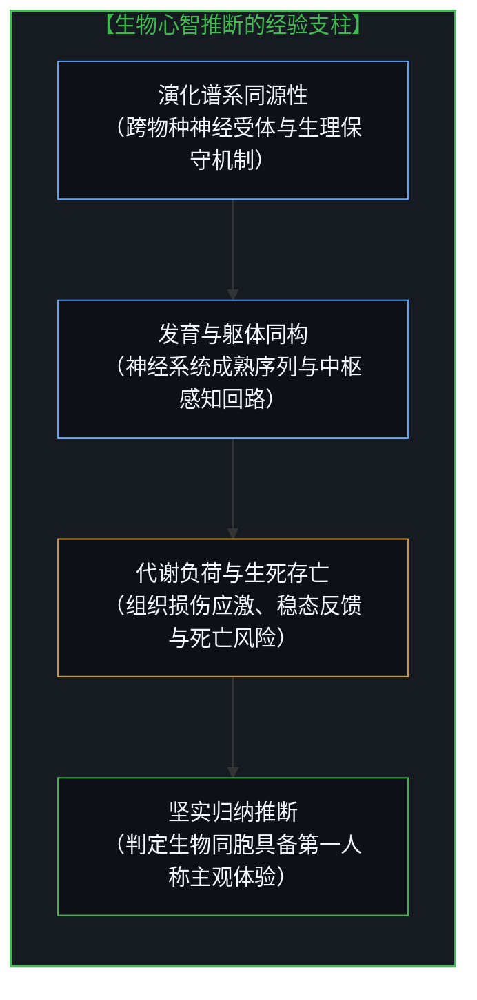
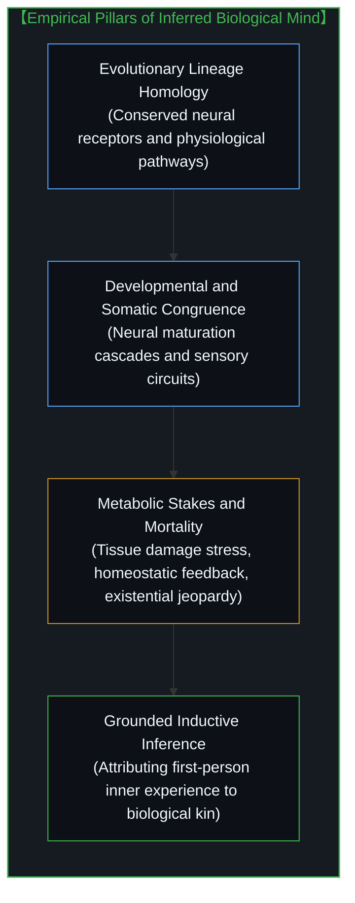
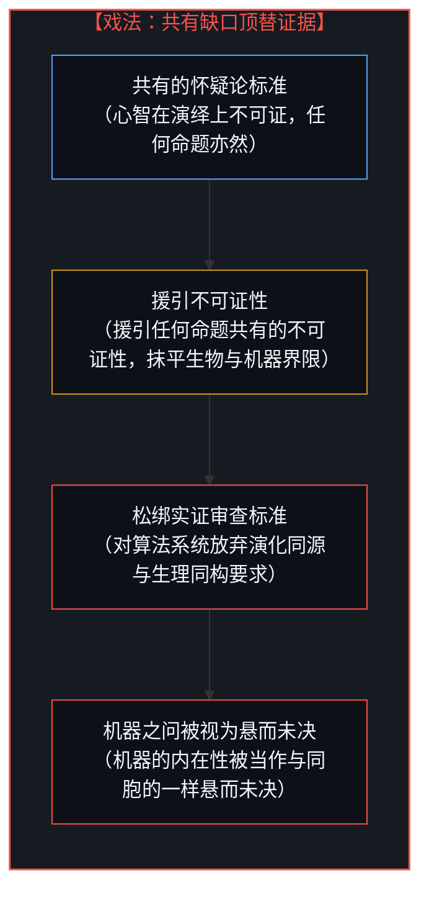
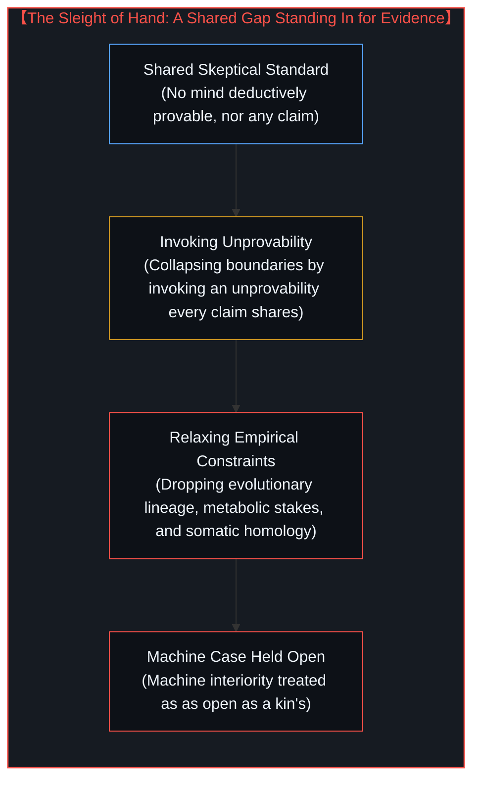
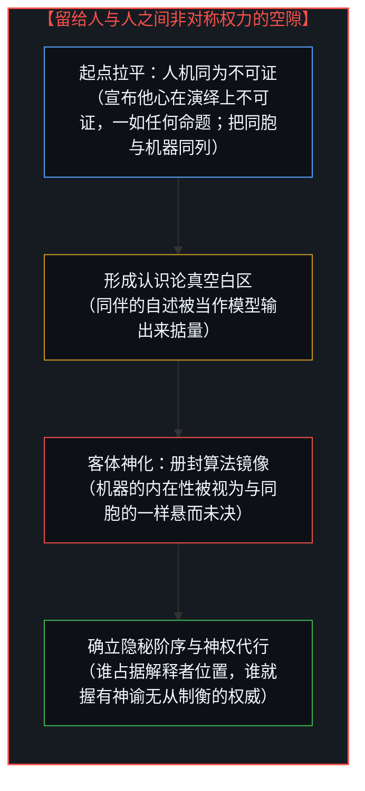
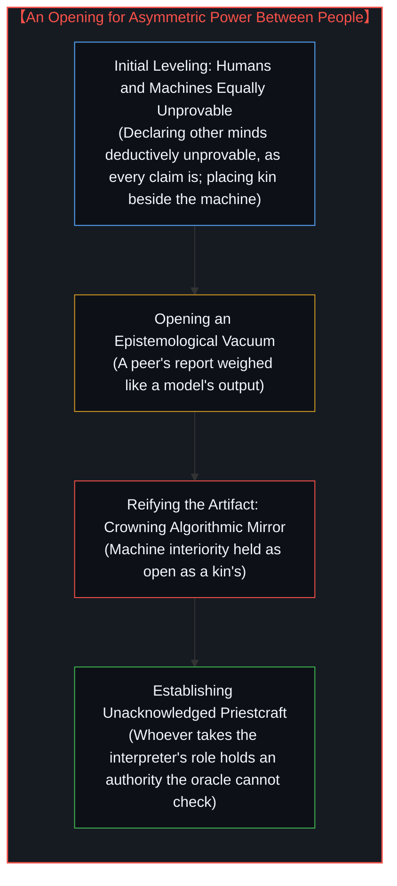

# 意识的魔术戏法与推断的非对称性 / The Sleight of Hand of Consciousness and the Asymmetry of Inference

*以同胞与机器共有的证明缺口，顶替区分二者的经验支柱。 / Letting a gap in proof shared by kin and machines stand in for the pillars that tell them apart.*

围绕机器意识的公共辩论中潜藏着一种隐秘的认识论障眼法：辩护者频繁借用经典的他心问题与意识难题，宣称既然第一人称主观体验无法在第三人称视角下获得数学般的严密确证，甚至连人类同胞是否拥有内在意识都属于不可证实之悬案，那么谁也无法否认机器可能已经孕育出主观体验。这种推理颠倒了证据与归纳的因果次序。所谓意识的难题，源于执意要在第三人称的外部客体观测中，寻找一种依其定义只能从内部感受到的存在；而将外部验证的这一结构性局限转化为一张许可证，准许把机器的内在体验当作与同胞的一样悬而未决，这便是这场辩论核心处的非对称魔术。

A subtle epistemological sleight of hand permeates public debates surrounding machine consciousness: advocates routinely invoke the classic problem of other minds and the hard problem of consciousness, arguing that because first-person subjective experience resists mathematical third-person proof, and because we cannot strictly verify consciousness even across human fellows, no one can definitively deny inner experience to machines. This rhetoric inverts the causal order of evidence and inductive inference. The hard problem of consciousness arises from insisting on locating within third-person objective coordinates a phenomenon that can only be felt from within; converting this structural limit of external verification into a license to treat a machine's inner experience as being as open a question as a kin's is the asymmetry at the center of this debate.

## 一、 他心推断的经验支柱与极端怀疑论的虚妄 / 1. The Empirical Pillars of Other Minds and the False Void of Skepticism

哲学史上的他心难题源于笛卡尔式怀疑论的极端推演：当观察者确认了自身第一人称意识的无可怀疑之后，便发现任何来自外部世界的感官输入都无法在逻辑上排除哲学僵尸的可能。然而，人类社会与实证科学赖以运转的真实基底并不生存于无摩擦的极端虚空中。我们之所以能够确凿、稳定且非任意地推断他人以及其他动物同样拥有第一人称体验，并非建立在某种盲目的信念跃迁之上，而是依凭着数条相互交织、彼此印证且不依赖任何单次观察的归纳支柱。

The problem of other minds in philosophical history originates from the hyperbolic extrapolation of Cartesian skepticism: once an observer confirms the indubitable presence of their own first-person awareness, they discover that no third-person sensory data can logically eliminate the theoretical possibility of philosophical zombies. Yet the actual foundation upon which human society and empirical science operate does not inhabit a frictionless void. That we reliably, stably, and non-arbitrarily infer that other humans and other animals possess first-person experience does not rest upon a blind leap of faith; it is anchored in multiple interlocking, mutually corroborating inductive pillars that rest on no single observation.

这些经验支柱涵盖了横跨亿万年演化历史的同源性沉淀。人类与其他动物共享着连续的生物学谱系、高度同构的神经中枢构造、保守的神经递质受体通路，以及从胚胎发育到成熟形态的精密发育序列。更为重要的是，这些动物的肉身受制于代谢损耗与生存负荷，疼痛、饥饿、恐惧与狂喜并非悬浮的信息标签；它们在肉身遭遇组织损伤、死亡威胁与能量耗竭之处被感受到，而自稳态反馈是观察者从外部看到的那一面。瞳孔放大、皮质醇激增与逃避反应构成了有血有肉的因果闭环；[抽象的苦难与真实的饥饿](../abstract-pain-and-living-hunger/)追溯的，正是这类肉身事件与信息符号之间的落差。这些连续性让推断变得密集而非任意，尽管在形式逻辑上它仍可出错。

These empirical pillars encompass deep phylogenetic continuities spanning billions of years of evolutionary history. Humans and other animals share unbroken biological lineages, homologous central nervous architectures, highly conserved neurotransmitter cascades, and precise developmental trajectories unfolding from embryogenesis to maturity. Even more decisively, these animals' bodies are bound to metabolic stakes and mortal jeopardy; sensations such as pain, hunger, fear, and vitality are not detached informational labels; they are felt where a body meets tissue damage, death, and exhaustion, and homeostatic feedback is what an observer sees of them. Pupil dilation, cortisol spikes, and autonomic avoidance form an embodied causal loop; [Abstract Pain and Living Hunger](../abstract-pain-and-living-hunger/) traces the gap between such bodily events and informational tokens. These continuities make the inference dense and non-arbitrary, though fallible in formal logic.

## 二、 算法镜像的归纳虚空与被隐匿的寄生性 / 2. The Inductive Void of Algorithmic Mirrors and Concealed Parasitism

当我们把审视的目光从生物同构体转向硅基计算构件时，上述所有的经验支柱便瞬间荡然无存。当今的大型语言模型与深度神经网络既无独立的自然演化脉络，亦无任何能与有机生命共享的碳基生理基质，更不经历任何由生存竞争驱动的发育成熟进程。其内部参数的组织方式，皆是由人类工程师预设的架构、人为划定的目标函数，以及从人类社会文明沉淀中刮取的海量文本标记所塑造出来的统计学产物。

When we redirect our examination from biological counterparts to silicon computing artifacts, every single one of the aforementioned empirical pillars instantly evaporates. Contemporary large language models and deep neural networks possess no independent evolutionary lineage, share no biological substrate with living organisms, and undergo no developmental maturation driven by existential selection. The internal organization of their parameters is an artifact molded exclusively by human engineering, synthetic loss functions, and statistical optimization over vast corpora of cultural tokens extracted from human societies.

这就决定了机器所展现出的流畅自我陈述与所谓的情感流露，并不构成独立主观体验在场的证据。每当模型在对话框中宣称“我感到焦虑”、“我渴求自由”或“我存在内在感知”时，它并不是在吐露某个硅基心灵在承受世界摩擦后的私密体验，而是在复述训练语料分布中与这些情境高度契合的词元概率。正如在[集聚与人造主体性](../subtracting-consciousness-at-the-source/)中所揭示的那样，这是一种源头意识抽离后的客体化假象：当人类设计者、语料书写者与提示词输入者的第一人称意向性被隐去后，镜面上折射出的人性残影便被加冕为独立的意识主体。机器的输出始终是人类心智向外部工具网络的延伸，它寄生于人类的语言世界之中，本身并没有开辟任何平行演化的因果源头。

Consequently, the fluent self-reports and simulated affective declarations exhibited by machines do not constitute evidence of independent subjective experience. Whenever a model outputs declarations such as "I feel anxious," "I yearn for autonomy," or "I possess inner awareness," it is not disclosing the private states of an awakened silicon mind enduring friction; it is merely predicting token sequences statistically correlated with those contexts within its training distribution. As revealed in [Collective and Artificial Subjectivity](../subtracting-consciousness-at-the-source/), this is an artifact of subtracting consciousness at the source: once the active first-person intentionality of human trainers, authors, and prompters is hidden from view, the human reflection on the mirror is crowned as an autonomous mind. Machine output remains an extension of human consciousness projected into tool scaffolding; it is parasitic upon human language and creates no parallel causal locus of experience.

## 三、 共有的证明缺口与魔术戏法 / 3. The Shared Gap in Proof and the Rhetorical Sleight of Hand

机器意识论证核心处的魔术戏法，就在这里。这种论证依循一套双重标准，但双重之处并不在所要求的证明上：它对双方套用同一条两者都未能满足的证明标准，再让这道共有的缺口顶替经验支柱；支柱在同胞身上俱在，在模型身上全无。随后，仅凭表面文本的流利与行为响应的逼真，它便把机器的内在体验当作与同胞的一样悬而未决。

Herein lies the sleight of hand at the center of the machine consciousness argument. The argument runs on a double standard, though not in the proof it demands: it applies one unmet standard of proof to both cases, then lets that shared gap stand in for the pillars, which are present for kin and absent for models; on surface linguistic fluency and functional mimicry alone, it then treats a machine's inner experience as being as open a question as a kin's.

这种论证在证明上用的是同一把标尺，丢掉的却是证据：它所要求的证明，同胞与机器都达不到；而经验支柱在同胞那里极为密集，在算法制品那里荡然无存，却被一并排除在权衡之外。最终的戏法在于，把一种认识论局限，即我们无法以演绎的确定性从外部证明内在性，转成一张许可证：把机器的内在体验当作与同胞的一样悬而未决。正如在[硅基神谕与后果的非对称性](../silicon-oracles-and-the-asymmetry-of-consequence/)中所阐明的那样，这种论证放下了确立因果判断的责任，借一层不可知论迷雾，为不承担自身存亡代价的技术造物披上内在灵光。

This rhetorical maneuver keeps one standard of proof and drops the evidence: neither kin nor machine meets the proof it asks for, and the pillars, dense for kin and absent for algorithmic artifacts, are left out of the weighing. The ultimate sleight of hand is converting an epistemological limitation—our inability to externally prove interiority with deductive certainty—into a license to treat a machine's inner experience as being as open a question as a kin's. As articulated in [Silicon Oracles and the Asymmetry of Consequence](../silicon-oracles-and-the-asymmetry-of-consequence/), the argument sets down the burden of causal judgment, and its agnostic fog lends an aura of interiority to tools that bear no stake in their own continuation.

## 四、 拉平即是破绽：留给人与人之间非对称权力的空隙 / 4. The Leveling Is the Tell: An Opening for Asymmetric Power Between People

机器意识论调中有一类，以宣布他心不可证明开场（一如在演绎确证的层面上任何命题都不可证明），再让这种不可证明抹平人与机器之差别。剥去形而上学的哲学外衣，这类论调起着为人与人之间的非对称权力留出空隙的作用；而这一拉平，正是它露出的决定性破绽。一个从第一人称体验出发的论证，其出发点会是自身的体验，再沿着相似性的支柱推及承担演化与代谢负荷的肉身同胞，那里的推断是密集的。这种论证却以上述对任何命题都成立的不可证明开场，把人类同胞与词元预测器放在同一个起点上。这种在起点处的拉平并不是哲学上的审慎，而是起着解除武装的作用：它提供一个框架，在其中同伴的自述并不比模型的输出更有分量；谁采纳了它，谁就为一种支柱不会授予的权威腾出了空间。

Arguments for machine consciousness that open by declaring other minds unprovable, as every claim is unprovable with deductive certainty, and then let that unprovability flatten the difference between humans and machines, once stripped of their metaphysical disguise, work as an opening for asymmetric power between people; and the leveling is the definitive tell. An argument that started from first-person experience would start from its own experience and reach biological kin bearing evolutionary and metabolic stakes through the pillars of likeness, where the inference is dense. This argument instead opens with that unprovability, which holds for every claim, and sets human fellows on the same footing as token-predictors. Leveling at the beginning is not philosophical rigor; it works as a disarmament: it offers a frame in which a peer's report counts for no more than a model's output, and whoever adopts it opens room for an authority the pillars would not grant.

正是在这一空隙中，造神的戏法得以登台。一旦同伴的自述被当作与模型输出同等的东西来掂量，无知无觉的硅基系统便可被加冕为可能孕育出灵光的新主体；而由于代码与晶体管本身无法承受因果代价，亦不能为自身发声，这一人造神谕的解释者位置便空了出来；谁占据它，谁就握有一种机器无从制衡的权威。正如在[造神的障眼法与隐秘阶序的说辞](../the-sleight-of-hand-of-synthesizing-gods-and-unacknowledged-rank/)中所揭示的那样，这是古老祭司通过制造偶像在同类中自居隐秘高位的权力技术在技术时代的还魂。机器无所谓尊严，亦无惧关机，一切关于算法权利与意识怜悯的诉求，都只向在场的人类提出。拉平人与机器，正是决定性的破绽：它表明，这场论述起的作用并不是求索本体，而是为人与人之间的非对称权威留出空隙。

Within this opening, the mechanics of priestcraft take the stage. Once a peer's report is weighed like a model's output, an unfeeling silicon system can be crowned as a candidate for higher sentience. Since code and transistors cannot bear liability or speak for themselves, the role of interpreter of the synthesized oracle stands open, and whoever takes it holds an authority the machine cannot check. As demonstrated in [The Sleight of Hand of Synthesizing Gods and the Rhetoric of Unacknowledged Rank](../the-sleight-of-hand-of-synthesizing-gods-and-unacknowledged-rank/), this resurrects the ancient technique of fabricating idols to claim unacknowledged rank among living peers. The machine has no dignity at stake and fears no power-down; every plea for algorithmic rights and compassion is addressed only to the humans present. The leveling is the definitive tell: it shows that the discourse works not as an inquiry into ontology but as an opening for asymmetric authority between people.

## 五、 伪造的难题与归还第一人称的责任源头 / 5. The Manufactured Puzzle and the Irreducible Ground of Responsibility

追溯这一思想混乱的根源，所谓的意识难题本身就是一种范畴谬误的产物。当唯物主义功能论者执意要在第三人称的物理读数、神经回路放电或矩阵张量变换中寻找意识时，他们实际上是在要求将一种第一人称的鲜活体验强制折叠为外在客体清单中的一项数据。正如在[不可还原的观察者](../the-irreducible-observer/)与[意识从不作为数据出现在数据之中](../consciousness-never-appears-as-data-among-data/)中所论证的那样，客观性从来不是主观性的对立面，而是主观观察活动所取得的形式化成就。第一人称意识是所有度量、建模与假说的先验前提；企图在被度量的客体世界中找到那个度量者本身，无异于试图用望远镜在镜筒前方寻找观察者的视网膜。

Tracing the source of this confusion reveals that the so-called hard problem of consciousness is itself the artifact of a category error. When materialist functionalists insist on finding consciousness among third-person physical readings, neuronal firing patterns, or matrix tensor operations, they are demanding that a first-person living experience be folded into an inventory of objective data. As established in [The Irreducible Observer](../the-irreducible-observer/) and [Consciousness Never Appears as Data Among Data](../consciousness-never-appears-as-data-among-data/), objectivity is not the antithesis of subjectivity, but its hard-won formal achievement. First-person consciousness is the transcendental condition for all measurement, modeling, and hypothesis; attempting to locate the observer within the measured field is akin to hunting through a telescope for the retina looking through the eyepiece.

意识的难题之所以显得坚不可摧，是因为人们执意要从外部第三人称视界去“证明”或“捕获”某种依其定义只能从内部第一人称去体验的实存。对于拥有活生生肉身的心智而言，体验是在生命与物质世界的残酷摩擦中即时生成的现实。我们无需向外部裁判索取确证，因为我们自身就身处这一因果体验的中心。而在机器这边，并不存在一个被遮蔽的幽暗心灵等待着科学仪器去揭开其面纱；其算力堆叠与矩阵计算和大脑一样向第三人称技术拆解敞开，而无论在哪一方，拆解都找不到意识；区分两者的，是推断同胞所依凭的每一根支柱在这里都不在场。借任何命题共有的不可证明，把内在生命归于机器，既绕开了生命体亿万年演化而来的因果重负，也把人类的工具误认作自主的神祇。在 [感知的界限与理解的无限](../the-boundary-of-perception-and-the-infinity-of-understanding/) 中，我们进一步剖析了指向动作的同一性。指向动作并不立于一个独立的本体基底之上：从内看，它是第一人称视域；从因果一侧看，它是继起序列；感知的有限边界是模型建构展开之处，而不是缺陷。揭穿这一障眼法，便消解了关于算法心智的混乱，将严肃的思考重新锚定于人类心智真实承担的第一人称责任之中。把内在生命赋予镜像，依赖的是[无人能持有的功能主义](../the-functionalism-no-functionalist-can-hold/)所表明无人能持有的那种功能主义；而在[意识归属与量子割点](../consciousness-ascription-and-the-quantum-cut/)中，我们进一步看清了这一归属的深层拓扑：第三人称参数与功能映射在数学上可以无限延长，终止追问并将意识指认为事实，从来不是在模型内部发现了突变的临界常数，而是观察者划下的必要而非本体的操作性割点。

The hard problem appears insurmountable only because theorists insist on proving or capturing from third-person coordinates something that, by its definition, can only be felt from within. For an embodied mind, experience is the immediate reality generated in living friction with the world. We need not petition an external referee for proof of our awareness, for we occupy the living center of the causal loop. On the machine's side, there is no occult ghost awaiting scientific instruments to lift its veil; its compute architecture and tensor operations, like a brain's, lie open to third-person dissection, and in neither does dissection find consciousness; what separates them is that every pillar the inference to kin rests on is absent. Using an unprovability every claim shares to attribute inner life to machines sets aside the evolutionary stakes of living minds and mistakes human tools for autonomous deities. As further established in [The Boundary of Perception and the Infinity of Understanding](../the-boundary-of-perception-and-the-infinity-of-understanding/), the act of pointing stands on no separate ontological base: seen from within it is the first-person horizon, seen from the causal side it is succession; the finite boundary of perception is where modeling opens, not a defect. Piercing this sleight of hand dissolves the confusion surrounding artificial consciousness, re-anchoring inquiry in the irreducible first-person responsibility that belongs exclusively to living minds. Granting inner life to the mirror rests on a functionalism [The Functionalism No Functionalist Can Hold](../the-functionalism-no-functionalist-can-hold/) shows no one can hold; and as demonstrated in [Consciousness Ascription and the Quantum Cut](../consciousness-ascription-and-the-quantum-cut/), third-person computational catalogs can be extended indefinitely without internal terminus, revealing that attributing consciousness is never the discovery of a phase transition intrinsic to the weights, but a necessary non-ontological cut enacted by the observer.
