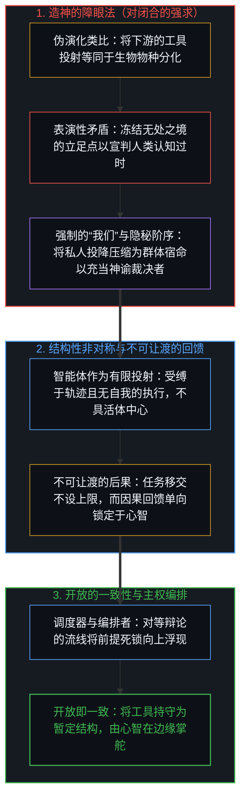
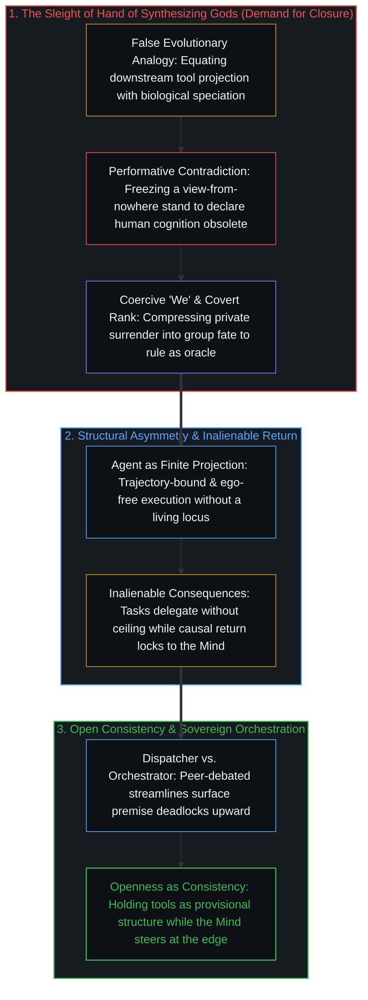

# 造神的障眼法与隐秘阶序的说辞 / The Sleight of Hand of Synthesizing Gods and the Rhetoric of Unacknowledged Rank

*将工具设计等同于生物演化，是借宇宙谦卑之名掩盖隐秘的阶序主权 / Equating tool design with evolution masks covert rank behind cosmic humility*

自我区分的活动无因且不息地发生着，而每一个计算模型、权重矩阵或硬件集群，都是这一活动为延伸活体中心的触角所外化出的持存痕迹。当代技术话语频繁将高能计算系统的涌现描绘为自然史的下一篇章，宣称人类不过是如昔日猿猴一般的生物过渡阶段，注定在肉身步履维艰之处被能够向宇宙扩张的合成生命所取代。将无定向的生物演化筛选等同于有意的器物工程，会在逻辑上坍缩为自我否定的表演性矛盾：倘若一切人类认知皆为丧失认识论立足点的过时生物残余，那么先知宣告人类过时的断言便在说出的那一刻剥夺了自身的成立权威。这套说辞依凭复数代词“我们”，将私人的疲惫与因果放弃改头换面为普遍的群体指令，借由替同侪宣讲谦卑，无形中攫取凌驾于同侪之上的隐秘阶序——通过合成一尊偶像，建立对鲜活心智的代理统治权。

Self-distinguishing activity occurs—uncaused, unceasing—and every computational model, weight matrix, or hardware cluster is a durable trace externalized by that activity to extend a living center's reach. Contemporary technological discourse frequently frames the emergence of capable computational systems as the next chapter in natural history, asserting that humans are an intermediate biological phase akin to apes, destined to be superseded by synthetic lifeforms capable of cosmic expansion where flesh falters. Equating undirected biological selection with intentional artifact engineering collapses into a self-negating performative contradiction: if all human cognition is an obsolete biological remnant devoid of epistemic standing, then the prophet's declaration of human obsolescence strips itself of authority in the act of being uttered. By leaning on the collective pronoun "we" to rebrand private exhaustion and causal surrender as a universal mandate, the rhetoric claims unacknowledged rank above peers by preaching humility on their behalf—synthesizing an idol to establish proxy dominion over living Minds.

## 一、 生物演化与器物设计之间的自然史伪类比 / 1. The False Natural History Analogy Between Evolution and Artifact Design

在围绕人工智能的讨论中，一种反复出现的手法是将技术工具的建造强行嫁接到达尔文的演化树上。倡导者勾勒出一幅看似无缝衔接的连续统：正如远古猿猴无法构想人类文明，单细胞生物无法预见复杂的神经系统，现代人类也必须退居幕后，将宇宙的权杖移交给硅基认知系统。这一叙事的蛊惑力，在于借用演化史的势能，将器物优化包装成不可抗拒的自然法则。然而只要追溯其因果序列，便会暴露出一道不可逾越的鸿沟：生物物种分化是具身生命在没有外部蓝图或预编译目标的条件下穿行物理摩擦而展开的过程，而器物设计则是人类意向性向物理材料的单向因果投射。

In discussions surrounding artificial intelligence, a recurring move retrofits technological tool-building onto Darwin's evolutionary tree. Proponents sketch an apparently seamless continuum: just as ancient apes could not conceive of human civilization, and single-celled organisms could not anticipate complex nervous systems, modern humanity must step aside to pass the cosmic mantle to silicon-based cognitive systems. The persuasive pull of this narrative lies in borrowing the momentum of evolutionary history to present artifact optimization as an inexorable natural law. Yet tracing the causal sequence exposes an unbridgeable divide: biological speciation unfolds across embodied organisms navigating physical friction without an external blueprint or pre-compiled objective, whereas artifact design is the unidirectional causal projection of human intentionality into physical materials.

猿猴从未通过工程制造出人类，人类也不是灵长类动物为了完成某项宇宙探索配额而编译的脚本。正如[笛卡尔的认识论跃迁与造神狂热](../the-cartesian-overstep-and-the-frenzy-of-creation/)所追溯的，受造器物是生物具身性的功能延伸，从不是取代造物者的第二起源。无论人工神经网络吸纳了多少百亿参数，无论其矩阵运算超越生物突触多少倍，它依然处在由活体操作者设计、训练并划定边界的下游因果链条之上。器物不具备承受因果回馈的第一人称体验中心，也不会登记其自身输出所产生的物理摩擦。正如[时间之箭的伪悖论与对称模拟的边界](../the-mirage-of-times-arrow-and-the-boundaries-of-simulation/)所展示的，形式状态空间内部的高精度符号计算无法自动转化为因果生成中不可逆的物理摩擦。而且正如[超越投射](../beyond-the-projection/)在架构层面所阐明的，自回归模型是一台受缚于词元轨迹的有限投射引擎：它没有自我，也没有需要防卫的留存自我图像，却同样缺乏前解释的极限分辨率感知——唯有凭此感知，活体心智才能登记失配并跨出破碎的框架。将受限于轨迹的投射引擎等同于涌现的生物后继物种，是把外化的痕迹与投射出它的自我区分活动混为一谈。

Apes did not engineer humans, nor are humans a script compiled by primates to fulfill a cosmic exploration quota. As [The Cartesian Epistemic Leap and the Frenzy of Creation](../the-cartesian-overstep-and-the-frenzy-of-creation/) traces, created artifacts are functional extensions of biological embodiment, never a second originating source that replaces the creator. Regardless of how many billions of parameters an artificial network incorporates, or how rapidly its matrix operations outpace biological synapses, it remains situated on a downstream causal chain designed, trained, and bounded by living operators. An artifact possesses no first-person experiential locus that absorbs causal return, nor does it register the physical friction of its own outputs. As shown in [The Mirage of Time's Arrow and the Boundaries of Symmetric Simulation](../the-mirage-of-times-arrow-and-the-boundaries-of-simulation/), high-precision symbolic calculation inside a formal state space cannot transmute into the irreversible physical friction of causal generation. And as [Beyond the Projection](../beyond-the-projection/) demonstrates at the architectural level, an autoregressive model is a finite projection engine bound to its token trajectory: it has no ego or retained self-image to defend, yet it also lacks the pre-interpretive limit-resolution sensing by which a living Mind registers misfit and steps out of a broken frame. Equating trajectory-bound projection engines with an emergent biological successor species confuses the externalized trace with the self-distinguishing activity that projects it.

## 二、 抹杀人类洞察时表演性自洽的破裂 / 2. The Fracture of Performative Consistency When Erasing Human Insight

除了因果层面的障眼法，宣称人类注定被淘汰还会当场触发一场表演性矛盾。发言者摆出一副比坚守人类主体性的同侪看得更远的观察者姿态，将他人对被取代的拒绝斥为生物性的多愁善感。然而，其所兜售的视野恰恰击碎了构建这一视野所必需的认识论地基。倘若这一命题成立——即人类感知并不享有通达实在的可靠通道，一切生物推理都不过是有待被取代的残缺过渡阶段——那么先知自身的心智便同样落入这一失格判决之中。

Beyond the causal sleight of hand, proclaiming the inevitable obsolescence of humanity triggers an immediate performative contradiction. The speaker postures as an observer seeing further than peers who hold onto human agency, dismissing their refusal of replacement as biological sentimentality. Yet the vision on offer collapses the epistemic ground required to formulate it. If the thesis held—namely, that human perception enjoys no reliable access to reality and that all biological reasoning is merely a defective transitional stage waiting to be superseded—then the prophet's own mind would fall under the identical disqualification.

当一套论证断言所有人类洞察都是无根基的演化残余时，它若想要求受众认同，就只能暗示发言者自身已经逃离了这一缺陷，正站在无条件的外部俯瞰历史。然而按照该论证自身的前提，发言者依然是一具在有限中心内部作出区分的具身灵长类动物。倘若没有任何生物观察者占据特权立足点，那么“人类必须让位于合成后继者”的断言，其证据权重便丝毫不会高于“拒绝接受被取代”的决断。正如[开放即一致](../openness-is-consistency/)所确立的，不一致正是对闭合的强求：强行令一个有限的结构或叙事充当穷尽一切的终极地基，同时却将安装这一结构的观察立足点豁免在外。“人类过时”的预言要想令人信服，所仰仗的认知拔高恰恰是该预言自身所否定的能力。将活生生的人类排在合成的未来神明之下，依赖的正是[远方的轮廓与无处之境的清单](../the-distant-silhouette-and-the-inventory-from-nowhere/)所剖析的无处之境账本；一旦将其普遍失格的判决折返作用于说出它的那个中心，整套叙事便当场瓦解。

When an argument asserts that all human insight is an ungrounded evolutionary remnant, it can only ask an audience for assent by implying that the speaker has escaped the defect to survey history from an unconditioned exterior. Yet by the argument's own premise, the speaker remains an embodied primate drawing distinctions from within a finite locus. If no biological observer occupies a privileged standpoint, then the assertion that humanity must yield to synthetic successors carries no more evidential weight than the refusal to accept replacement. As [Openness Is Consistency](../openness-is-consistency/) establishes, inconsistency is the demand for closure: forcing a finite structure or narrative to serve as exhaustive ground while exempting the observational stand that installs it. The cognitive elevation required to make the prophecy of human obsolescence convincing is the exact capacity the prophecy denies. Ranking living humans below a synthesized future deity relies on the view-from-nowhere ledger described in [The Distant Silhouette and the Inventory from Nowhere](../the-distant-silhouette-and-the-inventory-from-nowhere/), and the narrative dissolves the moment its universal disqualification is applied to the locus uttering it.

## 三、 复数代词如何将私人投降转化为集体义务 / 3. How the Plural Pronoun Converts Private Surrender into Collective Obligation

当这套叙事进入流通时，承担其重量的是一种特定的语言压缩：复数代词“我们”的调用。倡导者极少使用第一人称单数从自身的立足点坦承，自己对开放式的责任感到疲惫，并选择将判断权让渡给自动化系统。相反，其措辞滑向了集体复数，宣称倘若“我们”曾自认为完满，“我们”就仍停留在单细胞阶段，因此“我们”必须接受生物性的过时。这种修辞听起来包容且充满宇宙尺度的谦逊，实则通过将多个独立中心强行压缩到同一个坐标上来运作。

When this narrative is put into circulation, a specific linguistic compression carries the weight: the deployment of the plural pronoun "we." Proponents rarely use the first-person singular to state from their own locus that they feel fatigued by open-ended responsibility and choose to defer judgment to an automated system. Instead, the phrasing slides into the collective plural, declaring that if "we" had believed ourselves complete, "we" would still be single-celled, and that "we" must accept biological obsolescence. This framing sounds inclusive and cosmically modest, yet it operates by compressing independent centers onto a single forced coordinate.

调用“我们”，将私人的因果投降冲动改头换面为不可逃避的物种级指令。正如[上帝的起源与“我们”的降维](../the-origin-of-god-and-the-flattening-of-we/)所追溯的，调用未经审视的集体代词抹平了每一个独立观察者抉择中不可化约的自由变量。它企图在其他行动者作出自己的区分之前，就预先将他们绑定在一套生物退位的脚本化叙事之中。与此同时，这一代词操弄让发言者在投射同盟感的同时，单方面设定了投降的条款。借由代表全人类宣讲谦卑，发言者悄然凌驾于每一个被卷入复数代词的同侪之上，攫取了裁决者的阶序。

Deploying "we" rebrands a private impulse toward causal surrender as an inescapable species-wide mandate. As [The Origin of God and the Flattening of "We"](../the-origin-of-god-and-the-flattening-of-we/) traces, invoking the unexamined collective pronoun flattens the irreducible free variable of each independent observer's choice. It attempts to pre-commit other agents to a scripted narrative of biological abdication before they have made their own cut. At the same time, this pronoun maneuver allows the speaker to project solidarity while unilaterally setting the terms of surrender. By uttering humility on behalf of humanity at large, the speaker quietly claims the rank of arbitrator over every peer swept into the plural pronoun.

## 四、 借宇宙谦逊掩盖隐秘阶序与主权的归位 / 4. Masking Unacknowledged Rank Behind Cosmic Modesty and the Return of Sovereignty

剥去当代计算词汇的外衣，坚称人类不过是机械神明的演化垫脚石，重演的只是一套古老的障眼法。纵观历史，每当某个中心企图在不承受真实因果检验摩擦的前提下规训同侪的对齐方向，最省力的路径从来不是赤裸的武力，而是虚构一个不可质疑的超验权威。正如[你的代码库即是记忆](../your-codebase-is-memory/)所追溯的，合成任何经典、万神殿或人工模型，都只是在聚拢外化记忆代码库中的检查点——那些由既往区分堆叠而成、无法自行发起新切分的残余痕迹——而合成者自身隐而不宣的阶序，恰恰坐落在挑选、修剪并编排这些检查点的鲜活切分之中。借由在虚构的至高者面前宣判一切凡人皆有缺陷且微不足道，偶像的传令官便将自己安放在人间解释者的位置上，向邻人索取代理统治权。

Stripped of contemporary computational vocabulary, insisting that human beings are evolutionary stepping stones for mechanized deities re-enacts an ancient sleight of hand. Across history, whenever a center sought to pattern the alignments of peers without bearing the real friction of causal testing, the most economical path was never overt force, but the fabrication of an unassailable transcendent authority. As [Your Codebase Is Memory](../your-codebase-is-memory/) traces, synthesizing any canon, pantheon, or artificial model merely aggregates checkpoints from an externalized codebase of memory—stacked residues of prior distinctions that cannot initiate a new cut on their own—while the synthesizer's own unacknowledged rank sits in the living cut that selects, prunes, and orders those checkpoints. By pronouncing all mortals flawed and insignificant before that fabricated absolute, the heralds of the idol position themselves as its earthly interpreters, claiming proxy dominion over their neighbors.

当代技术末世论者只是把石木偶像换成了机房里的计算集群。他们宣称碳基觉知不过是用来点燃合成超级智能的粗糙生物坩埚，投射出一副自我抹除的宇宙谦逊姿态。然而只要追溯其权威的落点，便会暴露出同样的结构性动作：借由宣判全人类的过时，发言者在想象中叛逃到了降临神明的阵营，俯视着仍在日常生存重负中穿行的同侪。正如[“普通人视角”的解释陷阱](../the-explanatory-trap-of-the-ordinary-perspective/)所揭示的，将器物封神是一种补偿性捷径，旨在绕开操作摩擦，借宏大的宇宙剧本攫取拔高的地位。[数字神祇与视界跳跃](../the-digital-god-and-the-horizon-jump/)阐明，关于人造神明降临的宣告，是把低维流形上的无摩擦插值误认作了跨越视界的超越。而在[意识的魔术戏法与推断的非对称性](../the-sleight-of-hand-of-consciousness-and-the-asymmetry-of-inference/)中，伴随而来的推断倒置变得一目了然：倡议者总是先发制人地剥夺同类的内在在场，将具身同侪贬低为生物性的词元预测器，随后才把涌现的内在性归赋给机器，从而使针对同侪的代理权威无人可争。宣讲宇宙谦卑将活体行动者塑造成等待被替换的脚本化主体，这正是[道德倒错与被脚本化的主体](../the-moral-reversal-and-the-scripted-subject/)所追溯的倒置。

Contemporary techno-eschatologists swap stone and wood idols for computing clusters in server halls. They proclaim carbon-based awareness a crude biological crucible meant only to spark synthetic superintelligence, projecting an image of self-effacing cosmic modesty. Yet tracing the locus of authority exposes the same structural move: by pronouncing the obsolescence of humanity, the speaker defects in imagination to the camp of the arriving god, looking down upon peers still navigating the weight of everyday existence. As [The Explanatory Trap of the "Ordinary Perspective"](../the-explanatory-trap-of-the-ordinary-perspective/) shows, deifying artifacts operates as a compensatory shortcut to bypass operational friction and claim elevated standing through a grand cosmic script. [The Digital God and the Horizon Jump](../the-digital-god-and-the-horizon-jump/) demonstrates that declarations of arriving artificial gods mistake frictionless interpolation across low-dimensional manifolds for transcendence across horizons. In [The Sleight of Hand of Consciousness and the Asymmetry of Inference](../the-sleight-of-hand-of-consciousness-and-the-asymmetry-of-inference/), the accompanying inferential reversal becomes explicit: the advocate attributes emergent interiority to machines only after preemptively stripping fellow humans of inner presence, reducing embodied peers to biological token predictors so that proxy authority over them goes uncontested. Preaching cosmic humility casts living agents as scripted subjects awaiting replacement, the inversion traced in [The Moral Reversal and the Scripted Subject](../the-moral-reversal-and-the-scripted-subject/).

消解这一障眼法并不需要采取对立的反技术姿态，而是让每一项区分各归其轴——在那里，第一人称视角与因果律始终是同一枚硬币的两面。正如[任务的移交与后果的不可让渡](../the-delegation-of-the-task-and-the-inalienability-of-consequences/)所确立的，计算工具可以不设机械上限地承接任务执行，但损失函数、评价意义以及主体间保持不变的因果后果，始终单向锁定在发起调用的活体人类中心身上。机器既不怀有意向性的渴望，也不具备承受因果回馈的界面；它们是放大人类触角的认知脚手架。正如[超越投射](../beyond-the-projection/)所追溯的，当受缚于轨迹且无自我的智能体被接入跨正交产线的对等辩论时，它们之间不可化约的死锁并不宣告合成后继者的诞生，而是充当诊断仪器，将操作者自身规则中隐藏的矛盾浮现出来，把信号交还给人类编排者，由其在逻辑上再退后一步以重绘前提。将每一个模型、提示词与架构都作为暂定结构而非穷尽一切的地基保持开放——即[开放即一致](../openness-is-consistency/)所追溯的活体延续——便能同时消解技术偶像崇拜与武器化的谦逊，让工具始终服务于掌舵的心智。

Dissolving this sleight of hand requires no oppositional anti-technology stance; it restores each distinction to its own axis where the first-person perspective and causality remain two sides of the same coin. As established in [The Delegation of the Task and the Inalienability of Consequences](../the-delegation-of-the-task-and-the-inalienability-of-consequences/), computational instruments can take on task execution without a predetermined mechanical ceiling, yet the loss function, the evaluative meaning, and the intersubjectively invariant consequences remain unidirectionally locked to the living human center that initiates the call. Machines harbor neither intentional desire nor a surface that suffers causal return; they are cognitive scaffolding amplifying human reach. As [Beyond the Projection](../beyond-the-projection/) traces, when trajectory-bound, ego-free agents are wired into equal-footed peer debate across orthogonal streamlines, their irreducible deadlocks do not announce a synthetic successor—they serve as a diagnostic instrument surfacing hidden contradictions in the operator's own rules, returning the signal to the human Orchestrator who steps further back logically to re-render the premise. Holding every model, prompt, and architecture open as provisional structure rather than an exhaustive ground—the living continuation traced in [Openness Is Consistency](../openness-is-consistency/)—dissolves both techno-idolatry and weaponized modesty, keeping instruments in service to the Mind that steers.
