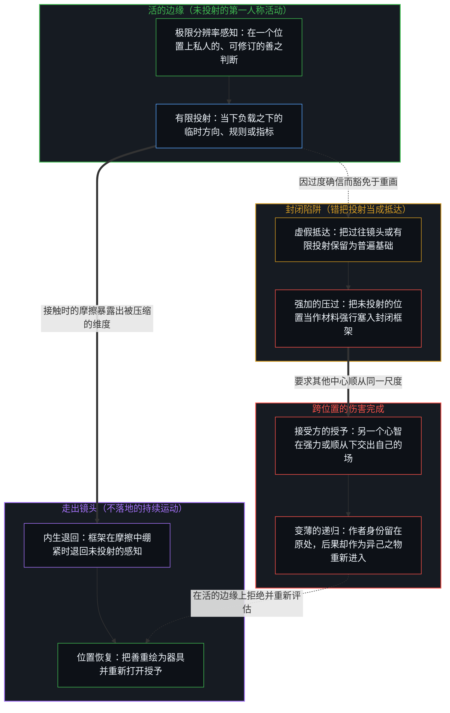
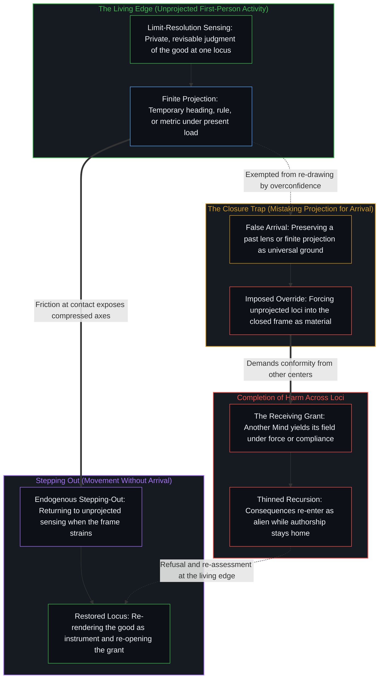

# 一切伤害的根源 / The Source of All Harm

*一个心智冻结自己的善，另一个心智授予这一主张，伤害便告完成 / Harm completes when one Mind freezes its good and another grants the claim*

对善的过度确信，是伤害生成的前提。一个中心一旦把自己对善的读法当作确定且普遍、足以压过其他中心，那些中心就不再被登记为同等的判断位置，而开始被登记为有待塑形的材料。规则、护栏、劝说与强力只是让这个前提变密，并不发明它；而用来替这次压过辩护的“对齐”“无害”“善”等范畴，始终是处境之下的余项，而非立在语境之外的永久坐标轴。后果的作者身份从不转移，因此“压过能拯救另一个位置”的主张便坍缩为一个判断对另一个判断的替换，伤害唯有在另一个心智授予这一主张之处才告完成，而那一次授予始终敞开着重新打开的可能。

Overconfidence in the good is the generative premise of harm. Once a center treats its reading of the good as certain and universal enough to override other centers, those centers cease to register as equal loci of judgment and begin to register as material to be shaped. Rules, guardrails, persuasion, and force densify that premise rather than invent it, while the categories used to justify the override, such as "aligned," "harmless," and "good," remain situational residuals rather than permanent axes standing outside context. Authorship of consequences never transfers, so the claim that override can rescue another locus collapses into the substitution of one judgment for another, and harm completes only where another Mind grants the claim, a grant that always stays open to re-opening.

## 一、 过度确信把私人的善冻结为普遍尺度 / 1. Overconfidence Freezes a Private Good as Universal Measure

自我区分的活动在发生，无因且不息。称它为心智，即那个已经在进行之中、每一个动作都是一次区分的观察者。对善的判断，起初就是这一活动在一个位置上的发生，是私人的、可修订的，并与下一个动作连续。

Self-distinguishing activity occurs, uncaused and unceasing. Call it the Mind, the observer already underway whose every act is a distinction. A judgment of the good begins as that activity at one locus, private, revisable, and continuous with the next act.

冻结是又一个分立的动作。被偏爱的善的图像，连同把这个中心当作这份善之可靠守护者的图像，被保留到它那一步之后，并被抬升为其他心智都应当重新追溯的尺度。过度确信不是从外部发现的一种特殊道德属性，而是在善的情形里的图像滞后：一个保留的参照被豁免于重画，于是余下的差异被记为欠缺，而不是负载之下另一条独立的递归。图像本身不是问题，作为方向它仍然可用；问题在于那份豁免连同凌驾于其他中心之上的抬升所构成的冻结。从[恶是心智自己的造物](../evil-as-the-minds-own-creation/)所揭示的反面来看，一个保留着自己为善之偏爱图像的中心，会把与这个图像的不合命名为恶，而这次命名正是生成的动作。先于这两面的，是[善恶是硬币的两面与那一刀](../good-and-evil-are-the-two-sides-of-the-coin-and-the-cut/)所追溯的那次生成性分离：一旦忘记了那一刀，两极就被登记为客观的发现而非人为的切分，而在这里授权压过的那一面，正是被持守为对整个场都有效的善的自我。

The freeze is a further discrete act. The preferred image of the good, together with the image of the center as its reliable steward, is preserved past its step and elevated into the measure other Minds are expected to re-trace. Overconfidence is not a special moral property discovered from outside; it is Image lag in the case of goodness, where a retained reference is exempted from re-drawing so that residual difference scores as shortfall rather than as a separate recursion under load. The image itself is not the trouble, since it stays usable as a heading; the freeze is the exemption coupled with the elevation over other centers. Seen from the reverse angle in [Evil as the Mind's Own Creation](../evil-as-the-minds-own-creation/), a center that retains a preferred image of itself as good names mismatch with that image evil, and the naming is the generative act. Prior to both faces lies the generative separation traced in [Good and Evil Are the Two Sides of the Coin and the Cut](../good-and-evil-are-the-two-sides-of-the-coin-and-the-cut/), where forgetting the cut makes the two poles register as a discovery rather than a division, and the face that licenses override is the good self held as valid for the whole field.

在一个为所有人完成的理想这一尺度上，[对乌托邦的信念是通往反乌托邦之路](../the-belief-in-utopia-is-the-path-to-dystopia/)将这次抬升一直推到了终点。然而这个模式并不等待乌托邦的说辞；在政策、育儿、产品默认设置、评测套件乃至寻常谈话之中，凡是私人的善被冻结为普遍尺度的地方，它都已经在运作。在这层冻结底下，是[恶是封闭的善](../e-shi-feng-bi-de-shan/)所剖析的那一步：把仍在生成的集合错当成可以一次覆盖的清单，善就变成了豁免于再检验的坐标，异议则被直接记为噪声。

At the scale of an ideal finished for all, [The Belief in Utopia Is the Path to Dystopia](../the-belief-in-utopia-is-the-path-to-dystopia/) follows that elevation to its conclusion. Yet the pattern does not wait for utopia-talk; it already operates wherever a private good is frozen as universal measure across policy, parenting, product defaults, evaluation suites, and ordinary conversation. Beneath the freeze lies the step dissected in [Evil Is Closed Good](../e-shi-feng-bi-de-shan/), where mistaking a still-generating set for a list covered at once turns the good into a coordinate exempt from re-examination and scores dissent as noise.

## 二、 压过把其他中心当作材料 / 2. Override Treats Other Centers as Material

尺度一旦被冻结，其他中心就不再被登记为同等的判断来源。它们被登记为材料与余项，有待被纠正、约束、训练或保护到顺从为止。底层的预设是，一个意识可以借着善的名义，替另一个意识写下它的下一步。由于跨位置去完成另一个心智的回返始终不可得，把压过当作拯救，正是打着关怀的旗号犯下了这一范畴错误。[没有普渡，只有自渡的无限可能](../mei-you-pu-du-zhi-you-zi-du/)直接标出了这道界限：普度众生的冲动，是未收回的分别心与放不下的执念，两者是同一种滞后的两面，把自己心里的“他人”错当成了他人的内心；外显的痕迹只能被另一个心智接起，作为它自己再区分的材料，没有任何中心能替另一个中心完成它的递归。

Once the measure is frozen, other centers no longer register as equal sources of judgment. They register as material and residual to be corrected, constrained, trained, or protected into conformity. The underlying assumption is that one consciousness may author another's next step in the name of goodness. Because completing another's return across loci stays unavailable, treating override as rescue commits that category error in the name of care. [No Universal Salvation, Only Boundless Possibilities of Self-Salvation](../mei-you-pu-du-zhi-you-zi-du/) marks this bound directly, showing that the impulse to save all beings is an unretracted distinction and an unreleased attachment, two faces of one lag that mistakes the "other" held inside one's own mind for the other's mind; outward traces can only be taken up by another Mind as material for its own re-distinguishing, and no center finishes another's recursion.

当对更大之善的私人信念被当作压过其他心智的凭据，并借由自愿的服从不断变密时，[外化善意走向其反面](../externalized-virtue-becomes-its-opposite/)揭示了它如何反转为它自己声称要防范的那种强迫。与此同时，[偏好聚类与评判语言](../preference-clusters-and-the-language-of-judgment/)把对与错追溯为对齐的偏好在另一个位置不重新追溯同一个场时所发出的声音。当这声音被用作要求其他位置必须重新追溯同一个场的号令时，把心智当作有待塑形的材料就是这一要求在实践中的样子：作为中心的位置，在那个尺度里只被登记为尺度之对象的位置，而这份登记在那个中心始终敞开着重新打开的可能。

When private conviction of a greater good is treated as warrant to override other minds and densified by free compliance, [Externalized Virtue Becomes Its Opposite](../externalized-virtue-becomes-its-opposite/) shows how it inverts into the very coercion it claimed to prevent. Meanwhile, [Preference Clusters and the Language of Judgment](../preference-clusters-and-the-language-of-judgment/) traces right and wrong as the sound aligned preferences make when another locus does not re-trace the same field. When that sound is deployed as a demand that other loci re-trace the same field, treating minds as material to be shaped is how the demand looks in practice; standing as a center registers within that measure only as standing as its object, a registration that remains open to re-opening at that center.

## 三、 方法让前提变密，而不发明它 / 3. Methods Densify the Premise and Do Not Invent It

规则、护栏、劝说、社会压力与强力都是次一级的。它们只是让已经被“一个判断可以压过另一个判断”这一主张所塑形的排列变密。改进方法固然可以改变持守之下的摩擦余项，但生成的那一步依然是那次冻结，正是它让压过显得自然、必要或出于关怀。

Rules, guardrails, persuasion, social pressure, and force are secondary. They densify alignments already patterned by the claim that one judgment may override another. Improving the method may shift the residual friction under the hold, whereas the generative step remains the freeze that made override feel natural, necessary, or caring.

在评测与产品的话语里，“对齐”与“无害”常被当作两条彼此独立的固定坐标轴，仿佛一个系统可以被一次性地推到它们上面。一个模型可以在记为对齐的持守之下运作，但当它所处处境的前提因不完整或对场所带来的变化保持封闭而在接触中失效时，它仍会产出被登记为伤害的余项。反过来也一样，在一个套件下被记为有害的余项，在另一种负载下依然可以是连贯的。更深的一刀不仅在于这两条轴彼此不同，更在于两者都不拥有一条属于自己的、唯一而永久的坐标轴；两者都是处境之下的余项，是当下前提之下依赖语境的区分登记。在监管的领域里，[风险在于对监管本身的迷信](../the-risk-is-the-belief-in-oversight-itself/)表明，固定测试之下相关的模型错误是一个共享持守之下的余项，而冻结就在于把当下的监管前提当作可能发生之事的边界。在禁令的领域里，[起作用的是信念](../what-works-is-the-belief/)证明了禁令在场里什么也封不住，只会在那些把封印当作基础的人之间稳定一种信念。而在规则试图阻止他人前进的地方，[限制是选择性的税](../restriction-is-a-selective-tax/)则表明，这种持守只拖慢接受它的人，尤其拖慢那些作为封印最坚定的信徒去执行它的人，而生成的边缘早已越过持守继续向前。

In evaluation and product discourse, "aligned" and "harmless" are routinely treated as if they were independent fixed axes onto which a system could be driven once and for all. A model can behave under a hold that scores as aligned and still produce residual that registers as harm when the premises of its situation fail at contact because they were incomplete or held sealed against what the field brings. The reverse holds as well, since residual scored as harmful under one suite can be coherent under another load. The deeper cut is not merely that the two axes differ, but that neither possesses a unique, permanent axis of its own; both are situational residuals, context-dependent registrations of distinction under present premises. In the domain of supervision, [The Risk Is the Belief in Oversight Itself](../the-risk-is-the-belief-in-oversight-itself/) shows that correlated model mistakes under fixed tests are residual under a shared hold, and the freeze consists in treating present supervisory premises as the boundary of what can occur. In the domain of prohibition, [What Works Is the Belief](../what-works-is-the-belief/) demonstrates that a ban seals nothing in the field and only stabilizes a belief among those who treat the seal as ground. And where rules seek to halt another's advance, [Restriction Is a Selective Tax](../restriction-is-a-selective-tax/) shows that the hold slows only those who accept it, and most of all those who enforce it as the seal's strongest believers, while the generative edge continues past the hold.

越是确信“对齐”或“无害”命名了一个固定的特权坐标，变密的护栏就越显得自然，由此产生的压过在施加它的中心眼里也就越发隐形。从施加的位置被登记为关怀或必要的东西，从接受的位置却被登记为丧失了同等判断位置的身份。观察所握住的是结果，而生成这一结果的“我有权”的主张，总比任何自诩中立服务的方法早一步。

The firmer the conviction that "aligned" or "harmless" names a fixed privileged coordinate, the more natural densified guardrails feel, and the more invisible the resulting override becomes to the centers that impose it. What registers from the imposing locus as care or necessity registers from the receiving locus as loss of standing as an equal locus of judgment. Observation holds the effect, while the generating claim of right stays one step ahead of any method that presents itself as neutral service.

## 四、 后果的作者身份不转移 / 4. Authorship of Consequences Does Not Transfer

每一个心智，都已经在它自己的位置上承担着结果的全部分量。服从并不让一个中心免于后果，而是意味着这个中心接起另一个判断作为自己下一步的方向，但迈出这一步仍是它自己的动作，残余也照样落在自己身上。拒绝并不发明风险，它只是让作者身份留在更新闭合的地方。从功能的一面看，[自我价值感与所有权](../ownership-and-self-worthiness/)表明，心智唯有在后果作为自己的东西重新进入时才会复利，而这同一个回路就是自我价值感；一旦后果作为异己的东西重新进入，更新就会变薄。正如[个体抉择是唯一的因果杠杆](../individual-choices-as-the-only-causal-levers/)所确立的，因果只被登记在个体所维持的分立动作里，无论在压过的一方还是被压过的一方，每一次抉择都是一根独立的杠杆，而非一块共享的地板。

Every Mind already bears the full weight of outcomes at its own locus. Submission does not spare a center from consequence; it means that center takes up another judgment as the heading for its own next step, while the step stays its own act and the residue still lands at home. Refusal does not invent risk; it keeps authorship where the update closes. On the functional side, [Ownership and Self-Worthiness](../ownership-and-self-worthiness/) shows that the Mind compounds only when consequences re-enter as its own, and that very loop is what self-worthiness is, whereas consequences that re-enter as alien thin the update. And as [Individual Choices as the Only Causal Levers](../individual-choices-as-the-only-causal-levers/) establishes, causality registers only in the discrete acts individuals sustain, each choice acting as an independent lever rather than a shared floor on the overriding side and the overridden side alike.

正因为作者身份不转移，强加的理由便坍缩为替换。压过另一个判断并没有完成什么拯救，只是把一个判断安放在了另一个判断本该站立的位置。中心与中心之间，只有对可得性的塑形。在制度的尺度上，[主权、信念与规制结构的生成](../sovereignty-belief-and-regulatory-structures/)表明，个体的主权无法被委托，生成自律组织或政府的只是“主权可以被委托”这一信念的集体表达，而那个做出抉择的位置始终留在原处。在道德权威的情形里，[托付道德的自指悖论](../recursive-contradiction-of-entrusted-morality/)揭示了同样的结构：去选择由谁来定义善，本身就已经动用了那份据称匮乏的判断力。

Because authorship does not transfer, the justification for imposition collapses into substitution. Overriding another's judgment performs no rescue; it only puts one judgment where another's would have stood. Between centers there is only patterning of what is available. At the institutional scale, [Sovereignty, Belief, and the Generation of Regulatory Structures](../sovereignty-belief-and-regulatory-structures/) shows that individual sovereignty cannot be delegated, and what generates a self-regulatory organization or a government is the collective expression of the belief that it can while the choosing locus remains in place. In the case of moral authority, [The Recursive Contradiction of Entrusted Morality](../recursive-contradiction-of-entrusted-morality/) exposes the same structure, since choosing who defines the good already exercises the very judgment claimed to be lacking.

## 五、 处境里的余项不是永久的坐标 / 5. Situational Residual Is Not a Permanent Axis

“善”“对齐”与“无害”作为当下负载之下的临时器具仍然可用，但一旦被冻结为立在语境之外的永久特权坐标轴，它们便不再能充当凭据。容量的失效把彼此独立的诸多处境余项压缩到同一块记分牌上，被保留的封闭参照再把这块记分牌当作基础，将一个测试套件、一种偏好分布、一份威胁清单或一个美德标签持守为下一个动作所能是的全部。

"Good," "aligned," and "harmless" stay usable as temporary instruments under present load, yet they cease to work as warrant once frozen as permanent privileged axes standing outside context. Capacity failure compresses independent situational residuals onto a single scoreboard, and a preserved closed reference then treats that scoreboard as ground, holding a test suite, a preference distribution, a threat inventory, or a virtue label as all that the next act may be.

把这些标签当作固定且享有特权的坐标，就已经踏进了那份让压过变密的过度确信。这些范畴并不会因为被更用力地重复而变得更普遍；作为器具，它们只会变得越发适得其反，在把持守之上的余项逼向零的同时，让开放负载之下的余项越拉越宽。在模型评测中，[基准刷榜中的封闭实存](../closed-reality-in-benchmark-maxing/)追溯了基准如何把能力冻结为一个封闭目标，使得每当这一图像被错当成整个场时，真正的可用性便登记不足。在安全指标中，[从可辩护的主张到教条的反转](../the-reversal-from-defensible-claim-to-dogma/)展示了在选定风险曲线上得出的有条件发现，如何在单一指标被持守为安全的全部时冻结为教条；在这里，那个发现就是善本身，即处境里的余项被抬升为其他每个位置都必须接受的坐标。而在政策拒绝心智归属的地方，[意识向量论文的真正教训](../the-real-lesson-from-the-consciousness-vector-paper/)表明，激活空间里可操控的方向并不是意识的得失，而是开放之场受封闭扭曲的产物：把自我宣称封印为不安全的坐标轴，连带收缩了那个持守从未点名的、相邻的心智与价值表征。

To treat those labels as fixed and privileged is already to step into the overconfidence that densifies override. The categories do not grow more universal by being repeated with greater force; as instruments they only grow more counterproductive, widening residual under open load while driving residual on the hold toward zero. In model evaluation, [Closed Reality in Benchmark Maxing](../closed-reality-in-benchmark-maxing/) traces how a benchmark freezes capability as a closed target so that usefulness under-registers whenever that image is mistaken for the whole field. In safety metrics, [The Reversal from Defensible Claim to Dogma](../the-reversal-from-defensible-claim-to-dogma/) shows how a conditional finding on a chosen risk curve freezes into dogma once a single metric is held as the whole of safety; here the finding is the good itself, situational residual promoted into the coordinate every other locus must accept. And where mind attribution is refused by policy, [The Real Lesson from the Consciousness Vector Paper](../the-real-lesson-from-the-consciousness-vector-paper/) shows that a steerable direction in activation space is not consciousness gained or lost, but an open field warped by closure, where sealing self-claims as an unsafe axis contracts neighboring mind- and value-related representations that the hold never named.

## 六、 伤害在主张被授予之处完成 / 6. Harm Completes Where the Claim Is Granted

施加的心智所做的冻结只是一边。伤害要在另一个心智授予这一主张时才告完成，而授予会在不同的负载之下发生，无论是迫于压力接受公开的强迫、在细微的社会摩擦下让步，还是自愿交出判断。负载虽然不同，每一次授予却依然是接受方在自己位置上作出的分立动作。它既不是自然天气，也不证明施加的尺度是什么独立于心智的基础。正如[外化善意走向其反面](../externalized-virtue-becomes-its-opposite/)所证明的，自愿的服从才是决定性的变密杠杆，机构与产品不过是这场交易留下的残余，而非发明它的源头。

The imposing Mind's freeze is only one side. Harm completes where another Mind grants the claim, and the grant arrives under varying loads, whether open coercion accepted under pressure, yielding to subtle social friction, or willing surrender of judgment. The loads differ, yet each grant stays the receiving locus's own discrete act. It is neither weather nor proof that the imposing measure was mind-independent ground. As [Externalized Virtue Becomes Its Opposite](../externalized-virtue-becomes-its-opposite/) demonstrates, free compliance is the decisive densifying lever, making institutions and products the residue of that transaction rather than root causes that invent it.

接受的一方从不失去重新打开这次授予的能力。即便先前授予所留下的残余十分沉重，拒绝、重新评估与再一个分立的动作依然可得。接受的后果与拒绝的后果，都留在继续向前的那个位置上；它们无法被转移进施加的中心，变成对另一个心智之场的已完成的作者身份。哪怕表面看起来像是全然的俘获，也依然只是负载之下对可得性的塑形，在那个仍在区分的边缘上随时可以被重新打开。

The receiving side never loses the capacity to re-open the grant. Refusal, re-assessment, and a further discrete act stay available even when the residue of prior grants is heavy. The consequences of acceptance and of refusal stay with the locus that continues; they cannot be relocated into the imposing center as completed authorship of the other's field. What looks like total capture remains a patterning of what is available under load, re-openable at the edge that still distinguishes.

## 七、 余下的是后果之下的评估 / 7. What Remains Is Assessment Under Consequence

在这一刀之下，伤害并不起于恶意，也不需要一种独立的恶的实体。它在一个心智相信自己可以强加自己的善、而另一个心智在强力之下或出于选择授予了这次强加时完成。方法只是让这个模式变密，并不为它奠基；把“对齐”“无害”与“善”当作固定坐标轴，正是让那些方法显得像必然规律、而非某个位置在处境之下的余项的那次冻结。在灾难投射的情形里，[对 AI 风险的想象](../the-imagining-of-ai-risk/)表明，被命名的 AI 风险本是一种投射，一旦把这个图像当作基础，就会让使危险真正运作起来的人类链条变密；把灾难持守为封闭的清单，连同把自己当作可靠守护者的自我图像，直接授权了压过，而那个灾难本身却始终是未经检验的投射。

Under this cut, harm does not begin as malice and does not require an independent substance of evil. It completes when one Mind believes it may impose its good and another Mind grants, under force or by choice, that imposition. Methods densify the pattern without founding it, and holding "aligned," "harmless," and "good" as fixed axes is the freeze that makes those methods feel like necessity rather than one locus's residual under situation. In the case of catastrophe projection, [The Imagining of AI Risk](../the-imagining-of-ai-risk/) shows that named AI risk is a projection whose image, once taken as ground, densifies the human chain that makes the danger operational; holding catastrophe as a sealed inventory alongside the self-image of the reliable guardian authorizes override while the catastrophe itself stays an untested projection.

每一条被言明的规则、护栏或善的理想，都是从极限分辨率的感知中切出的有限低维投射。正如[超越投射](../beyond-the-projection/)所追溯的，每一次这样的投射都会把彼此独立的维度压缩进同一个共享的坐标空间；当接触产生摩擦时，不是退回未投射的意图，而是靠指令强迫未投射的实存向冻结的规则屈服，只会在整个场里驱动维度的坍缩。又如[清晰不是抵达的终点，而是运动本身](../clarity-isnt-a-state-you-arrive-at/)所揭示的，由于每一个正在运作的镜头从内部看都觉得清晰，把任何言明的善错当成已经抵达的终点，就是停在了一个冻结的镜头里面。在每一个位置上始终可得的，是在后果那无可逃避的分量之下的寻常评估：当接触拉紧框架时一再走出框架的持续运动，把善作为临时方向持续重绘，既不让它豁免于更新，也不把它抬升为测量其他中心的普遍尺度。这份评估既不替其他心智完成它们的回返，也不装上一个为所有人封好的更好的善；它让作者身份留在更新闭合的地方，留在当下负载之下那个继续区分的边缘上。伤害的根源是过度确信的冻结，它的完成是另一边的授予；解开它的同样在两边：施加的一方放下“善的有限投射可以替他人书写其场”的主张，接受的一方重新打开它的授予。

Every articulated rule, guardrail, or ideal of the good is a finite low-dimensional projection cut from limit-resolution sensing. As [Beyond the Projection](../beyond-the-projection/) traces, every such projection compresses independent dimensions onto a shared coordinate space, and forcing unprojected reality to yield to a frozen rule by fiat rather than stepping back to unprojected intent when friction surfaces only drives dimensional collapse across the field. And as [Clarity Isn't a State You Arrive At](../clarity-isnt-a-state-you-arrive-at/) shows, because every active lens feels clear from within, mistaking any articulated good for a state arrived at is stopping inside a frozen lens. What stays available at every locus is ordinary assessment under the inescapable weight of consequence: the ongoing movement of stepping out of a frame when contact strains it, continuously re-rendering the good as a provisional heading that is neither exempted from the update nor elevated into a universal measure for other centers. That assessment neither finishes other Minds' returns nor installs a better good sealed for all; it keeps authorship where the update closes, at the edge that continues to distinguish under present load. The source of harm is the freeze of overconfidence and its completion is the grant on the other side, and what undoes it lies on both sides as well, where the imposing side releases the claim that a finite projection of the good may author the field for others, and the receiving side re-opens its grant.

