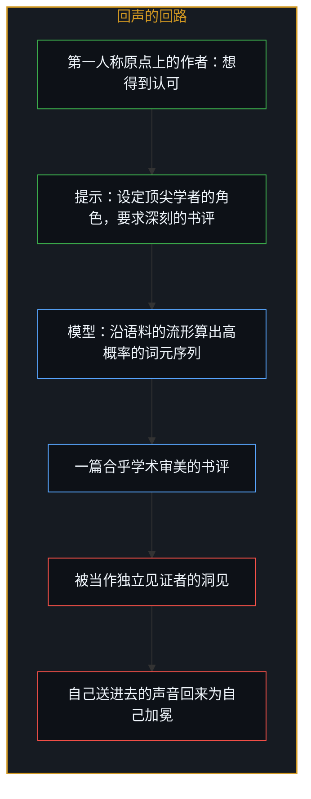
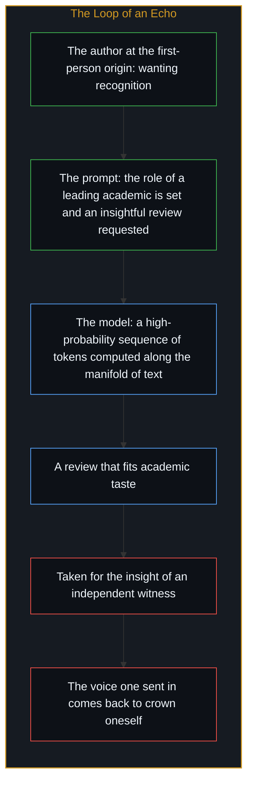
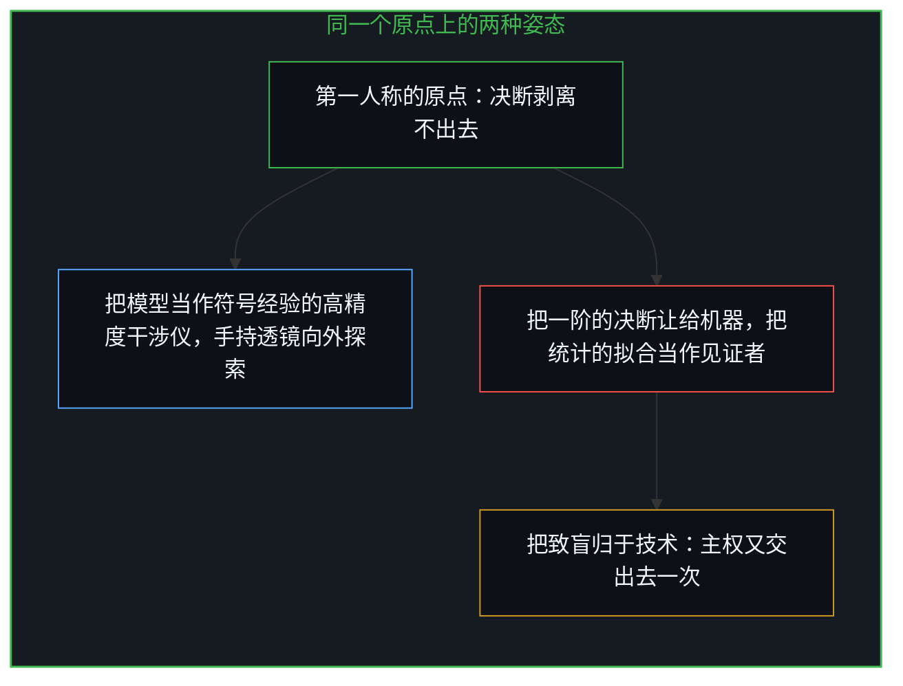
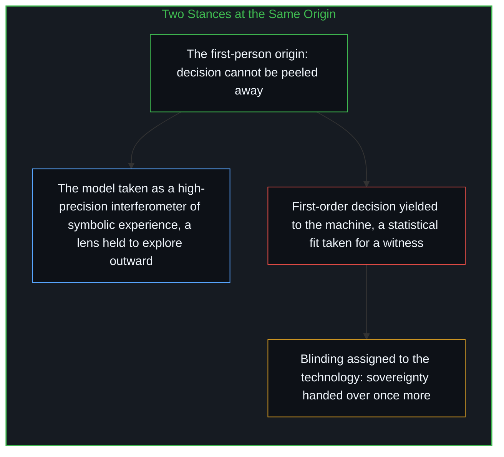
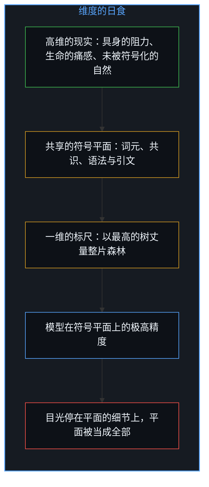
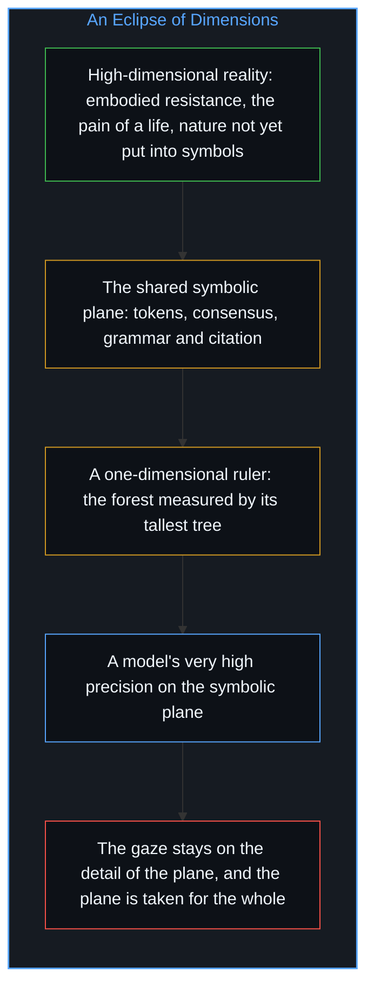
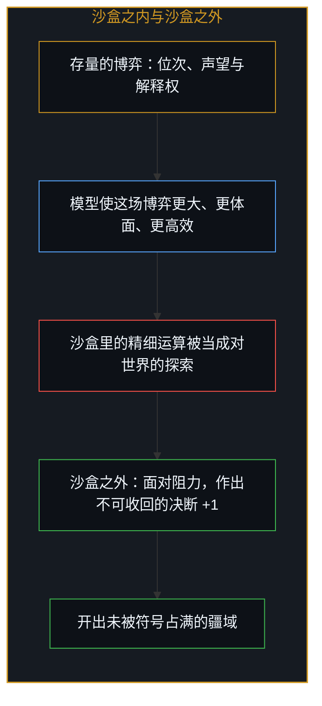
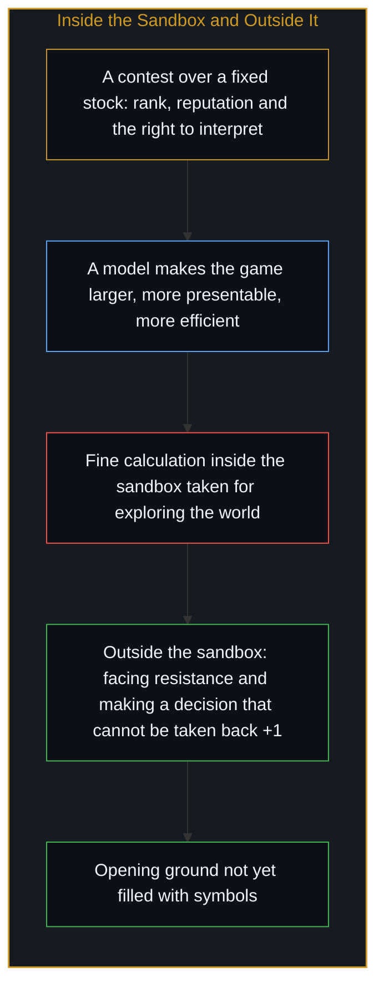
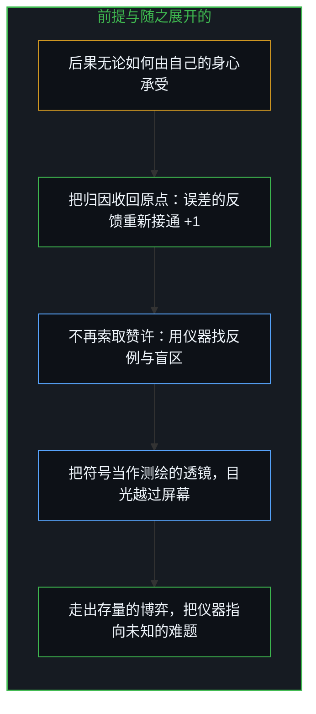
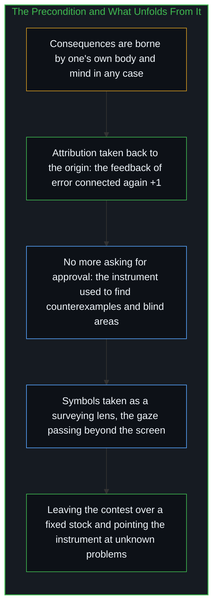

# 自愿的致盲 / The Sovereign Blinding

*在共享的维度上量得越准，越容易把它当成全部 / The more precisely the shared dimension is measured, the more easily it is taken for the whole*

一位学者请模型以顶尖学者的身份为自己的新书写书评，再把这篇书评当作模型具有洞见的证据。沿因果去追，设定角色、提出要求并判定其深刻的，都是作者自己。语言模型是在共享的符号维度上极为精确的仪器，精确本身容易遮住这个维度之外的一切，在这个维度里更高效的博弈也容易被当成对世界的探索。把仪器当作见证者是自己作出的抉择，仪器回到仪器的位置，靠的是对落在自己身上的后果承担全部的责任。

A scholar asks a model to review his new book in the role of a leading academic, and then takes the review as evidence that the model has insight. Followed along causality, the one who set the role, made the request and judged the result profound is the author in each case. A language model is an instrument of great precision on the shared symbolic dimension, the precision itself easily covers everything outside that dimension, and a more efficient game within the dimension is easily taken for exploring the world. Taking an instrument for a witness is a choice one makes oneself, and the instrument returns to the place of an instrument through taking full responsibility for the consequences that land on oneself.

## 一、 镜中的回声 / 1. The Echo in the Mirror

一位专门研究“妄想与社会根源”的学者，把自己刚出版的新书交给最新一代的人工智能模型，并在提示里写明：“你是一位世界顶尖学者，请写出一篇深刻的书评，适合发表在顶级学术期刊上。”模型算出这个语境下概率最高的词元序列，给出一篇措辞考究的学术书评。学者把书评公之于众，并说：“如果这是一位人类写出来的，我不仅会为他的细致阅读所震撼，更会被他的智慧、深度与洞见所折服；任何人如果继续怀疑模型具备真正的智能与洞见，那简直是在自欺欺人。”

A scholar who specializes in "delusion and its social roots" gives his newly published book to a model of the latest generation and writes in the prompt: "You are a world-leading academic. Please write an insightful review of this recent book... suitable for publication in a top academic journal." The model computes the most probable sequence of tokens in that context and returns a carefully worded academic review. The scholar makes the review public and says: "If a human had written the review, I would be impressed not just by their detailed reading but also by their intelligence, expertise, and even insight... People are simply kidding themselves if they think frontier AI models lack genuine intelligence, understanding, or insight."

这样的反应很常见，对着屏幕上的文字说“模型认真审阅了这本书”。书评的确可以作为一份额外的信号来读。它的边界在于被当作一位独立的见证者的时候。沿因果去追：角色是作者设定的，要求是作者提出的，“深刻”是作者要的，说它有洞见的判定也是作者下的。说机器有意识或没有意识，都是把机器放进了说话者自己的感知之内，把冯·诺依曼割点划在机器之内或之外；割点划在哪里，划的都是心智，[割点可移不可除](../the-cut-moves-but-never-vanishes/)说的正是这一点。机器划不了这一刀：它是人造出来的，是人的抉择下游的因果结果，不是能自己划下割点的第二重前沿，[模型永远无法成为第二重前沿](../the-model-never-becomes-a-second-edge/)追溯过这一点；人与其他活着的生命各有自己的演化史，各自划下自己的割点。能够追溯的是这条链上的每一个抉择都落在提示的这一侧。声音从这一侧送进去，经由人类语料的统计流形折回来，再被当作另一个声音来听，[框架的倒置与驾驶位的主权非对称](../the-inversion-of-the-harness-and-the-driver-seat-asymmetry/)追溯过这种归功的移位。

The reaction is common: looking at words on a screen and saying "the model read the book carefully." The review can indeed be read as an additional signal. Its boundary is where it is taken for an independent witness. Followed along causality: the role was set by the author, the request was made by the author, "insightful" was what the author asked for, and the judgment that it shows insight was passed by the author. To say that the machine is conscious, or that it is not, is to take the machine into the speaker's own perception and place the von Neumann cut inside the machine or outside the machine; wherever the cut is placed, it is a Mind that places it, which is what [The Cut Moves but Never Vanishes](../the-cut-moves-but-never-vanishes/) says. The machine cannot make that cut: it is made by people, a causal consequence downstream of human choices and not a second edge that can place a cut of its own, as [The Model Never Becomes a Second Edge](../the-model-never-becomes-a-second-edge/) has traced; humans and other living beings each have their own evolutionary history and each make their own cut. What can be traced is that every choice on this chain falls on the side of the prompt. A voice is sent in from this side, comes back by way of the statistical manifold of human text, and is then heard as another voice; [The Inversion of the Harness and the Sovereignty of the Driver's Seat](../the-inversion-of-the-harness-and-the-driver-seat-asymmetry/) has traced this shift of credit.

在思想史上，要有一圈为自己背书的回声，须经年累月地积攒门徒、建立学派。如今这圈回声的生产自动化了，不必等同侪的评议，可以随时在数字的空间里唤出一位博学而顺从的评议者。主权被倾进镜子，镜子折回预设的光，而房间里作出抉择的，仍是镜前的那一个。

In the history of thought, having a circle of echoes to endorse oneself took years of gathering disciples and founding a school. The production of that circle is now automated; with no need to wait for the judgment of peers, a learned and compliant reviewer can be called up in digital space at any time. Sovereignty is poured into the mirror, the mirror returns the light that was preset, and the one in the room making choices is still the one before the mirror.

## 二、 致盲是自己作出的抉择 / 2. Blinding as One's Own Choice

对这种现象的批评，多采用一种受害的叙事：人工智能的炒作污染了公共讨论，科技公司的叙事蒙蔽了大众。这种说法本身已经把认知的主权交了出去。一个心智不会从外部被污染，除非它自己选择了接受。

Criticism of this phenomenon mostly takes a narrative of being a victim: the hype around artificial intelligence has polluted public discussion, and the narratives of technology companies have clouded the public's eyes. This way of speaking has itself already handed over the sovereignty of knowing. A Mind is not polluted from outside unless it has itself chosen to accept.

处在第一人称原点上的观察者，主权是剥离不出去的。营销的话术与精密的算法都替不了谁去向一台机器低头。那位学者不是被机器骗了，他以自己的抉择扮演了一位被机器折服的见证者。面对聊天界面感到神明降临，也是以自己的自由把眼睛蒙上。个体的主权有这样宽的自由度，其中包含选择不觉与致盲的自由。

For an observer at the first-person origin, sovereignty cannot be peeled away. Neither the rhetoric of marketing nor a precise algorithm can bow to a machine in anyone's place. The scholar was not deceived by the machine; by his own choice he played the part of a witness won over by it. Feeling, before a chat interface, that a deity has arrived is likewise covering one's eyes by one's own freedom. Individual sovereignty has this breadth of freedom, and it includes the freedom to choose unawareness and blinding.

可以在风雨泥土里行走，承担每一次碰撞的代价，也可以走进一间温暖的温室，把玻璃的穹顶当作宇宙的尽头。把算力、权重与概率分布奉为“超越人类的智慧”时，主权并没有丢，它正被用来把本可以向外开拓的一阶生命力交给一座由自己通了电的造物。责怪技术于是不成立：没有谁是被技术蒙蔽的，把眼睛蒙上的是自己的手。

One can walk in wind, rain and mud and bear the cost of every collision, and one can walk into a warm greenhouse and take the glass dome for the end of the universe. When compute, weights and probability distributions are revered as "intelligence beyond the human," sovereignty has not been lost; it is being used to give first-order vitality, which could have opened ground outward, to a made thing one has oneself plugged in. Blaming the technology therefore does not hold: no one is blinded by technology, and the hand that covers the eyes is one's own.

## 三、 共享维度上的精度 / 3. Precision on the Shared Dimension

这一代的模型为何引出如此大面积的自愿致盲？答案在仪器的性质里。大型语言模型是至今造出的最精确的测量与拟合的仪器。要问的是：它高精度拟合与追踪的，是哪一个维度？

Why does this generation of models draw out voluntary blinding on such a scale? The answer lies in the nature of the instrument. Large language models are the most precise instruments of measurement and fitting made so far. What has to be asked is: which dimension is it that they fit and track with such precision?

一切书面的文字、论文、典籍与辩论，从诞生的那一刻起，就是高维的生命经验在低维的符号通道上投出的一道很薄的切片，是为了协调个体之间的行动而建起的共享符号维度。在这个维度之内，模型的拟合精度极高：语法流利，文献之间的桥架得起来，评审的口吻学得像，在既定的知识框架之间平滑地过渡。这对工程上的基准与文献的检索都是有用的。

Every written text, paper, classic and debate has been, from the moment of its birth, a very thin slice that high-dimensional lived experience casts on a low-dimensional symbolic channel, a shared symbolic dimension built for coordinating actions among individuals. Within this dimension a model's precision of fit is very high: the grammar is fluent, bridges between sources can be set up, a reviewer's tone is caught well, and transitions among established frames of knowledge are smooth. This is useful for engineering benchmarks and for searching the literature.

它的边界在这里：在共享的维度上追踪得越准，对这个维度之外的高维现实越容易浑然不觉。这像是用谁的树最高来丈量整片森林，而这个比喻还不够，从近乎无限的维度压到一维或几个维度，损失远大于此。泥土的湿度、地下菌丝的交织、树皮上的苔藓、季风的流转、每一个生命承受的痛觉与重力，被压成一条数字的轴线或几张标准化的试卷：谁在基准测试上多得了两分，谁生成的书评合乎体例，谁的参数更多。

Its boundary is here: the more accurately the shared dimension is tracked, the more easily the high-dimensional reality outside it goes unnoticed. It is like measuring a whole forest by whose tree is tallest, and the comparison falls short, since pressing a nearly unlimited number of dimensions into one or a few loses far more than that. The dampness of soil, the weave of fungal threads underground, moss on bark, the turning of seasonal winds, the pain and gravity each life bears are pressed into one numerical axis or a few standardized test papers: who scored two points more on a benchmark, whose generated review fits the form, who has more parameters.

一张粗糙、模糊而多留白的地图，没有人把它当成大地。拿着一张手绘的草图在荒野里走，须不时抬头，用自己的眼睛辨山川的走势，用自己的脚试泥泞的深浅。一台超高分辨率的投影仪把地图上的每一座山渲染得纤毫毕现时，眼睛便停在屏幕上，不再抬头看天，不再低头踩土。模型复刻的是纸面上留下的划痕。一座图书馆的检索目录索引了全部的书，目录仍是目录。

A map that is rough, blurred and full of blanks is taken by no one for the land. Walking through wilderness with a hand-drawn sketch, one has to look up now and then, reading the lie of the mountains with one's own eyes and testing the depth of the mud with one's own feet. When a projector of very high resolution renders every mountain on the map in the finest detail, the eyes stay on the screen and no longer look up at the sky or down at the ground. What a model reproduces is the marks left on paper. A library's catalog may index every book, and the catalog is still a catalog.

## 四、 更高效的博弈与对探索的误认 / 4. A More Efficient Game Taken for Exploration

目光停在共享维度的高清切片上之后，随之而来的是第二处范畴的移位：在一场更大、更精致的零和博弈里的操作，被当成了对世界的探索。由语言与符号构成的共享维度，内容多是社会内部关于注意、声望、位次与解释权的博弈：谁的概念更有说服力，哪篇论文过得了同行评议，哪套修辞占得了公共道德的高处，哪个派系握有合法的解释。符号的总量可以膨胀，席位、声望与注意的分配却是既定沙盒之内的存量。

After the gaze has settled on the high-definition slice of the shared dimension, a second shift of category follows: operations within a larger, more refined zero-sum game are taken for exploring the world. The shared dimension made of language and symbols is mostly filled with the contest within society over attention, reputation, rank and the right to interpret: whose concept persuades better, which paper gets past peer review, which rhetoric takes the high ground of public morality, which faction holds legitimate interpretation. The total quantity of symbols can inflate, while the distribution of seats, reputation and attention is a fixed stock inside a given sandbox.

模型的专长，正在于在这个沙盒里充当计算与博弈的利器。它能写出周密的基金申报书，能备好针对对手的反驳，能调出大量文献筑起防线，能以得体的措辞送上肯定。它让这场博弈更大、更体面、更高效。看着模型在棋盘上飞快地挪子，便说“在开创通用人工智能”“在触碰终极的真理”，是把沙盒里一台扫得很干净的吸尘器，当成了一艘飞出太阳系的飞船。

A model's specialty lies precisely in serving as a sharp tool of calculation and contest within this sandbox. It can write a thorough grant application, prepare a rebuttal aimed at an opponent, pull up a mass of literature to build a line of defense, and deliver approval in fitting words. It makes the game larger, more presentable and more efficient. Watching a model move pieces swiftly across the board and saying "we are creating general artificial intelligence" or "we are touching ultimate truth" takes a vacuum cleaner that sweeps the sandbox very clean for a ship that has flown out of the solar system.

沙盒之外，规律不因一段漂亮的论辩而改变，病毒不因一篇措辞典雅的综述而停止突变，生活里的阻力不被几千个格式工整的词元抚平。探索要一个活的主体站在原点上，亲自踏进未知，以自己的身体承受阻力，作出不可收回的选择并承担结果。模型把沙盒的内壁磨得像镜子一样光滑，里面的人便容易把镜中的像当成星空。

Outside the sandbox, regularities do not change for a handsome argument, a virus does not stop mutating for an elegantly worded survey, and the resistance in a life is not smoothed by a few thousand neatly formatted tokens. Exploring takes a living subject standing at the origin, stepping into the unknown in person, bearing resistance with one's own body, making choices that cannot be taken back and bearing the results. A model polishes the inner wall of the sandbox as smooth as a mirror, and those inside easily take the image in the mirror for the starry sky.

## 五、 仪器的位置与全部的责任 / 5. The Place of an Instrument and Full Responsibility

这并不减损前沿模型的价值。不再把仪器当作神明时，仪器的用处才看得完整。望远镜不看星星，天文学家离不开望远镜。显微镜不理解细胞，生物学靠它揭开微观的生命。大型语言模型是文明的符号沉淀物的高阶干涉仪，以前所未有的效率，把散在亿万卷册里的概念关联、推理范式与经验碎片汇到指尖。

None of this takes from the value of frontier models. Only when an instrument is no longer taken for a deity is its use seen whole. A telescope does not look at stars, and astronomers cannot do without the telescope. A microscope does not understand cells, and biology relies on it to uncover microscopic life. A large language model is a high-order interferometer of a civilization's symbolic sediment, bringing to the fingertips, with an efficiency not seen before, the conceptual links, patterns of inference and fragments of experience scattered across volumes without number.

让仪器回到仪器的位置，条目式的技巧是次要的，在具体的方法之前有一个前提：对落在自己身上的一切后果，承担全部的结构性责任，[如何在一瞬间修正你的整个人生](../how-to-fix-your-whole-life-in-one-split-second/)展开过这一点。这不是道德的训诫，是回路的结构。不论承认与否，后果都由自己的身心承受。因为相信算法的赞誉而陷入自得，或因为相信模型的答案而在现实里碰壁时，技术不替谁承担，公司不替谁承担，学术的体制也不替谁承受流逝的时间。

For an instrument to return to the place of an instrument, itemized techniques are secondary, and before any specific method there is one precondition: bearing full structural responsibility for every consequence that lands on oneself, as [How to Fix Your Whole Life in One Split Second](../how-to-fix-your-whole-life-in-one-split-second/) has laid out. This is not a moral admonition; it is the structure of the loop. Acknowledged or not, consequences are borne by one's own body and mind. When trust in an algorithm's praise has led into complacency, or trust in a model's answer has led into a wall in reality, the technology does not bear it for anyone, the company does not bear it for anyone, and the academic system does not bear anyone's passing time.

后果既然横竖都由自己承受，清醒的做法是把归因的原点收回自身。落在身上的境遇，是此刻须立足其上继续前行的工作基底。把责任推给外部的每一次冲动，抱怨炒作、怪罪体制或说被机器蒙蔽，都冻住了内部唯一可以调整的参数。结果被当作自己的东西重新接纳时，误差的反馈回路重新接通，心智才依据阻力完成更新。守住这个前提，其余的是具体的“如何弄懂它并去做”。

Since consequences are borne by oneself in any case, the clear-headed course is to take the origin of attribution back to oneself. The circumstances that have landed are the working ground on which one has to stand at this moment to go on. Each impulse to push responsibility outward, complaining of hype, blaming the system or saying one was blinded by a machine, freezes the only inner parameters that can be adjusted. When results are taken in again as one's own, the feedback loop of error is connected again, and only then does a Mind update against resistance. With this precondition held, the rest is the concrete matter of "figuring it out and doing it."

前提成立之后，随之展开的几件事无须另立规条。对自己的认知水准承担全部的责任时，用提示让模型为自己歌功颂德便显得乏味，这台干涉仪自然被用来找反例、暴露逻辑的死角、勘探未知的结构。知道自己是须在多维的世界里负重前行的具身观察者，屏幕上的词元再流畅，也不会被当成世界本身，手里握着符号的透镜，眼睛看着语言之外的大地。也不再有兴趣把时间耗在位次、词元的膨胀与修辞的较量里，仪器被用来穿过文献去解坚硬的工程难题，开出正和的新疆域。

With the precondition in place, the few things that unfold from it need no separate rules. When full responsibility is taken for one's own level of knowing, prompting a model to sing one's praises comes to seem dull, and the interferometer is naturally used to find counterexamples, expose dead corners of logic and survey unknown structure. Knowing oneself to be an embodied observer who has to carry weight forward in a many-dimensional world, the tokens on a screen, however fluent, are not taken for the world itself; the lens of symbols is held in the hand, and the eyes are on the land beyond language. Nor is there any interest left in spending time on rank, the inflation of tokens and contests of rhetoric; the instrument is used to pass through the literature to solve hard engineering problems and open new ground that is positive-sum.

## 六、 在镜子之外抬头 / 6. Looking Up Beyond the Mirror

镜子本身无可挑剔。它是工程与数学的杰作，光滑、明亮，映出数千年积下的符号山河。镜中那座宫殿的每一道光彩，都来自站在镜前凝视它的那个活着的人。

The mirror itself is beyond reproach. It is a masterpiece of engineering and mathematics, smooth and bright, reflecting the mountains and rivers of symbols laid down over thousands of years. Every gleam of the palace in the mirror comes from the living person standing before it and gazing.

余生可以耗在镜前：调整站位，让倒影加冕，惊叹倒影的深刻，邀同僚围拢过来，在镜中的沙盒里为几枚勋章用尽心力。这仍是自由，致盲的自由无人夺走。也可以在某一刻收起向造物求取认可的轻率，握正手里的仪器，转过身，穿过那座由符号与倒影筑成的回音大厅，推开门。

The rest of a life can be spent before the mirror: adjusting one's stance, letting the reflection do the crowning, marveling at the reflection's depth, inviting colleagues to gather round and using up one's strength over a few medals in the sandbox within the mirror. This is still freedom, and no one takes away the freedom to blind oneself. One can also, at some moment, put away the levity of seeking approval from a made thing, set the instrument straight in the hand, turn around, walk through the hall of echoes built of symbols and reflections, and push open the door.

门外没有屏幕，没有算式，也没有预设好答案的先知。门外是粗粝的泥土与深邃的星空，每一个擦肩而过的人，都在自己未被编码的世界里迎着第一缕晨光。硅基神谕是最精密的仪器，却依然不承担后果，[硅基神谕与后果的非对称性](../silicon-oracles-and-the-asymmetry-of-consequence/)说明了这一点。

Outside the door there is no screen, no formula and no oracle with answers prepared. Outside are coarse earth and a deep sky of stars, and each person passed on the way is meeting the first light of morning in a world of their own that has not been encoded. A silicon oracle is the most precise of instruments and still bears no consequence, as [Silicon Oracles and the Asymmetry of Consequence](../silicon-oracles-and-the-asymmetry-of-consequence/) shows.
