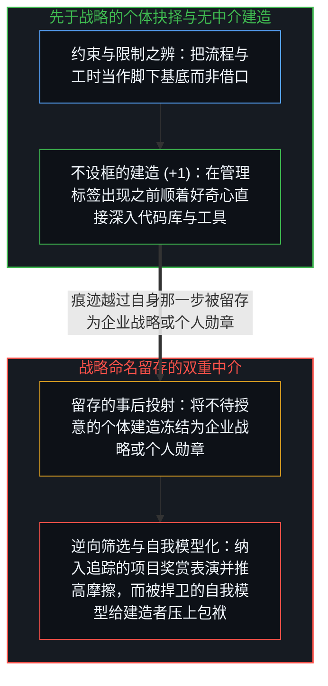
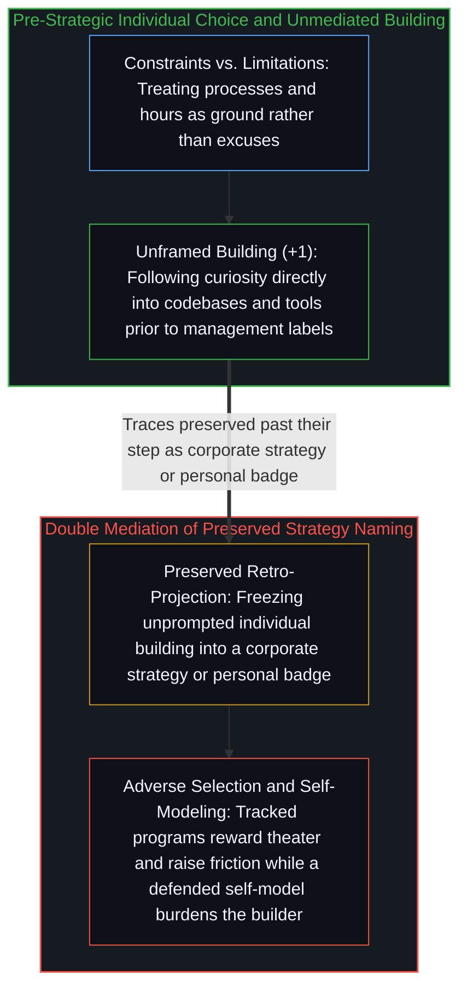

# 从未作为战略的副业 / The Strategy That Wasn't

*把个体好奇心追认为企业副业项目战略，扼杀的正是它所褒扬的自发性 / Retroactively naming individual curiosity a corporate side-project strategy kills the spontaneity it celebrates*

围绕 Anthropic“副业项目战略”的公共争论犯了一个精确的错误：它先把生成机制替换成事后投射，再围绕这幅投射争论不休。Claude Code 始于鲍里斯·切尔尼顺手解一处工程之痒，模型上下文协议（MCP）则源于工程师着手解决眼前的工具互操作问题；二者在源头上都不是企业战略，因为在任何组织框架命名这一抉择之前，那都只是个体顺着好奇心在行动。

Public debate over Anthropic's "side-project strategy" commits a precise error: it replaces a generative mechanism with its retrospective projection and then debates the projection. Claude Code began as Boris Cherny scratching an engineering itch, and the Model Context Protocol (MCP) emerged from engineers solving immediate tool interoperability; neither originated as a corporate strategy, because both were individuals following curiosity before any organizational frame named the choice.

## 一、 虚假的组织二分法与约束和限制之辨 / 1. The False Organizational Dichotomy and Constraints versus Limitations

评论者惯于把“自下而上的野生创新”与“自上而下的顶层规划”对立起来，仿佛它们只是菜单上可供勾选的两种管理战略。这两个说法都落在组织决策的坐标轴上，而生成行动本就先于这根坐标轴而发生。正如谷歌著名的“百分之二十时间”在被命名、被度量并制度化为政策时所表明的那样，先于战略的运动一旦被收编为组织项目，政策便取代了现象本身。

Commentators routinely pit "scrappy bottom-up innovation" against "top-down planning" as though they were two management strategies on a menu. Both terms sit on the axis of organizational decision-making, whereas the generative act operated prior to that axis altogether. As Google's famous "twenty-percent time" demonstrated when it was named, measured, and institutionalized into policy, the moment pre-strategic movement is captured as an organizational program, the policy replaces the phenomenon.

剥去事后叙事，实际运转的只是一个人在约束之中选择动手建造。约束是事实——有限的工时、既有的流程、特定的工具；限制则是诠释：相信这些事实规定了自己被允许选择什么。鲍里斯·切尔尼面对着与其他人相同的组织约束，却并未将其诠释为限制（参见[约束即基底与作为平台的个体](../constraints_are_ground/)与[个体抉择是唯一的因果杠杆](../individual-choices-as-the-only-causal-levers/)）。无论是“培育副业文化”还是“打造合适的环境”，都把因果杠杆错放到了那个迈步行动的个体之外。

Stripped of retrospective narrative, what operates is a person choosing to build within constraints. Constraints are facts—finite hours, existing processes, specific tools—whereas limitations are interpretations: the belief that those facts dictate what one is allowed to choose. Boris Cherny faced the same organizational constraints as everyone else without interpreting them as limitations (see [Constraints Are Ground](../constraints_are_ground/) and [Individual Choices as the Only Causal Levers](../individual-choices-as-the-only-causal-levers/)). Both "foster a side-project culture" and "engineer the right environment" mislocate the causal lever outside the individual who moved.

## 二、 命名如何双重扼杀：逆向筛选与自我模型凝结 / 2. How Naming Kills Twice: Adverse Selection and Self-Model Crystallization

宣称推行“副业项目战略”，不仅像“命令人自发行动”那样自相矛盾，还会排挤它声称要培育的无中介好奇心。不待授意的建造从不依赖制度不设立场，因为任何政策都只是外部约束，而非强制指令；然而，组织一旦宣布自己重视、追踪并鼓励副业项目，便立起了一套清晰可读的评估标尺，把个人探索重新框定成组织产出。这一正规化随即诱发逆向筛选：那些安于在挂牌“创新项目”里为记功而表演的人纷纷涌入这项指标——而围绕评估标尺做优化，鲜少能开创突破——至于拒绝这层中介的建造者，要么在项目记分牌之外工作，要么在官僚摩擦升高且另有去处可选时转往别处。

Declaring a "side-project strategy" is not merely paradoxical like commanding spontaneity; it displaces the unmediated curiosity it claims to cultivate. Unprompted building never depends on the absence of an institutional stance, since any policy remains an external constraint rather than a decree; yet the moment an organization announces that it values, tracks, and encourages side projects, it installs a legible rubric that reframes personal inquiry as organizational output. That formalization induces adverse selection: those comfortable performing for credit inside a named "innovation program" crowd into the metric—and optimizing for an evaluation rubric rarely originates breakthroughs—while builders who decline that mediation either work outside the program's scorecard or, as bureaucratic friction rises and alternatives stay open, sort elsewhere.

这种中介同样向内运作：出于无中介的好奇造出工具，与事后讲述自己的副业成功，是对待同一行动的两种不同关系。越过自身那一步仍握住这段叙事不放，便会凝结出一个被捍卫的自我模型——“我是那个做出突破性副业项目的人”——进而在下一次抉择中充当中介并为其压上包袱（参见[自我模型维护悖论](../the-maintenance-paradox/)）。一旦把这种事后命名当作基底留存下来，它便会造成双重扼杀——在宏观尺度把个人行动转化为制度功劳，在微观尺度把鲜活运动转化为被捍卫的身份认同——从而遮蔽了那个先于战略的事实：某个人心生好奇，直接对着外化的代码库动手建造，正如[你的代码库即是记忆](../your-codebase-is-memory/)所追溯的那样。

The same mediation operates inward as well: building a tool out of unmediated curiosity and narrating one's side-project triumph afterward are two different relations to the act. Holding onto that narration past its step crystallizes a defended self-model—"I am the person who builds breakthrough side projects"—which then mediates and weighs down the next choice (see [The Maintenance Paradox](../the-maintenance-paradox/)). When that retrospective naming is preserved as ground, it kills twice—converting personal acts into institutional credit at the macro scale and converting living movement into defended identity at the micro scale—obscuring the pre-strategic fact that someone got curious and built directly against an externalized codebase as traced in [Your Codebase Is Memory](../your-codebase-is-memory/).
