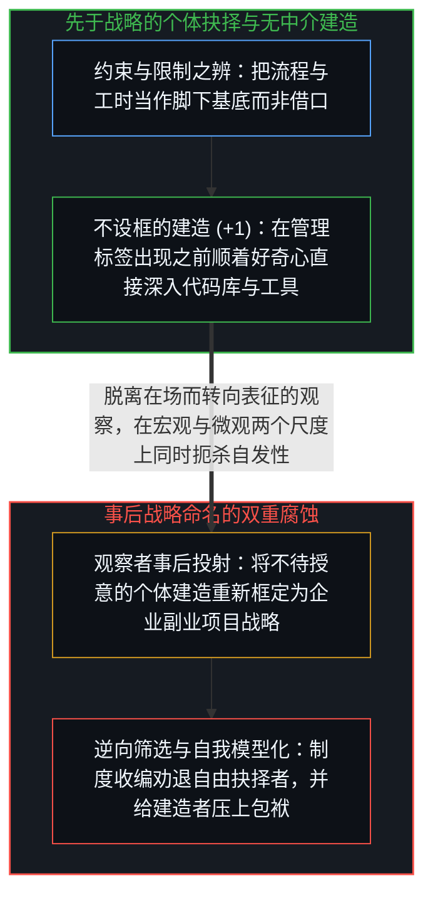
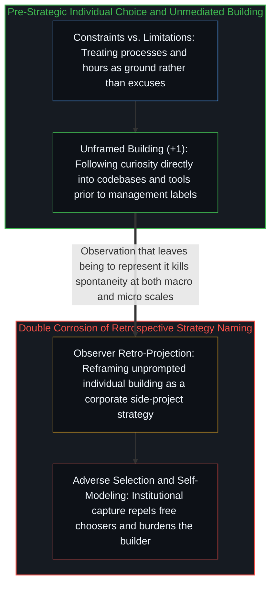

# 从未作为战略的副业与被观察扼杀的自发性 / The Strategy That Wasn't

*把个体好奇心追认为企业副业项目战略，扼杀的正是它所褒扬的自发性 / Retroactively naming individual curiosity a corporate side-project strategy kills the spontaneity it celebrates*

围绕 Anthropic“副业项目战略”的公共争论犯了一个精确的错误：它先把生成机制替换成事后投射，再围绕这幅投射争论不休。Claude Code 始于鲍里斯·切尔尼顺手解一处工程之痒，模型上下文协议（MCP）则源于工程师着手解决眼前的工具互操作问题；二者在源头上都不是企业战略，因为在任何组织框架命名这一抉择之前，那都只是个体顺着好奇心在行动。

Public debate over Anthropic's "side-project strategy" commits a precise error: it replaces a generative mechanism with its retrospective projection and then debates the projection. Claude Code began as Boris Cherny scratching an engineering itch, and the Model Context Protocol (MCP) emerged from engineers solving immediate tool interoperability; neither originated as a corporate strategy, because both were individuals following curiosity before any organizational frame named the choice.

## 一、 虚假的组织二分法与约束和限制之辨 / 1. The False Organizational Dichotomy and Constraints versus Limitations

评论者惯于把“自下而上的野生创新”与“自上而下的顶层规划”对立起来，仿佛它们只是菜单上可供勾选的两种管理战略。这两个说法都落在组织决策的坐标轴上，而生成行动本就先于这根坐标轴而发生。正如谷歌著名的“百分之二十时间”在被命名、被度量并制度化为政策时所表明的那样，先于战略的运动一旦被收编为组织项目，政策便取代了现象本身。

Commentators routinely pit "scrappy bottom-up innovation" against "top-down planning" as though they were two management strategies on a menu. Both terms sit on the axis of organizational decision-making, whereas the generative act operated prior to that axis altogether. As Google's famous "twenty-percent time" demonstrated when it was named, measured, and institutionalized into policy, the moment pre-strategic movement is captured as an organizational program, the policy replaces the phenomenon.

剥去事后叙事，实际运转的只是一个人在约束之中选择动手建造。约束是事实——有限的工时、既有的流程、特定的工具；限制则是诠释：相信这些事实规定了自己被允许选择什么。鲍里斯·切尔尼面对着与其他人相同的组织约束，却并未将其诠释为限制（参见[约束即基底与作为平台的个体](../constraints_are_ground/)与[个体抉择是唯一的因果杠杆](../individual-choices-as-the-only-causal-levers/)）。无论是“培育副业文化”还是“打造合适的环境”，都把因果杠杆错放到了那个迈步行动的个体之外。

Stripped of retrospective narrative, what operates is a person choosing to build within constraints. Constraints are facts—finite hours, existing processes, specific tools—whereas limitations are interpretations: the belief that those facts dictate what one is allowed to choose. Boris Cherny faced the same organizational constraints as everyone else without interpreting them as limitations (see [Constraints Are Ground](../constraints_are_ground/) and [Individual Choices as the Only Causal Levers](../individual-choices-as-the-only-causal-levers/)). Both "foster a side-project culture" and "engineer the right environment" mislocate the causal lever outside the individual who moved.

## 二、 命名如何双重扼杀：逆向筛选与自我模型凝结 / 2. How Naming Kills Twice: Adverse Selection and Self-Model Crystallization

宣称推行“副业项目战略”，不仅像“命令人自发行动”那样自相矛盾，更具有主动的腐蚀性。那些不待授意便首创工具的建造者，所选择的正是组织对其个人抉择不设制度立场；一旦组织宣布自己重视、追踪并鼓励副业项目，便把个人行动重新框定成了组织产出。这一命名随即触发逆向筛选：那些本会自由建造的人把这项政策读作离开的信号，而那些安于在挂牌“创新项目”里表演的人，鲜少是开创突破的人。

Declaring a "side-project strategy" is not merely paradoxical like commanding spontaneity; it is actively corrosive. Builders who originate tools unprompted select for the absence of an institutional stance toward their personal choices; the moment an organization announces that it values, tracks, and encourages side projects, it reframes personal action as organizational output. That naming triggers adverse selection: those who would have built freely read the policy as a signal to leave, while those comfortable performing inside a named "innovation program" are rarely the ones who originate breakthroughs.

这种腐蚀同样向内运作：出于无中介的好奇造出工具，与事后讲述自己的副业成功，是对待同一行动的两种不同关系。叙事会凝结出一个自我模型——“我是那个做出突破性副业项目的人”——进而在下一次抉择中充当中介并为其压上包袱（参见[自我模型维护悖论](../the-maintenance-paradox/)）。命名造成双重扼杀：在宏观尺度把个人行动转化为制度功劳，在微观尺度把鲜活运动转化为身份认同，从而遮蔽了那个无法被框定的事实——某个人心生好奇，直接对着外化的代码库动手建造，正如[你的代码库即是记忆](../your-codebase-is-memory/)所追溯的那样。

The corrosion operates inward as well: building a tool out of unmediated curiosity and narrating one's side-project triumph afterward are two different relations to the act. Narration crystallizes a self-model—"I am the person who builds breakthrough side projects"—which then mediates and weighs down the next choice (see [The Maintenance Paradox](../the-maintenance-paradox/)). Naming kills twice—converting personal acts into institutional credit at the macro scale and converting living movement into identity at the micro scale—obscuring the unframeable fact that someone got curious and built directly against an externalized codebase as traced in [Your Codebase Is Memory](../your-codebase-is-memory/).
