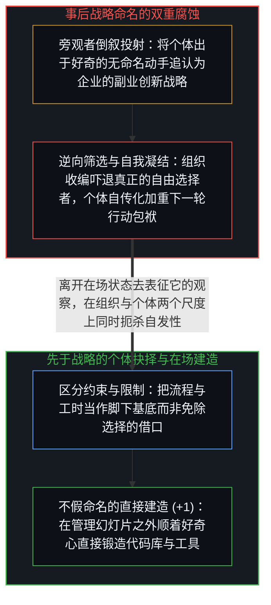
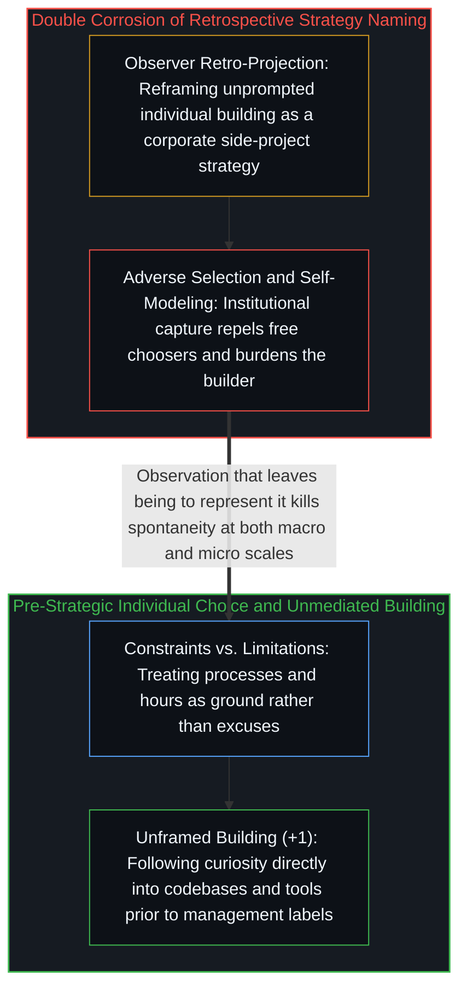

# 从未作为战略的副业与被观察扼杀的自发性 / The Strategy That Wasn't

*把源于个体好奇心的破土之作追认为企业副业战略，会在命名瞬间扼杀自发生成的活力 / Retroactively naming individual curiosity a corporate side-project strategy kills the spontaneity it celebrates*

围绕 Anthropic“副业项目战略（side-project strategy）”的公共辩论犯下了一个精确的认识论错误：人们先把一个生成机制替换成了它事后的旁观者投射，然后围绕这幅投射展开激辩。无论是源于鲍里斯·切尔尼顺手解痒而诞生的 Claude Code，还是工程师为了打通工具互操作而写出的模型上下文协议（MCP），在破土而出的那一刻都不是什么“公司战略”——它们只是具体的个体顺着好奇心，在任何组织框架尚未给这一行动命名之前做出的自主建造。

Public debate over Anthropic's "side-project strategy" commits a precise error: it replaces a generative mechanism with its retrospective projection and then debates the projection. Claude Code began as Boris Cherny scratching an engineering itch, and the Model Context Protocol (MCP) emerged from engineers solving immediate tool interoperability; neither originated as a corporate strategy, because both were individuals following curiosity before any organizational frame named the choice.

## 一、 虚假的组织二分法与作为事实的约束和作为解释的限制 / 1. The False Organizational Dichotomy and Constraints versus Limitations

争论双方习惯于把“自下而上的野生创新”与“自上而下的顶层规划”摆在天平两端，仿佛这只是高管在会议室里勾选的两种组织战略。然而这两个选项都栖居在同一根名为“组织决策”的坐标轴上，而真正生发出那些突破性作品的运动并不在那根轴上运行。催生出 Claude Code 的，不是“选择野生模式而非规划模式”的管理决议，而是先于“野生与规划”之分的个体动手行动。正如当年谷歌著名的“百分之二十自由时间”一旦被命名、被制度化、被纳入绩效考核，就立刻从鲜活的土壤退化为一纸僵硬的行政政策：命名的那一刻，就是它作为源初运动终结的时刻。

Commentators routinely pit "scrappy bottom-up innovation" against "top-down planning" as though they were two management strategies on a menu. Both terms sit on the axis of organizational decision-making, whereas the generative act operated prior to that axis altogether. As Google's famous "twenty-percent time" demonstrated when it was named, measured, and institutionalized into policy, the moment pre-strategic movement is captured as an organizational program, the policy replaces the phenomenon.

剥去事后的组织叙事，留在原地的只有一个具体的人在约束条件下选择动手建造。这里的区分至关重要：“约束（constraints）”是客观事实——时间有限、流程繁琐、手头工具特定；而“限制（limitations）”则是主体的解释——即相信这些外部事实有权决定自己能选什么、不能选什么。哪怕在流程最繁琐的科层制里，个体依然可以选择动手建造；大多数人之所以不动手，是因为他们把外部约束解释成了免除自身抉择的借口（参见[约束即基底与作为平台的个体](../constraints_are_ground/)与[个体抉择是唯一的因果杠杆](../individual-choices-as-the-only-causal-levers/)）。无论是呼吁“培育副业文化”还是“创造鼓励创新的环境”，都把因果支点错放到了那个真正迈步的人之外。

Stripped of retrospective narrative, what operates is a person choosing to build within constraints. Constraints are facts—finite hours, existing processes, specific tools—whereas limitations are interpretations: the belief that those facts dictate what one is allowed to choose. Boris Cherny faced the same organizational constraints as everyone else without interpreting them as limitations (see [Constraints Are Ground](../constraints_are_ground/) and [Individual Choices as the Only Causal Levers](../individual-choices-as-the-only-causal-levers/)). Both "foster a side-project culture" and "engineer the right environment" mislocate the causal lever outside the individual who moved.

## 二、 命名的双重扼杀：组织层面的逆向筛选与个体层面的自我模型化 / 2. How Naming Kills Twice: Adverse Selection and Self-Model Crystallization

“让我们推行副业项目战略”不仅在逻辑上像“命令你必须自发”一样自相矛盾，在实践上更具有主动的腐蚀性。那些不待召唤便动手造出新工具的人，最看重的是组织对他们私人探索保持“无姿态的留白”；一旦公司高调宣布“我们拥有副业战略，我们重视并鼓励你的业余创造”，这一命名就等于把个体的自由行动收编成了“组织环境培育出的产出”。这种收编会立即触发逆向筛选：真正自由的建造者会因反感被纳入管理叙事而选择离开，而乐于在“官方副业文化”招牌下活动的人，原本就不会在无人要求时自己动手。

Declaring a "side-project strategy" is not merely paradoxical like commanding spontaneity; it is actively corrosive. Builders who originate tools unprompted select for the absence of an institutional stance toward their personal choices; the moment an organization announces that it values, tracks, and encourages side projects, it reframes personal action as organizational output. That naming triggers adverse selection: those who would have built freely read the policy as a signal to leave, while those comfortable performing inside a named "innovation program" are rarely the ones who originate breakthroughs.

更微妙的是，这种腐蚀同样会向内发生在最初那位动手者自己身上。鲍里斯出于一时兴起动手写下 Claude Code，与鲍里斯事后在聚光灯下讲述“我的副业成功经验”，是同一个人与同一件事之间截然不同的两种关系：前者是身处行动之中，后者则是抽身出来旁观并维护一个“我是擅长靠副业破局的人”的自我模型（参见[自我模型维护悖论](../the-maintenance-paradox/)）。一旦自我叙事凝结成形，下一次动手前就会多出一道“我接下来该造什么才配得上这个名声”的沉重滤镜。无论是在组织尺度把个体行动改写为制度功劳，还是在个体尺度把鲜活的好奇凝结为身份招牌，离开在场状态去表征它的动作都会抹杀那个真正推动万物生长的起点——某个人心生好奇，并在如[你的代码库即是记忆](../your-codebase-is-memory/)所揭示的外部基底上直接动了手。

The corrosion operates inward as well: building a tool out of unmediated curiosity and narrating one's side-project triumph afterward are two different relations to the act. Narration crystallizes a self-model—"I am the person who builds breakthrough side projects"—which then mediates and weighs down the next choice (see [The Maintenance Paradox](../the-maintenance-paradox/)). Naming kills twice—converting personal acts into institutional credit at the macro scale and converting living movement into identity at the micro scale—leaving behind only the unframeable fact that someone got curious and built directly against an externalized codebase as traced in [Your Codebase Is Memory](../your-codebase-is-memory/).
