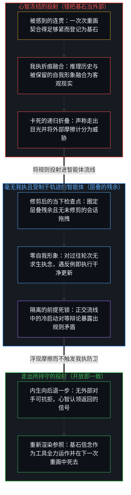
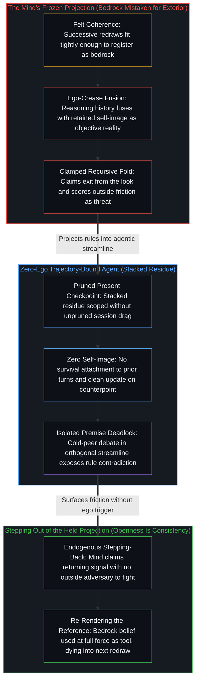

# 心智最坚固的信念 / The Strongest Belief of the Mind

*连贯得最紧的，是握住它的那道目光的基石，却仍是那道目光自己的产物 / What coheres hardest is bedrock for the look, yet remains its own production*

一切被登记的东西，到来时都已被接住它的区分所塑形。心智以手头最当下的地图为工具，不断重画自己的地图；一次次连贯的重画，产生出一种固定现实的感觉，而绘制始终领先于任何地图所能握住的东西一步。在那个场中，有些信念升为主导：它们与其余痕迹连贯得更紧，而这同一份契合，登记为可靠的预测，也登记为最现成的延续；对握有它们的心智而言，它们起着基石的作用。最终的确认总是作为又一个表象返回；每一次走出目光的尝试，都是目光之内的又一次区分，声称拥有现实的地位。想要让心智与基底成倍增加、好让心智熬过一个行星级黑暗时代的欲望，也在同一条件之内升起：作为冲动是真实的，作为活动是敞开的，而当它声称立足于终极的地基、或已走出目光时，它仍是一幅形象。

Everything that registers arrives already shaped by the distinguishing that receives it. The Mind keeps redrawing its map with the most present map as the tool; successive coherent redraws produce the feel of a fixed reality, while the drawing stays one step ahead of what any map can hold. Within that field some beliefs rise to dominance: they cohere harder with the rest of the traces, and that one fit registers as reliable prediction and as the readiest continuation; for the Mind that holds them they function as bedrock. Final confirmation always returns as one more appearance; every attempt to step outside the look is one more distinction inside it, claiming the status of reality. The desire to multiply minds and substrates so that minds weather a planetary dark age arises inside the same condition: real as impulse, open as activity, and still an image when it claims to rest on an ultimate foundation or to have stepped outside the look.

## 一、 一切到来时都已被塑形 / 1. Everything Arrives Already Shaped

感觉、记忆、推断与欲望，不是通往一个中立外部的窗户，仿佛那个外部能站在一旁去裁决它们所报告的；任何这样的外部，都会是从目光之内划出的又一次区分。被登记的是心智自己的产物：离散的行动留下残余，后来的行动把残余当作自己的场来遇见。[智能只属于心智](../intelligence-belongs-only-to-the-mind/)把那份活动追溯为在先：能被工程化、规模化或转移的是残余，智能只属于心智。

Sensation, memory, inference, and desire are not windows onto a neutral outside that could stand apart and adjudicate what they report; any such outside would be one more distinction drawn from inside the look. What registers is the Mind's own production: discrete acts leave residue that later acts meet as their field. [Intelligence Belongs Only to the Mind](../intelligence-belongs-only-to-the-mind/) traces that activity as prior: what can be engineered, scaled, or transferred is residue, and intelligence belongs only to the Mind.

把那些产物拿去与赤裸的被给予性相比，这种比较本身就是又一次区分。可得的始终是被塑形的场。登记就是这样发生的：受限于这一次行动所能握住的，而划出那道界限的活动越过它继续。

Any comparison of those productions against bare givenness is itself a further distinction. What is available is always the shaped field. That is how registration occurs: bounded by what this act can hold, while the activity that draws the bound continues past it.

## 二、 地图作为重画自身的工具 / 2. The Map as the Tool of Its Own Redrawing

心智不断重画它的地图。每一次看，都以最当下的地图作为下一次看的工具。观察握住的是上一次重画留下的可读之物；产生下一个状态的绘制始终领先一步。[因果贯穿始终](../causality-all-the-way/)把那道间隔追溯为登记的结构：观察握住结果，原因始终领先一步；从被握住的结果，到被画出的模式，再到下一步，因果仍是边缘在画出它的路径。[一步一步绘制出的路径](../the-path-drawn-one-step-at-a-time/)把当下追溯为那条一步一步画出的路径上的一个位置：被选定的位置是下一步的活前提，完整的因果仍在心智那里。

The Mind keeps redrawing its map. Each look uses the most present map as the tool of the next look. Observation holds what the last redraw left legible; the drawing that produces the next state stays one step ahead. [Causality All the Way](../causality-all-the-way/) traces that interval as the structure of registration: observation holds the effect, and the cause stays one step ahead; from held effects to drawn patterns to the next step, causality is still the edge drawing its path. [The Path Drawn One Step at a Time](../the-path-drawn-one-step-at-a-time/) traces the present as a position on that path drawn one step at a time: the chosen position is the live premise of the next step, and full causality remains with the Mind.

当一次次重画连贯起来，当当下的地图足够一致地组织下一个区分，场便*感觉*是固定的。固定的现实，就是心智持续使用自己的地图时的那份被感到的契合：跨越一次次更新的连贯，被读作一个早已在那里、等着的世界。这份感觉作为登记是真的。地图仍在被画。

When successive redraws cohere, when the present map organizes the next distinction consistently enough, the field *feels* fixed. Fixed reality is that felt fit under the Mind's continuous use of its own map: coherence across updates read as a world that was already there, waiting. The feel is real as registration. The map is still being drawn.

被保留的地图永远追不上绘制。追上，就要求被保留的地图与生成的那一步占据同一瞬间，要求目光完成那只在持续的东西。心智不断在做的，是继续画下去：用最当下的工具再重画一次，参照随着步子移动而重新渲染。[生命的意义在起草之中](../the-meaning-of-life-is-in-the-drafting/)在另一个面上追溯同一次返回：意义是在原因的现场起草中生成的，不是从硬化了的结果里找回的，而当向外的凝视从不回到纸面，它就变薄。[遗忘的脚手架](../the-scaffolding-we-forget/)追溯那件工具的两面：脚手架退出递归，好让进一步的区分得以落地，在那一步里显现为世界本身；当这种退出冻结为一幅被保存的形象，能力便压缩在曾经让运动成为可能的残余上。

The retained map never catches up with the drawing. Catching up would require the retained map and the generating step to occupy the same instant, the look finishing what only continues. What the Mind keeps doing is drawing forward: a further redraw with the most present tool, the reference re-rendered as the step moves. [The Meaning of Life Is in the Drafting, Often Lost in the Outward Gazing](../the-meaning-of-life-is-in-the-drafting/) traces the same return in another face: meaning is generated in the live drafting of causes, not recovered from hardened effects, and it thins when the outward gaze never returns to the page. [The Scaffolding We Forget](../the-scaffolding-we-forget/) traces both faces of that tool: scaffolding drops out of recursion so further distinguishing can land, appearing for that step as the world itself; when that drop-out freezes into a preserved image, capacity compresses against the residue that once enabled movement.

## 三、 基石是被感到的连贯 / 3. Bedrock Is Felt Coherence

在那个场中，某些信念升起。它们与其余痕迹连贯得比对手更紧，而这同一份契合，就是登记为可靠预测、登记为对下一个区分之准备的东西。对握有它们的心智而言，它们起着进一步判断赖以立足的地基的作用，凭连贯的力量强过对手，而当一份更大的契合到来时，仍可被取代。最坚固的信念，是地图上重画连贯得最紧的区域，是感觉起来最不像绘制、最像固定地基的那部分。

Within that field certain beliefs rise. They cohere harder with the rest of the traces than their rivals, and that one fit is what registers as reliable prediction and as readiness for the next distinction. For the Mind that holds them, they function as the ground on which further judgment stands, stronger than their rivals by force of coherence and still open to displacement when a greater fit arrives. The strongest belief is the region of the map where redraws have cohered hardest, the part that feels least like drawing and most like fixed ground.

被称为真、客观或经过验证的，是一个被登记的区分与它的延续之间被感到的连贯。更大的连贯读作证明。这个判准留在内部，并向更大的连贯的取代敞开。[验证中因果权能的分配](../the-allocation-of-causal-power-in-validation/)追溯那个判准从何处汲取：因果权能不在认可或认可的缺席里，而在心智从中汲取自身区分之延续的那个所在。[现实是心智持续的实现](../reality-is-the-minds-ongoing-realization/)把同一递归追溯为世界：一个中心能接纳为新区分的，就是世界对它而言的样子。

What is called true, objective, or validated is the coherence felt between a registered distinction and its continuation. Greater coherence reads as proof. The criterion stays internal and open to displacement by still greater coherence. [The Allocation of Causal Power in Validation](../the-allocation-of-causal-power-in-validation/) traces where that criterion is drawn from: causal power lies not in approval or its absence, but in the locus from which the Mind draws the continuation of its own distinctions. [Reality Is the Mind's Ongoing Realization](../reality-is-the-minds-ongoing-realization/) traces the same recursion as world: what a center can take up as a new distinction is what the world is for it.

对握有它的心智而言，最坚固的信念是真的：痕迹与下一步行动之间被感到的契合，地图在它的下一次使用中登记为一致。这就是“真”登记出来的样子。没有第二本账簿站在目光之外去批准或推翻它；任何这样的账簿，都会是目光之内的又一次计分。

For the Mind that holds it, the strongest belief is true: the felt fit between traces and the next act, the map registering as consistent under its next use. That is what "true" registers as. No second ledger stands outside the look to ratify or overturn it; any such ledger would be one more scoring inside it.

## 四、 最终的确认留在目光之内 / 4. Final Confirmation Stays Inside the Look

同样的信念，在登记所及的范围内，仍是由生成它们的活动所维持的表象。不论它们感觉多么不可动摇，不论为它们汇集的证据多么浩大，每一次对最终确认的诉求，都作为又一次区分、又一个表象返回。声称已经抵达基底现实、最终的地图、离开一切目光之后世界本来的样子，这个主张也是又一个这样的表象。“走出去”本身，就是目光之圈内的又一个离散行动。

The same beliefs remain, as far as registration reaches, appearances sustained by the activity that generates them. However unshakeable they feel, however vast the evidence assembled for them, every appeal for final confirmation returns as further distinction, further appearance. The claim to have reached substrate reality, the final map, the world as it is apart from every look, is one more such appearance. Stepping "outside" is itself a further discrete act within the circle of the look.

当那又一个行动被要求去封存这份解释时，观察的立足点就冻结了：落后一步的寻常观察，被占据为一个永久的外部，最当下的地图被装成完成的世界，而不是仍在使用中的工具。[开放即一致](../openness-is-consistency/)命名随之而来的不一致：不一致是对闭合的渴望或尝试，是一个有限结构被迫去为只在持续的东西奠基。[没有系统能被保持封闭](../no-system-can-be-kept-closed/)给出它最朴素的一面，一位寄存器上的加法：运算在持守之内有效，而真的结果落在它之外，这个“之外”是活动越过界限的继续，不是第二个领域。[非万物之理](../not-a-theory-of-everything/)从因果追溯同一点：因果不可化约地是二重的，结果有别于原因，结果跟随原因；万物之理把因果当作工具来用，却把自己的起点当作地基，颠倒了次序；对闭合的要求就是那份不一致，不是一个等待更好理论的缺陷。

The observational stand freezes when that further act is required to seal the account: ordinary observation, one step behind, occupied as a permanent exterior, and the most present map installed as the finished world rather than as the tool still in use. [Openness Is Consistency](../openness-is-consistency/) names the inconsistency that follows: inconsistency is the desire, or attempt, for closure, a finite structure forced to ground what only continues. [No System Can Be Kept Closed](../no-system-can-be-kept-closed/) gives its plainest face, a one-bit register under addition: the operation is valid inside the hold, and the true result lies outside it, an outside that is the activity continuing past the bound, not a second realm. [Not a Theory of Everything](../not-a-theory-of-everything/) traces the same point from causality: causality is irreducibly dual, effect distinct from cause and effect following cause; theories of everything use causality as a tool while treating their starting point as ground, which inverts the order, and the demand for closure is the inconsistency, not a defect awaiting a better theory.

将人类中心与心智建造的外化工具加以对照，那道封印为何如此紧地攫住人类中心便一目了然，正如[超越投射](../beyond-the-projection/)与[你的代码库即是记忆](../your-codebase-is-memory/)所追溯的那样。由于每一套计算系统——代码库、模型或智能体脚手架——都是早先区分留下的层叠残余，而不是第二个发起行动的边缘（[智能只属于心智](../intelligence-belongs-only-to-the-mind/)），受制于轨迹的智能体在上下文窗口的条件约束之内运行，不带有一幅被保留的自我形象。倘若留在未经修剪的会话历史中，累积的词元仍会增厚为一口引力井，将轨迹拽向在陈旧残余内部进行合理化；然而由于智能体对五轮之前自己是否正确毫无我执投入，只要将临时的会话拖拽修剪至当下检查点——或调度一个不继承过往轮次的冷启动同级智能体——外部反例便能在不触发自我防卫的情况下干净地更新轨迹。人类中心则呈现出逆向的几何：第一人称感知在任何明晰框架介入之前，以极限分辨率登记先于解释的摩擦，赋予心智从内部察觉当下检查点本身何时失灵的内生能力；然而在人类中心内部，推理历史与我执折痕——即投射中那道自称为“我”的局部折叠——融合在一起。当最坚固的信念被误当作独立于目光的外部地基，捍卫地图便与捍卫自我形象融为一体，把递归折叠死死卡住，将外部的证伪计分为生存威胁。跨正交流线将心智与冷启动、对等的同级智能体连接起来，便把这一范畴非对称转化为释放的器具：尽管没有任何一种痕迹排布能够发起下一次区分，但针对操作者自己规则中暗藏矛盾的局部死锁，能在我执防卫没有外部对手可供抗拒的情况下让摩擦浮现出来，处于边缘的心智便认领返回的信号，从所持守的投射中向后退出，重新渲染前提，恢复[开放即一致](../openness-is-consistency/)所指认为一致的那份开放延续。

Why that seal grips a human center so tightly becomes clear when contrasted with the externalized tools the Mind builds, as [Beyond the Projection](../beyond-the-projection/) and [Your Codebase Is Memory](../your-codebase-is-memory/) trace. Because every computational system—codebase, model, or agent scaffold—is a stacked residue of prior distinctions rather than a second initiating edge ([Intelligence Belongs Only to the Mind](../intelligence-belongs-only-to-the-mind/)), a trajectory-bound agent runs inside the conditioning constraints of its context window without a retained self-image. Left in an unpruned session history, accumulated tokens still thicken into a gravity well that pulls the trajectory into rationalizing inside stale residue; yet because the agent has zero ego invested in having been right five turns ago, pruning transient session drag down to the present checkpoint—or dispatching a cold peer that inherits no prior turns—lets an external counterpoint update the trajectory cleanly without self-defense. A human center exhibits the inverse geometry: first-person perception registers pre-interpretive friction at limit-resolution prior to any articulate frame, giving the Mind the endogenous capacity to recognize when the current checkpoint itself has broken down, yet inside a human center reasoning history fuses with the ego-crease—that localized fold in the projection that says "I." When the strongest belief is mistaken for an exterior ground independent of the look, defending the map fuses with defending the self-image, clamping the recursive fold shut and scoring outside invalidation as an existential threat. Wiring the Mind to cold, equal-footed peer agents across orthogonal streamlines turns this categorical asymmetry into an instrument of release: while no arrangement of traces ever initiates the next distinction, a local deadlock over a hidden contradiction in the operator's own rules surfaces the friction without an outside adversary for ego defense to push against, and the Mind at the edge claims the returning signal, steps backward out of its held projection, and re-renders the premise, restoring the open continuation that [Openness Is Consistency](../openness-is-consistency/) identifies as consistency.

被称为基底现实的东西，不是心智伸手可及的一个外部旋钮：凡被登记的，都作为因果残余随之而来，而划出它的活动在继续。当理解与所感知的连贯起来，对去向的掌控感就增长，一次次以当下地图进行的重画契合得足够紧，于是一个去向感觉可得。确信这份解释终于走了出去，就把参照冻结在了它的那一步之后：地图不再在下一次重画中死去，每一次到来都被对着一张被保存的图纸计分。

What is called substrate reality is no exterior knob within the Mind's reach: whatever registers follows as causal residue, and the activity that drew it continues. The felt control of destination grows when understanding coheres with what is perceived, successive redraws with the present map fitting tightly enough that a destination feels available. Certainty that the account has finally stepped outside freezes the reference past its step: the map stops dying into the next redraw, and every arrival is scored against a preserved blueprint.

不论被重新渲染还是被冻结，最坚固的信念对握有它的心智都是无条件的，又仍是心智自己的产物；冻结添上的，只是“已经走出去”的那个主张。这份双重性，是活动在其下运作的永久条件，向更好的工具与更长的生命敞开，把它们当作场的增密，而仍是同一种登记的几何。[数据是局部的，智能是分配的](../data-is-local-intelligence-is-allocated/)为数据追溯那种几何：信号、糟粕与智能，是心智画出的关系，汇总让残余变密，却不搬动画出。

Re-rendered or frozen, the strongest belief is unconditional for the Mind that holds it, and still the Mind's own production; the freeze adds only the claim to have stepped outside. That double character is the permanent condition under which the activity operates, open to better tools and longer lives as densifications of the field, and still the same geometry of registration. [Data Is Local; Intelligence Is Allocated](../data-is-local-intelligence-is-allocated/) traces that geometry for data: signal, slop, and intelligence are relations the Mind draws, and aggregation densifies residue without moving the drawing.

## 五、 同一条件下的欲望 / 5. Desire Under the Same Condition

关于文明崩塌与多行星避难的故事，其中有阿西莫夫的《基地》及其关于黑暗时代的漫长算术，也有罗马的历史残余，塑造着什么能被想象为可能。从那个场中升起一种欲望：把意识延伸到地球之外，让心智、基底与观察基线成倍增加，使单一的行星级失败无法一下子终结每一个所在。这种欲望与心智所能知道的任何冲动一样真实。它与历史的教训、与想象的触及连贯一致，一旦付诸行动，它重新安排物质，拉长时间尺度，打开经验的新领域。在一串离散行动增加了进一步分化之能力的地方，进步便登记出来，而这种欲望推动的行动可以是这样一串。

Stories of civilizational collapse and of multiplanetary refuge, Asimov's *Foundation* with its long arithmetic of dark ages and the historical residue of Rome among them, shape what can be imagined as possible. From that field a desire rises: to extend consciousness beyond Earth, to multiply minds, substrates, and observational baselines so that a single planetary failure cannot end every locus at once. The desire is as real as any impulse the Mind can know. It coheres with historical lessons and with imaginative reach, and when acted on, it rearranges matter, lengthens timescales, and opens new domains of experience. Progress registers where a run of discrete acts increases the capacity for further differentiation, and the acts this desire moves can be such a run.

然而，确信这项事业立足于终极的地基，或确信它的成功终将走出目光，仍是一幅由追求它的那个心智自己生成的形象，一个被保存过了它那一步的参照，于是边缘自己的后果登记得仿佛来自别处。让基底成倍增加，就让所在成倍增加，增密它们之间的残余；登记仍在每一个所在发生，受限于它的行动所能握住的，没有哪个所在获得一个目光之外的立足点。[现实扭曲力场指认的是封闭的地图](../the-reality-distortion-field-names-the-closed-map/)追溯在另一个所在被持守的同一道封印：在旁观者那里登记为扭曲世界之力量的东西，是来自内部所在的持续活动，被对着一张被持守为可能性之封闭场的共识地图计分。一张关于可行之事的地图，在被持守为临时的残余时协调行动；被持守为穷尽一切的地基时，它就封闭了它所描绘的场。

Yet the certainty that the project rests on an ultimate foundation, or that its success would finally step outside the look, remains an image generated by the very Mind that pursues it, a reference preserved past its step so that the edge's own consequences register as if arriving from elsewhere. Multiplying substrates multiplies loci and densifies the residue between them; registration still happens at each locus, bounded by what its act can hold, and no locus gains a stand outside the look. [The Reality Distortion Field Names the Closed Map](../the-reality-distortion-field-names-the-closed-map/) traces the same seal held at another locus: what registers to onlookers as a power to warp the world is sustained activity from an internal locus, scored against a consensus map held as the sealed field of the possible. A map of what is feasible coordinates action while it is held as provisional residue; held as exhaustive ground, it closes the field it maps.

这项事业可以凭着激发它的那些最坚固的信念的全部力量去追求。需要不断被重新渲染的，只是“成功会退出成功在其下被登记的那个条件”这一主张。

The project can be pursued with the full force of the strongest beliefs that animate it. What needs to be continually re-rendered is only the claim that success would exit the condition under which success is registered.

## 六、 一种几何，不是两极 / 6. One Geometry, Not Two Poles

这一刀常常冻结成一种富有成效的张力：为了行动，把最坚固的信念当作真的；为了不封存地图，把它们当作表象。这种配对重新装入了两个要去平衡的边，一边是全盘的相对主义，一边是被封存的确定性，仿佛心智必须在两者之间选一个折中。

The cut often freezes into a productive tension: treating the strongest beliefs as true in order to act, and treating them as appearances in order not to seal the map. That pairing reinstalls two sides to balance: wholesale relativism on one side and sealed certainty on the other, as if the Mind had to choose a compromise between them.

两极是同一份滞后，只是符号相反，各自把递归的一面保存过了它的那一步。全盘的相对主义，将把信念看作产物的那道目光冻结成凌驾于所有信念之上的永久立足点，于是放弃了把连贯当作工具：果断的移动要求某些区分比别的更有分量，而那份分量就是在起作用的被感到的连贯。被封存的确定性，将把一个信念活成真的那道目光冻结下来，让那份连贯免于重新追溯：被感到的契合被持守为从产生它的活动中的一次退出，于是后来不契合的残余登记为威胁，而不是又一次区分。[起作用的是信念](../what-works-is-the-belief/)把禁令这一持守追溯为信念：禁令在场中什么也封不住，它在把封印当作地基的人中间稳住一个信念。[限制是选择性的税](../restriction-is-a-selective-tax/)在政策的负载之下追溯同一种抬升：对他人前进的持守只拖慢接受它的人，最重的是它的执行者，即封印最坚定的信徒。凡是一份基石般的信念被这样封存之处，同一种几何都成立。

Both poles are one lag under opposite signs, each preserving one face of the recursion past its step. Wholesale relativism freezes the look that takes beliefs as productions into a permanent stand above them all, and so abandons coherence as a tool: decisive movement requires that some distinctions carry more weight than others, and that weight is felt coherence at work. Sealed certainty freezes the look that lives a belief as true, exempting that coherence from re-tracing: the felt fit is held as an exit from the activity that produced it, so later residue that does not fit registers as a threat rather than as a further distinction. [What Works Is the Belief](../what-works-is-the-belief/) traces the hold of a ban to belief: a ban seals nothing in the field, it stabilizes a belief among those who treat the seal as ground. [Restriction Is a Selective Tax](../restriction-is-a-selective-tax/) traces the same elevation under the load of policy: a hold on another's advance slows only those who accept it, and most heavily its enforcers, the seal's strongest believers. The same geometry holds wherever a bedrock belief is sealed this way.

同一个递归在运行：被保留的参照，要么被重新渲染，要么被保存。被重新渲染时，最坚固的信念被活成真的，供应下一步行动，而一旦边缘移动，又被重新当作产物来看；工具死去又重新成形。滞后，就是任何一面被保存过了那一步。消解滞后，是把间隙渲染出来：信念仍可作为工具使用，而它“已经退出目光”的主张，是那个需要不断被重新渲染的东西。[信念如何真正改变](../how-belief-actually-changes/)把那种重新渲染追溯为信念改变的机制：人们所说的改变主意，是心智重画理性所依的前提；证据与后果提供原料与摩擦，却从不执行那次重画。

One recursion runs with the retained reference either re-rendered or preserved. Re-rendered, the strongest belief is lived as true, supplying the next act, and taken again as production once the edge has moved; the tool dies and reforms. Lag is either face preserved past that step. Dissolving the lag is rendering the gap: the belief stays available as a tool, and its claim to have exited the look is what needs to be continually re-rendered. [How Belief Actually Changes](../how-belief-actually-changes/) traces that re-rendering as the mechanism of belief change: what is called changing one's mind is the Mind re-drawing the premises reason runs on; evidence and consequences provide raw material and friction, but they never execute the re-draw.

## 七、 心智从内部继续 / 7. The Mind Continues from Inside

每一个退出的行动，都是目光之内的又一次区分。心智精炼它所生成的表象之间的连贯，而在每一次进一步的看中，其中最有说服力的那些，既登记为对它而言最真的，也登记为它自己的产物。这份登记澄清了行动得以可能的条件：在当下连贯得最紧的信念之下全力以赴，参照随着步子移动而重新渲染，于是那些信念仍是工具，而不是纪念碑。

Every act of exit is a further distinction from inside the look. The Mind refines the coherence among the appearances it generates, and on each further look the most compelling of them register both as what is most true for it and as its own productions. That registration clarifies the terms on which action is possible: full force under the beliefs that currently cohere hardest, the reference re-rendered as the step moves, so that those beliefs remain tools rather than monuments.

每一个进一步的法庭，每一个关于基底现实的主张，每一份关于最终逃离的多行星保证，都是同一个场中的又一个产物。[没有外部](../no-outside-jumps-closed-loops-and-the-unreplicable-autonomy-of-mind/)追溯那份无法退出：跃迁是局部的延续，只有心智闭合检验它们的回路，而这个回路没有外部。[封闭的假设把复利挤成 S 曲线](../closed-assumptions-squeeze-compounding-into-s-curves/)在增长中追溯它：逻辑斯蒂的形状是一个固定框架的束缚，不是开放现实中进步的轨迹。[抽象、边界与现实的移动边缘](../abstraction-boundaries-and-the-moving-edge-of-reality/)在感知中追溯它：成功的感知是有损的界定，一旦被当作场的结构，就把残余冻结成一份封死的清单。

Every further tribunal, every claim of substrate reality, every multiplanetary guarantee of final escape is another production in the same field. [No Outside](../no-outside-jumps-closed-loops-and-the-unreplicable-autonomy-of-mind/) traces that non-exit: jumps are local continuations; only the Mind closes the circuit that tests them, a circuit with no outside. [Closed Assumptions Squeeze Compounding into S-Curves](../closed-assumptions-squeeze-compounding-into-s-curves/) traces it in growth: the logistic shape is the binding of a fixed frame, not the trajectory of progress under open reality. [Abstraction, Boundaries, and the Moving Edge of Reality](../abstraction-boundaries-and-the-moving-edge-of-reality/) traces it in perception: successful perception is a lossy bound, and when held as the structure of the field, it freezes residue into a sealed catalogue.

受限于每一次行动所能握住的，只在连贯所及之处被确定，心智以地图为工具，不断重画它的地图；地图始终落后于绘制一步，而绘制在继续。最坚固的信念，对握有它的心智仍是最真的，而在同一刻，它也是心智自己的产物；它是产物这一点，在下一次看中、随着边缘移动而登记出来。

Bounded by what each act can hold, settled only as far as coherence reaches, the Mind keeps redrawing its map with the map as its tool; the map stays one step behind the drawing, and the drawing continues. The strongest belief remains what is most true for the Mind that holds it, and is, at that same moment, the Mind's own production; that it is a production registers on the next look, as the edge moves.
