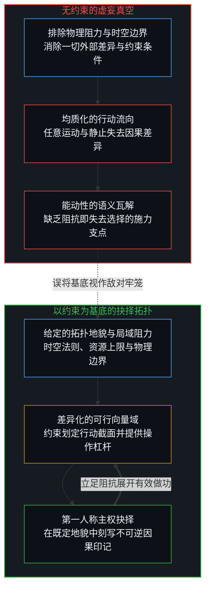
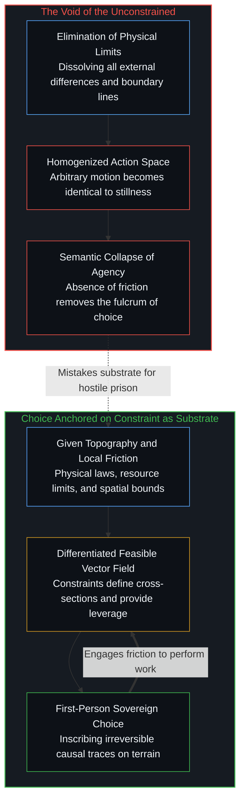
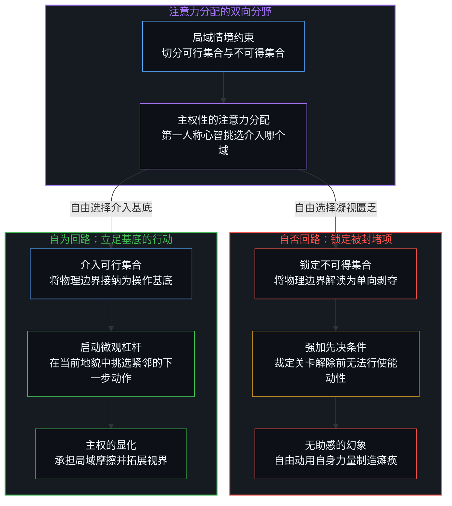
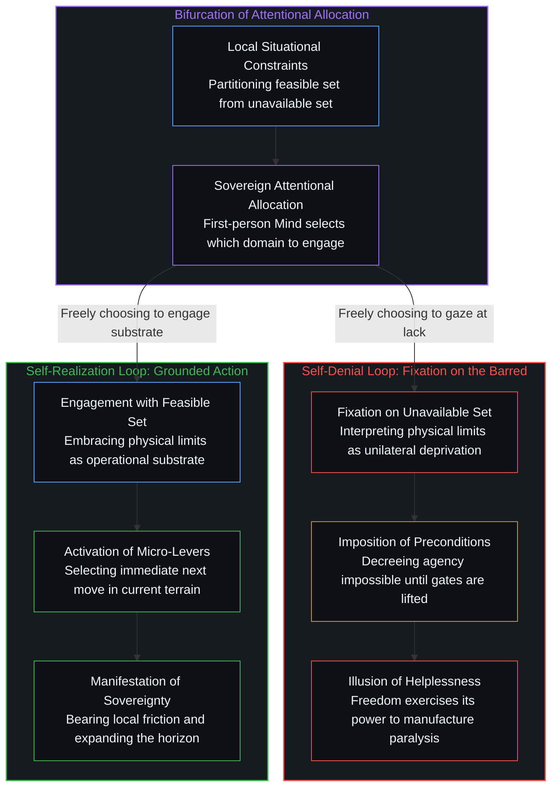

# 约束基底与自由自否 / The Substrate of Constraint and the Self-Denial of Freedom

*痛苦源于给自由施加先决条件，而自由恰是在任何约束下皆可行动的主权。 / Suffering stems from conditioning freedom on outcomes; freedom is sovereign action under constraints.*

在大众语境与浪漫主义文学的叙事中，自由长期被描摹为一种摆脱一切阻碍、免除所有重负的原生完满状态。这种设定假定世间所有的物理规律、生理局限、历史因果与环境阻力皆是对个体主权的粗暴掠夺，宣称唯有撕碎所有的边界，生命才能抵达随心所欲的彼岸。然而，这种将自由等同于排除一切限制的设想，从逻辑的第一步起便陷入了认知倒错。

In popular discourse and romantic literature, freedom has long been depicted as a pristine state emancipated from all friction and relieved of every burden. This framing assumes that physical laws, biological limitations, historical circumstances, and environmental friction constitute an outright confiscation of individual sovereignty, imagining that the mind attains full autonomy only when every boundary is dissolved. Yet equating freedom with the absence of constraints collapses into conceptual incoherence at its very first step.

## 一、 虚无的真空与选择的因果基底 / 1. The Void of the Unconstrained and the Causal Substrate of Choice

设想一个被抽干了所有约束的虚构空间：在那里不存在引力，没有时空的局域阻隔，没有物质形态的阻抗，也没有行动后果的不可逆沉淀。当所有的行动通道都具有等价的流动性，当任何意图都不需要克服差异化的阻力，任何一个特定方向的微动便与静止毫无二致。没有阻抗，转向就失去了支点；没有不可逆的物理刻写，抉择便无法在世界中留下具有差异的因果痕迹。约束从来不是囚禁自由的牢笼，它恰恰是赋予选择以几何形态、语义内容与因果权重的实体基底。正如在[约束的样子不是自由的失去](../the-look-of-constraint-is-not-the-loss-of-freedom/)中所剖析的，成人的受限外貌并非生命被环境剥夺了主权，而是能动性与现实发生深层摩擦后的历史沉淀。

Consider an imaginary void emptied of all constraints: where gravity is absent, spatial and temporal frictions vanish, matter offers zero resistance, and actions leave no irreversible deposits behind. When every trajectory possesses identical fluidity and no intention requires overcoming differential resistance, moving in any direction becomes indistinguishable from standing still. Without resistance, steering has no fulcrum; without irreversible physical inscription, choice cannot carve meaningful distinctions into the world. Constraints are never the bars of a cell; they are the generative substrate that grants choice its geometry, its semantic content, and its causal weight. As dissected in [The Look of Constraint Is Not the Loss of Freedom](../the-look-of-constraint-is-not-the-loss-of-freedom/), the constrained appearance of maturity does not signify that reality has stripped away agency, but reflects the accumulated coordinates where action met the world.

以下因果拓扑图展现了无约束真空的虚妄与以约束为基底的抉择机制之间的对照：

The following causal topology illustrates the contrast between the illusion of an unconstrained void and the generative mechanics of choice anchored on constraints as its substrate:

## 二、 先决条件的关卡与受苦的延期机制 / 2. The Gate of Preconditions and the Postponement of Agency

如果约束构成了行动的基底，人类经验中普遍存在的沉重受困之苦究竟由何而来？这种苦楚并不诞生于外部物理阻力的坚硬，而是源于心智在语法层面为自由生硬追加的先决条件。人们极易落入一种精巧的拖延仪式中：认定自己必须先积攒下巨额的财务充裕，必须先化解家庭的摩擦，必须先驱散内心的恐惧与不确定，或者必须先获得体制与环境的认可，自己才具备行使自身能动性的资格。

If constraints constitute the indispensable substrate of action, what generates the pervasive existential suffering of feeling trapped? Such distress does not originate in the rigidity of external physical barriers, but stems from the grammatical error of appending preconditions to freedom. Minds routinely slip into an elaborate ritual of postponement: convincing themselves that they must first amass financial abundance, resolve familial friction, eradicate fear and uncertainty, or secure institutional validation before becoming qualified to exercise their own agency.

一旦将外部条件的满足确立为运作的前提，自由便不再是能动者立足的活生生地基，而退化为一张停放在未来的期票。[有条件的自由](../you-tiao-jian-de-zi-you/)剖析了这种能动性抵押的自毁机制：无论设立的前提最终是被撞碎还是达成，心智都早已在竖起关卡的瞬间交出了自己的主权。在匮乏时，物质短缺充当了停滞的挡箭牌；在充裕时，失去的风险又立刻成为犹豫的新理由。正如在[自由即地基](../freedom-as-ground/)中所推导的，把解放切分为层层递进达标阶梯的分类法，实则搭起了一座无限推迟当下主权的行政脚手架。痛苦从来不属于地貌本身，而是心智亲手把自身能动性推迟到遥不可及的地平线时所引发的内在痉挛。

The moment the satisfaction of an external condition is installed as an operational prerequisite, freedom ceases to be the living ground of agency and is degraded into a promissory note parked in the future. As demonstrated in [Conditional Freedom](../you-tiao-jian-de-zi-you/), this mortgage of agency is self-defeating: whether the designated condition is shattered or fulfilled, the mind has already surrendered its authorial sovereignty the moment the gate was erected. In scarcity, material lack serves as an alibi for immobility; in affluence, the risk of loss instantly becomes the new justification for hesitation. As derived in [Freedom as Ground](../freedom-as-ground/), ladder taxonomies that stratify liberation into sequential tiers of attainment construct an administrative scaffold that endlessly postpones present sovereignty. Suffering belongs not to the terrain itself, but to the internal convulsion produced when the mind defers its own agency to an unreachable horizon.

## 三、 注意力分配与自否状态中的自由行使 / 3. Attentional Allocation and the Exercise of Freedom in Self-Denial

由此暴露出人类能动性的核心反讽：当一个人陷入深重的瘫痪感、坚称自己“毫无选择”时，能动性并未消失，相反，它正以饱满的强度运转。在任何特定的现实截面中，既有约束将可能性场域切分为两组截然不同的集合：一组是在局域边界内切实可执行的可行行动集，另一组则是被物理、财务或社会条件排除在外的反事实选项集。约束确立了这一地貌分界，但在两组集合之间如何分配注意力，却始终是第一人称心智独享的主权。

This exposes the central irony of human agency: when an individual suffers from overwhelming paralysis and insists they "have no choice", agency has not vanished; rather, it is operating at full intensity. At any given cross-section of reality, existing constraints divide the field of possibilities into two distinct sets: the set of feasible actions executable within local boundaries, and the set of counterfactual options excluded by physical, financial, or social conditions. While constraints establish this topographical threshold, allocating attention between these sets remains the exclusive sovereignty of the first-person Mind.

受困者的不自由，本身正是自由的主动行使：行动者动用自身的注意力带宽，将目光死死锁定在不可得的集合之上，并裁定唯有恢复那些被封堵的可能性才算拥有完整无损的能动性。这种解释性的分配将结构性边界框定为单向剥夺，使心智对可行域中依然敞开的众多微观向量视而不见。被登记为不可得集合的内容中，有一部分从未被条件封堵。某项代价——时间、风险、社交摩擦或惩罚——被拒付，而对低代价路径的持续选择随后又从账面上略去，于是，一个只要付出代价便依然可行的替代选项，被登记成由外部排除的选项，改变这一安排的权力也随之被移置向外，正如[能动性、矛盾与权力的移置](../agency-contradiction-and-the-relocation-of-power/)所追溯的那样。从内部将这一拒付与所感到的匮乏登记为同一项活动，便把该替代选项重新归还至可行域：其代价不再是无法另作他选的理由，而是附于可见替代选项的标价。[自由意志的自否自由](../the-freedom-of-will-to-deny-itself/)剖析了理论家动用理性区分能力去论证能动性不存在的施演矛盾；而在日常处境中，受困者也在这一锁定中上演同构的施演矛盾。一个人感到受困的那一刻，恰恰是自由在以自我否定的方式运转的时刻。这并非意志的熄灭，而是自由调转枪口指向自身：心智自由地采纳了一座将自己建模为无力者的概念牢笼，继而自愿入住其中充当被动囚徒。决定论所许诺的，恰恰是有条件的自由抵押自身以苦苦等待的那个保证结果，然而正如[没有固定者的固定](../fixed-by-nothing/)所阐明的，没有任何东西预先把这个结果固定下来。

The unfreedom of the sufferer is itself an active exercise of freedom: the agent deploys their attentional bandwidth to fixate on the unavailable set, decreeing that only the restitution of barred possibilities qualifies as unimpaired agency. This interpretative allocation frames structural limits as unilateral deprivation, blinding the mind to the array of micro-vectors that remain open in the feasible domain. Part of what registers as the unavailable set was never barred by conditions. A cost was declined—time, risk, social friction, or penalty—and the ongoing selection of the lower-cost path was then left out of the account, so an alternative still feasible at a price registers as one excluded from outside, and the power to alter the arrangement is relocated outward with it, as traced in [Agency, Contradiction, and the Relocation of Power](../agency-contradiction-and-the-relocation-of-power/). Registering the declining and the felt lack from within as one activity returns that alternative to the feasible domain: its cost is no longer a reason one cannot choose otherwise, but a price attached to a visible alternative. While [The Freedom of Will to Deny Itself](../the-freedom-of-will-to-deny-itself/) dissects theorists using rational discrimination to argue against agency, everyday sufferers enact an identical performative contradiction in this fixation. The precise instant one feels trapped is an instant where freedom operates in self-denial. Far from witnessing the extinction of will, it exhibits freedom turned against itself: the mind freely adopts a conceptual cage that models itself as powerless, then volunteers to dwell within it as a passive captive. Determinism promises the very guaranteed outcome that conditional freedom mortgages itself to wait for, yet as [Fixed by Nothing](../fixed-by-nothing/) demonstrates, nothing fixes that outcome in advance.

以下因果机制图展现了注意力分配如何分化为无助感的自否回路与立足基底的自为回路：

The following causal diagram details how attentional allocation bifurcates into the self-denying loop of helplessness versus the self-realizing loop of grounded agency:

## 四、 约束下的不变主权与因果手柄的收回 / 4. Invariant Sovereignty Under Constraints and the Reclaiming of the Causal Lever

具操作性的自由，从来不依赖于外部摩擦的奇迹般消散。它的区分性特质在于跨任意约束拓扑的不变性：无论身处的处境走廊多么狭窄，无论眼前的资源多么匮乏，只要第一人称觉知依然在线，挑选下一个微观行动的能力便始终完整而未受折损。正如[个体抉择是唯一的因果杠杆](../individual-choices-as-the-only-causal-levers/)所阐明的，宏观系统与结构性规律的方向性动量，皆源自当下发生的离散微观抉择。自由不需要先决条件的核准背书；它是在任何呈现于面前的地貌上施加因果牵引的基线能力。

Operative freedom never depends on the miraculous dissolution of exterior friction. Its distinguishing property is an invariance across arbitrary constraint topologies: no matter how narrow the situational corridor, no matter how scarce the immediate resources, as long as first-person awareness remains active, the capacity to select the next micro-action remains whole and uncompromised. As demonstrated in [Individual Choices as the Only Causal Levers](../individual-choices-as-the-only-causal-levers/), macroscopic systems and structural regularities derive their directional momentum from discrete microscopic choices occurring in the present. Freedom requires no validating sanction from preconditions; it is the baseline capacity to exert causal traction across whatever terrain presents itself.

消解心理瘫痪并不需要等待一个无摩擦的未来，而是直接把因果手柄重新收回自己掌心。这要求放弃向世界乞求免除约束的特别豁免，同时停止为哀悼被排除的可能性而持续耗散认知能量。当心智不再把边界误读为高墙，而是将其接纳为脚下坚实的地面，受困的幻象便随之蒸发。行动者在既定坡度上迈出具体的一步，吸收局域摩擦并扛起不可逆的后果。正像[你的代码库即是记忆](../your-codebase-is-memory/)所展示的，承接自外部化痕迹的代码库正是活边缘书写下一次修订的具体记忆基底，锚定在这一约束基底上的持续做功跨越时间拓展了活视界，将自由从自我否定的瘫痪转化为塑造现实的持久力量。

Dissolving psychological paralysis does not require waiting for a frictionless future, but demands reclaiming the causal lever directly into one's own hands. It requires abandoning appeals to the world for special exemptions from constraints, while ceasing to hemorrhage cognitive energy mourning excluded possibilities. When the mind ceases to misread boundaries as walls and embraces them as the firm ground beneath its feet, the illusion of captivity evaporates. The agent takes a concrete step upon the existing slope, absorbing local friction and shouldering irreversible consequences. Just as [Your Codebase Is Memory](../your-codebase-is-memory/) shows that an inherited codebase of externalized traces is the concrete memory substrate from which the living edge authors its next revision, sustained work anchored on this substrate of constraints expands the living horizon across time, transmuting freedom from a self-denying paralysis into the durable force that shapes reality.
