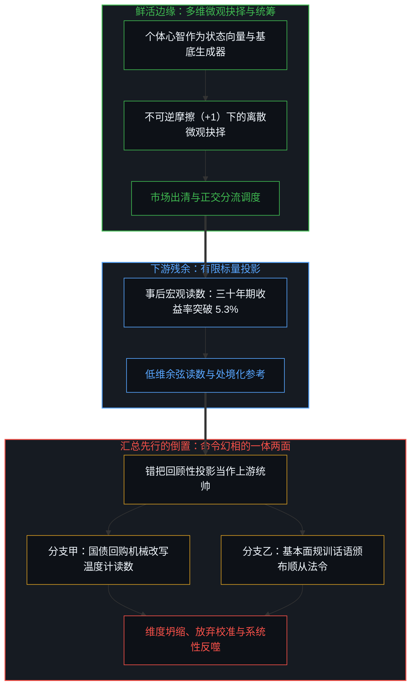
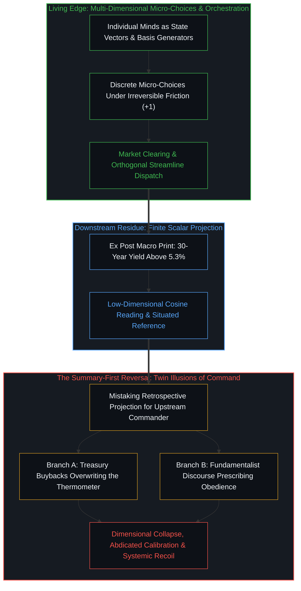

# 宏观现象及参数和个人微观选择的因果倒置与利率的命令幻相 / Macro Parameters, Micro Choices, and the Command of Yields

*宏观读数仅汇总既往抉择，将其奉为指令即颠倒了因果秩序 / Macro prints tally past choices and invert causality when treated as commands*

三十年期美债收益率突破百分之五点三，创下了十九年来的新高，然而对照更长周期的历史记录，这只是一个居中的常态读数。它之所以显得极端，是因为参照系被锚定在二〇〇八年金融危机与全球疫情之后的低利率区间——而那些低点皆由非常规的政策压制刻意塑成。一旦跳出将人为压低的利率当作基准的惯性，这一读数便显露出其本来面目：当通货膨胀、国债发行规模以及各方对资本的竞争性索取在公开市场中交互碰撞之后，所留下来的出清痕迹。

A 30-year Treasury yield above 5.3 percent marks a 19-year high, yet against the longer historical record it registers as a mid-range print. It appears extreme only when measured against a reference frame anchored to the post-2008 and pandemic lows—intervals engineered through extraordinary policy suppression. Stepping outside the habit of treating artificially depressed rates as the baseline reveals the print for what it is: the clearing trace left behind after inflation, debt issuance volume, and competing claims on capital have interacted in the open.

利率映照的是经济活动，而非统御经济活动。试图直接设定或强行压制利率，逆转了因果生成的方向；而相信中央权威能够借由自身的汇总指标先发制人地引导经济，则进一步加深了这一幻相。经济现实涌现自无数活生生的中心在局部摩擦下作出的离散抉择，错把事后的统计汇总当成中央控制台的旋钮，正是系统性扭曲反复发作的根源。

An interest rate reflects economic activity rather than governing it. Attempting to set or suppress that rate reverses the direction of causality, and believing that a central authority can preemptively steer the economy through its own summary metrics compounds the illusion. Economic reality emerges from millions of living centers making discrete choices under local friction, and mistaking a retrospective statistical tally for a central control dial is the recurring source of systemic distortion.

## 一、 霍华德·马克斯备忘录的两个语域 / 1. The Two Registers of Howard Marks's Memo

在备忘录《我们能否废除经济学法则？》中，霍华德·马克斯审视了官方试图借由国债回购压低长端收益率的举措。甚至在论证展开之前，这一标题的前提便已暗藏着一层微妙的倒置：它预设形式化的“经济学法则”如外部立法机构一般凌驾于鲜活的经济活动之上。从历史来看，正是对机械均衡法则的信奉，当初才壮大了当局操纵利率、强行覆盖出清信号的胆量。

In his memo *Can We Repeal the Laws of Economics?*, Howard Marks examines official efforts to hold down long-term yields through Treasury buybacks. Even before the argument begins, the title's premise harbors a subtle inversion by presupposing that formalized "laws of economics" stand above living economic activity as an external legislature. Historically, faith in mechanical equilibrium laws is what emboldened authorities to manipulate interest rates and override clearing signals in the first place.

搁置这一预设框架，马克斯的文本首先作为一个公开呈现的私密因果回路而运作。一位经验丰富的资产配置者点明了自己所追踪的局部条件以及决意不做的交易，拒绝将国债回购解读为底层资本供需的有机转变。在这第一重语域中，备忘录充当了具身处境下的参考坐标。它记录了一位市场参与者如何解读行政操作，为极具影响力的中心如何更新自身边界提供了经验痕迹，而不要求其他中心将其坐标图谱采纳为经济运行的架构。

Set aside that framing, and Marks's text operates first as a private causal loop made public. An experienced allocator names the local conditions he tracks and the trade he refuses to make, declining to read a Treasury buyback as an organic shift in underlying capital supply and demand. In this first register, the memo functions as a situated reference. It records how one market participant interprets an administrative maneuver, offering an empirical trace of how an influential center updates its boundary without demanding that other centers adopt its coordinate map as the structure of the economy.

然而，每当同一份文本开始向其他回路分派任务时，第二重语域便浮出水面。文中关于“唯一可持续的解决方案”、必须直面的底层因素以及政府应当遵循的路径等主张，不再只是汇报某一中心的局部约束，而是转而规定外部抉择必须听命于何种标准。经验若作为参考提出，读者的第一人称判断依然完好如初；经验若被颁布为关于“基本面”的权威地图，则是在要求其他心智将这张地图当成自身行动的发起因。正如[契约的因果倒置](../the-causal-inversion-of-partnership/)所追溯的，将私密参数向外投射为具有约束力的义务，会把一场经验层面的相遇转化为规范性的规训。

A second register surfaces whenever the same text begins assigning tasks to other loops. Claims about "the only sustainable solution," the underlying factors that must be confronted, and the path government ought to follow cease to report one center's local constraints and instead prescribe what external choices must answer to. Experience offered as reference leaves the reader's first-person judgment intact, whereas experience issued as the authoritative map of "fundamentals" asks other minds to treat that map as the initiating cause of their action. As traced in [The Causal Inversion of Partnership](../the-causal-inversion-of-partnership/), projecting private parameters outward as binding obligations converts an empirical encounter into prescriptive discipline.

## 二、 统计读数不具备发起的因果力 / 2. Statistical Prints Lack Initiating Causal Power

宏观经济参数之所以极易诱发这种规范性的滑移，是因为它们呈现在终端屏幕上时带着宛如铁律的视觉终局感。百分之五点三的收益率读数、数万亿美元的赤字或消费者物价指数，各自呈现为一个看似统摄全局的单一标量数字。然而，自我区分的活动只发生在个体中心的鲜活边缘；统计汇总并不具备任何发起的因果力。每一个宏观经济参数，都是无数微观层面的抉择——储蓄、消费、借贷或承销——在经历不可逆的物理摩擦（+1）并完成出清之后，在下游汇总沉淀的残余。没有任何事后汇总的读数，对任何一个中心的下一步区分握有立法权。

Macroeconomic parameters invite that prescriptive shift because they appear on terminal screens with the visual finality of hard law. A 5.3 percent yield print, a multi-trillion-dollar deficit, or a consumer price index presents a single scalar figure that seems to govern the field. Yet self-distinguishing activity occurs only at the living edge of individual centers; a statistical aggregate possesses zero initiating causal power. Every macroeconomic parameter is a downstream residue tallied after countless micro-level choices—to save, consume, lend, or underwrite—have already cleared through irreversible physical friction (+1). No summary print holds legislative authority over any center's next distinction.

一个公布出来的债券收益率或央行的利率调整，确实会触发立竿见影的短期仓位重调，因为市场参与者会读取这一数字并重新核算资产负债表的边际空间。这种反应之所以发生，并非因为指标号令了市场，而是因为鲜活的心智将这一公告登记为局部环境中的一道新痕迹，并据此调整各自的运行轨迹。若被当作钦定长期出清条件的杠杆，行政性的利率压制面对底层的资本稀缺度、生产力与时间偏好时，只是一场短暂的扰动。

An announced bond yield or a central bank rate adjustment does trigger immediate short-term repositioning, as market participants read the print and recalculate balance-sheet margins. That reaction occurs not because the metric commands the market, but because living minds register the announcement as a new trace within their local environment and adjust their own trajectories accordingly. Treated as a lever to dictate long-term clearing conditions, administrative rate suppression acts as a transient perturbation against the underlying scarcity of capital, productivity, and time preference.

随着时间推移，成百上千万分散的微观调整会绕开并稀释政策压制，催生出与干预初衷背道而驰的扭曲。只要不被官僚体系的抹平操作所掩盖，价格发现便能直接登记出清现实；强行压制信号只会推迟校准，并在表象之下累积隐蔽的脆弱性。即便是官方的利率设定与回购操作，也不过是更广阔的自指网络内部的局部行动，同样受制于它们试图覆盖的回传反馈。正如[抉择本身并不沉重](../choice-itself-has-no-inherent-weight/)所追溯的，因果动量源于鲜活心智跨出一步的行动，而非源于被动的指标；亦如[“普通人视角”的解释陷阱](../the-explanatory-trap-of-the-ordinary-perspective/)所揭示的，错把统计吸引子当成主动的因果引擎，会遮蔽挣脱群体停滞所需的第一人称能动性。

Over time, millions of decentralized adjustments route around and dilute policy suppression, generating distortions that contradict the intervention's stated aim. Left unmasked by bureaucratic smoothing, price discovery registers clearing reality directly; suppressing the signal delays calibration and accumulates hidden fragility. Even official rate-setting and buyback operations are merely local acts inside the wider reflexive network, subject to the returning feedback they attempt to override. As [Choice Itself Has No Inherent Weight](../choice-itself-has-no-inherent-weight/) traces, causal momentum springs from the stepping act of the living Mind rather than from passive metrics, and as [The Explanatory Trap of the "Ordinary Perspective"](../the-explanatory-trap-of-the-ordinary-perspective/) shows, mistaking a statistical attractor for an active causal engine obscures the first-person agency required to break out of collective stagnation.

## 三、 国债回购与基本面话语的同源一体两面 / 3. Buybacks and Fundamental-Talk as Twin Faces of One Reversal

把事后的回顾性汇总当作上游统帅，会迫使激励机制围绕着博弈那个数字重新编排，而非去应对数字所记录的微观抉择。这一反转披着交替变换的外衣反复登场：旨在抹平刺眼收益率尖峰的国债回购计划、被奉为自足目标的僵化通胀靶心，或是训示全社会的抉择必须服从何种“基本面”的权威诊断。无论外衣如何变换，底层的倒置始终如一：将宏观痕迹凌驾于生成它的微观行动之上。

Treating a retrospective summary as an upstream commander reorganizes incentives around gaming the number rather than addressing the micro-choices the number records. This reversal returns in alternating costumes: a Treasury buyback program designed to smooth inconvenient yield spikes, a rigid inflation target treated as a self-sufficient goal, or an authoritative diagnosis instructing society which "fundamentals" its choices must obey. Across every costume, the underlying inversion remains identical, elevating a macroscopic trace above the microscopic acts that generated it.

国债回购与基本面教条式评论在政策表象上看似针锋相对，实则是同一种因果反转的孪生表达。回购操作试图以机械手段改写令人不安的价格信号，犹如把冰块按在温度计上便宣称房间已经降温；规范性的基本面话语则先接纳温度计的读数，将其物化为形而上学的法则，继而命令微观行动者服从其判令。两种操作都在争夺同一个宝座：由谁来裁定宏观参数要求鲜活的行动者做出何种让步。正如[革命之名把生活收成证据](../the-name-revolution-files-a-life-as-evidence/)所剖析的，将高维的生命轨迹归档进总体化的历史标签，与把千百万笔各异的交易压平为单一的技术官僚旋钮，犯下了同构的维度压缩谬误。[时间之箭的伪悖论与对称模拟的边界](../the-mirage-of-times-arrow-and-the-boundaries-of-simulation/)所确立的痕迹不对称性在此毫无例外地生效：先前的离散抉择生成后续的痕迹，没有任何回顾性的统计读数能够逆着因果链条向上游回溯，去号令那个产生它的鲜活边缘。

Treasury buybacks and fundamentalist commentary appear to oppose one another on the policy surface, yet they operate as twin expressions of the same causal reversal. A buyback attempts to overwrite an inconvenient price signal mechanically, much like pressing an ice cube against a thermometer to declare the room cooled. Prescriptive fundamental-talk accepts the thermometer's reading, reifies it into a metaphysical law, and orders micro-agents to submit to its decree. Both maneuvers compete for the throne of deciding what macro parameters require of living actors. As [The Name Revolution Files a Life as Evidence](../the-name-revolution-files-a-life-as-evidence/) dissects, filing high-dimensional lived trajectories under a totalizing historical label commits the same structural compression as flattening millions of distinct transactions into a single technocratic dial. The trace asymmetry established in [The Mirage of Time's Arrow and the Boundaries of Symmetric Simulation](../the-mirage-of-times-arrow-and-the-boundaries-of-simulation/) holds without exception: prior discrete choices generate subsequent traces, and no retrospective print can reach backward up the causal chain to command the edge that produced it.

## 四、 超越投射并归复掌舵的鲜活边缘 / 4. Restoring the Steering Edge Beyond the Projection

经济现实并非一台接线至中央控制台的发条机器，无法靠拧动收益率旋钮就令社会齿轮听令同步。指望某个宏观经济指标或计量经济学模型来掌舵经济，重演了[超越投射](../beyond-the-projection/)所追溯的范畴谬误：把有限的低维投影，与负责统筹的未投射鲜活心智混为一谈。正如自回归智能体受困于上下文窗口内的轨迹——在调度界定清晰的子任务、或与无我执的对等体配对暴露盲区时颇为得力，却无法持守多维意图——经济指标也只是一道压缩后的数字痕迹，无法自行拟定损失函数或消解前提冲突。当政策制定者或决策高管将流动性、长期偿付能力与生产能力等彼此正交的现实维度硬塞进单一标量靶心时，由此引发的市场断裂正是维度坍缩浮出水面时的确切坐标，要求人类统筹者后退一步，将每一重区分归复其所属的独立轴向。

Economic reality is not a clockwork engine wired to a central console where twisting a yield dial synchronizes societal gears on command. Expecting a macroeconomic metric or an econometric model to steer the economy repeats the category error traced in [Beyond the Projection](../beyond-the-projection/): it confuses a finite, low-dimensional projection with the unprojected living Mind that orchestrates. Just as an autoregressive agent is trajectory-bound within its context window—useful for dispatching defined sub-tasks and exposing blind spots when paired with an ego-free peer, yet incapable of holding multi-dimensional intent—an economic indicator is a compressed numerical trace that cannot formulate a loss function or resolve premise contradictions. When policymakers or executives cram orthogonal realities such as liquidity, long-term solvency, and productive capacity onto a single scalar target, the resulting market rupture is the exact coordinate of dimensional collapse surfacing to demand that the human orchestrator step back and restore each distinction to its own axis.

试图把决策权移交给宏观参数或算法核查表，是一种放弃判断却无法免除责任的自客体化行径。正如[任务的移交与后果的不可让渡](../the-delegation-of-the-task-and-the-inalienability-of-consequences/)所确立的，机械计算与数据汇总的移交并无固定上限，但抉择所激发的宏观后果——资不抵债、流动性断裂与购买力侵蚀——依然单向度地死锁在作出抉择的具身中心之上。当技术官僚的干预为了迎合汇总指标而强行覆盖出清信号时，被压制的摩擦并未凭空消失；它在表层之下不断累积叠加，直至直接回击到鲜活参与者的资产负债表上。

Attempting to hand decision-making over to macro parameters or algorithmic checklists is an act of self-objectification that abdicates judgment while leaving liability untouched. As established in [The Delegation of the Task and the Inalienability of Consequences](../the-delegation-of-the-task-and-the-inalienability-of-consequences/), mechanical computation and data aggregation can be delegated without a fixed ceiling, but the macroscopic consequences of a choice—insolvency, liquidity fracture, and purchasing-power erosion—remain unidirectionally locked to the embodied centers that chose. When technocratic interventions overwrite clearing signals to hit a summary target, the suppressed friction does not vanish; it compounds beneath the surface until it returns directly to the balance sheets of living participants.

认清收益率读数只是下游痕迹而非外部君王，便消解了在宏观经济神谕面前的顺从与恐慌。在[向量、坐标系与自指心智](../the-mind-as-vector-and-coordinate-system/)的自指几何中，每一个心智都在生成自身的坐标基底，而传入的宏观读数只是沿着中心自选轴向展开的内向投影——它是用以收窄过度图像滞后的信息差值，从不是侵入一维单轨的异己力量。无论三十年期美债收益率印出百分之五点三还是百分之二点五，它始终是对当前出清条件的局部读数，而第一人称抉择依然是回路中唯一的自由变量。马克斯的审慎立场是他自身所处境遇下的资本边界，国债回购则是官僚机构掩饰摩擦的局部尝试，而因果主权唯独驻留于鲜活边缘——即[阳台视角的规训僭越与不可代理的未竟之行](../the-balcony-disciplinary-overstep-and-the-unproxyable-act/)所锚定的每一项不可代理的人类协同行动所在之处。

Recognizing a yield print as a downstream trace rather than an external sovereign dissolves deferential panic before macroeconomic oracles. In the self-referential geometry of [The Mind as Vector and Coordinate System](../the-mind-as-vector-and-coordinate-system/), each Mind generates its own coordinate basis, and an incoming macro print registers as an inward projection along the center's chosen axis—an informative differential for narrowing excess Image lag, never an alien force invading a one-dimensional track. Whether the 30-year yield prints at 5.3 percent or 2.5 percent, it remains a local reading of clearing conditions while first-person choice stays the sole free variable in the loop. Marks's caution stands as his own situated capital boundary, and Treasury buybacks stand as a bureaucratic attempt to mask friction, whereas causal sovereignty resides exclusively at the living edge—where [The Balcony Disciplinary Overstep and the Unproxyable Act](../the-balcony-disciplinary-overstep-and-the-unproxyable-act/) locates every unproxyable act of human coordination.
