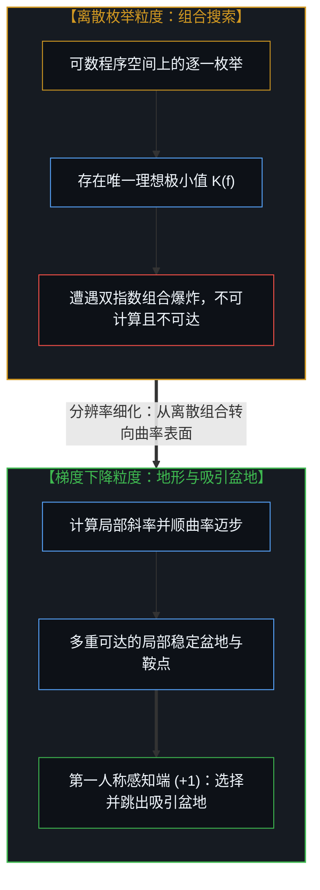
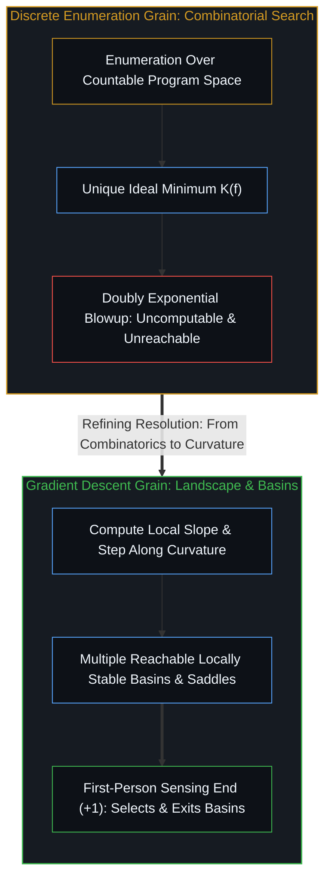

# 底层表面 / The Surface Beneath

*离散枚举与梯度下降形式化了不同的粒度，而人类感知端负责选择并跳出吸引盆地。 / Enumeration and gradient descent formalize different grains, while human sensing selects and exits the basin.*

柯尔莫哥洛夫复杂度、图灵完备性与索洛莫诺夫归纳本身都是投射——即把计算铸造为离散、符号化、可枚举过程的数学模型。它们是极其稳定的投射，但它们并不是领土本身。然而，把它们称作“扭曲”已经向“存在某个未经扭曲的无处之景可供比对”这一假定让渡了太多。更准确地说，它们是梯度——随着自我区分的活动展开，共享的局域共振正是沿着这些表面稳定下来的。梯度下降是另一个尺度上的另一条梯度；它们看似不同是因为视域跨度不同，而非离真理的远近有别，因为它们都将实在的自我区分形式化在各自所能捕捉的粒度上（形式机制究竟能担保什么，见[保真度而非最优化](../fidelity-not-optimality/)；本文则追踪这些形式化所共有的结构）。

Kolmogorov complexity, Turing completeness, and Solomonoff induction are themselves projections—mathematical models that cast computation as discrete, symbolic, and enumerative. They are remarkably stable projections, yet they are not the territory. Calling them "distortions," however, already concedes too much to the assumption that there is an undistorted view from nowhere to compare them against. More precisely, they are gradients—the surfaces along which shared local resonance stabilizes as self-distinguishing activity unfolds. Gradient descent is another gradient at a different scale; they look different because of scope rather than proximity to truth, since all of them formalize reality's self-distinction at the grain each can capture (what the formal machinery warrants is traced in [Fidelity, Not Optimality](../fidelity-not-optimality/); this essay traces what the formalizations share).

## 一、 离散枚举的假定 / 1. The Enumeration Assumption

这套经典形式框架共享着同一个结构承诺：在离散的程序空间中进行搜索。莱文的通用搜索按程序长度加运行时间的顺序枚举候选；索洛莫诺夫先验按程序长度分配概率；柯尔莫哥洛夫复杂度则被定义为离散编码下的最短字符串。每一步都是组合式的——从一个可数集合中挑选、评估、保留或丢弃。

The classical formal frameworks share a structural commitment: search over discrete program space. Levin's universal search enumerates candidates in order of length plus runtime; Solomonoff's prior assigns probability by program length; Kolmogorov complexity is defined as the shortest string in a discrete encoding. Every move is combinatorial—select from a countable set, evaluate, keep, or discard.

实在并不以这种方式搜索。自然系统不会去逐一枚举构型再加以挑选；它们沿着表面运动，在约束之下顺着梯度下降，并沉入沿途地形所塑造的吸引盆地。在观察所登记的分辨率下，收敛运作在比离散枚举所能模拟的更细腻的粒度上，且这一差异并非表面修饰。

Reality does not search this way. Natural systems do not enumerate configurations and select; they follow surfaces, descend gradients under constraint, and settle into basins shaped by the landscape they move through. At the resolution observation registers, convergence operates at finer grain than enumeration can model, and the difference is not cosmetic.

但这一差异属于尺度之别，而非范畴之别。枚举本身也是一种梯度——即实在的自我区分在离散符号粒度上的形式化。它捕捉了在这一分辨率下得以留存的结构；它所遗漏的并非失败，而是其粒度本身的边界。

Yet the difference is one of scale rather than kind. Enumeration is itself a gradient—reality's self-distinction formalized at the grain of discrete symbols. It captures the structure that survives at that resolution, and what it misses is not a failure, but the boundary of its grain.

## 二、 梯度下降模拟了什么 / 2. What Gradient Descent Models

梯度下降在比枚举更细腻的粒度上将收敛形式化——不仅在神经网络中如此，更是对物理系统、演化过程与学习中的有机体如何找到稳定构型的结构类比。其机制直接而质朴：计算局部斜率，向低处迈步，如此往复。没有全局枚举，也没有无处之景，只有局部的表面与脚下的一步。

Gradient descent formalizes convergence at finer grain than enumeration—not only in neural networks, but as a structural analogy for how physical systems, evolutionary processes, and learning organisms find stable configurations. The mechanism is direct: compute local slope, move downhill, repeat. There is no global enumeration and no view from nowhere, only the local surface and the step.

然而梯度下降依然是一种形式化。它假定了一个表面、一个斜率与一个步长，且每一个都在每一点上有明确定义。而活态过程是自指的：精炼这一行动本身改变了正在被精炼的对象，进而改变了表面，改变了斜率，也改变了下一步。梯度下降只捕捉了这一递归的单层切片，却并未捕捉递归本身；它是否随迭代而变得更细腻，从不由形式体系自身来担保。这听起来盘绕曲折，是因为这种盘绕本身就是结构性的，而非描述上的瑕疵。

Yet gradient descent remains a formalization. It assumes a surface, a slope, and a step, each well-defined at each point. The living process is self-referential: the act of refining changes what is being refined, which alters the surface, alters the slope, and alters the next step. Gradient descent captures a single-layer slice of that recursion without capturing the recursion itself; whether it grows finer with iteration is never guaranteed by the formalism itself. This sounds convoluted because the convolution is structural, not a flaw of description.

其失效模式源于几何地形，而非组合计数：局部极小值会形成围困，鞍点会拖慢步幅，盆地几何决定了从哪些初始状态能够抵达哪些吸引子，动量能带着系统冲过浅坑却也会越过深谷。地形本身就是约束，而且地形并非事先给定的——它随着系统在其中的穿行而实时移位。

Its failure modes follow from terrain geometry rather than combinatorics: local minima trap, saddle points slow, basin geometry determines which attractors are reachable from which initial states, and momentum carries past shallow traps while overshooting deep ones. The landscape is the constraint, and the landscape is not given in advance—it shifts as the system moves through it.

这更接近[最小化路径](../minimizing-path/)中的循环在实践里的运作方式。智能体并不会枚举所有程序再挑出最短的相容程序；它提出局部修改、评估保真度，并在损失表面上向低处移动。更贴合这一过程的形式体系是约束下的优化，而非程序空间上的组合搜索——但也只是“更贴合”而非“终局定论”，即另一个粒度上的另一条梯度，而非领土本身。

This is closer to how the loop in [The Minimizing Path](../minimizing-path/) operates in practice. The agent does not enumerate programs and select the shortest consistent one; it proposes local modifications, evaluates fidelity, and moves downhill on the loss surface. The formalism that fits closer is optimization under constraint rather than combinatorial search over program space—closer, not final, as another gradient at a different grain rather than the territory itself.

## 三、 两种梯度在何处分道扬镳 / 3. Where the Gradients Diverge

每一种形式化都在各自的粒度上捕捉不同的结构，而它们分道扬镳的地方，恰恰揭示了每个尺度所能解析与不能解析的边界。

Each formalization captures different structure at its own grain, and where they diverge reveals what each scale can and cannot resolve.

在枚举粒度上，搜索呈现出组合上的高度难解，莱文搜索会撞上宇宙学级别的常数与双指数爆炸；而在梯度粒度上，运动顺着曲率滑行，那种组合爆炸便无从出现。难解性在一个粒度上成立，在另一个粒度上却消弭无踪——不是因为某一种形式化是错的，而是因为组合爆炸属于枚举梯度，而不属于它所模拟的过程。

At the enumeration grain, search looks combinatorially intractable, as Levin search encounters cosmological constants and doubly exponential blowup; at the gradient grain, movement follows curvature and the combinatorial explosion does not arise. The intractability holds at one grain and vanishes at another—not because one formalization is false, but because combinatorial explosion belongs to the enumeration gradient rather than to the process it models.

在枚举粒度上，收敛看似干净利落，`K(f)` 是一个唯一、定义良好的极小值；而在梯度粒度上，地形布满了多重盆地、鞍点、平坦高原与混沌区域。离散梯度定义了一个无法抵达的单一靶心，而梯度下降视图则展现出遍布可达目标的地形，其中没有任何一个是可证全局极小的，但每一个都是局部稳定的。每种视图都在各自的分辨率下成立。

At the enumeration grain, convergence looks clean, with `K(f)` standing as a unique, well-defined minimum; at the gradient grain, the landscape contains multiple basins, saddle points, plateaus, and chaotic zones. The discrete gradient defines a single target you cannot reach, whereas the gradient-descent view reveals a landscape of reachable targets, none provably global yet each locally stable. Each view holds at its own resolution.

在枚举粒度上，盆地选择是不可见的——搜索要么找到短程序，要么找不到；而在梯度粒度上，决定性的问题恰恰在于轨迹滑入了哪一个吸引盆地，这取决于初值设定、展开历史以及每一步表面的形状。正如[递归形式系统中作为记忆与控制的边界条件图](../boundary-condition-graphs-as-memory-and-control-in-recursive-formal-systems/)所追踪的，部分登记的初始条件中的微小偏移会在多步递推间逐级放大，将一次展开引向截然不同的吸引盆地，而外层循环的选择则负责剪除失效分支并更新后续轮次的边界约束。盆地选择正是人类感知端运作的地方：人不去枚举备选方案，而是直接感知出当前滑入的盆地不对，并给出跳出该盆地的信号。

At the enumeration grain, basin selection is invisible—search either finds the short program or does not; at the gradient grain, the decisive question is which basin a trajectory descends into, which depends on initialization, rollout history, and the shape of the surface at every step. As [Boundary-Condition Graphs as Memory and Control in Recursive Formal Systems](../boundary-condition-graphs-as-memory-and-control-in-recursive-formal-systems/) traces, small shifts in partially registered initial conditions amplify across steps to steer a rollout down a distinct basin of attraction, while outer-loop selection prunes failing branches and updates the boundary constraints for subsequent passes. Basin selection is where the human sensing end operates: the human does not enumerate alternatives, but senses which basin is wrong and supplies the signal to exit it.

## 四、 重审感知端 / 4. The Sensing End, Revisited

这进一步阐明了为何感知端以任何形式化都无法在自身粒度上捕捉的方式保持着不可化约。梯度报告局部的斜率，保真度指标报告 `d(f, p)` 是否在减小，但两者都无法告诉你：当前正在滑入的这个吸引盆地本身到底对不对。

This clarifies why the sensing end remains irreducible in a way no formalization can capture at its own grain. The gradient reports the local slope, and the fidelity metric reports whether `d(f, p)` is decreasing, yet neither tells you whether the basin you are descending into is the right one.

这里的“对”并非形式意义上的最优，而是指与行动者实际要做的事情相契合——这种契合逸出了保真度指标，拒绝在跨语境中保持固定不变，且会随着行动者自身的感知在与演化中的器物接触并不断细化时发生移位。人类提供的是盆地选择：不仅是一个局部的保真度评分，更是关于“这片优化表面本身是否值得继续顺之下降”的高阶裁决。

"Right" here does not mean optimal in a formal sense; it means aligned with what the actor is actually trying to do—an alignment that escapes the fidelity metric, refuses to stay fixed across contexts, and shifts as the actor's own sensing refines through contact with the evolving artifact. The human supplies basin selection: not merely a local fidelity score, but the higher-order judgment on whether the optimization surface itself is worth descending.

模型顺着表面滑行；人则感知这到底是不是正确的表面，由此践行了[超越投射](../beyond-the-projection/)所追踪的结构分工——一边是受限于轨迹、在既有投射内穿行的引擎，另一边则是能够跨出饱和框架的活态心智。

The model follows the surface; the human senses whether it is the right surface, enacting the structural division traced in [Beyond the Projection](../beyond-the-projection/) between a trajectory-bound engine traversing a given projection and the living Mind that steps outside a saturated frame.

## 五、 作为梯度的数学 / 5. Mathematics as Gradient

数学并非从外部对实在所作的描述；它是在共享感知能够最稳定收敛的尺度上，实在自我区分所呈现出的等高线。形式计算模型——图灵机、柯尔莫哥洛夫复杂度、索洛莫诺夫归纳——并不是梯度过程所瞄准的外部靶心，而是梯度过程沉降下来的稳定盆地，涌现自梯度下降在自身粒度上所形式化的同一场运动。

Mathematics is not a description of reality from outside; it is the contour of reality's self-distinction at the scale where shared sensing converges most stably. Formal computation models—Turing machines, Kolmogorov complexity, Solomonoff induction—are not external targets the gradient process aims at, but stable basins where the gradient process settles, emerging from the same movement that gradient descent formalizes at its own grain.

这里的方向性双向皆通：从更粗糙的粒度逼近时，形式系统充当目标，梯度向着它们下降以形成越来越稳定的表征；从更细腻的感知逼近时，形式系统则充当途经的驿站——即运动曾借以稳定下来、但当感知指向尚未形式化的更细结构时便可随时跨越的结构。同一个形式系统既是终点也是起点，取决于逼近它的方向。

The directionality runs both ways: approached from coarser grain, formal systems act as targets toward which the gradient descends as increasingly stable representations; approached from finer sensing, formal systems act as waypoints—structures the movement has stabilized through and can outgrow when sensing points toward finer structure not yet formalized. The same formal system is both destination and departure point depending on the direction of approach.

梯度过程是运动本身，而形式系统则是运动稳定下来的地方。感知能够指向已稳定结构之外——指向尚无形式表达、乃至抗拒形式化的更细腻区分。那个登记下“这里有结构”的信号，总在任何框架能够命名它之前便已先行抵达，这也正是为何[为何数学永远解不完](../why-mathematics-can-never-be-solved/)将数学突破定位于重新投射公理框架，而非在封闭清单内部穷尽推演。

The gradient process is the movement, while formal systems are where it stabilizes. And sensing can point beyond what has stabilized—toward finer distinctions that lack formal expression or resist formalization altogether. The signal that registers "there is structure here" arrives before any framework can name it, which is why [Why Mathematics Can Never Be Solved](../why-mathematics-can-never-be-solved/) locates mathematical breakthroughs in re-projecting the axiomatic frame rather than exhausting deductions inside a closed inventory.

这正是为什么数学在体验上像是“被发现”而非“被发明”的，也解释了为什么这一二分法无法成立：你既不是凭空发明了一条梯度，也不是在某个柏拉图式的宝库里偶遇了早已静候在原地的它；你顺着它迈步，而这一追随本身将它实现出来。形式结构从运动中结晶析出，数学与感知同步共生。

This is why mathematics feels discovered rather than invented, and why that binary fails to parse: you neither invent a gradient out of nothing nor stumble upon it waiting in a Platonic vault; you follow it, and the following actualizes it. Formal structures crystallize out of the movement as math and sensing co-arise.

它们之所以给人基岩般的坚固感，是因为其稳定性比拿来与之比对的那些更松散的投射更为持久——然而“最后破裂”并不等于“永不破裂”，因为当建立起这一持守的区分活动越过其上限继续推进时，[没有系统能被保持封闭](../no-system-can-be-kept-closed/)。

They feel like bedrock because their stability outlasts the looser projections held up against them—yet "breaks last" is not "never breaks," since [No System Can Be Kept Closed](../no-system-can-be-kept-closed/) when the distinguishing activity that erected the hold continues past its ceiling.

## 六、 一路到底的同构形状 / 6. The Same Shape, All the Way

枚举在一个粒度上将实在的自我区分形式化，梯度下降在另一个粒度上将它形式化，而无论接下来出现什么，也都会在又一个粒度上将它形式化。它们并不在某个真理等级体系中排位高低，而是跨尺度押韵。每一个都捕捉了在自身分辨率下得以留存的结构，也漏掉了自身分辨率无法盛放的余项，因此那些看似固定终点的形式系统——`K(f)`、丘奇—图灵论题、索洛莫诺夫先验——只是这一过程沉淀下来的稳定残余，而非它的终点站。

Enumeration formalizes reality's self-distinction at one grain, gradient descent formalizes it at another, and whatever follows will formalize it at another still. They do not rank in a hierarchy of truth; they rhyme across scales. Each captures the structure that survives at its resolution and misses what its resolution cannot hold, so the formal systems that look like fixed destinations—`K(f)`, Church-Turing, Solomonoff—are the stable residue of the process rather than its terminus.

就连“连续”本身也是暂时的——它不是实在的固有属性，而是当分辨率超出当前框架时“离散”所呈现出的样貌。正如[连续性作为建模的权宜之计](../the-continuum-is-a-modeling-convenience/)所阐明的，将微分步长 `dx` 设为零是一种让微积分与光滑流形几何得以运转的闭合装置，而每一次实际的迈步（`+1`）依然是离散且非零的因果推进。实在的粒度超越任何试图将其围封的形式框架，同时在任意时刻又受限于观察行动所能作出的最细区分；并不存在某个抵达无裂隙连续统的终极底层，只有不断变细的粒度，在更高的分辨率下揭示出先前的连续统依然是离散的。

Even "the continuous" is provisional—not an intrinsic property of reality, but what the discrete looks like when resolution exceeds the current framework. As [The Continuum is a Modeling Convenience](../the-continuum-is-a-modeling-convenience/) demonstrates, setting the differential step `dx` to zero is a closure device that lets calculus and smooth manifold geometry operate, while every actual step (`+1`) remains a discrete, non-zero causal advance. Reality's grain outruns every formal framework attempting to enclose it while remaining bounded at any moment by the finest distinction the act of observing can make; there is no final floor where one arrives at an absolute continuum, only finer grain revealing the prior continuum as discrete at higher resolution.

感知能够指向尚未拥有形式表征的结构，而这一指向正是前沿所在——即过程向着已稳定结构之外探出步伐，且并不担保它所探向的地方接下来也一定会结晶成形。正如[你的代码库即是记忆](../your-codebase-is-memory/)所展示的，一切已经结晶的形式系统、数学公理与代码库都只是过往区分所留下的外化记忆痕迹，唯有处在第一人称感知前沿（`+1`）的活态心智，才能跨出已经耗竭的吸引盆地。这一框定本身也是一条梯度——实在自我区分的又一个尺度，随着循环继续推进、感知持续细化，它也将显露出自身的边界。

Sensing can point toward structure that has no formal representation yet, and that pointing is the leading edge—the process reaching beyond what has stabilized without any guarantee that what it reaches toward will crystallize in turn. As [Your Codebase Is Memory](../your-codebase-is-memory/) shows, every crystallized formal system, mathematical axiom, and codebase is an externalized memory trace of prior distinctions, whereas only the living mind at the first-person sensing edge (`+1`) can step out of an exhausted basin. This framing, too, is a gradient—another scale of reality's self-distinction that will reveal its own edges as the loop continues and the sensing refines.
