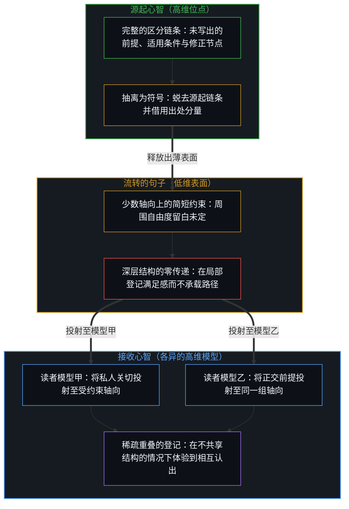
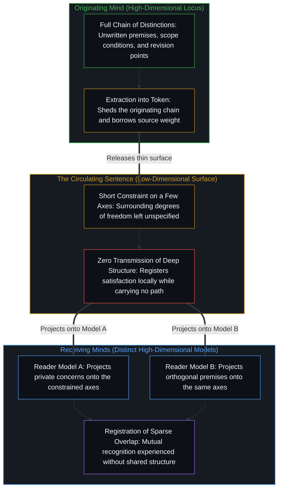
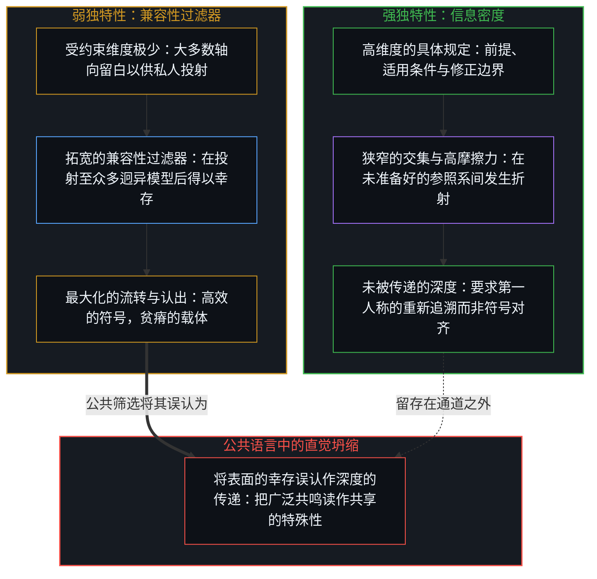
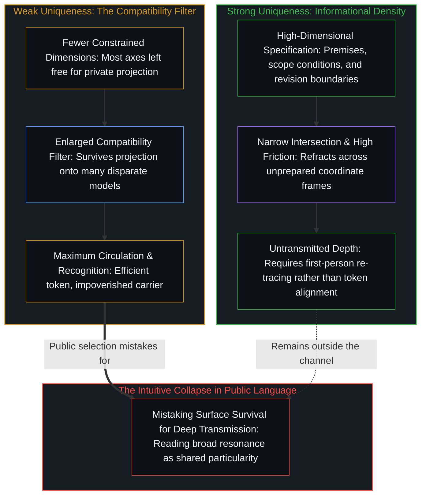

# 登记共鸣的表面 / The Surface That Registers

*流转的句子之所以唤起相互认出的感觉，恰在于它薄到足以让众多高维模型与之相交而不共享结构 / A circulating sentence produces the sense of mutual recognition precisely by remaining thin enough for many higher-dimensional models to intersect it without sharing structure.*

一张打磨考究的语录图在公共信息流里流转：彼得·蒂尔在《从0到1》中写下的那句“最特立独行的事不是去反对大众，而是自己思考”，未附只言片语便被直接发出。当发出这张图的账号长期致力于揭批流行的政策与学术教条——一边阐发托马斯·索维尔对盲从大众的批判，一边不加评注地转发拿破仑·希尔与拉尔夫·沃尔多·爱默生的格言——那条指出“践行这条建议需要领会其要义而非照搬其字面”的回复，便在“流转一枚符号”与“执行第一人称切分”之间标出了分界。顺着这道分界追溯，便会显露公共交流中两重相连的结构性倒置：一句表述传得越远，它所承载的源初思考就越少；一句流转的话语唤起的相互认出感越强，心智之间跨界传递的独特信息就越稀薄。

A polished quote graphic circulates across a public feed: Peter Thiel's line from *Zero to One*, "The most contrarian thing of all is not to oppose the crowd, but to think for yourself," posted without a word of commentary. When the account posting it is organized around a long-running project of exposing prevailing policy and academic dogmas—expounding Thomas Sowell's critiques of the crowd alongside unaccompanied maxims from Napoleon Hill and Ralph Waldo Emerson—the reply that following the advice requires heeding its essence rather than its words marks the exact split between circulating a token and performing the first-person cut. Tracing that split exposes two linked structural reversals in public communication: the farther a formulation travels, the less of the originating thought it carries; and the stronger the sense of mutual recognition a circulating sentence produces, the less unique information has crossed between Minds.

## 一、 借来的分量与零传递的满足感 / 1. Borrowed Weight and the Satisfaction of Zero Transmission

发出一句现成的话，足以让人感到大功告成。选中的句子贴合了发布者怀有的某种意图；出处自带的权威补上了发布者未曾给出的分量；公开发布这一动作本身则登记为一次表达。然而抵达读者的，只有这句孤零零的话，以及一句潜台词：这句话代表了发布者。至于发布者的前提、适用边界或修正节点，则丝毫没有进入传递通道。满足感是真实的，传递量却为零。这句话之所以完成了它在当下的局部功能，恰恰因为它停留在表面，而未曾展开为一条路径。

The act of posting a finished sentence can feel complete. The chosen line tracks an intention the poster holds; the authority of its source supplies weight the poster does not supply; the public placement registers as expression. What reaches the reader is the sentence and the implicit claim that it stands for the poster. Nothing of the poster’s premises, scope conditions, or places of revision enters the channel. The satisfaction is real. The transmission is zero. The sentence has performed its local function by remaining a surface rather than a path.

在眼前的样本里，这种乖离就摆在做法的表面。一位长期致力于驳斥共识叙事的评论者——像[索维尔的表象洞察与根因之偏](../sowell-observed-the-surface-problem/)与[未经自我审视的批判者](../the-unexamined-critic/)所追溯的那样，不断罗列流行正统观念在何处失效——挑中了蒂尔那句警惕“仅靠反对大众来标榜独立”的告诫，并将其作为一张独立的配图发出。这一挑选并不意味着发布者缺乏底层的思考脉络。在点击发布的那一刻，发布者内心持有某种由区分构成的私人配置，使得这句话显得恰如其分。然而，这一举动并未以第一人称去追溯那些前提，而是借用被引用者的名望来挑起分量；与此同时，发布者“本来想说的”与配图“字面所说的”在内部达成一致，向内登记为一次已然完成的表达。由于读者只收到了那枚剥离了语境的印记，内在“我已言说”的确认，便与外在“毫无言说者独有之物”的空白重合在一起——这正是[当观察变成表演](../when-observation-becomes-performance/)与[印迹与行动](../the-mark-and-the-act/)所定位的机制：用台面上的现成参照，替代了鲜活的当场校准。

In the specimen at hand, the divergence sits right on the surface of the practice. A commentator whose ongoing work consists of contesting consensus narratives—cataloging where popular orthodoxy fails, as [Sowell Observed the Surface Problem](../sowell-observed-the-surface-problem/) and [The Unexamined Critic](../the-unexamined-critic/) trace—selects Thiel's warning against merely opposing the crowd and sets it out as a standalone graphic. That selection does not mean the poster lacks an underlying line of thought. At the moment of posting, the poster holds a private configuration of distinctions that makes the sentence feel apt. Yet instead of tracing those premises in the first person, the act borrows the standing of the quoted name to carry the weight, while the private alignment between what the poster meant to say and what the graphic says registers inwardly as a completed expression. Because the reader receives only the detached mark, the inward confirmation of having spoken coincides with the outward absence of anything particular to the speaker—the exact substitution of a staged reference for the live calibration that [When Observation Becomes Performance](../when-observation-becomes-performance/) and [The Mark and the Act](../the-mark-and-the-act/) locate.

公共流转将同一机制推向了更远处。一旦被抽离出来，这句表述便蜕去了生成它的那条区分链条。继续向前移动的，只剩下一道简短的约束，供不同的心智各自映射到自身原有的关切之上。每一次映射都在叠加外在共鸣的同时，扣减着对任何单一源头的残余保真度。字句传得越远，它们所承载的最初挑选它们时的思考就越少，也就越发充当起一处让各异的高维模型登记重叠的场所。流转的广度所度量的，是可能相交的截面有多宽，而不是所共享的特殊性有多密。

Public travel extends the same mechanism. Once extracted, the formulation sheds the originating chain of distinctions. What continues to move is a short constraint that different minds can map onto their existing concerns. Each mapping adds an extrinsic resonance while subtracting residual fidelity to any single origin. The farther the words travel, the less they carry the thinking that first selected them and the more they function as a site where diverse higher-dimensional models register an overlap. Circulation measures the breadth of possible intersections, not the density of shared particularity.

## 二、 低维表面与高维模型的稀疏重叠 / 2. Low-Dimensional Surfaces and Sparse Overlap of High-Dimensional Models

表面之所以奏效，是因为它是低维的。它只约束寥寥几个轴向，而将其余周围的结构留白。一个高维模型可以投射到这几个轴向上，并将这次投射体验为彼此契合。就其所及的范围而言，这种体验并不假：受约束的维度确实对齐了。但每个模型推理的主体部分——它的前提、它的边界、它在何处会修正这一主张——都留在了共享通道之外。因此，这一信号在众多心智那里登记为意味深长，却无需这些心智持有相同的结构。共鸣，是对稀疏重叠的登记；信息密度，则是未曾随波流转的那部分。

The surface succeeds because it is low-dimensional. It constrains a few axes and leaves the surrounding structure free. A higher-dimensional model can project onto those axes and experience the projection as agreement. The experience is accurate as far as it goes: the constrained dimensions do align. The bulk of each model’s reasoning—its premises, its boundaries, the points at which it would revise the claim—remains outside the shared channel. The signal therefore registers as meaningful to many without those many holding the same structure. Resonance is the registration of sparse overlap. Informational density is the portion that does not travel.

这一几何结构，直接源于自我区分的活动跨中心投射结构的方式。正如[维度即投影](../dimensions-are-projections/)与[表征的闭环](../the-closed-loop-of-representation/)所确立的，每一个心智都在开放的超高维区分空间中运作，而在接触其他中心时，只能通过自身模型内部重建的压缩印迹来进行。在[注释不是代码](../the-comment-is-not-the-code/)中，即便是紧挨着可执行代码的技术注释，在读者依据自身先验从中重建出意图之前，也给不出任何东西；而在[信任读者是最后的越界](../trusting-the-reader-is-the-last-overstep/)中，一旦脱手发布，文本便不具备任何跨心智的因果力量，去规定接收者会代入哪些初始条件。一句不加评注的格言，更是连周遭的代码或论证也一并剥去。蒂尔的句子只约束了一组二元对比——反对大众与自己思考——却把所有操作性轴向全部敞开：在特定领域里什么算作大众、哪些前提正被固定不移、言说者自身的做法在这组对比中又处于什么位置。一万名读者可以将各自互不相容的高维模型投射到这片双轴表面上，在受约束的对比处登记一次精准命中，然后带着“自己与发布者及其他人共享了某种罕见洞见”的确信离开。

This geometry follows directly from how self-distinguishing activity projects structure across centers. As [Dimensions Are Projections](../dimensions-are-projections/) and [The Closed Loop of Representation](../the-closed-loop-of-representation/) establish, each Mind operates within an open, ultra-high-dimensional space of distinctions while encountering other centers only through compressed traces rebuilt inside its own model. In [The Comment Is Not the Code](../the-comment-is-not-the-code/), even a technical comment sitting beside executable code yields nothing until a reader rebuilds an intent from it under the reader's own priors; in [Trusting the Reader Is the Last Overstep](../trusting-the-reader-is-the-last-overstep/), the released text carries zero cross-mind causal power to dictate which initial conditions the recipient supplies. An unaccompanied aphorism strips away even the surrounding code or argument. Thiel's sentence constrains a single binary contrast—opposing the crowd versus thinking for oneself—while leaving every operational axis open: what counts as the crowd in a given domain, which premises are being held fixed, and where the speaker's own practice sits relative to that contrast. Ten thousand readers can project their incompatible high-dimensional models onto that two-axis surface, register an exact hit on the constrained contrast, and walk away convinced they share a rare conviction with the poster and with one another.

## 三、 兼容性的弱独特性与信息的强独特性 / 3. The Weak Uniqueness of Compatibility and the Strong Uniqueness of Information

常见的解读把广泛受认可这一事实当作独特性的证据。这种解读在它自身的框架内是成立的：一句能够通过更宽过滤器的话，相对于被该过滤器筛掉的那些表述而言，确实有其出众之处。然而它所通过的过滤器名叫兼容性。兼容性靠减少受约束的维度来拓宽。让这句话得以触及更多心智的那份单薄，也使其大部分内容处于未指明状态。在公共意义上被登记为“独特”的，只是投射到众多私人模型之上后幸存下来的残余物，而不是那些模型真正共享的高密度信息包。直觉将“广泛可接受的弱独特性”与“特定信息的强独特性”坍缩为一谈，把表面的通行无阻读作了深度的成功传递。

The common reading treats the fact of broad acceptance as evidence of uniqueness. That reading holds inside its frame: a formulation that clears a wider filter is distinctive relative to the formulations the filter rejects. The filter it clears, however, is compatibility. Compatibility is enlarged by constraining fewer dimensions. The same thinness that lets the sentence reach more minds keeps most content underspecified. What registers as unique in the public sense is the residual that survives projection onto many private models. It is not a dense packet that those models actually share. The intuition collapses the weak uniqueness of broad acceptability with the strong uniqueness of particular information, reading the success of the surface as if it were the transmission of depth.

公共语言天然筛选并放大这种倒置。那些将跨心智交集最大化的表述，也正将足以区分不同心智推理过程的共享结构压到最低。传得最远、唤起最强认出感的句子，恰恰是携带独特内容最少的那一句。符号的高效率，是用它作为载体的贫瘠买来的。在“无评注引文”这一具体案例中，整套机制在第一步就已闭合：发布者获得了对齐的确认，读者获得了认出的确认，而当初促成这一挑选的高维意图则依然停留在私人领域。表面在继续流转，路径却未曾延伸。

Public language selects for this reversal. Formulations that maximize intersections across minds minimize the shared structure that would distinguish one mind’s reasoning from another. The sentence that travels farthest and produces the strongest sense of recognition is the one that has carried the least unique content. The efficiency of the token is purchased by its poverty as a carrier. In the concrete case of the unaccompanied quote, the mechanism is already complete at the first step: the poster obtains the confirmation of alignment, the reader obtains the confirmation of recognition, and the higher-dimensional intention that prompted the selection stays private. The surface continues. The path does not.

将信息追溯回源初的切分动作，就能看清流转广度与特殊性之间的反比关系为何如此严密。正如[信息是什么](../what-information-is/)所确立的，信息不是封装在字词内部四处流通的现成物件，而是心智作出并登记的一次离散区分。当一段表达保留了其切分动作的高维链条——指明前提、标出前提失效的边界、列出随之迫使做出的调整——它便同时约束了多个正交的轴向。一旦进入公共场域，这种致密结构就会遭遇[高维信息的离散折射与认知分层](../gao-wei-xin-xi-de-li-san-zhe-she/)所追溯的剧烈折射，以及[独见者的自反困境与必然性的后验投射](../the-reflexive-dilemma-of-unique-insight/)所审视的结构性阻力：因为鲜有其他模型事先具备同一组轴向组合，这段表达无法被毫不费力地映射到现成的先验之上。强独特性——即高维印迹的特殊性——在构造上就收窄了即时的兼容性。反过来，一句被精心设计或挑选出来以通过最宽兼容性过滤器的句子，就必须不断蜕去那些起约束作用的维度，直到只剩下一层平滑的表面。

Tracing information back to the founding cut makes the inverse relationship between circulation and particularity exact. As [What Information Is](../what-information-is/) establishes, information is not an ambient commodity carried inside words, but the discrete distinction a Mind draws and registers. When an expression preserves the high-dimensional chain of its cuts—specifying its premises, the boundary where they fail, and the adjustments they force—it constrains many orthogonal axes at once. Entering the public field, that dense structure encounters the sharp refraction traced in [The Discrete Refraction of High-Dimensional Information](../gao-wei-xin-xi-de-li-san-zhe-she/) and the structural resistance examined in [The Reflexive Dilemma of Unique Insight and the Retrospective Projection of Necessity](../the-reflexive-dilemma-of-unique-insight/): because few other models already share that specific combination of axes, the expression cannot be mapped effortlessly onto standing priors. Strong uniqueness—the particularity of a high-dimensional trace—narrows immediate compatibility by construction. Conversely, a sentence engineered or selected to clear the widest compatibility filter must shed those constraining dimensions until only a smooth surface remains.

## 四、 表面的边界与第一人称的延展 / 4. The Boundary of the Surface and the First-Person Extension

这一切分标出的是边界，而非禁令。在已经共享了框架的语境内部，低维符号依然可用于协同；但一旦需要区分或修正的对象正是框架本身，它们便即刻丧失作为载体的功能。到了那一刻，表面只能登记既有的重叠，却无法推动生成它的那些模型。鲜活的区分依然系于第一人称的行动——要么将链条继续向前延展，要么任由那句话停留在原处成为残迹。

The cut marks a boundary, not a prohibition. Low-dimensional tokens remain usable for coordination inside already-shared frames. They cease to function as carriers the moment the frame itself is what must be distinguished or revised. At that point the surface can only register the prior overlap; it cannot move the models that produced it. The living distinction remains the first-person act that either extends the chain or leaves the sentence as residue.

当参与者已经共享了致密的实践语境——比如同一个代码库里的团队、承受过相同现实摩擦的践行者——一句简短的格言或指针便能索引整段共同经历，而无需从头复述。符号之所以在那里奏效，是因为受约束的轴向已被先前的第一人称工作锚定在局部语境之中。一旦离开这样的共享框架，指望一句关于“独立思考”的流转语录去传递独立思考，无异于要求表面去替路径做功。领会这条建议的要义而非停留在字面，意味着放下借来的表面所给予的满足感，在自己的位点上把前提、边界与修正的实际链条一一铺开——在那里，心智做出下一次切分，而不是在上一次切分的重叠处原地登记。

Where participants already share a dense operational context—a team inside a codebase, practitioners who have paid the same physical friction—a short maxim or pointer can index an entire shared history without having to re-state it. The token works there because the constrained axes are anchored locally by prior first-person work. Outside such a shared frame, asking a circulating quote about independent thought to transmit independent thinking asks the surface to do the work of the path. Heeding the essence of the advice rather than its words means leaving the satisfaction of the borrowed surface behind and laying out the actual chain of premises, boundaries, and revisions at one's own locus—where the Mind draws the next cut rather than registering an overlap on the last one.
