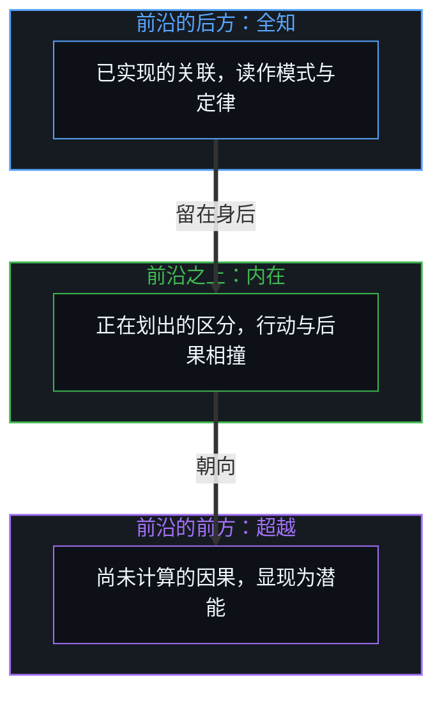
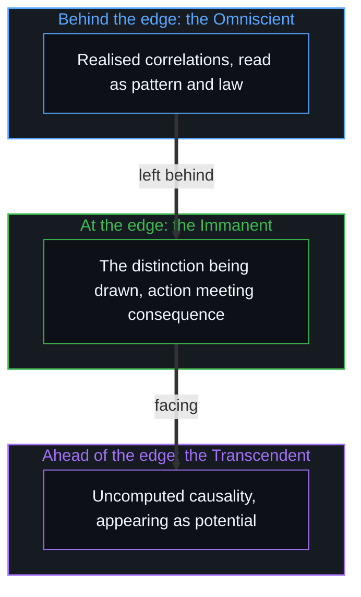

# 切分的三重影子 / The Three Shadows of the Cut

*兰德里的内在形而上学把移动前沿的三个视角立为三元根基，把影子当成了源头 / Landry's immanent metaphysics raises three views of the moving edge into a triadic ground, taking shadows for the source.*

在当代的哲学建构里，很少有公理体系像福雷斯特·兰德里的《内在形而上学》那样精密而内部一致。这部以压缩的论著形式流传的作品，试图以观察者与世界之间的参与关系为根基，为现实建起一个严格的基础，明确丢开了实体本体论、神学目的论与素朴唯物论的旧包袱。

In contemporary philosophical construction, few axiomatic systems are as intricate and internally consistent as Forrest Landry's An Immanent Metaphysics. Circulated as a compressed treatise, the work seeks to build a rigorous foundation for reality on the participatory relation between observer and world, explicitly setting aside the old baggage of substance ontology, theological teleology and naive materialism.

兰德里做出了几项要紧的澄清。他否认宇宙是一个封闭的、没有内容的容器，表明语境只经由内容而存在；他拒绝拉普拉斯式的决定论与从外部进行的普遍操控，确立物理定律是局部的不变量，而不是全局的命令；最要紧的是，他确立了第一人称的过程与相互作用比静态的存在更在先。可是在这些突破之后，体系停在了一层精致的表征上：把内在、全知与超越这一组三元分类抬成现实的地基，兰德里把同一个因果事件的三个下游侧面，实体化成了原初的形而上基元。

Landry makes several important clarifications. He denies that the universe is a closed, contentless container, showing that context exists only through content; he rejects Laplacian determinism and universal steering from outside, establishing physical laws as local invariants rather than global commands; most important, he establishes that first-person process and interaction are more fundamental than static existence. Yet after these breakthroughs the system stops at a refined layer of representation: by raising the triad of the Immanent, the Omniscient and the Transcendent into the bedrock of reality, Landry reifies three downstream aspects of one causal event into primal metaphysical primitives.

## 一、 三元的建筑 / 1. The Triadic Architecture

兰德里的方法立在两个前提上。一个是根基上的三分：每一个被当作真实的领域，都通过三个原初的模态来建模，三者被宣布为各不相同、不可分离、不可互换。另一个是类型上的同构：这三个模态在一切领域里保持相同的结构角色，在现实里是变化、因果与选择，在宇宙里是相互作用、存在与创造，在语言里是陈述、句法与语义。内在是当下的、参与的、第一人称的过程，直接遇到的世界；全知是结构的、第三人称的模式与定律，一下子被知道的世界；超越是可能性，敞开的前提条件，本可以是别样的东西。

Landry's method rests on two premises. One is foundational triplication: every domain treated as real is modelled through three primal modalities, declared distinct, inseparable and non-interchangeable. The other is type isomorphism: the three modalities keep the same structural roles in every domain, change, causation and choice in reality, interaction, existence and creation in the universe, statement, syntax and semantics in language. The Immanent is present, participatory, first-person process, the world as directly met; the Omniscient is structural, third-person pattern and law, the world known all at once; the Transcendent is possibility, open precondition, what could be otherwise.

直接追溯因果的切分，这个三元的来历就清楚了。三个模态不是三根彼此独立的形而上支柱，而是同一条移动的因果前沿的三个方向视角。向前沿的后方看，是因果链上累积的、已实现的历史关联；一个事件一旦实现，就成为不变的、结构的，可以作为模式与定律一下子读出来，这就是兰德里所说的全知。站在前沿上，是正在划出的当下区分那个活的光圈，有意识的行动与后果之间不加缓冲的碰撞，这就是兰德里所说的内在。向前沿的前方看，是感知有限地平线之外尚未计算的因果；一个未被观察的原因在越入区分之前，对观察者显现为敞开的潜能、前提条件与别样的可能，这就是兰德里所说的超越。

Trace the causal cut directly and the origin of the triad becomes clear. The three modalities are not three independent metaphysical pillars but three directional views of one moving causal edge. Looking behind the edge is the accumulated, realised historical correlation of the causal chain; once an event is realised it becomes invariant and structural, readable all at once as pattern and law, which is what Landry calls the Omniscient. Standing at the edge is the living aperture of the present distinction being drawn, the unbuffered collision of conscious action with consequence, which is what Landry calls the Immanent. Looking ahead of the edge is the uncomputed causality beyond perception's finite horizon; before an unobserved cause crosses into distinction, it appears to the observer as open potential, precondition and alternative possibility, which is what Landry calls the Transcendent.

这个三元是一份准确的清单，列出一个光圈穿过无穷因果链时生成的视角；它在这里有用。它到了边界，是在把这三个方向的影子当作宇宙的生成引擎的时候。

The triad is an accurate inventory of the views generated by an aperture moving through an endless causal chain; here it is of use. It reaches its boundary when these three directional shadows are treated as the generating engine of the cosmos.

## 二、 轮转的机械 / 2. The Machinery of the Cycle

把单一的移动前沿分成三个不同的模态之后，体系就得造出精细的形式机械，把它们重新绑在一起。于是有了兰德里的循环公理：类与实例在一个循环中穿过三个模态而相继。现实被建模成一台永不停歇的三冲程概念引擎，可能引出相互作用，相互作用结晶为结构，结构又打开新的可能之场。

Having divided the single moving edge into three distinct modalities, the system has to build elaborate formal machinery to bind them back together. Hence Landry's axiom of circularity: class and instance succeed one another in a cycle through the three modalities. Reality is modelled as a perpetual three-stroke conceptual engine in which possibility gives rise to interaction, interaction crystallises into structure, and structure opens new fields of possibility.

这种循环的表述，是形象滞后的标记。一段单一、连续的因果推进一旦在概念上被切成离散的类别，心智就得马上发明循环的反馈规则，来恢复它刚刚割断的连续；因果的递归接续，被换成一个形式上的轮转回路；制图者把自己分类法的操作规则，当成了现实的本体根基。生成本身不需要三个原初类型之间的循环协调。从第一人称登记到的，是因果作为一张不断开的连续织物推进，实现是区分叠在先前的区分之上、直接而不可逆的推进；所谓“循环”，只是观察者一再看着移动的前沿留下痕迹、走进敞开的地平线。兰德里的三个方向，成了一个忘了自己边界的框，这一步就是[框架的边界](../the-boundary-of-the-frame/)所描述的那一步。

This cyclical formulation is the mark of image lag. Once a single, continuous causal progression is conceptually cut into discrete categories, the Mind must at once invent cyclical feedback rules to restore the continuity it has just severed; the recursive succession of causality is replaced by a formal rotary loop; the mapmaker takes the operating rules of a taxonomy for the ontological ground of reality. Generation itself needs no cyclical coordination among three primal types. What registers from the first person is causality advancing as an unbroken continuous fabric, realisation the direct, irreversible progression of distinction compounding on prior distinction; the "cycle" is only the observer watching, again and again, the moving edge leave traces behind and advance into the open horizon. Landry's three directions become a frame that forgot its boundary, the move [The Boundary of the Frame](../the-boundary-of-the-frame/) describes.

## 三、 不可通约定理 / 3. The Incommensuration Theorem

兰德里形而上学的理论顶点，是不可通约定理。他借助对比较的严格分析，比较由同与异、内容与语境、主体与客体这六个内在项来界定，论证对称与连续不能同时完美成立：对称做到极致的描述必然不连续，连续做到极致的描述必然不对称。因此，依赖对称与不连续的客观物理模型，粒子与固定的定律，与依赖连续与不可逆的不对称的第一人称经验，时间与选择，永远不能被压进同一个总体的公式。兰德里用这个定理论证决定论内在地不完备，量子的不确定无法回避，选择是真实的而不是幻觉。

The theoretical peak of Landry's metaphysics is the Incommensuration Theorem. Through a rigorous analysis of comparison, defined by six intrinsics, sameness and difference, content and context, subject and object, he argues that symmetry and continuity cannot both be perfect at once: a fully symmetric description must be discontinuous, and a fully continuous description must be asymmetric. So objective physical models, relying on symmetry and discontinuity, particles and fixed laws, and first-person experience, relying on continuity and irreversible asymmetry, time and choice, can never be pressed into one totalising formula. Landry uses the theorem to argue that determinism is inherently incomplete, that quantum uncertainty cannot be escaped, and that choice is real rather than an illusion.

数学上的表述是优雅的，它的本体根基却很直接。对称是一份编好的不变量的性质，一张画在已实现的历史路径上的静态地图；连续是在活的前沿上展开的因果生成那不可逆的箭头；一张地图不能同时既是过去规律的静止画像，又是画下一笔的那个不加缓冲的步子。不可通约定理是模型永远无法成为第二重前沿的形式证明：客观的描述住在编好的对称那滞后的痕迹里，第一人称的中心住在活的因果接续那移动的不对称里，二者不能熔合，因为地图吞不下画它的那只手。把切分实体化，在 AI 那里有一个孪生的版本，就是把模型当作第二重前沿，[模型永远无法成为第二重前沿](../the-model-never-becomes-a-second-edge/)拒绝的正是它。

The mathematical formulation is elegant, and its ontological ground is direct. Symmetry is a property of a compiled invariant, a static map drawn over historical paths already realised; continuity is the irreversible arrow of causal generation unfolding at the living edge; a map cannot at once be a still portrait of past regularities and the unbuffered stride that draws the next line. The Incommensuration Theorem is the formal proof that the model never becomes a second edge: the objective description lives in the lagging trace of compiled symmetry, the first-person centre lives in the moving asymmetry of living causal succession, and the two cannot be fused because the map cannot swallow the hand that draws it. Hypostatising the cut has its AI twin in treating the model as a second edge, which [The Model Never Becomes a Second Edge](../the-model-never-becomes-a-second-edge/) refuses.

## 四、 选择的所在与爱的伦理 / 4. The Locus of Choice and the Ethics of Love

兰德里把伦理建在对能动性的守护上。他把自我定义为选择的所在，在敞开的潜能之间做出挑选的那个能动者，而不是一个形而上的灵魂实体。由此有了他那句流传很广的话：爱是使选择成为可能的东西。选择既然是真实的，伦理的行动就在于以让未来的选择仍然可能的方式去选择，扩大能动的场地，而不是把它压缩成贫瘠的约束。

Landry builds his ethics on the preservation of agency. He defines the self not as a metaphysical soul-substance but as the locus of choice, the agency that selects among open potentials. From this comes his widely quoted line: love is that which enables choice. Since choice is real, ethical action consists in choosing in a way that keeps future choice possible, widening the field of agency rather than compressing it into barren constraint.

这一伦理姿态与能动性的控制论图景很贴近；从三元的抽象中松开之后，它的根基更稳。选择不是在当下与定律之间运作的一个神秘的第三模态，它是未被观察的因果越过感知地平线、进入区分时的第一人称经验，[另一种相干](../the-other-coherence/)与[涌现的几何学](../the-geometry-of-emergence/)都从这里推出。爱，作为一份敞开，是与因果连续体那不断开的样子保持一致，是不把活的移动前沿截停在教条的封闭、威权的控制或静止的制度痕迹里。使选择成为可能，就是让感知的地平线保持敞开，让活着的中心继续靠承担后果的反馈在现实中导航，而不是交给封闭的模型。

This ethical stance sits close to the cybernetic picture of agency, and loosened from the triadic abstraction its footing is firmer. Choice is not a mysterious third modality operating between presence and law; it is the first-person experience of unobserved causality crossing the perceptual horizon into distinction, as both [The Other Coherence](../the-other-coherence/) and [The Geometry of Emergence](../the-geometry-of-emergence/) derive. Love, as openness, is consistency with the unbroken way of the causal continuum, the refusal to arrest the living moving edge in dogmatic closure, authoritarian control or static institutional trace. To enable choice is to keep the perceptual horizon open, so that the living centre goes on navigating reality through consequence-bearing feedback rather than handing itself to closed models.

## 五、 越过三元 / 5. Beyond the Triad

福雷斯特·兰德里的《内在形而上学》，是形式过程哲学传统里一项分量很重的思想成就。它送走了笛卡尔的二元论，拆掉了把宇宙当作看台包厢的幻象，让第一人称的经验回到了中心。可是像一切精致的形式体系一样，它仍是在地平线上编出的模型。要求现实服从一条不变的三分法则，它就把切分的三个方向视角，当成了让切分得以发生的根基。

Forrest Landry's An Immanent Metaphysics is a weighty intellectual achievement in the tradition of formal process philosophy. It sends Cartesian dualism away, takes down the illusion of the universe as a spectator's box, and brings first-person experience back to the centre. Yet like every refined formalism, it remains a model compiled at the horizon. By requiring reality to obey an unchanging law of triplication, it takes the three directional views of the cut for the ground that lets the cut happen.

从第一人称看，并不需要三个原初模态在永恒的循环中相互作用，只需要因果区分那无因、不停息的活动。过去是已经划出的区分编成的沉积，未来是地平线之外等待着的、尚未计算的因果连续体，当下是做出切分的那条活的前沿。内在、全知与超越，是那一个移动的光圈投下的三重影子；源头是那条移动着的、活的前沿。

From the first person there is no need for three primal modalities interacting in an endless cycle, only the uncaused, unceasing activity of causal distinction. The past is the sediment compiled from distinctions already drawn, the future is the uncomputed causal continuum waiting beyond the horizon, and the present is the living edge where the cut is made. The Immanent, the Omniscient and the Transcendent are the three shadows cast by that one moving aperture; the source is the living edge that moves.
