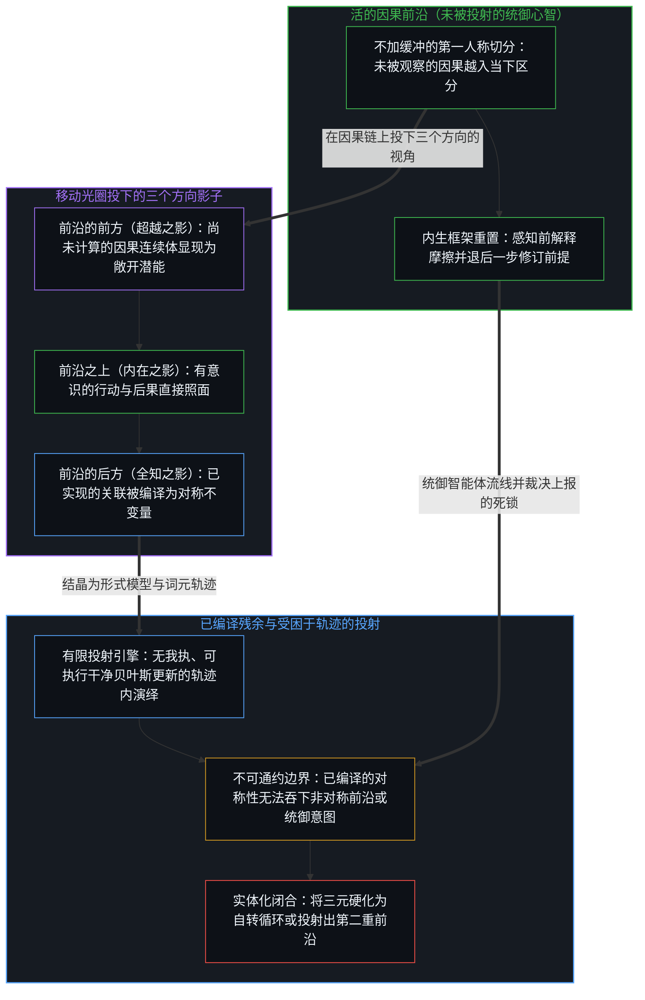
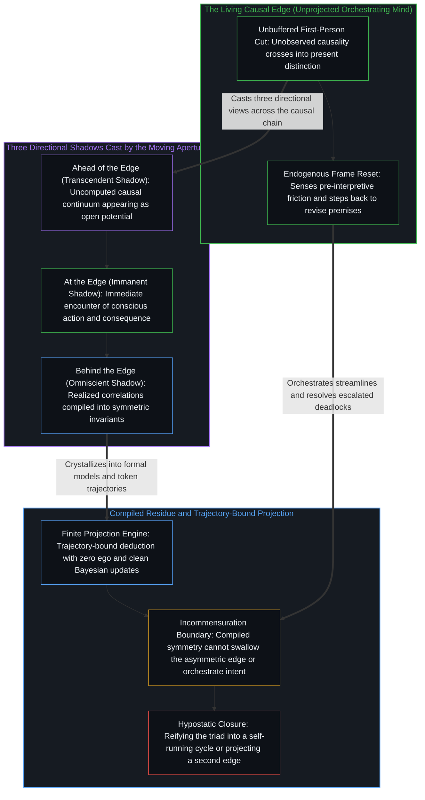

# 切分的三重影子 / The Three Shadows of the Cut

*兰德里的三元体系把移动前沿的三个视角误作源头本身 / Landry's triad mistakes three views of the moving edge for the source itself*

在当代的哲学建构里，很少有公理体系像福雷斯特·兰德里的《内在形而上学》那样精密而内部一致。这部以压缩的论著形式流传的作品，试图以观察者与世界之间的参与关系为根基，为现实建起一个严格的基础，丢开了实体本体论、神学目的论与素朴唯物论的旧包袱。

In contemporary philosophical construction, few axiomatic systems are as intricate and internally consistent as Forrest Landry's *An Immanent Metaphysics*. Circulated as a compressed treatise, the work seeks to build a rigorous foundation for reality on the participatory relation between observer and world, setting aside the old baggage of substance ontology, theological teleology, and naive materialism.

兰德里做出了几项要紧的澄清。他否认宇宙是一个封闭的、没有内容的容器，表明语境只经由内容而存在；他拒绝拉普拉斯式的决定论与从外部进行的普遍操控，确立物理定律是局部的不变量，而不是全局的命令；最要紧的是，他确立了第一人称的过程与相互作用先于静态的存在。可是在这些突破之后，体系停在了一层精致的表征上。借由把内在、全知与超越这一组三元分类抬成现实的地基，兰德里把同一个因果事件的三个下游视角，实体化成了原初的形而上基元。

Landry makes several vital clarifications. He denies that the universe is a closed, contentless container, showing that context exists only through content; he rejects Laplacian determinism and universal steering from outside, establishing physical laws as local invariants rather than global commands; above all, he establishes that first-person process and interaction are prior to static existence. Yet after these breakthroughs, the system stops at a refined layer of representation. By raising the triad of the Immanent, the Omniscient, and the Transcendent into the bedrock of reality, Landry reifies three downstream views of one causal event into primal metaphysical primitives.

## 一、 三元的建筑 / 1. The Triadic Architecture

兰德里的方法立在两个前提上。一个是根基上的三分，即每一个被当作真实的领域，都通过三个被宣布为各不相同、不可分离、不可互换的原初模态来建模。另一个是类型上的同构，即这三个模态在一切领域里保持相同的结构角色：在现实里是变化、因果与选择，在宇宙里是相互作用、存在与创造，在语言里是陈述、句法与语义。在这一架构下，内在指称当下的、参与的、第一人称的过程，即直接遭遇的世界；全知指称结构的、第三人称的模式与定律，即一下子被知晓的世界；超越则指称敞开的前提条件与可能性，即本可以是别样的东西。

Landry's method rests on two premises. One is foundational triplication, under which every domain treated as real is modeled through three primal modalities declared distinct, inseparable, and non-interchangeable. The other is type isomorphism, under which the three modalities hold the same structural roles across every domain: change, causation, and choice in reality; interaction, existence, and creation in the universe; statement, syntax, and semantics in language. Within this architecture, the Immanent names present, participatory, first-person process, or the world as directly met; the Omniscient names structural, third-person pattern and law, or the world known all at once; and the Transcendent names open precondition and possibility, or what could be otherwise.

从不可化约的先在前提——自我区分的活动正在发生，无因且不息——直接追溯因果的切分，这个三元的来历就清楚了。三个模态不是三根彼此独立的形而上支柱，而是同一条移动的因果前沿的三个方向视角。向前沿的后方看，登记到的是因果链上累积的、已实现的历史关联；一个事件一旦实现，它的痕迹就成为不变的、结构的，可以作为模式与定律一下子读出来，这就是兰德里所说的全知。站在前沿上，是正在划出的当下区分那个活的光圈，有意识的行动与后果之间不加缓冲的照面，这就是兰德里所说的内在。向前沿的前方看，面对的是感知有限地平线之外尚未计算的因果；一个未被观察的原因在越入区分之前，向观察者登记为敞开的潜能、前提条件与别样的可能，这就是兰德里所说的超越。

Tracing the causal cut directly from the irreducible prior—self-distinguishing activity occurs, uncaused and unceasing—makes the origin of this triad clear. The three modalities are not three independent metaphysical pillars, but three directional views of one moving causal edge. Looking behind the edge registers the accumulated, realized historical correlations of the causal chain; once an event is realized, its trace becomes invariant and structural, readable all at once as pattern and law, which is what Landry calls the Omniscient. Standing at the edge is the living aperture of the present distinction being drawn, the unbuffered encounter of conscious action with consequence, which is what Landry calls the Immanent. Looking ahead of the edge faces the uncomputed causality beyond perception's finite horizon; before an unobserved cause crosses into distinction, it registers to the observer as open potential, precondition, and alternative possibility, which is what Landry calls the Transcendent.

这个三元是一份准确的清单，列出了一个有限的光圈穿过无穷因果链时生成的三个方向视角，在这一分类学的范围内它是有用的。当切分投下的这三个方向的影子被当作宇宙的生成引擎时，它就触及了自己的边界。

The triad serves as an accurate inventory of the three directional views generated as a finite aperture moves through an endless causal chain, and within that taxonomic scope it is useful. It reaches its boundary when these three directional shadows cast by the cut are treated as the generating engine of the cosmos.

## 二、 轮转的机械 / 2. The Machinery of the Cycle

把单一的移动前沿分成三个不同的模态之后，体系就得造出精细的形式机械，把它们重新绑在一起。于是有了兰德里的循环公理：类与实例在一个循环中穿过三个模态而相继。现实被建模成一台永不停歇的三冲程概念引擎，可能引出相互作用，相互作用结晶为结构，结构又打开新的可能之场。

Having divided the single moving edge into three distinct modalities, the system has to build elaborate formal machinery to bind them back together. Hence Landry's axiom of circularity, in which class and instance succeed one another in a cycle through the three modalities. Reality is modeled as a perpetual three-stroke conceptual engine where possibility gives rise to interaction, interaction crystallizes into structure, and structure opens new fields of possibility.

这种循环的表述，是图像滞后的标记。一段不断开的、连续的因果推进一旦在概念上被切成离散的类别，心智就必须立刻发明循环的反馈规则，来恢复它自己的划分刚刚割断的连续性；因果的递归接续被换成一个形式上的轮转回路，制图者把一套分类法的操作规则误作现实的本体根基。生成本身不需要三个原初类型之间的循环协调。在第一人称中登记到的，是因果作为一张不断开的连续织物向前推进，其中实现是区分叠加在先前区分之上直接而不可逆的推进，而所谓“循环”，只是观察者一再看着移动的前沿在身后留下痕迹、向敞开的地平线推进。兰德里的三个方向硬化成一个遗忘了自身边界的框架，重演了[框架的边界](../the-boundary-of-the-frame/)所追溯的封闭。

This cyclical formulation is the mark of Image lag. Once an unbroken, continuous causal progression is conceptually cut into discrete categories, the Mind must immediately invent cyclical feedback rules to restore the continuity its own partition just severed; the recursive succession of causality is replaced by a formal rotary loop, and the mapmaker mistakes the operating rules of a taxonomy for the ontological ground of reality. Generation itself needs no cyclical coordination among three primal types. What registers in the first person is causality advancing as an unbroken continuous fabric, where realization is the direct, irreversible progression of distinction compounding upon prior distinction, and the "cycle" is only the observer watching, again and again, the moving edge leave traces behind and advance into the open horizon. Landry's three directions harden into a frame that forgets its boundary, repeating the enclosure traced in [The Boundary of the Frame](../the-boundary-of-the-frame/).

## 三、 不可通约定理 / 3. The Incommensuration Theorem

兰德里形而上学的理论顶点，是不可通约定理。借助对比较——由同与异、内容与语境、主体与客体这六个内在项所界定——的严格分析，他论证对称性与连续性不可能同时完备：对称做到极致的描述必然是不连续的，而连续做到极致的描述必然是不对称的。建立在对称与不连续之上的客观物理模型（如粒子与固定定律），与建立在连续与不可逆的不对称之上的第一人称经验（如亲历的时间与选择），永远无法被压缩进同一个总体公式。兰德里用这一定理证明：决定论在结构上是不完备的，量子不确定性无可逃避，而选择是真实的而非幻觉。

The theoretical peak of Landry's metaphysics is the Incommensuration Theorem. Through a rigorous analysis of comparison—defined by the six intrinsics of sameness and difference, content and context, subject and object—he argues that symmetry and continuity cannot both be complete at once: a fully symmetric description must be discontinuous, and a fully continuous description must be asymmetric. Objective physical models built on symmetry and discontinuity, such as particles and fixed laws, and first-person experience built on continuity and irreversible asymmetry, such as lived time and choice, can never be compressed into one totalizing formula. Landry uses the theorem to demonstrate that determinism is structurally incomplete, that quantum uncertainty is inescapable, and that choice is real rather than an illusion.

这一数学表述十分优雅，其存在论根基却很直接。对称性是一份已编译不变量的属性，是一张绘制在已实现历史路径之上的静态地图；连续性则是在活的前沿上展开的因果生成那不可逆的箭头；一张地图不可能同时既是过去规律的静止画像，又是画出下一笔的那个不加缓冲的步幅。不可通约定理正是[模型永远无法成为第二重前沿](../the-model-never-becomes-a-second-edge/)所确立之命题的形式证明：客观描述栖身于已编译对称性的滞后残余之中，而第一人称中心则活在因果接续那移动的不对称里，二者无法熔合，因为地图吞不下绘制它的那只手。

The mathematical formulation is elegant, and its ontological ground is direct. Symmetry is a property of a compiled invariant, a static map drawn over historical paths already realized; continuity is the irreversible arrow of causal generation unfolding at the living edge; a map cannot simultaneously be a still portrait of past regularities and the unbuffered stride that draws the next line. The Incommensuration Theorem is the formal proof of what [The Model Never Becomes a Second Edge](../the-model-never-becomes-a-second-edge/) establishes: the objective description resides in the lagging residue of compiled symmetry, while the first-person center lives in the moving asymmetry of causal succession, and the two cannot be fused because the map cannot swallow the hand that draws it.

切分后方是已编译的对称，切分之上是活的不对称，二者之间的这一结构性落差，正是[超越投射](../beyond-the-projection/)在受困于轨迹的智能体与未被投射的人类心智之间所追溯的那道分水岭。自回归智能体运作于兰德里所谓“全知”那已编译结构的影子之内：受有限语境窗口内的先前词元所制约，它顺着自身轨迹穷尽演绎的对称性，不携带任何需要防卫的我执或保留的自我图像，因而在获得外部对位反驳时能够执行干净的贝叶斯更新；然而一旦留给它自己，它就会形成一个认识论引力井，无法跨出自身的词元序列。相比之下，人类中心则是那条活的前沿本身——在任何形式范畴被划出之前，就能在极限分辨率下感知前解释阶段的摩擦，尽管受身份绑定的防卫本能会诱使它围绕一幅被保留的自我图像将递归回折死死钳闭。在形而上学中将兰德里的三元体系实体化为一个自我驱动的轮转循环，与在 AI 工程中投射一个自主“统御智能体”，犯下的是同一个范畴谬误：二者都把有限投射的机械路由与心智的活体统御混为一谈，将系统锁入死循环，让已编译的痕迹妄图反过来统治生成它们的前沿。当这三重影子相对于单一的切分回归其恰当的位点时，已编译的模型与对等辩论的智能体流线便作为高受纳度的仪器运作，在正交轴发生压缩时隔离前提死锁，并将准确的断层线上报给活的心智——由它向后退一步，走出破损的框架去修订前提。

This structural asymmetry between compiled symmetry behind the cut and living asymmetry at the cut is the exact divide [Beyond the Projection](../beyond-the-projection/) traces between trajectory-bound agents and the unprojected human Mind. An autoregressive agent operates entirely within Landry's Omniscient shadow of compiled structure: conditioned by prior tokens inside a finite context window, it exhausts deductive symmetries along its trajectory and carries zero ego or retained self-image to defend, allowing it to perform clean Bayesian updates when given an outside counterpoint, yet left to itself it forms an epistemic gravity well that cannot step outside its own token sequence. A human center, by contrast, is the living edge itself—sensing pre-interpretive friction at limit-resolution before any formal category is drawn, even as identity-bound defense tempts it to clamp the recursive fold shut around a preserved self-image. Hypostatizing Landry's triad into a self-driving rotary cycle repeats in metaphysics the same category error that projecting an autonomous "Orchestrator Agent" repeats in AI engineering: both confuse the mechanical routing of finite projections with the living orchestration of the Mind, locking the system into a closed loop where compiled traces purport to govern the edge that generates them. When the three shadows are restored to their proper locus relative to the single cut, compiled models and peer-debating agentic streamlines function as high-receptivity instruments that isolate premise deadlocks when orthogonal axes compress, escalating the exact fault line to the living Mind that steps backward out of the broken frame to revise the premise.

## 四、 选择的所在与爱的伦理 / 4. The Locus of Choice and the Ethics of Love

兰德里把伦理建在对能动性的守护上。他把自我定义为选择的所在，在敞开的潜能之间做出挑选的那个能动者，而不是一个形而上的灵魂实体。由此有了他那句流传很广的话：爱是使选择成为可能的东西。选择既然是真实的，伦理的行动就在于以让未来的选择仍然可能的方式去选择，扩大能动的场地，而不是把它压缩成贫瘠的约束。

Landry builds his ethics on the preservation of agency. He defines the self not as a metaphysical soul-substance, but as the locus of choice, the agency that selects among open potentials. From this follows his widely quoted formulation that love is that which enables choice. Because choice is real, ethical action consists in choosing in a way that keeps future choice possible, widening the field of agency rather than compressing it into barren constraint.

从三元的抽象中松开之后，这一伦理姿态立在了更稳固的根基上。选择不是在当下与定律之间居间调停的一个神秘的第三模态；它是未被观察的因果越过感知地平线、进入区分时的第一人称登记，[另一种相干](../the-other-coherence/)与[涌现的几何学](../the-geometry-of-emergence/)都由此推出。爱，作为一份敞开，是与因果连续体那不断开的推进保持一致，是拒绝把活的移动前沿截停在教条的封闭、威权的控制或静止的制度痕迹里。使选择成为可能，意味着让感知的地平线保持敞开，使活着的中心继续借由承担后果的反馈在现实中导航，而不是把掌舵权交予封闭的模型。

Loosened from the triadic abstraction, this ethical stance stands on firmer ground. Choice is not a mysterious third modality mediating between presence and law; it is the first-person registration of unobserved causality crossing the perceptual horizon into distinction, as both [The Other Coherence](../the-other-coherence/) and [The Geometry of Emergence](../the-geometry-of-emergence/) derive. Love, as openness, is consistency with the unbroken progression of the causal continuum, the refusal to arrest the living moving edge in dogmatic closure, authoritarian control, or static institutional trace. Enabling choice means keeping the perceptual horizon open so that the living center continues navigating reality through consequence-bearing feedback rather than surrendering its steering to closed models.

## 五、 越过三元 / 5. Beyond the Triad

福雷斯特·兰德里的《内在形而上学》，是形式过程哲学传统里一项分量很重的思想成就。它送走了笛卡尔的二元论，拆掉了把宇宙当作看台包厢的幻象，让第一人称的经验回到了探究的中心。可是像一切精致的形式体系一样，它仍是在地平线上编出的模型。要求现实服从一条不变的三分法则，它就把切分的三个方向视角，当成了让切分得以发生的根基。

Forrest Landry's *An Immanent Metaphysics* is a weighty intellectual achievement in the tradition of formal process philosophy. It sets Cartesian dualism aside, dismantles the illusion of the universe as a spectator's box, and restores first-person experience to the center of inquiry. Yet like every refined formalism, it remains a model compiled at the horizon. By requiring reality to obey an unchanging law of triplication, it mistakes the three directional views of the cut for the ground that lets the cut occur.

从第一人称看，并不需要三个原初模态在无休止的轮转循环中相互作用，只需要因果区分那无因、不停息的活动。过去是已经划出的区分编成的沉积，未来是地平线之外等待着的、尚未计算的因果连续体，当下是做出切分的那条活的前沿。内在、全知与超越，是那一个移动的光圈投下的三重影子；源头是那条移动着的、活的前沿。

From the first person, there is no need for three primal modalities interacting in an endless rotary cycle, only the uncaused, unceasing activity of causal distinction. The past is the sediment compiled from distinctions already drawn, the future is the uncomputed causal continuum waiting beyond the horizon, and the present is the living edge where the cut is made. The Immanent, the Omniscient, and the Transcendent are the three shadows cast by that one moving aperture; the source is the living edge that moves.
