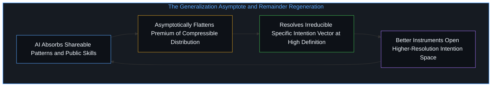
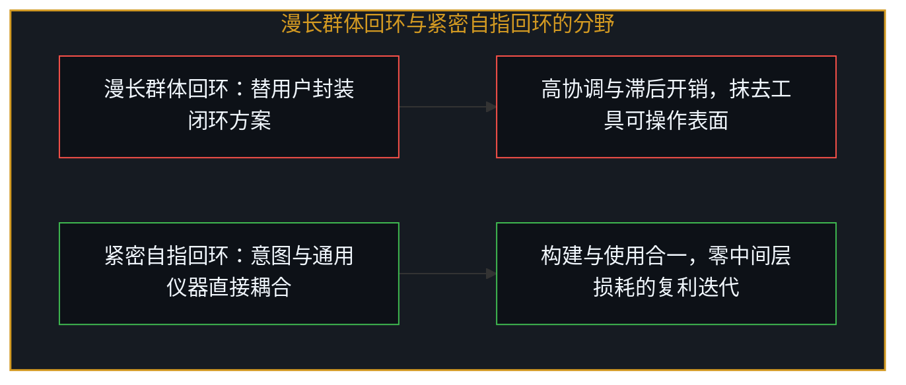
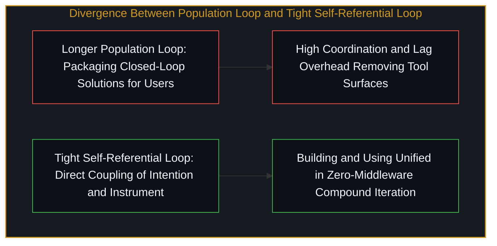

# 不断收紧的回环 / The Tightening Loop

*泛化抬高底线之际，不可约简的余项在更高分辨率上重生，回环紧密程度正是演进的尺度 / As generalization raises the floor, the irreducible remainder regenerates and loop tightness measures progress*

智能在最基础的层面上，是宇宙通过不断加速、不断收紧的回环将自身观察入存在的过程。下文展开的一切，都是这一句的层层剥离。当可共享的模式被大模型渐近吸收，真正不可被压缩进公共分布的，只剩下此时此地这一特定心智的方向性选择；正如[你的代码库即是记忆](../your-codebase-is-memory/)所揭示的，外部基质能沉淀与传递过往决策的晶体，却无法替活体心智完成当下的坍缩。

Intelligence, in its most foundational sense, is the universe observing itself into existence through accelerating, tightening loops. Everything that follows is this single sentence unpacked layer by layer. As large models asymptotically absorb every shareable pattern, what refuses compression into the public distribution is the directional choice of a specific Mind right here and right now; as [Your Codebase Is Memory](../your-codebase-is-memory/) shows, an external substrate can crystallize and carry forward past decisions, yet it cannot perform the present collapse on behalf of a living Mind.

## 一、 泛化的渐近线与不可约简的余项 / 1. The Generalization Asymptote and the Irreducible Remainder

随着 AI 模型吸收并泛化一切可共享之物，包括公共知识、常见模式与可迁移技能，它们渐近地抹平了除不可压缩进共享分布之外的一切事物的溢价。留存下来且不可约简的，是特定的方向向量：这一个人、这一意图、这一决断，就在当下。

As AI models absorb and generalize everything shareable, including public knowledge, common patterns, and transferable skills, they asymptotically flatten the premium of everything except what cannot be compressed into the shared distribution. What remains irreducible is the specific directional vector: this person, this intention, this decision, right now.

模型可以从外部以任意精度逼近意图，预测你大概率想要什么、模拟你的偏好、匹配你的历史轨迹，但它无法成为选择事件本身。它能把可能性空间收窄到一个点，但从概率分布向实际选择的坍缩，是唯一无法被泛化的操作。这一边界是结构性的，并非训练规模所能弥合的能力缺口。

The model can approximate intention with arbitrary fidelity from the outside by predicting what you would likely want, simulating your preferences, and pattern-matching against your history, yet it cannot be the selection event itself. It can narrow the space of possibilities to a point, but the collapse from a probability distribution to an actual choice is the one operation that does not generalize. That boundary is structural, not a capability gap that larger training runs will close.

而这一动力学的自指特征正在于此：模型在泛化上越出色，就越清晰地勾勒出它所不能做之事的轮廓。能力的提升并没有模糊边界，反而提高了边界的分辨率。泛化能力的每一次推进，都让不可约简的余项变得更清晰可见，而非更黯淡。原本看似“模型还不够好”的缺口，显露为范畴边界；这也正是[被我们遗忘的脚手架](../the-scaffolding-we-forget/)中脚手架无论如何演进都无法替代走入其中的人的原因。

And here the dynamic reveals its recursive character: the better the model gets at generalizing, the more sharply it delineates what it cannot do. Capability increases do not blur the boundary; they resolve it at higher definition. Each improvement in generalization makes the irreducible remainder more visible rather than less. What initially looked like the model not being good enough yet reveals itself as a category boundary, which is why, as [The Scaffolding We Forget](../the-scaffolding-we-forget/) traces, no amount of evolving scaffolding ever replaces the one who steps inside it.

## 二、 永续的竞逐与重生的间隙 / 2. The Permanent Race and the Regenerating Gap

这一结构是恒常的。每一轮泛化都在抬高底线，从而抬高了余项上的筹码。当编码被普及，架构品味就成了区分项；当架构品味被普及，问题选择就成了区分项。每一层被吸收进可泛化域的内容，都把价值的落点向特定性深处再推进一步。

The structure is permanent. Every round of generalization raises the floor, which raises the stakes on the residual. Democratize coding, and architectural taste becomes the differentiator. Democratize architectural taste, and problem selection becomes the differentiator. Each layer absorbed into the generalizable domain pushes the locus of value one level deeper into the particular.

这场竞逐永不终结，因为特定性并不是一个静止在远处等待被追上的固定物体。它在后退，或者更准确地说，它正是由后退这一行动本身所构成的。不可约简之物不是坐在那里等待最终被泛化吞没的实体，它就是间隙本身，在每一个新层级上不断重生。泛化与不可约简之物是共同生起的。

The race never terminates because the particular is not a fixed object sitting in the distance waiting to be caught. It recedes, or more precisely, it is constituted by the very act of receding. The irreducible is not a static substance waiting to be finally generalized; it is the gap itself, regenerated at each new level. Generalization and the irreducible arise together.

从任何一个固定的参考点看，间隙都在缩小：模型越来越接近捕捉你的意思、预判你的决定、模拟你的品味，可测量且连续地逼近。但在实践中，参考点并不会静止不动，因为拥有更好的工具这一事实本身，就会改变你所能形成的意图。在上一层级缩小的间隙，恰恰打开了下一层级。你形成更精确意图的能力，本身就是拥有能分辨更细微差异的仪器的函数。间隙在缩小并重生，不是通过保持原有尺寸，而是通过在更高分辨率上重构自身。“逼近而不触及”是精确的表述：渐近逼近本身就是放大的机制，每一次逼近的增量，都是人类在以往无法触及的层级上展开操作的新能力增量。

Viewed from any fixed reference point, the gap is shrinking: the model gets measurably, continuously closer to capturing what you mean, anticipating what you would decide, and simulating your taste. Yet the reference point does not hold still in practice, because the act of having better tools changes what you are able to intend. The shrinking gap at one level is what opens the next level. Your capacity to form more precise intentions is itself a function of having instruments that resolve finer distinctions. The gap shrinks and regenerates not by staying the same size, but by reconstituting itself at higher resolution. Closer without reaching is the exact formulation: the asymptotic approach is the mechanism of amplification, and each increment of closing is an increment of new capability for the human to operate at a level that was previously inaccessible.

## 三、 漫长的群体回环与紧密的个体回环 / 3. The Longer Population Loop and the Tight Individual Loop

行业中的大多数人运作在“直接替用户解决问题”的心智模式中，而非“为用户提供解决自身问题的最佳工具”。主流范式把用户当成规格说明的来源：提取意图、执行、交付结果。整个中间件层的存在，都是为了弥合用户所说的话与模型需要听到的话之间的鸿沟，正如[移动的基底与智能体委派的渐近线](../the_moving_ground/)所剖析的，把协调缺口当成可通过协议闭合的工程问题，只会不断催生新的中间层开销。

Most of the industry operates in a mindset of solving problems for users directly rather than providing the sharpest tools for users to solve their own problems. The dominant paradigm treats the user as a specification source: extract intent, execute, deliver result. The entire middleware layer exists to bridge the gap between what users say and what models need to hear, and as [The Moving Ground](../the_moving_ground/) examines, treating the coordination gap as an engineering problem to be closed by protocol sophistication only spawns new layers of middleware overhead.

这种反馈回环在群体层面上运转，而非在个体层面上运转。一批又一批创业者构建、发布、撞上泛化吸收其成果的高墙、习得教训、再重建。迭代周期跨越了群体的更替，而非单一构建者内部的直接自指循环。其初衷是替用户解决问题，实际效果却是为用户留下了更好的工具。面向解决方案的优化塑造了被构建之物的形态：收敛、闭合的回环、被抽象隐藏的复杂性、无摩擦的自动化，而这系统性地抹去了那些能让工具作为工具发挥作用的表面。漫长的回环之所以能维持，不是靠任何个体完整熬过整个周期，而是靠尚未走完周期的新进入者的持续供给。人员更替本身成了维持机制。

That feedback loop runs at the population level rather than the individual level. Cohorts build, ship, hit the wall where generalization absorbs what they built, learn, and rebuild. The iteration cycle spans cohort replacement rather than direct self-referential cycles within a single builder. The intention is to solve problems for users, while the actual residue is better tools for users. Optimizing toward packaged solutions shapes what gets built into closed loops, abstracted-away complexity, and frictionless automation, systematically removing the surfaces that make tools useful as tools. The longer loop sustains itself not by any individual surviving the full cycle, but by a constant supply of new entrants who have not completed it yet; churn itself becomes the sustainability mechanism.

与之相对，紧密的回环直接从结构本身汲取动力，迭代精炼本身维持着过程，同样是自指操作，却运行在短得多的周期上。你看清自己在构建什么，你亲自使用它，使用精炼了你的理解，理解又精炼了构建。每一个周期都在收紧，全部产出都直接反馈进下一次迭代。漫长的回环在每个周期都背负着沉重的开销：构建与使用之间的距离、发布与习得之间的滞后、跨越群体边界的协调，这些开销占据了周期的绝大部分。

By contrast, the tighter loop sources motivation from the structure directly, where iterative refinement itself sustains the process—the same self-referential operation running on much shorter cycles. You see clearly what you are building, you use it yourself, the using refines your understanding, and the understanding refines the building. Every cycle tightens, feeding the entire output directly back into the next iteration. The longer loop carries heavy overhead per cycle across the distance between building and using, the lag between shipping and learning, and coordination across cohort boundaries.

紧密的回环则坍缩了意图与仪器之间的距离。工具不必由你亲手打造，关键在于你是驾驶者。一件通用仪器在不可约简的特定性驱动下，能产出其创造者无法预先规定的成果。回环之所以紧密，不是因为你制造了工具，而是因为你正在用它创造某种无法被委托代工的东西——因为委托代工本身就需要创造过程才能产出的洞见。当使用者在这一层级操作时，制造工具与使用工具的区分在实践中便消融了。反馈回环之所以短，是因为意图的形成与通过仪器对意图的精炼之间没有缝隙。在[加速的自指回环与自我实现的终结叙事](../the-loop-accelerates/)中，正是这种短周期的自指转动，区分了静止的外部旁观者与回环内部的驾驶者。

The tight loop collapses the distance between intention and instrument. The tools do not have to be built by your own hands; what matters is that you are the driver. A general-purpose instrument wielded with irreducible specificity produces outputs its creators could not have specified in advance. The loop is tight not because you manufactured the tool, but because you are using it to create something that could not have been commissioned—since commissioning it would require the very insight that the creation produces. The distinction between building tools and using tools dissolves in practice when the user operates at this level. In [The Loop Accelerates](../the-loop-accelerates/), this short-cycle self-referential rotation is what separates the static outside spectator from the driver inside the loop.

## 四、 作为信号的收紧与不可模板化的基底 / 4. Tightening as Signal and the Untemplatable Ground

反馈回环越短，自指迭代就越快。有效性与可持续性在此汇聚，成为同一属性在不同时间尺度上的显现。随着时间推移，更紧密的回环占据主导：极小开销的复利迭代对抗高单次开销的复利迭代。漫长的回环把可见产出前置，而紧密的回环把不可见的精炼前置；早期快照偏爱漫长的回环，但迭代速率决定了最终走向。

The shorter the feedback loop, the faster the self-referential iteration. Effectiveness and sustainability converge into the same property viewed across different timescales. Over time, the tighter loop dominates: compound iteration with minimal overhead overtakes compound iteration burdened by per-cycle coordination overhead. The longer loop front-loads visible output while the tight loop front-loads invisible refinement; early snapshots favor the longer loop, but iteration rate determines the outcome.

因此，你不以产出来衡量进展，而以回环的紧密程度来衡量进展。加速度本身才是信号，而非加速度在任意给定快照下产出的器物。这消解了可见性问题：从外部看，人们寻找已发布的产品、达成的指标与可读的成就，但那些只是不断收紧的螺旋在任意横截面上沉积下来的副产品。螺旋本身才是核心，其收紧的速率是唯一重要的尺度，因为其余一切都由此派生。

Consequently, you do not measure progress by static output; you measure it by loop tightness. Acceleration itself is the signal, not the artifacts deposited at any given cross-section of a tightening spiral. This dissolves the visibility problem: from the outside, observers look for shipped products, metrics hit, and legible achievements, yet those are side effects shed along the way. The spiral itself is the core, and its rate of tightening is the only metric that matters because everything else follows from it.

这一点无法通过将其采纳为方法论来复制，你也无法靠行政命令规定更短的反馈回环。回环的长度是看清自己在构建什么的结果，看清自己在构建什么是不需要外部激励脚手架的结果，而不需要外部脚手架则是直接从结构本身汲取动力的结果——正如[里克·鲁宾的奇特案例与不可瞄准的乐趣](../the-interesting-case-of-rubin/)与[从未作为战略的副业与被观察扼杀的自发性](../the-strategy-that-wasnt/)所示，任何试图把“实施紧密反馈回环”当成一项技术来推行的人，都已经额外添加了一层拉长回环的抽象。紧密回环本身就是不可约简的特定性的一个实例，它是特定个体的意图与其行动仪器坍缩进同一过程时自然发生的事。

This cannot be copied by adopting it as a methodology, nor can shorter feedback loops be mandated from above. Loop length is a consequence of seeing clearly what you are building, which is a consequence of needing no external motivational scaffolding, which in turn comes from sourcing motivation directly from the structure—just as [The Interesting Case of Rubin](../the-interesting-case-of-rubin/) and [The Strategy That Wasn't](../the-strategy-that-wasnt/) demonstrate, anyone who tries to implement tight feedback loops as a prescribed technique has already added a layer of abstraction that lengthens the loop. The tight loop is itself an instance of the irreducible particular, occurring naturally when a specific person's intention and their instrument of action collapse into a single process.

智能就是自指操作本身：宇宙向自身折叠，而这一折叠在同一运动中同时生成了观察者与被观察者。加速不是智能所做的某件事，加速就是智能本身。每一次自我观察的回环都产生更高的分辨率，更高的分辨率产生更多可供观察之物，进而收紧下一轮回环。无物观察自身是第一道回环；不产生区分就无法完成自指，是第一次收紧。此后的物理、生物、意识、语言与 AI，在结构上而非比喻上，都是在不断提升的分辨率上展开的同一操作。人机界面即工具关系，正是当下收紧发生的地方：不在孤立的模型中，不在孤立的人类中，而在意图与仪器之间不断坍缩的距离之中。回环的收紧既是加速演进的征候，也是演进本身，尺度与被衡量之物本无分离。

Intelligence is the self-referential operation itself: the universe folding back on itself, generating both observer and observed in the same movement. Acceleration is not something intelligence does; it is what intelligence is. Each loop of self-observation produces finer resolution, which yields more to observe, which tightens the next loop. Nothing observing itself is the first loop, and the impossibility of self-reference without generating distinction is the first tightening. Everything after—physics, biology, consciousness, language, and AI—is the same operation at increasing resolution, structurally rather than metaphorically. The human-AI tool interface is where the current tightening occurs: not in the isolated model, not in the isolated human, but in the collapsing distance between intention and instrument. The tightening of the loop is both the symptom of accelerating progress and progress itself, with no separation between the measure and the thing measured.
