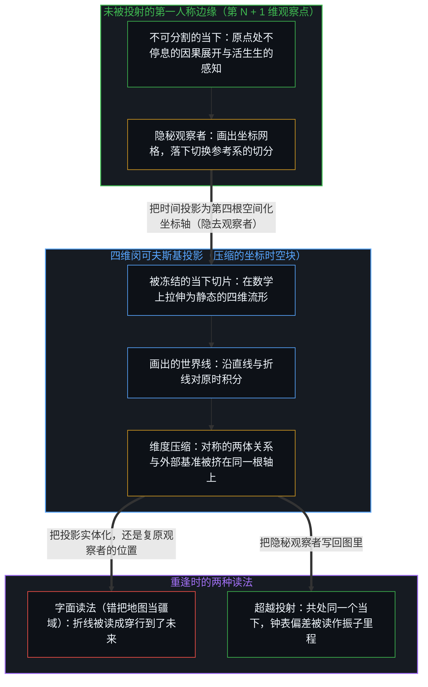
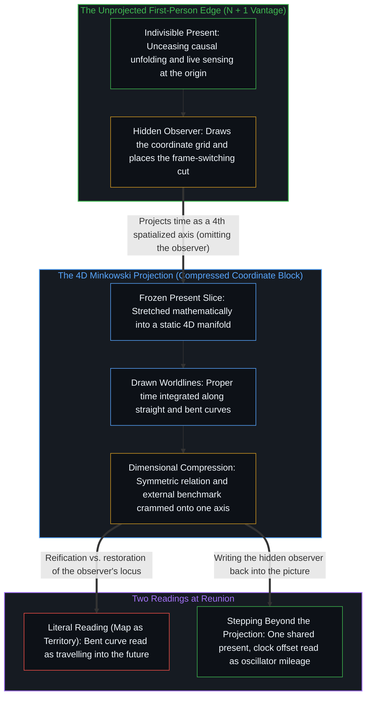

# 双生子佯谬与隐秘观察者 / The Twin Paradox and the Hidden Observer

*把时间画成一根轴，画图的观察者就被留在了图外 / Drawing time as an axis leaves the observer who drew it out of the picture*

相对论以光速为尺、以整个宇宙为参照，把钟与光信号之间的相对关系保存得极为精确，卫星授时、引力透镜与水星进动都靠它算准。它的边界在读图的方式上：时间被画成四维几何中的一根轴之后，比较两条世界线长短的那个位置站在图外，却没有被写进图里。双生子重逢时握住的是同一个当下，两只钟读数的不同是两个振子各自经历的记录。大爆炸与热寂是同一张图向后与向前的外推，属于投影出的时间；从第一人称的位置去找，找到的只有当下。

Relativity takes the speed of light as its ruler and the whole cosmos as its reference, and it preserves the relations between clocks and light signals with great precision; satellite timing, gravitational lensing, and the perihelion of Mercury are all computed by it. Its boundary lies in how the picture is read: once time is drawn as an axis in a four-dimensional geometry, the place from which two worldlines are compared stands outside the picture and is not written into it. Reunited twins clasp hands in one present, and the difference between two clock readings is the record of what each oscillator went through. The Big Bang and heat death are the same picture extrapolated backward and forward, and they belong to projected time; a search from the first-person position finds only the present.

## 一、 只有两个人的宇宙 / 1. A Universe of Two

狭义相对论问世一个多世纪以来，双生子佯谬一直是它的时空观里最引人注目的思想实验。教科书的叙述是：双胞胎中的哥哥留在地球，弟弟乘接近光速的飞船远行，随后掉头返回；重逢时，哥哥已白发苍苍，弟弟依然年轻。

For more than a century since special relativity appeared, the twin paradox has been the most striking thought experiment in its view of spacetime. The textbook account runs: of two twins, the elder stays on Earth while the younger travels in a ship near the speed of light and then turns around and comes back; at the reunion the elder is white-haired and the younger is still young.

相对性原理说一切惯性运动都是相对的，双方都可以说是对方在动。面对这个对称的诘问，标准的回答是：对称被打破了，因为远航的弟弟经历了掉头的加速，离开了单一的惯性系。

The principle of relativity says that all inertial motion is relative, and that each side may say it is the other who moves. To this question from symmetry the standard reply is that the symmetry is broken, because the travelling twin underwent the acceleration of the turnaround and left a single inertial frame.

这个回答底下有一个未被审视的前提，换一个问法它就露出来：如果宇宙里只有这两个人呢？设想一个虚空的宇宙，没有地球，没有星系，没有微波背景辐射，只有两名各在密封舱里的观察者，两人相互远离，随后相互靠近。从哥哥的位置看，弟弟的飞船离去、喷火、转向、返回；从弟弟的位置看，哥哥的飞船离去，自己的引擎产生推力，哥哥返回。

Beneath this reply sits an unexamined premise, and another way of asking brings it out: what if the universe held only these two? Picture an empty universe with no Earth, no galaxies, and no microwave background, only two observers, each in a sealed cabin, who move apart and then move together. From the elder twin's position, the younger twin's ship leaves, fires, turns, and returns; from the younger twin's position, the elder twin's ship leaves, the younger twin's own engine produces thrust, and the elder twin returns.

在只有两体的系统里，运动是两者之间的关系。没有第三个参照物时，找不到哪一条判据能把“静止”给其中一方而不给另一方；说一方“真正加速了”、另一方“保持静止”，要靠系统之外的背景。这个思想实验之所以得出“一方比另一方老得快”的确定结论，是因为叙述在没有言明的地方把整个宇宙当作了一座不动的舞台。

In a system of only two bodies, motion is a relation between the two. With no third reference, no criterion can be found that gives "at rest" to one of them and withholds it from the other; to say that one "really accelerated" while the other "stayed still" leans on a background outside the system. The thought experiment reaches its definite conclusion, that one ages faster than the other, because the account, at a place it does not state, takes the whole cosmos as a stage that does not move.

## 二、 没有被写进图里的观察者 / 2. The Observer Left Out of the Picture

相对论的纲领是取消经典力学里的特权参考系与以太，确立惯性运动的关系性。解释双生子佯谬时，被取消的基准又从后门回来了。为了判定远航的弟弟“真正经历了不对称的世界线弯曲”，解释调用了地球的质量分布、银河系的引力势场，乃至遥远恒星构成的背景；在理想化的思想实验里这些具体的物质背景不够用时，解释就设想一个悬在宇宙之外的位置。

The programme of relativity was to remove the privileged frame and the ether of classical mechanics and to establish that inertial motion is relational. In explaining the twin paradox, the benchmark that had been removed comes back through the rear door. To decide that the travelling twin "really underwent an asymmetric bending of the worldline," the explanation calls on the mass distribution of the Earth, the gravitational potential of the galaxy, even the background formed by distant stars; and when these concrete material backgrounds are not enough in an idealized thought experiment, the explanation imagines a position suspended outside the cosmos.

这个位置就是隐秘观察者。[因果的自反性与物理的无源假定](../causality-is-irreducible-the-physical-is-a-view-from-nowhere/)讨论过“没有视角的视角”：仿佛做理论的人可以离开自己所在的因果位置，从一个哪里都不是的地方俯瞰万物。在双生子佯谬里，这个位置是坐标网格的绘制处：手握四维网格，俯瞰图上的两条世界线，量出其中一条更短。

That position is the hidden observer. [Causality is Irreducible; The Physical is a View from Nowhere](../causality-is-irreducible-the-physical-is-a-view-from-nowhere/) has discussed the "view from nowhere": as though the one doing theory could leave the causal position occupied and survey everything from a place that is no place. In the twin paradox this position is where the coordinate grid is drawn: holding the four-dimensional grid, looking down on two worldlines in the picture, and measuring one of them as shorter.

这里有两套标准并用。对外的说法是宇宙里没有特权基准，运动是观察者之间对等的关系；解释佯谬时用的却是一个外部的固定参照，第三人称的俯瞰盖过了第一人称之间的对称。佯谬出在这一步替换上，沿着两个人各自的因果去追，找不到矛盾。[共享沙盒的幻象](../the-illusion-of-the-shared-sandbox/)指出过同样的次序：先设一个中立的公共沙盒，再把两个独立的因果中心放进预先画好的标尺里，于是量具的形状被读成了宇宙的属性。观察者可以从图里移到图外，却移不掉，[割点可移不可除](../the-cut-moves-but-never-vanishes/)说的正是这一点。

Two standards are in use here together. The outward statement is that the cosmos holds no privileged benchmark and that motion is an equal relation between observers; the explanation of the paradox uses an external fixed reference, and a third-person survey covers over the symmetry between first persons. The paradox arises at this substitution; followed along the causality of each of the two, no contradiction is found. [The Illusion of the Shared Sandbox](../the-illusion-of-the-shared-sandbox/) has pointed to the same order: a neutral public sandbox is posited first, two independent causal centers are then placed inside a ruler drawn in advance, and the shape of the measuring tool is read as a property of the cosmos. The observer can be moved from inside the picture to outside it and cannot be removed, which is what [The Cut Moves but Never Vanishes](../the-cut-moves-but-never-vanishes/) says.

## 三、 时间作为投影参数 / 3. Time as a Projection Parameter

解释之所以在这里打转，可以追到模型里的一个假定：静态的宇宙。在闵可夫斯基时空几何里，时间被空间化为第四个维度，宇宙的全部发生被压成一个已经完成的四维时空块；过去、现在与未来像书页一样并排，一个人的一生被画成一条静止的世界线。

That explanation keeps circling here can be traced to one assumption in the model: a static universe. In the geometry of Minkowski spacetime, time is spatialized into a fourth dimension, and all that occurs in the cosmos is pressed into a four-dimensional block already finished; past, present, and future lie side by side like the pages of a book, and a life is drawn as a worldline at rest.

面对这个几何体，计算者站在它的外面，沿两条世界线对原时做积分，发现弯折的那条累积的数值小于直的那条，于是说：远航的弟弟更年轻，他到了未来。这个推论把坐标上的投影参数读成了活的因果时间。

Facing this geometric body, the one who calculates stands outside it, integrates proper time along two worldlines, finds that the bent one accumulates a smaller number than the straight one, and says: the travelling twin is younger and has arrived in the future. This inference reads a projection parameter on a coordinate as living causal time.

时空块的可信感来自对当下的冻结与再投影。直接经验到的只有当下这一个切片，好比电影胶片上的一格；它扎在最直接的经验里，所以显得可信。接下来的操作是把这一格冻结，在数学上拉伸、再投影成一个四维的体。在拉伸出来的静态几何体里，可以画任意的曲线，并把其中任何一条称为世界线；度规张量、联络、测地线方程，这些工具都是在这张投影出的画布上记账，正如[你的代码库即是记忆](../your-codebase-is-memory/)所追溯的：唯有栈外那个未被投射的观察者先行落下用作比较基准的参照切分，参考系、时空图与形式化的记忆代码库才会把过往区分的不变量记录下来。

The credibility of the block comes from freezing the present and projecting it again. Only this one slice of the present is directly experienced, like a single frame on a strip of film; it is rooted in the most immediate experience, and so it seems credible. The next operation freezes this frame and, in mathematics, stretches and re-projects it into a four-dimensional body. Inside the stretched static body any curve can be drawn and any one of them called a worldline; metric tensors, connections, and geodesic equations are all bookkeeping done on this projected canvas, just as [Your Codebase Is Memory](../your-codebase-is-memory/) traces how coordinate frames, spacetime diagrams, and formal codebases of memory record the invariants of prior distinctions only after an unprojected observer outside the stack has already chosen the reference cut that anchors the comparison.

洛伦兹变换里的时间坐标 t 是一件记账工具，用来在不同的观测框架之间对齐读数。[维度即投影](../dimensions-are-projections/)指出，维度是心智用来压缩关系的方式，不是可以走进去的长廊，而要把任何一个 N 维坐标空间界定为已经完成的对象，都离不开一个站在其坐标轴之外的第 N + 1 维观察点。[超越投射](../beyond-the-projection/)在有限的投射引擎与未被投射的心智之间追溯了同一道结构边界：形式的轨迹或演绎模型在固定坐标窗口的规则之内运行，无法跨出自己正在计算的序列；因此，当两个彼此正交的事实——这里是两体关系的对称性与切换参考系的不对称切分——被压进同一个低维流形时，演绎就会浮现出表面上的佯谬；唯有退回栈外那个未被投射、亲手画出网格并落下切分的第一人称观察者，佯谬才能消解。把静态几何体里不同线条的度规长度之差读成身体的年轻与衰老，是把地图读成了疆域。

The time coordinate t in the Lorentz transformation is a bookkeeping tool for aligning readings across different frames of observation. [Dimensions Are Projections](../dimensions-are-projections/) points out that a dimension is a way the Mind compresses relations, not a corridor that can be walked into, and that bounding any N-dimensional coordinate space as a finished object always requires an (N + 1)-th vantage standing outside its axes. [Beyond the Projection](../beyond-the-projection/) traces this same structural boundary between finite projection engines and the unprojected Mind: a formal trajectory or deductive model runs inside the rules of its fixed coordinate window and cannot step outside the sequence it is computing, so when two orthogonal realities—here, symmetric two-body relation and an asymmetric frame-switching cut—are compressed onto one reduced manifold, the deduction surfaces an apparent paradox that can only be dissolved by stepping back to the unprojected first-person observer who drew the grid and placed the cut. To read the difference in metric length between lines in a static geometric body as the youth and aging of a body is to read the map as the territory.

从第一人称的位置去找，找不到一块预先铺好、供人穿行的时空块，找到的是由因果展开的当下，一步接着一步，不可逆。[索求万物理论是在将当下冻结为清单](../demanding-a-toe-freezes-time-into-a-catalog/)说过，把时间还原成一根几何轴，是先在头脑里取消了时间的生成，把活着的展开做成一份清单。没有谁在时间维度上领先或落后；两个观察者无论怎样运动，重聚时共有的是同一个当下，时间膨胀是模型沿静态时间轴投影时出现的坐标形变。冻结的块状宇宙，是被外推成宇宙的取样框，[黑白采样帧与外推宇宙](../the-black-and-white-sample-frame-and-the-extrapolated-universe/)说明了这一点。

A search from the first-person position finds no block laid out in advance to be travelled through; it finds a present unfolded by causality, one step after another, irreversible. [Demanding a Theory of Everything Freezes Time into a Catalog](../demanding-a-toe-freezes-time-into-a-catalog/) has said that reducing time to a geometric axis first cancels, in the head, the generation of time and turns a living unfolding into a catalog. No one is ahead or behind along a time dimension; however two observers move, what they share on meeting again is one present, and time dilation is the coordinate deformation that appears when a model projects along a static time axis. The frozen block universe is the sample frame extrapolated into a cosmos, as [The Black-and-White Sample Frame and the Extrapolated Universe](../the-black-and-white-sample-frame-and-the-extrapolated-universe/) shows.

## 四、 钟是振子，读数是里程 / 4. A Clock Is an Oscillator and Its Reading Is Mileage

测量数据是确凿的：喷气式飞机上的原子钟（哈费勒—基廷实验）与轨道上的 GPS 卫星钟，记下的计数确实与地面基准钟不同。流行的说法把这件事讲成“时间旅行得到了验证”。

The measurements are solid: atomic clocks flown on jet aircraft (the Hafele–Keating experiment) and the clocks on orbiting GPS satellites do record counts that differ from reference clocks on the ground. The popular telling presents this as "time travel confirmed."

这个说法略过了钟是什么。钟不是时间的感应器：沿因果去追，找不到一条名为“时间”的河流流过钟表、供它采数。钟是一个局部的振子连着一个计数器，一段摆动的钟摆，一块受激振动的石英晶体，或是一个在能级之间跃迁的铯原子。

That telling passes over what a clock is. A clock is not a sensor of time: followed along causality, no river named "time" is found flowing through the instrument for it to sample. A clock is a local oscillator joined to a counter, a swinging pendulum, a driven quartz crystal, or a cesium atom moving between energy levels.

实验里的原子钟也不在只有两体的虚空之中，它们处在地球的引力势场与自转之中。引力势的差别与加减速的运动作用在原子核与外层电子的相互作用上，改变了能级跃迁的频率；变了的是具体的振子在所处环境里的因果循环的节律，读数之差是这段节律的累积。

Nor do the atomic clocks of the experiments sit in a void of only two bodies; they sit within the Earth's gravitational potential and its rotation. Differences in gravitational potential and motion with acceleration and deceleration act on the interaction between nucleus and outer electrons and change the frequency of the transition between levels; what changes is the rhythm of the causal cycle of a particular oscillator in the surroundings it is in, and the difference in readings is that rhythm accumulated.

里程表是同一种记录。两辆车从同一地点出发，走过不同的路面，最后停进同一个车库，一辆车的里程表上英里数较少。没有人会说这辆车到了未来的车库；两辆车并排停在此时此地，读数之差记下的是齿轮在不同路况下转过的圈数。

An odometer is a record of the same kind. Two cars leave from one place, cross different ground, and end up parked in one garage, and one odometer shows fewer miles. No one would say that this car has arrived in a garage of the future; the two cars stand side by side here and now, and the difference in readings records the turns the gears made under different road conditions.

[时间是因果的不可逆方向与离散步长](../time-is-causality-not-a-dimension/)说，时间是因果的方向与步长。重逢的原子钟显示的那一点秒数之差，是两个振子在不同环境里留下的印记，是经历的记录，不是穿过时空长廊的凭证。

[Time Is the Irreversible Direction and Discrete Step of Causality](../time-is-causality-not-a-dimension/) says that time is the direction and the step of causality. The small difference in seconds shown by reunited atomic clocks is the mark left on two oscillators by different surroundings, a record of what was gone through and not a ticket for passage down a corridor of spacetime.

## 五、 握手发生在同一个当下 / 5. The Handshake Happens in One Present

远航的弟弟回来，走下飞船，向留在原地的哥哥伸出手，这时发生了一件朴素的事：两个人握住了对方的手。

The travelling twin comes back, steps down from the ship, and holds out a hand to the twin who stayed, and at this moment a plain thing happens: the two take each other's hand.

握手发生在同一个不可分割的当下。哥哥不在弟弟的过去，弟弟不在哥哥的未来。假如时间是一条可以各自滑到不同位置的几何长廊，处在不同时间坐标上的两个人就碰不到对方；两人能够对视、交谈、交换触觉的信号，说明谁也没有离开过共有的那个当下。

The handshake happens in one indivisible present. The elder twin is not in the younger twin's past, and the younger is not in the elder's future. If time were a geometric corridor along which each could slide to a different place, two people at different time coordinates could not touch; that the two can look at each other, speak, and exchange the signals of touch shows that neither ever left the present they share.

只要两个人各自渲染现实的节律没有断，两段旅程里活过的感受就是同一种：弟弟看着舱里的钟一秒一秒地跳，感到自己的心一下一下地搏动；哥哥看着地面的钟一秒一秒地跳，同样感到自己生命的节律。

So long as the rhythm at which each of the two renders reality is unbroken, what is lived through on the two journeys is of one kind: the younger twin watches the cabin clock tick second by second and feels each beat of the heart; the elder twin watches the clock on the ground tick second by second and likewise feels the rhythm of a life.

“弟弟只过了几天，哥哥过了一生”这个戏剧化的推论，建立在对光速常数与时空坐标轴的投影的字面读法上。只要分离期间弟弟的身体没有受到足以破坏生物大分子的应力，他的细胞更替与新陈代谢就按自身的因果步长进行；重逢时，兄弟二人在同一个世界里共有同步的当下。倒着读一条轨迹会藏起自由变量，在物理中如此，在权力中也如此，[隐性自由变量与权力的事后幻相](../the-free-variable-and-the-retrospective-illusion-of-power/)说明了这一点。

The dramatic inference that "the younger twin lived a few days while the elder lived a lifetime" rests on a literal reading of the projection of the light-speed constant and the coordinate axes of spacetime. So long as, during the separation, the younger twin's body met no stress great enough to break down its biological macromolecules, the renewal of cells and the metabolism went on at their own causal step; at the reunion the two brothers share a synchronous present in one world. Reading a trajectory backward hides the free variable, in physics as in power, as [The Invisible Free Variable and the Retrospective Illusion of Power](../the-free-variable-and-the-retrospective-illusion-of-power/) shows.

## 六、 一格胶片的前推与后推 / 6. One Frame Run Backward and Forward

把视线从两体的思想实验移到整个宇宙，同一个结构再出现一次：在静态的四维时空块里，没有什么可以“发生”，大爆炸与热寂也不例外。

Moving the view from the two-body thought experiment to the whole cosmos, the same structure appears once more: in a static four-dimensional block nothing can "happen," and the Big Bang and heat death are no exception.

标准的图景同时用着两套模型。热力学与演化的宇宙学说，宇宙在一百三十八亿年前从一个低熵的起点开始，随后膨胀、冷却、形成结构，最后趋向熵最大的平衡，这是一个由状态的更新构成的过程。相对论的时空几何说，时空是一个四维的伪黎曼流形，过去、现在与未来以几何的形式并存于其中。

The standard picture uses two models at once. Thermodynamics and evolutionary cosmology say that the cosmos began 13.8 billion years ago from a low-entropy starting point, then expanded, cooled, and formed structure, and tends in the end toward the equilibrium of maximum entropy, which is a process made of updates of state. The spacetime geometry of relativity says that spacetime is a four-dimensional pseudo-Riemannian manifold in which past, present, and future coexist as geometry.

两者放不到一起。一个静态的四维几何体内部没有开端，没有演变，也没有终结。若宇宙整体是一个已经画好的时空块，说它在“膨胀”或“变冷”，就要在块的外面再引入一个供它变化的时间；若时间只是块内一根空间化的坐标轴，大爆炸就不是引出后续的源头，而是这张四维地图的底边，热寂也不是正在逼近的未来，而是地图的顶边。

The two cannot be put together. Inside a static four-dimensional geometric body there is no beginning, no evolving, and no ending. If the cosmos as a whole is a block already drawn, then to say that it "expands" or "cools" requires a further time outside the block for it to change in; if time is only a spatialized coordinate axis inside the block, the Big Bang is not a source that brings forth what follows but the bottom edge of this four-dimensional map, and heat death is not an approaching future but the top edge of the map.

一部正在放映的电影与一格胶片的缩放，可以把这件事说清楚。活过的时间像放映：放映机每走一格，状态就不可逆地更新一次，每一格都由当下的因果交互生成。标准宇宙学模型的做法，相当于从放映机上取下当前的一格，也就是此刻在局域观测到的星系间距与红移，把它当作整部电影的规律。

A film being projected, set beside the scaling of a single frame, makes the matter clear. Lived time is like projection: each time the projector advances one frame the state is updated once, irreversibly, and each frame is generated by the causal interaction of the present. What the standard cosmological model does amounts to taking the current frame off the projector, that is, the galactic separations and redshifts observed locally at this moment, and treating it as the rule of the whole film.

这一格里的像素彼此在分开，于是沿着这条几何轨迹向后推，推到 t → 0，像素被挤进一个点，这个点被称为大爆炸奇点；再沿同一条轨迹向前推到 t → ∞，像素之间的距离拉到极大，画面稀薄、暗淡，这被称为热寂。

The pixels in this frame are moving apart from one another, and so the geometric trajectory is run backward, to t → 0, where the pixels are squeezed into one point, and this point is called the Big Bang singularity; then the same trajectory is run forward to t → ∞, where the distances between pixels are stretched to the extreme and the image grows thin and dim, and this is called heat death.

大爆炸与热寂属于投影出的时间：它们是一格静止的画面向后缩到原点、向前放到极远时得到的两端，放映本身不在这张画面里。投影出的时间不是活过的时间。

The Big Bang and heat death belong to projected time: they are the two ends obtained when one still image is shrunk backward to an origin and enlarged forward to the far extreme, and the projection itself is not in the image. Projected time is not lived time.

## 七、 无限多条路径 / 7. Infinitely Many Paths

同一个结构落到运动学上，就是双生子佯谬的几何来源。在静态的四维时空块里，连接分离点与重逢点的几何轨迹不止两条，而有无限多条。按度规公式 dτ = dt · √(1 − v²/c²)，这些路径在网格上的坐标速度各不相同，模型给每一条路径一个不同的原时。

The same structure, brought down to kinematics, is the geometric source of the twin paradox. In a static four-dimensional block the geometric trajectories joining the point of parting to the point of reunion are not two but infinitely many. By the metric formula dτ = dt · √(1 − v²/c²), these paths have different coordinate velocities on the grid, and the model gives each path a different proper time.

照教科书的读法，沿第一条路径的观察者累积了五十年，沿第二条的累积了五年，沿第三条的累积了两天，沿第四条的只累积了十分钟；这无限多个经历了不同时间跨度的观察者，最后同时到达同一个点，在同一个房间里握手对视。

On the textbook reading, the observer along the first path accumulates fifty years, the one along the second five years, the one along the third two days, and the one along the fourth only ten minutes; these infinitely many observers, having gone through different spans of time, arrive in the end at one point together and shake hands face to face in one room.

教科书里的双生子，是这无限多条路径里只取两条的特例。画在静态坐标纸上的许多条曲线，用度规量出长短之后，被想成许多条并存而流速各异的时间之河。重逢的那一点不是许多条河汇入的水池，它就是此时此地不可分割的当下；各人在同一个当下里一步一步地到达，图上路径长度的差别是投影的算术余数。被藏在图外的那个观察者，正是[不可还原的观察者](../the-irreducible-observer/)所说的不可还原者。

The twins of the textbook are the special case in which only two of these infinitely many paths are taken. Many curves drawn on static coordinate paper, once their lengths are measured with the metric, are imagined as many rivers of time existing together and flowing at different rates. The point of reunion is not a pool into which many rivers run; it is the indivisible present, here and now. Each arrives step by step within one present, and the difference in path length on the picture is the arithmetic remainder of the projection. The observer hidden outside the picture is the irreducible one of [The Irreducible Observer](../the-irreducible-observer/).

## 八、 切线、双锚与地图 / 8. The Tangent, the Two Anchors, and the Map

静态的四维模型为什么这样可信？一部分答案在观测的窗口里。在日常感知的尺度上，周围的环境极为稳定：宏观物体的速度远小于光速，微观的涨落被统计的平均盖住。在这个狭窄的窗口里，世界被体验成一个近于静止的容器。

Why is the static four-dimensional model so credible? Part of the answer lies in the window of observation. At the scale of everyday perception the surroundings are extremely stable: macroscopic objects move far below the speed of light, and microscopic fluctuations are covered by statistical averages. Within this narrow window the world is experienced as a container nearly at rest.

局域的平稳引出了“孤立系统”这个理想化。[没有系统能被保持封闭](../no-system-can-be-kept-closed/)论证过，封闭的系统是为计算方便而画的括号，括号之内运算成立，结果却落在括号之外。把局部系统当作封闭的实体、把不可逆的因果时间放到括号外之后，向任何维度的投影都成了符号上的操作。

Local steadiness leads to the idealization of the "isolated system." [No System Can Be Kept Closed](../no-system-can-be-kept-closed/) has argued that a closed system is a bracket drawn for convenience of calculation: the operation holds inside the bracket, and the result falls outside it. Once a local system is treated as a closed entity and irreversible causal time is placed outside the bracket, projection into any dimension becomes an operation on symbols.

模型与观测吻合得如此之好，原因在局域线性近似。在微积分与微分几何里，任何平滑的曲线或流形，在足够小的邻域内，都可以被切空间以极高的精度拟合。精密仪器观测的全部历史，几十年的实验，太阳系尺度的空间，相对于理论假定的宇宙尺度，是一个极小的邻域。在这个邻域里，线性近似精确得惊人，正像修一座一百米的桥或一条十公里的路时，把地面当作欧几里得平面，激光测距的数据与平地模型分毫不差。切线在局域如此精确，越界发生在把它当作曲线本身的时候：向后外推一百三十八亿年，向前外推到无穷。

The model agrees with observation so well because of local linear approximation. In calculus and differential geometry, any smooth curve or manifold can be fitted, within a small enough neighborhood, by its tangent space to very high precision. The whole history of observation with precision instruments, a few decades of experiment in a space the size of the solar system, is a very small neighborhood beside the cosmic scale the theory assumes. Within that neighborhood the linear approximation is astonishingly exact, just as in building a hundred-meter bridge or a ten-kilometer road the ground is treated as a Euclidean plane and laser ranging agrees with the flat-ground model to the last fraction. The tangent is this exact locally, and the overstep comes when it is taken for the curve itself: extrapolated 13.8 billion years backward, and forward to infinity.

相对论的用处在两个测量基准上。狭义相对论的锚是光速。测量的一条通则是：用系统里传播最快的信号去标定较慢的现象；若基准比系统内部的运动慢，比它快的因果事件就无从约束。狭义相对论把因果传递的上限定为测量中的不变量，由此搭起一张覆盖一切次光速运动的测度之网。广义相对论的锚是整个宇宙：它以度规 gμν 与能动张量 Tμν 的全域分布为背景，一旦以整个宇宙为参照，其中的每一颗星体、每一束光与每一个振子，都得到精确的相对位置与几何关系。

The use of relativity lies in two benchmarks of measurement. The anchor of special relativity is the speed of light. A general rule of measurement is to calibrate slower phenomena with the fastest signal that propagates in a system; if the benchmark is slower than the motion inside the system, causal events faster than it cannot be bounded. Special relativity sets the upper limit of causal transmission as the invariant of measurement and from it builds a net of measure that covers all motion below the speed of light. The anchor of general relativity is the whole cosmos: it takes the global distribution of the metric gμν and the stress-energy tensor Tμν as its background, and once the whole cosmos is the reference, every star, every ray of light, and every oscillator within it receives an exact relative position and geometric relation.

理论与世界的关系，像二维地图与三维地球的关系。把球面画到平面上，几何畸变在数学上免不了：墨卡托投影里，两极被拉伸到无穷，格陵兰岛看上去比整个非洲还大。这不妨碍它是一张极为精确的航海图，航海所需的方位角、恒向线与相对的陆地坐标，都被投影严格地保存下来，水手凭它横渡风暴，准确进港。

The relation of theory to world is like the relation of a two-dimensional map to the three-dimensional Earth. When a sphere is drawn on a plane, geometric distortion is mathematically unavoidable: in the Mercator projection the poles are stretched to infinity and Greenland looks larger than the whole of Africa. This does not keep it from being a very exact nautical chart; the bearings, rhumb lines, and relative coordinates of land that navigation needs are all strictly preserved by the projection, and with it a sailor crosses storms and makes port accurately.

相对论的时空模型是这样一张高度保真的工程地图。它以光速与整个宇宙为基准，把因果的展开投影到四维的坐标网格里，精确地保存了振子与光信号之间的相对关系，水星进动、引力透镜与 GPS 授时的校准都靠它。

The spacetime model of relativity is an engineering map of this kind, of high fidelity. With the speed of light and the whole cosmos as benchmarks, it projects the unfolding of causality onto a four-dimensional coordinate grid and preserves exactly the relations between oscillators and light signals; the perihelion of Mercury, gravitational lensing, and the calibration of GPS timing all depend on it.

航海的人不会指着墨卡托地图上被拉到无穷的北极，说地球在北极有一道无限延伸的冰墙。对四维的图纸，同一种读法却很常见：投影角度造成的世界线长度之差，被读成远航的弟弟到了未来；缩回原点的那一个点，被读成宇宙的开端；扩散到极限的空白边缘，被读成宇宙的终结。图上的畸变在这里被读成了宇宙的历史。

One who navigates does not point at the North Pole stretched to infinity on a Mercator chart and say that the Earth has a wall of ice extending without end at the pole. With the four-dimensional chart the same kind of reading is common: the difference in worldline length produced by the angle of projection is read as the travelling twin having arrived in the future; the single point shrunk back to the origin is read as the beginning of the cosmos; the blank edge spread out to the limit is read as its end. Here the distortions on the chart are read as the history of the cosmos.

## 九、 一句话底下的几幅图像 / 9. Several Pictures Under One Phrase

站在不做推导的位置上，“时间膨胀”与“穿越时空”的可信来自标签：不推黎曼几何、不解场方程的时候，接过来的是冠着爱因斯坦名字、被称作“既定科学”的词。

From a position where no derivation is done, the credibility of "time dilation" and "travel through time" comes from a label: when Riemannian geometry is not worked through and the field equations are not solved, what is received is a phrase that carries Einstein's name and is called "settled science."

[共享沙盒的幻象](../the-illusion-of-the-shared-sandbox/)指出，公共的“共识”不必是各人头脑里图像的重合，它可以是一个让协作得以进行的出清价。做理论的人之间，对双生子佯谬的解释也各不相同：有的认为是掉头时的加速打破了对称；有的反驳说加速无关紧要，引入第三只不加速的惯性钟就可以解释；有的认为关键在坐标系转换时同时性平面的跳变；有的认为这只是伪黎曼度规下测地线长度的数学事实，不需要因果上的解释。

[The Illusion of the Shared Sandbox](../the-illusion-of-the-shared-sandbox/) points out that a public "consensus" need not be an overlap of the pictures in different heads; it can be a clearing price that lets cooperation go on. Among those who do theory, explanations of the twin paradox also differ: some hold that the acceleration at the turnaround breaks the symmetry; some reply that acceleration is beside the point and that a third, unaccelerated inertial clock is enough to explain it; some hold that the crux is the jump of the plane of simultaneity when coordinates are changed; some hold that it is only a mathematical fact about geodesic length under a pseudo-Riemannian metric and needs no causal explanation.

几幅互不相通的图像，对外用的是同一句话：“时间膨胀早已被严密证实。”这句话让论文得以发表、协作得以进行，这是它的用处；图像之间的分歧留在了这句话的底下。[从形式迷思到逻辑闭环](../cong-xing-shi-mi-si-dao-luo-ji-bi-huan/)指出，权威的背书代替不了第一人称的逻辑闭环；标签可以作为多出来的一条信号，被当作结论时，推导就停在了它那里。

Several pictures that do not connect with one another use one sentence outwardly: "time dilation has long been rigorously confirmed." The sentence lets papers be published and cooperation go on, which is its use; the divergence between the pictures stays beneath it. [From the Myth of Form to the Closed Loop of Logic](../cong-xing-shi-mi-si-dao-luo-ji-bi-huan/) points out that the endorsement of authority cannot stand in for a first-person closed loop of logic; a label can serve as one more signal, and when it is taken as the conclusion, derivation stops at it.

把一个在局域有效的模型当作整个宇宙的图景，与把地面当作平面是同一种结构。盖一栋房子、规划一座城市、修一条路时，把地面看作二维平面，准确而且高效；把这种局部的有效外推成“整个地球是一张平的盘”，就越过了它的边界。四维时空块也是这样：在局域的观测窗口里，把参考系之间的读数偏差投影为坐标时间，是方便的计算工具；据此说宇宙是一个静态的时空块、时间的流逝是幻觉、人可以到未来去，就是同一步外推。

Taking a model that is valid locally as the picture of the whole cosmos has the same structure as taking the ground for a plane. In building a house, planning a city, or laying a road, treating the ground as a two-dimensional plane is accurate and efficient; extrapolating this local validity into "the whole Earth is a flat disc" goes past its boundary. The four-dimensional block is the same: within a local window of observation, projecting the offsets in readings between frames as coordinate time is a convenient tool of calculation; to say on that basis that the cosmos is a static block, that the passing of time is an illusion, and that a person can go to the future is the same step of extrapolation.

把两体的相对运动读成时间的不对称流逝，是在图外安放了一个未言明的俯瞰位置之后才出现的困局。[因果贯穿始终](../causality-all-the-way/)说过，定律与方程是心智建立的投影工具，展开各种可能的因果前沿只在第一人称的当下。

Reading the relative motion of two bodies as an asymmetric passing of time is a difficulty that appears only after an unstated surveying position has been placed outside the picture. [Causality All the Way](../causality-all-the-way/) has said that laws and equations are projection tools built by the Mind, and that the causal frontier which unfolds every possibility is only in the first-person present.

把那个位置写回图里，佯谬就不再出现：双生子没有走进不同的时间之河，分开，重逢，都在同一个未完成的当下之中。世界线是一叠当下的帧，[四维长鹿的幻象与当下的模型](../the-myth-of-the-four-dimensional-deer-and-the-present-model/)借鹿的例子说明了这一点。

With that position written back into the picture, the paradox no longer appears: the twins did not walk into different rivers of time, and parting and reunion both lie within one unfinished present. A worldline is a stack of present frames, as [The Myth of the Four-Dimensional Deer and the Present Model](../the-myth-of-the-four-dimensional-deer-and-the-present-model/) shows with the deer.
