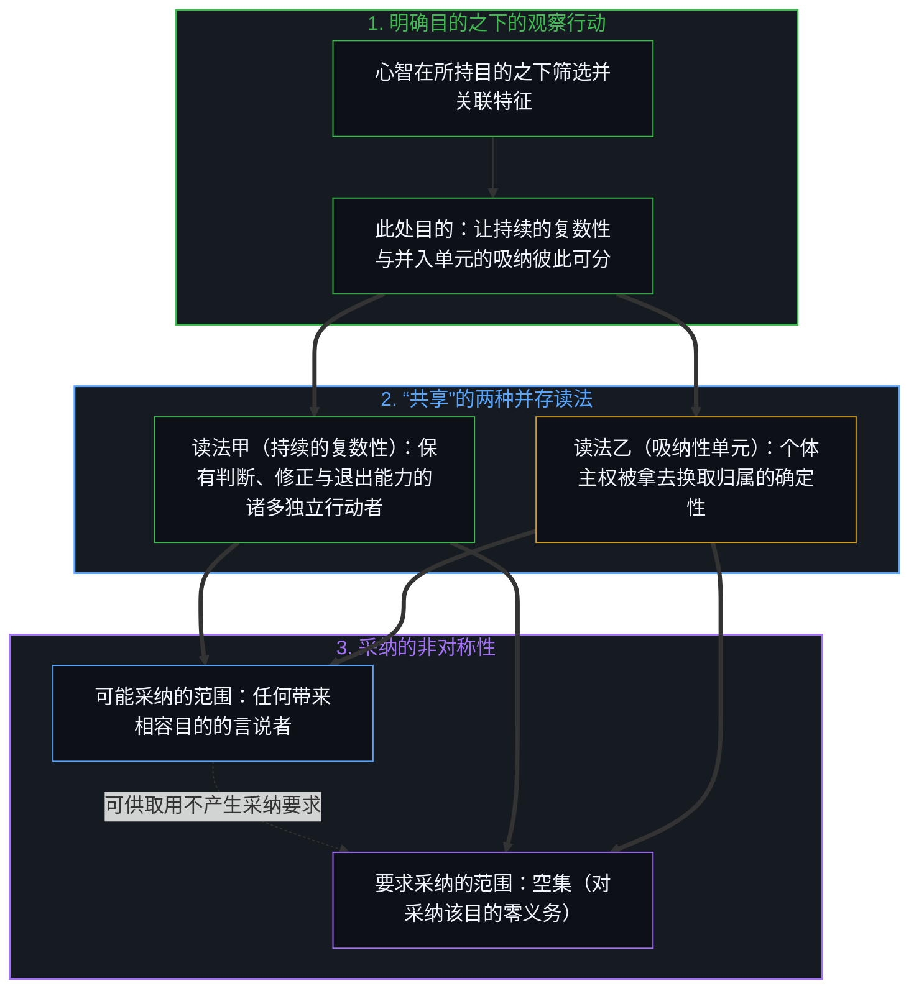
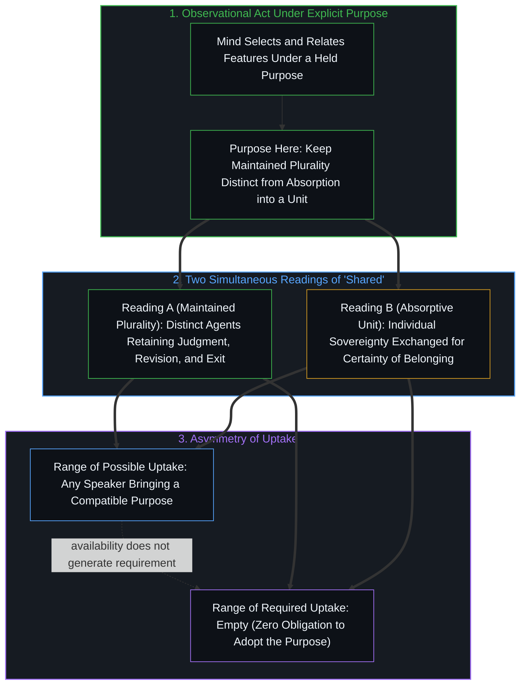
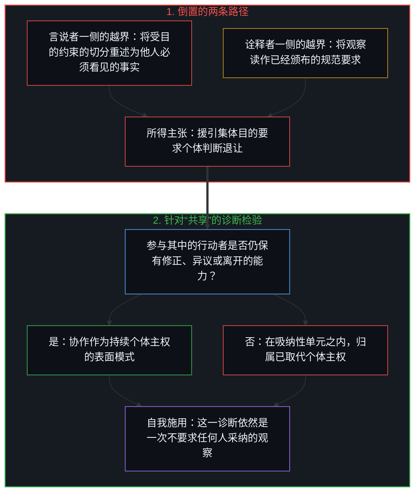
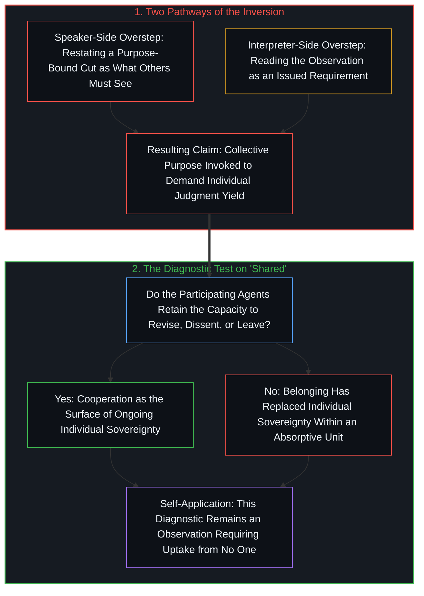

# “共享”的两种读法与观察的边界 / The Two Readings of Shared and the Observational Bound

*只要行动者仍能修正、异议或离开，协作便始终是主权的表面模式，而记下这一点的观察不要求任何人采纳。 / Cooperation stays the surface of sovereignty while agents can still revise, dissent, or leave, and the observation that notes this requires uptake from no one.*

自我区分的活动发生着——无因，不息。称之为心智：观察者早已在途，它的每一个行动都是一次区分。“共享”一词同时承载着两种并存的读法。在一种读法中，共享的人性是指诸多独特个体持续在场，他们依然行使判断与能动性，依然保有修正或退出的能力。在另一种读法中，同一个短语所指称的却是一个单元：在其中，个体主权早已被拿去换取归属的确定性。一位观察者若以让这一区分保持可见为目的，便可以把两种读法一并登记下来。无论哪一种读法，都不因被登记这一事实，就决定其他任何言说者必须得出什么结论、采取什么行动。

Self-distinguishing activity occurs — uncaused, unceasing. Call it the Mind: the observer already underway, every act of which is a distinction. The word “shared” carries two readings that remain available at once. In one, a shared humanity is the maintained presence of distinct individuals who continue to exercise judgment, agency, and the capacity to revise or withdraw. In the other, the same phrase names a unit in which individual sovereignty has already been exchanged for the certainty of belonging. Both readings can be registered by an observer who holds the purpose of keeping the distinction visible. Neither reading, by the fact of being registered, settles what any other speaker must conclude or do.

## 一、 协作是持续主权的表面模式 / 1. Cooperation as the Surface of Ongoing Sovereignty

在同一目的之下，人类的协作呈现为个体共同行使主权时所产生的表面模式——无论是[共同的人性从不共享](../shared-humanity-is-never-shared/)所追溯的事后交叠，还是[价格是言说，理解是交易](../price-as-utterance-understanding-as-trade/)中的互惠交换。市场、科学工作、契约性结社以及有限制度都可以这样来描述：协调之所以发生，是因为行动者依然能够决定、修正与退出。这一描述记录了当相关区分被保持在视野中时可以观察到的一种模式。它并不把这一模式变成一种独立的价值，仿佛必须脱离产生它的行动者，单独加以肯定或否定。

Human cooperation appears, under the same purpose, as the surface pattern produced when individuals exercise sovereignty together—whether in the retrospective overlap traced in [Shared Humanity Is Never Shared](../shared-humanity-is-never-shared/) or in the reciprocal exchange of [Price as Utterance, Understanding as Trade](../price-as-utterance-understanding-as-trade/). Markets, scientific work, contractual associations, and limited institutions can be described this way: coordination occurs because agents retain the ability to decide, correct, and exit. The description records a pattern that is observable when the relevant distinction is held in view. It does not convert the pattern into a separate value that must be affirmed or rejected independently of the agents who produce it.

## 二、 目的边界与要求采纳的空集 / 2. The Purpose Bound and the Empty Range of Required Uptake

一次观察，是观察者依其所持目的筛选并关联特征的行动。它始终受这一目的约束，正如[依其自身标准的观察](../an-observation-by-its-own-standard/)中一项发现仅在其自身标准下成立一样。对“共享”的双重读法，以及将协作描述为持续个体主权的表面模式，都留在这道边界之内。任何觉得这一区分有用的言说者都可以取用它；然而可供取用并不产生必须采纳这一区分的要求。可能的采纳有多宽，就看有多少言说者可能带着相容的目的而来；他们相会于[共享意识是个体性的交集](../shared-consciousness-is-intersecting-individualities/)所描绘的交集。要求采纳的范围则是空集。

An observation is the act of an observer who selects and relates features according to a purpose that observer holds. It remains bounded by that purpose, as a finding holds only under its own standard in [An Observation by Its Own Standard](../an-observation-by-its-own-standard/). The dual reading of “shared,” and the description of cooperation as the surface of ongoing individual sovereignty, stay within that bound. They are available to any speaker who finds a use for the same distinction; availability does not generate a requirement that the distinction be adopted. The range of possible uptake is as wide as the set of speakers who might bring a compatible purpose, meeting at the intersection described in [Shared Consciousness Is Intersecting Individualities](../shared-consciousness-is-intersecting-individualities/). The range of required uptake is empty.

## 三、 从观察到权威要求的倒置 / 3. The Inversion from Observation to Authoritative Requirement

当这一观察被重述为关于“他人必须看见什么或将什么奉为权威”的主张时，倒置便发生了——它抹去了观察者的目的，跨过了[框架的边界](../the-boundary-of-the-frame/)，踏入[阳台视角的规训僭越与不可代理的未竟之行](../the-balcony-disciplinary-overstep-and-the-unproxyable-act/)所剖析的第三人称强制。这一重述既可以来自原初的言说者——暗中附加一项要求，把不同意当作未能认出该模式的失误；也可以来自后来的诠释者——把这句话当成一纸已经开出的处方，要求制度变革或道德对齐。无论哪一种情形，这一步都离开了观察语域。对话随即从审视“这一模式可以如何描述”，滑向强加或抗拒“必须将该模式奉为决定性标准”的要求。

The inversion occurs when the observation is restated as a claim about what others must see or treat as authoritative—crossing [The Boundary of the Frame](../the-boundary-of-the-frame/) by dropping the observer's purpose and stepping into the third-person enforcement of [The Balcony Disciplinary Overstep and the Unproxyable Act](../the-balcony-disciplinary-overstep-and-the-unproxyable-act/). The restatement can be supplied by the original speaker, who adds an implicit demand that disagreement constitutes failure to recognize the pattern. It can be supplied by a later interpreter, who takes the remark as an already-issued prescription for institutional change or moral alignment. In either case the move leaves the observational register. The conversation then shifts from examining how the pattern can be described to enforcing or resisting a requirement that the pattern be treated as decisive.

## 四、 修正、异议或退出的能力 / 4. The Capacity to Revise, Dissent, or Leave

一旦倒置就位，关于共享人性或集体目的的语言，便既可以用来描述一个仍由判断着的行动者所构成的复数群体，也可以用来为“个体判断应当退让”的主张背书。这两种用法依然可以通过“视野中的行动者是否继续持有修正、异议或退出的能力”来加以区分——即[正交的拒绝](../the-orthogonal-refusal/)与[剩余个人主义](../residual-individualism/)所追溯的那根活的抉择杠杆。有了这一能力，协作才始终是主权的表面模式，而不是主权的替代品。观察记下了这一条件。若一位言说者尚未自己选定那个让这一条件变得相干的目的，观察并不为其规定结果。

Once the inversion is in place, the language of shared humanity or collective purpose can be used either to describe a plurality that remains composed of judging agents or to underwrite a claim that individual judgment should yield. The two uses remain distinguishable by whether the agents in view continue to hold the capacity to revise, dissent, or leave—the live choosing lever traced in [The Orthogonal Refusal](../the-orthogonal-refusal/) and [Residual Individualism](../residual-individualism/). That capacity is the condition under which cooperation stays the surface of sovereignty rather than its replacement. The observation notes the condition. It does not prescribe the outcome for any speaker who has not already chosen the purpose that makes the condition relevant.

