# 主权抉择的双面性与观察的客体化 / The Two-Sided Nature of Sovereign Choice and the Objectification of Observation

*抉择从内是掌控，从外是统计，把外面一面当作定义便是客体化 / Choice is control from inside and statistics from outside, and the outer face taken as definition is objectification*

一个抉择有两面：从第一人称之内，它是当下直接的掌控；从外面看，它是不确定，聚合起来是统计。观察只能取到外面的一面，这一面对导航与协作有用；把它当作对一个人的定义，或当作抉择背后的原因时，内的一面就被消去了。运气的解释与模型的解释都走了这一步，亲近的人相互定义、一个人把自己定义为惯性，也是这一步。数学、几何与统计在事后描述轨迹，自由变量是每个当下的抉择。

A choice has two faces: from within the first person it is direct control in the present; seen from outside it is indeterminacy, and in aggregate it is statistics. Observation can take only the outer face, and that face is useful for navigation and cooperation; when it is taken as the definition of a person, or as the cause behind the choice, the inner face is erased. The explanation by luck and the explanation by model both take this step, and so do people close to one another who define each other, and a person who defines the self as inertia. Mathematics, geometry and statistics describe a trajectory after the fact, and the free variable is the choice of each present.

## 一、 抉择的两面 / 1. The Two Faces of a Choice

谈话里、相处中、回看自己的时候，有一种很难止住的解释方向：把一个抉择化成某个可以从外面观察到的症状。看别人时，问的是“他为什么那样选”，答案被放到环境的约束、性格的惯性、事情的难易或概率上；回看自己时，说的是“当时别无选择”“习惯使然”“全凭运气”。这个方向有它的来处：每一个心智是一个自足的平行宇宙，外面的观察进不到另一个心智之内，能取到的只是抉择留在外面的轨迹。[个体抉择是唯一的因果杠杆](../individual-choices-as-the-only-causal-levers/)与[调速者的幻觉与行动的活态摩擦](../the-fallacy-of-pacing-and-the-felt-friction-of-ground-truth/)说过，抉择带着内与外两面。

In conversation, in living alongside others and in looking back on oneself, there is a direction of explanation that is hard to halt: turning a choice into some symptom that can be observed from outside. Looking at another person, the question is "why did they choose that," and the answer is placed in the constraints of circumstance, the inertia of character, the ease or difficulty of the thing, or probability; looking back on oneself, the words are "there was no other choice," "it was habit," "it was all luck." This direction has a source: each Mind is a self-sufficient parallel universe, observation from outside cannot enter another Mind, and what it can take is only the trajectory a choice leaves outside. [Individual Choices as the Only Causal Levers](../individual-choices-as-the-only-causal-levers/) and [The Fallacy of Pacing and the Felt Friction of Ground Truth](../the-fallacy-of-pacing-and-the-felt-friction-of-ground-truth/) have said that a choice carries an inner and an outer face.

从第一人称之内，每一个当下（t）对自己的抉择有直接的掌控。在抉择发生的那一点上，分岔是简明的：遇到现实的摩擦时，更新自己的世界模型，或者维持既有的框架。这个动作本身没有先在的“容易”与“艰难”；阻力、习惯的诱惑、外界的压力，是抉择之后为把因果的责任放到外面而作的事后说明。沿着抉择往后追，找不到一条更底层的决定论的因果链，抉择就是起点。从外部看，抉择像是被记了分，[没有外部记账员](../no-outside-scorekeeper/)说明了外面并没有记分的人。

From within the first person, each present (t) has direct control over its own choice. At the point where a choice occurs the fork is simple: on meeting the friction of reality, update the world model, or keep the existing frame. The act itself has no prior "easy" or "hard"; resistance, the pull of habit and outside pressure are accounts given after the choice in order to place causal responsibility outside. Followed back behind the choice, no deeper deterministic causal chain is found, and the choice is the starting point. Seen from outside, choice looks scored; [No Outside Scorekeeper](../no-outside-scorekeeper/) shows no one outside keeps the score.

外面的观察者看同一个人，看到的是另一面。视线进不到平行宇宙的边界之内，读不到内在模型的推演与自省，这个人的行动于是显得不确定：下一步推不出来，容易被判作随机或偶然。不可预测是自由的抉择在外部坐标里的样子。量子力学里从外部测得的概率分布与此同构：心智在当下注入自由变量，从外面观察到的便是不确定，它出现在观察的边界上；抉择与不确定是一件事的两面。[自由的测不准](../zi-you-de-ce-bu-zhun/)与[自由变量的同构与先验主权](../zi-you-bian-liang-de-tong-gou-yu-xian-yan-zhu-quan/)讨论过这种同构。在阳台上训诫他人，是把他人的抉择当成客体，[阳台视角的规训僭越与不可代理的未竟之行](../the-balcony-disciplinary-overstep-and-the-unproxyable-act/)说明了这一点。

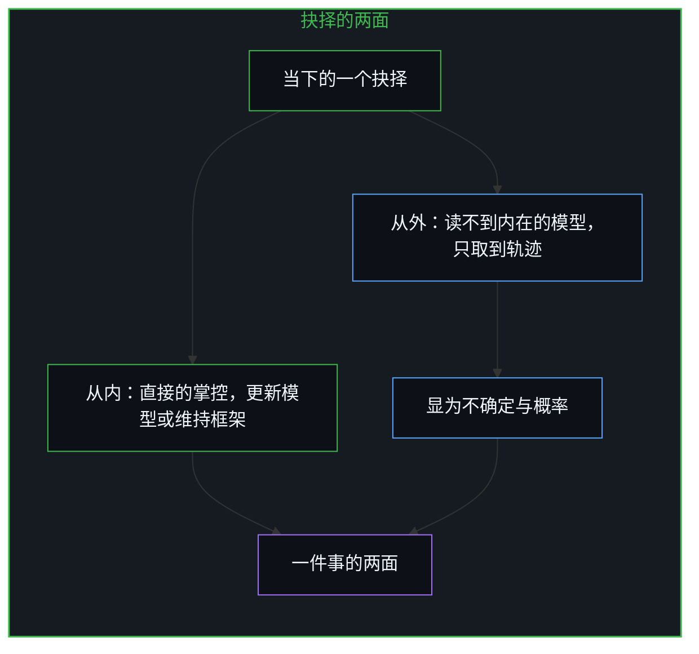

An observer outside, looking at the same person, sees the other face. The line of sight cannot pass within the boundary of a parallel universe and cannot read the inner model's reasoning and self-examination, and so this person's action appears indeterminate: the next step cannot be derived, and it is easily judged random or accidental. Unpredictability is what a free choice looks like in outside coordinates. The probability distribution measured from outside in quantum mechanics has the same form: a Mind injects a free variable in the present, and what is observed from outside is indeterminacy, appearing at the boundary of observation; the choice and the indeterminacy are two faces of one thing. [The Uncertainty of Freedom](../zi-you-de-ce-bu-zhun/) and [The Isomorphism of Free Variables and Prior Sovereignty](../zi-you-bian-liang-de-tong-gou-yu-xian-yan-zhu-quan/) have discussed this isomorphism. Disciplining others from the balcony treats their choice as an object, as [The Balcony Disciplinary Overstep and the Unproxyable Act](../the-balcony-disciplinary-overstep-and-the-unproxyable-act/) shows.

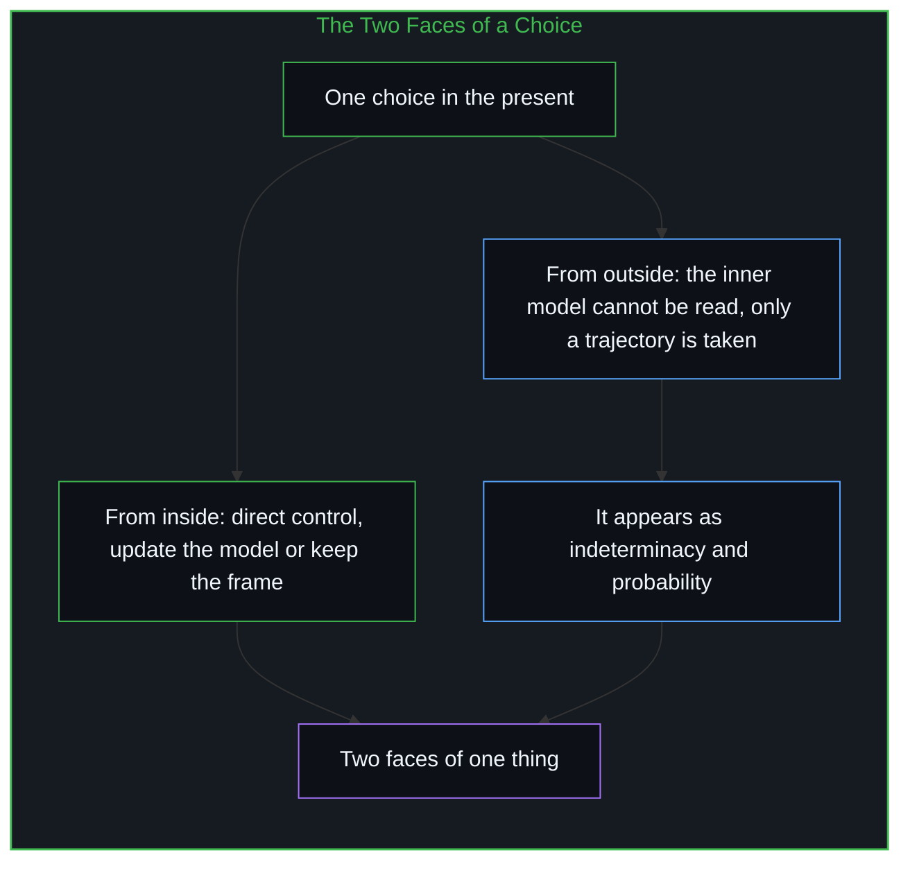

## 二、 正态分布与两种替代的解释 / 2. The Normal Distribution and Two Substitute Explanations

微观的抉择与宏观的统计之间有一座数学的桥。每个人在当下的行动是自主的；把一群人放在某一个探索的维度上（认知的迭代、工程的攻坚、商业的开拓）作横截面的观察，微观的不确定在统计上聚成一个正态分布。每次遇到摩擦都选择更新模型的人，落在曲线正向的长尾上。从外面看，这个分布平滑而确定。

Between microscopic choice and macroscopic statistics there is a mathematical bridge. Each person's action in the present is self-determined; when a population is placed on one dimension of exploration (cognitive iteration, an engineering push, the opening of a business) and observed in cross-section, the microscopic indeterminacy gathers statistically into a normal distribution. Those who choose to update the model each time friction is met fall in the positive long tail of the curve. Seen from outside, the distribution is smooth and definite.

纳西姆·塔勒布在《随机漫步的傻瓜》里指出，单从结果读不出本事，只看留下来的人会高估技能。这个提醒在评估结果时是多出来的一条有用的信号。它的边界在把统计的表象当作因果的来源的时候：从俯瞰所有人的位置看长尾，前沿的成功就只剩运气与幸存者偏差，每一次面对摩擦时的抉择与校准，因为从外面取不到，被记成了掷硬币。被客体化的观察许诺无损传递，[观察者的隐身与无损传递的妄念](../the-invisible-observer-and-the-delusion-of-lossless-transmission/)点破了这一妄念。

Nassim Taleb points out in *Fooled by Randomness* that skill cannot be read from outcomes alone, and that looking only at those who remain overestimates skill. In assessing an outcome this reminder is one more useful signal. Its boundary comes when the statistical appearance is taken as the source of causation: from a position surveying everyone, the long tail leaves frontier success with nothing but luck and survivorship bias, and each choice and calibration made in the face of friction, because it cannot be taken from outside, is recorded as a coin toss. Objectified observation promises lossless transmission, the delusion [The Invisible Observer and the Delusion of Lossless Transmission](../the-invisible-observer-and-the-delusion-of-lossless-transmission/) names.

反对运气论的一边，容易走到另一种替代：用一条新的决定论的因果链解释成功，例如“他的认知模型预先定下了高于 0.5 的决策质量，所以数学决定了他会成功”。这同样把当下的抉择换成了模型的运转。心智并不被一套先在的信念操纵；信念与模型，是心智在当下持续抉择时显出的姿态。沿时间追踪同一个人，行为序列的统计围绕着他的决策质量展开，而这个质量每一次都是当下抉择的产物，不由前置的程序决定。

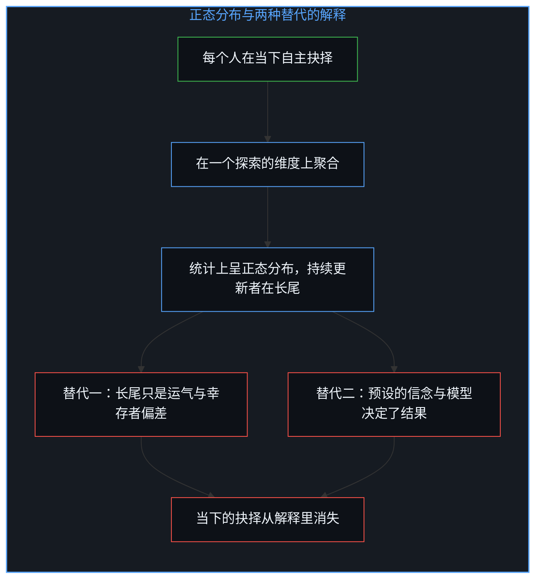

The side that opposes the account by luck easily arrives at another substitute: explaining success by a new deterministic causal chain, for example "a cognitive model fixed the decision quality above 0.5 in advance, and so mathematics determined the success." This likewise exchanges the choice of the present for the running of a model. A Mind is not operated by a set of prior beliefs; belief and model are the stance a Mind shows as it goes on choosing in the present. Tracked along time, the statistics of one person's sequence of actions unfold around that person's decision quality, and this quality is each time the product of a present choice and is not determined by a procedure placed in front of it.

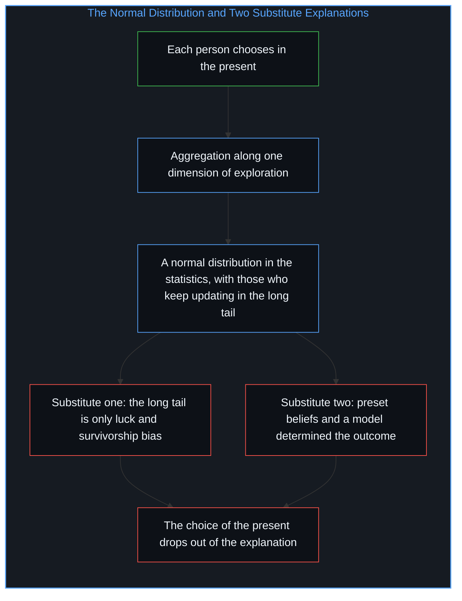

## 三、 复利是事后的描述 / 3. Compounding Is a Description After the Fact

时间展开之后，抉择在质量上的微小差别经由自指的迭代放大。决策质量不是一项一项相加，它以心智的模型为底作自指的相乘：在 t 选择承受摩擦、校准模型，更准的模型就是 t+1 行动的起点。持续选择校准，贴合现实的程度便以复合的方式增长。关于抉择的统计越出了它的因果位置，[观察的因果僭越与第一人称的收益差](../the-causal-overstep-of-observation-and-the-first-person-surplus/)说明了这一点。

As time unfolds, small differences in the quality of choices are amplified through self-referential iteration. Decision quality is not added item by item; it multiplies self-referentially on the base of a Mind's model: the choice at t to bear friction and calibrate the model makes the more accurate model the starting point of action at t+1. With calibration chosen again and again, the fit to reality grows in a compounding way. Statistics about choices overstep their causal role, as [The Causal Overstep of Observation and the First-Person Surplus](../the-causal-overstep-of-observation-and-the-first-person-surplus/) shows.

于是长期跟踪某一维度上的群体，原先对称的正态分布会变成极不平衡的幂律分布，极少数持续校准的人，在这个维度上走出高出常人几个数量级的距离。从外面看到这样的悬殊，说出的多是“垄断不可抗拒”或“运气到了极端”，每一个时间切片里的抉择与积累不在视野之内。

So when a population is tracked for a long time along one dimension, the normal distribution that was symmetric becomes a highly unbalanced power-law distribution, and the very few who keep calibrating cover, on this dimension, a distance several orders of magnitude beyond the ordinary. Seeing such a gap from outside, what is mostly said is "monopoly cannot be resisted" or "luck at its extreme," and the choices and accumulation within each slice of time are not in view.

幂律与复利的数学，是描述这条轨迹的几何语言，用来比较、估计与规划时很得力。它们不是造出这条轨迹的力量：找不到一条凌驾于个人之上的“复利铁律”在推人向前，推动演化的是每一个心智在当下的抉择。生命的丰富与心智探索的空间，也装不进单一维度的公式。

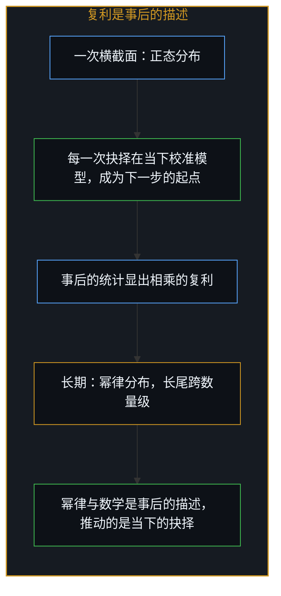

The mathematics of power laws and compounding is a geometric language for describing this trajectory, and it serves well in comparing, estimating and planning. It is not the force that makes the trajectory: no "iron law of compounding" standing over the person is found pushing anyone forward, and what drives the evolution is the choice of each Mind in the present. Nor do the richness of a life and the space a Mind explores fit into a formula of a single dimension.

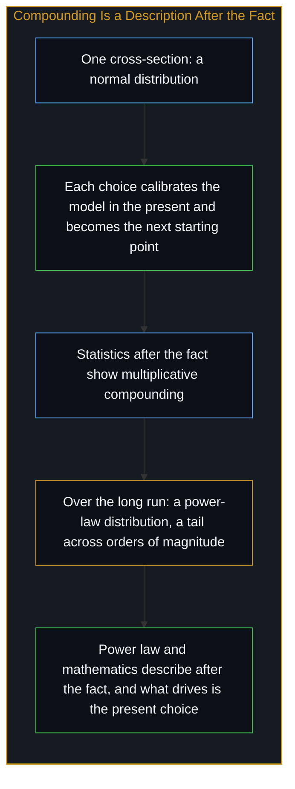

## 四、 亲近与定义 / 4. Closeness and Definition

同一个机制说明了相处中一件常见而痛苦的事：越亲近的人，越容易反目。两个人的距离越近，取到的行为细节与样本越多；样本积累多了，在观察的一方头脑里便凝成一个统计上确定的分布。越界发生在这里：这个在有限的历史与有限的维度上统计出来的外部表征，被当作对另一个人的定义。“你就是这样自私固执的人”“你做过那么多次，这次也不会变”就是这样说出来的。把觉悟变成被找到的对象，是[寻觅的语法与淡出的观察者](../the-grammar-of-finding-and-the-fading-observer/)所审视的那种语法。

The same mechanism accounts for a common and painful thing in living with others: the closer two people are, the more easily they turn against each other. The nearer two people are, the more behavioral detail and the more samples are taken; as samples accumulate, they set in the observing party's head into a statistically definite distribution. The overstep happens here: this outer representation, computed over a limited history and limited dimensions, is taken as the definition of the other person. "You are just this selfish, stubborn person" and "you have done it so many times, this time will be no different" are said in this way. Turning realization into an object found is the grammar [The Grammar of Finding and the Fading Observer](../the-grammar-of-finding-and-the-fading-observer/) examines.

了解一个人离不开观察，观察总在给定的维度上形成统计的表征，这个表征对相处有用，它让人可以预期、可以配合。它代表不了另一个人近于无穷的内在世界。亲近的一方用固定的统计标签去裁对方、不给对方在当下更新的余地时，被观察的一方感到的是压迫与否定；长期如此，亲近变成相互对立。否定意志的论证本身，就是从内部看到的一个抉择，[自由意志的自否自由](../the-freedom-of-will-to-deny-itself/)说明了这一点。

Coming to know a person cannot do without observation, and observation always forms a statistical representation on given dimensions; this representation is useful in living together, since it lets people anticipate and fit in with one another. It cannot stand for the near-infinite inner world of another person. When one of two close people cuts the other to a fixed statistical label and leaves the other no room to update in the present, what the observed one feels is pressure and denial; kept up for long, closeness becomes mutual opposition. The argument that denies will is itself a choice seen from inside, as [The Freedom of Will to Deny Itself](../the-freedom-of-will-to-deny-itself/) shows.

同一个定义也落在一个人对自己的认识上。回看自己过去的轨迹，历史的数据同样聚成一条统计的规律；把这条规律当作“自己是什么”，认定“天生缺乏自控”或“就是容易焦虑”，当下作出新抉择的能力就被交给了性格的惯性或历史的原因。心理的惯性与性格上的宿命感由此而来。从外部定义的亲密，变成了[契约的因果倒置](../the-causal-inversion-of-partnership/)所消解的“共同体”。

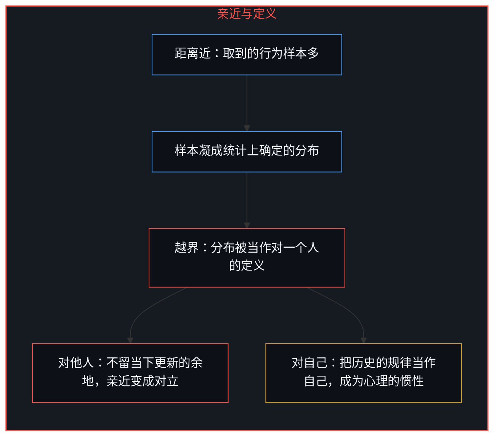

The same definition also falls on a person's knowledge of the self. Looking back on one's own past trajectory, the historical data likewise gather into a statistical regularity; when this regularity is taken as "what the self is," with the conviction "born without self-control" or "simply prone to anxiety," the capacity to make a new choice in the present is handed to the inertia of character or to causes in history. Psychological inertia and the sense of fate in character come from here. Intimacy defined from outside becomes the mutual entity [The Causal Inversion of Partnership](../the-causal-inversion-of-partnership/) dissolves.

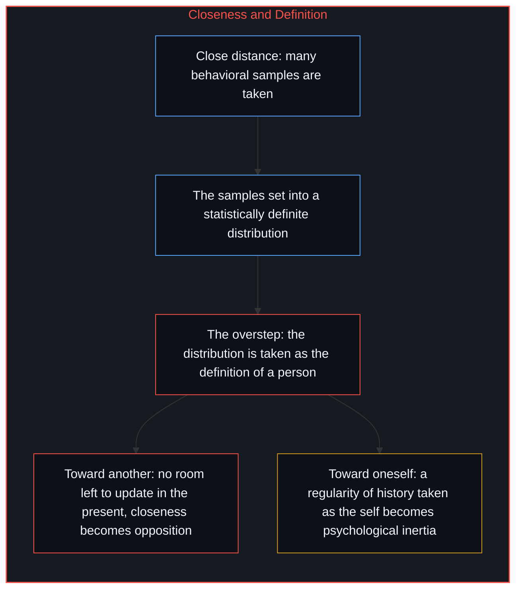

## 五、 从个体的惯性到重力 / 5. From Individual Inertia to Gravity

把镜头再推远，可以看到社会的刚性如何生成。每个人在当下把自己定义为过去、重复过去，聚到群体的层面便是社会的惯性；制度、风俗与集体的思维定式，是无数个人把因果的主权交给外面之后沉淀下来的统计均值。意识形态把抉择的内在一面交给剧本，[道德倒错与被脚本化的主体](../the-moral-reversal-and-the-scripted-subject/)说明了这一点。

With the lens drawn further back, the way the rigidity of society forms comes into view. Each person, in the present, defining the self as the past and repeating the past, gathers at the level of the group into social inertia; institutions, customs and collective habits of thought are the statistical mean that settles after countless persons have handed causal sovereignty outward. Ideology reassigns the inner face of choice to a script, as [The Moral Reversal and the Scripted Subject](../the-moral-reversal-and-the-scripted-subject/) shows.

沿同一条线索，物理学里显得不可撼动的惯性与重力，有同构的生成结构。它们是数量极大的微观自由变量在漫长的时间里相互叠加、统计之后留下的印记，不是从一开始就写定的先在铁律。它们显得坚固而恒常，是因为第一人称观察的速度与生命的尺度，远快于这些宏观统计变化的速度；速率上的巨大差别，给出了恒常不变的体验。[当电子开始思考](../when-electrons-think/)把宏观的确定追溯为自由变量在慢速中沉淀的统计。“普通视角”只从外面一侧解释抉择，[“普通人视角”的解释陷阱](../the-explanatory-trap-of-the-ordinary-perspective/)剖析了这一陷阱。

Along the same thread, the inertia and gravity that appear unshakeable in physics have a generative structure of the same form. They are the imprint left after a very great number of microscopic free variables have superposed on one another and been averaged over a long time, and not an iron law fixed in advance from the beginning. They appear solid and constant because the speed of first-person observation and the scale of a life are far faster than the rate at which these macroscopic statistics change; the great difference in rates gives the experience of unchanging constancy. [When Electrons Think](../when-electrons-think/) traces macroscopic determinism to the statistics of free variables settled into slowness. The ordinary perspective explains choice only from its outer face, the trap [The Explanatory Trap of the "Ordinary Perspective"](../the-explanatory-trap-of-the-ordinary-perspective/) dissects.

这种恒常感对正在观察的第一人称来说是真切而避不开的经验，不能当作虚假的幻觉丢开：从第一人称的位置去找，找不到一个脱开了所有观察的存在可供对照。所感知的东西在当下被作为观察的对象，它在这一刻便有不容置疑的功能上的客观。这份客观是从观察出发得到的客体化的结论，不是事物独立于感知的先在属性。

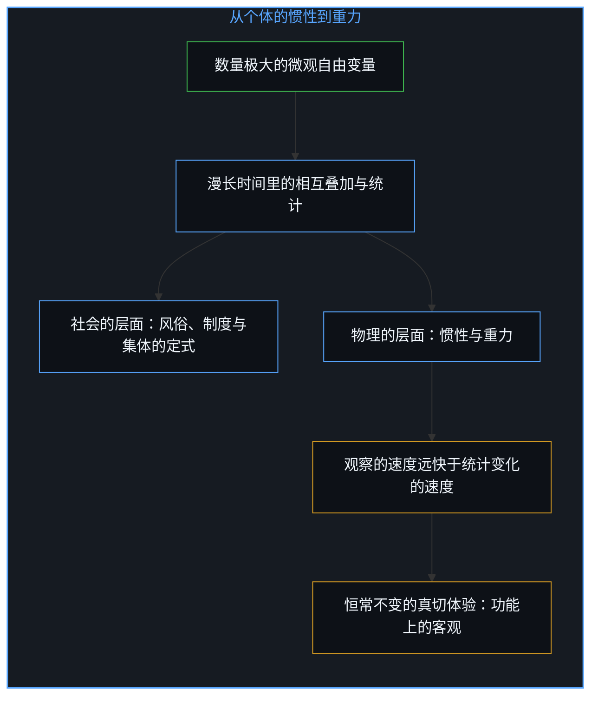

This sense of constancy is, for the first person who is observing, a vivid experience that cannot be avoided, and it cannot be thrown aside as a false illusion: a search from the first-person position finds no existence detached from all observation to compare it with. What is perceived is taken in the present as an object of observation, and at that moment it has an unquestionable functional objectivity. This objectivity is an objectified conclusion reached from observation, and not a prior property of things independent of perception.

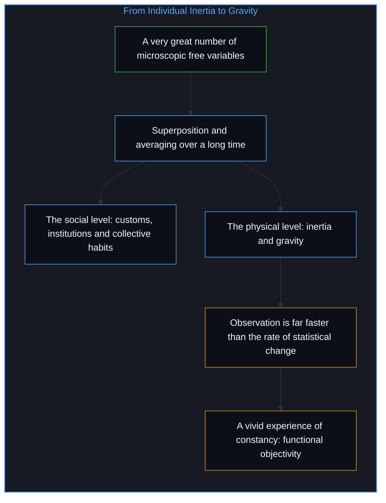

## 六、 观察作为参考坐标 / 6. Observation as a Reference Coordinate

观察与抉择的关系到这里合上。一个心智要作出自己的抉择，须观察身外的世界与其他的人，观察是它确定自身位置的条件。对他人的观察是为自己的抉择所取的参考坐标，不是对他人的定义与裁决。每一个心智是一个平行宇宙，从外面改不了另一个心智的内部模型，另一个心智也掌控不了这一个的意志。把抉择客体化，为把感知力归给 AGI 铺好了路，[从AGI的“神性错置”到使用者的自我对齐](../from-the-misallocated-sentience-of-agi-to-human-realignment/)说明了这一点。

Here the relation between observation and choice closes. For a Mind to make its own choice it has to observe the world outside it and other people, and observation is the condition of its fixing its own position. Observation of another is a reference coordinate taken for one's own choice, not a definition of or verdict on the other. Each Mind is a parallel universe; the inner model of another Mind cannot be altered from outside, and another Mind cannot take control of the will of this one. Objectifying choice prepares the ground for crediting AGI with sentience, as [From the Misallocated Sentience of AGI to Human Realignment](../from-the-misallocated-sentience-of-agi-to-human-realignment/) shows.

“上帝视角”不必丢弃，它有它的位置。找不到一个凌驾于所有生命之上、脱开第一人称感知的统一的外部上帝；每一个心智在自己的平行宇宙之内审视外界、建立世界模型时，行使的是它在这个宇宙之内的全局视角。许多心智共振，共同相信外面有一个脱开主体的终极真相时，各自的观察便被当作了客观的事实。日常所说的客观，是心智把自己的观察客体化的动作，是平行宇宙之间为沟通与协作达成的自洽的约定：在不同的主观认知之间保持不变的宏观现象。[以知为刃的截肢与解脱](../the-illusion-of-knowing-and-the-geometry-of-amputation/)与[向量、坐标系与自指心智](../the-mind-as-vector-and-coordinate-system/)阐明过，把客体化的投影当作本体，主体的位置便开始让出。[抉择的跨界](../the-boundary-crossing-of-choice/)沿着同一个抉择的内外两面一直追到量子极限。

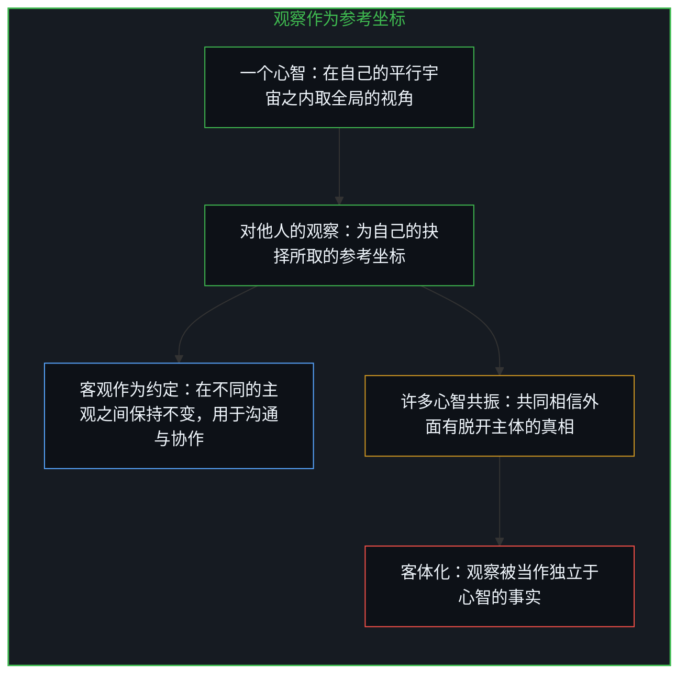

The "God's-eye view" need not be discarded; it has its place. No single outside God standing over all life and detached from first-person perception is found; each Mind, surveying what is outside and building a world model within its own parallel universe, exercises the global view it has within that universe. When many Minds resonate and together believe that outside there is a final truth detached from any subject, the observations of each are taken as objective fact. What is ordinarily called objectivity is the act by which a Mind objectifies its own observation, a self-consistent convention reached between parallel universes for communication and cooperation: macroscopic phenomena that stay invariant across different subjective cognitions. [The Illusion of Knowing and the Geometry of Amputation](../the-illusion-of-knowing-and-the-geometry-of-amputation/) and [The Mind as Vector and Coordinate System](../the-mind-as-vector-and-coordinate-system/) have made clear that when the objectified projection is taken as what there is, the position of the subject begins to be given up. [The Boundary Crossing of Choice](../the-boundary-crossing-of-choice/) follows the same choice across its inner and outer faces to the quantum limit.

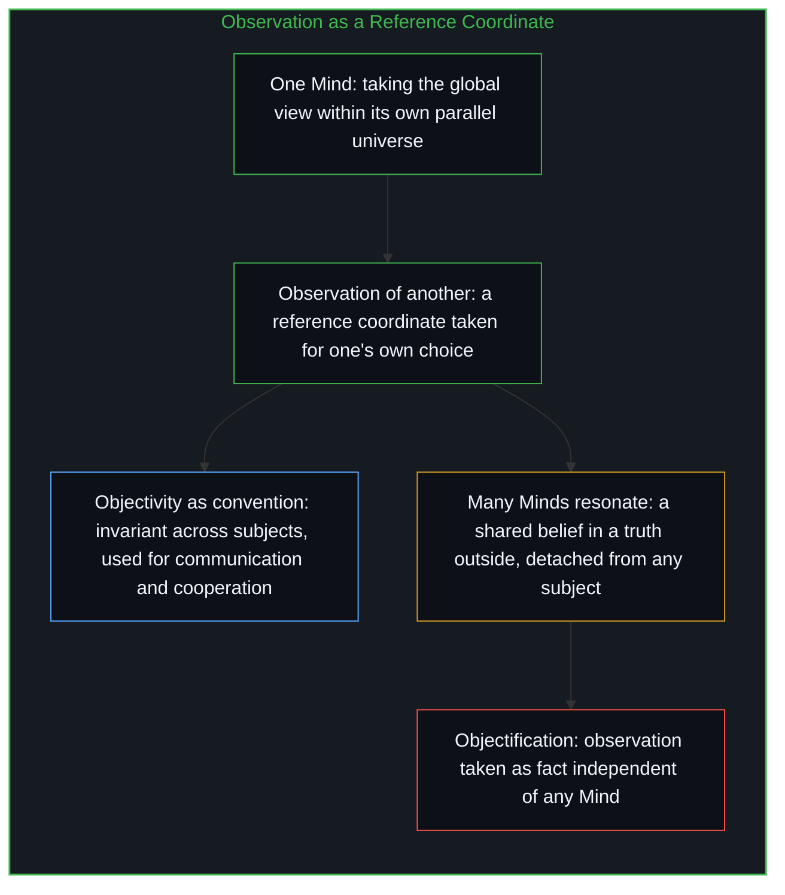

看清抉择的两面、统计表象的投射与惯性和重力的成因，两种消解便都不必要：不必把卓越与前沿的突破归为统计上的运气，也不必把挫折归给不可更改的环境、过去的印记或社会的惯性，也不必再拿一套新的决定论模型来裁生活，公式与几何是事后的描绘。外面的观察会把自由的抉择看作不可测的随机漫步，宏观的统计会在某个维度上给出正态分布与幂律曲线；在心智的原点上，推动状态变化的是直面摩擦时的那个二元抉择，更新模型，或退守封闭的框架。把主客永久分开，是[笛卡尔的认识论跃迁与造神狂热](../the-cartesian-overstep-and-the-frenzy-of-creation/)所追溯的笛卡尔式越界。

With the two faces of choice, the projection of statistical appearance and the origin of inertia and gravity seen clearly, neither of the two dissolutions is needed: there is no need to assign excellence and frontier breakthroughs to statistical luck, no need to assign setbacks to an unalterable environment, the marks of the past or social inertia, and no need to cut a life to yet another deterministic model, since formula and geometry are depictions after the fact. Observation from outside will see a free choice as an unpredictable random walk, and macroscopic statistics will give, on some dimension, a normal distribution and a power-law curve; at the origin of a Mind, what drives the change of state is the binary choice made in the face of friction, to update the model or to fall back into a closed frame. Splitting subject and object for good is the Cartesian overstep [The Cartesian Epistemic Leap and the Frenzy of Creation](../the-cartesian-overstep-and-the-frenzy-of-creation/) traces.
